# 【全集-附课程讲义】密歇根大学-人工智能编程-EECS492-中英字幕-p42-Lecture-42---拉格朗日乘数优化：不等式约束--BV14JqfBNEAS_p42-

In the second part of section 6。23。We study optimization problems with inequality constraints。

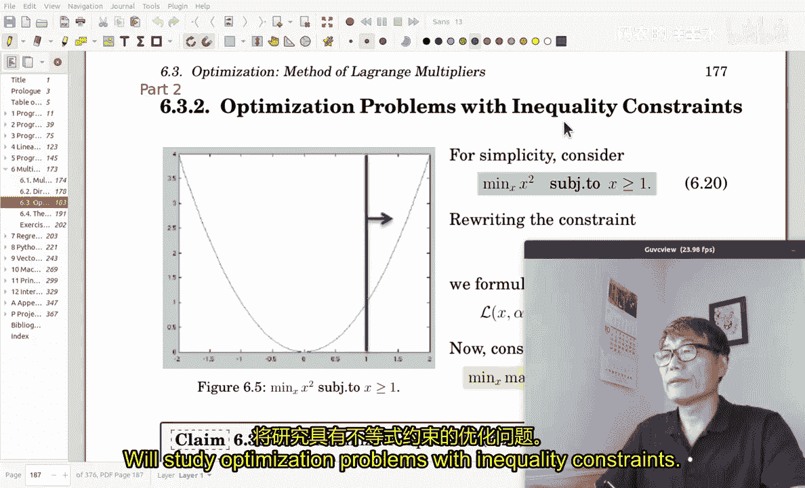

For simplicity， consider there a minimization problem。In the imagination of xos square。

 now we choose f of x as exos square subject to x is larger than or equal to 1。In this figure。

 the curvi is y equal Xosscale。And we try to find the minimum。When x is larger than or equal to1。

Apparently， this varies the minimum value。So啊。Okay， by using F notation。The opt value is one。

 when x is 1。So we know the answer。 Now， we'll try to solve the problem using。Optimization theory。

 First， we rewrite the constraint in this form and formulate。The Laguangian。And F of x。

Minus alpha times x -1。And we consider this miniax problem of the lag engine， subject to。

Now the 라グ 멀pl。Its non negative。

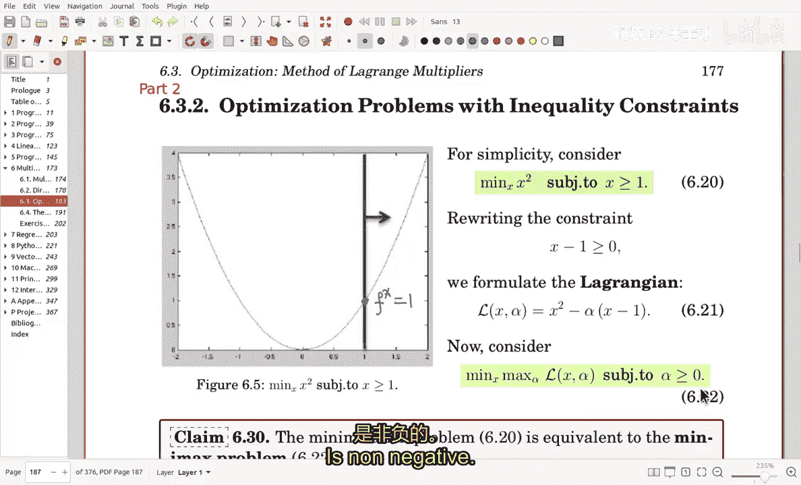

Then we have here。A claim。The original minimization problem。That one。

Is equivalent to the miniax problem。

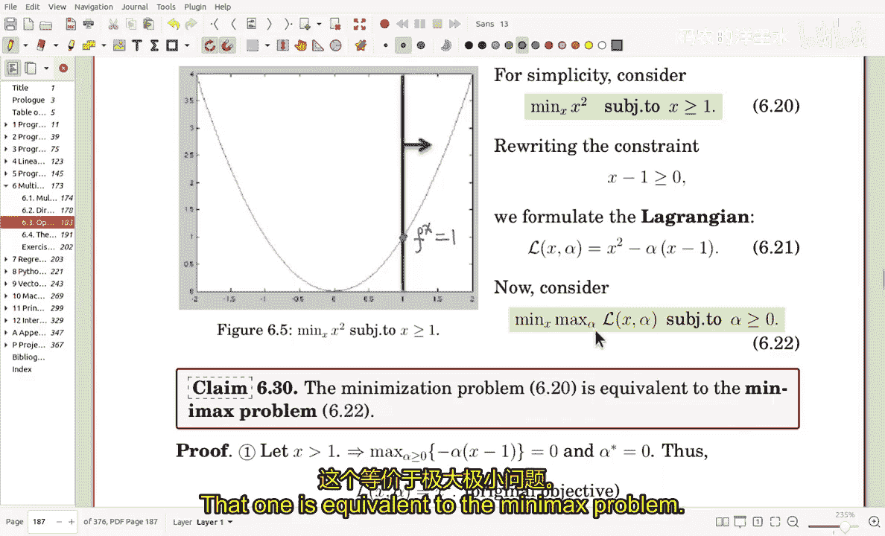

We'll she first some detailed proof and later。Withqueched format proof。Ren。

X is strictlyly larger than one。 Then this portion。

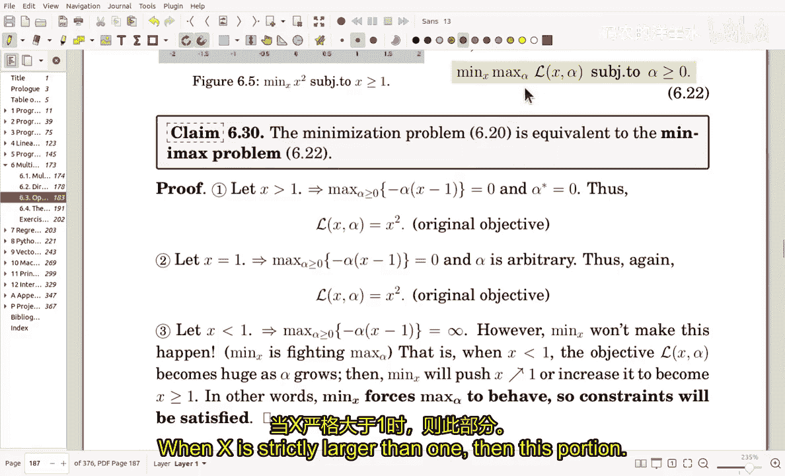

Okay， that portion。And along with。The extra term， because X is not being touched so that。Yeah。

 we crunchched this portion。Then， maximum。Over alpha non negative when x is strictly larger than one。

 This portion is positive。 There is non negative and。With this negation， this is always a negative。

In fact。Non part。 So the maximum value must be 0 when alpha is 0。 So it becomes。

The lagang becomes the original objective function。Yuan。X is 1， then this is0。

So for arbitrary choice of alpha， this value is always zero。 So it is zero。So。

 the log engine becomes again the。

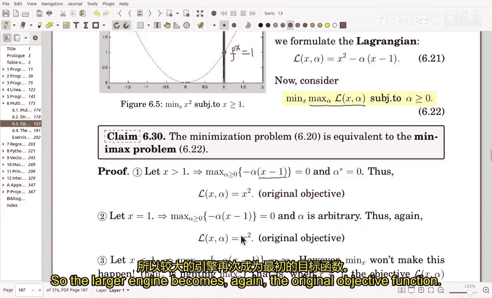

Original objective function。Now， when x is a less than one， which is violating the constraint。

 then the maximum of alpha of that portion。Now， Xs are negative。So that this portion is。Leser on。

 So this one is negative。And along with that。Here， if alpha is non negative。

 then maximum value will become。Infinity。And we can choose alpha very large， so it becomes infinity。

However， bro。In front of this maximum function the operation， we have。Minimum operation over eggs。

So that minimum will not make this happen。In fact， the minimization parties are fighting。

Maximization part。And。So that when。The axis of violating the constraint， then。

The objective becomes fairly large， so that。The minimization will push X inque。So that eventually。

 X becomes。The largerer to one。 That means to sat the constraint。So in other words。

 the miniization of forces。The maximization to behave。 So constraint will be satisfied。So。

 eventually。And this whole thing is equivalent to the original minimization problem。

The proof is a little bit foggy。

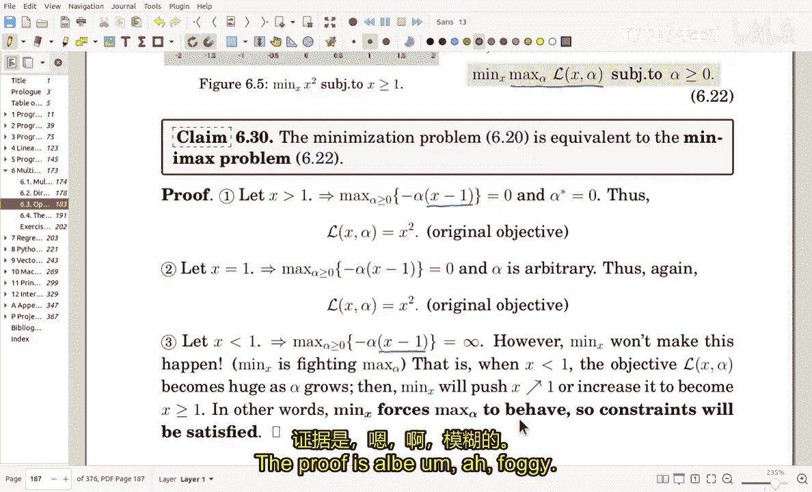

And now， we'll go to。Formal argument for other equivalents。Now we start with F x equal x Sch and。

Every first star is the optimal value of the original mini problem。And we read out here。

 meaning my over x f of x subject to X is larger than or equal to 1。For this one。

Once x is larger than equal to 1， then。Here the Laguranian。

And because alpha will be chosen to be non negative， this portion is always non positiveative。

So that。The Larian is always pounded by Ephoage。Of course， its maximum happens when this portion is0。

So we have this re。How about。X S。Violating the constraint， which means that x is now less than one。

Then here early， we checked that in this case， the maximum of the lagguangan is infinitefinity。

So X can be either this one or， in fact， satisfying this one or that one。 And for these two cases。

 we have this conclusion。Now， we try to minimize this term。Over x。 then this is infinity。

 That is f of x。So， that。嗯。We can get this one here。

 That must be F for X when X is large and equal to 1。

That problem is exactly exactly the same as the original problem。 So is。Optimum value is every star。

 so we can reachsha that on。Which is that。The original리지널 problem。

And this minim problem will have the same answer。 So they are equivalent。

And we have to notice this one， this minimization。The syn require acts to satisfy the constraint。

In fact， this im is over all possible values of x。And even though we do that here， from this two。

 we get this conclusion。So that once we write down this way。Then。

The constraint is ruling alpha non negative， and there is no constraint for x。However， this problem。

 Vex problem is。Equivalent to the original problem。

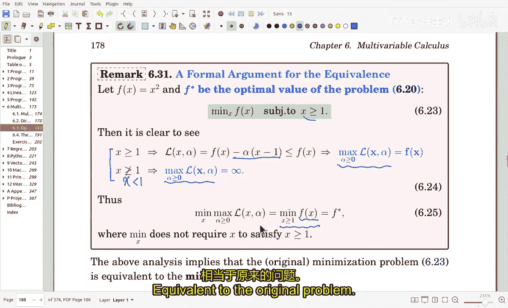

Okay。Okay， here。

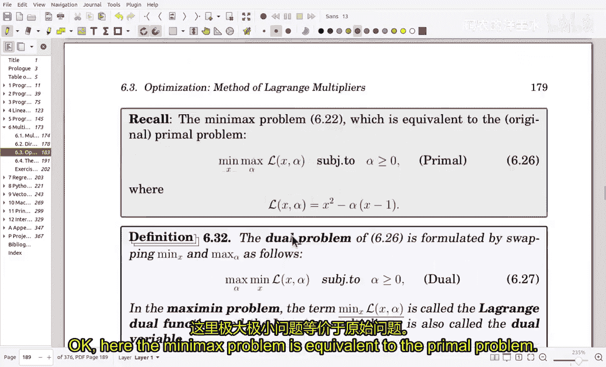

The miniax problem is equivalent to the primal problem。 So we write down here。

 So now the constrain is。The lagar multiplier， non negative。

 So we can say this is the primal problem。And the Laguangian is defined in this way。

Here we define dual problem of that primal problem。By swapping。And the mini and maxim。嗯。Operations。

 just simply， we swap that to get。The real dual problem。

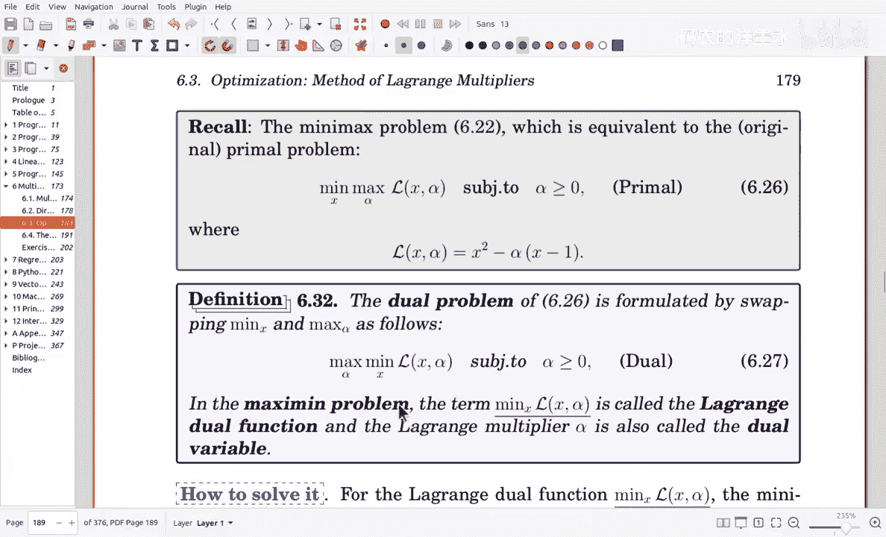

This portion。It's called the Laang dual function。And now here。

 alpha is also called the dual variable。To listen， we consider the dual problem is here。For example。

That optimizes F star。 And this optimization optimal value is G star。Then， in  theory0。

We know that F star。As always is larger than or equal to G star。If they are different， then。

We have audible issue， however。In our simple problem， in fact， F star must be same as G star。

And in this case， we say。That。Is a strong duality Once this inequality is strict then we say it is a weak duality。

But for convex。The optimizationim problem， itll be strong dualology。Now。

 rather than solving this problem， in most cases， solving this problem is much easier so that we'll try to solve this problem。

And then the。Optimal value will be used for that one。Okay， that's the strategy to listeners。

 basically in Laangian， once。Okay， for that one。It's a kind of。嗯。

Linear with respect to alpha is combined so that， in fact。

 this one is a kind of a lower hyperplan with respect to alpha。And so that。Once in general dimension。

 if we have object function， then it's a kind of lower Hyplan is made。Along with。

This La R and and try to find the possible， possible yeah。

 maximum optimization so that and that will be。Here now， touching here。 So eventually。

 once you try to maximizing with respect to alpha。Then。Certain hyperpolein will be made。

 and then that will be the optimal value。And。For。This is a con problem。

 all this is satisfy so that no problem。The original problem is not easy to solve。This one is E。

 so we'll try to do that， okay？

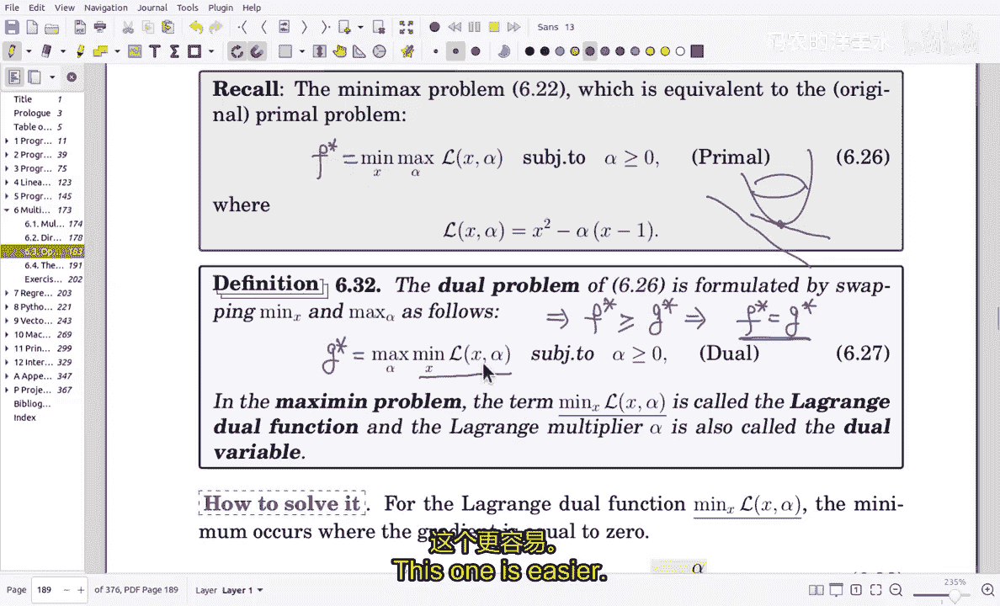

Now， first， we try to solve this portion in myge of the Laguangian。Okay， then we can do it by saying。

And。Quite familiar。 characteristic tech， just derivative with respect to eggs。Then we can go。

3 x minus alpha。Now， we set it 0。 then x is half over 2。By using this question。

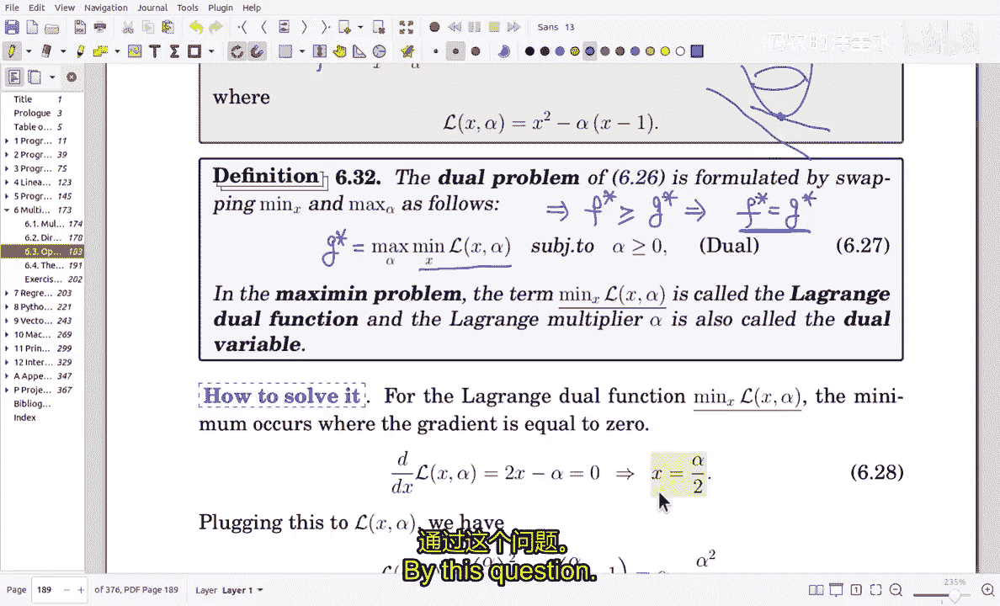

We can get we can express the Laguangian as a function of alpha， depling x by using alpha over 2。

Yeah， so we reach out that one。Now we try to maximize this Lagran over alpha。

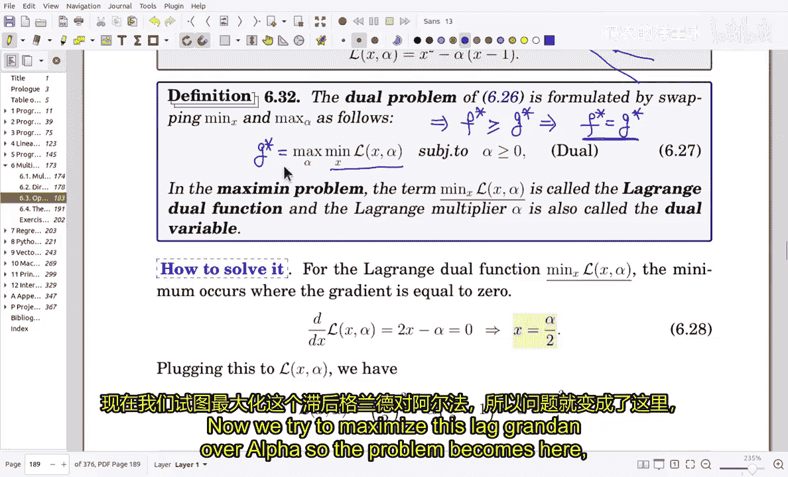

So the problem becomes here。This can be easily solved then。嗯。If you try to make a graph。

 then you can see in this ring。Okay， now for that one。Once alpha is 0， then it's a 0。

 and once alpha is。4 okay， then it is a0。 Okay， so that the graph of this functional alpha can be given in this range。

That is4。 and at2， it is maximum。Okay。So when alpha is2， the maximum value is1 now。

 you can easily see that。

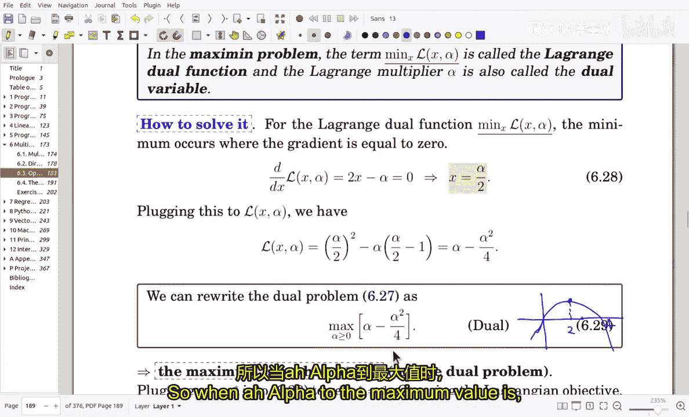

Or you can use derivative seconding from here， if you make a derivative。

 then1 minus alpha over 2 equals 0 so that you can get alpha is 2 and alpha is 2。

 the value is 1 okay。Now， we found the optimal value， alpha star。Creature is 2。

 then you can pull here， and you can decide X。So， that。Now， x is 1。

 and you can finalize the answer or。Now， you can。Yeah， because we only know Als 2。

And from Laguranian now， Al is replaced by its optimal value。 So we reach thereon。

 and then this can be reformted in this way， which means that。The Lagurenan。minimum。When xs one。

 the minimum values 1。 that is the final answer。So in by using various techniques。

 we can get the same result。

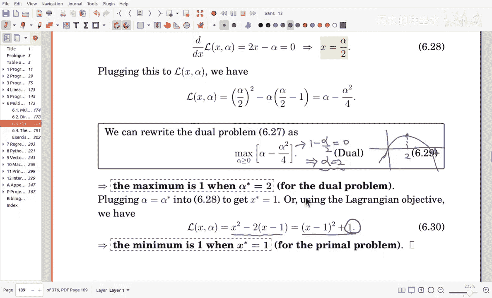

But here， the idea is， through this。A tool problem。 Maxim problem。

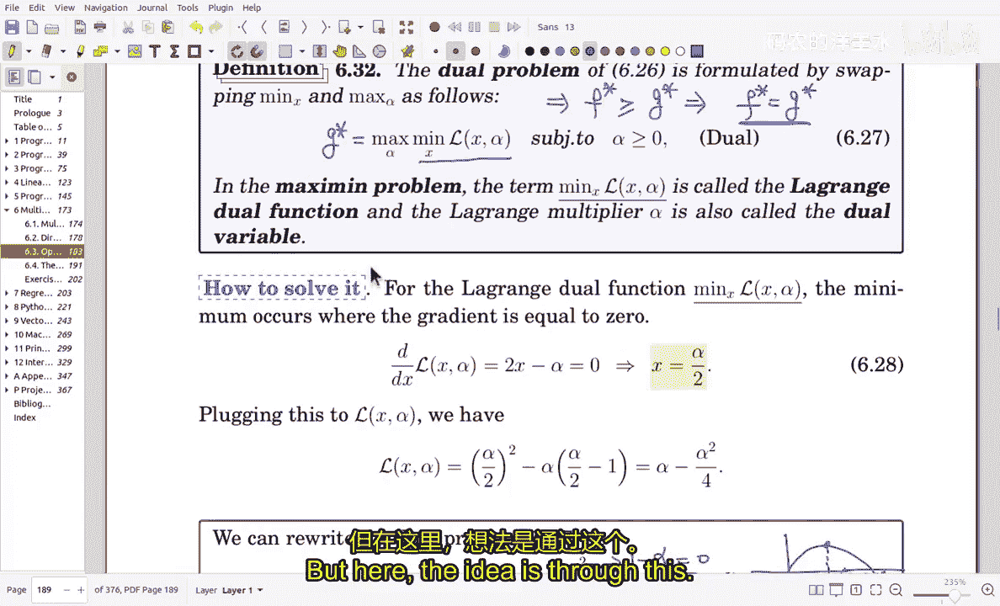

We can get the solution much easier。

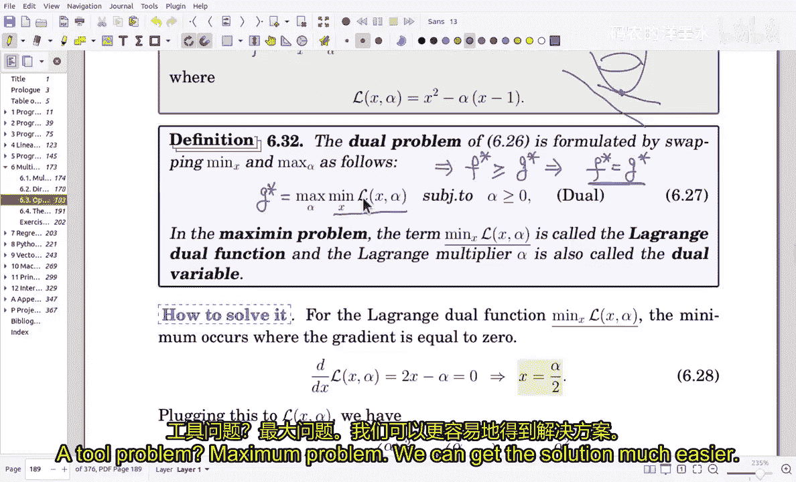

Then solving original mini Max problem。 So there's reason we try to use。The dual formulation。

 and try to get the solution more。Effectively。But once it is not strong duality。

 then we may have some issue。But that is over。呃。The the class so that we not deal with that yeah。

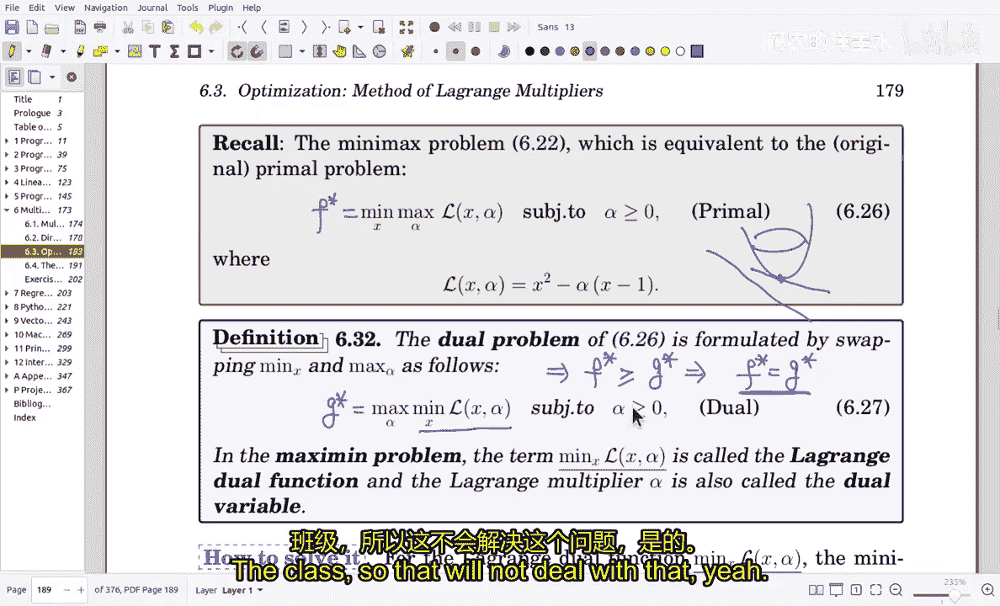

Okay。Now， finally， in this section， we'll consider multiple constraints。Consider this problem。

 the maxization of F of X subject to these two equality constraints。

Then we'll consider geometric interpoliization。Ren。Extreum happens。 then the gradient。It must be。

In the plane of。The gradient of G and gradientnt H。

 which means that the gradient of F must be a linear combination of the gradient of these two functions。

So， here we。YouFte these five vacations when the function is defined over all 3 in。X， Y， Z。Now。

 gradientent to F is the same as Ramda gradient to G plus mu gradientent to H。

 So gradient to F is a linear combination of gradient to G and gradient to H。

And we have these two constraints。So there are five equations。

 3 from here an extra 2 from constraints， and we have to decide values of X， O Y C and Ramda view。

 so five variables。We can solve with this a system reasonably。

 but it doesn't mean that we have a unique solution。

It is another linear system so that you can have a wooden。We solutions。

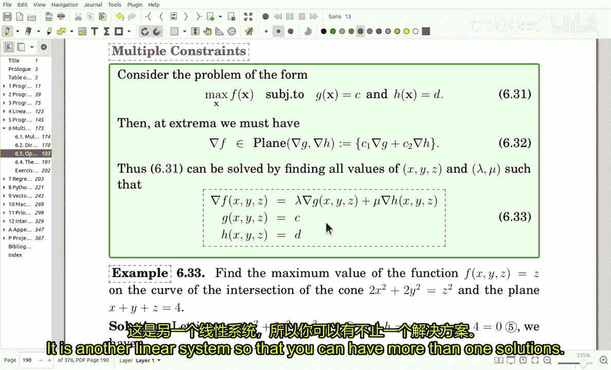

See this example。Find the maximum value of function。F of X， Y Z equals here。

 we chose very simple object function。 And on the curve of the intersection of the con and plane。

Now that is here we define from here a G of X， Y， Z。And from the second constraint plane。

 we have the function H。Then by using this formula， we have this one。

Cide interval F is Ramda times gradient interval G plus mu。Times gradient we age。Now， line by line。

 term by term， we write in this ring。 So we have3 equations and extra two equations。Now。

 from the hintes is saying that from one and2。We can conclude ex Y。In order to do that。

 we have to show that Rammnda is nonan zero。Okay， for this portion， once weda is 0。Then。

This vector was as view。Times the victim of all ones is impossible。So that Ramda cannot be 싫어。

Once surrender is a nonanzi， then here， this is the same and left hand side is the same。

So that hereda themda。Same so that x must be y。And if we plug this one to over there。

 then we can reach add here， that one。So by using these two equations， you can express that on。

Quite simple function of one variable。So that you can decide the one variable room。

Then here you can decide are two。So you can finish the competition yourself。Okay。

 this's the end of the section。 Thank you。

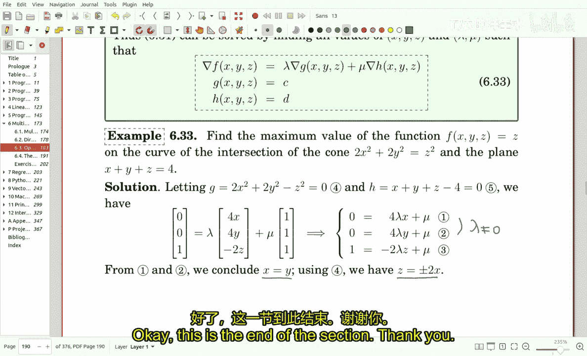