# 【全集-附课程讲义】密歇根大学-人工智能编程-EECS492-中英字幕-p43-Lecture-43---梯度下降法的推导与分析--BV14JqfBNEAS_p43-

Section 6。4， the Car Ticent method。Here is the problem we're want to solve in this section。오메가。

Is a subset of odd N。For given real value， the function F。

The general minimization problem is formulated in this vein。Try to find the minimum of F。

Ran xs in the Sa mega。In this context， F is the objective of function。

 Sometimes it is called the lowest function or the cost of function。

And omega is the domain of the function。And。The constraint is sound。

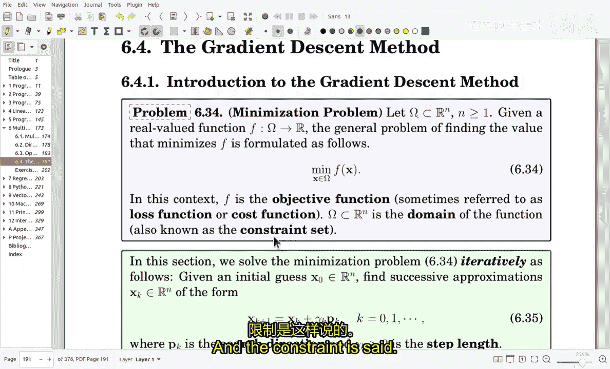

We'll try to solve the miniization problem iterably。기부는은 initial gas엑스즈로。

Will try to find the successively approximationations X K。Of this form。

The new approximation is corrected by this correction term， your P K。Is the search direction。

And ca K is the step length， after finding。The direction， and we try to decide theres a stepling。

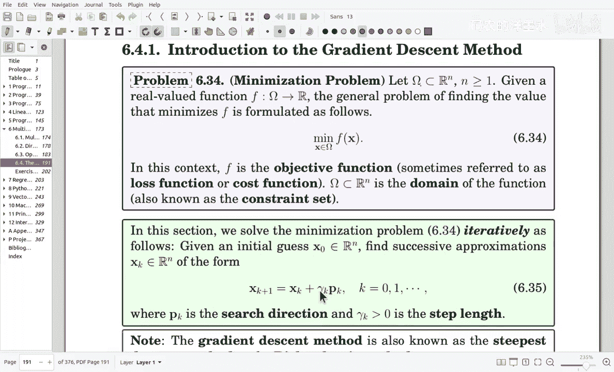

The credent is， the method is。Also known as the Paster dis method。

 or sometimes is called the Dchasins method。Here， for this type of。Eerative algorithm。

And we try to drive。

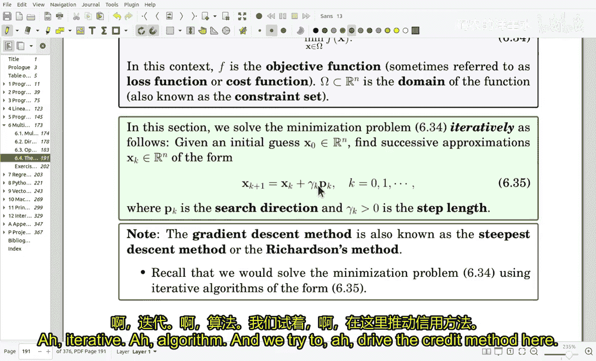

The gradient that is method here。When X K plus  one decided。With this。The question。Then here。

 we may try to use tail expansion。For this perturbion。So， f of x K。And that is gradient of F。

 And that the such direction。And along with a scale with step length。 and second of the term。Of。

Ca acain。Now， once we assume the second derivative， the hesian is bounded。

 then we can write in this ring， the gos。Now， this to must be smaller than that to。So that it is。

The descending， the values descending。

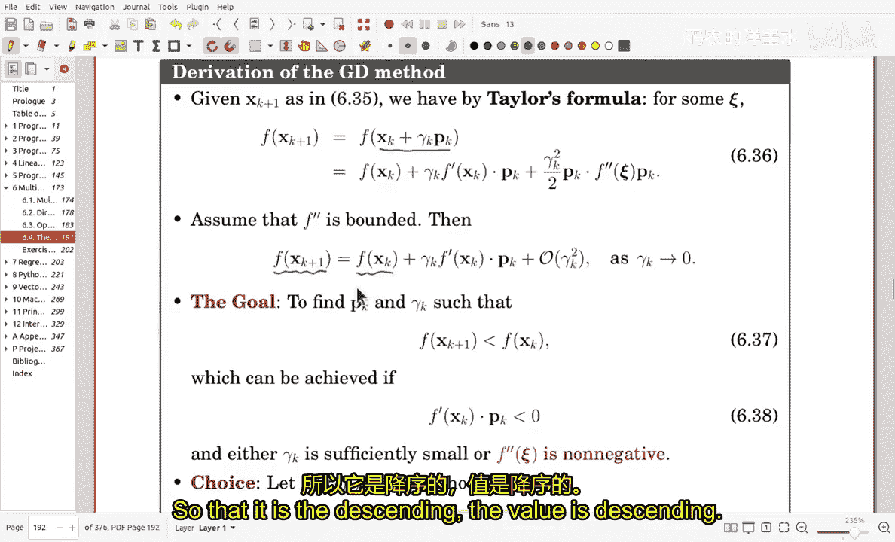

Okay， that's the goal。And once。Okay， this that product is negative。

Then because this step length is positiveitive。We have。The smaller value。Ren。Okay。

 this is sufficiently small or。And the second derivative， the hesian is non negative。

Now here our choice is。For。P， K， the search direction， we try to use negative of the gradient。Then。

This， that product。the same as negativegaivity of the。The gradient norm square。

 So it is a negative when the gradient is a non zero。

So that's the choice for the Car to teach the method。

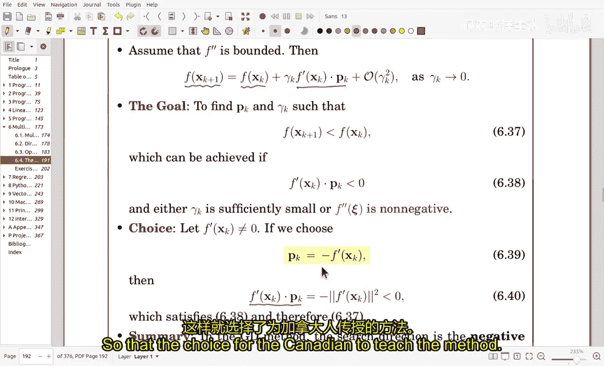

So here we can sumize。In the gradient test method， the search direction is the negative gradient。

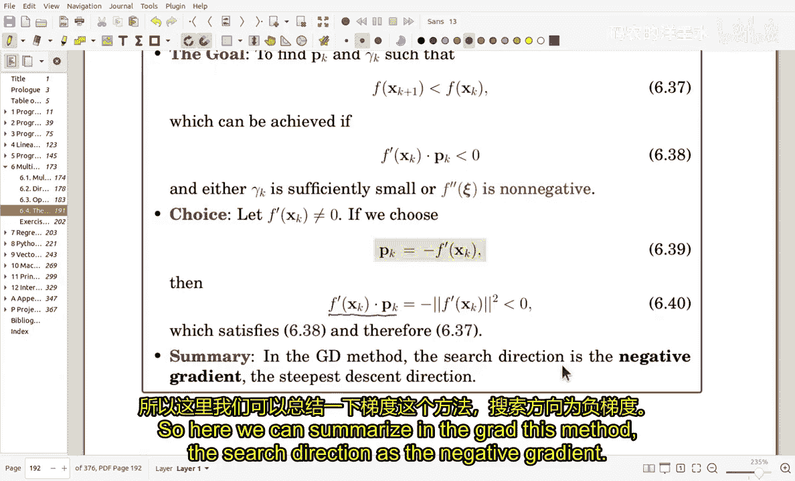

The stick。Pass the distance to direction。

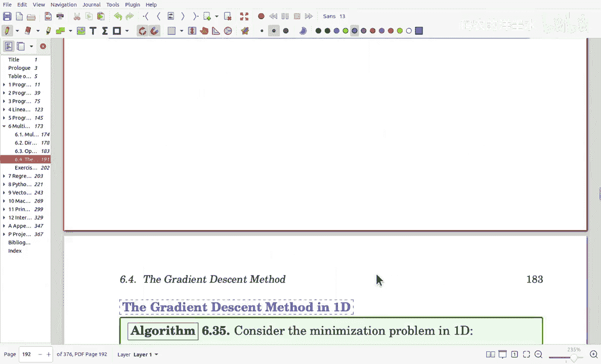

Okay， now we try to analyze the method in one day。

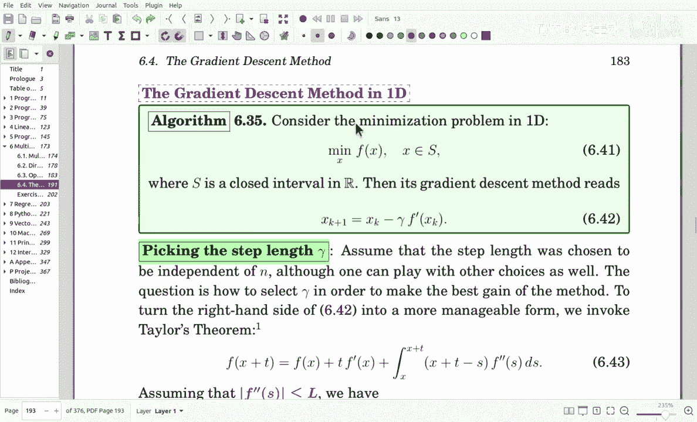

Consider the minimization problem in one day， the minimization of F for x when x is in a set S and x is a close interval。

In the real line。Then。The gradient distant method can be formulated in this way。 X K plus 1 is X， K。

Mas。嗯。Gma and F prime at X K。 that is the2 tip minus2。Yes， minus the gradient。Now。

 well try to set the step length。H。Gmma， very effectively。

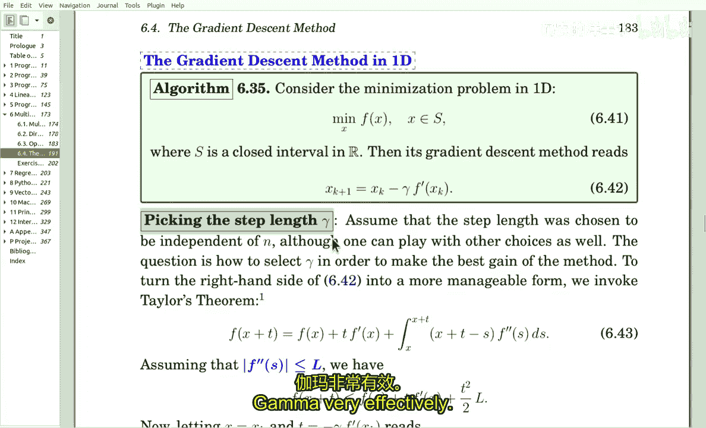

Here we start with Taylor Theorem。And。F of X， T， X plus T for general X and T， we have F of X。Plus。

 T have primate x， and this limit is integral form。 But you can use for this one。

The lagang remainder。 that is for this portion。You may use here that is teaca。

Over to F double prime at some point。Either this way you that way。You can。IUse the the limit the to。

 express the limit the to。Now。Assuring that the second derivative is bounded。And pounded by L。

Then we have we here。Apple X。Plus2。It is bounded by F O X and that time。

 and we are choosing maximum from this one。 So it is a Ts schedule of2 and maximum value of that one L。

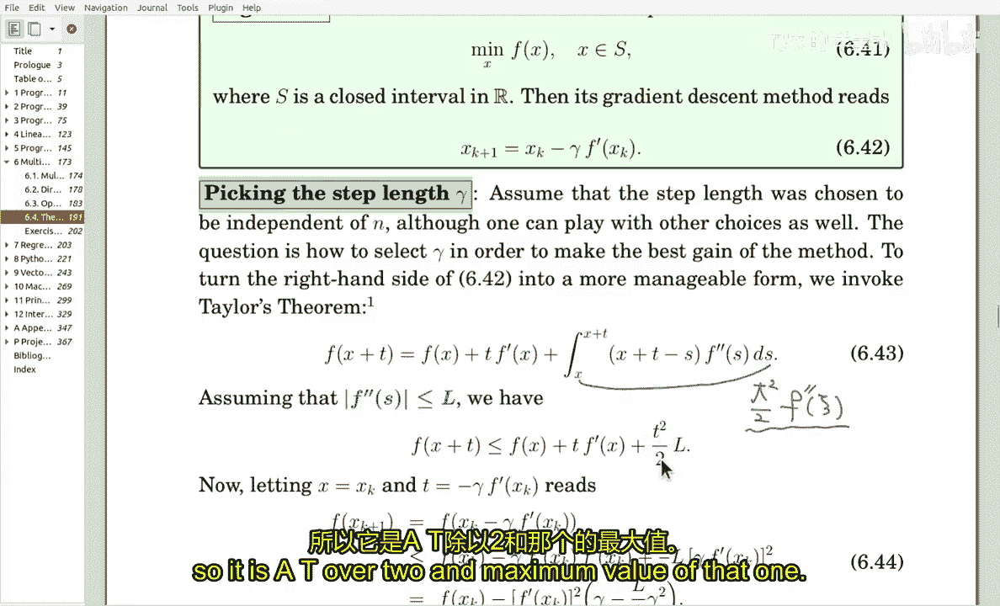

Now， for this formula， now we are using here X is， X， K and T is minus。Kma if primmeds came， then。

We have here。 this time is bounded by the right side， along with these terms。We have here。 now。

 that is the same as this one。

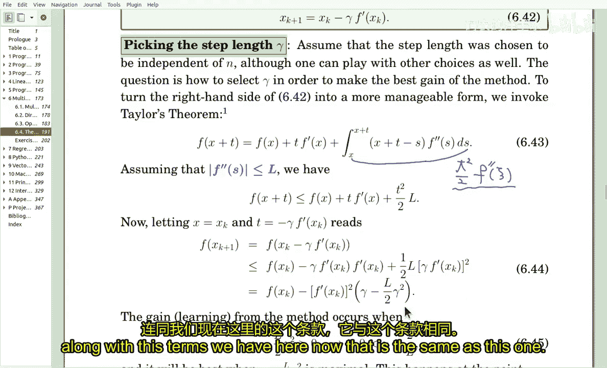

Now， the goal is。Yeah， that is this portion is positive。

Then this will be strictly smaller than this value。So that's carried in。 And once。Theテティビ何지郎。Then。

If this term is positive， then it can happen。So the requirement is this one。And that is same as here。

 the gamma is between 0 and。2 over L。This quadrac term has a maximum when。

 The chma is the middle point。 So yes chma is1 over L。You can get this one。

Here by using the derivative technique for this one， try to make a derivative and set it zero。

 Then you can find this equation also。

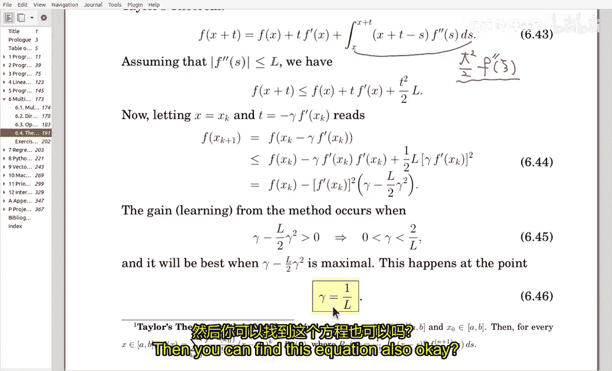

Okay。Now， here。The un effective gradient this method that can be written in this way。

There is the formula， along with。The gamma。When over L， we have that。That is here。And further。

 we can get this one from。

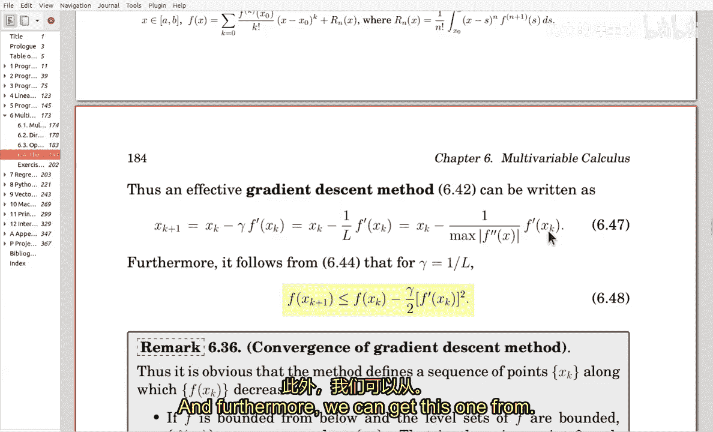

That one。Now， when。The camera is one of L。 We can rewrite this one。

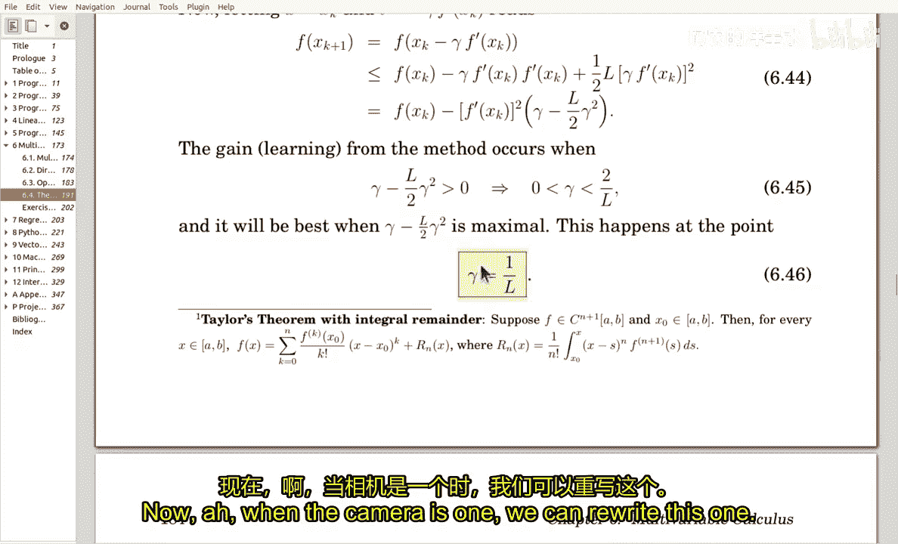

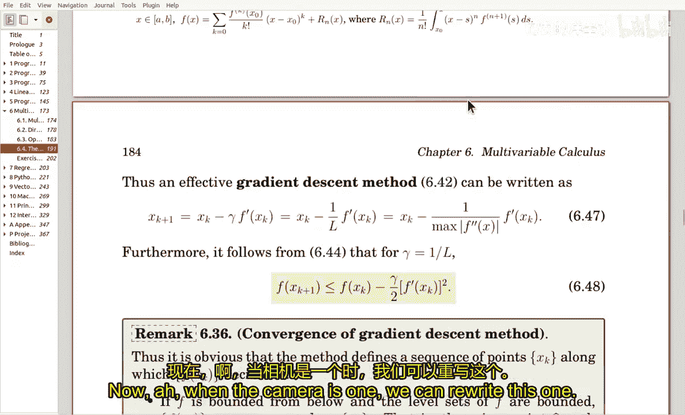

Here in this rain， so that。This new value is bounded by all the value。Mus。Gamma of2， F prime。

AtThe all the。The point scared them。So we get this inequality that will be used to later on for the deciding。

This gamma。 But in one day， though theoretically， we can choose this value， but in general。

 it's not easy easy to set this value。 So when we try to find the。A good， reasonable pullmeter。

Stab length。 And we have to find the value， such that。This inequality。Is satisfied。

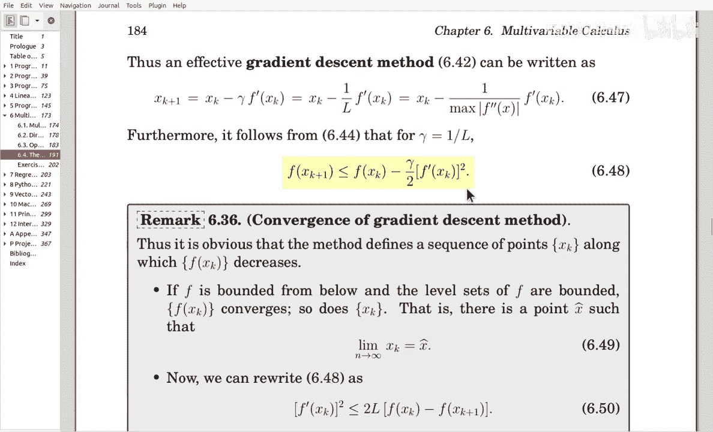

Thatll be used later on。Here we have a computer on our。You can read this the remark。 But here。

 the main idea is here once X K。Compages to X hat。Then。At X had the limit。The F prime。

 the chief tip is theceone， which means that。Exha is a critical point。

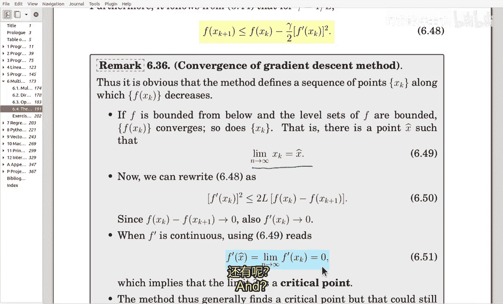

And。Again， that means that the gradient this method is trying to find a critical point。

 So local minimum。AndOr set point。And finding global minimum is， not。Here azable。But anyway。And。Here。

 the algorithm is trying to find local minimum。 It can be the global minimum。But anyway。

 the around the point initial value， it try to find local minimum。For example。

 the object function is given pictorially like that。Then once you start from here。

 then it'll go down and。Did share that on。 So X hat in X direction will be this one。

 Once you stuff from here， then it will go down and X hat will be there on。So in any way。

 the algorithm is trying to go down in function value and reach at a local minimum。Okay。

 now we'll continue in the second part。 Thank you。

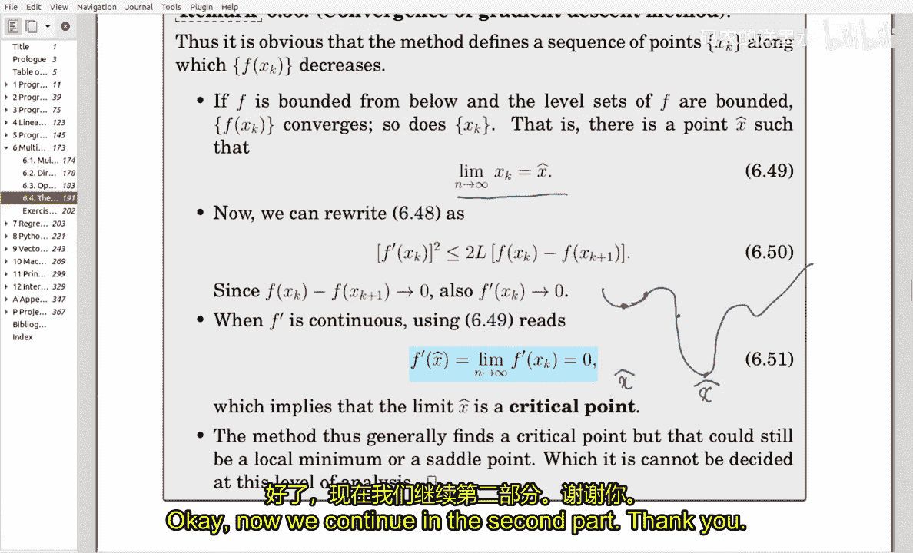