# 【全集-附课程讲义】密歇根大学-人工智能编程-EECS492-中英字幕-p44-Lecture-44---梯度下降法回溯线搜索--BV14JqfBNEAS_p44-

In the first part of the section， we derived and analogd the gradientad dis method in one dimensional space。

Here in this part。Well consider some practical issues for the method of the N voltage dimensions。

Will begin。With the example。For example。The rosenbro function in two dimensional space is defined as indisipation。

This is the graph of the function。And the mini miniger is one and one。So， there one。行。

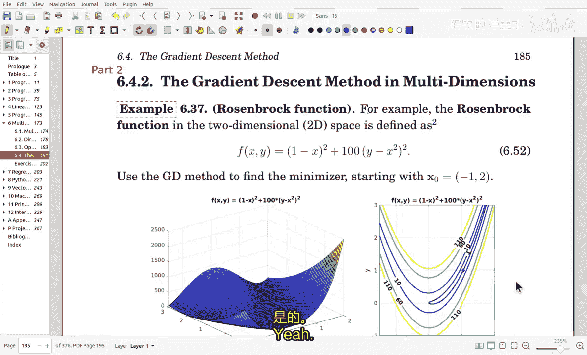

So when x is1 and y is 1， this will be C and there will be C so that the minimum value is C。

This function is used to a lot in optimization。The major reason is that。

Here it has very smoothly changing value。 And once in iteration， when iterate located in around here。

 the valley， then the movement is at soon。So that you have to give some。

Spial scheme to accelerate the convergence。 But if you try to choose the parameter large， then。

It may blow， so you have to be very careful。Anyway， this function is used to。In optimization。

Pretty much。For checking the convergence of your algorithm。

 Once your algorithm is working very nicely and much better than some other algorithms。

 then you may say that your algorithm is。

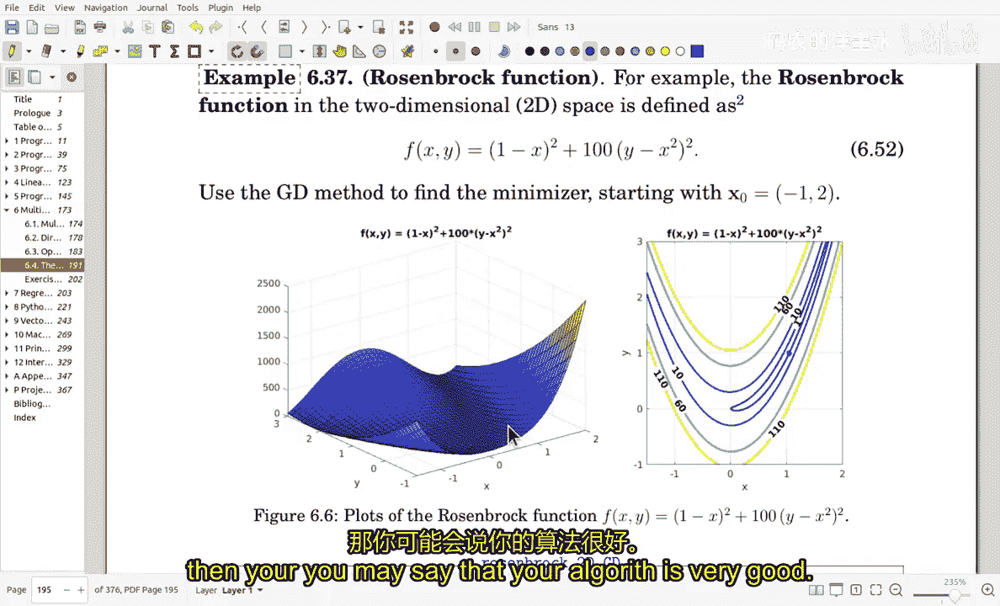

Veryty good。Okay。Now， for this function will apply。The Canadian that the method。

 along with the choice。

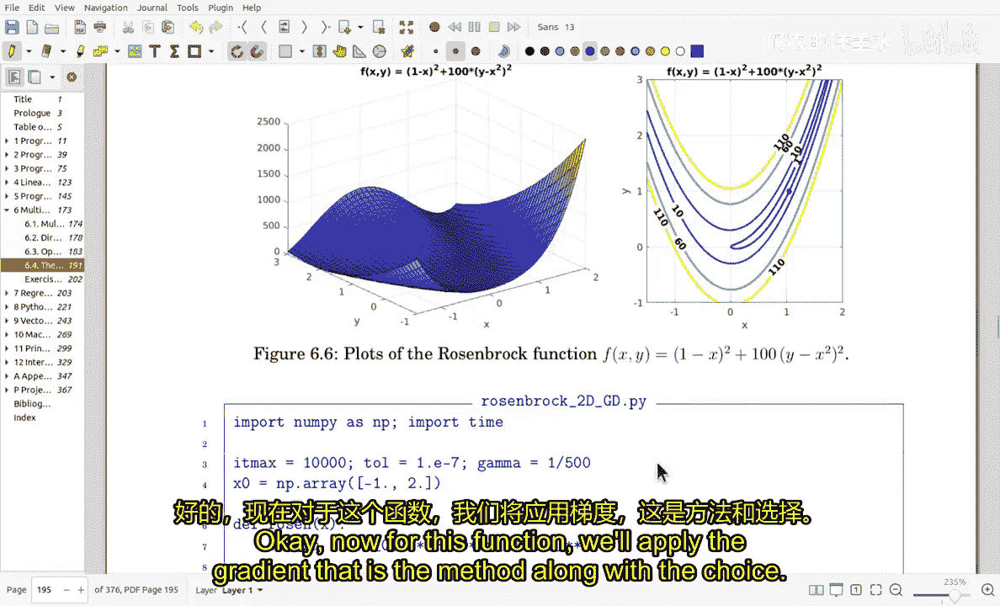

Now， the gemmma is one over 500 and starting point is minus-1 and 2。

 and this is a definition of a rosn board function。

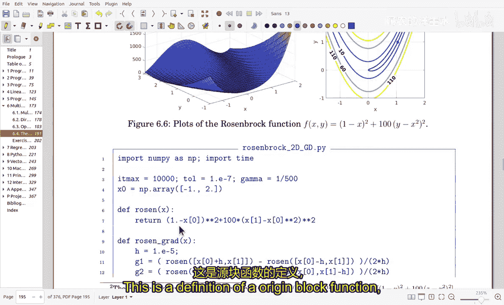

And here we can get the gradientedent over we add。

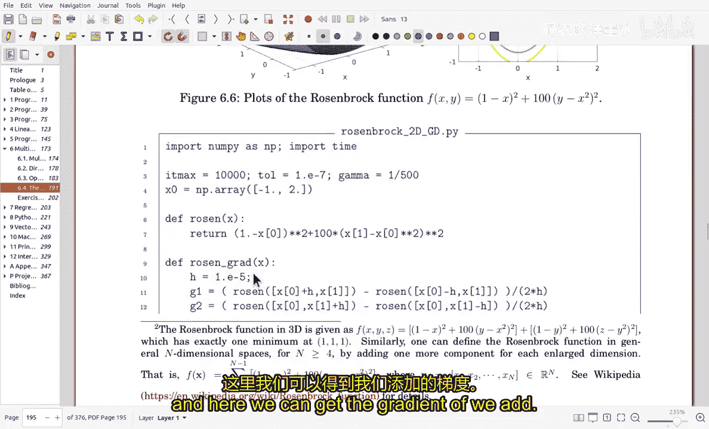

Okay， here this。The foot is saying that。The 로젠ブ function。Can be defined in general dimensions。

 For example， in3ity， you have that and for n dimensions here。You can have such a formula。 Okay。

 let's go back to the program。Lo젠 and 로젠 gradient， and here。嗯。

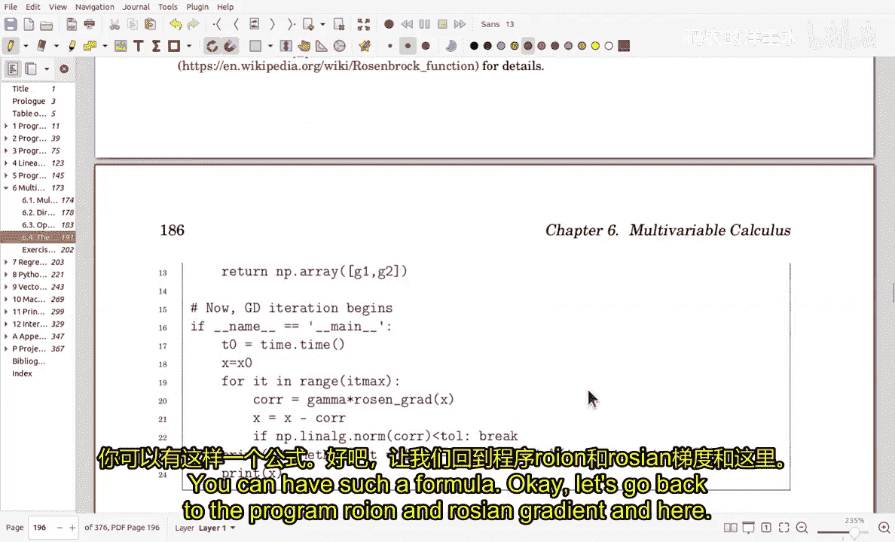

Now，啊。That is a gradient， and。Now。When we run the program， then we do iteration。

Along with the correction term and updating。And here。We stop when the correction term。

 the ism less than。

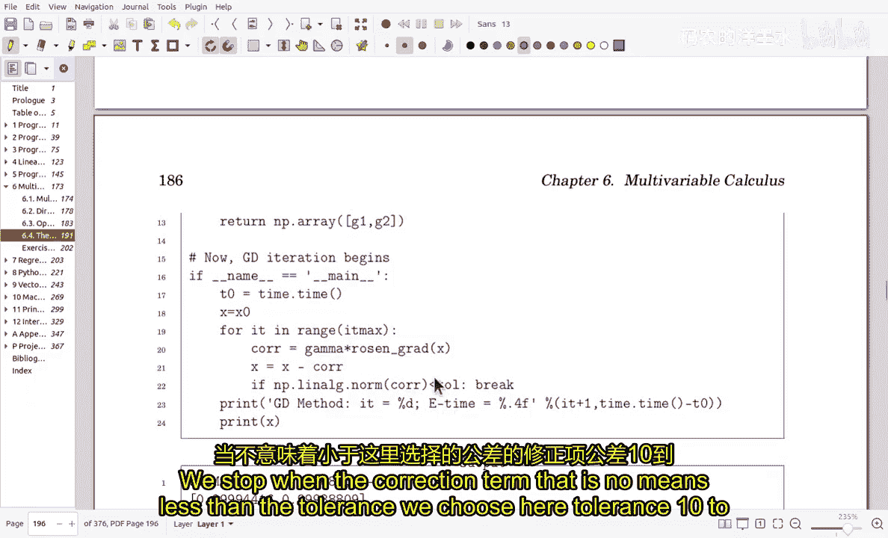

The tolerance we chose here tolerance 10 to-7， okay。

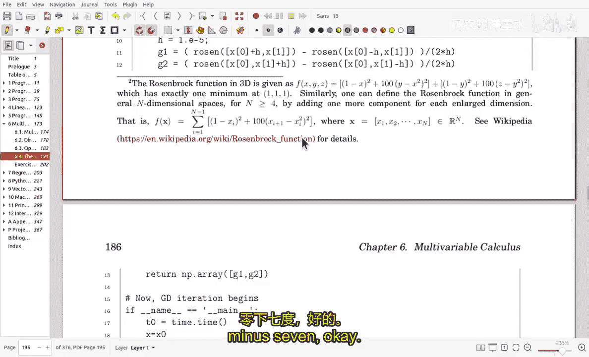

So here the result given， the Corent methodth。Accompd in。Larger than 7000 iterations。

 And the time is small。 But anyway， it is。Accompaning to when at1。But it's slow。

 The number of wetu is larger than 7000。嗯。Once you can choose the the step length a much better way。

 then you can get much better conut。

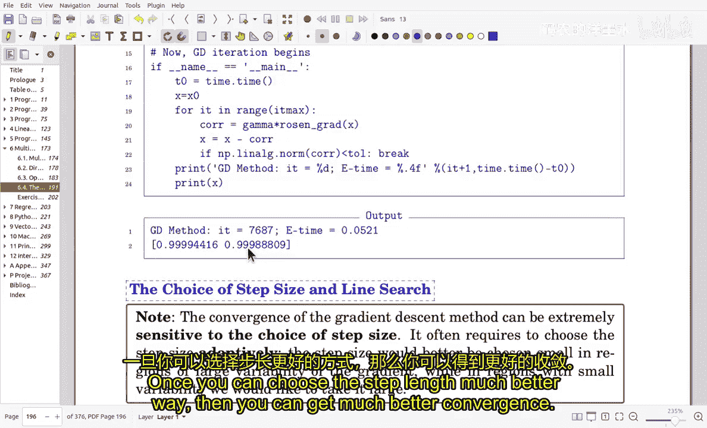

Here， so that main issue around here is the choice of step size。

The components of the gradient this method can be extremely sensitive to the choice of stepline。

We may try to choose yet adaptably。 That means in each traditionition， we try to choose。The。

 the step size。Gamma， different size。And， however。We had to make the confidence as good as possible。

One way of getting such a step size is called the backting line search。That is。In this search。

 we will try to find the step size。Gamma K， satisfying the sufficient decreased condition。

So in new position， the value must be less than or equal to this right size and。Along with。

A choice of。The gamema came。That one。Is coming from。

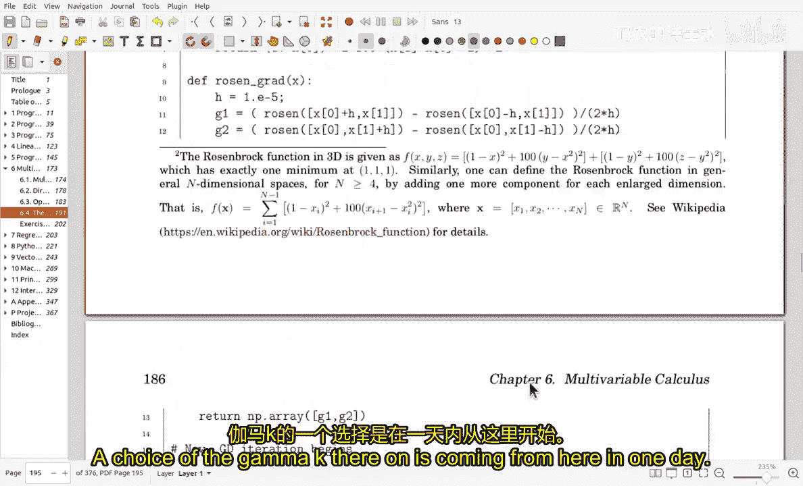

X。In one day。We have such analysis as that is for the new value， new function value。

s compounded by all the value minus that to。And so we need to choose this parameter satisfying this inequality in this case。

It is sufficiently decreasing。

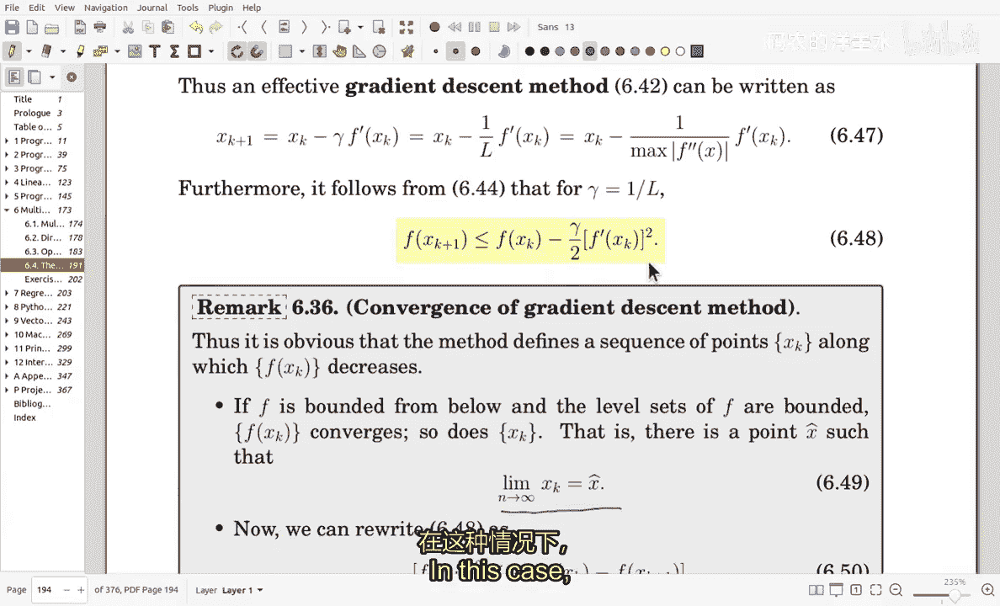

So that is called the sufficient and decrease condition。

 and we'll try to find the step size satisfying this inequality。You said reasonable。Yeah。

 it is quite reasonable and we analyze it for one day。But for multidis， also。

 this should be satisfied。Okay， here。

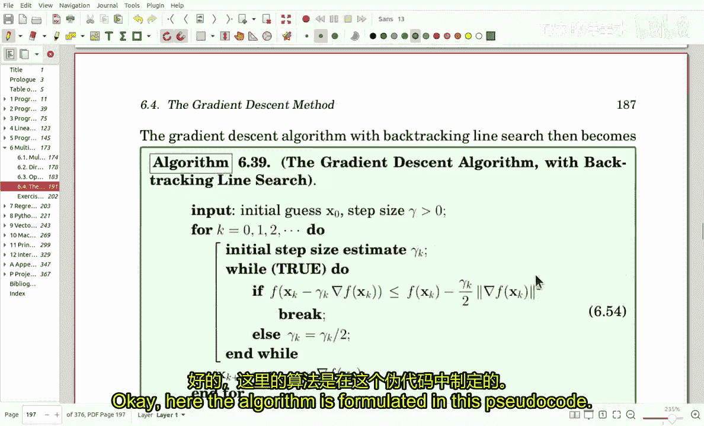

The algorithm is formulated in's pseudo code。And。Here we start with initial gas exger and initial value。

The camera。And this portion is extra portion。For back tracking line search。And for each。

Stir in each iteration， we start with some initial value。Of。The camera came， and。

So that in the beginning， we have to choose this a little bit large。 and then。Once this inequality。

For気。The parametermeter。The camera came。And we can evaluate this one。And， and then， also。

Because this is already given， and also。At the point， we know the gradient。 So for each time。

We make this vector， and evaluate the function。Then this one is satisfying this right side。

 Then now we stop the iteration。 If not， we try to reduce the parameter， for example。

 by using this equation so that。The step size is hd in each it， in。In searching。The parameter。

So and we do this situation。And we decided。The step size， and we can update。嗯。So， already here when。

We are evaluating this value。 We have that one， so that。The from here。 and， and once。

The iteration in the iteration is broken， then this is exactly the same as Xk plus 1。Okay。

 in this way， we can use the line search techniqueonic。 and for each iteration K。Now。

 we try to decide。The step size iteratively from the large value， and the shrinking。

Each time half and we decide。 So it is called back trackingracking line search。Okay。

After deciding the step size， we can update and go to the next iteration。

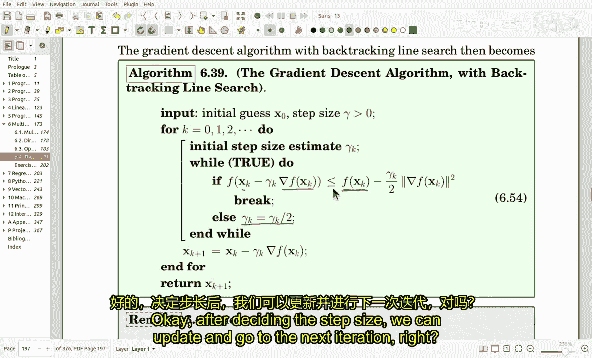

Incorporated with either the line search。Or the partial updates。

And the puzzle of this image his that。Rather than gradient the update。

 we may choose some portion of gradientians once it is in multidimen。

 you may try to choose one directional derivative。 So among this one。

 the first component can be used there。Or。A few of them。And can be used there。

Or if the objective function has a sum， for example， if we have。

 if the objective function F is formulated along with。The tita points。

Then you may try to use only a few of the data points so that rather than whole gradient。

 you may try to use the part of the gradient。Either way， you can get partial updates。

And along with this align search and partial update， the gradient methodod is the major。

Computational algorithm for various machine learning。Tes goes。

So it is the major tool in the optimization of machine learning problems。

The gradient method with a partial updates is called the stochastic gradient method。

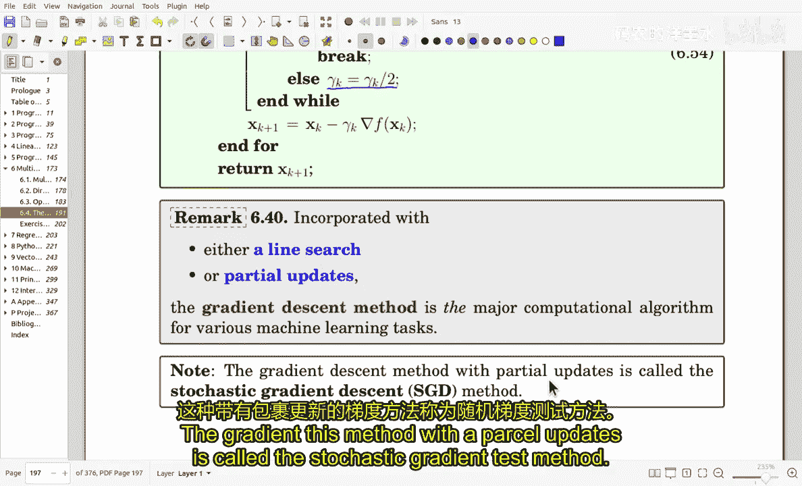

Okay。Now we'll continue in the third part。 Thank you。

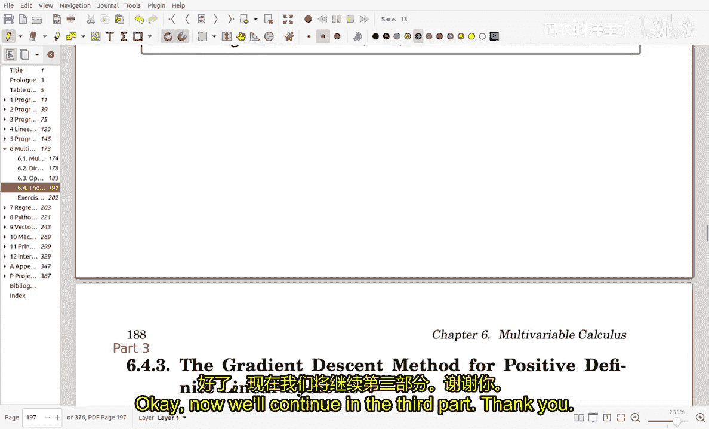