# 【全集-附课程讲义】密歇根大学-人工智能编程-EECS492-中英字幕-p45-Lecture-45---正定线性系统的梯度下降法--BV14JqfBNEAS_p45-

In this part of the section。Will consider the gradient method for part the definite linear systems。

Once you try to solve a party definitely linear system。

You may use the conjugate gradient method rather than the gradient disk method。

So the gradient these method is very useful for solving positive definitive linear systems。However。

 here we consider the method to understand the ad more thoroughly。

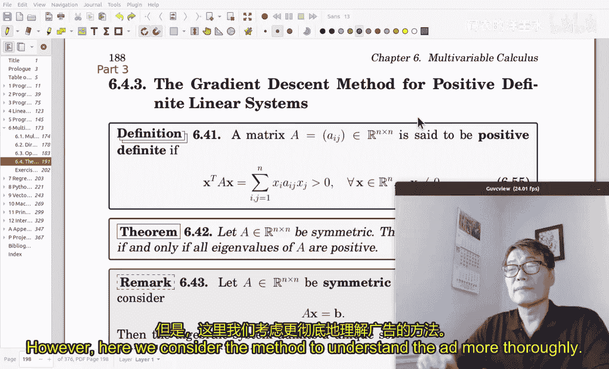

See the definition。A is a schematic， right。And the method is said to be。Partty definite， if。

This term X transportpos AEX。As always positive。For9 zero x。If a is symmetric。

 then a is party definite， if and all if all eigenvalues of a are positiveative。

So for symmetric party def system， the eigenvalues are all positive。

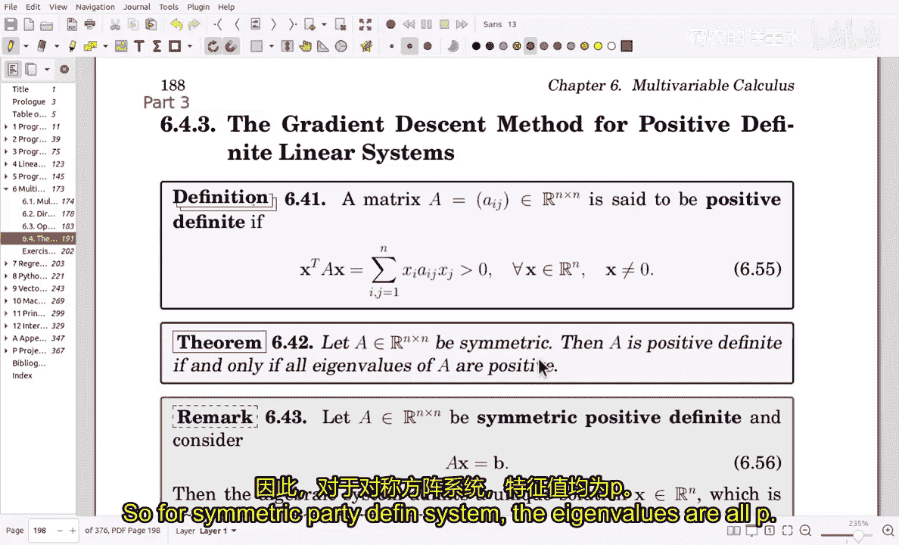

，Seymatictic poly definition system。Can be formulated with this minimization problem。

If Yta is defined to be here in this rain。Then the solution of this minimization problem is the same as。

The problem。You may check it easily。Once Yta is the minimizer。

 then the derivativeive with respect Yta must be zero。Once you take the derivative tip。Actually。

 the gradient。 then from here。So the gradient of F is same as。

 that is now a yta minus being by setting a zero we and this problem。So they are the same。

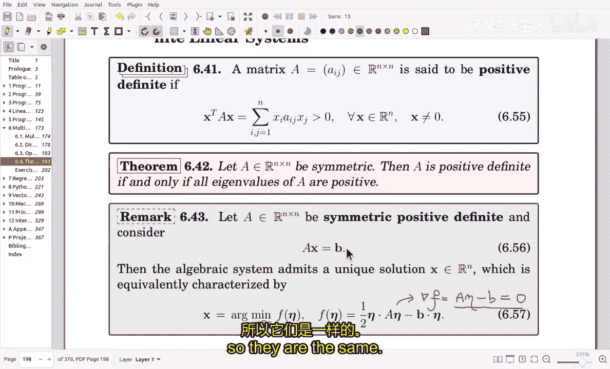

Okay。

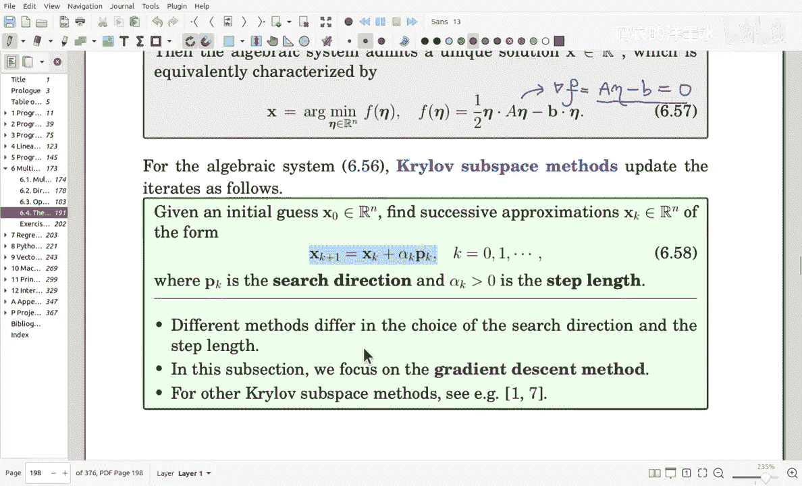

For the algebra system given here， the call subspace method can be used in this form。 iterably。

 we try to update。The solution。X， K plus one is X K from all the one。

We try to update by using this collection term。In this case， P K is the such addiction and alpha K。

Usually this is positive its the step length。And。The gradient method is one of the critical sub methods。

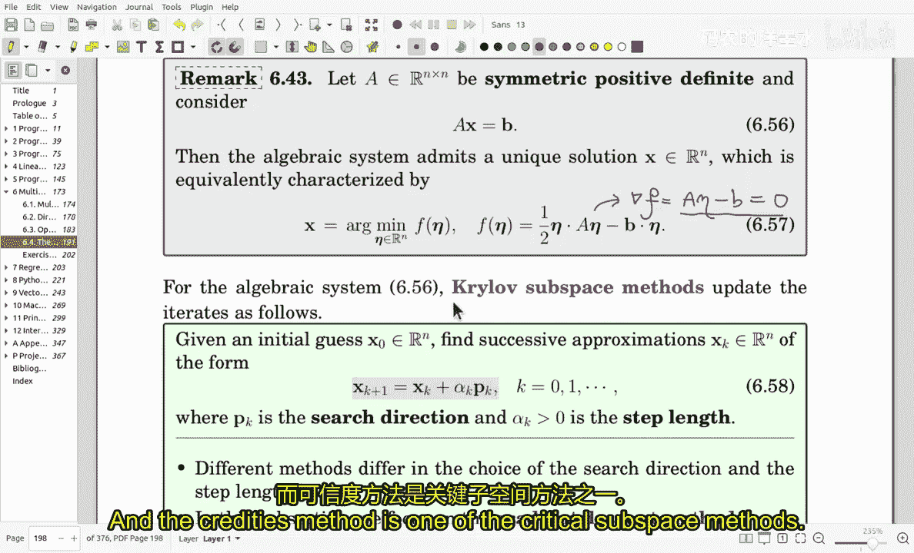

The T methods。D in the choice of a search direction and the。teラ。In this subsection。

 we focus on the gradientnt distant method for other Kop subspace method， you may。嗯。

Go through this reference。

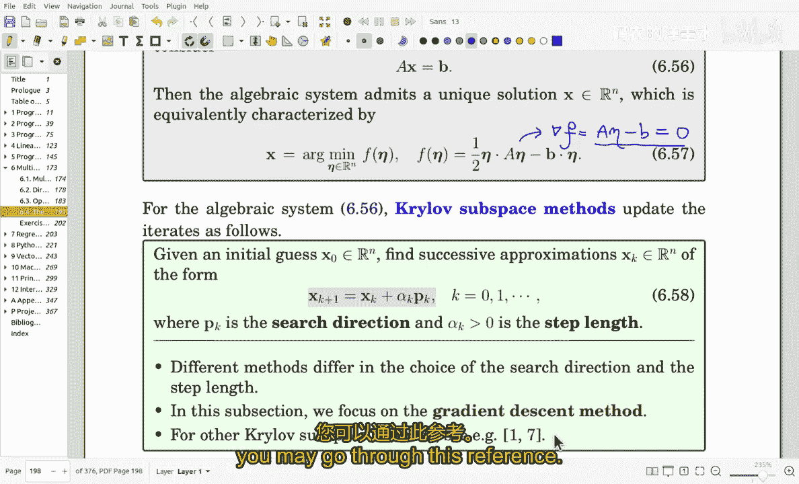

Okay， let's try to drive the gradientnt method for the linear system。For the functional F。

The gradient is this one。 And then Heian， the second derivative is the metric a。Now。

 by using the Taylor formula。And Xk plus1 the same as that on。 Now we can expand in this way。Now。

 in fact。The hisian is same as the metric。And。If the metric is bounded， so usually is bounded。

 then we can write in this ring。

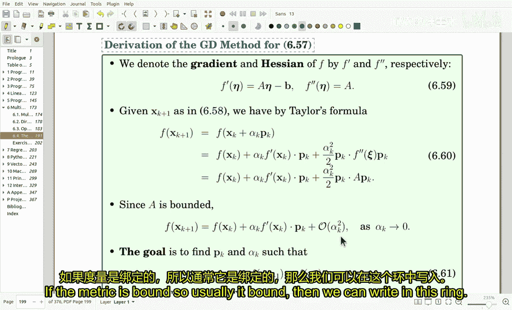

Hing。😔，The same way as in the last subsection， the goal is to find the the search direction and step length search there。

And you。A pushmate。The function value is similar than。The last one。Once we choose。

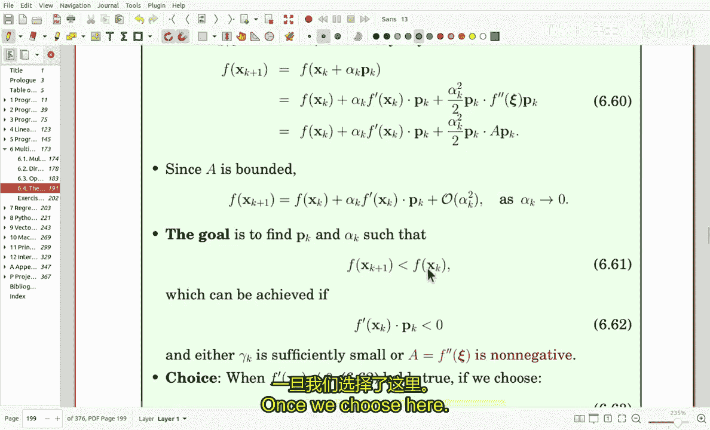

Yo。😔，嗯。PK search direction and to be de of the gradient to be app。Then that portion will be negative。

 and when the alpha K is sufficiently small。And now， only the a is asymmetric pi definite。

And here this is always non negative， in fact， positive， so that once it is smaller than zero。

 then the goal will be achieved。So the choice is。Now， P K is negative of the gradient。

And let we know the gradient at minus B。 and negatively add as B minus a X K。

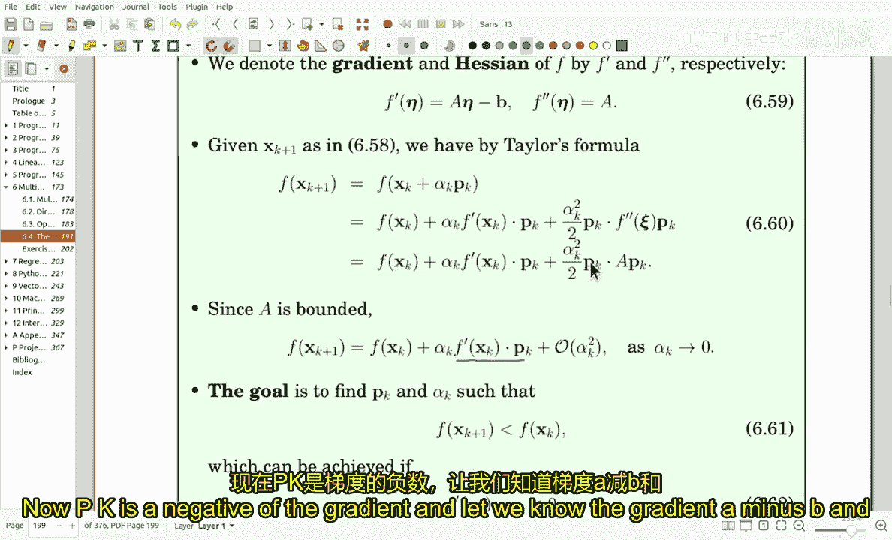

And for that term， usually we are using R K， which is the remainder。The vggge on。

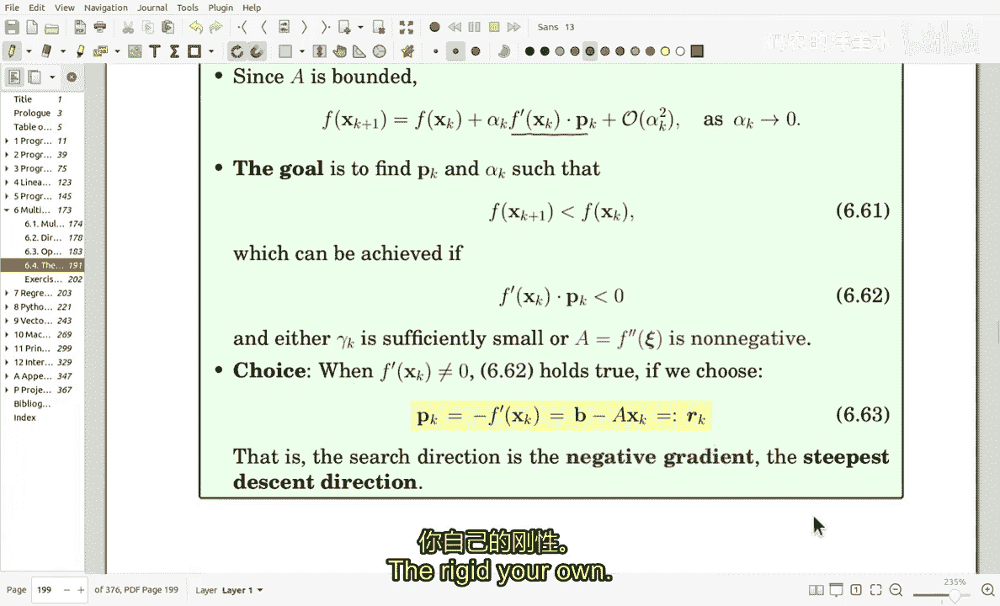

Okay， so P K will be chosen。As the negative gradient， That's the gradient dis method。

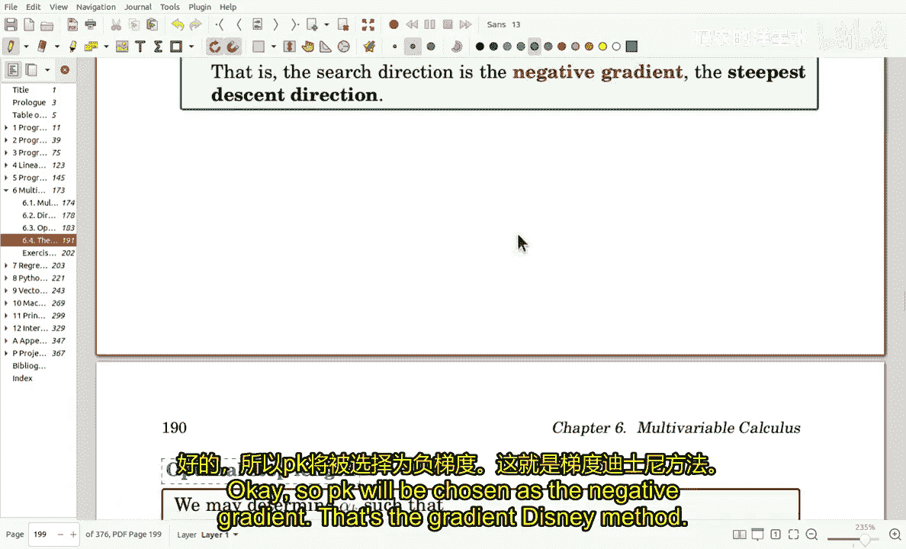

Now， we have to choose the step length alpha kingine。For solving linear system， usually alpha K。

Will be chosen。From this optimization problem。Will try to get alpha K， such that this function。

Pass a minimum value。Now， by using calculus technique， we can decide alpha K。

And we see this one as a functionable alpha， and we can differentiate。With respect to alpha。Then。

 for that one。We have here， and。Now。AndBy using。And the change will， first。

 we try to make the derivativeive。 So it is gradient。With respect to their one。

 And then here for this to。We make alpha derivative。 then that is P K。 So we each thereron。

 And after that， alpha is replaced by alpha K。So we have this one。

Now we are using the practical terms from this gradient。

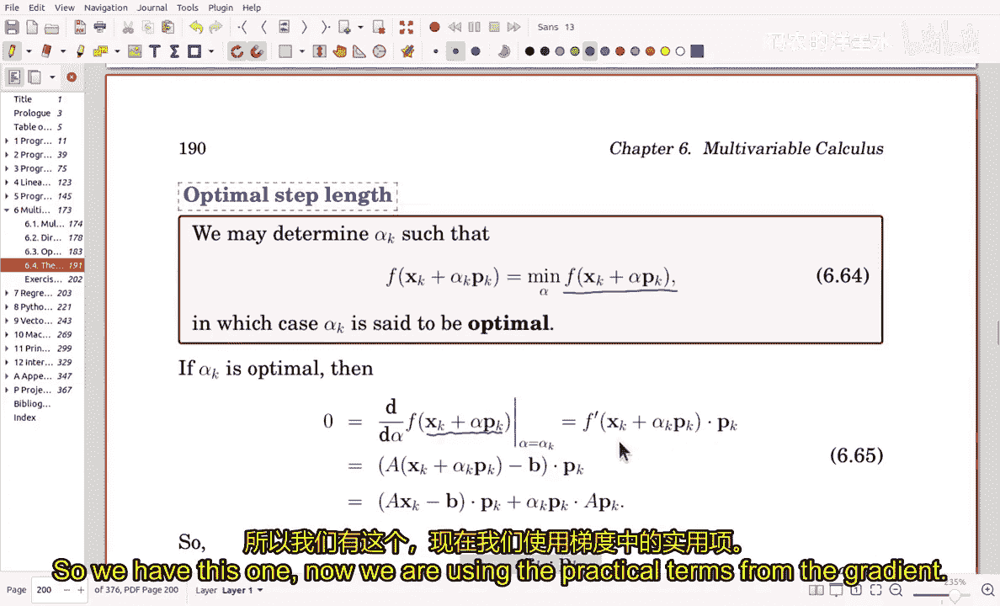

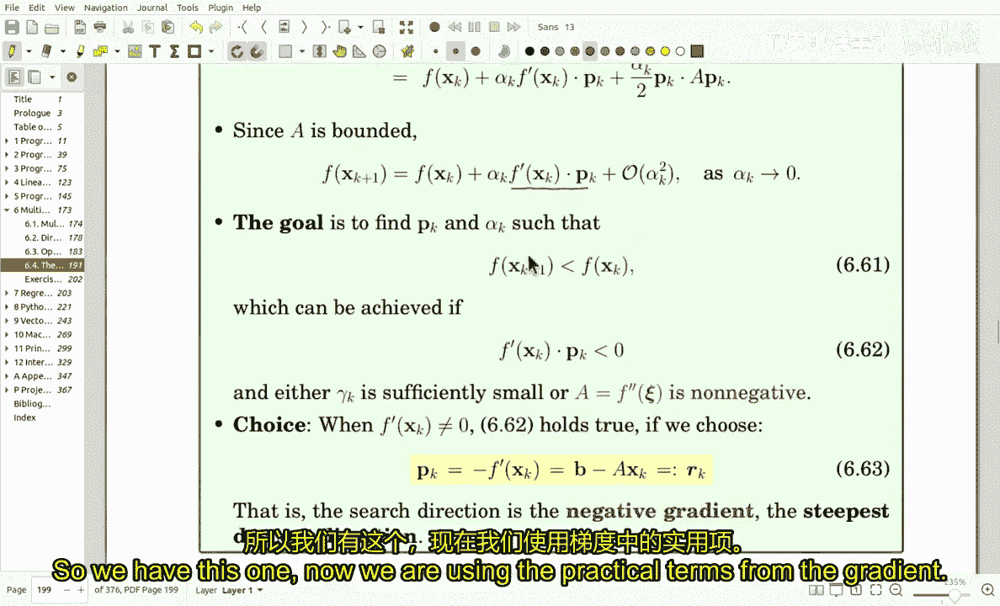

Now， rather than Yta， we put。

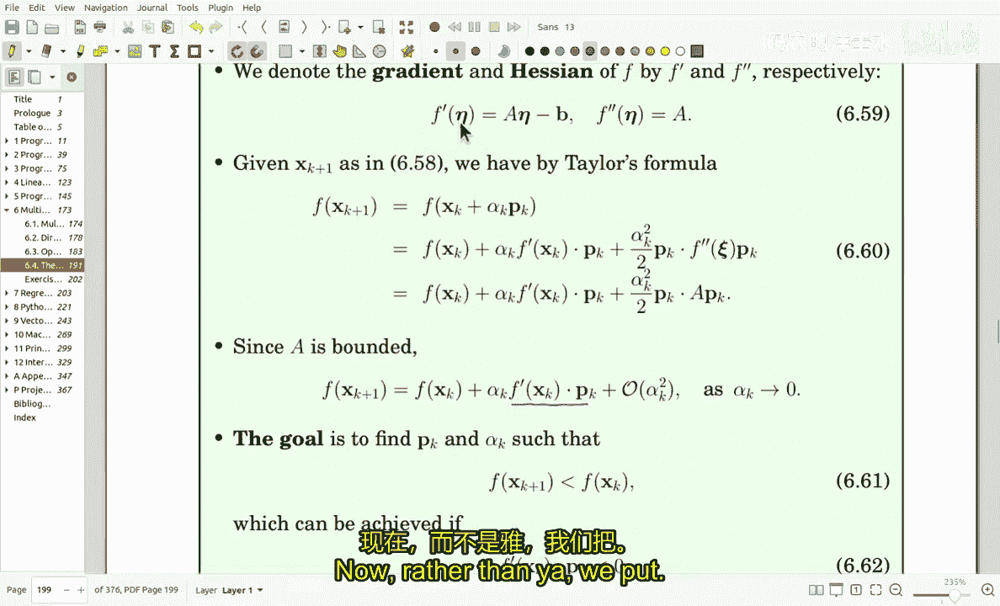

，The Tom。Here。X K plus alpha K P K。 Then we have this one。So this。From this on。

 we can decide alpha K， so alpha K。's the same as okay， that is negative of the residual。

 So we can move this one to the other side and divide divide by that constant。

 So we reach out this one。So this is used for various killer subsive method。

That is a kind of a universal way of getting alpha K once you choose the search direction。

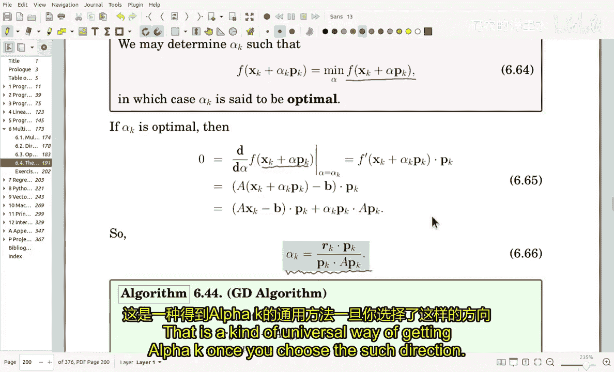

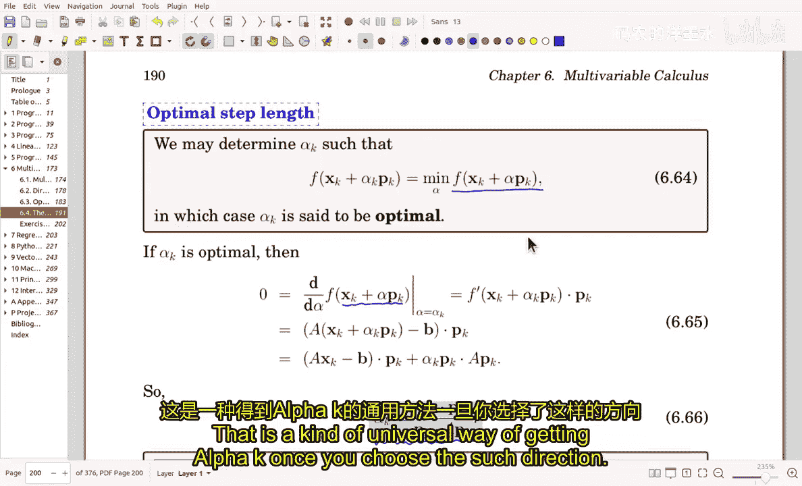

So that depending on your search direction here， alphapha K will be decided。

 but that is now on optimal choice。

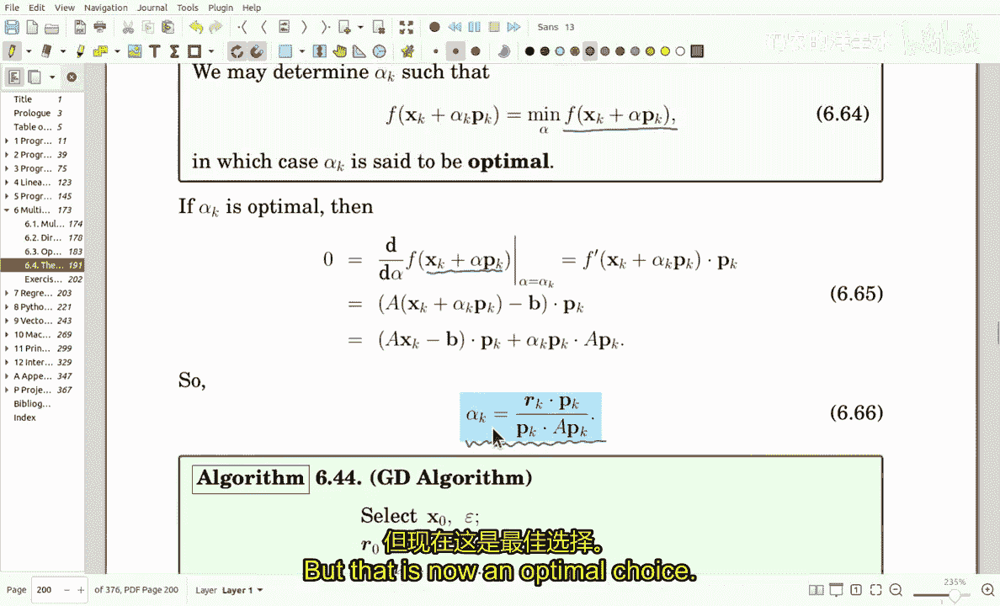

Okay， here we have the griddent algorithm。And with initial value。X0 and。Abspsilon。

 the stopping tolerance。 we first compute the residual for given。In civilizationization。Now。

 alpha K will be compute in this rank。 Now， Pk in gradient decent method， the Pk is R K。

So here alpha K can be obtained in this range。And we update。The iterate。

 And then we try to get here residualule。 Once the residualule is bounded by the totalance times original residual。

 then we can stop the iteration。

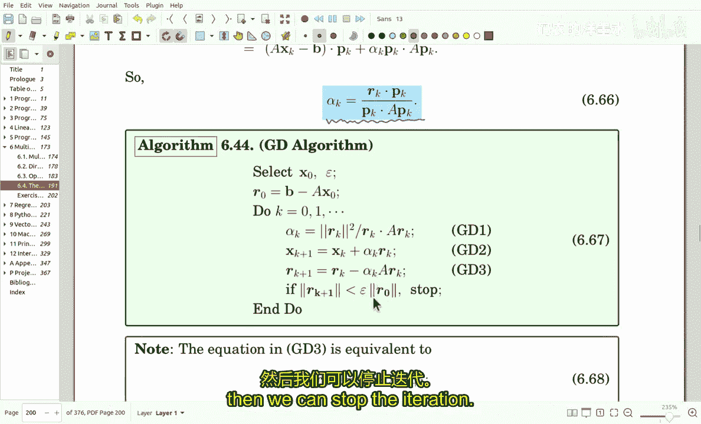

Now呃。Here， the residual acade plus 1 is defined in this rank。And。That rain。P minus a X K plus 1。

 but rather than that one。We try to use this question the listeners here。Now。

 when you implemented this algorithm。Then。In each tradition， you compute this one and say it some。

Okay， for example。That saved into a vector Q。Then you can use this one here again。

So that for each iteration， you can do only one metric vector computation。In this algorithm。

 most expensive portion is the metric of vector computation。 But if you try to use this definition。

 then you have to do one more of。The matter vector computation。

 rather than that we are using this one。Now。This one and that one is the same。

 You can prove it quite easily。And I leave this problem for you。So you can figure it out yourself。

So here the main。The purpose of using these formulas to save the。The computation。

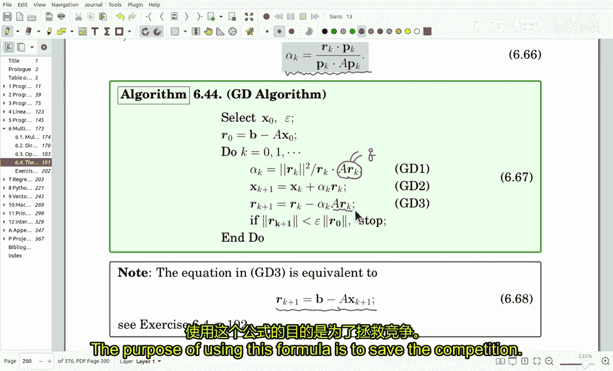

Okay。Now， for the gradient method， we may。Analyze its congence。Once a is inverable。

 then for invertable matrix， the condition number is defined in this ring。Yeah。

Norome of a times norm of a inverse。 Of course， this norm is a mat norm。And。That is the finish on。

And when。Matric is a symmetric pie the definite。Then， condition number becomes here。

The ratio between。The maximum eigenvalue tip and the minimum eigenvalue。

And that is the condition number for， of course， here， we are using two norm。

 So condition number two norm。

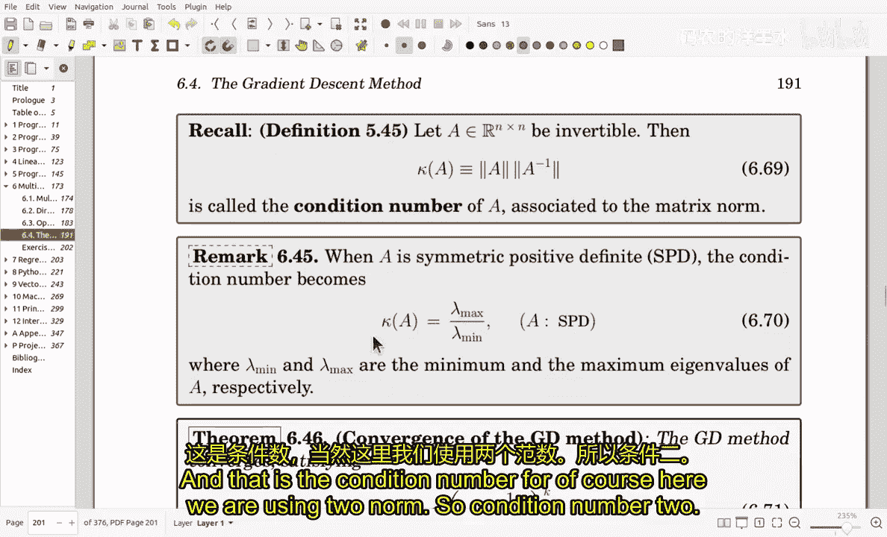

Okay， here we have a theorem components of the gradientednt method。

The GD method con satisfying this inequality。 So at。The case， after case iteration。

 the error is abounded by。Here， this portion times original error。

So that the number of iterations required to reduce the error by a factor of epsilon can be found in this ring。

 So we can get this one from this inequality， for example。

 is bounded by epsilon and this portion can be。Solved the by， of course over the in fact。

 epsent times x minus x is it like that so that we can cancel this to and then solve for k。

 Then we can reach a that one。So it is the K。 that required the number of iteration is order of。

Condition number。 So there's reason。Here the。嗯。The number of intelligent required is large for gradient decent method。

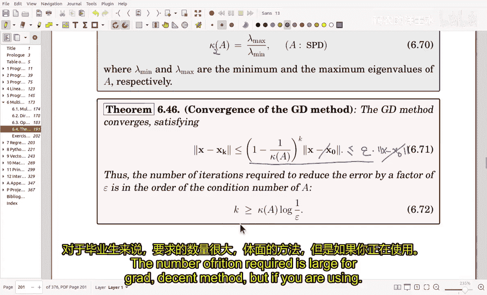

But if youre using。呃。The conjugate grid method， in fact。

 the K required number of it is around the structure of the condition number。

Usually the quant number edge larger than one or equal to one。But。Most caches， once a is in our N。

Time N， then condition number of a。As。InMany cases， order of and scared。So there's vision。

 this one is large， but for conjugate critical methodadone its very faster。

And so we know the gradient method is slower than other methods。 However。

 when you are solving the optimizing the function and the cost function of。

The machine learning problems。Then。In most cases， the gradiented decent methodthodist the choiceus。

 because it is a simple。And once you choose the step length nicely， then you can get quite。嗯。

Good conclusions。 And along with partial updates。So practically。

 people are using the stochastic gradient in this method。For machine learning algorithms。

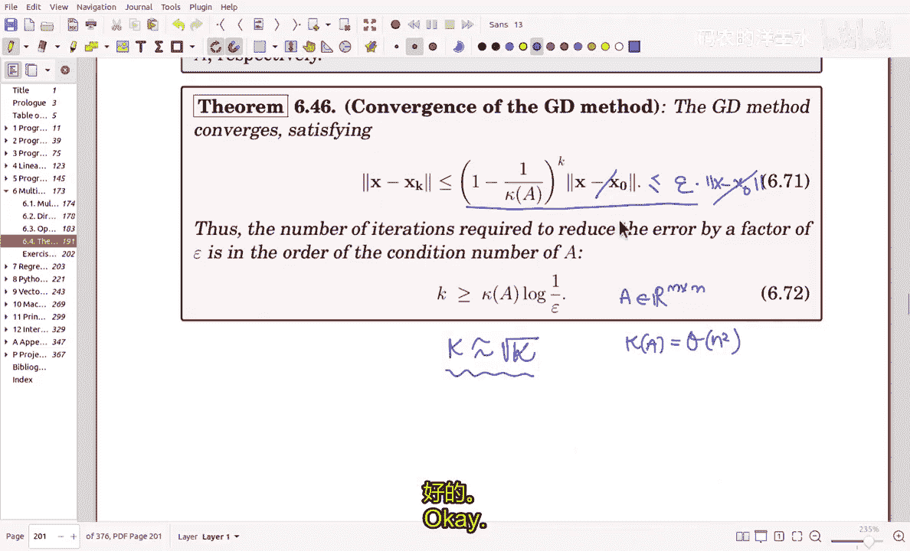

Okay， that's the end of the section and end of the chapter。 Thank you。

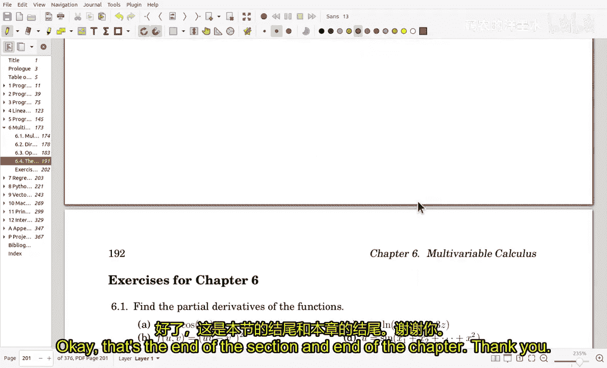