# 【全集-附课程讲义】密歇根大学-人工智能编程-EECS492-中英字幕-p46-Lecture-46---最小二乘问题—正规方程方法--BV14JqfBNEAS_p46-

In this chapter。Will study the least gas problem and regression analysis。

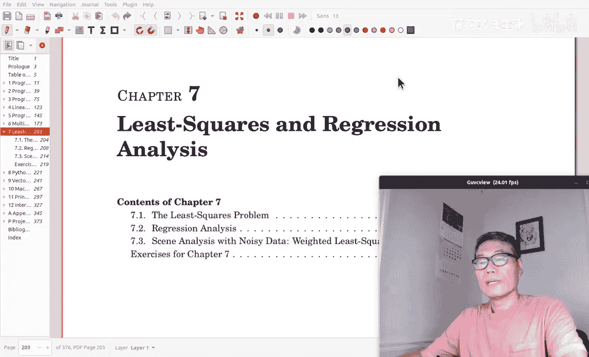

For Cleneno Alys。Will consider a well known algorithm。

Called the rana to deal with noiseisy data effectively。 Let's go to section 7。1。

 the least spheres problem。

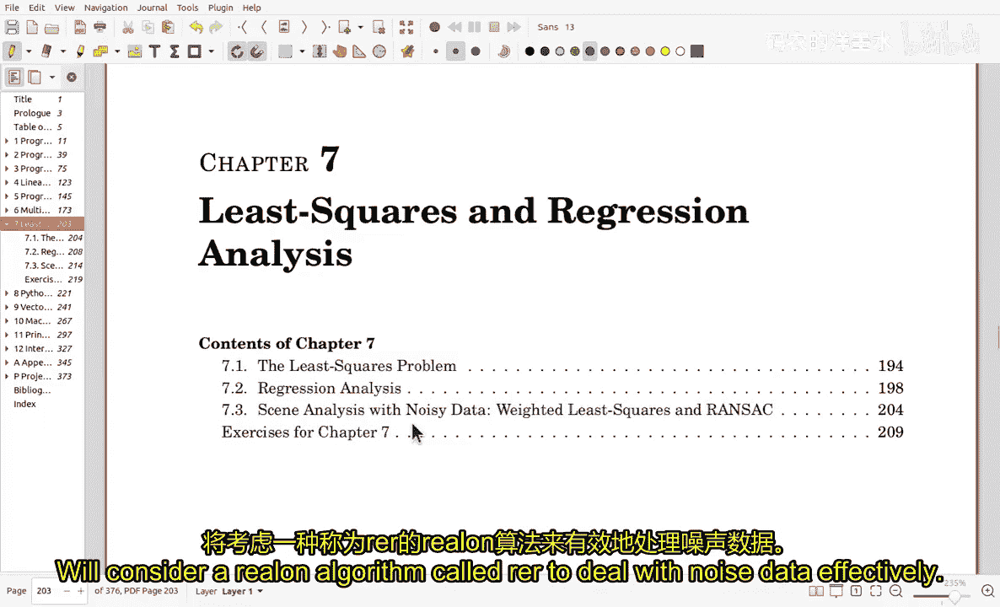

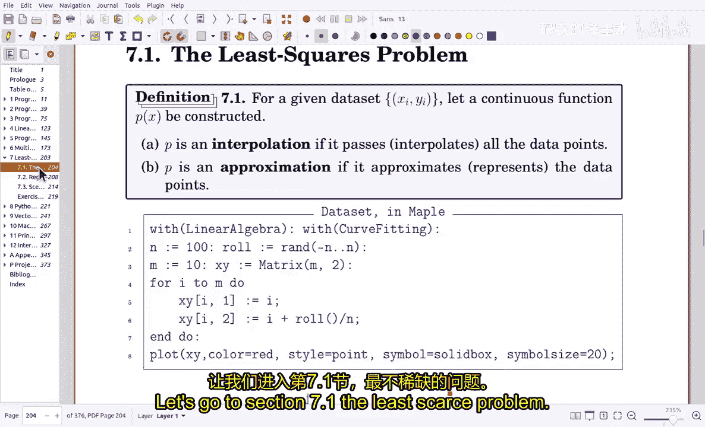

For given 대 said。X， I， Y， I。Let continuous function PO VX be constructed。P is an interpretation。

 by definition， if。It passeses all the data points， otherwise it is an approximation。

Let's see the small program。Using maple。We try to generate a data set。

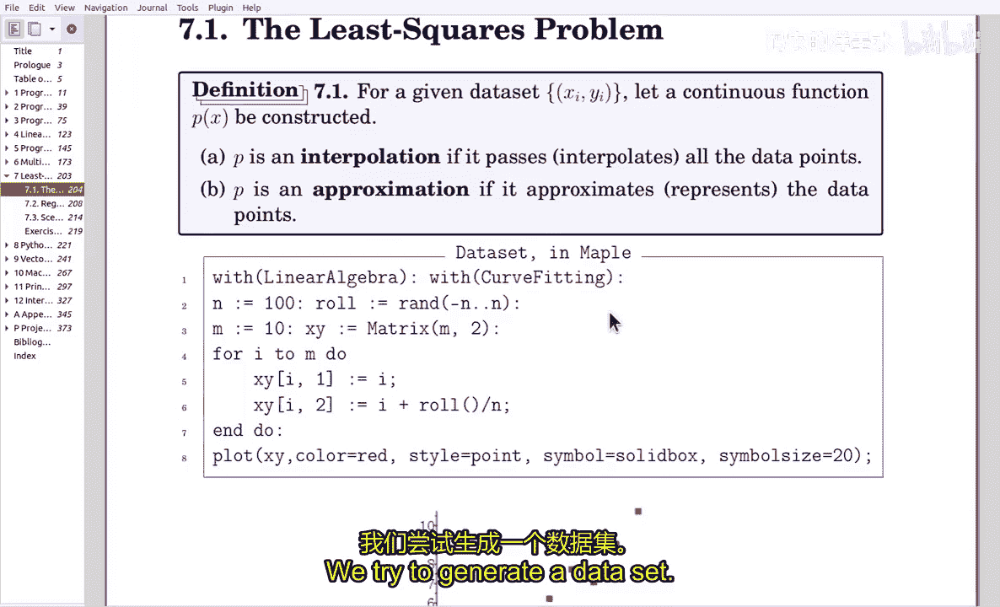

And。Baic。The model is a line。 There is x component and y component， and we add a random。error。

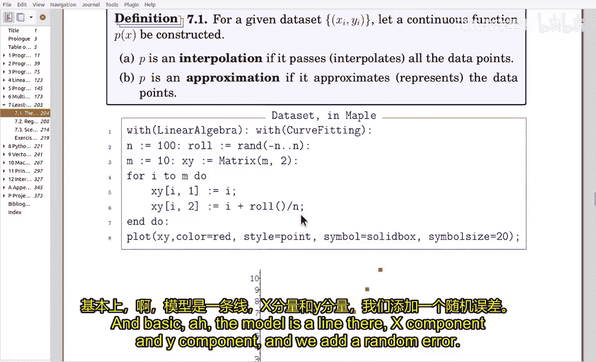

And the gene， the data。Yes， it is scatterpl。If we try to。Construct on interolating polynoial， then。

Now， that are10 points so that we can get。A polynomial of ti 9。And if we try to。

Get a best fitting line then yeah， the digital is given in this ring。

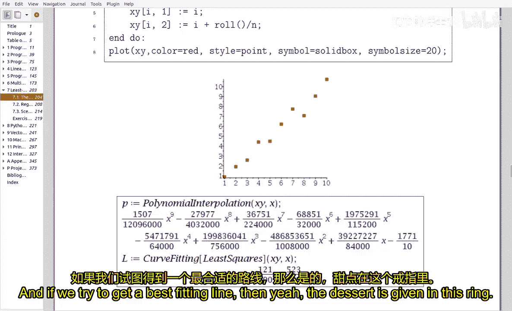

Le's the data points， along with。The interolating polynomial and the past feeding line。

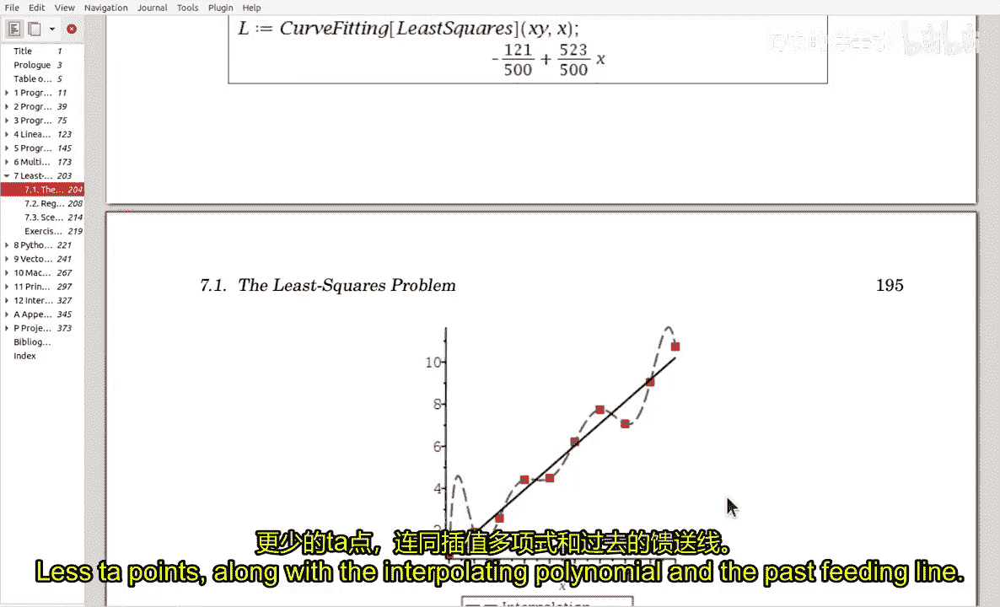

Okay， here the interolrating polynomial is quite o so that in reality， it may not be useful。And。

 further。Once data points are given at a point more than one。

 then we cannot get such an interpolation。And the statue line is the passive。

Line and depresenting the data cell。 So in many cases， this best filling line is more useful。

 So that's the。The background。Or some reason will consider risk case problems。

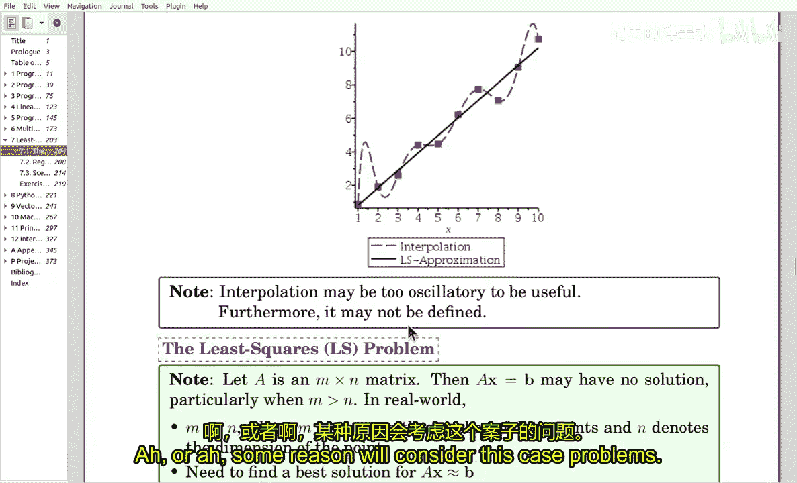

A is on M by N metric， then A X equals B。May have no solution。Particularly y M is larger than N。

In real world。M is much larger than M。Here and usually represents the number of data points and。

And denotes the dimension of the points， which is usually the dimension of future。Component。

So the number of data point is much larger。To solve this problem。

So we need to find the past solution。So that at of finding the best solution。

 A X is nearest to the source being。

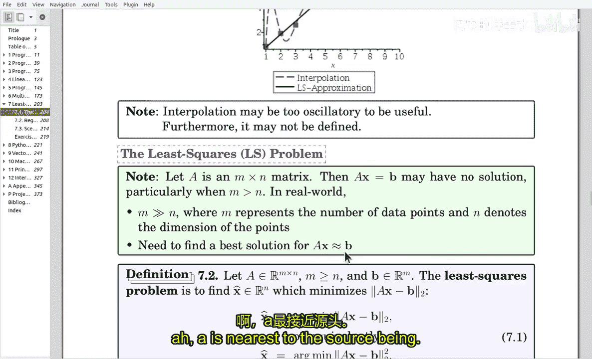

Okay， now we define the list case problem。In this way。A is on M by n metric。

 and M is larger than or equal to n， and B is in R M。

 Then the least fierce problem is to find x hat in R N。

 which minimizes this difference measured n atonome。So x hat is the mini of this miniization problem。

And that is same as this one。 once it minimize them。

With the X hat then also its sphere must be minimized with the same X hat。

 So these two problems are the same。Your ex is called。The least square solution of A X equals B。

The reason we call it， this curve is here。For Darron， this is a vector。

And when we are measuring aronome。And each component will be scared and summed。

So that is an abbreation of the list of square the error。But usually， we call at least peers。

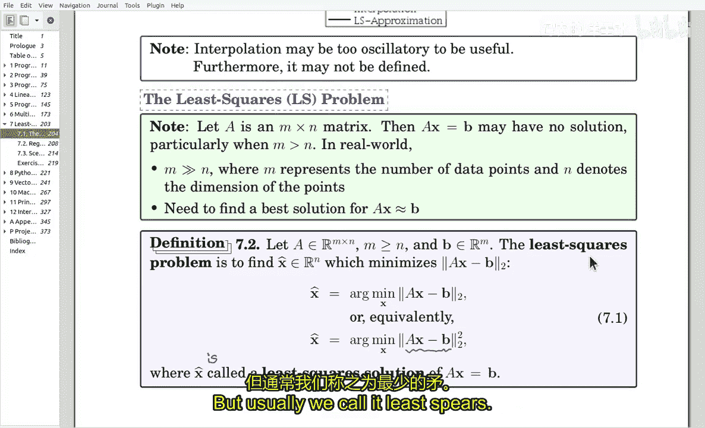

The least skills problem can be solved by using the method of normal educations。

The set of least case solutions of a x equals B。Coinciize with the 9 empty set of solutions of。

The normal。Theicians。And is given in this way。 This normalization is obtained， just。

Multiplying a transports from left to side for this one， just to multiply a transporter。

 Then you can get these normal locationss。Let's drive the me， a bying。Some calculus staconic。

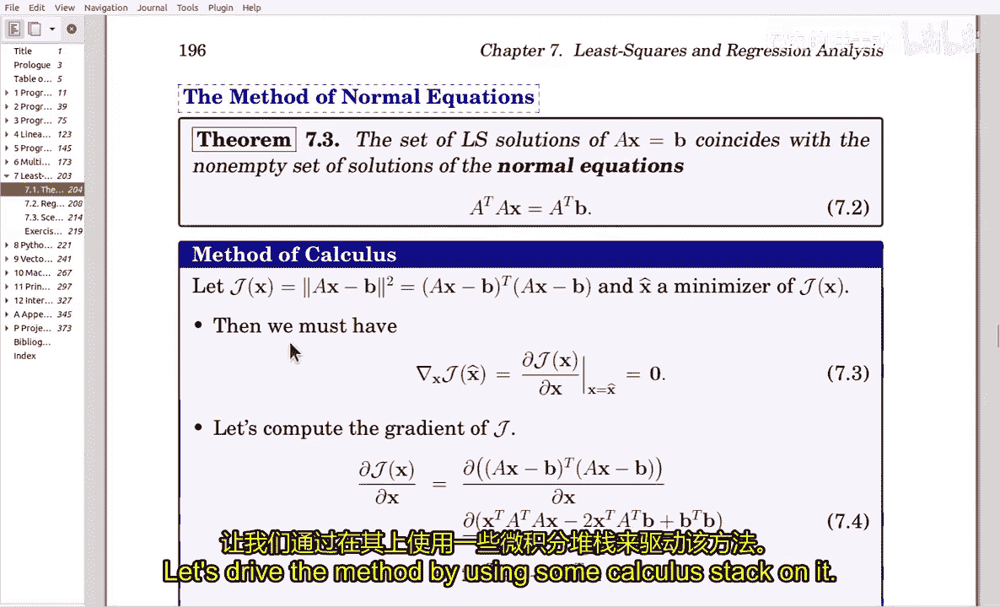

Chayya reacts。Is defined to be this objective function， A E X minus B norm squared。

 which is same as A X minus B to at times A X minus being。Okay。

 in Ltonome for vector V norm schedule is the same as V transpo the V。 Oh， we can say V dot V， right。

And。X head is。Minimize of joy V。Then。If we。Apply derivative。 So it is a gradient。And in。

Exriction then。And x is deple by x Ha， then it must be see。Now， the gradient can be obtained。

Quite easily in this way。 So once。呃。Is differentiated with respect to act then。Now， here。

 after expanding this， and we can apply the tip chip。And from this first one， we have okay。

Twice of of a transpo A and X。 And from this one。And you this appeal and。us2 a2 of B。

 And this is a constant so that itll disappear。So， we reche this one。And so。

 by setting the right side。To zdo and。We can get the normal equations， right？

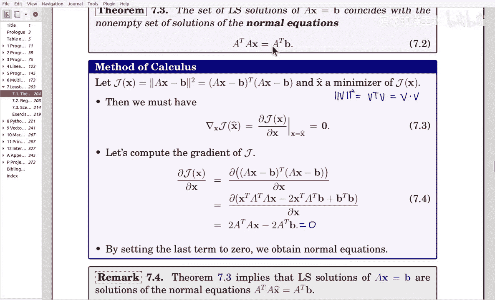

Okay。Thebi theomy implies that the least clear solutions of AX equals B are solutions of normal applicationss。

Here， a transport A X hat is x transport B。When a transport area is not inevitableable。

The normal locations have either no solution or infinitely many solutions。

So to get reasonable Uni solutions data is very important so that eventually。

The apo a the metric is inverible。 we have to get data such that this metric is inverible。

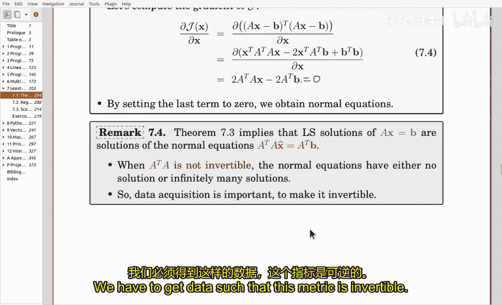

Okay， let's see here。Method of normal locations， A is an M by M metric。M is larger than O equal to n。

The following statements are logically equivalent。The e Ax equal B has a unique。

This suggest a solution for each choice it would be in our Ram。

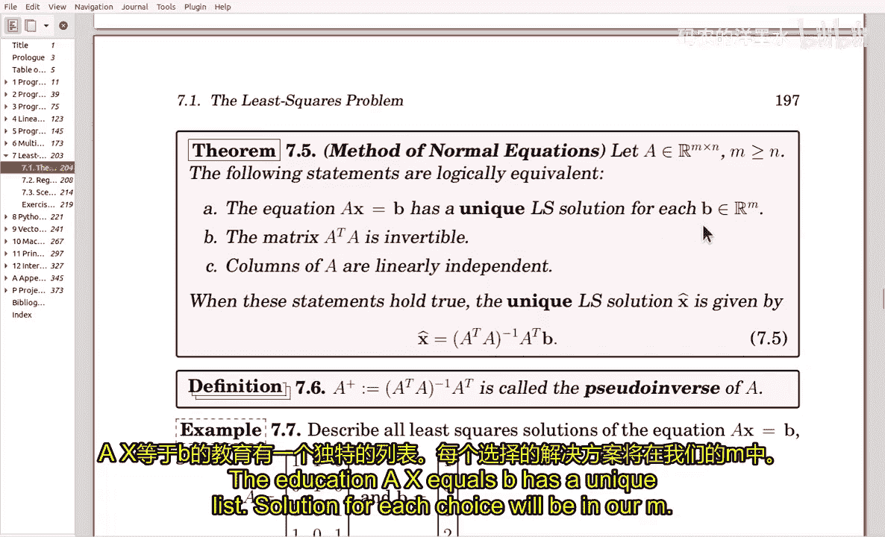

D that。This the nobel equation。

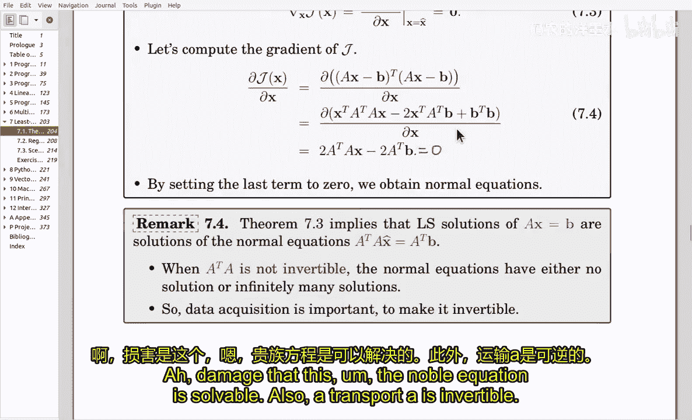

Its a solvable。 Also a transport A is inverable。

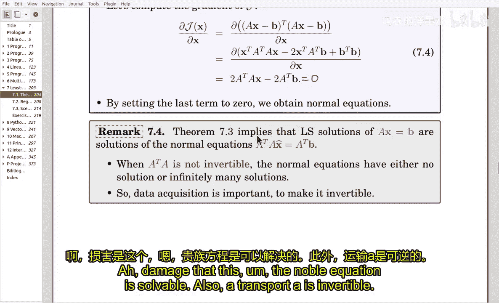

Then X head will be unique。

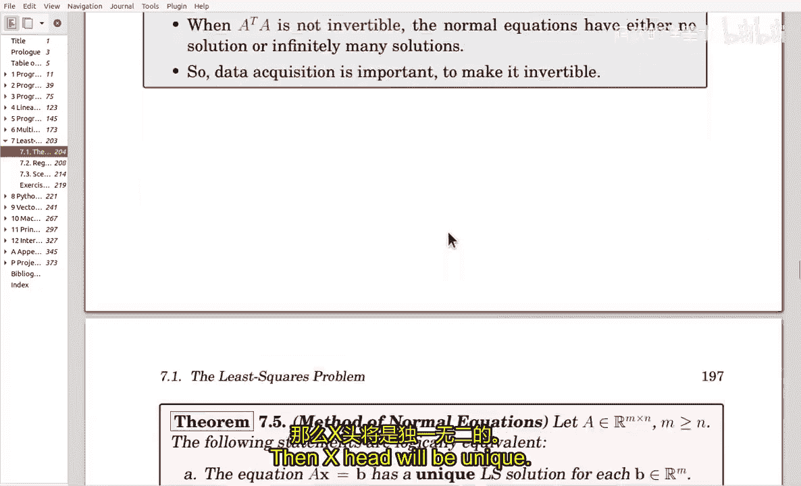

Okay。呃。So that statement is the same as this one， the metric a principle is inevitablever。

Now that is also the same here， the columns of a are linearly independent。So in this case。

 were say a has a full rank。AndPracically， once the columns a are linear independent。

 then a trans must be inverible。And because it's a symmetric。And also made along with。

A transfer A in this form。Every eigenvalue must be positive。Then。

So that these authority are equivalent when these statements holds true。The unique solution。So。

 because here。That is a unique solution so that the unique listed care solution X had。given by。

This equation。That just came from the normal occasions。So a transpose A and X。

Its now a transfer be from here。After inotting this metric。Because。呃。

If we assume one of these statements hold true， then we can inver this one to get the unique list scale solution X hat。

嗯。Now。Then， we are using。Normal location techonic。 Then here well see such matrix。

So maybe we can give it a name so that later on， can we can use it conveniently。

So by using a plus notation。We define this one and call it the pseudo universeverse of a。

Looks like if we start with that education。Now， once it is a s metric and inverible。

 then we we can apply an inverse to be to get the solution。But rather than that。

We are using such a metric。 So it is plain the rule of inverse， but it's not really inverse。

 so that we call it。The should inverse of a。Quite reasonable name， right？

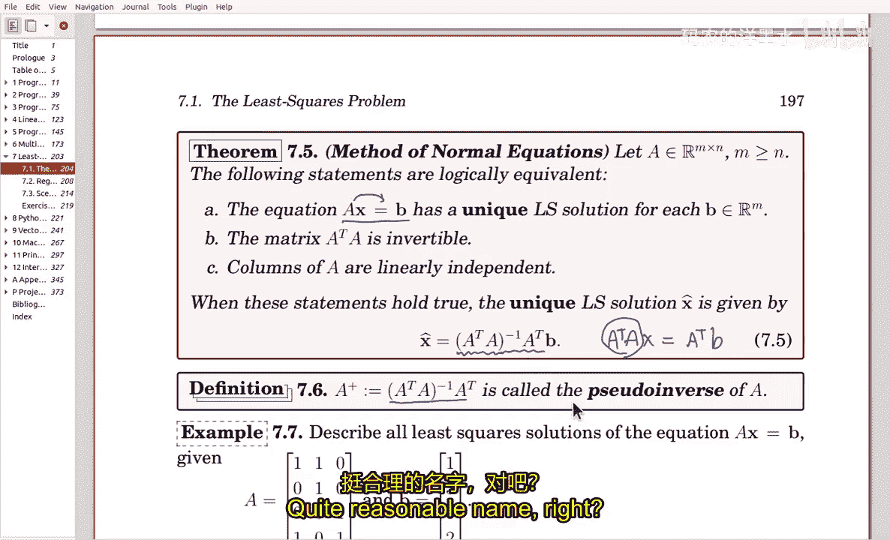

Describe all these sphere solutions of equation， A X equals being given here。A and B are given。

And let's try to solve the problem with pencil and paper。So first， we have to form a transpose a。

And a2 be。OkayA transport a。That is。Now， okay，1，0，0，1。1ン100。And then，0，0，1，1 and。The original a is 1。

1，0，0，1，0，0，0，1，1，0，1。喂。对。So， here。By using the rule of metricmetric product， we can get。The product。

 raw column。タ product。This row is one in one， so we construct only the first one and last one so that addition of a tool that is to addition edition is1 and addition of these2 is now again one。

Okay。Now， this row and columns。So that is 1，1， so that we consider only these two addition then 1，2。

0。Right。Now， for the last row， one， one， which means。In tattoo product。

 these two further row and final row will be added so that that is10。1。Okay。

 so that is edit so that that is true， right？Addition is 1， Ed is0， Ed is2。 Okay。

 so we get the metric。

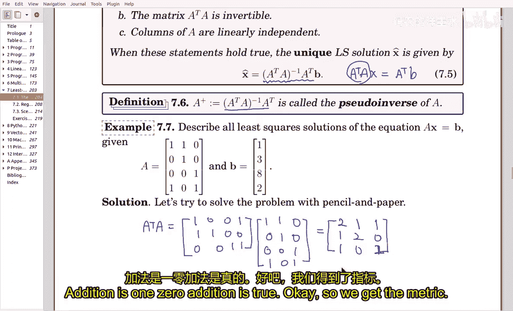

And how about a trust was being。Okay。Now， okay， that is a transforms and b is 1382 here。Okay。

 for that on。No。Okay， if we choose the first row， then first component and last component will be added。

 So we add here to get3 from this one， first and second。Will be added。 So it's4。And for that one。

 last two will be added。Which is 10。

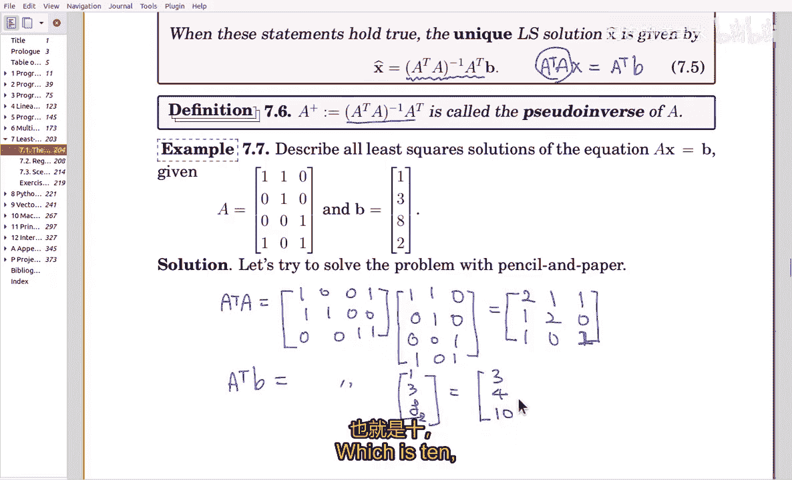

Okay， okay。So how can we solve that now to find the solution。

That is possibly start with the over to the metric。2，1，1，1，2，0，1，0，2， and right inside of 3，4 and 10。

Now we can apply elementary raw positions。 Okay， we'll move this into the top。1，0，2，10。Okay。

 and then subtraction we make consider subtraction is now two subtraction minus2 subtraction minus6。

嗯。And then here twice a subtraction。And that will make a zero。1， twice subtraction。

 minor 3 and twice subtraction。Minus 17。Okay。From this one。Now， that is 1，0，2，10， the first row。

 un changege n。Yg。😔，We may put this one in the second row so that01 minus 30 minus 17 and twice subtraction。

 that will be0 twice subtraction6 is added， which is 4。Twice the subtraction for 34。Is edit。

34 is added。 and so that that would become 28 now divided by。4， we have。Okay。

 let's try to use the metric again。

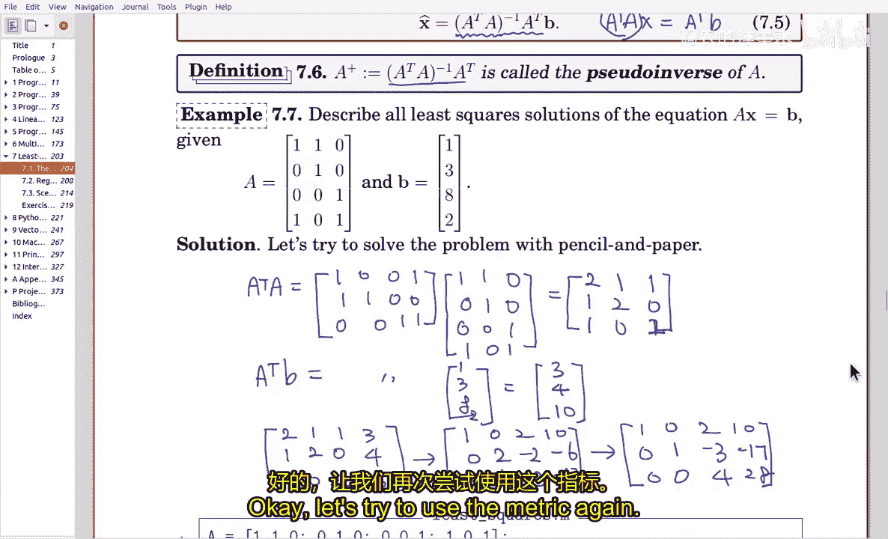

So by using red pen。Now， divide by4， we have that one here，0，0，1，7。Now。Three times added。

Then they will be 싫어。There will3 times edition 21 is editing so that it will become now。F。

Twice the subtraction。 Yeah， it'll be you know， twice the subtraction， it will become -4。

 So we have the solution-4。 Okay， this is。Identity metric。 So the -4，4 and 7。对。Okay。Here， by using。呃。

A metric program。 Yeah， That is the metric。And。Here。That's the right inside of B and X is。

A transport A inverse， a transport B， and the output is exactly that one。 and also bying。

The pencil and paper， we got the same answer， okay。

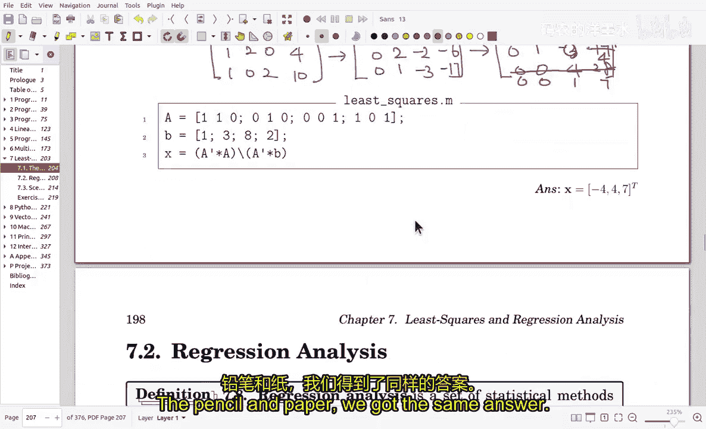

Okay， thank you。

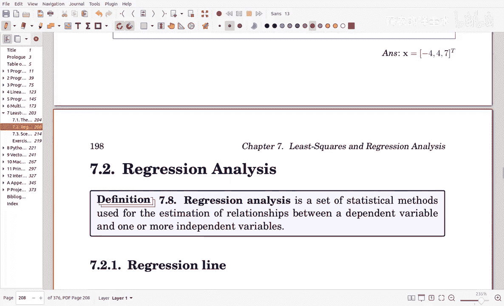