# 【全集-附课程讲义】密歇根大学-人工智能编程-EECS492-中英字幕-p47-Lecture-47---回归分析：线性与非线性回归--BV14JqfBNEAS_p47-

Section 7。2， regression on analysis。By definition， regressional analysis is a set of statistical methods used to estimate the relationships between。

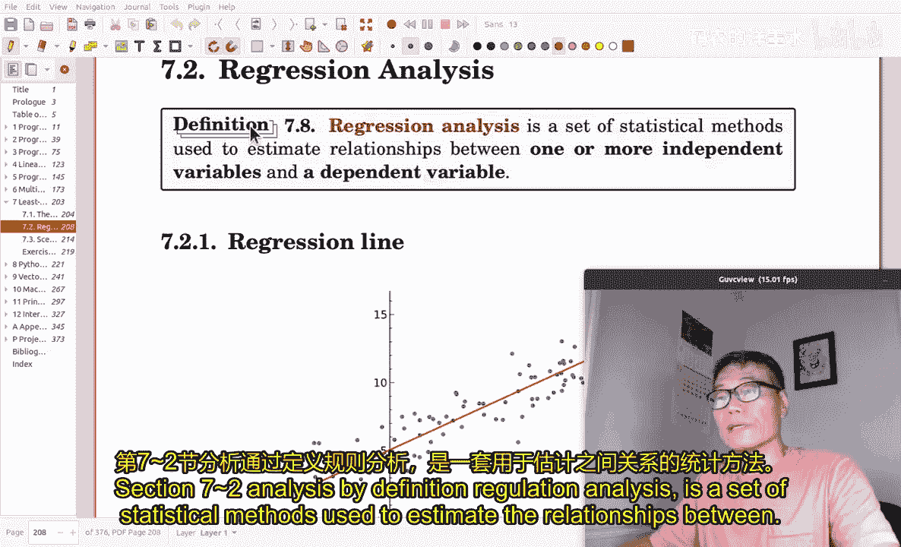

The independent variables and a dependent variable。Look at this figure。There are the data points。

And blue dots and bying the Lisa sphere technique。We find a line which represents the data points。

This line is called the Regguration line。Here， we define the terms officially in this definition。

Suppose a set experimental data points are given。As in this form， x1 y 1， x to y2 and x M， Y M。

 there are M points。So， for example， at x1， the observed value of y is y1。Right。

And if we display these data points， then assume。The graph is close to a line， as in this figure。

Then。We may determine a line。Of this form， y calls Peta 0 plus Peta 1 x。

And so that the line is as close as possible to the data points。In average sense， or。With list。

 the square error。Because the line cannot pass all the data points。

 and we have to determine the line of this form。 So we write down here。

 we may and mostly determine a line。In this case， this line is called the li s line or the regression line。

And。Pta， Peta1 a called regression coefficientions。

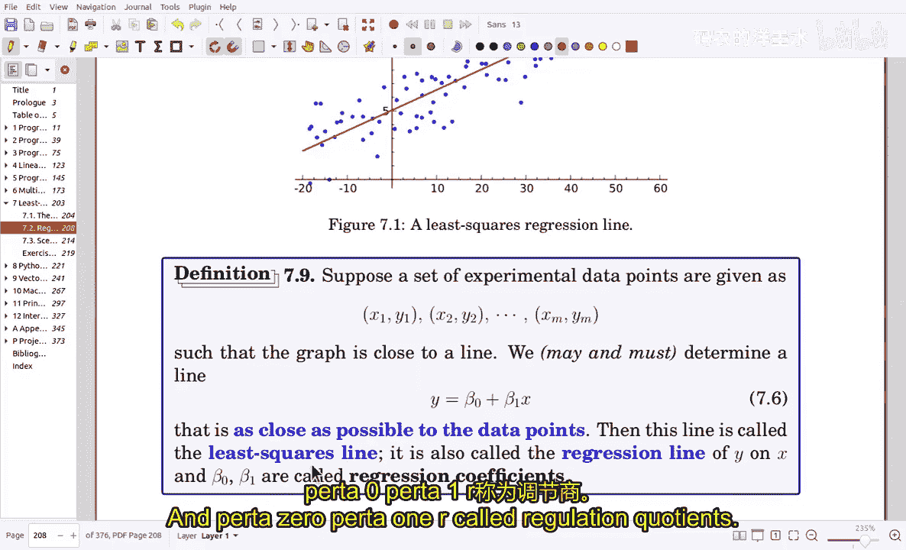

Let's see how to calculate Li line or least case lines。Now。

 we consider the least case model of the form y call Peta0 plus P x for given theta cell。Then。

Here for each point， we have object the y value at x1。

 Ob the Y value is this one so that for the model， we have this equation。And for x2。

And this is the model。And the objective y value is Y 2。 So we have this one。 So for each point。

 we have。One equation。Now， for。

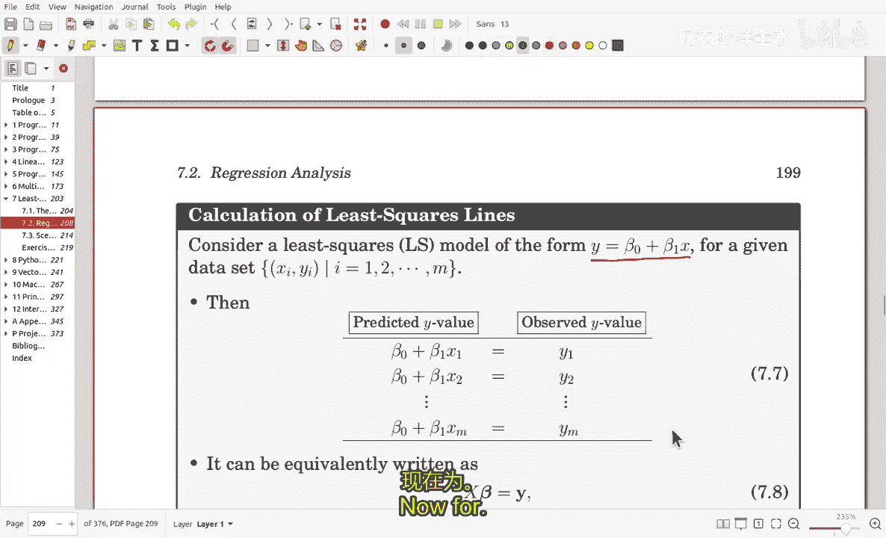

The addition。We can write it into this。Mater form here x Now the course is 1 and x 1。

 because the unknown is Pta 0 and Pta 1。1 is quoed and x1 is quoed for the first one and for the second equation。

1 and x2 coefficients。So， the matrix to x。Ass the collection of a courseions。

And peptideta is the unknown vector。 and y is the observation vector。And here。

 if we are using the laser scarce technet， then just we can use the method of normal equations。

 So we multiply x principless。Then when this is invertible， then we can find the unique solution。

 apparently。Here， this first column。And if we。呃。Tec。Here now。

The data in distinctive points at the least two of the points， the X value are different to then。

This column is independent so that x has linearly independent columns。

Which means that in earlier in the last section， we are saw fear them saying that。

This metric has independent columns， Then X X must be inver。So。Apparently， this is。Oh。

Independent columns， then is inevitableverible。Now， here。

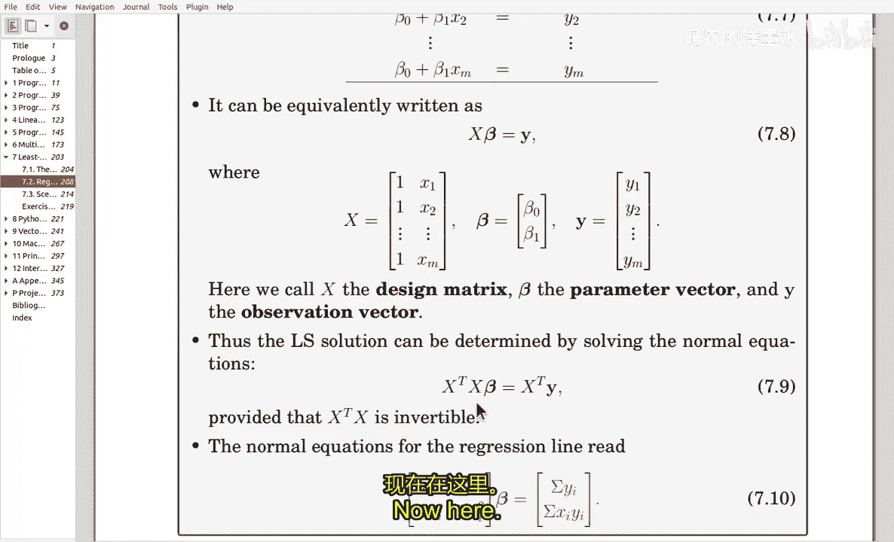

The practically， expressly， we can write down the metric X transpo and the right side in this ring。

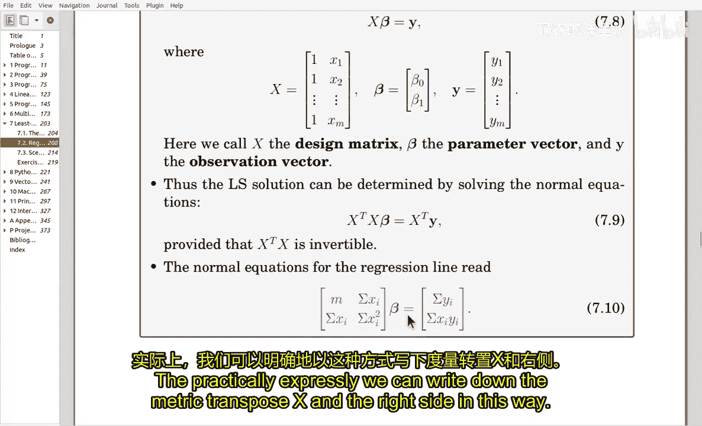

Okay。And that is M， the number of points and sumation of X and sumation of X and summation of X is curd。

There's a sum of objective values。Y values and。

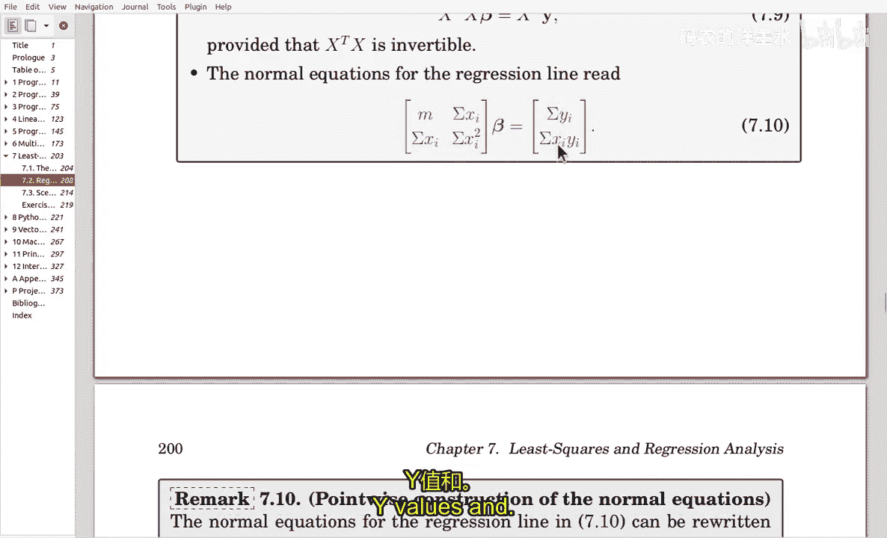

X， I， Y I submission。Okay。In reality， we may construct the normal locations here， point wiseing。

 That means that。

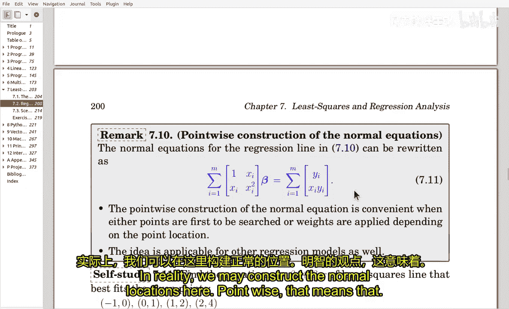

Rather than making this component onces。 And by submission， we try to construct for each data points。

 these are contributions and with some。

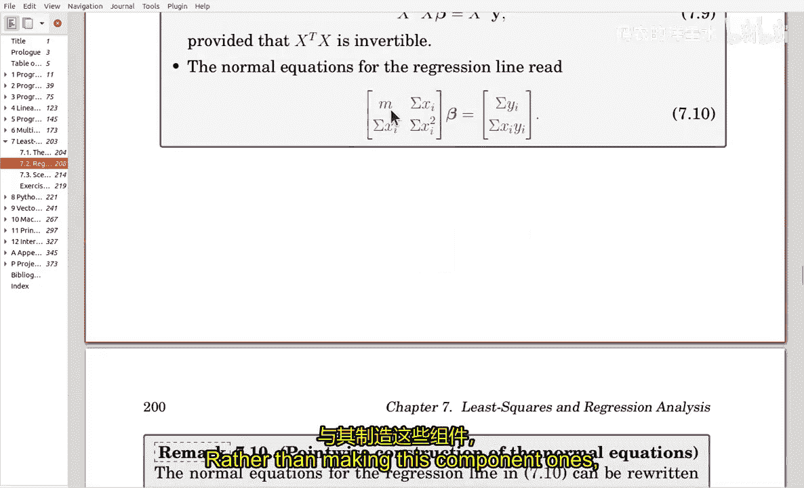

Those。The point was metric to get the final metric and order for right side。We can get。

A vector pointwise vector， and sum them to get the final right side of vector。

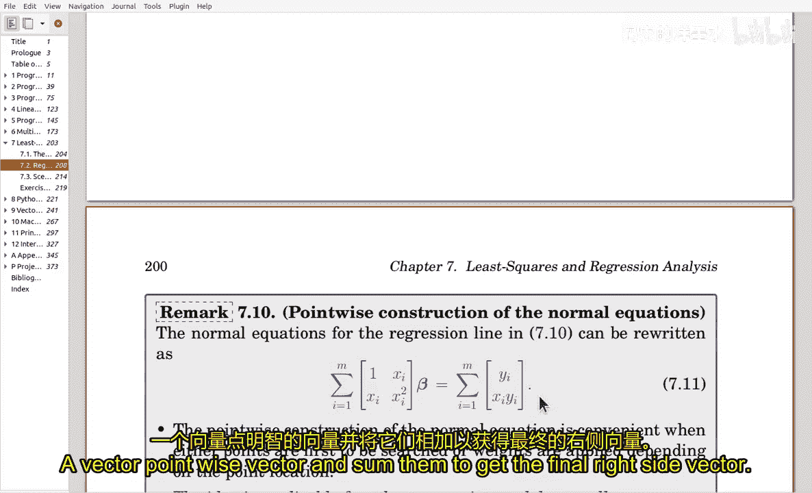

To reason， we are working on this way is that。Now， after all。呃。Once we get some vigorson line。

 and then once we add some more points， then we can add。The contributions for additional point more。

um。The easily， and over。Now， once we try to give some rates。

Some points are more potent than others and。And then we can give some higher weight so that we can put here a weight component so that we can get a better regulation line。

Okay。Now， this idea of construction of point was。The normal locations is useful for every other regression models。

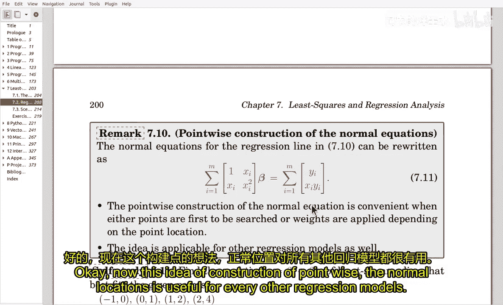

Okay。Now， herell find the equation release is just a line that bests the given points。

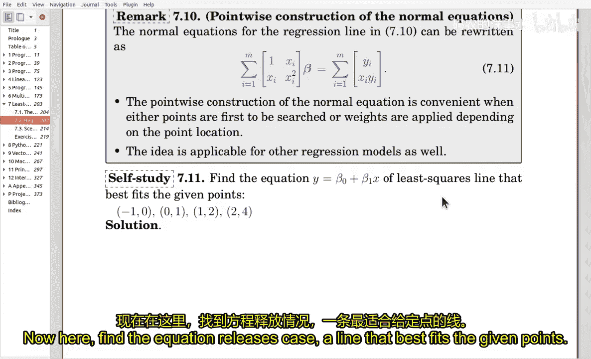

Okay， let's try to do。呃呃 some嗯。Part of the computation。 Now， when you work on this problem， possibly。

You may try to make a table， X and Y。Like there。Okay。X is now -1 and0。

 And the first components are x values and1 n。2。The corresponding y values are。0，1，2，4， right。Okay。

4 x transpose x。We cant get it here， that are full points。Theres a full submission of。The x values。

Which is。Now，2。And here， again， too。The sum of x is squared 1，1，4。 So it is a 6。Right，1，1，4。Okay。

How about the right side？X transpose of y。Okay， that one is。

The first component is a summ of y values。This one is now7。And X， I， Y I。Okay。

 here to here is 0 and 2。Plus， air。 So it is a 10。So we have to solve the metric times the cors。嗯。

Thelig in coefficient sense equals this right side。Now。By in hand。

 you can solve the problem stuff from the augmented metric for 2 and 2 and 6 and right side 7 and 10。

 you can get。If you change this portion。To be the identity metric， then you can get it。For this one。

 it is same as 1，3 by scaling and 5。And now twice subtraction will make this is you know。

 twice subscriptionion。So the trial is subjected-10。Now， trains is subed。So that-13。Okay。Yeah。

 that is。Okay， that is-10， minus 130， okay。

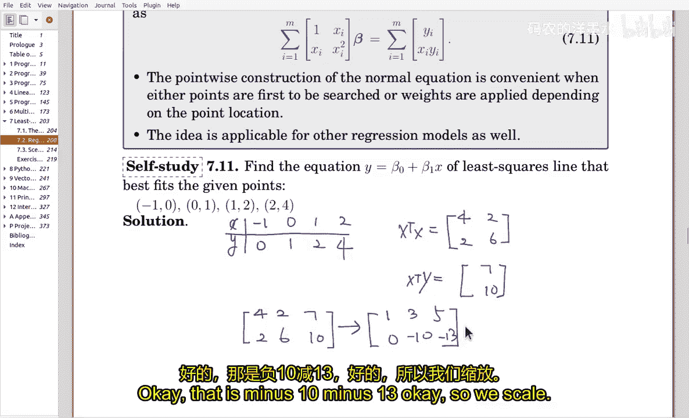

So， we scale。Bying。嗯。Different color。Yeah， rather than write it again again， we trend this one into。

0。1 and 1。3。And3 times subtraction。 Okay， from here now。3 times subtraction will make 10。

 and there is a 3。9 so that this is 2。1。I guess。Yeah。It is 3。9， okay， 1。1。Okay。There must be。1。

1 and0 1，1。23。Damage， this is a be， and that is beta1， so that the model。

We are seeking as here y equal beta 0。Ass 1。1， and the sloia is 1。3 nx。So， that's the。

Filular as okay。Okay， now that is here。For other curves。

 we can use the same techniqueing lease scarces feeding methodth。Corn suva。

The regression model of this form。Its a quadratic polynomial。Then for 기 데타셋。

We can make here the equation for each data points at x1。

This model has this one and this is a of the y value。For every point you can make。Any question。

And these sets can be read。In this metric equation， now here。배타 싫어 베타 1， 베타 2。

forming an unknown vector and quos are 1 x1 x1 squared for the first location。

 So we have here from second location1 x to x source square so we have the collection of quots。

To become x and that right inside y is to observe the y values。Now， if we are using。

The least case technique with the normal location method， then now we can get here x transpo the x。

 if you do critical computation， then you can reach out this one that is better and x trans y will become this one here we have the pattern。

This says 1 x。Exces schedule， sum。 and that is now。When x is multiplied。So X， X to。

 X now cubeubative。And one more time Xi multiplied here。So that one power increased them。

 So you have this pattern for right side。Now， a submission of Yi， X I is multiplied and X I schedule。

It's multiplied。So you can see the pattern。は。Now。For this problem is a selfish study problem。

So they try to find the， the on。Thisless curve for。This data points and in this form。

Try to do it you。 then youd see this result。

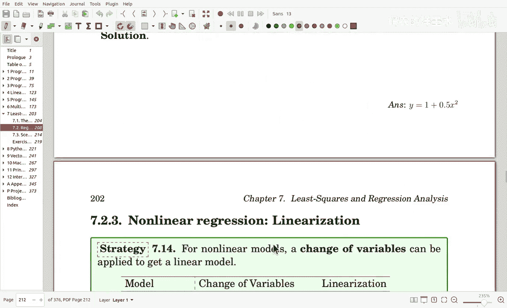

Okay， now the。Regation technique or least technique can be useful for9 in your mothers。

So through linearization， we can do it very effectively。Now， that start from change of variables。

 Look at here， the model question assume we going to get。Yeah， the model。

 we have to fit the given data points by saying this model。So， it is。

Not linear because X is involved with on the bottom。In this case。

 we may consider a change of variables in this rank， x tilde as one of x。

And now we don't have to change why。 but we try to use this change variable， why。Tilday it's same SY。

Then now in Tilde variables， we have this one。And y tilda is same as a。Plus b times x till down。

 So it is a linear model。嗯。By using this model， you can。嗯。Find A And B。And easily， just the standard。

Bying the standard ecious formulation。Now， if we have this model， then now rather than next。

 we try to introduce Y tilda to be one of Y， then it can be written in this form。 Again。

 this is a a linear model so then you can get。This gets solution quite easily by using the standard technet。

Now this is exponential function。For this matter， we have to decide C And D the Cors。Now。

 in order to do that， we keep x variable， but for y variable。We take lower of them。Then here。

 if we are taking logarithm， then there is a logarithm of y is the same as。Now。

 log at them of these termss。That same as logarithm of this plus logarithm of a C。

 so that we can see that Dx plus logarithm of C。So once。We apply logism from both sides， then。Here。

 along with the log than Y， Y til the， we can write in this way。That is exactly from here。

 Y tilde same as log than C plus D X tilde。 Now， this is a。리녀마。And we'll get。

The output will be lower at the machine。Out of the lower C。

 we can get C by taking exponential function， right。Now here， consider this model。

 then we introduce one of Y to be Y Tilda then。It becomes now a numerator for logar max。

 Now are we introduce x tilde， Then it will become again， a linear model。

This table shows just a few examples of linearization。For other9 in others。

 you can use your imagination creativity to get。Denalized model or。

Some very approximate linear model。To reason we need a generalization is that sometimes we have to solve the Nniya regression model by wish。

For example， Newton's methodthad。In this case， you have to keep really good initialization for the parameters by using renalization or approximate model。

 you can get good approximate parameters。 Then from that moment， you can get the。

Much better estimation by using the newton method。

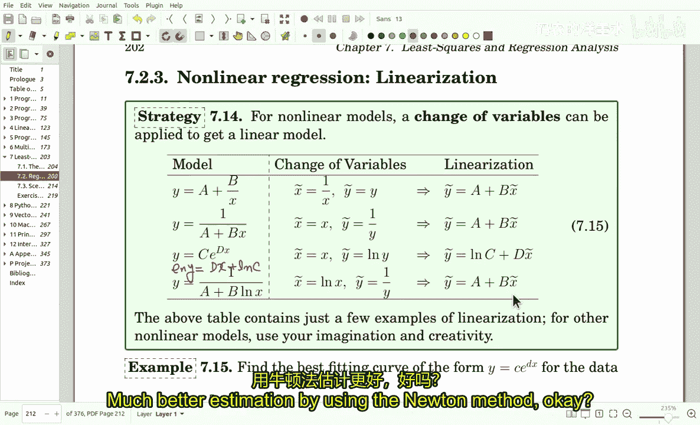

Okay。Okay， here， these are data points。And finding the past feeding curve of the form。

 this is exponential function for the data。So if we make a scatterlate。

 then it is given in this ring， looks like an exponential curve， or it can be a quadratic curve。

 but anyway， in this example we decide to find the best feeding curve of this form。能。Okay。

 after taking Lo of them。And here we have that。 So we are introducing the change variable for Lo Y。

 We are using capital Y， and for。Smallx， little X。 We are using capital X rather than tla notation。

 We are using capital variables。And here。For Lo， we are using a。And for the， A1。Then， the。

We can decide is this one。 This is line。So， we apply。

The linear li gas a method that to get a 0 and A 1 after getting these values。

 and we can dec and C And D。 A 1 is D is directly from a1。 Now， C can be found。From here。Now。

 C is exponential of a0， right？Okay。This is a small code in maple。Now， here。Okay， in fact。

 data is medium。오케이， 데이터스 기분。From here。嗯。Okay， that data is not shown， but anywhere from there on。

And y is logarithm of y。 So we are taking for y values， logarithm。So， that。Here， X， n and Y。

And this x value is the same as。The original x values。 And now y values， infected， theres capital y。

 which is logarm of sum y values。So this a change of variable means。That in programming。

 you have to apply the same operation for data values。So that。In this data set。呃。The y value。

Cannot have negative or0。And once it is appearing， then also you decide to decide。

To fight this mother。Then， here。The value， the other values are positive。

 y values are positive then summe and some data point having negative y value。

 you have to discard those the data points。If you try to use that， then the algorithm will break。

Okay。So we take a log at them。 And for those threshold from the data， we try to find a curve。

In the form of。Now， a plus bx， then we have that。So that is now aid， that is a1。

And D is decided from this one， directly。Now， C is the exponential of this one so that we can have them。

So here， the 디자인 model。So this one C times is exponential of Dx。 Okay， that is one。Now， we yeah。

The make plot for the curve we found。 So these are data points。

 And this is the model we found by using。They linearize them at least scared method。

It's fitting around， right？

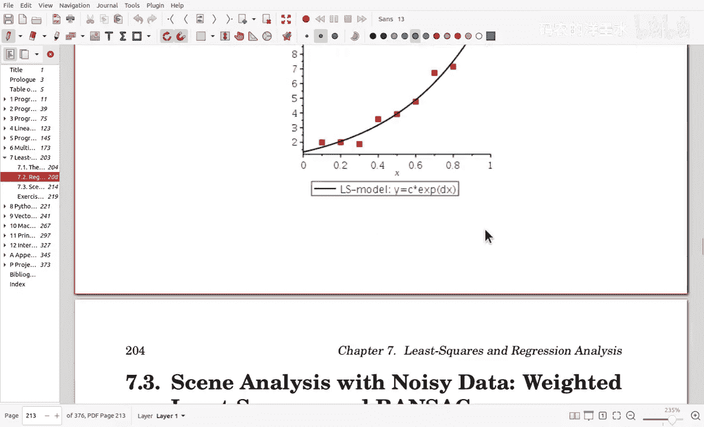

Okay， that's the end of the section。 Thank you。