# 【全集-附课程讲义】密歇根大学-人工智能编程-EECS492-中英字幕-p48-Lecture-48---场景分析：噪声数据加权最小二乘法和-RANSAC--BV14JqfBNEAS_p48-

In this section， we study techniques for。Noice data on analysis such as Ra the leastphers and ranan。

Cn analysis as concerned with the interpretation of acquired data in terms of predefined modelss。

It has two sub problems。First one is finding the best mother。

 which is a kind of classification problem。And the second one is the computation of the best parameter values。

Which has a parameter estimation problem。traditionalditional parameter estimation techniquess optimize the model to all data points。

Such as in lease peers。Those techniques are simple aboaging methods based on the smooth assumption。

The assumption yes。There will always be good data points enough to smooth out and across deviation。

However， in reality。The smoothing sufficient does not hold in many applications。

That means the datacent may involve cross errors such as noise。

So in order to get more reliable model parameters， there must be internal mechanisms to determine which points are matching to the model。

In liars。And which of points？Producing false matches， how layerss。Here we have weighted list squares。

 When you get data points， then。You may see that some points are more important and more reliable than the others in this case。

 for those important points you may try to give larger weight。

 This is the idea of weighted leastphers method。That is on risk scale method， which involves。

Wt metric， W。The ray metric is often given。As diagonal and metric。Like it is。

This rates can be decided。

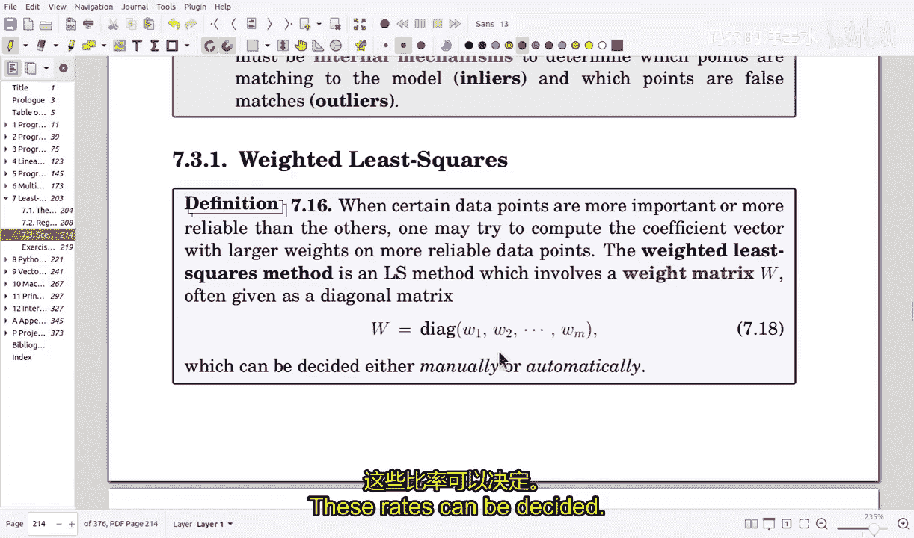

Either manually or automatically。

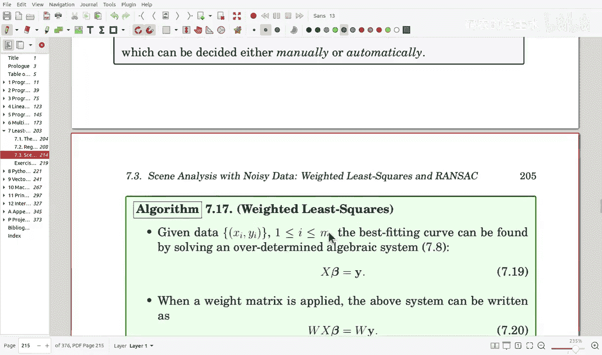

Here is an algorithm for weighted Lisa scales。For 기본 데이터 set， X I YI。

The pest feeding curve can be found by soging。On algebraic system given in this ring。

 we formulated this form of。A system earlier。When a rate method is。When metric is applied。

 then the system can be read done in this way。 Just we simply multiply the wave metric。

Then the corresponding no created the no。Can be formulated in this by multiplying x transports。

Once this is inverible， then we can get。The parameters， uniquely。

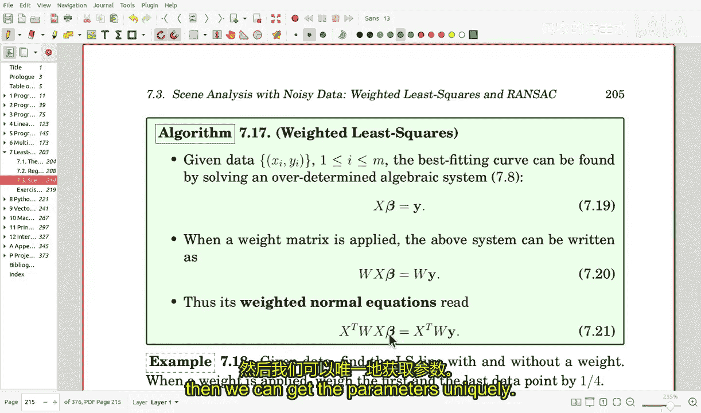

See this example。Given data and we to find the least scarce line with and without a rate。

When a weight is applied。The way the first and lost the data points by。One quarter。Okay。Now。

 if you see the data， okay， in fact， we can plot here。Now， it's around the line for。Inter points。

 but for boundary points。Is quite perurbed。 So we may consider。

These two boundary points are not liable。I's not to discard these points， because yuan。In reality。

 when you try to get a Tetaan， then every point is money。Once you paid money。

Then it is notdge to discard those points。So。You may try to use it with。Smaller weights。

 So that's the。Idea here。Now。LS is output of the cover feeding。In standard way。

Having all the way Sam right。Now， weight to the list square is using this weight metric。

For first one and last one， the rate is one quarter。

 and inside the interior points as have the same rate 1。So let's see the resultss。

 these are apparently quite different。Okay， when we are using。Weight， then we have that solid curve。

 And without using weight， we have that one。So now here rate the listques is more reliable。喂。

Once we assume that these two points are our lis。

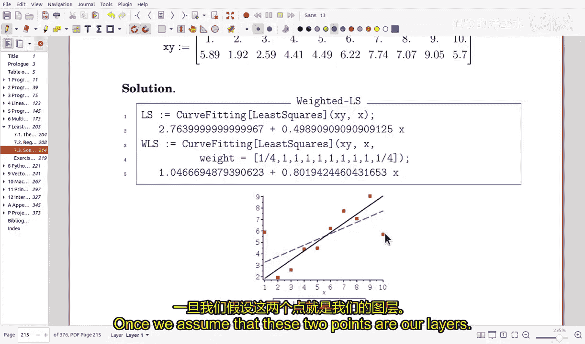

Now we'll go to rannza， random sample Conors。Ranza is one of the most powerful tools for the the construction of corono structures from。

Poin cloud datas。

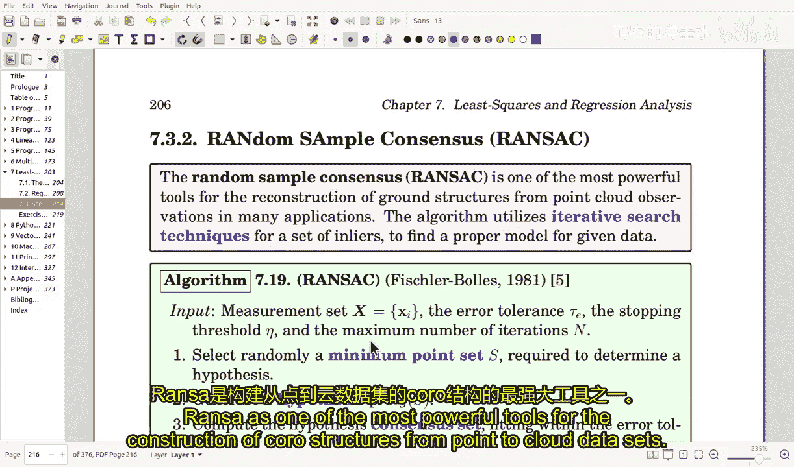

The algorithm utilizes。E of was search techniques for a set of1 layers years。To find。

Propo model for given data。Here is an algorithm。嗯。That is。Invented by Fsler Boles in 1981。Okay。Now。

 X is the theta S。에르톨로는스타2。Is used to。As a radius。Between the mother。

So I'll explain this one how it is used to。 And now stopping threshold shoulders。

 Yta and maximum number of iterations， capital n。We start with the first step。

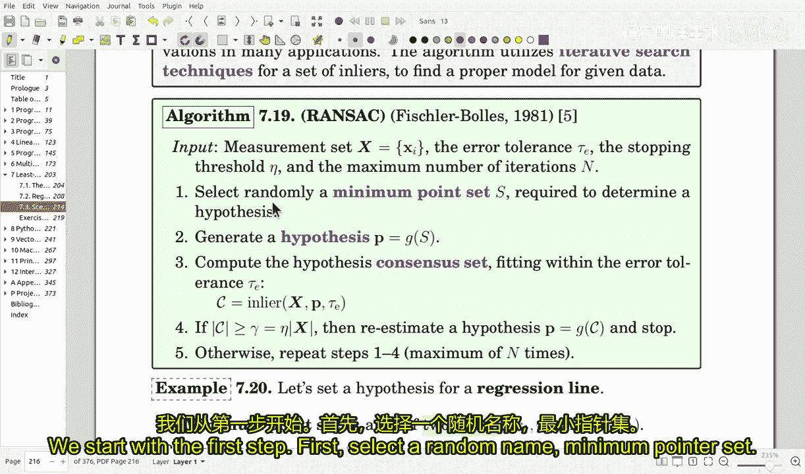

First， to select a random name， minimum pointer cell。Theyqui to determine hypotherfaes。

The minimum point to set means that minimum number of points。For example， if you。

 your mother is a lion。Then if you choose the two points， then。You can decide the line。

So that minimum pointer set will include only two points。

 So we select randomly two points to form a minimum pointer set。And generate hyperthe P。

U with fifth face now a mother， the line is made in。And compare the。

Hypophy is consensus set feeding within the error tolerance。 once you are constructed a line。

Then here， and redis Tao E is used to get a strip。Like that。

 and then that is now we count the points inside the SS strip。So in this vein， Tao E issues。

So that from the data set。And using the。The mother and using the tolerance。

 So it is a radius of that。And we count， we collected the points inside this3。

 Then that is the consensusor set。Now， we count to the number of points inside the the consensusor set that once it is larger than。

Certain number。 So Yta is used to。The three shoulder。 So it's pushing。For example，0。9。

Then 90% is larger than or equal to the 90% of the。Original theta points， then we re hyperfi is。

And stop Otherwise， we go number one first step in the。And up to N iterations。Once we cannot find。

Any hyperfies， any inlay set so that。Here， it is not。 It is satisfied。

 If there is no such consensus said， then among the search， we try to choose the。

The set having largest the number of points。 So in each tu， we kid。The， the pest one。So that。

Once at some point it is satisfied， then return the best one and stop。If not。

 then we continue up to an iterations。 and eventually， we return。AndThe best the one。

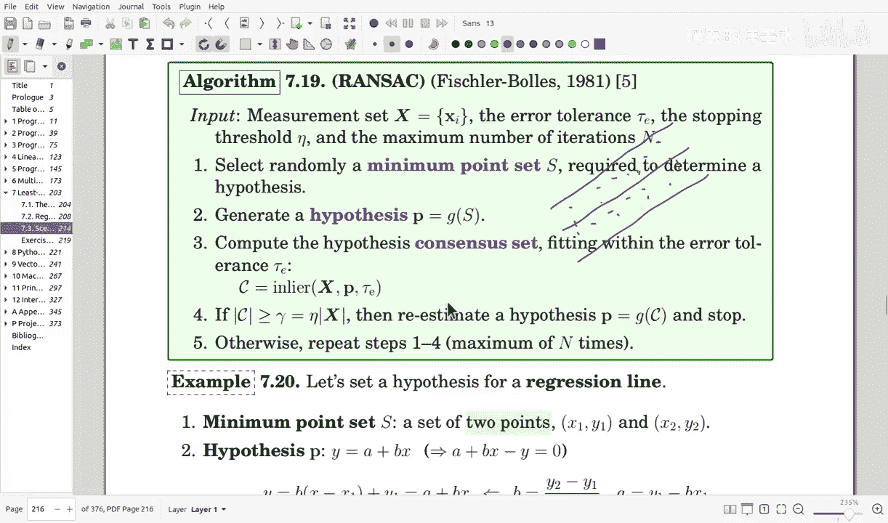

Okay。Here， let's set a hypothesisthe for regression line。 When we choose line。

 then we need the two points。And from two points， we can。Easily that here， the modern。Or in this way。

 But they can be made easily。Yeah， by you saying。The technic。

 the slope can be measured by using changing y divided by changing X。

 You did this one from high school and you can decide。

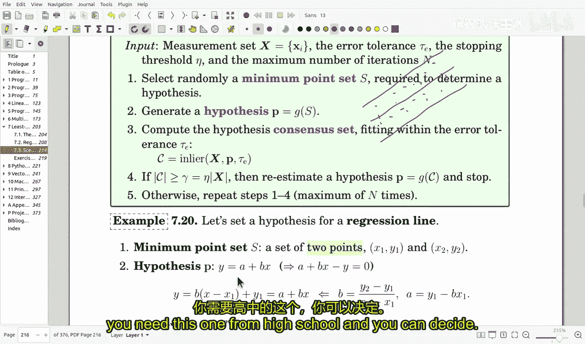

The model。And for the consensus said C， now that is the collection of a points。

 So that from the point to the line that is。The formula for the distance between X， I， Y。

 I to the line。I guess also you learned it from high school。The distance is aed by Tao E。

 then is a part of the。

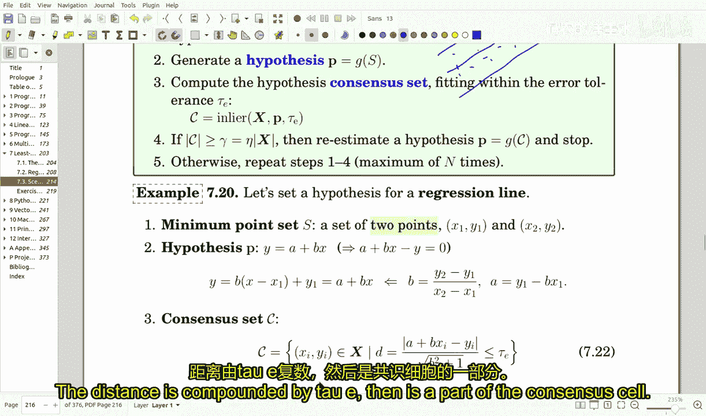

Connce sad。Okay。Here we have a note for implementation of ranan。In step 2。

The hypothesisesis P is the set of model parameters rather than the model itself。

Damage the rather than modelly self y equal a plus B X， probably we may save only a MP。It's okay。

 and further step， we need only AM MBBA。

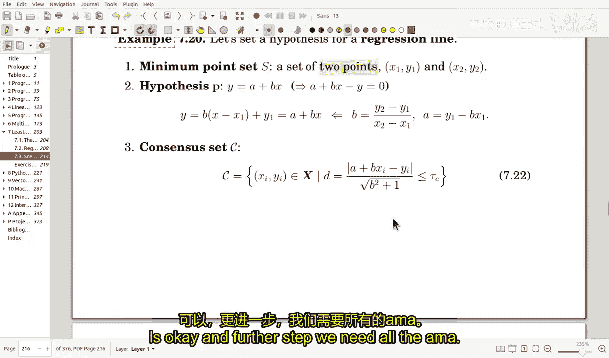

Now， in step3， the consensus set can be represented more conveniently by considering C as an index array。

Then is that。C is an index ordering so that once X I is in C， the consensus set， which means。For X。

This inequality is satisfied， then。At I position， we put one。 Otherwise we assign0 so that。

We try to collect the points， corresponding。The index value 1， then these are points of in layerss。

So， it is quite conveniently。嗯。The collect the。

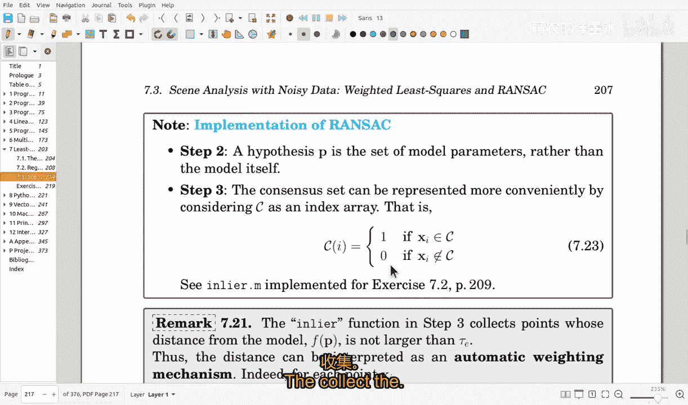

The points for your layers。Okay。We have a remark for the。Randack。

The inlay function in step 3 collects points whose distance from the model is not larger than tau E。

So the distance can be interpreted as an automatic。Creating mechanism。As a matter of fact。

 for each point Xi。Once distance from X to the mother is bounded by Tao Yi。

Then we try to say the rate is  one。 and otherwise the rate is 0， then。

The re estimation in the last step。And when we just before stopping。

The hypothesis can be seen as on potentme estimation with corresponding rate metric。So。

The parameter estimation in the ran can be considered as weighted lease cares。

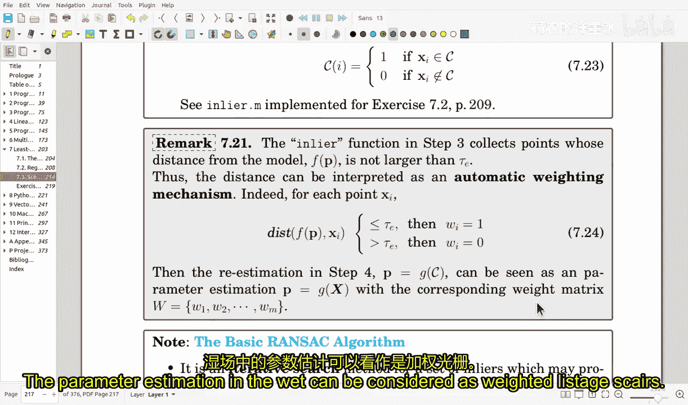

The basic race algorithm。It is an iterative search method for the for a set of inlineers。

Which may produce presumably accurate model parameters。However。

 it is problematic and often very erroneous。The main disadvantage of Ra is that。Rans against。

 unreputatable。It may yield different to result in each run so that none of the result can be。Optima。

However， it is a simple。In implementation and also efficient。So that people like it。

People like a simple algorithms。

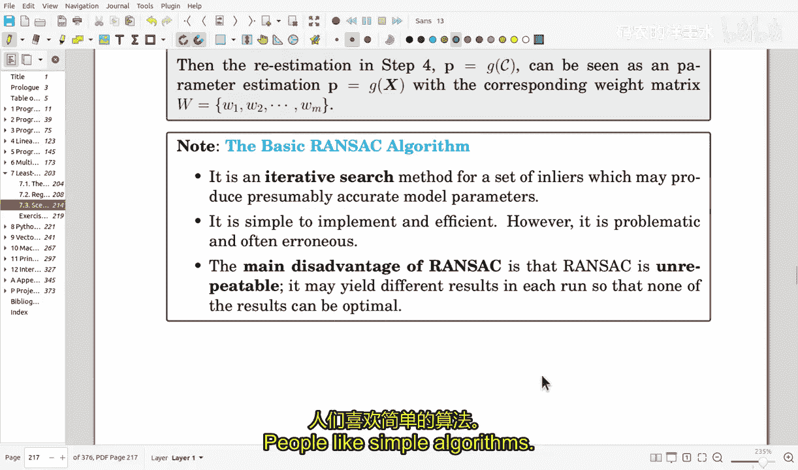

See this jumpper。Now we have two different data set blue points。嗯。

E layerar points and whether does our lis。Once we are using all the points。

 then here we have red line and bothide。And if we are using only in layer points。

 then we have here blue line。From the lease spheres。Now， we use a ran that。

 Then here sion that the lion is made。And as from the out of Ran。Now， as can see here。Now， this。

Lines are only different from。The design， the one。And now if you run and then each time sometimes it is very good。

 but sometimes quite different， sometimes you can see very with a very large perturbion。

 such a line is made。So， I try to measure。The changes。And after running 1000 times here。Now。

 from Ret， and I collected outputs， the 1000 output and tried to measure the standard deviation for。

Okay， for this model， for the intercept and for the slope。So， that is， now for。

Left to data set is data set 1。 And we have here， a standard deviation for。

The y intercept this value。 So its error is large and for slope。And again。

 large and there is average computation time。Now， for right side， Tita said。Here， the intercept is 0。

1。So， yes。I's not so much accurate error is really observable， and slope has such error。

 standard deviation， and this is competition time。For the。St us in the right side。Okay。

We have here somebody for Rsat。Rena is neither repeatputable nor optimal。

In order to overcome the drawback。Various variants have been studied in the literature。For variants。

Yeah， we can construct this maximum likelihood estimation sample consensus。That is called。Okay， okay。

 I guess that must be meal set。So that is to pronounce， but any a。

MLE is set and here progressive sample consensusors。 There's Pro set。

And because say ranai is all of ransai。Yet people don know。How to。Overcome the tool bag completely。

And。In fact， I published。Paper， and this year。And that's called。Are you sick？I UAC and I Z。

 and that is now optimal。We are using iterative update rather than iterative search。 and we can get。

Some congenent。The variantant of Renan，an。We can input the computation time and accuracy a lot。

However everyone， anyway。Here， incredibly。Ranll remains a prevailing algorithm for finding in layersars。

And even though people made such a variance， granted it is simple。And efficient。 So that。

People like it。Okay。That's the end of the section， thank you。

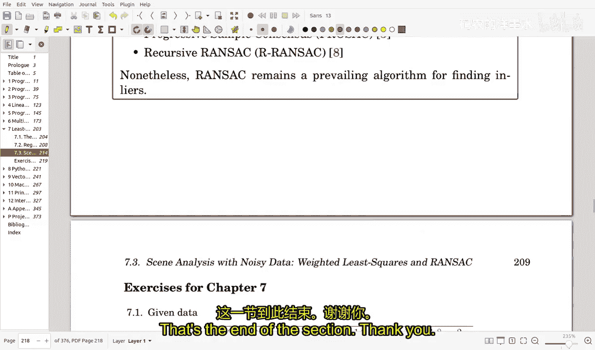