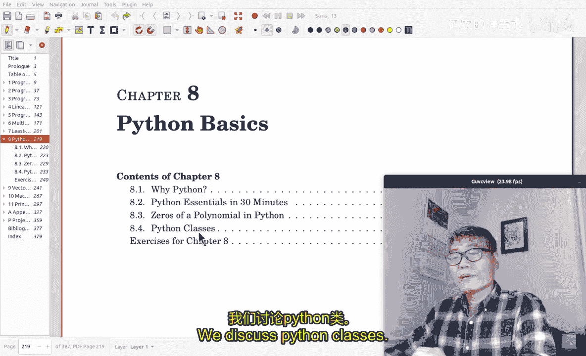
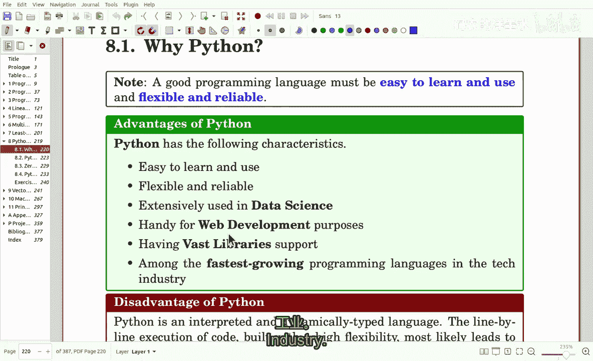
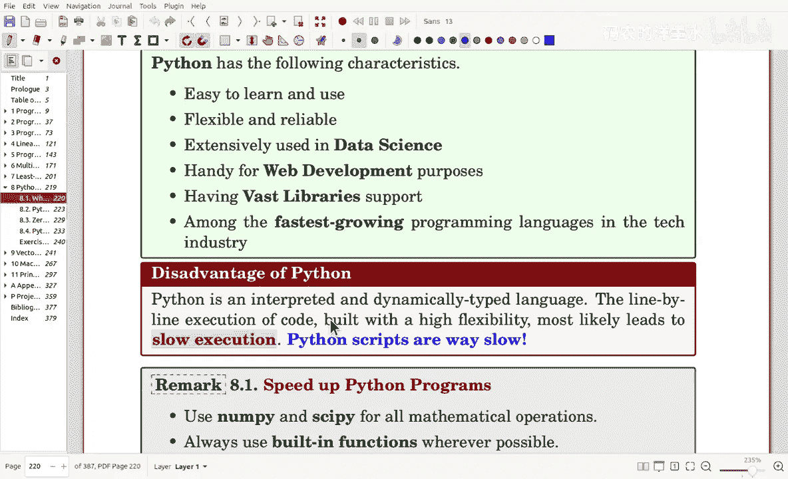
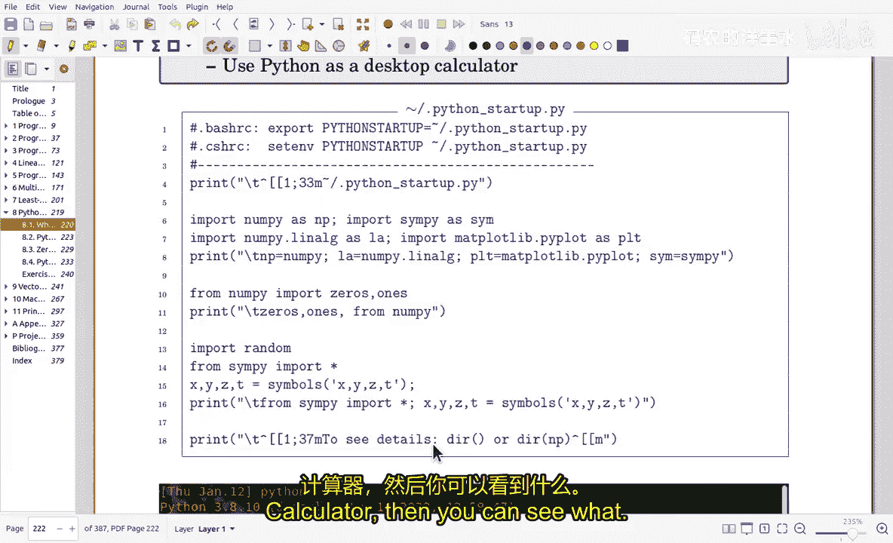

# 【全集-附课程讲义】密歇根大学-人工智能编程-EECS492-中英字幕-p49-Lecture-49---学习Python和库--BV14JqfBNEAS_p49-

So far， you have done programming with a MA lab。If you understand one programming language。

 then you can understand other languages without。Big difficulties。

Since the core of programming is logic。In this chapter。Will study Python pay 6。

Python essentials can be covered in 30 minutes。Then。

Will implement a code for zeros of polynomial in Python。And will compare the code with a Matla code。

Finally， in this chapter。We discuss Python classes。

Okay， here section 8。1 wide Python。A good programming language。Must be easy to learn and use。

Flexible and reliable。嗯。This are。Or advantages of Python。Additionally。

Python is used extensively in data science。Handyful。We have development purpose cells。

Having a vast library is a support。And， finally。The python is the fastest growing programming and language in the tech。

Industry。AI and machine learning。

Here， however， Python has a problem。Because it is。On Inter and dynamically。Tact to language。

It is quite slow。And。Me lab is also。嗯。The script language， compared with the Mat labb。

Python scripts are very slow。

And to speed up Python program。Here we have Steje。T use numpian sipine for all mathematical operations。

And try to use built in functions。Olays wherever available。That's a simple strategy strategy。And。

A good choice is using cellphone。Which is？C extension for Python and developed for you just not familiar with the C Cyython。

Is。A combination of C and Python。And you can define or you can implement the functions like a C or like a Python。

 if you try to use C push more， then your program will be faster。Anyway。

 using iPhonephone is a good choice。Now， the past the choices。You quit。And import your own C。

 C plus plus or。Fortunate modules into Python。 In this case， you can make your。The code， easily。

100 times faster than Python scripts。And using compiler modules is way better than Python script。

Part디러리。You have to you are working on new a project and you have to write down a long script to then try to use compiler language。

 then you can get much better code。Here we consider how to call C C plus plus For from Python。

This sharescript will compile。All the。The functions written in C， C plus plus and Forron。First。

 we define the library name for For 9。And C and C plus plus。Like there's right size。

Now here we compile fortune 90 files by using FT Py 3。It is available。For。Every operating system。Now。

 you can include Fort 90 options。 Fort 90 flex。 I chose here。Optimization level 3， which chairs。

AtThe maximum possible available level。哦， if。You don't choose optimization， then。And。In deep for it。

It is choosing some level。And depending on your computer， its a little bit different。

But if it is not level freeing， then usually one level。M about twice a faster。

So that once your T is not3。Then your algorithm is twice as slower。Or four times as slower。Okay。

 so along with that optimization level。And。Minus M。Here， that show the object name。

By using all Fort 90 files for C。And you have to make position independent code so that you have to give here a flag and opt level 3。

 the assembly level and share the object the name is here using all C files。For C plus plus the same。

 only the difference is here are using。C plus plus of fires。So we saved into this shadow object。Now。

 once you made share the objects， then you can wrap up in Python。Okay， here。

 now that is a standard import and。For this one。Now， you can import。Oh。嗯Python。Util is。

From this library and for this shared the object， you can import all forfront functions。

 So it's almost the same manner you can use in。 However for C and C plus plus。

 you have to use C types， C DLL。Tyna dynamic link is。And so that here， the shared object must be。

Clled。And here。Now， for C and C plus plus for the library。 now， for example， for C。

And now this one has basically everything， every function you implemented。 now， among them。Now。

 for C function。For example， you are trying to call this function the。Okay。

 call this function with these arguments， so first one is double or， second is again。

 double or and third to fourth are inteents and returns are double value。Then。You have to。

Define C types so that for input。Now， double double integer integer。 So that is now because O。

 you have to use a point term。 So that is for the first argument。 Now we have another one。

And then this is for third one and for the last one， of course， they are the same。

There is an input type must be declared for output。

And we have a double value so that here C types that C double。And that is for output tie。So。

 for the function。You are trying to call for each function。You have to declare this types。

 that is argument type。 That means input types。 So you。After defining that one。

 you can put over there for output and now you are putting here。

 so it is declared with that if you call the C function， then X。

 Y and M variables in in Python that will be transformed for C function。And after。呃。

Then the required operations。 it is returning。A value in sea time。Now。

 result is expecting such a type。 and now now it is converted to4 Python。 In this way。

 C functions can be called。 However， for fortune run， you can use it directly。

Withouticiculating such complications。Okay， the library in Nampier is designed for a metal like implementation。

 and Python can be used as a convenient desktop calculator。First， youll have to set up。

Startup environment。And。And then you can use Python as a desktop calculator。For example。

You are using Linux， then on the bench。You can include this line。If you are using seashell。

 then you can include this line and then in this file in home directory。You are putting this the。

Import， and for， for this one。 now you can import nuier and。Now， sip。And here。

 the linear algebrabra packaging and plot packaging。And now， some。Okay，0 and once and random and。

From the simply and everything。 So that again， for your use， you may declare X， Y， Z， T as a symbols。

And put it to some。Some lines so that when you。Open T desktop。Calculator， then you can see what。

You imported。So like over there。And I just to put Python， then。Here it is open。

 and these are printed out。 and I can see。What are I imported。Yeah。

 MP S for nuy all is for the nuy linear packaging and plot。And same is simply。

And also this declaread。 And also here X， I C T symbols。And here there is extra information。

To see details， I may try use such a comment。And。So， it is。Could recall。

 and you can see what you imported and what are directly available。And then now， you can use this。

Python。And as a very convenient task tab is really good language。High flexible and easy to use。Okay。

That's the end up with the section， thank you。