# 【全集-附课程讲义】密歇根大学-人工智能编程-EECS492-中英字幕-p50-Lecture-50---Python基础-、循环与函数--BV14JqfBNEAS_p50-

It is a section a。2 Python essentials in 30 minutes。Here are key features of Python。

Python is a simple， readable， open source programming language。And each to learn。

It is an interpreted language， not a compiler language。 That means it is a scripture language。

And variables are not type。That means you don't have to declare。Varis earlier。The use。

Python supports。Object oriented programming models。It is a platform independent。

 which means that it can be used。On Linux system。Yindo systems and mat。

It is a huge standard libraryboarding。Python is。A highigh level language。

And that means it is Egypt to yours。High level languages are not necessarily better than low level languages。

But it is egoous and simple。And also， it is powerful。Python。Has no support the pointers。

 and Python codes must be stored。With that P Y extension。Here。The cool point is using indentation。

Python uses indent to define a plug of code。That is really good one， in many cases。

Use just a writing code without indentation so that later on， tibugging is not easy。But in Python。

 if you make a mistake in indentation， then it's not working。 so I like it。

AQu starts with indentation and ends with the first on indented line。

The amount of indentation is up to the user。But it must be consistent throughout the b。

And comments can be included by using the hass symbol or。Multten9 equipment can be added by using。

The triple chs， either the single three ch or double3 chs。

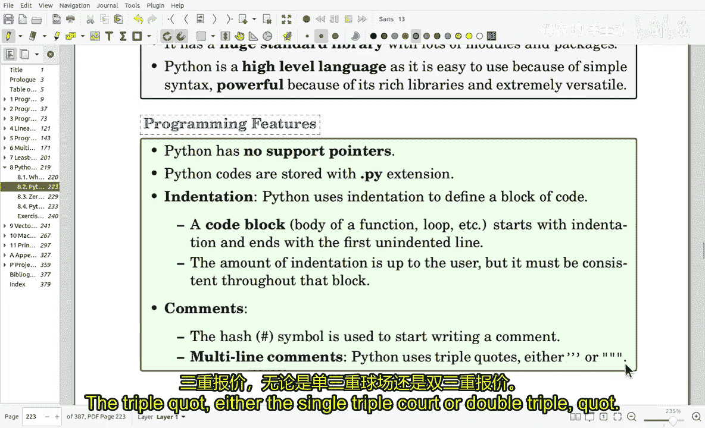

Now， let's see Python essentials。And。The sequence theta times。Here， list。

 tuple string list will be defined， along with。Pracket。And like this one， you can add them。Here。

 either string integer。Or flat to point number。So combining this full component， now， L is defined。

And you can define tuer using parentes。And here， of course， you have to separate。

Entries with commands。 so that here now， Tple is defined。Now， one entry is， again， a tu。

And you can define in this way And string and real number and integer。 And you can。Put together。

Very different kind of。Ttatypes。Studenting can be defined using the courses and。here。

That double quote。 And this a single quote and。德布尔。Tlip quotes， and。You may use either of their on。

 for example， a string hello world with single quote and double quote and using。Now。Tple。

 double quotes。And you can define。Now， you can。Access this Tet and bying Now here's the indexes start from0。

For least the zero， that is and the。String。And here you can access several of them simultaneously。

And to pull one， that's this one。And two years there on， and -2 means from back the second last one。

 which is 4。1。And for string after a declaration of this one and string can be access to Now here we have to count the letter and from 25 to 36。

 and you can get that one here。There one。The break line， new line is here now。Is not visible。

 but is' there。 So that are。

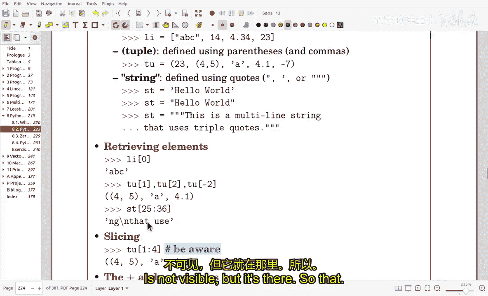

It print it out。Here we use the slicing。Now， slicing has some。rule。And okay。

 once you have an list or array that are components。Like that。

 Then this is you can access it along with the index of 0 here。 Now， there's  one and 2，3，4，5。

 and so on。 Now， if you try to use a slice， then。That is in front of them。The entry， that is0 slides。

And that is， now， slice1。In this frame。We can make a slicing here。14 means that from here。

To for that one。So it is printing out 30 components。 So from second to fourth to one。

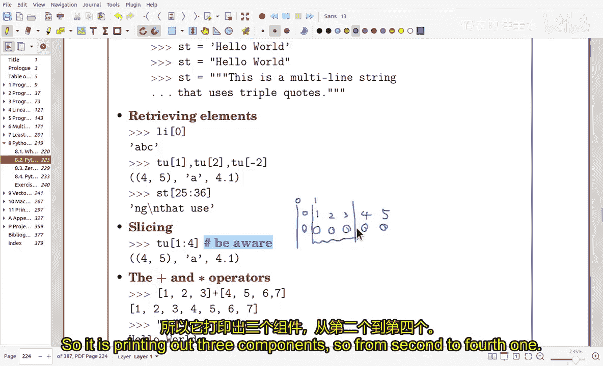

With twople， let's go where there are two pool from second to fourth one from this to there。

 you can see the output。

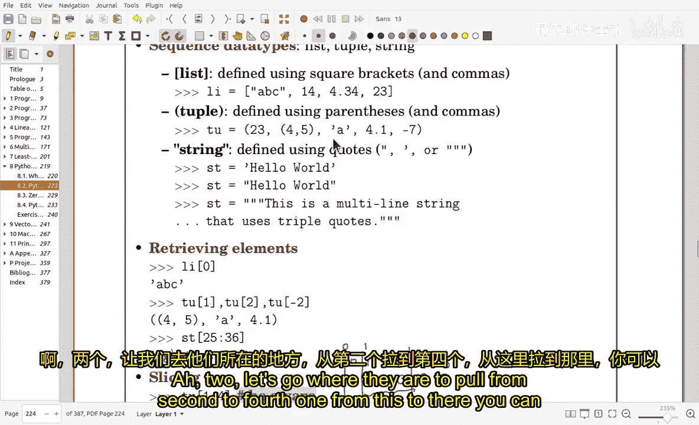

Right。Now， for list。And tuple and string。The addition and bulkplication works。

Not really same as the usual addition and multiplication。 if you add to。

L then just simply list this edit and also here hello and space。And， again。World。

 and you can add them then output as hello world。 And if you multiply 3 for this tuple。

 then is  three times。嗯。Yang。😔，Duplicated的。So you can get this one。

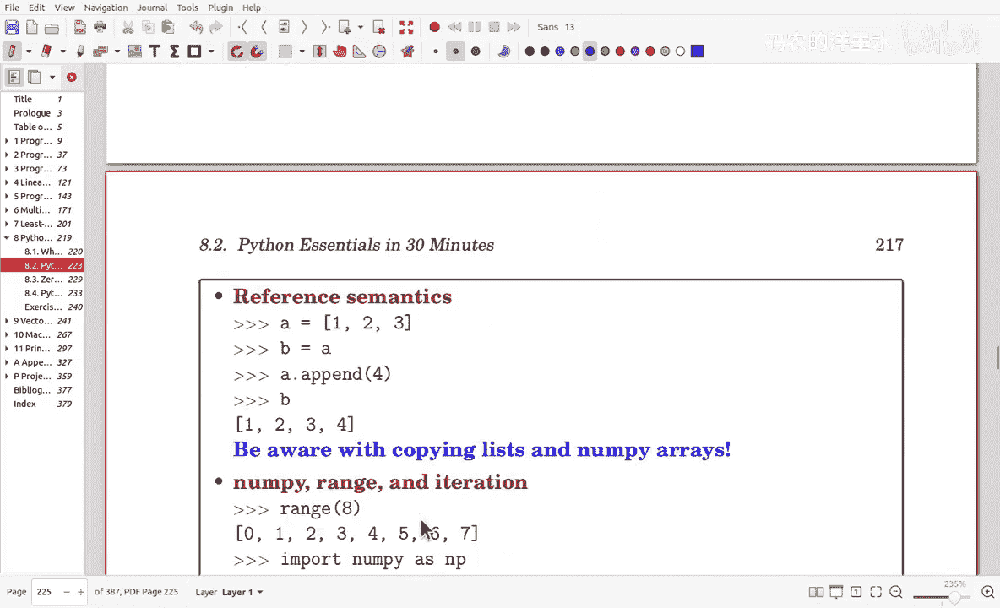

Now， reference symmetry X。 Okay， A is defined as a list， and you copied it to be。In in B。

 and you append another number for a。 Then if you try to print out， then it is again。

 appendated for B。That means that。B is another name of a， so that if you add。

An element to then also a be is also automatically enlarge them。

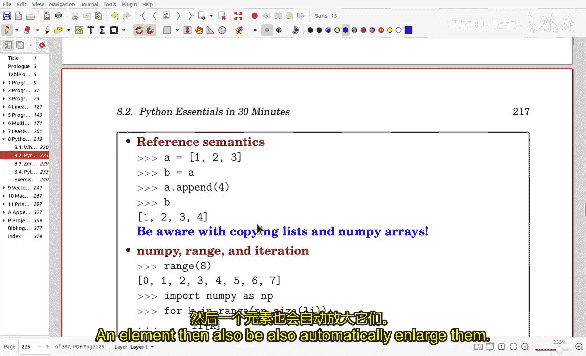

Now。No P range and iteration can be done in this way。 range8 means from 0 to 7。

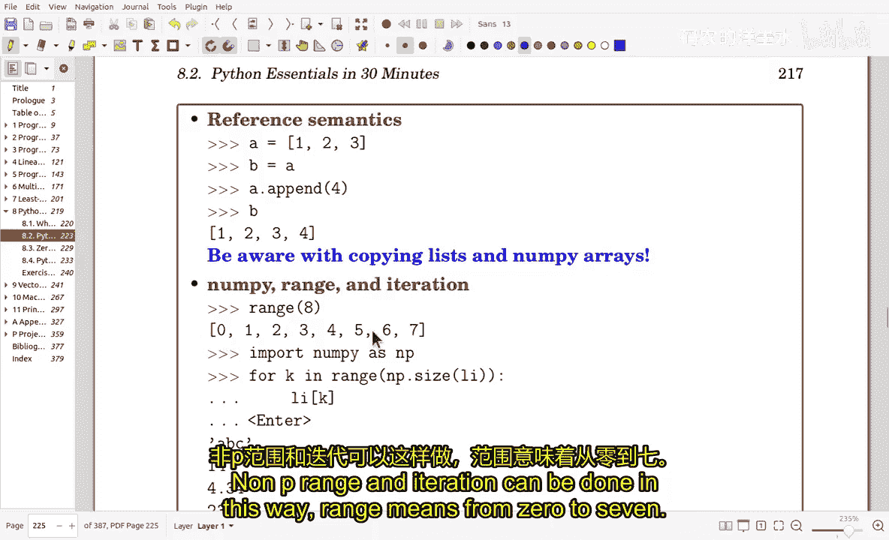

And after importing nump pain。Here， lumpy by using lumpy size。 you can。Check the。

 the ally list the length。Okay， that is。 Okay， let's go to this term here。We have now。

The length of 1，2，34， right。 That is 4。

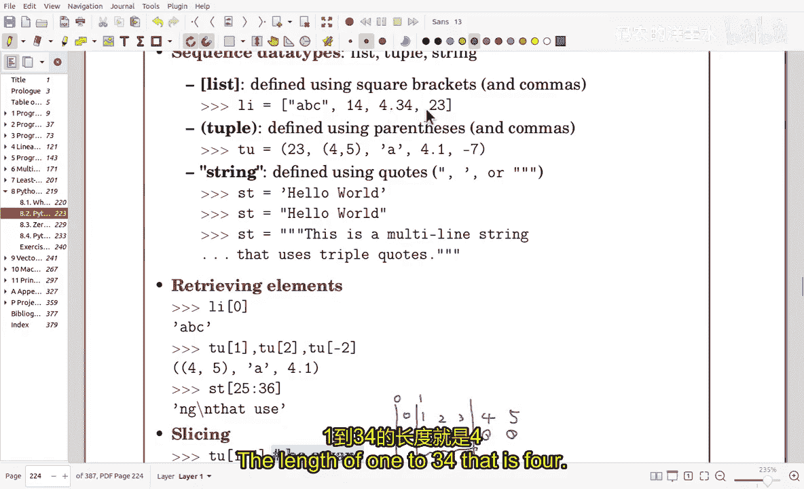

mm。So in this iteration， itll be here。So now it is producing 0，1，2，3， okay。And for non puree。

We may try to use deep copying。 And earlier， just a simple copying。

 the assignment is not really opening new worry。So we import a deep copy from copy packaging。

And after opening。Here， not be all。We just a simple copy to make a B and we use a deep copy to produce a C。

 Now we multiply4 because it is do array multiplication of4， Yes really。

Mplication of four for each entering。So here now if we try to print out B。

 then B is a simple copy so that it is fully is multiplied， but for C， it is deep copying。

 so its not changing。Deip卡片。Produces new wording， completely new wording， but simple。

Using that equality sign， if you try to make another order， then that is， in a sense， renaming。

 So a has another name， B。So that now voice is multiplied then also。Together， B。

 the entries should be multiplied by phone。Here we have frequently used the Python rules。Sometimes。

 the lion。You have to do many things。 Then it is over one line。

 Then you can use this assign to put everything in。Werti lines or。You may try to use your parentesis。

 bracket or brush to。Make a crew。 then we felt。Changelline sign。 It is considered as a line。Now。

 you can print out here the same output。And by using semico， you can put。Many statements。In。

 in one line， you assign the value 1，4 a value 2。4 B A and 34 C。You can assign in this re。

And in fact， you can assign also in this way， for example， ABC。

Separated by kumma and right side y pulled。3 components。 Then a is1， piece 2。

 and C is a string containing hello。 You cannot assign in this way， also。Now， backstring。Okay。

 and when you define a function and you may write down yeah such kind of a line。

 you can put it in multiline。And along with three double quotes and end with the same。

 then it is considered as a dark screen。And like in Matthlab。Baosing help， help with。

The function name。 Then you will see some beginning portion of the function and start with。

The comet design that is produced in Vele that is exactly same for this function。Now。

 that methodthad。Is capturing this portion and printed the o。Okay。Okay。

 that is assignment of multiple values in a line， and you can swap two values quite easily。Here。

 PC equals C， then PC are swapped。Quite convenient in Python。But in other languages。

It is not allowed。 You have to copy one value in temporary variable n after copying。Now。You are。

Just the copy back to the other side。Okay。Now here， once you assign a variable， then in Python。

 the type is automatically decided， however， if you try to use this one in a different time。

 then type is quite easilyly converted。So you don't have to worry about it。After this assignment。

 if you try to check the type， then here，4 there run a。It is considered as now integer， but B is a。

Fluating。Point2。valuable。

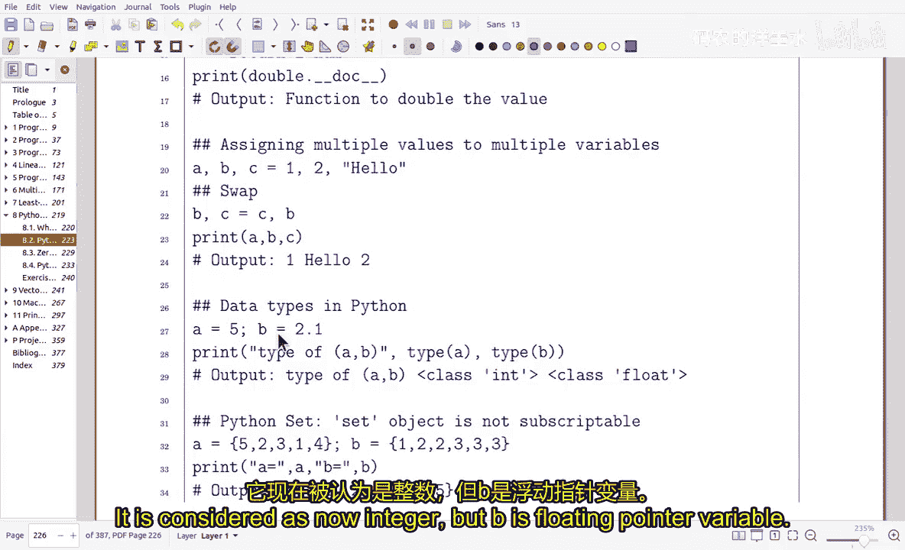

Okay， type， the flip type。Now， Python fair said is here。To find in this way， once you。Make a said。

 A and B。Then， first of all， duplications will be simplified and also。And。Here。

 once it' is orderable， then it is orderable。Like that。

 So that for this one is order do and duplications disappear here。

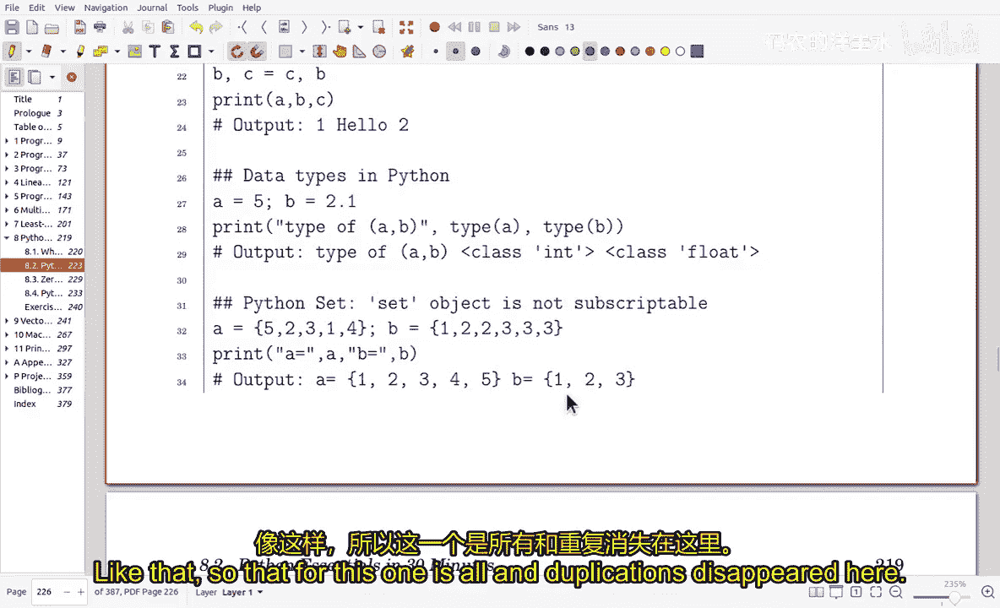

Now， Python dictionary is quite useful for。デタ processing。So。Inside this price now here。

 D is defined along with the key and value。For example， Seth here is 22 years old。

 and Alex is 21 years old。 Now， you can access this dictionary。By using keys。 So the D Q1。

And now that is now D， you then able to。What the positions， just if you know the name。

 then if you can put here， then you can get。The assigning values。The value doesn't have to be some。

Dome value。 It can be a string。 Now， you can get this output。

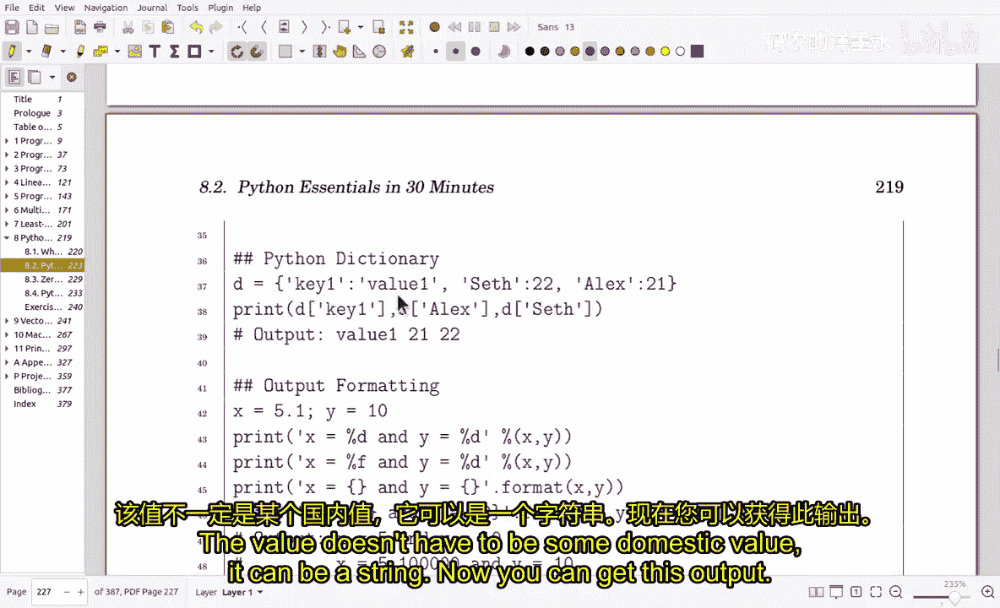

For Python。The print。Output format is quite flexible。You can use whenever this。

Now there is D as intesger。And that is also integer。 Then here output with the S。

Orig generallyally start with the x is a floating pointer number and y is an integer。

 now automatically change it into integer so that x becomes 5。Right。Now， if you are using this key。

 then now default number of dig here so that in of 5。1 in this way。Now for that one。

 just rather than keeping specific output format， you may try to use this sign then here that format X Y。

 then an x value will be here， Y value will be here Okay， so you can get that one。Now。

 if you change the order， then yes change it okay。Now， here you can specify the separator and end。

Tef foot and is new line。But you may put that sign。So that if you executed this one。Then here。

 x equals and separator。That sign。And then x value again separra y equals and sera y value。

 and then at end this sign。Right， so you can make your output。Quite flex。Now， Python in import。

Can be done using the function input。So if you exped this line。Then enter any this one coming out。

 So I wrote down stackville。That is the city I live。Then now print the input your stack file okay。

Looping and。Functions。呃。We'll try to compose a python function。

 which returns cubes of natural numberss， okay。No。We define get cubes using this number as input。

And in the beginning。Your cube is a list empty list this open。And now。From。1 to。The number。And。

Cubs are made， and then the values appended to the list。

 And after finishing this loop and return the earlying。G that is the function。Now， this one is that。

Okay， if it is executed， then this function， this portion is。Considered as main。

So here we have two on the bar main and two on the bar and such function name is usually not used by users so that that is a default。

The function name。 and also we can access that by using the name key。The name， the。

 the program name is main。Fu this one， the main is assigned once it is used as main。

 then it is executed。So， here。Now， by using the interactive input。

 and this is shown and you type a number。Then， output。um。

Number then the number will be used to get the cubes。The list by using this definition， the function。

 and it printed out。

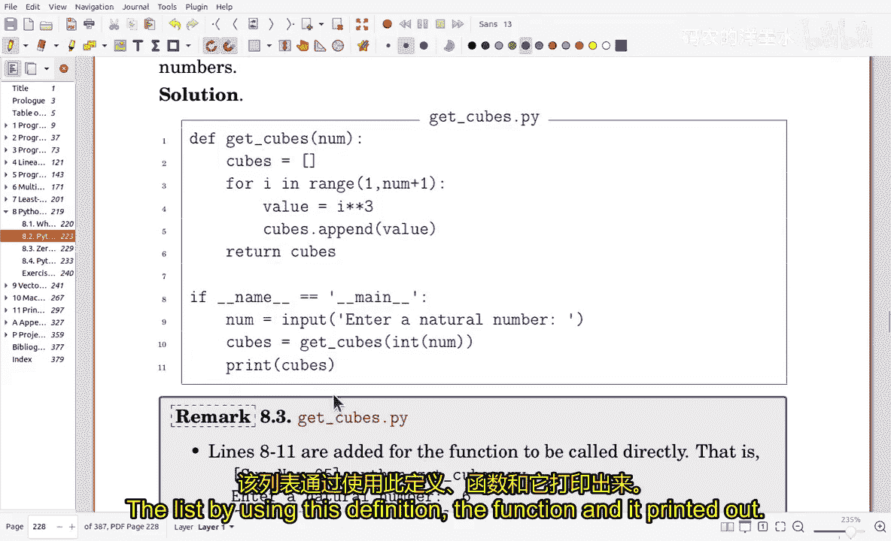

Okay。So， here。Now， python get。Cubes that P Y， then in this case。This function is used as the main。

So that that would be executed and I put here6。Then from 1 to 6， the cus are。呃。The generator。

And in this variable， and we put into the our。Now， the function。Can be。Cll it from another function。

Then this one is the function is included， and the another function will be considered as the main so that this portion is not executed。

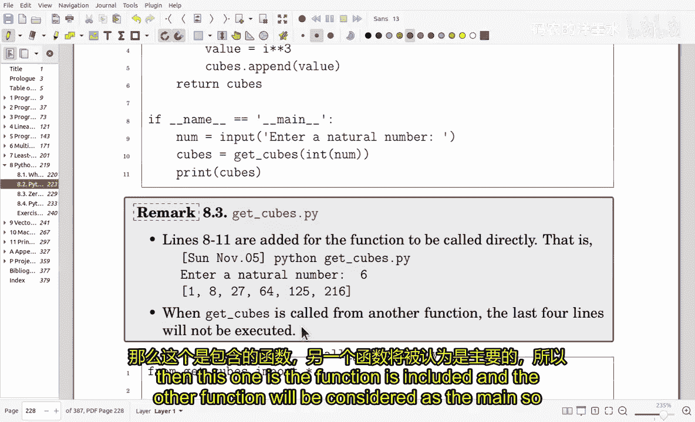

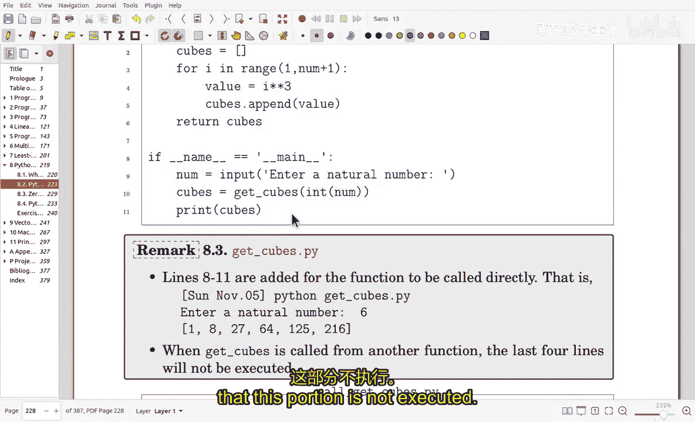

Okay， so let's try to do that。We try to call， get cuwords by saying。Here， this program。 So first。

 we import the function defined in this file。

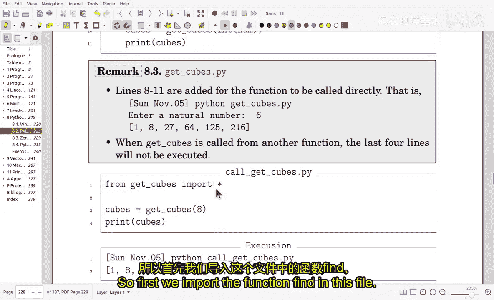

So from get cubes， import everything， which means this one is imported。

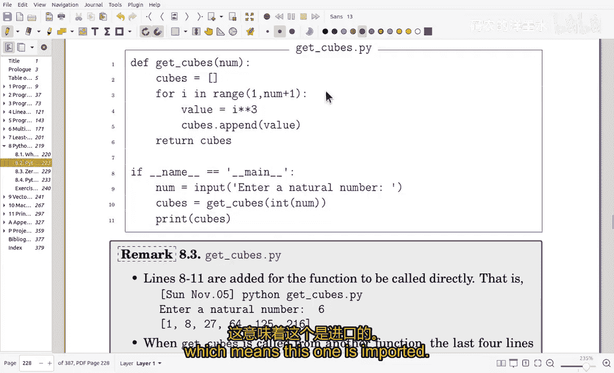

Then now here we call it along with a and here Qs。Then， without here interaction。

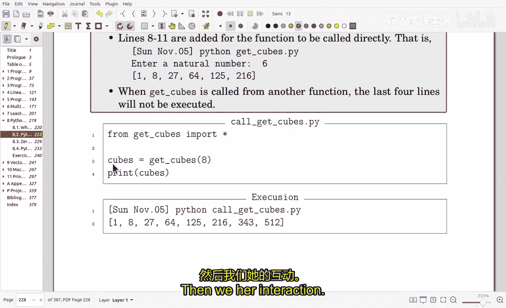

This one is， along with the interaction。 but now from。

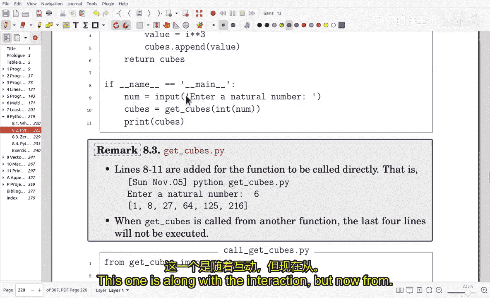

Other function， Another function， we call this one Tiecting so that without interaction。

 we can get cubes and we can print on。 So just the simply。

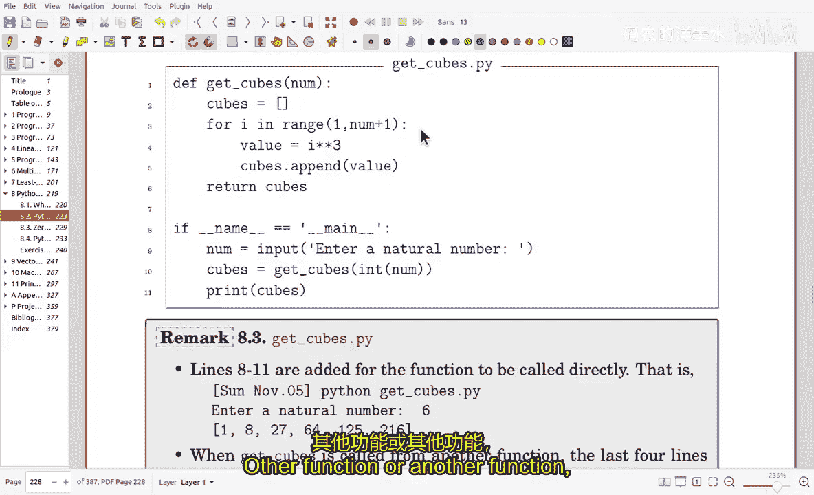

Here， Python called this one。 Then that is the main， and it is imported as a supporting function。

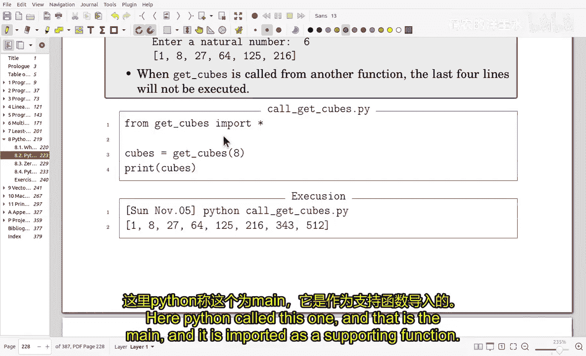

So that this portion is ignored and that top portion is executed， and we can get。

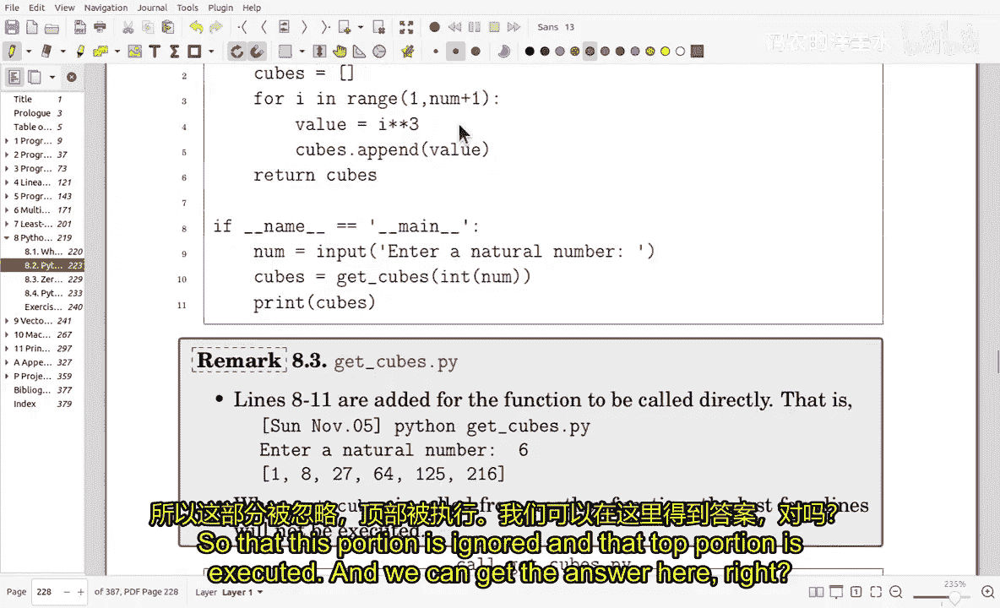

The answer here。

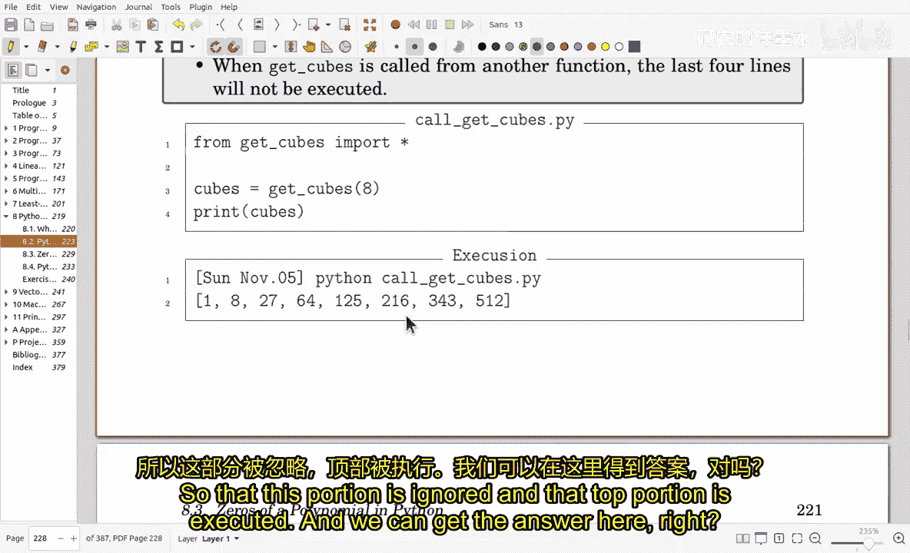

喂。Okay， that's it for the section。 Thank you。 Yeah， it takes really 30 minutes。

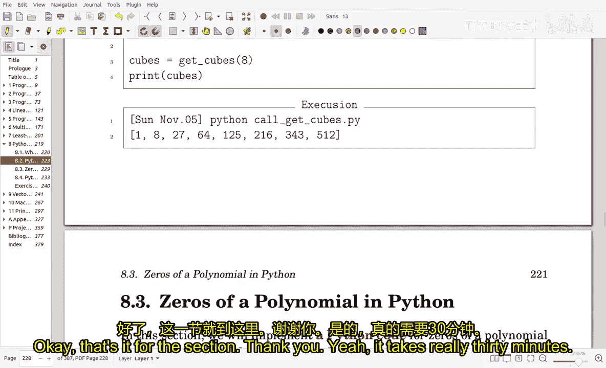