# 【全集-附课程讲义】密歇根大学-人工智能编程-EECS492-中英字幕-p51-Lecture-51---Matlab-的-Python-编程--BV14JqfBNEAS_p51-

Section  a。3，0 of polynomial in Python。In this section。

Will implement a Python code for zero self polynomial。And compare it with a matla cord。

Let's begin with recording how to find the zero cell of polynomial。And we studied it earlier。

When the newest method is。Used for finding on approximation。Of a0 Px。Then。

The ittion can be formulated in this way。The new point is from all the one， we try to get。

The collection term， and collected to get。Better approximationation。Now， we have to find。

The evaluate P。At a point， and。Is derivative at the same point， in each iteration。

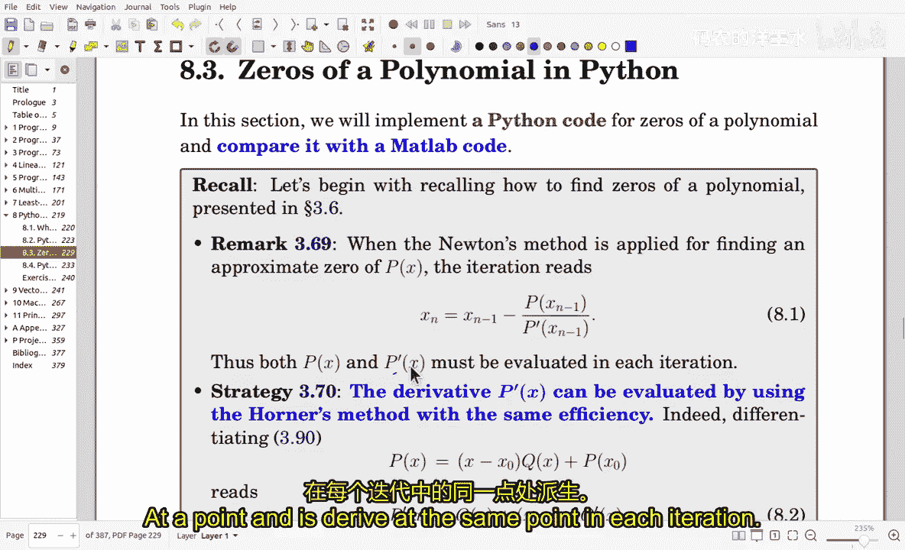

Now， to find the derivative value， we may。Try to use Ho method。

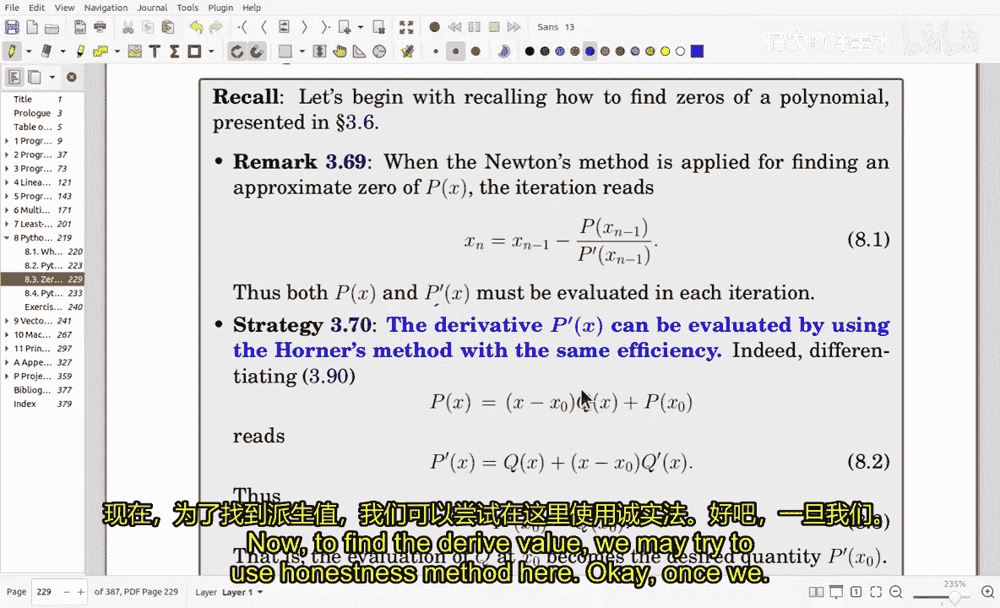

Here。Okay， once we。Right this the given px in this vein。By usinging the limit theorem。Then。

Is derivativeive can be this one。 And once we use evaluated at X zero。

 then this term will disappear and that is Q at X zero。So， that。At ex all。The function value。

 the polynomial value。Ass P X it， and then。Now， P primmatic0 is the same as。The。

 the value evaluated with the quoient。So by using the wholeth method we can get these two values at the same position X as you。

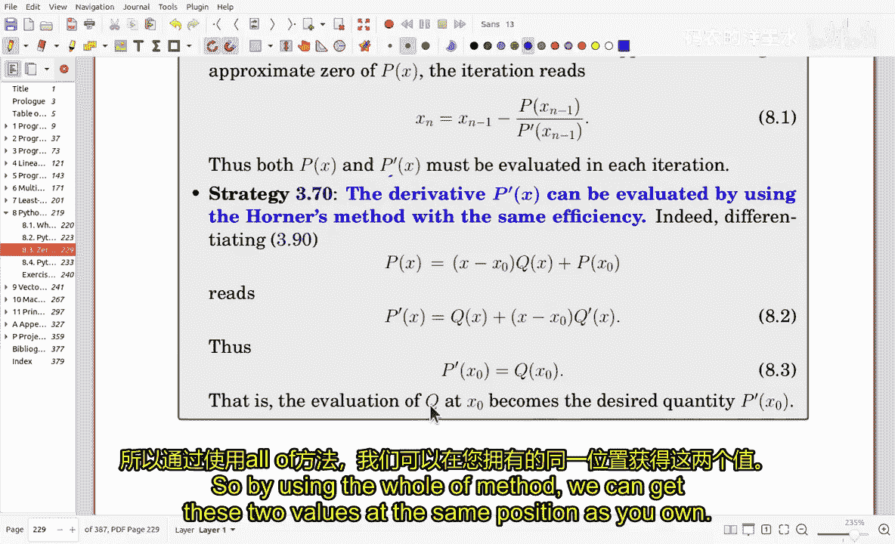

Here， the P V X is given in this way and use the newance method and the honest method to implement a code and find on。

App02어3。Okay。First， let's try to find them。The solution。And by using Pian functions。And he had nuing。

And we。Toine the quots we collect here， the quots。And now， for by using。

Here the poly1 day by using equations， we can construct the polynomial。And here we can get폴 de。

The symbolically。Here we see， there is the polynomial。 There is the drip chip。And now biasing roots。

 the method that we can get roots over that。

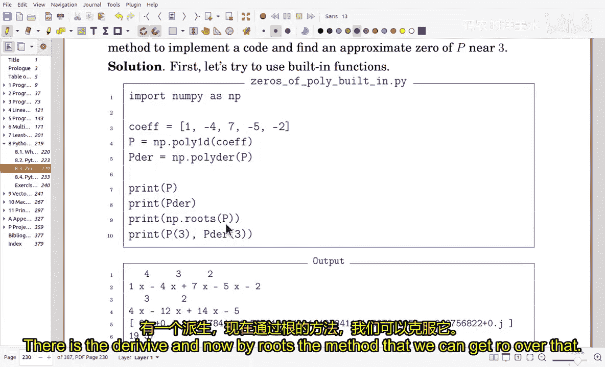

So， here。These are roots。 And at 3D。The polynomial value and its derivativeluive value here。

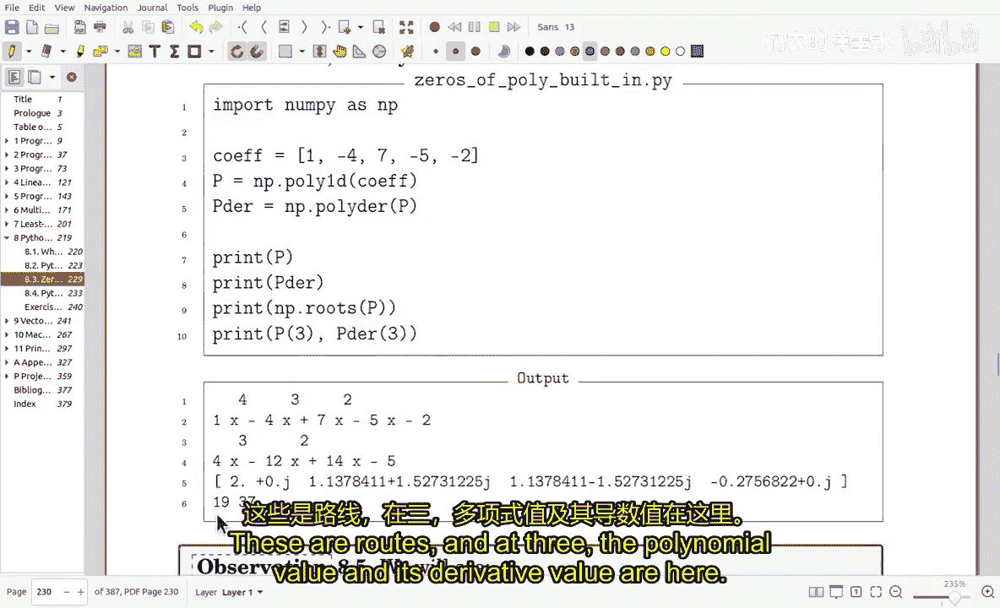

Okay。Now in this section， we're seeing Python programming is as easy and simple as Matla programming。

 particularly Nmpier is developed for Matla like implementation with enhanced convenience。

No piece used， extensively。And most of scientific python packages， including。Sipra， pandas。

Met Pli and Cyone。And basically， most of scientific Python packages use nu。But an nuia。

Is developed for melip like implementation。So once you understand the met lamb， then。

The python is quite easy to understand。

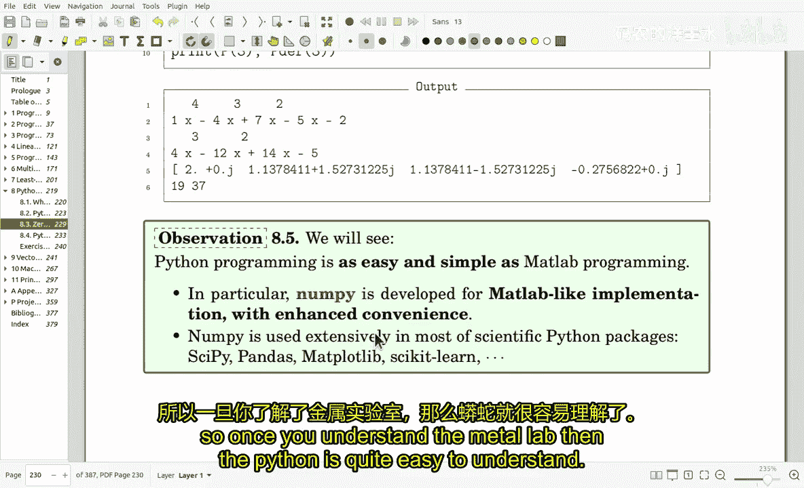

Now， we implement a code in Python for Newton Ho methodthadone to find。A numerical0 of a P Ne 3。

 where this says Ho and Python。There is a duck string。 And here。We try to。呃， count。

The numbers in U A， that is thes。And。Xo。😔，Now we assign the first one in the order4 P and this is it。

 and thiss a loop after finishing this loop。And the P is。The function value at x0。

 and that is derivative to value at x0。You learned this one earlier。And。Now， you to Hoer。Is K here。

 start with x0， so it is x。Now， bying the correct value。Uingホ method we get。

The polynomial value and its derivative value。 And。

 and that is the correction term H and correction to is added the。To get updated。The value。

And once the correction term is aounded by given tolerance。

 then we stop the iteration and here return。And the final value x， and。Here， we count't。

The number Btus and its output to see how manytus are performed。Okay。

 here now the quos is collected and the initial point is 3。And toleranceernesss 10 to -12。

 and maximum possible utilization。Is 1000。We call Newton Hona and these two are the value returned。

 and we print our。You turn Hona。And ex and final answer。 And in。The number of iterations， okay。

So we see， we call。Now， the function。Python a file。Then and the result from here is now x0 3。

 and the final answers to in 70 relationss， the Newton Hoer。Algom。Converged in 7 iterations。

 So to get the value。And earlier， we， we tried to find the roots here， these are。

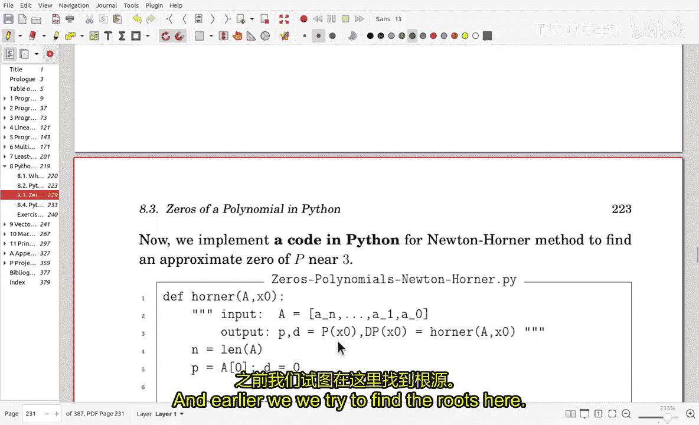

Now， part roots are complexul value so that。Here。The limit part is also produced， along with the。

Complex value form。 but that is basically 2 and minus-0。27。

There are two real value the solutions and two compress value the solutions， okay。

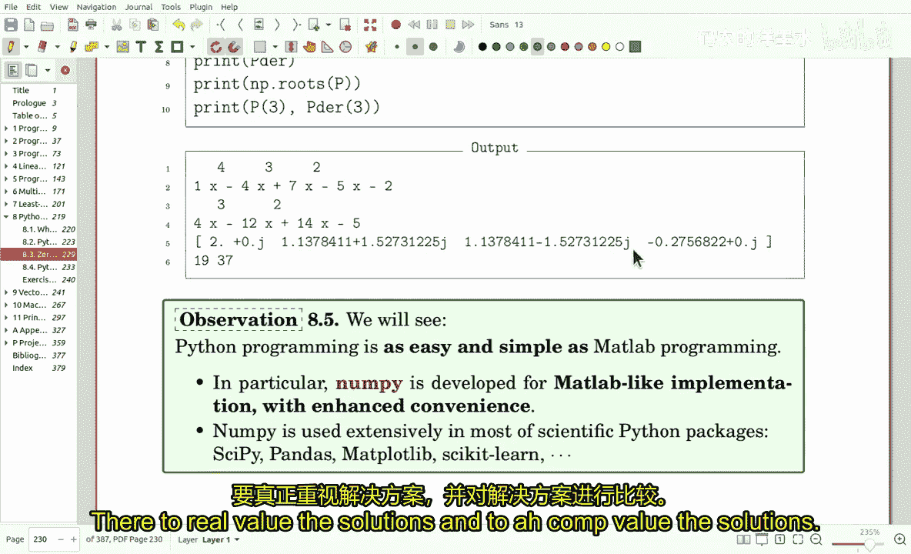

So we found the， the one of the。

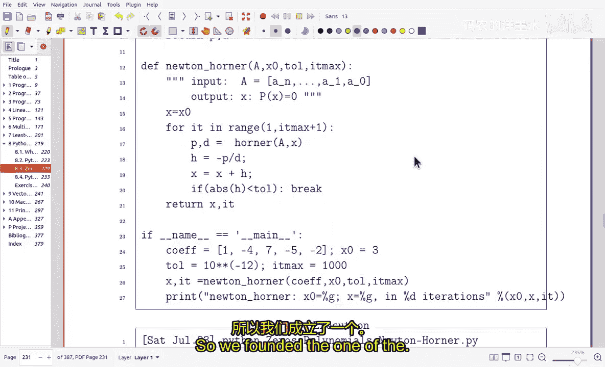

The root，2。那。The python code must be compared with the matter code we used in。

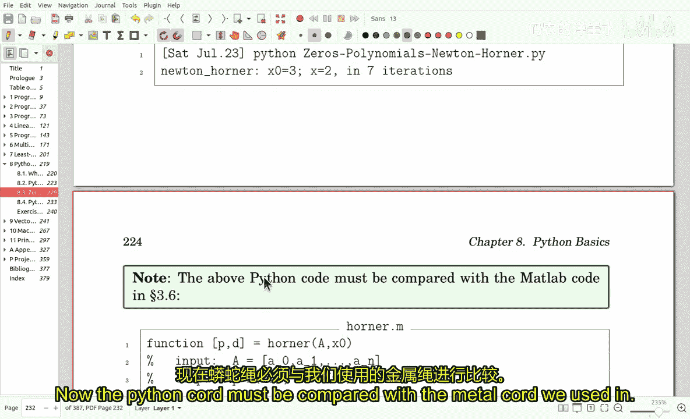

In our section earlier。There's horn。Is defined in this vein that luus is exactly same as in Python so you can compare and also neutton Ho is the same in each equation we call Ho using the quos and the current x value and we produce P and D and。

There is Corian Tom， an editor。Once the correction term in modulus is bounded by tolerance。

 then we break the iteration and return here X N。The number we tradition performed。

And we call the Newton Ho separately。 A is defined。 Now， this is ascending order。

And because we implemented them。In their way。Now， the same is X 3， the tolerance is 10 to the-12。

 and maximum possibly tu is 1000， and we call deton Hoer。Then applicating this one， same。

 we try to put it out。Then the result is exactly same Duron Ho and start with 3 and convert it to two in seven equationitions。

You can compare。Metro code and Python code。 But you can see big similarity。

 So you can easily use Python once you understand the Me lab。Okay， that's it for the section。

 Thank you。

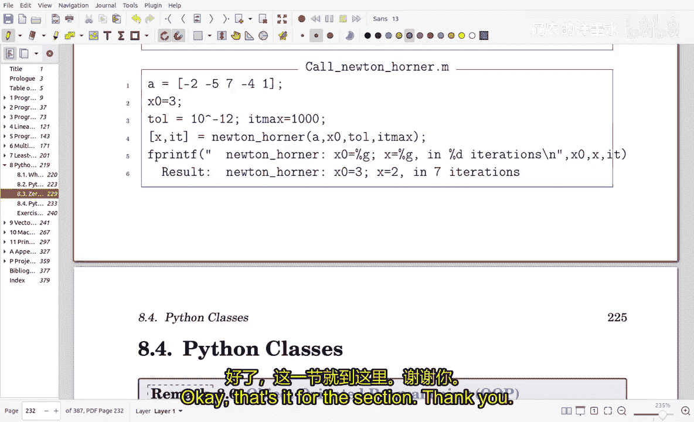