# 【全集-附课程讲义】密歇根大学-人工智能编程-EECS492-中英字幕-p52-Lecture-52---继承和使用类--BV14JqfBNEAS_p52-

In this section， well consider Python classess。Classes are a key concept in the object orientationient programming。

Cses provide a means of building data and functionality together。

Cls are usually defined template or prototype。From which。Real world the objects can be created。

The major method of using classess is on the sheing mechanism between functions and objects。

The functions。In a class called methods。The initialization and the sharing boundaries must be。

Declared clearly and conveniently。So there are a class tells us and what。

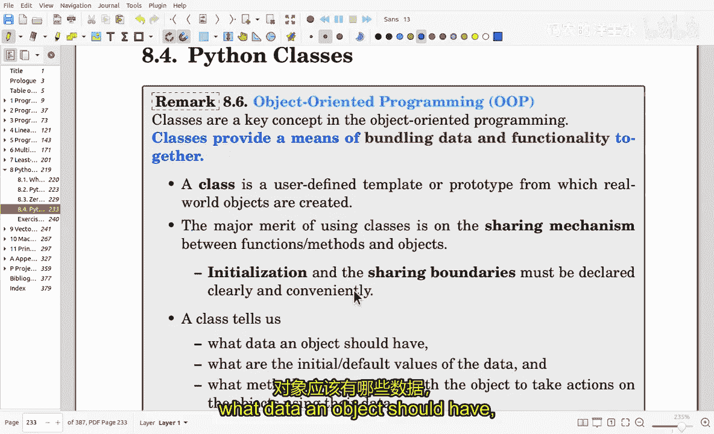

Data on object should have。 What are the initial default values of the data。

And one methods are associated with the object to take actions。In fact， this bulletette is a kind of。

Implementation requirement， so。In that way， you have to implement class。

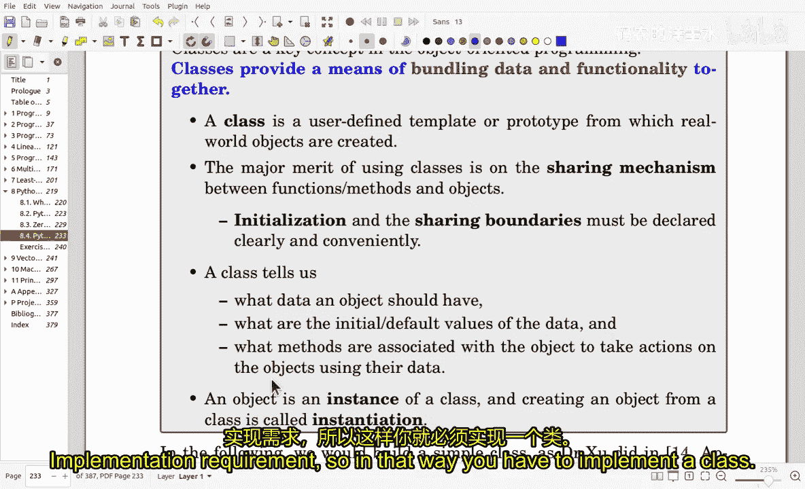

An object is on instance of a class and creating an object from a class is called instantiation。

In this section， we would build simple class， as T Su did in his book， T Su。

Is a math professor at Southern Methodist University， Dallas， Texas。In the section。

 we will learn how to initiate and how to define and how to use classiers。

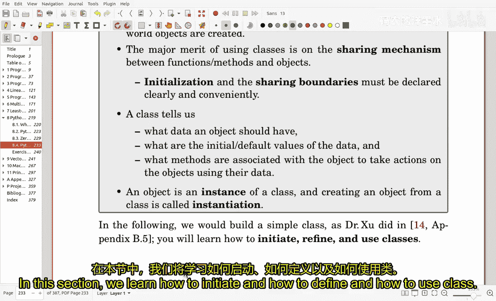

Okay， let's initiate a class。The class name， polynomial。Is defined in。

 And here this is a dark string。Now there are two functions。 Each one is called a method。

This unit method is a special method for initialization。Once this。

By using this class once the object is made as in this line。So polynomial with this data。

And P2 is an object produced by this polynomial cl。Then this one is， initialize them。

And saw that in it。Is called the init construct and automatically initialize them。

Now it requiress two， right now， you can see two arguments， better for self。

You don't have to keep any。Data， but for this one。You have to provide the values。

So itll take a this input and biasing that now self。Quiff is made。那。Once it is。Uing self。Pfix。

 then that will be shared to every every other method。And also， it can be access。嗯。

From objects in this way， object name。That cliff then。That one is access there。There is a rule。Now。

 we have。methodthone itself， which means that。It is not equating。Any input。

And now because of a selfque， it is available here because it's shared。

And we measure at the length of the Ode and-1。That is duty of the polynomial。 right now。

 we have30 components。Is for polynomial， for example， Xos square plus 2 x plus 3。

 So degree is 2 with this3。Qusons， so then to sum。Very simple class。

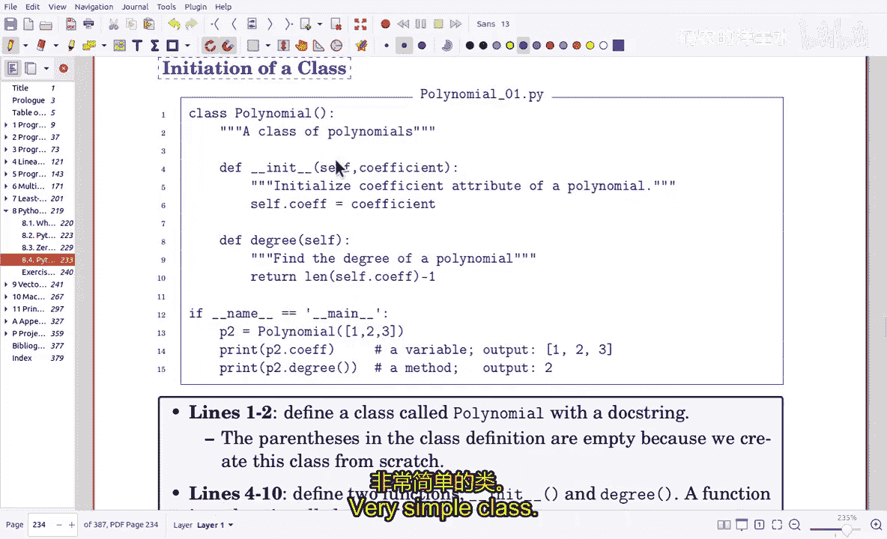

Okay， I explained。Theres all over this one， okay。Okay。

 now we try to define the polynomial class here。Now， for。呃。This one。We defined this one outside。

A methodadone。 So it's one line， the variable。It's used to in this case。That one。Is。

Its called a class attribute。 but that one is belonged to the polynomial。

And now it should be accessed by using thereon。 So the polynomial thatt count in outside of。In。

The class。 So in object， it must be。Cllold in this way。 And then it is shared for every object。

Now thereon， for example， this one is accessed by objects， but for each object。

 the optionss can be different。And by using different input， you may try to make this array。

 But this one。Is global parameter in a sense so that it is shared by every object。

 So it is a kind of global parameter。Now， for this in， there's no。Are the input except itself。

 but for each method， you have to have a self every。Self， so it is not requiring。Any import。

 but thequi will be initialized with number one，1 and2。Now， that one count as used to every。

 and along with。The polynomial prefix， the collection name。 So here， once it is initial， then。

Discount is added by one。 Discount is counting。Number of objects。The created by this polynomial。

 so that once it is called then in initialization， now the count is added by one。Here。

 we are now define here。That。Function， that is television of objects by using this one。

You can delete in fact。 The object can be deleted by using the Ping function， D L。Now。

 if you define this one， then this will be performed without。This definition， of course。

 you can delete other apps by using the L。 but with this one。Now， the count。

Will have value 1 less than earlier one。And。That is the finish on here。Now， here degreegu。Okay。

 that is the same as earlier。Now， we can。Here。Define， evaluate。Now for Qn X。X has many points。

So the K order， we try to evaluate the function value。And then here， Eva， the Ode。We。

Contain the values corresponding function values for x values。So you can add over there so that。Here。

 now。The2。And ors。And self equipment are available from。 It is made and。

Considered in other the method， but it it is shared inside the clear。Well of course， this。

Occess though。Bying the object name that the second part， the behind part of self。

By using object name that degree you can。Occess the method。 Okay， let's see here。The cool。And。So， in。

 in refinement。You can add such global variable。And also。You can do a different initialization。

And also， you can add some。Deletion operations。 And also， you may add some other method。

 This way is newly added in this way。

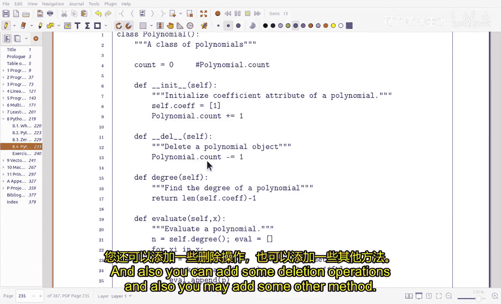

You can refine and you can use that those method in the class。Now， here， poly one。

 because initialization doesn't require input just we open。An object。

 create an object without an import。Then。It's once you open it。Then。

Tep default optionss must be one here。 Will one entry here like that。 It is initialized there。

 so we can print out two see from。 Okay， let's see here。 that is now initialized。Question O A。

 and after assigning， so we can access by using object name and this Que。And we assign in。

 And have to assignment。We can see it。The result here is this one。

Now we can check the degree and after reset the quots， we can see also degree。

There is exactly the information here， the implementation。And at to this side。

 we see the optionss and3 will come out in which the degree is 2。Now， we。Create one of objects。

And along with the object。And name and Que。 we assign this one。

Then this one and they one are different because well with a different object。

 they must be different。Now， after reset said， we， we already saw the output that are5。

 The entries and degree must be 4。For now， at this moment， it is called an printed out in before。

 Let's see if it is a really form here。 Youll get over the form。

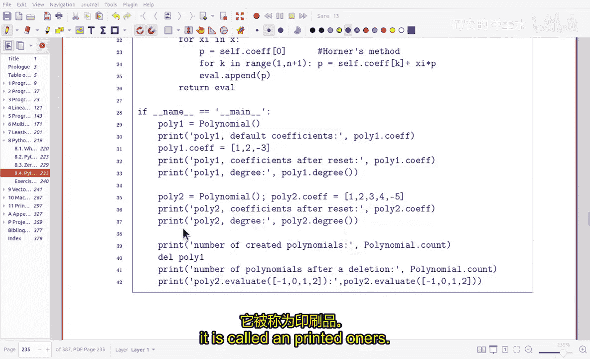

Now， we are checking number of created polynomials， okay。

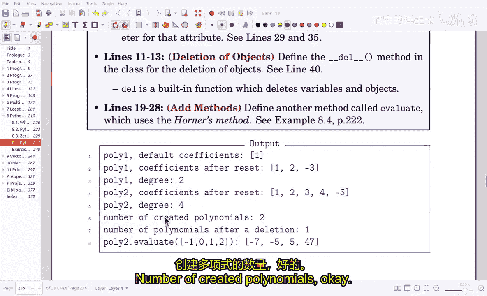

For that。Now， here we try to print out the created polynomials。Here， already we constructed two。

 So the first answer must be 2， and we delete polynomial1， the object。

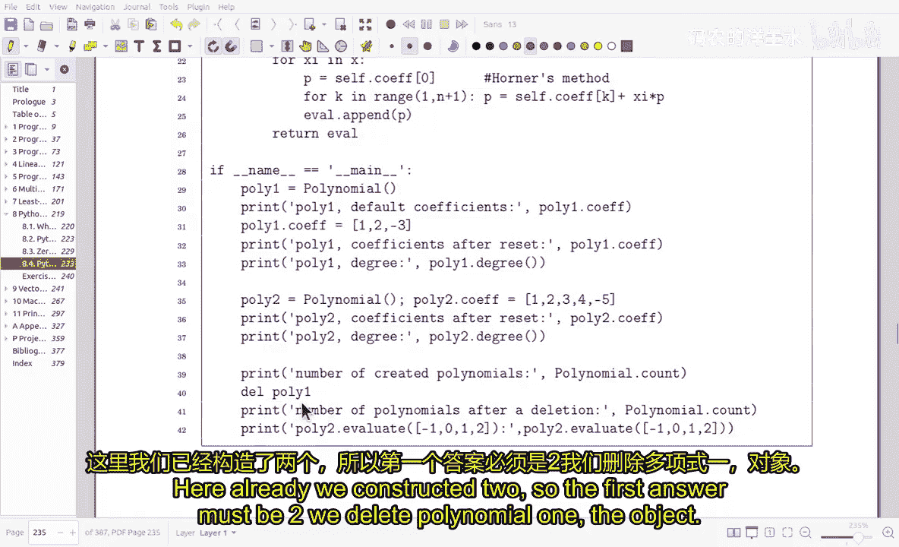

Okay。Without this one， again， I say without this one， you can delete。

 But because of that one in corresponding to。Dti it command。 And with that definition。

The polynomial count will be reduced by one。对。So that this is reduced by one。 And after that。

 we can print out。The polynomial account。And here for polynomial2。

 we try to evaluate at this four points。And。So that we print out， okay。Let's see here the result。

Before deletion， we have two polynomials created， and after deletion， it is deus by 2。And。

At this point， the function values are here， okay。Okay。

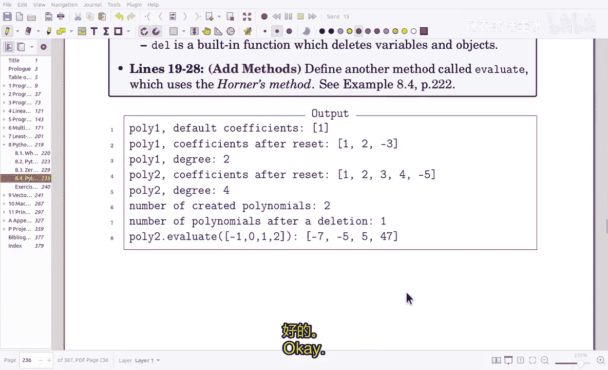

So basically， in deffinement。You can declare your global variables and so you can do some other initialization。

 and also you can add some diable objects。And here are the methods can be added。In this array。

 you can define your。Initialized class。To become more convenient and more useful。Now。

 we quenched the。The inheritance。If we want to write a class， that is just a special version of。

Earlier made another class that we don't need to write the class from the scratch。Just， we can。

Use shit and now we can specialize。So that we call the specialized class。

 a child class and other channel class， a parent class。

The chicle can inherit all the o words and methods from the parent cos。

But it can also define its own special attributes and methods， or even。

It can override method of the parent class just to redefine some methods。

Classees can import functions implemented earlier to define methods。 Let's see this。

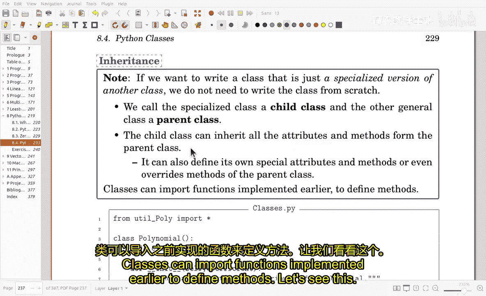

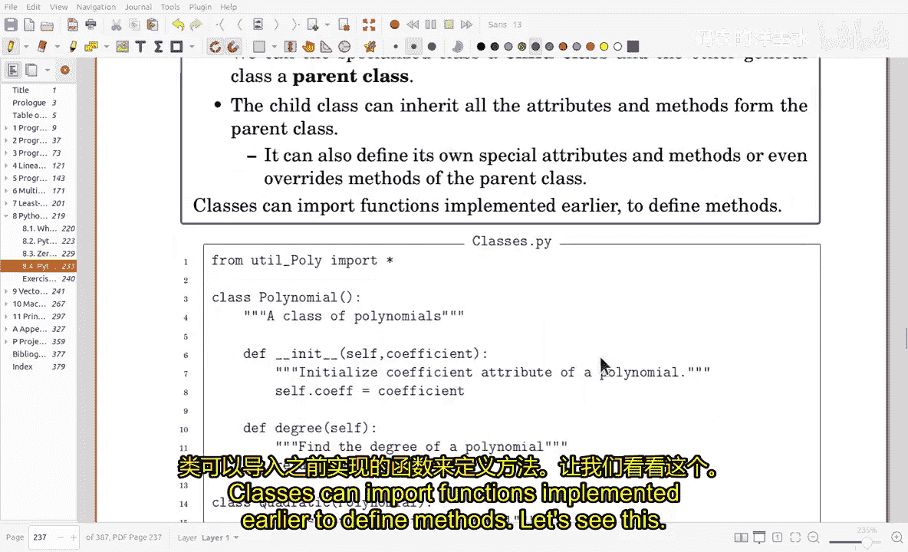

Okay。嗯。Okay， now here。In this file， we try to import usually implemented the function in inside utility。

Poorly and every function inside the file is imported。Now， we define。Here， polynomial as earlier。

 and this is the initial。Clas， we treated。Very early now from this polynoial。

We try to define a child class that's quadratic。 and we have to put。The parent class name。

That indicates that already the Python notes that this is a collapse， and if you write in this ring。

 then that means quadratic is a child class of polynomial。Okay， now。Xier。

And once this quadratic class is used， then once object is made， then it must be initialized。

And here we have self and questions bying this input。And here。We try to initialize by using。Okay。

 the parent initialization method。 So super key， that one。

Yess use exactly exactly the same initialization function from the parent class so that this initialization。

Will be used。 But in this one， new one， you may add one more line here。

So that another new variable is created self。And so it can be shared to other method self。

Power decreases equals 1。So that this variable will be。AndS them for every method。And， and。

In every object created by the quadraratic layers。T。So you can adjust， but that line is using。And。

Parent cook the initialization， and additionally， it is added them。Now， here， the roots are。

You can implement here long， long program。But you may try to use for quadratic polynomial root function can be used by coefficients and here power decreasees so that the coefficients。

Is collected along with the assumption that the power decrease is。Now， that means here，3 values。

 Okay， that is A， B C are there。 Then that means here decreaseques is a X scatter plus B， X plus C。

 okay。Okay， along with that convention。Here， the route will be made。And for degreegu。Now。

 that is overright。The parent1， the parent class is defined in this rank。

But at the quadra only degrees is 2 so that without any further checking simply return to。

It's okay for qua polynoia。So this one what is the parent to degree function， degree method。

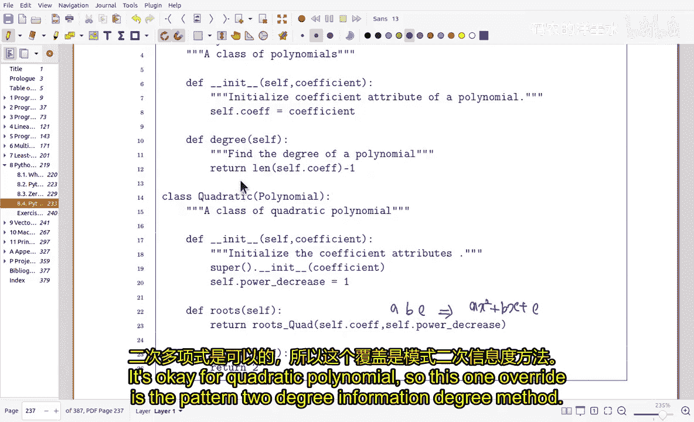

Okay。So in this way。You can define child the class。 Okay， let's see here。

 the u Pa that Py include those for quadrati。

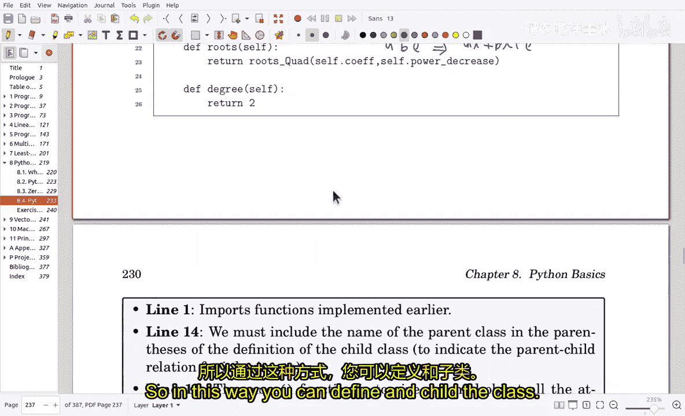

TheQutient and power decreases。And that is questions are given in this re。 So the assumption is now。

Power decrease is1， but a power decrease is 0。 once it is0， that means power is increasing。

 which means that ABC is used to in this way， A plus B， X plus C X scatter。But later on here。

 the computation is done along with the assumption that the power decreases so that once you change A C swap。

Then now you can use this portion without any further the change so that here。

 just swap and use it when power di is not one， right， that is。function。

It is implemented so that it can be used。Independently。At the class。

But if you implement this portion inside here， this portion， then。

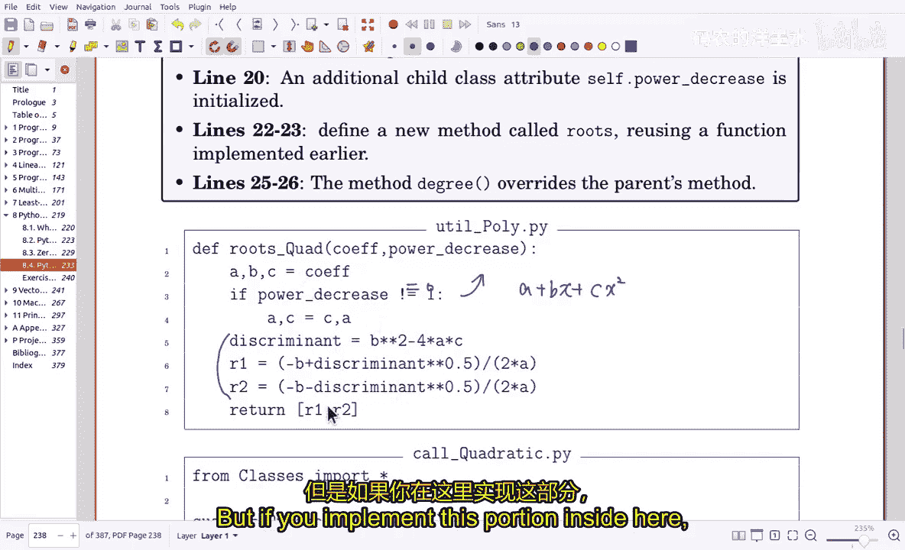

You may try to use。Along with the self prefix。 and also this one， so that。

This portion is not useful outside the class。So that。

And you may try to implement a function and independent of the class variables， and use share。

To get the solution， you can do it。Then。You can enhance the usability of functions。

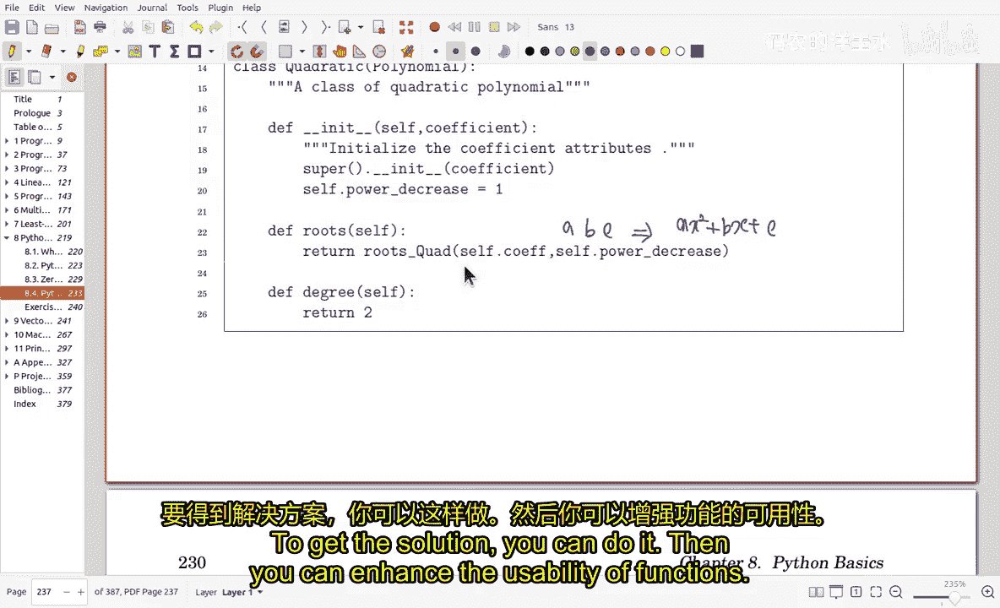

Okay。And here。We。Import the everything from classes， and by using。The quadratic class， we。Open  one。

Object。And。So， for object， we。Return， Comp the routes。And here。We are。Just change the value。

Pワ increase is0。Means that decrease 0 means that this one。Ys。Collected for。The polynomial this one。

 So it is increasing meansia。 This one is a three。Minus okay， okay， note， not3，2。So2。

Min- 30 x plus x is carry。But when power decrease is1， tip for the value is 1。So that that is。For。

Two xs scatter minus 30 x plus1。For this one。The roots are this one， and for this。

 the roots are here， okay。Okay。

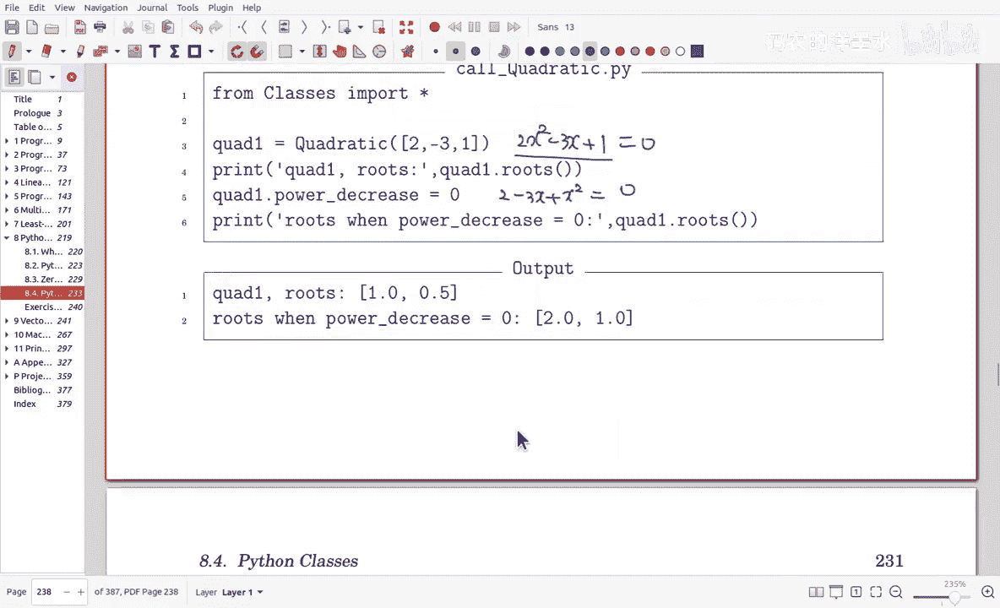

Here we have a final remarks on Python implementation。

A proper module orientation must precede implementation， as for other programming languages。

 moduleual means that。For all operations， you have to。Separate the kub of operations into。in in。

To make a function。 So you have to marginalize whole operations so that。You produce。

A number of functions。 Each function includes some portion of operations。

So you have to make such moduleularization properly。Of course。

 for every program and language language， you have to do it。And before implementation。

Casees are used quite frequently。But you don't have to use classes for small projects。And2 years。

 classy as smling。

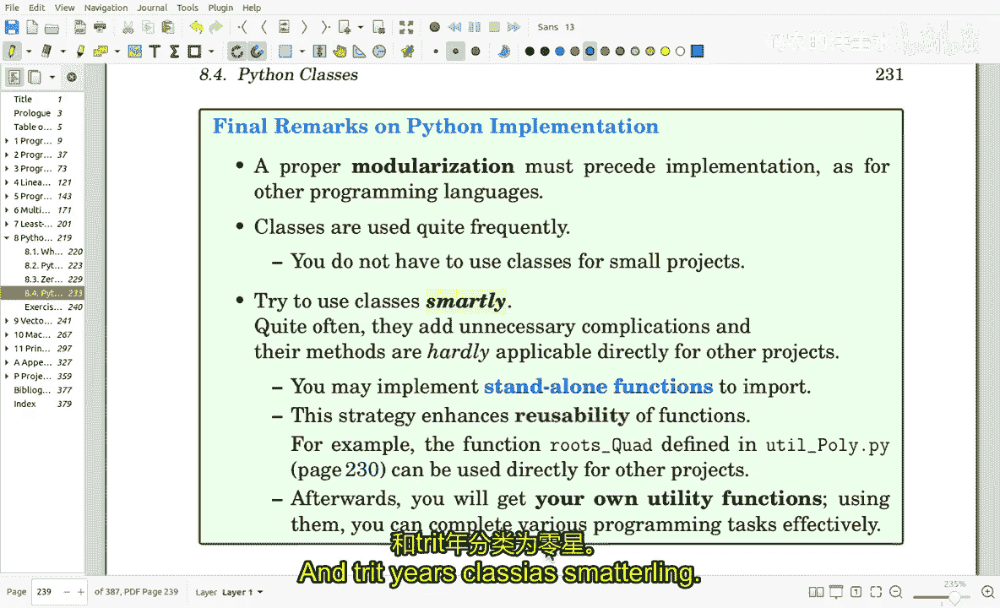

Quite often。They add unnecessary complications and their methods are hardly applicable directed for other objects。

So you may implement standalone functions to import。In this case， we implemented the。

That function stand alone。 It can be used in other projects。 But if you use only this portion。

In the class iss not easy to use it directly。

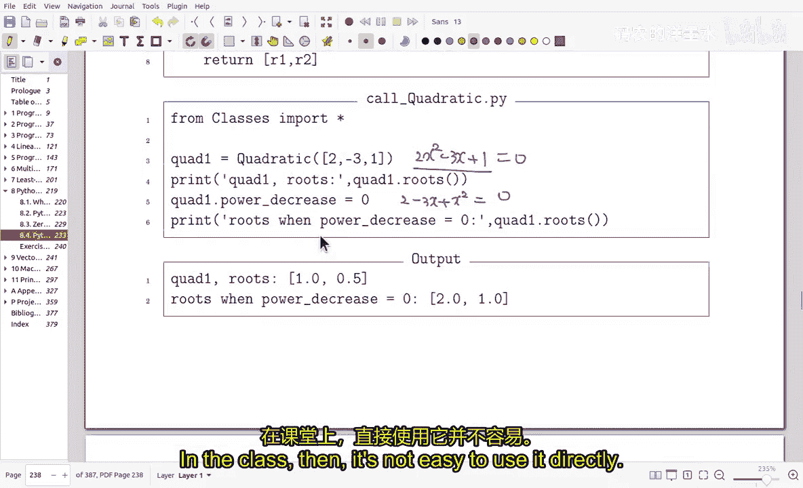

For other projects。And this strategy enhance reusability of functions。 For example。

 the function root are on about quality defined in。You to pull you that PI。

Can be used directly for other projects。Afterwards， youll get your own utility functions using them。

 you can complete various pgram tasks scores quite effectively。So try to use classes smartly。

Then you can be a good programmer。

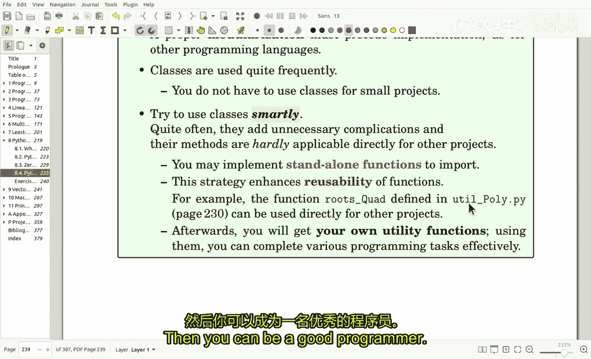

Okay， thank you。

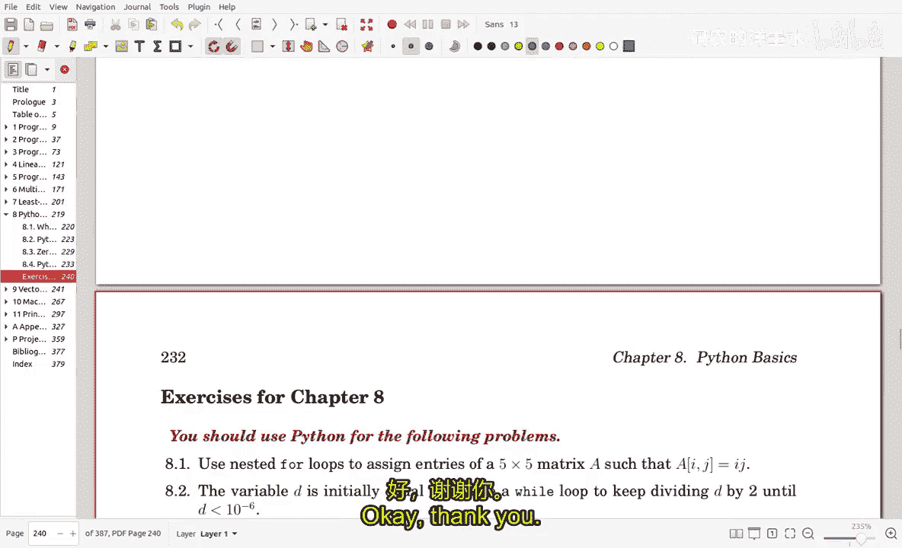