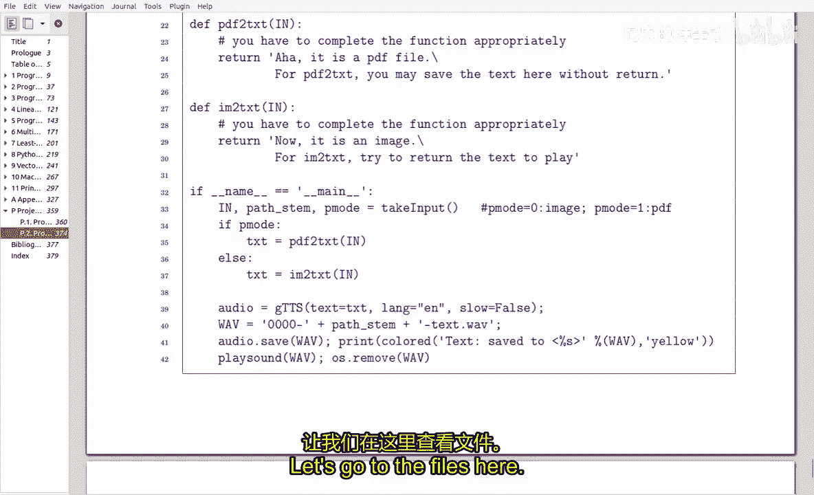
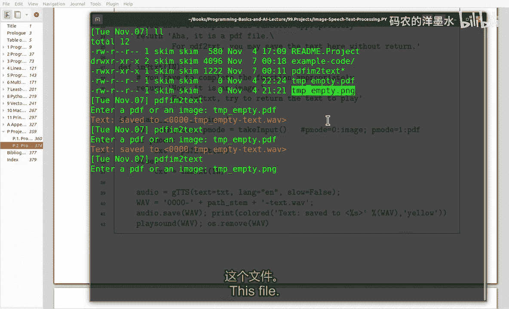
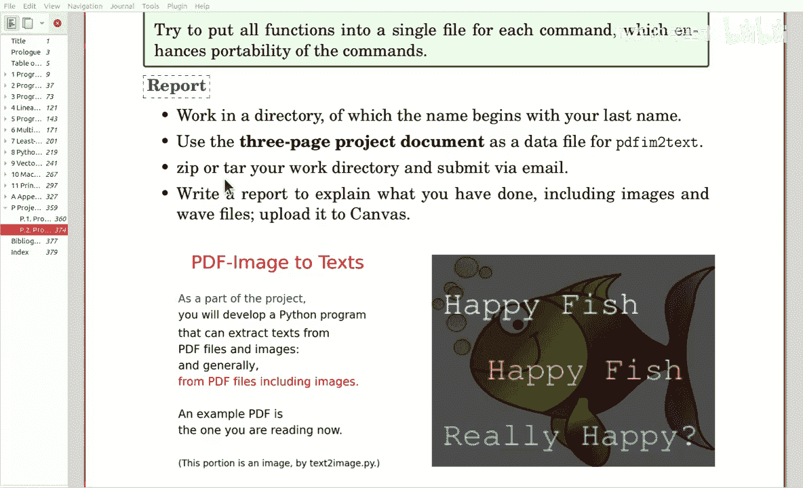

# 【全集-附课程讲义】密歇根大学-人工智能编程-EECS492-中英字幕-p53-Lecture-53---从图片、PDF-文件和语音数据中提取文本--BV14JqfBNEAS_p53-

Here is a project， text extraction from images， P files。And specator。In text extraction applications。

The core technologies。The O C，R， optical plate recognition。

Is primary function is to extract texts from images。In modern days。

 using other the machine learning algorithms， the OCR can convert image texts into audio files for easy listening。

There are some powerful text extractions of here， having accuracy。98 plus percent。However。

 most of them are not fully available。We'll develop two text extraction algorithms。

 one for image data and the other four speechy data。Yourら。Project objectivess。

Will develop two separate platformyth programs。Pdf image to text and speech to text。

For PDFf image to text， the input is either an image or a PDF file。You should implement。

The code to accept both forms of data。A p file may include images。

 particularly when a p is generated by scanning。Each page must be an image。

The core Tesque is to extract all textures and convert textures to。Audio data。

For speech2 text plus speech。The inputious speech。From microphone， or we a file。

Here'll get the coreotesque is to extract the textures and play them。Here is an example。

Pf image to text。The main library is this one。It is made from machine learning。

So it is trying to extract the text from。Is。This package will transfer P D F to image。

This one is for image processing。Now， G T T SS， Google。Text to speech。Which is quite good。In。gene너。

Vio data。To play the data， you need this one。And this was is for system operations。

And the last one is to print out。Clo的。呃。The textures。And with that， you can get。

You can recognize what the program is doing and also you can get some warning。And also。

 some mistake you can make。Okay。Now， first the function is take import。Once it is executedted。

 then that will be executedted。The function will ask you to enter a Pf， or an image。

Once your import is a file。Then from your import， try to get the stem from the name。

And also try to recognize the extension。Once your input is a P file， then Pma is 1。

 Otherwise initially 0， which means。It is on image file。

And return your input and the stamp and P mod。After getting pi mod， once it is one， then。

It will call Pf to text， otherwise， call image to text。Here we have two functions。呃 currently。

Nothing only， they return temporary text。And it is a pedophile for the function。

 You may save the text here without the tone。Most of likely。

The text from PDF file will be large so that with a return， you can save it into a file。Now。

 for image to text。You may try to return the text to play。After taking text。Now。

 you may trace me to an audio data。By using G T T S。And with this name， you can save。

And now that is print out。The information in color， yellow。You can play and eliminate。

 but you can save by commentting out this portion。Let's go to the files here。

You can see the file and there are two empty files。 See here the sizes it wrong。

So let's try to execute that function。Then it is asking king。To enter a Pf or an image。

Let's try to put this one。Okay。Then it is a P file。

For PDFT you may save the text here without return Did you share that？Let's try to do it again。Yeah。

With。Fun up。Aha， it is a P D F file for P D F2 TX T。 You may save the text here， without return。Okay。

 now let's try the other one。This file。

Now， it is an image。For I am to TXT， try to return the text to play。Okay。

 now let's hear some Python pieces。Let's go to this subject。Then you can see here， add text to image。

This is test for the Google text to speech。And we have another one。

 That is another picture for channel rating。Audio data。And image it to texture。And a PDFf to text。

And speech microphone 2 wave。And text to image。嗯。Some。Fileles are download from website， and。Also。

 I wrote down this one and。Okay， now I believe that one。And。

To let you know how to deal with the microphone。And how to deal with the audio data from microphone and save and replay。

I include some portions for you。And so you can get hint from these files。 And also， we have one。

 we have file。 Okay， let's play that one。The play command is。Shell comment。Okay。That is。

It's a project for images speed to text the processing。That is my voice。

 and I say then for test purposes。Okay。This directory whole thing whole file and every file is available through。

Oh。The Internet， and you can download and。The link here is given in this document。Okay。

Here is what to do。Download the tariff file。And un to see the file P D P D F image to text。

And example code is in a subdirectory exampleemp code。And you have to complete it first。

Pf image the text。And you can find some clues from this file， P F to text P O I。

It is a file downloaded from Google search。But it is a real written by some person。And。And。

It will be very useful for you to finish this function。And for the second one。

 you have to do it from scratch。Ppo of this。Project is for you to have。

Opportunity to make a program from scratch。But you may get hints from。These two files。

 I made these two files myself。Try to put all functions into a single file for each command。

Which enhances possibility over the command。If you try to save a comment into multi files。

 then it's not easy to move and it's not easy to copy。So we have to put everything into。Single file。

So， that。It can be。Ey to move and copy。Work in a directory。

 The directory name begins with your last name。And use the 30 page project document as a data file for Pf image text。

I'm explaining。The project with。For the pages。Try to take this of30 pages。

And you share as a data file for Pf image to text them。 The reason is this portion。

Other parts are just a simple p file， but this portion include image。And also。呃。Here。

 if you look at horizontally， then for this portion， happy fishy。This portion has two lines。

 So see if your program。Can catch this texture， and that one。Together。And also the same。

 this portion and that portion。 Now， this one is along with that one， but at the size of。Later。

Are different。 So that。Maybe your program。呃。Have some problem。In detect。Both portions。

Zip or tell your work directory and submit through email via report to explain what you have done。

 including images and variable files。And uploadloaded to cameras。

That's it。Thank you。