# 【全集-附课程讲义】密歇根大学-人工智能编程-EECS492-中英字幕-p54-Lecture-54---Rn-的子空间---矩阵-A-的列空间---秩定理--BV14JqfBNEAS_p54-

It is Chapter 9， vector spaces and orthoality。In this chapter， we study the a bit of linearage。

Here the major subjects are cruam process， Q vector。And Q iteration for finding eigenvalue。

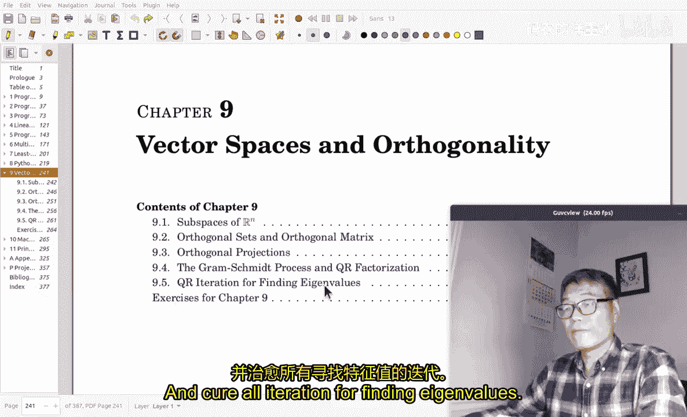

Let's begin with the section 9。1 subspace of RN。A subspace of Rn is any set age in Rn that has three properties。

The zero vector is in the set。For each U V in H， the sum is in the sand。For each choice you。In H。

 and for each choice of a Ka C。The scalmer location。Is in the sand。

If these3 conditions are satisfied， then。The set is a subspace of R N。These three conditions can be。

Expressed with this one line。H is closed on the linear combinations。Then it should have zero vector。

 and it must be closed on the addition and closed on the scala multiplication。Haren itself。

With the standard addition and sc multiplication。

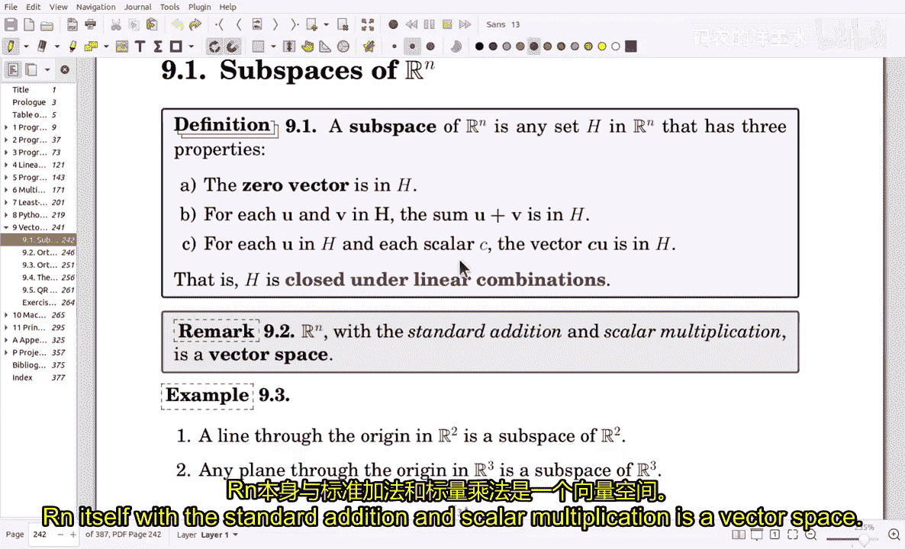

Is a vector space。See the example。Line through the origin in R2 is a subspace of R N。

If we consider a line。In two dimension coordinates。So， let's throw in this way。And once you choose。

 of course，0 is here。 And if we choose two vectors on。The line。

 then their submission must be on the line。And Snamet poh。Of course。

 the result is on the line so that it is a subspace of R2。Any plane through the origin and R3。

Is a subspace of all three。And you can easily to check that linear combinations are vectors in this plane。

嗯。呃。In the on the plane。And。This plan can be expressed as。The span of two vectors。

 V1 and V2 and V1 and V2。 then their linear combinations will make this plane。Viwen。

To VP is an audience。 Then span of the vectors。

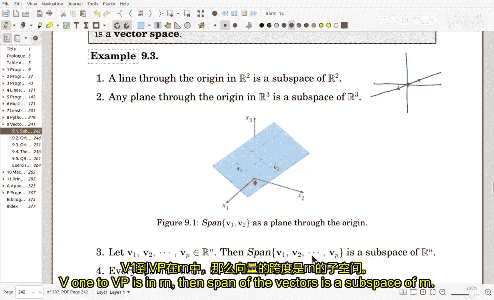

Is a subspace of R N。By definition。The span is the collection of linear combinations。So that。

The set must be closed on the linear combinations because it is already having every possible linear combinations。

So it is a selfspace of Rn。Every peniceat in Arden is a subspace。はい。Keep a mat。A in R， M by N。

We may consider the subspace Sp by the color vectors of a。In this definition。

The column space of a metric is defined。The column space of a is the set， and we are using。

The notation coれ。They set of all linear combinations of column sub。Once a has n columns， then call a。

Is the collection of linear combinations of columns Y。And here， C1 to C N are arbitrary scales。

So this call a must be a subspace of art。Ychi。vector。

 each column must be in R M so that their combination must be a subspace of R M。

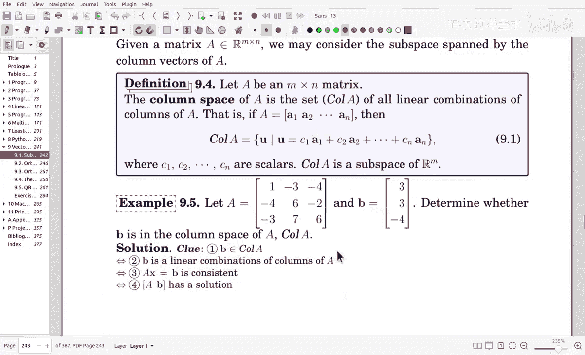

A is given， and B is given。Determine whether B is in column specable a。Okay。Once A。Okay， now。

Once B is in column space Bay， that means that B。Is a linear combination of column subbuer。

So that condition is the same as that on。Which meanss。If we consider the linear system， A x equal B。

Then this system has a solution。And we can find some questions， so that。

The scales so that the linear combination。Of columns of L with the quots， the weight becomes。

Here right side the being。The system is consistent， is the same as。

This augmented metric has a solution。So to solve this problem， we may begin with augment metric。

 Okay， let's do that。Now， a。1-30-4 and-4。6-2。マナ3。7，6 and right side，30，30。-4。Okay。

 now we apply elementary raw positions。And。Try to see if。It has a solution。Okay， first one is 130-4。

30。 That's the first row。And we eliminate。The quantities below the period and four times the addition will be set four times the addition。

-6。Four times the addition。That is。-16 and-18。Four times edition， which becomes 15。Now。

 a third time said addition。M피，3 time the edition。-2。Three times later Sean。-6。

Three times the addition， there must be。5。Okay。Now， from here。Okay。Weimin。Eliminate this wall。

Because that is a simply3 times of the last row。 So that from here。We can't get。1，-30，-4 and 3。

And then here，0。 Okay， we multiply。嗯。Possibly -1， then 2，6，-5 and 0，0，0，0。Okay， we have a P here。

 pivot here， and that is a free variable and access3。And so that， in fact。

We have infinite and many solutions for this system。So that。Bmins。Now， B is in the column specify a。

So you can finish competition to get explicit cautions。

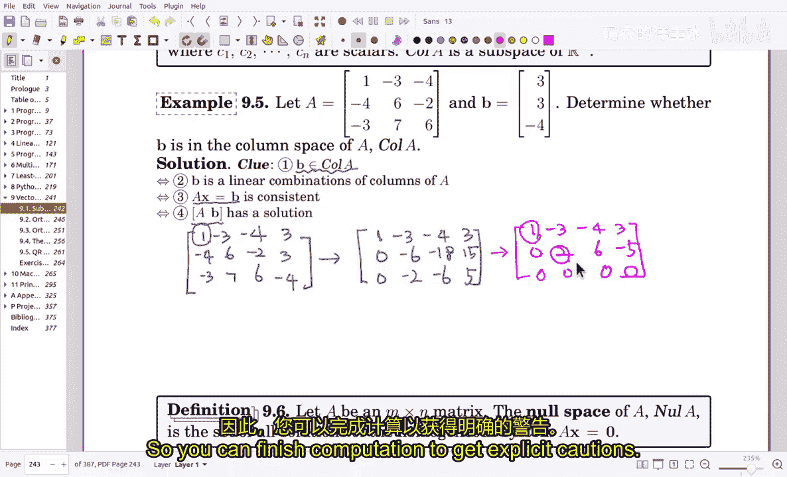

A is on M by M metric。 The nu specific A。 we are using dual a， the notation。

It's the set of all solutions of the homogeneous system。

So collection of x satisfying a x equals0 has a nu page。So node space is a subspace of RN。Of course。

 the notice pairs。In the beginning。Must be subset of audience， first of all。Now， okay。

 let's start with this zero and nule of a is a subset of Rn。And firstly， zero must be in dosa。

Because here if you put here zero， then it is satisfied。And secondly， now we have this show。

It is closed on the addition。 Then if you choose U N V from node space over a。Then， meanss。

And A U equals 0。And A V equals 0 so that they are in the noded space。So here， if you add。So the A。

 U plus or B， then A U will be 0。 A V will be 0 so that that is 0。

 which means U plus V is inter the set。Right。If we check the this。Separately， these conditions。

 then we can do this way。 And finally。We choose you from。Note space of A。Then， A equals 0。Now。

A you wrong the A any you。Mus be so that that means C you。Must be in。Not specifically。

So it is closed on the addition and sc multiplication and0 is insider set。

 so that dual a is a subspace of RN。

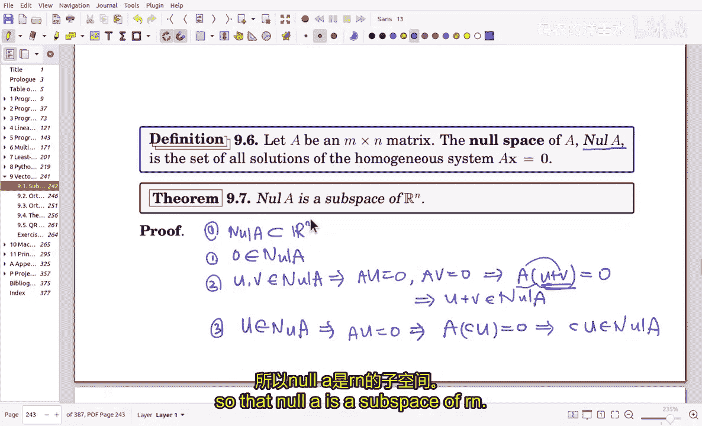

Basis for a substancespace。A basis for subspace H in Rn is a set of vectors。

That is linearly dependent， and spans H。For example。For I2。Yo。With these two vectors。

 we can span our two。For arbitrary vector in R 2 and。

You can find the questionss such that it becomes the vector。Because if you try to get。

A metric from these two vectors，1，0，1，2。Then， the equi sense。

Will be arbitrarytro vector right side in R 2。Let's say that is V。Then theses can be decided。

You can see easily this is invertible， so the C is determined uniquely。So， it is。Al we have that。

 which means these two vectors span R2。But， apparently。These two vectors are linearly independent。

And linear independence can be checked along with the corresponding metric。3。If you have the。

Pots and。The same number periods， there are two vectors。

 not two periodss so that they are linearly independent。

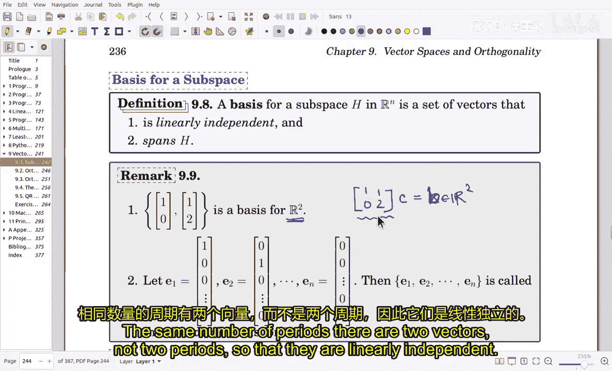

Okay， now we consider E1 E to up to E N。 So E1 is first component this one E2 is。

The second complete is one。 and， and so on so that E N has one at the。Last entry。Then。

These vectors is called the standard basis for Rn。Because this。Standard coordinator victors。In I。

 too。That is one is here， E1 is ones it all。At Erees， now is theran1。These are standard vectors。

 standard coordinated vectors in R 2。So we say the collection of these vectors is the standard basis for r n。

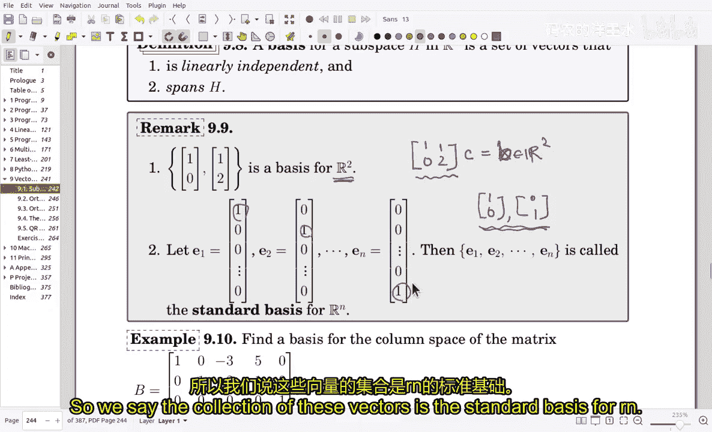

Find a basis for column space of of a。Okay， column space of the metric B， not a， okay。Now， if you。

Try to get linear combinations of columns of a。 Then that is column space。But a basis must be。Xg。的。

Independent， linear， independent subset of a column。

You can find themm here if the metric is given in this way。This is period。 This is period。

This is F is already in reduced as form， and there are periods。And here that is a1， I mean， P1， P2。

 that is P1， P2， and that is P3。B 4 and B5。Then you can easily see that B3。

Ass a linear combination of。P1 and P2 here That is exactly this one。

 minus 30 times of P1 and two times of P2。That is Piy。For B45 times double P1 minus。B2。Then。

 there is before。So these two can be generated once we eliminate these two vectors。

 then the3 are linear dependent。So that de foot vi。Form basis for the column space。And we say here。

In the sp， in general。Non pivot columns are linear combinations of preceding period columns。

 as in this metric here， this one is a non pivot column。

This is linear combination of preceding PV columns。P1 and P2。 And also for this one。

Is a linear combination of preceding。Pview columns， B1 and P2。We can。嗯是块的枝咧。Thus。

 the PV columns of metal gain forms pace for column specific n。For。PV columns。

 they are linear and independent。And also， because non PV columns are expressed as a linear combination of PV columns。

 we don't have to worry about for spending there。So only we consider PV columns。

 then they are linear independent and they also can span the whole column space of a。

So PB columns of a metric。Form or basis for column space array。

Find the basis for the column space and the nerved space of the metric aim。Okay， that is a metric。

And with some elementary rule portions， we can resha this video to。Aron form。Now。

First one and third one。These two columns are Pview columns。In fact， not this one。

 you have to select the columns from the original metric。That one。レ론か。

PV columns and collection of these two。Columns will be。Basis for the column space of the metric。

So that these two vectors。Will form。哦。Basis for the column space。Okay。Now， we have to find there。

Here pace for node space。That is the same as this one。 in fact。

 the node space is collection of x such that AA equals。This one is obtained from。Elim rule positions。

Yet。Dsymmetric times x beome。 So we have to collect。X， satisfying。This homonious equation。

But from the first row， we can see that。Yeah， x1。X 2 and x4 are fully variable。 So equal minus-2 x 4。

 x 2 and minus x 4。Now， x 2。Is fully variable so。Now we'll decide this on later and X 3， the line。

Is it saying that that is minus2 x4？And x4 is also fully variable。Okay， to decide this one。

 we may say that X 2 is x2 and x 4 is x 4。Right。Then。From here。Ex。The effect of x 1，2， x 4。

 that is same as。X 2。Can be chosen arbitrarily。And then， here。

Now the first component is minus-2 and1。These are zeroros。Along with the x of 4。Is fully variable。

 You can choose it arbitrarily。 and there's -1。 This more be。Second quantum was visit and minus2 n。

Wen。Right。So x， the solution of ax equals 0。呃。For the system， this is the gender solution。

X 2 and X 4 are fully variables so that you can choose them arbitrarily。Deenmins。The node space。

Its now。Spend by， there two vectors。Eventually， the collection of linear combinations of two vectors so that you write down here and one vector minus2100 and another vector that is minus 10 minus2 and 1。

So that's the notes pass away。

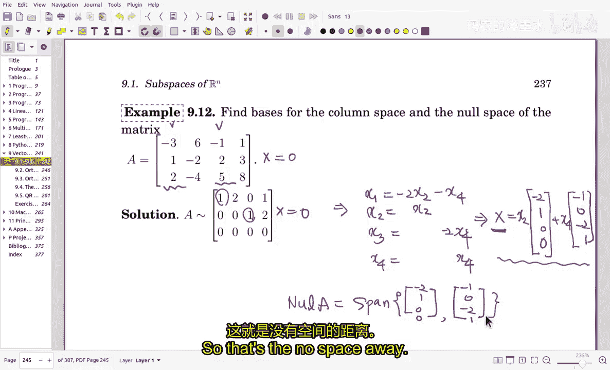

嗯。Pces for node space A can be obtained from the parametermetric。

Vctor form solutions of A X equals the0。

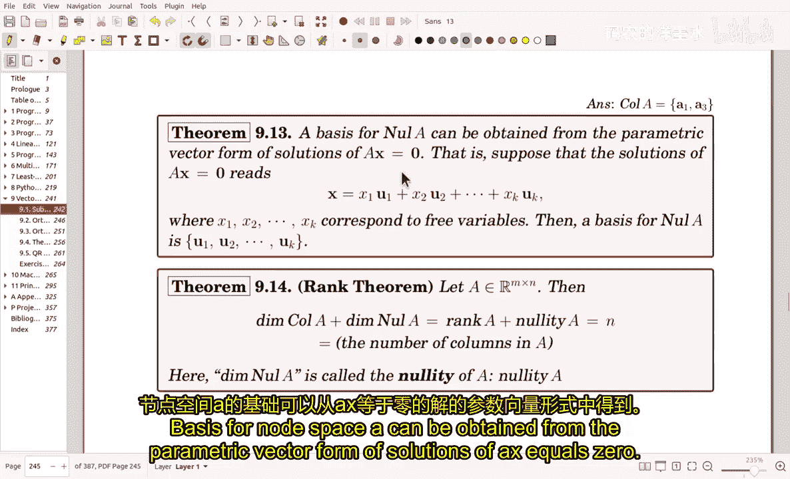

Right， we。T to find the pace for node space bay。By solving a X equal0， ejected， we did that。That is。

Suppose that the solution。Of Ax equal s lead that one。

 So here x1 to xk correspond to three variables。And we rename here now the x component scs。

 Then we can write in this way。Then basis for nodespace A is the collection of the vectors。 Yeah。

 you want to UK。Exactly we did in this example。Right。Okay， now we'll see the rank theorem。

A is on M by n metric， then。D image of column space A。And dimension of a node spaceway， the addition。

Must be same as Anne。Tim imageaginable column super A is the number of。

PV columns and dimension of node space V is number of。Footy variables。 So that give you some。

 then there must be the number of columns in a。We call this one as rank。

 so the rank a is image column space a。And for this， second part， we。

Uually used here the term nuleting， the nuli a is imaging of a nerve space of a。

 So the addition must be N rank plus nuing must be N， which is the number of columns in a。

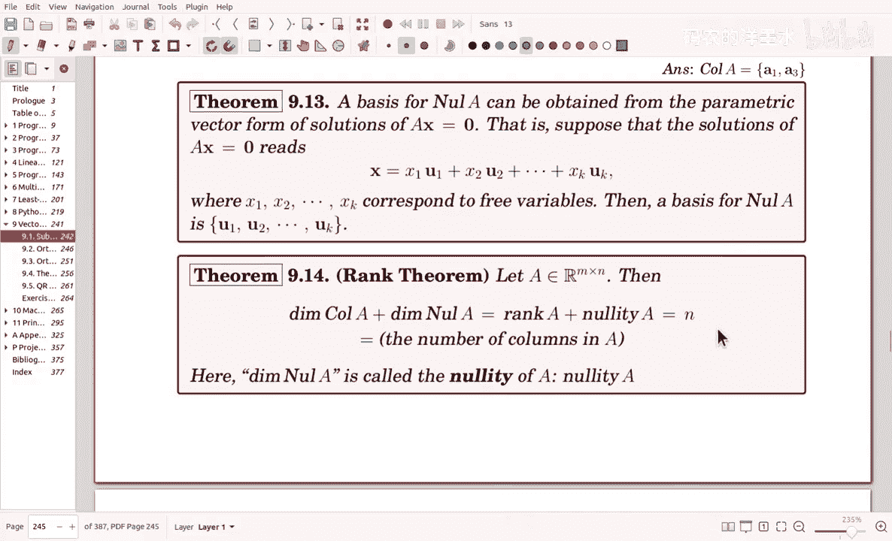

Okay， will continue。In the second section， thank you。

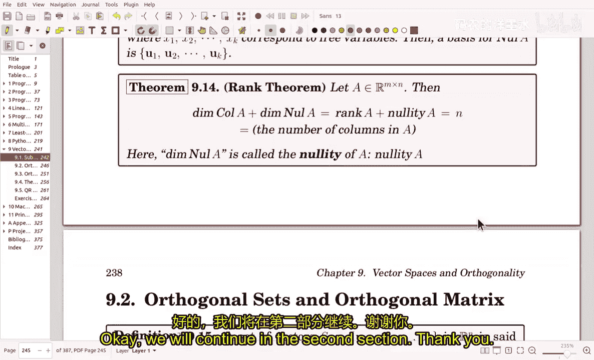