# 【全集-附课程讲义】密歇根大学-人工智能编程-EECS492-中英字幕-p55-Lecture-55---正交集与正交矩阵--BV14JqfBNEAS_p55-

In Mari algebra Gi。Or fairly frequently use the techne as the orthogonal projection in this section。

We consider basic for orthogonal projection。What's one0 sets and what one on metric？

See the definition or set of vectors as。You want to U P in R N。Is on or the10 said。If。

Each pair of distinct vectors from the set is orthogonal。 That means U I that U J is 0。

4 different I J。If the vector as90。Then。As must be linear independent， and therefore。

 the set forms a basis for。The space spend by。The sad。

Or orthogonal basis for a subspace W of R N is a basis for W。That is also an orthogonal side。

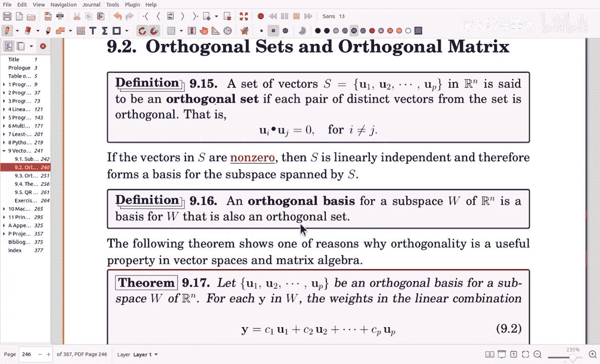

This theorem shows one of the reasons why orthoality is a useful property in。

Eector space and metric algebra。You want to U。Is on a third basis for subspace W of R N。For。

Each Y in W。The weight in the linear combination。Oh。Are obtained。By this occasion。

Because it is a basis for each element， each vector in W。

 we can write in this rank always age by using the basis vectors， we can express y in this vein。Now。

 the cushions can be。Obtained through this cushion。 so you can decide the weights quite easily。Here。

 and from this question。嗯，We啊。Take that product with U J。Then now here we have that one。

Because these are orthogonal， then only U J thatt U J remained and for other。

Vs that that product will be zero， so we reach had this one。And this is the same as now UJ Nomca。

 anyway， here， CJ can be decided by dividing this quantity and we reach at this one。Okay。

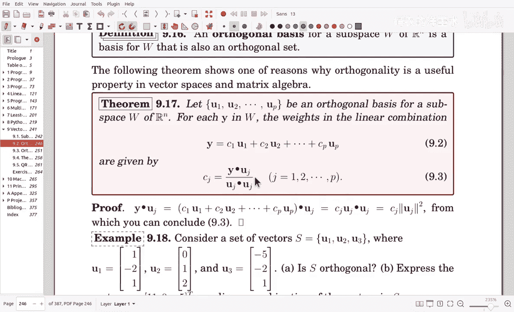

So quite easilyly， we can decide rates。Consider a set of vectors， U 1， U2 U 3。Here is S orthogonar。

Express the vector Y as a linear combination of the vector in S。 first， we have to figure out。

The set is orthogonal。オッケータ。And U1。That you too。Two factors are we make a ta product 0。-2 plus 2。

 Okay， it is 0。How about you1 that U swim。Here U1 and U 3 minus5 plus 4 plus1。 Okay。

 Yes against zero。How about you， too。That usually。Okay from here to there，0 minus2 plus 2。 So again。

 this is 0。 So the set of these3 vectors is orthoho on。Now， for part B， we'll try to use that one。

 Y is given here and。

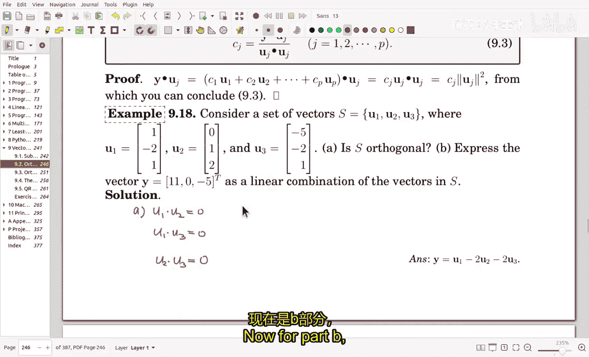

If we try to express this， why。Here in C1， U1 plus C2， U2 plus C3， U3。

 then CJ can be decided by this equation， so let's do that。

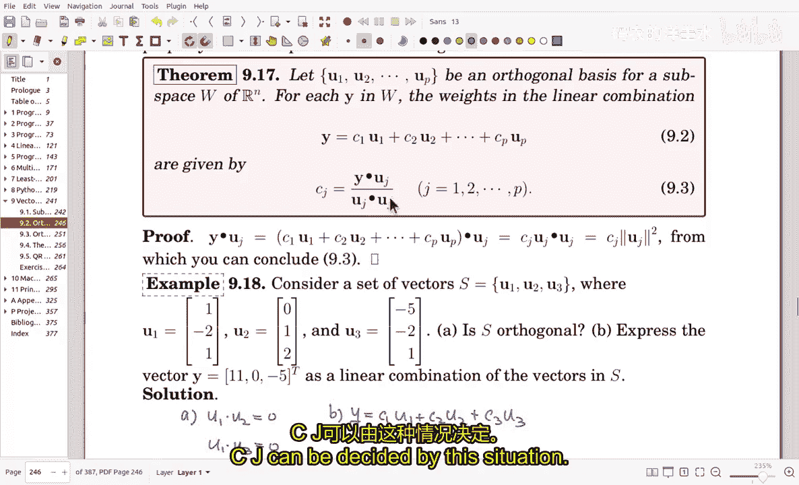

Here see one。It's now y that you want divided by you want that you won。Y is okay。

 We'll try to write down Y vertically。 so it's easy to handle。So that y is。11。0，-5。Okay， that's why。

And why that you want 11？That is zero and minus 5， so that is a6。Tide by。 you won that。 you won。One。

4， one， so this is a six， so we have one。Have a C2。That is why that U2 over。You2 gott you2。Yイユー2，0，0。

 minus10。Tivide by you2 that you2 1 plus 4，5。So it is a minus2。 Finally， we have to get C 3。

There is Y that U3。オバーゆ3タゆ3。Okay。Why that u 3 minus 55。 Okay， let's try to write minus 55。

0 and minus5。And 디바이バ。Okay，25 full1 edition is a 30 tab is-60。 So that that is minus2。

 So we have C 1 is 1。 C2 is minus-2。 Again， C 3 is minus-2。So eventually we'll get that as， right？

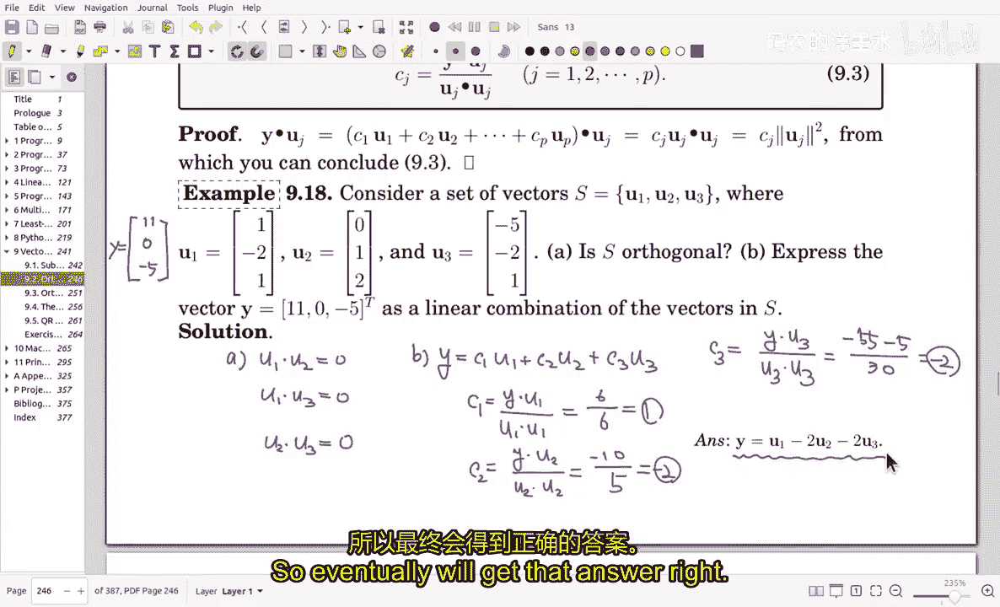

Okay， quite simple。나 우 비엔 버쏘건널。Projection。Keep a non0 vector U。 start with a non0 vector U in R。

 Consider the problem of takingcomposing a vector y into some of two vectors。

One multi U and the other was honor to you。Benmins。Why yes why he。플러시。Now why hat is pet to you？

Theyre the same as one multip view。 That is what I had。So that why hat is competitor。To you。

And Z is ortho to you。So in this way， we try to decompose the vector y。Okay。

While head is parallel to U， We may start with that on Y head is alpha U。Den。Here， Z。

다 이유 피크시스 어쩌그날 나트라트던 모 싫어로 바로。Is the same as okay， we， we move this one to the left hand side。

 So that Z is the same as y minus Y hat Y hat。 We say there is alpha U。 So it is a y minus alpha U。

 So that is exactly this one。That you。Then theyre is same as Y w minus alpha u w。Okay。Non value。

 known value， so alpha can be found。Here after moving this onewa so we there。Right。So。

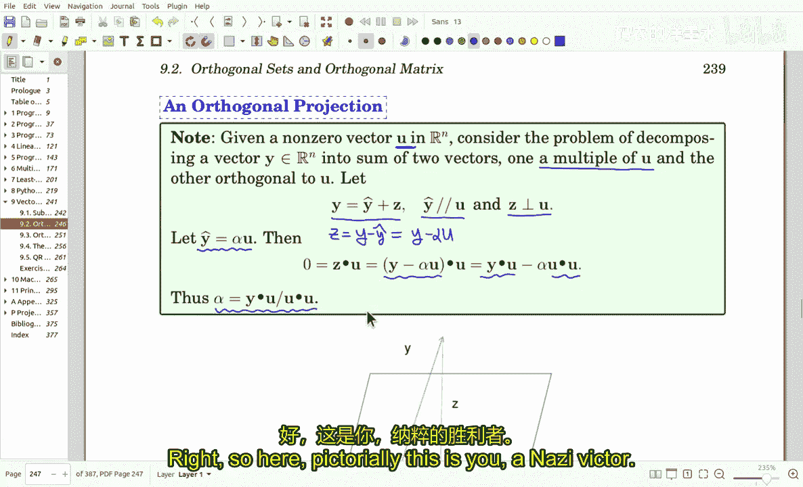

Here， pictorially。嗯。This is you a na Victor。Why does it have to be non zero in this theory but is non zero this is9 zero。

And why， why is now？It is the into two portion。 That is Y hat here。 and then Z。

 so that this is orthona in this ring and move Y hat。In the direction of U。

 and then orthogonal direction C to reach at y。 So there is Y hat plus Z， decomposition。

Pctorialically， we can consider this one。

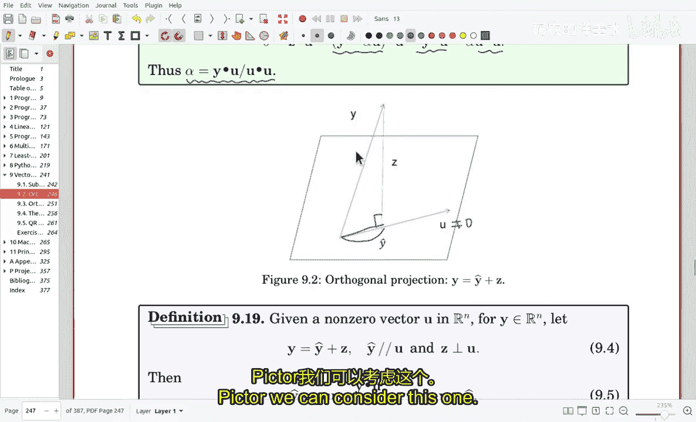

Now we define our television here in this way。

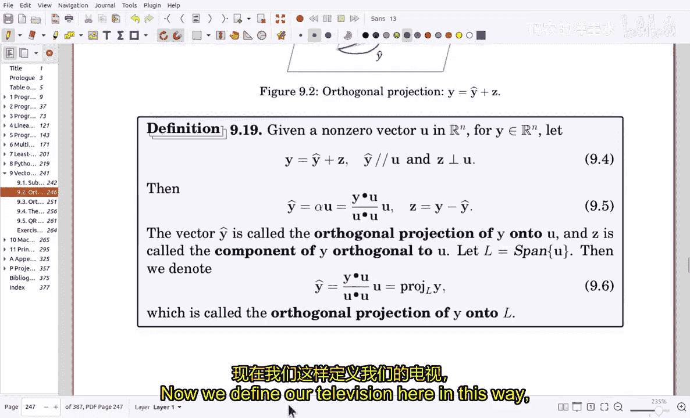

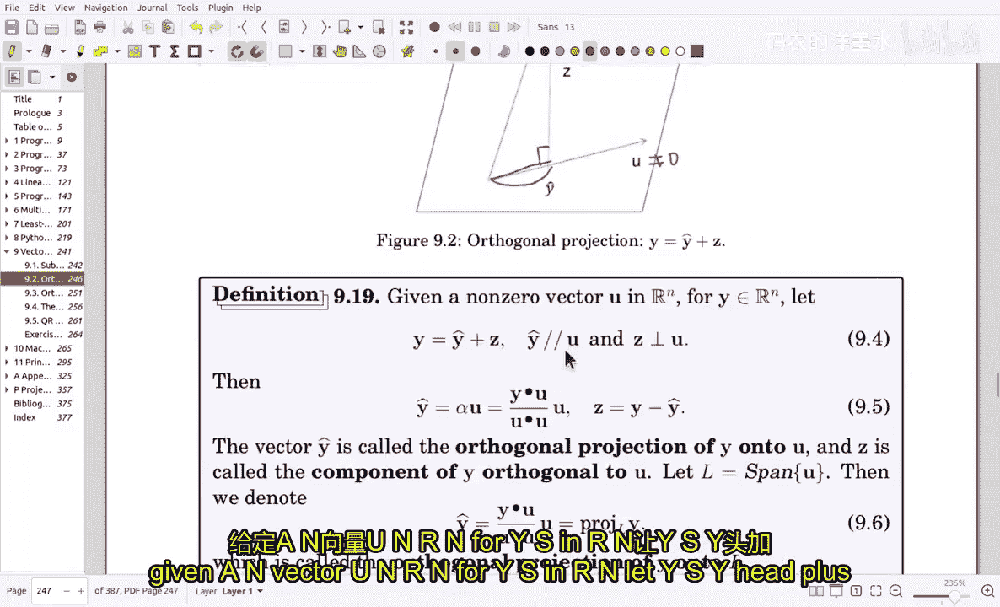

기分은ナ지ベトユアレフワイエアレ렛。Y is Y hat plus C and Y hat is parallel to you and。Now， Z is authority to you。Then。

 we may。Start with why head is alpha u because it' is a pal to U and alpha。

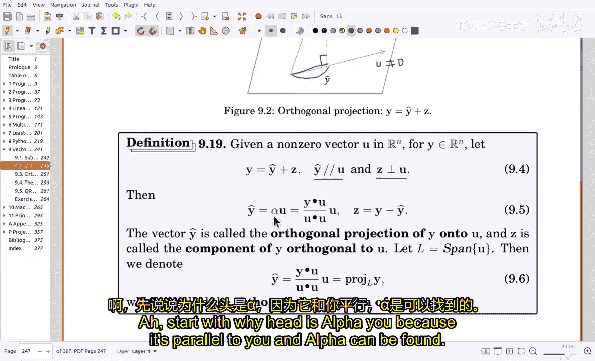

Can be found。 What it we found here。 Why that you over you， right， So we have here。

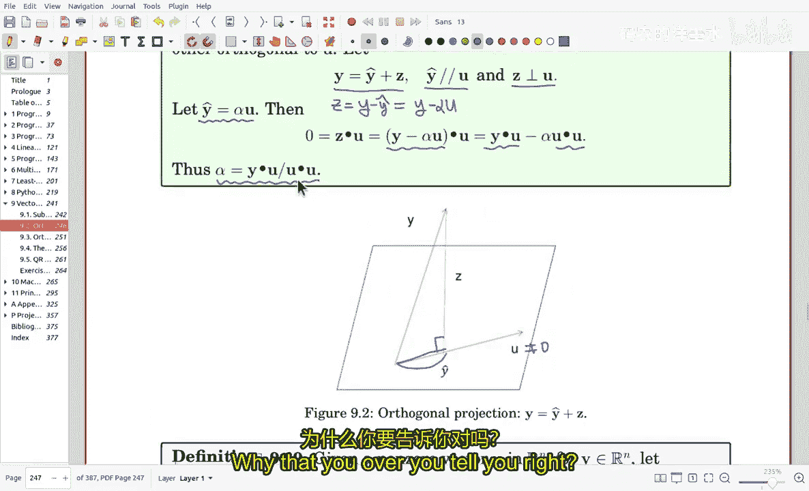

And once Y H is determined， then Z can be decided。By subtracting by hat from Y， right。

 so we can decide that， right。That is definition。The vector y hat is called the orthogonal projection of y O to U。

 and z is called the componentable y orthogon to U。Now， rather than a vector U and we consider。Space。

 subspace L spent by U。 Of course， there is a line。Here L， So is a line then。

We can write in this ring， the projection。嗯。A't you。Rather than projection onto to you， we consider。

Projection of y on to L。So that why help can be written in this projection of Y12L。

This one is more convenient to listeners。

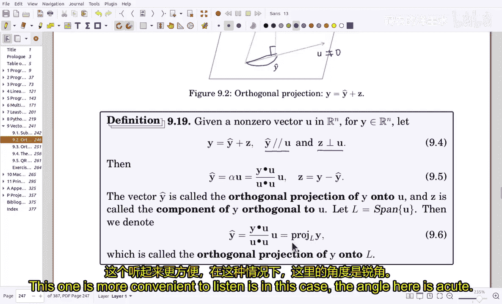

In this case， the angle here is。Acut and gone。But maybe you may have to deal with obtuse， angle。

 wire and that direction。Then projection will be output W。So that that is projector one。

 that's Y hat and that be。So it looks like a far away and maybe a bit odd U is that one。

 but there is no U here。So that rather than you itself， we consider the whole line。

So whole line is L the subspace。And using L， we try to consider。The projection。

 then more meaningful and also geometrically more sound。Right。

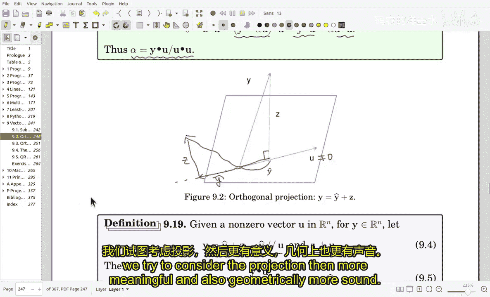

See the example， why and you are given。Find the orthogonal projection of Y on to U。Will say。

 from time to time on to you。However。Rather than you， you have to consider。Yeah。And1，2 L。It is spend。

How you。He。So you have to understand with this。Let's begin， a。And why is project onto to U。

 which means why is now。Why hat？Plus， of course， here， Y hat will be here。 Al U and Al is y that U。

オぼ youだよ。YW， YW， that is 28。28 plus 12。T by。And 16 plus 4， U w，16 plus 4 bottom is 20 tab is 40。

 so it is2。Right。So why hat？It's the same as two of you。Which is now。Okay，8 and4。

So that is exactly the projection itself， so we did， that is the projection。

Right Y is the sum of two orthoner vectorctors1 in。呃。The space L span of U and one orthoner to U。Now。

 we have found already this one。And then Z must be found。 Okay， that is part being。Is y minus y hat。

Okay， y yes7 is6。Seven and six。And see。Okay， why hat。 Okay， Y hat is8 and4。So that that is here。

-1 and2。Right。So if we try to write it once more， then we can write it in this way， why？

It's not my hat。Plusy， now， Y head is。8 then 4。And z is now minus-1 n。2， right。

So you can easy to see that that addition is the6 and。Now， Ed the Chas。

7 and also you can see that plus of these two vectors will be0 minus8 plus 8。 So it is s， right。

 so everything is satisfied。Now find the distance from Y to L， okay。Now， U is， okay part seeing。Here。

You see there on。The space L is this one and y is this one， and it is projected to U here。

 and theres Y hat。 and there is a Z。 Okay， this one is now Z。

Once we try to find distance from here to there。Then there is exactly now y minus y hat。

 which is the seeing。 So this terms is normal C。So that is norm obviously。Okay。And that is。Okay。

 this is already known here。M is one and two， so let's get to top one。Plus4。This says schedule to 5。

 the final answer for C。Its schedule2 of 5。Okay。

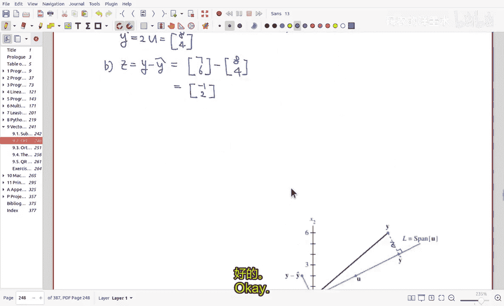

With normal sets。What said you want to U is on ortho for normal cell if it is orthogonal。

And having unique factors， all factors has length of one， and they are orthoal。

 Then it is called orthonormal cell。If W is a subspace， spend by。Its such a sad。Hence。

Then the S is on what's the normal basis for W。And orthogonomer base is。嗯。The said is。

The basis requires independent， linearly independence， linear independence。But the我 one。Also nomal。

 then automatically， is say linear dependent。So that。The set spend by this orthonmal set。嗯。

And then the autonmal cell must be a the normalmal basis for W right？What's normal。

 then automatically linearly independent。

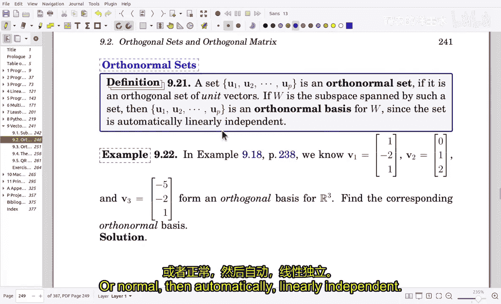

Right。

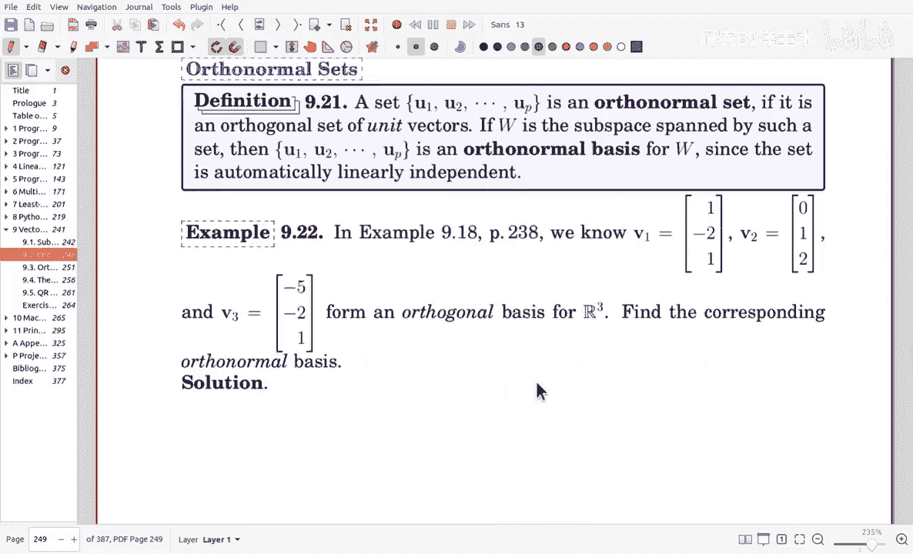

In the example 9。Poy18， we know we want V to V3 from a。

orthohogonal basis for L3 find the corresponding ortho normalmal basis。Okay， all did we know， V1。

 V 2， V3。啊，我说过呢。Now， ortho a normalmal。Bass requires， normalize the vector。So， we can get easily。

By normalizing these vectors。 So you1。From V1， we normalize it。 So divide the by V 1， no。嗯。Okay。

So here length is one，4，1， so's square root to6。One of all Scor 6 and V1， V1 is 1 minus2 and 1。

How about you too？Is from a V2。のマラして。Be too norm。Okay， from V2， Vt is。Now， Schketro 5。

 one of a Schkelettro 5 and。V 2， which is 0 and 1 and 2。About the last one， you。Theres V3。Normalized。

You3 norm。Okay， if P3 norm。Yeah， 25。4，1， okay，30。So it is security over 38。And obviously。Which is -5。

-2 n1。Right。So we found the corresponding with a normal basis。They야 어쩌かな。嗯。Either normalized or not。

 they or thena。 But after a normalization， the length of each vector will be one。

 So these are three vectors。Will form。On whatoma basis。

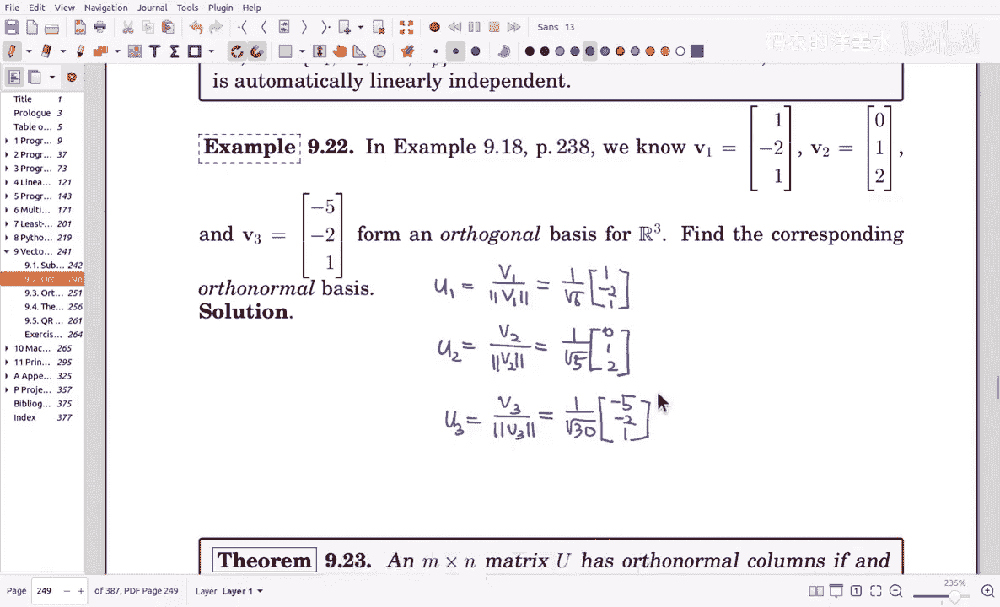

On M by N， Matthew U has。What the normal columns。Okay， each column。Yes。Now normal length one。

 and they are orthogonal each other。 So ortho normalmal columns， if in the audio。

You transport U as identity。 Let's try to prove it。For simplicityistic。We start with the case。

 You has only。Fty columns。U U1， U2 U3， and each one is in RM。 then now U transport U。

That is explicitly written in this rank。 Then we do metric the row column multiplication。Youwe。

Transport U on。 That is this one。 U on。This is a row vector right now， this is a column vector。

 U1 U2。 That is this one。 U1 U 3 this one。You continue and you make this a 30 by 30 met rail。Now。

 you has orthogonal columns。Or assume this one。Then orthonormal means this diagonal must be 1。

 but of diagonal entriesism must be 0。 So we reach this one。And also once it is true。

 then that means that this morespiidome and only long diagonal， the value must be1。

 also the below morespiidome， that is it's actually saying that the columns are columns of u are orthogonal and length of 1。

So you have orthon normalmal columns， so they are equivalent。When you has 30 columns， however。

This proof can be expanded for general number of columns， quite easilyly。

We start with the three columns for simplicityisticistic， but for general number of columns。

 you can do the you can finish the proof。So generally， that is true， okay？

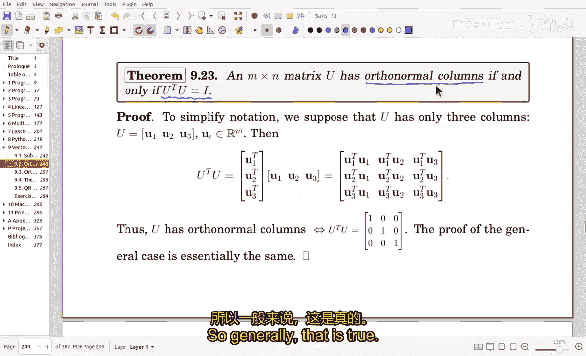

Now， U is on M by N metric with ortho normalmal columns， which means that if and Ol。

We already know from the previous theorem that U transports U is identity， right。

Now which choose xy from R， then Ux norm is same as x norm。

 so it is a length prejurbation after per of U， Ux dot uy is same as x thatt y。

 that is that the product prejurbation and Ux dot Uy equals 0 if Ol x thatt y equals 0。The orthoity。

I pre it them。Let's put the theorem。pating。Now。We think here， UX。Now， norm scaled。

 then they're the same as UX transport UX。Now， from this part。

 you have x transpose U transpose now U and x。This portion is identity， right？

So we have that the same as x transpose the x， which is same as x thatt x or x norm。수피해야 돼。So。

After eliminating the power to， we chat that right？Partti B。And here U x dot U Y。

 we start with here UvX。That。有啊。They're the same as， in fact， UX。Tspo。 and you are。

So from here again， using this one。X transpose U transs U Y。This portion is the same as that one。

Now U transport to U is again， identity。 so we will share x transport to y， which is same as x dot y。

 So we prove this the second one， the part is C。Can be proved the h러이。You can't finish it US。

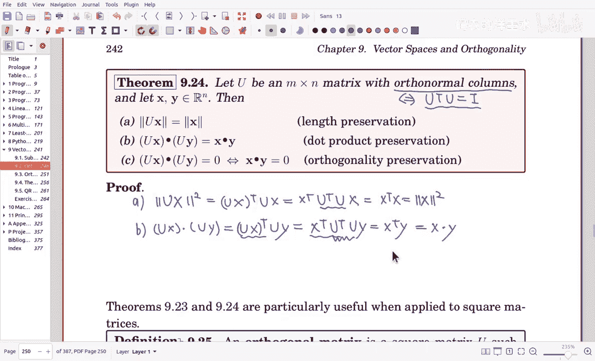

Theoreems 9。23 and 9。24 are particularly useful when applied to square matrixes。 Okay。

 let's go back to the theorems。

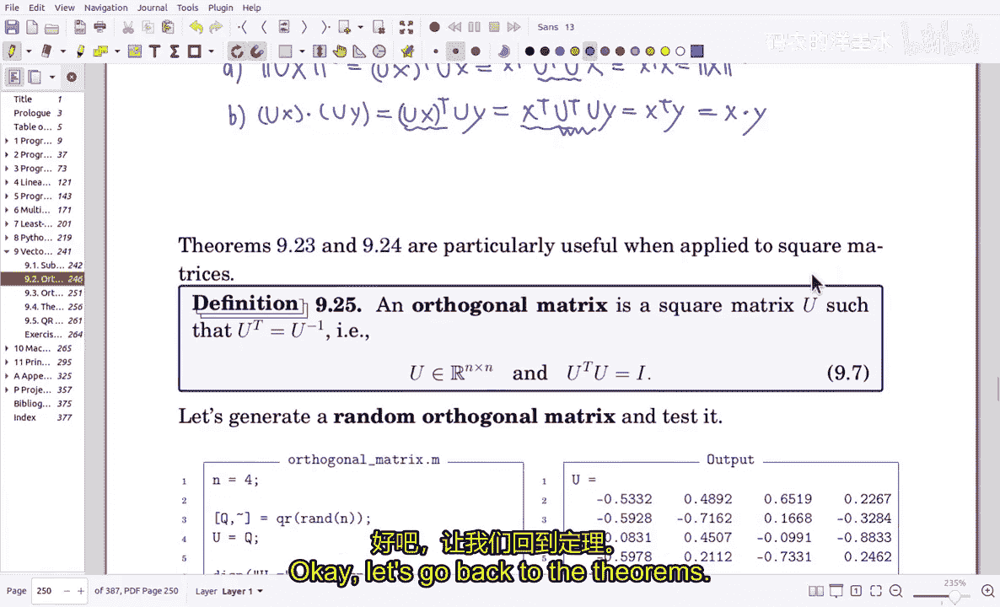

This tool。Okay。And is general size metric， U M N。Matw U has orthogonal columns。

 if only if U you identity。

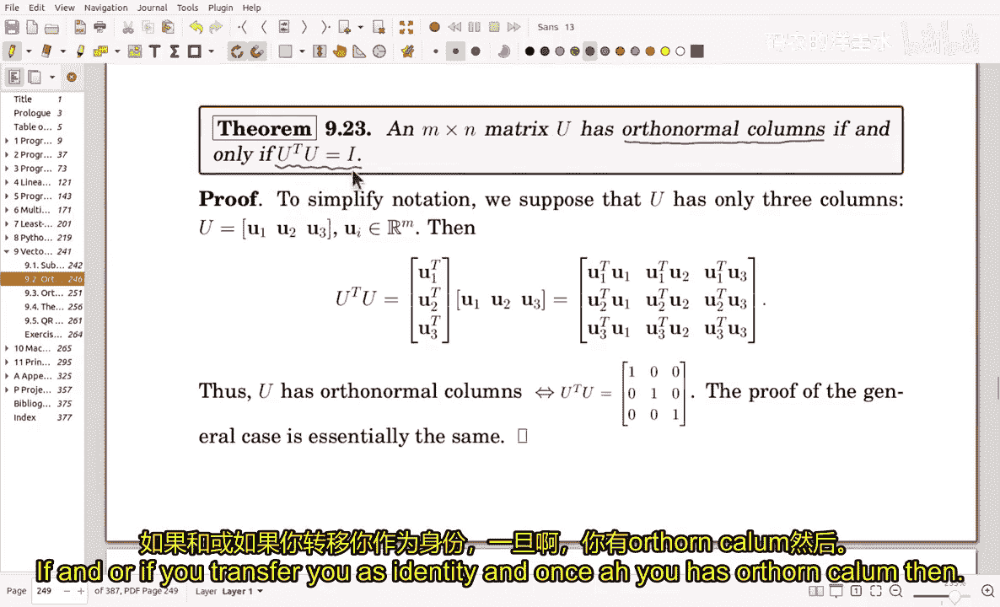

And once you have orthona Kalam then。

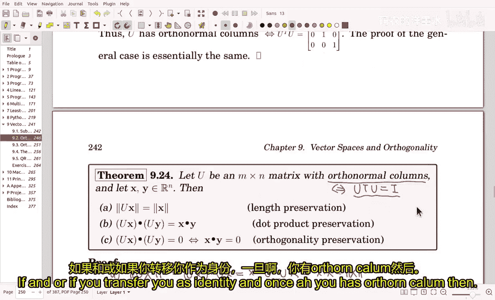

嗯。The metric preserves length。

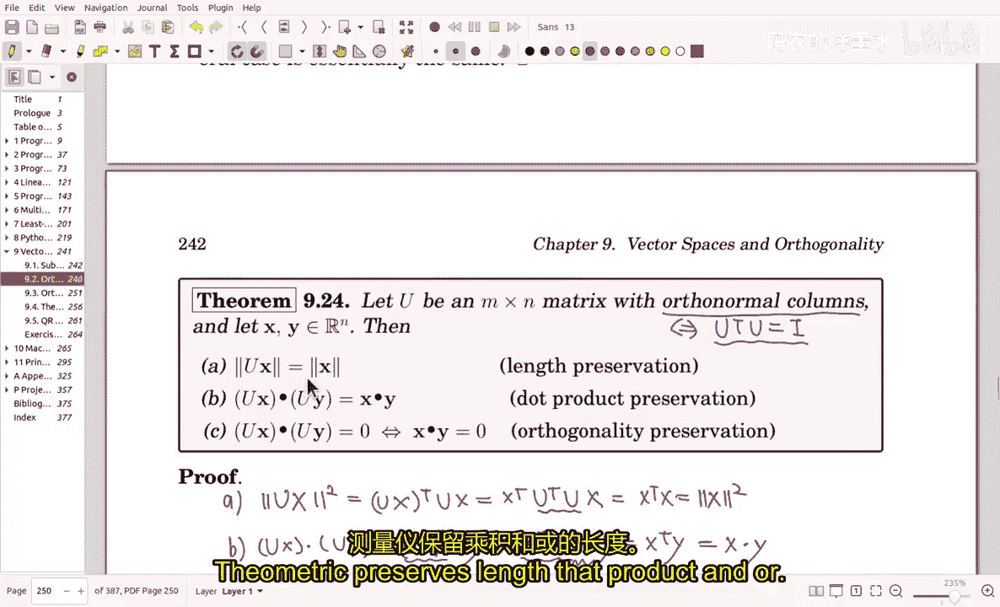

That product and authority。

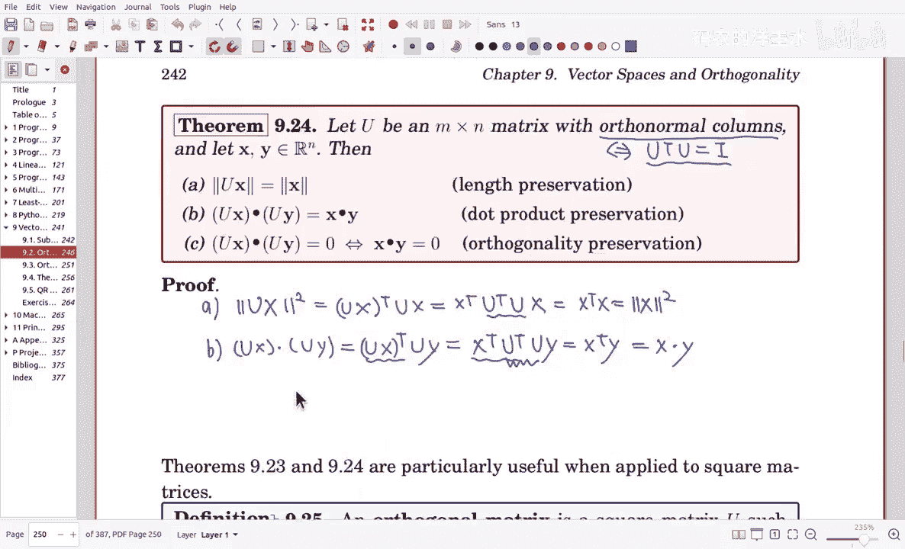

Now we couldn to that。The case。Whenan U is a srimetric。So you see n by n matrix？And in this case。

 it's quite useful and frequently used。 So we keep a name。The name is。Ahona metric。

An orthogon metric is a squaremetric U such that U transport is U inverse。

That means it is inver smetric。And the inverse is your transform。We may rewrite in this way。

 U is schemetric and you transport U as identity， u transport as now after the product becomes identity so that u transport as U inverse。

Now， once this one is satisfied。Then。You has if olive live。 U has orthonmal。Colors。

But the metric name is orthogonal metric。Traditionally， in mathematics。Mathematicians use this name。

But you should not be confused， just。This is name。But， practically。

Orgon metric that then practically is a square metric。And inver。 And also each。

Columns are orthoommal vectors。And also， it is a satisfyinguterance for U is identity。

Don't be confused with the name。It is。オ normalmal。Colums， okay。

Let's generate a random orthogon metric and testian。

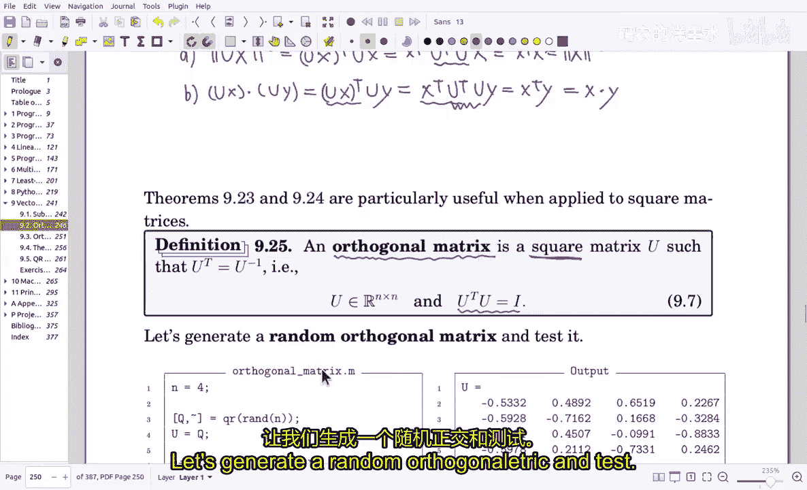

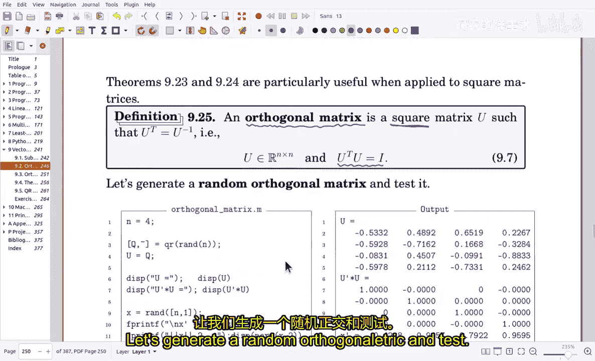

Oh。Here we choose n is4。 so well try to make4 by4 orthogonmetric。

And generate a random4 by4 metric and Q R ferization。And you learn Q factor。In。Section 9。4。

Then here Q is always ortho wegon maderan。But we are using U notation。 So after getting it， now。

 say we。Saブああ。Now， change it to you。And then。Now， here。We try to print out the mat。

And you transport you must be identity。And here， we。Get a random vector。And print out。

And check the norm of X。And no of UX。It's a norm preserving， so the outcome must be the same， right？

Okay， here。We have output。You， that is。Randomly generated worth one on metric。

 and you transferred you。See here and diagonal is1 and of the eagonal entries are 0。

 So it is basically identity。And this vector is generated and is known and U actually known。

They are the same。

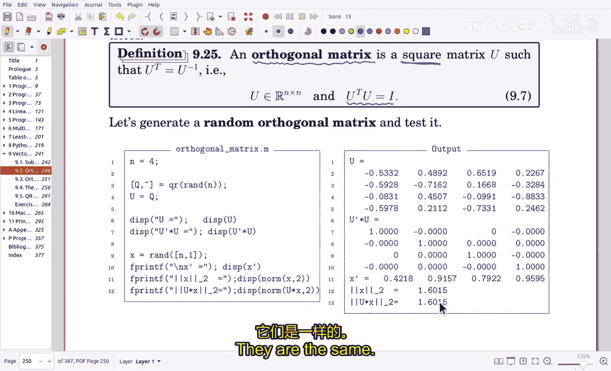

Right。Okay， that's the end of the section， thank you。

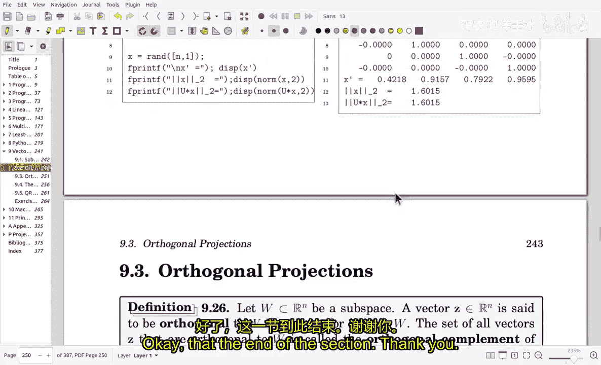