# 【全集-附课程讲义】密歇根大学-人工智能编程-EECS492-中英字幕-p56-Lecture-56---正交投影-正交分解定理--BV14JqfBNEAS_p56-

Now it is a section 9。3。Poathgonal projections are frequently use to taonics in me algebra and numerical ans。

See the definition。W。Is a subspace of our N。A vector Z in R N is said to be orthogonal to the subspace W。

If C that W equals0 for all W in the sub space。Once so vector Z is ortho to every vector in W。

 then we say。The vector Z is ortho to the subspace。If we collect all search。Orhogonal vectors。

 Then it is called orthogonal complementi of W。 And we are using the notation W proppenricular or simply W probe。

Here， this is official definition。W P is the collection of vectors Z。And which。

Has a that product serum for all。W。In the subspace， W。

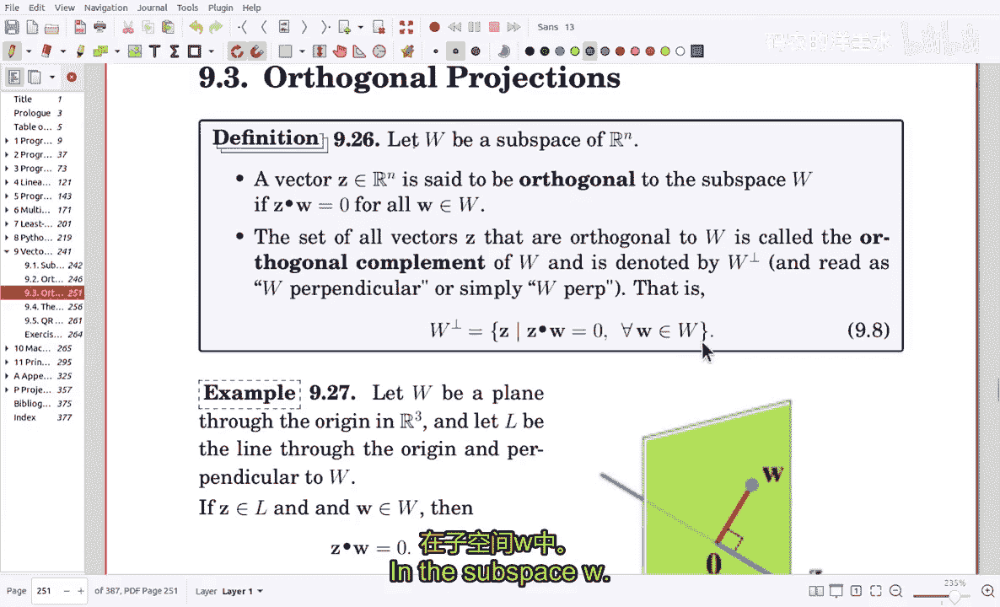

In this example。W is a plane passing through the origin in。R 3 and L。Is a lion。嗯。

Through the origin and perpenicular to the plane。If we choose any。Victor。Z from the line and W from。

The plane that it must be orthogonal so that their that product must be seen on Z W。That put0。And。

As a matter of fact。L lion。Its the collection of all victors。That are perpendicular to the plane。

And now W， this plane is the collection of all vectors， perpenicular to the line。

 So we say that here。L is double pro。The line is perpentaicular to the plane and and the plane is perpentaicular to the line。

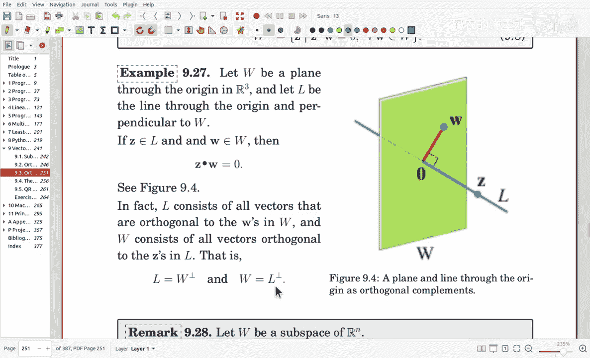

Okay。W is a subspace of R n， then。Or vector x is in W pro。Okay。Now。

X is in W Po means x and every vector in W。That product will be set on。

But we don't have to consider every vector in W。 once that is or set。And that spans a W。

 which means that。If we have a spinning cell of the subspace W。Then。If x is ortho or2， every vector。

In the spinning set。Then， x is in the。The probe of the subspace。

 So that rather than every vector in W， we may check the orthogonality。

 along with only the vectors in the spinning cell。Wp is a subspace of R。

 and you can prove quite easily。To be a subspace。You must be closed under linear combinations。

So if you are choosing， for example， two vectors and U and V in a2 vectors in W P， that means that。

There is the same as you know， U dot w equals0 and v dot W equals0 for every choice of W in the subspec。

So， from here。Taking two scs， the linear combination， C U plus D V。And for that vector。

 the linear combination， we have to show that is in W2。

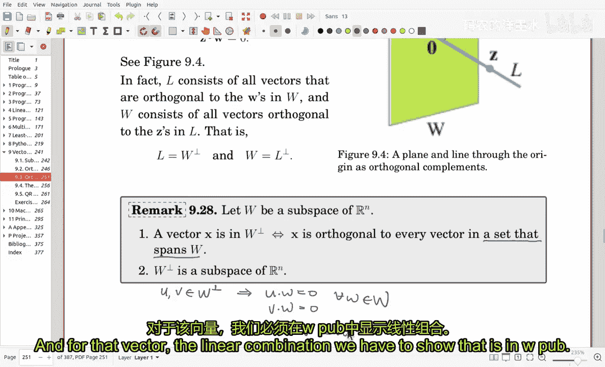

Now， to show。This one。That that is the target anyway now， we take a w from the subspace and then C。

 U plus D V。And a2 W。Then only do we know that。Yeah。U dot w0， V dot W0。 Okay， if you expanding。

Expanded then U that w， V that W， this are 0， So it must be 0。 that means this one。Is in W top。Right。

 so。W pop must be a sub of other。

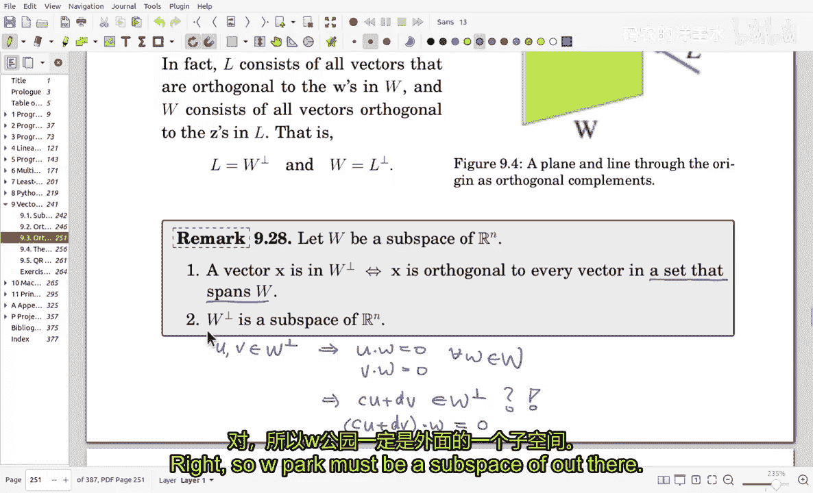

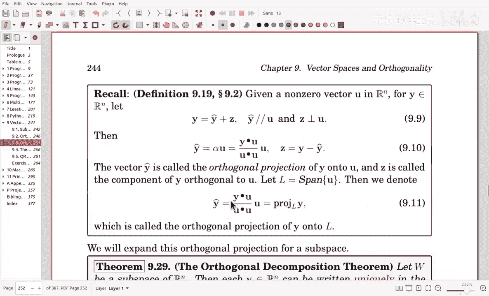

In the last section， we studied this one。Keep a non0 vector U in R N， Y is R N。

 Then here we can make this thecomposition， Y is Y hat plus C。

And why head is pet to you and Z is orthona to you。For that， yeah。

 why hat must be R for U because it's。Now， betteral to you。 So we start with alpha。

 then alpha could be。Determined in this， right。Have to determining why hat Z can be computed in this way。

Here the vector Y hat is called the ortho projection of y onto U。

 and z is called the component of y ortho to U。And。L is lying。Spned by the vector U。

 Then we may write down this Y hat。 Okay， the this quantity， the vector。 and we are using notation。

Yeah， projection of Y on。So we call Y hat the orthogonal projection of Y on2 L。 We did。

 We defined this one， and。Try to solve also some problems。Now， for this orthogonal projection。

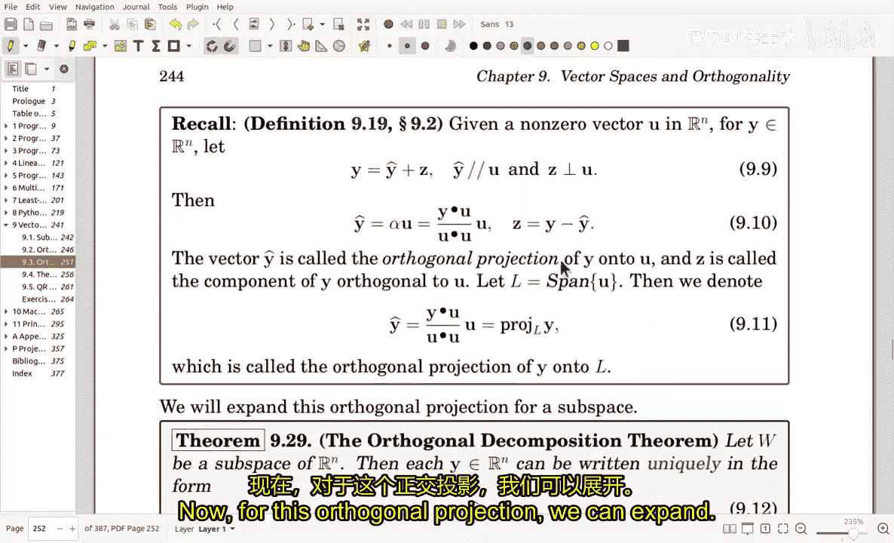

We。Can expandend。The projection for substancespense。The orthowaal。

 the compogen theorem says here that W is a subspace of Rn then。Each one in ArN can be written。

Uniquely， in the form。Yhy equal by H plus。Why hat is in W。Like over there here why hat。

And once we consider L， then y hat will be。In L。And Z is ortho r2 and that L。 So exactly in this way。

 Y head is in W and Z is in W pro。So that is a channelization with that projection。

 with the one of projection。In fact。If you want to U is on。orthogonal basis for W。

So once we have orthogonal basis for W。Then。The projection。A y onto to W can be written in this ring。

 We already know that for orthogonal set or orthogonal projections。

 orthogonal basis we already know the projection to the subspace in this ring。

 and then quos are determined the。By this question。We already didn't know。 And also here。

 we have the the same form。And just U1。 And for U to same format and up to U P。

And after getting Y hat， again， Z can be determined by this subtraction。

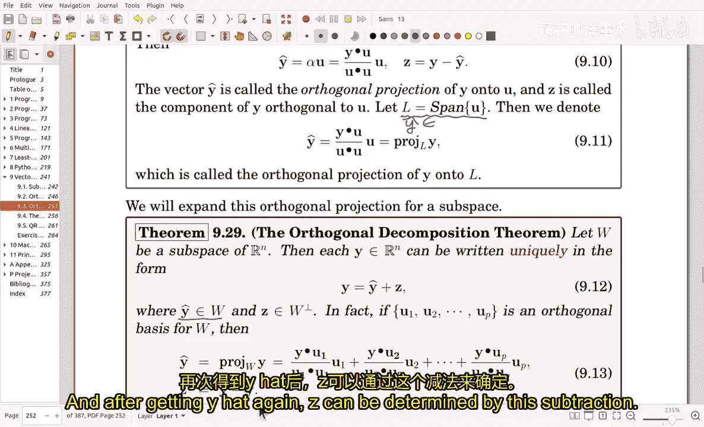

Okay。E pictorial。We can explain Anne。And this is subspace， this is the origin， and W is a subspace。

And y is here， then y hat S projection on W。So that why hat is。

Clsest the point from y and Y head is on W。So also。

 we can measure the distance from the subspace to y by measuring this Z component。Same as。A with。

Specable line， L is spend by。A vector U， rather than a vector。

It is pen by orthoal base and P vectors， Then we can consider we can make this projection and the orthoal vector。

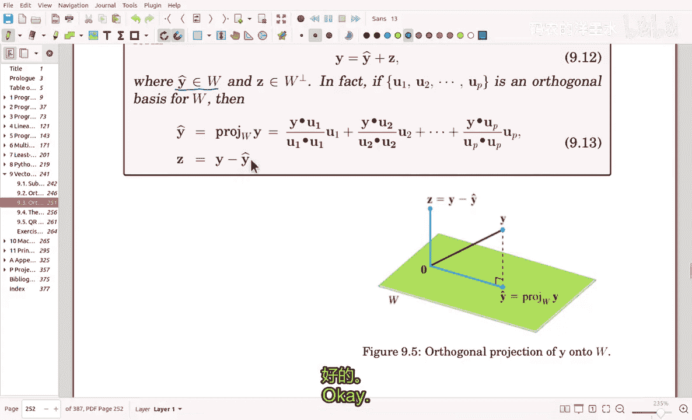

Okay。See the example。 you want you to。And why is given observe that you will need to use an orthogonal basis for W。

And spin over U on U2。 And we consider a self space W。In of all three。Then， okay。M-4 plus 5-1。

 So the these two are what the gonna。 Okay， so these two。Will form。On what' going a basis is。

Right y has the sum of a vector in W and a vector orthogonal to W。

 that means we intimate make orthogon decomposition1 is in W， and the otherone is orthogonal to W。

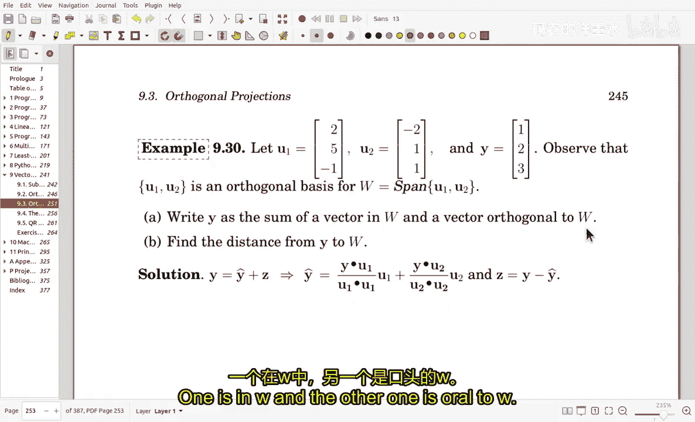

And already we know， from the orthona position theorem。

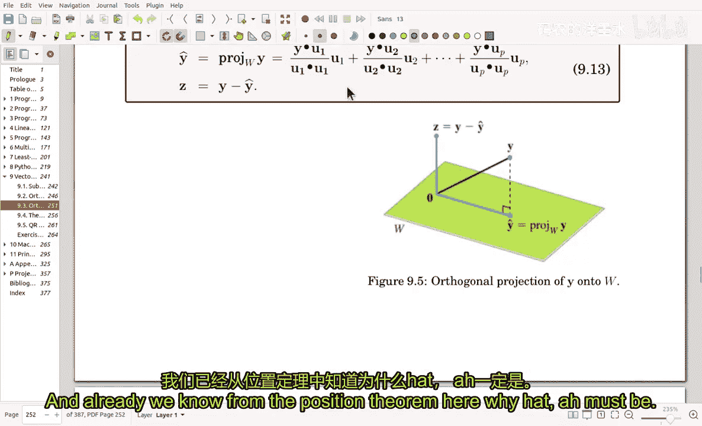

Yeah， why he？M be。Obtainending this string after obtaining Y hat。

 we can compute Z to be Y minus Y hat。 Let's。2。 and then the distance will be nomobil。

That's three step by step。A他A。那。We have to these values。 So let's try to write them in this way。

 Y hat equal。There is Arabpha1。Yuan。Plus alphapha 2， u2。 there is alphapha 2。Now， alpha 1 equals。

Why that you won？Why not you want over。You want that。 You won。Okay。

 let's try to get this tattoo product。Why that you want， which is2。And 10 minus-3， So1 tri-3。

 so which is 9。😔，U want thatt U1， that is 4，25。And。That is now just a moment。 Okay 2。

 This start product is 2。12 and9 occasion。Is correct。 U want that you want。There's4。25 and1。

 so its a 30。Okay。So that is。Okay， it's not an。Integer value。But anyway。フりこは。The alphapha 2。

 which is y that u2 and u2 that u2。Why that U 2， which is-2 plus 2 and。

So that there is three and you2 that u2。Thats。24 plus 1 plus1， that is a sex。So there is half， right？

So why hat？Mus be。Yeah，3 over 10 and you won。Okay， U1 is 2，5 minus1。Now， that is half。And that is。

Now， minus2 and one and one。So we can compute here。Let's try to pull out one over 10。

Then there's3 times 2， that's 5。So that6。-10， so is minus-4。And then that is 15 minus-5。15 plus 5。

 So that is 2。That is minus 3。Plusrush 5。 So it is true。So we can rewrite this one in this way。Mus 0。

4。2 n0。2。We got it。Now。Z can be obtained from here。 Y minus Y hat。 Okay。

 you can compute quite easilyly。 That is 1，2，3。And then minus this one is minus 0。42 and 0。2。Okay。

 so first one must be 1。4， second must be  zero， and then that is 2。0。Right。So this one。Plus。

 the bad one。As the expression here y equals y hat plus Z and for part B。Now， we can measure。

The normalcy for the distance？So Z norm。From here， you can find it quite digitally。

Nomal but this one。But you can finish it yourself。

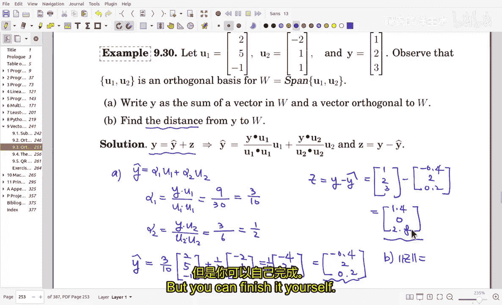

Okay。Properties of orthogonal telecomposition。Y is Y hat plus C and Y hat is in W and Z is in W pro then。

Why head is called the orthogonal projection of y on to W， and we may use such notation。

Y H is the closest point to y in W。

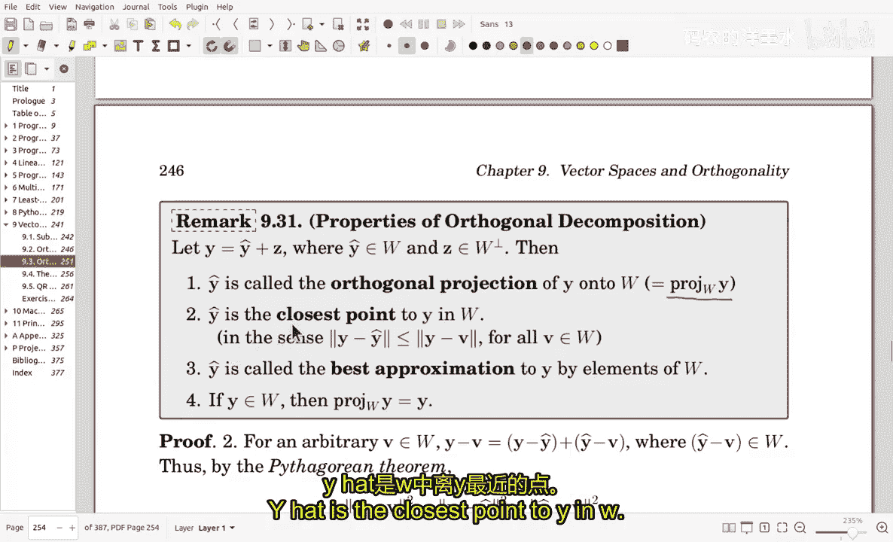

Let's go to the picture。 And why is here。

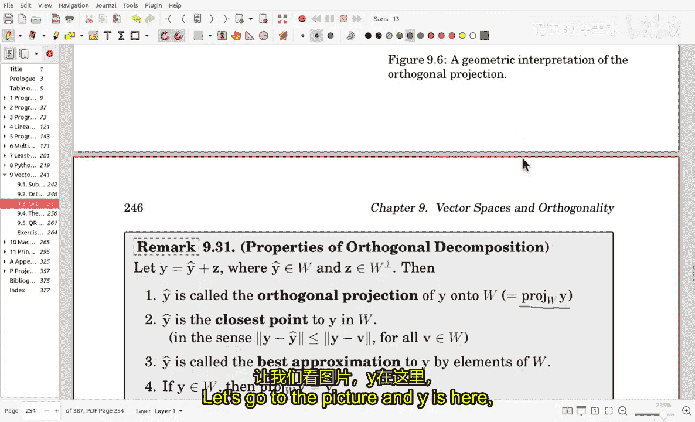

Then y hat is that one。 So why hat is on W。 But this Y hat is the closest point。In W。From why。Yeah。

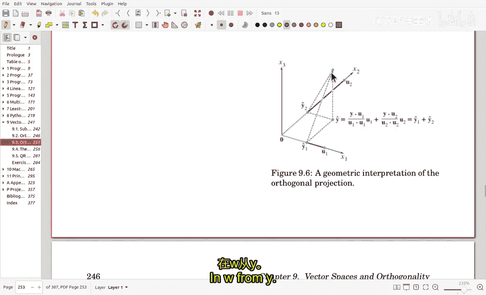

In this sense， we can say that mathematically y hat minus， y minus y hat norm is。Similar or equal to。

Every and y minus genome for all choices our being。Here it is proved there。By using Pythular theorem。

Now， y head is called the past approximation to y by elements of W。

So why head is the best approximation to y and why head is in。W the subspace。If y is in W。

 then is projection。Must be the same。Okay。For second part。

We choose an arbitrary vector V from W and y minus v， the right right side。

 We start with the right side， y minus V。Can be written in this way。Y minus y hat。And。

And y hat minus v。Okay。Now。Y minus y hat is orthogonal to w， but y hat is in W。 v is in W。

 Their combination is W。 So Y hat minus v is in W。 but this one is in W top， they are perpenricular。

That means。By using the Pthgonal theorem， we can say that this norm s is same as this norm scatter plus norm scatter。

 That's exactly this one。Now， if we try to compare this two。

Then now along with this term is the same。 and this is always non negative。

 which means that this one is always。And larger than or equal to this one。

 there is actually this one， right。

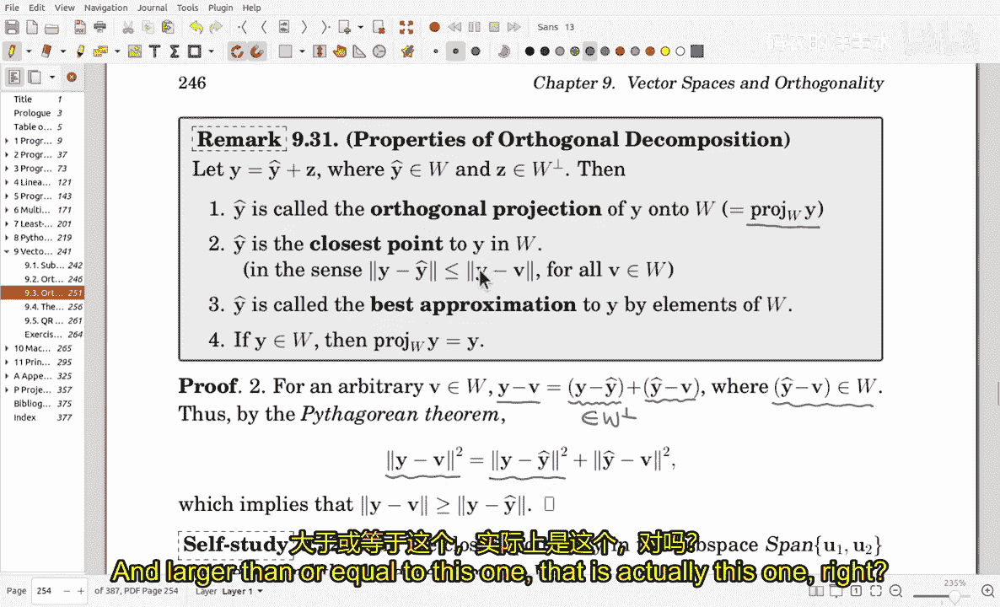

嗯。Try to solve this problem yourself， Find the closest point to y in the subspace span of U and U2 U U2 given and hence find the distance from y to W。

Here the problem is asking you to find why hat why is projected into the space spend by even you2 so that you may write down y equal and y hat and Y hat plus Z and then that this times will be normal the。

And why head will be here。Why that you want Ti buy the by， You want that you want。

 And now that's you want plus。Why that you2。You2 that you2。And you， too， that is Y hat and pluscy。So。

 you can。Find these questionss。 And after finding y hat。

 you can decide the Z and normal of Z will be the distance。 It actually same。

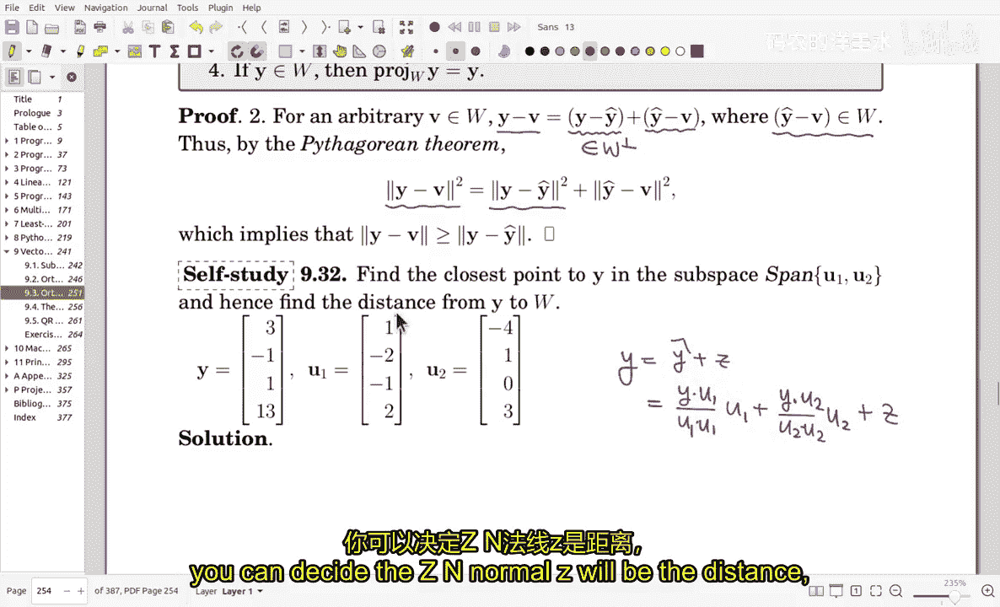

As for。That problem。But now Tim is。Higher。Except for that， everything would be the same。

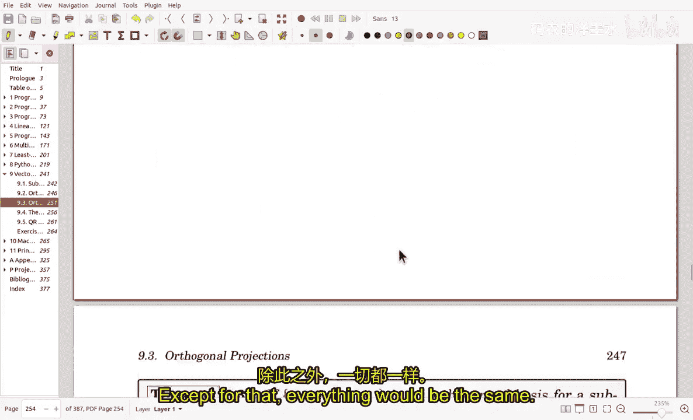

If you want to U。The said is on。On a normal basis for a subspace W of R N， then。The projection。

Of y onto to W that there must be capital W。ke in this way， because it's auton normalmal。Yeah。

 we ignore know on the bottom， the projections are always made。怀得。W1， no why that you want。

 you want that you won because it's normal， the value is one。 So we ignored。

 So every year the same you do over u to that u to， the values1， So we ignored every year。

 So that is the projection。And。So that if we consider a metric U and collection of the vectors。

 you want to U。Then the projection of y onto W can be written in this where U U transpose y。

So projection with one a projection can be viewed as a metric transformation。

 The metric corresponding metric is U U transpose。And we can prove this one quite easily。

 Look at that one。This one。Can be reading in this reign。Now， that is。Okay， scales。 This are scale us。

 but。Y that u1 is U124 Y。Why the U2 is U2 terms y， and also。For this term。

 similarly we consider in this ring。Now this。Ss。And that can be obtained from。This one。

 you trust module Y。Then this is surface of vector。

And there will be the first component of this vector， second component。

 and there is a last component。So this linear combination of U and2 UP can be rid thissymmetric vector computation。

Now。We consider this part then there is actually now this one UT transpose。Okay。

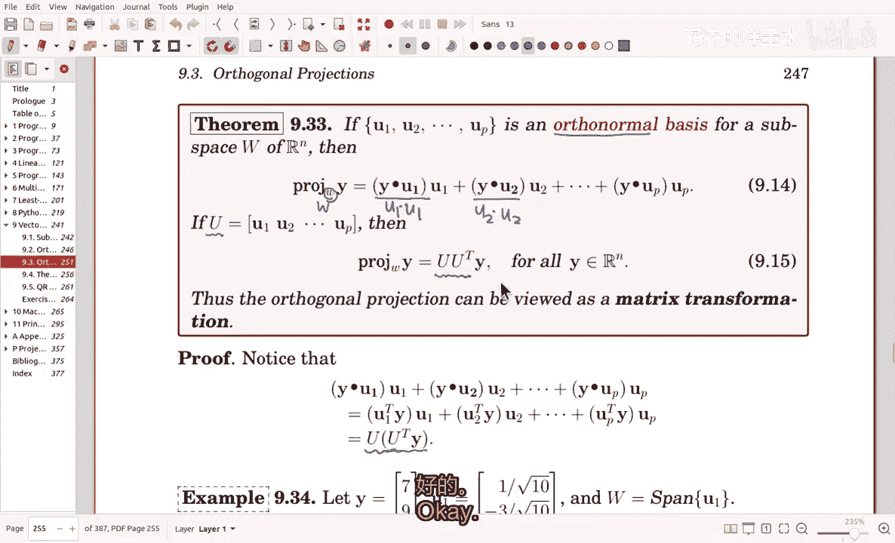

So here the theorem says that the orthoal projection。Can be viewed as a metric transformation。

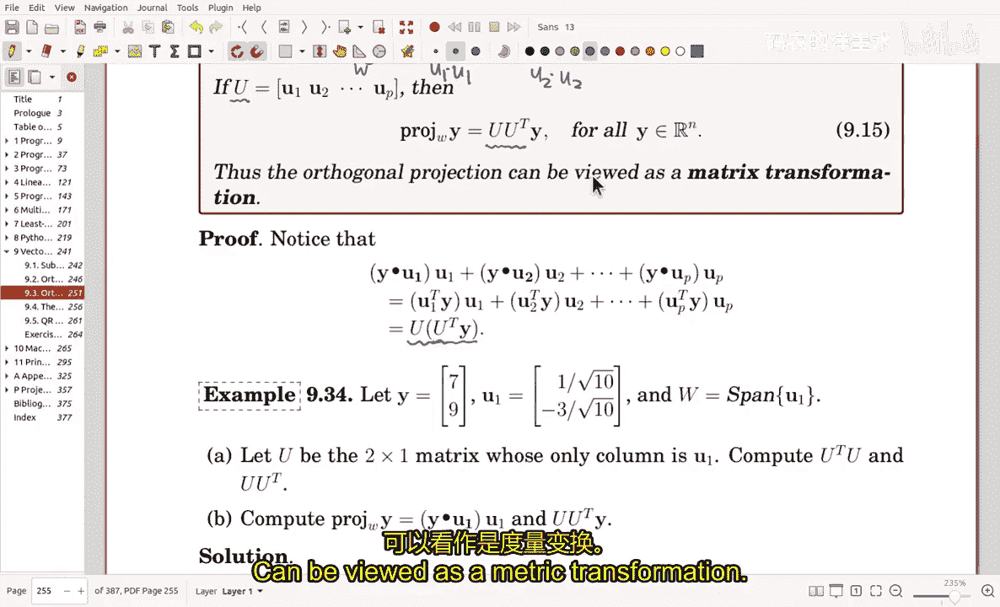

Now， why and you1。Eke。This is length one。 So if you try to measure。

 the length of then is length one W。As a subspace pen by U1。

 we are considering now only one vector and the corresponding subspace W。You。

It's the two by one metric whose。All the Columbus you want。

Then we tried to compute U Trans U and U U transports。 okay， let's do that。Yeah party。Now。

 U is this one， you won the metric。 We are considering now metric。

So one over sketo 10 and minus 3 over ske to 10， that is now2 by1 metric。And from here。

 you transport you。Is。Now。Okay， that is。1 over square up to 10， minus3 over square up to 10。

And you is selfish。Now one of our is going up to 10。😔，マイナ3オーバース。mm。That makes yet one over 10。

Plus 9 over 10 so that it is one。How about U U trans？Okay。F。This wonderful simplicity。

We may consider。You capital U that the same as one of our Schkeletleto 10 and now that is 1 and minor 3。

 we may think in this way。So that is。One of square up to 10。 and that is1 and minus3。And then again。

 is transpo。One of cur 10 colors is the same。Now is one minorad。For this two scala。

 we have one over 10。And then。We have to make metric that。Mplication is one。That market is a minor。

That one is minor 3， and this multiplication is 9。Okay。That's you， you transport。

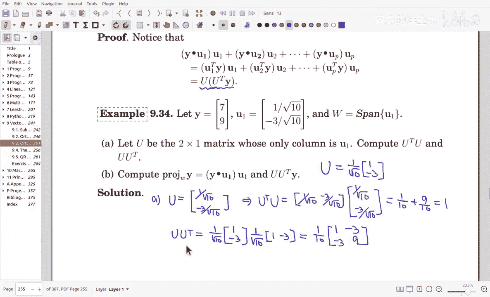

Now， here。We try to get projection。Of y onto W， which is same as。Why that you won。And here you want。

 Why that you want。Is why that you want？That is 7 and minus- 27 so that there is a minus20 over schedule top 10。

 that is the product and you won， you won。Is now one of us kind， okay， one of us going total 10 and。

That is1 and minus3， so we can simplify。Okay， that will be 10 and 20 so that we have a minus-2 and1 and-3。

 Okay， that's the result。 We can rewrite here now， minus-2 and 6。Okay， that is the projection。

How about the other one。You， u transpose N y。 Okay， the metric is one about 10。And1 and-3，-3 and 9。

And why， the victim y。It's7 n9。Okay。So that is one over 10， the equi is there。C part。

 And this that the product is a 7。-27。So， that minus-20。And this one is-21。And plus81。-27。21 plus 81。

 So it is 60。So here we can get here，-2 and 6。So that these two are the same。One is the projection。

 and one is along with metric transformation。But they are the same。And earlier。

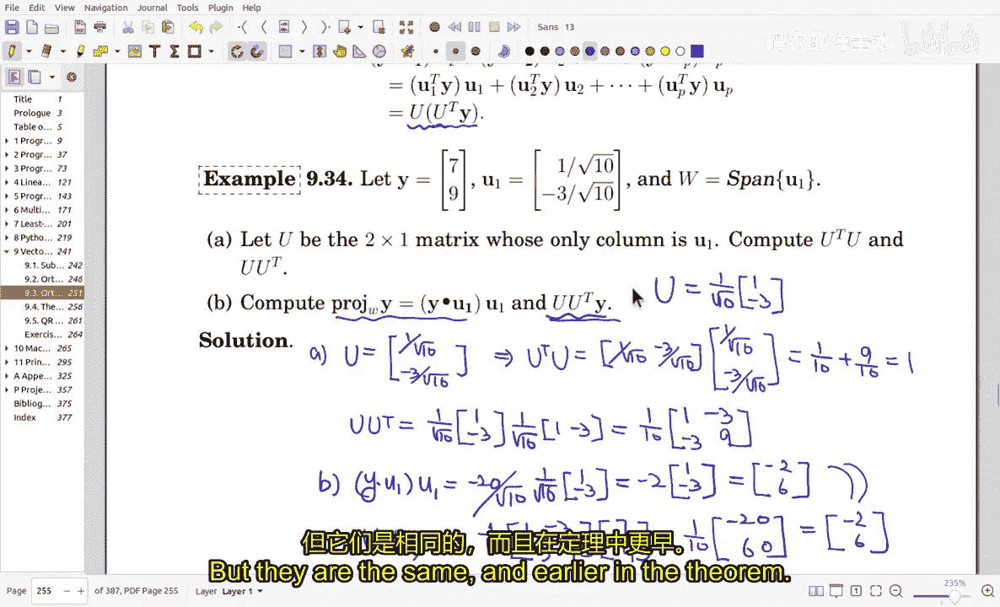

In the theem。We said that the orthoal projection can be viewed as a matrix transformation。

In this example， we purposely made the you transferred you and the projection and you transferred you why we checked them。

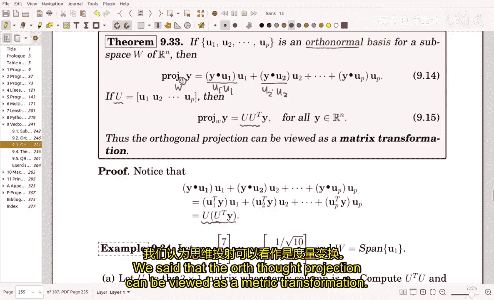

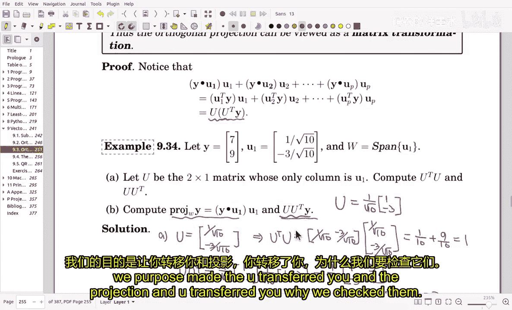

To it the same。Right。

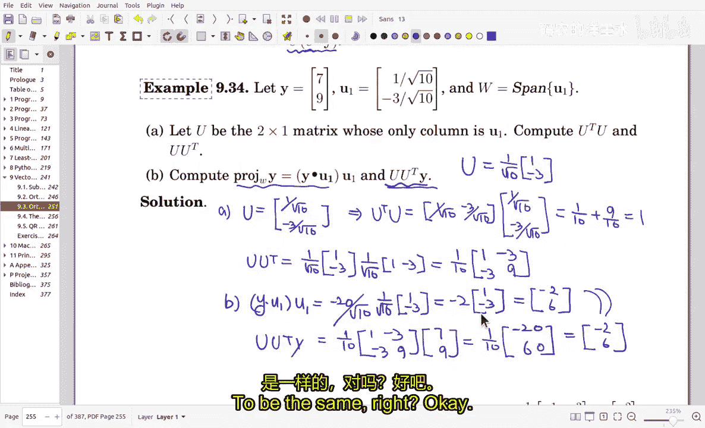

Okay。Okay， that's the end of the section， thank you。

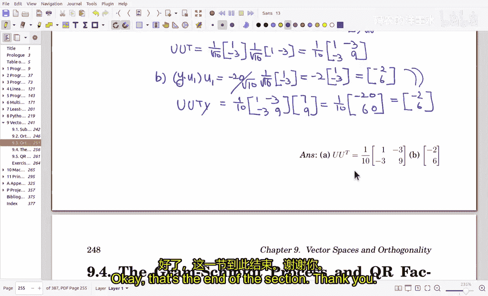