# 【全集-附课程讲义】密歇根大学-人工智能编程-EECS492-中英字幕-p57-Lecture-57---Gram-Schmidt-过程-QR-分解最小二乘解--BV14JqfBNEAS_p57-

In the last section， we studied orthogonal projections。

Here well apply them for the cramid process and QL factorization。

The crmetter process is on algorithm to produce on orthogonal or orthonommal basis for any nonzero subspace of RN。

See this example。

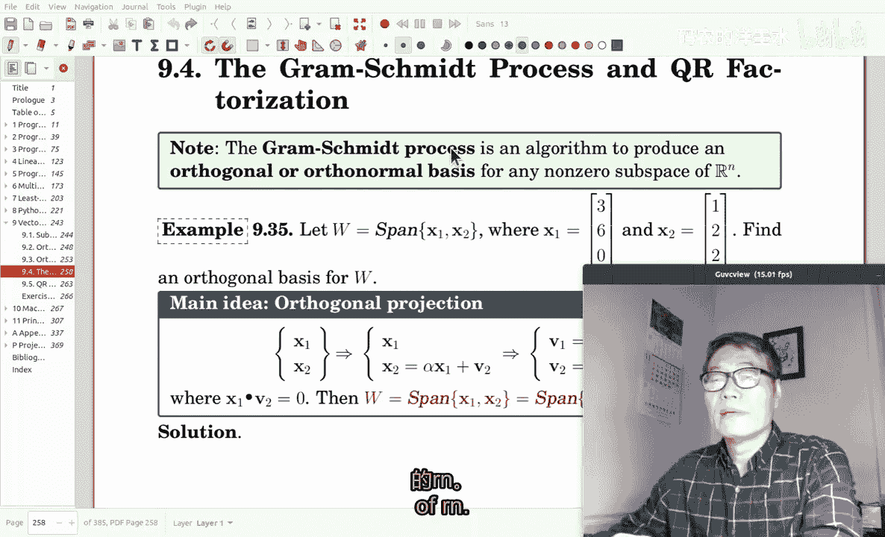

W is the span of x1 x2。 These two vectors are from all3。Will try to find on orthogonal pieces for W。

Main idea of the cr Schme process is to use orthogonal projections。For given x 1 and x 2， first will。

Project X 2。1，2， x 1。And V2 is orthogonal 2。X1。That is orthogonal projection。Now， rather than x1 x2。

 we'll try to choose V one and V2。 Of course， V is x1 and a V2。I from here， we can get it。Now。

 because V2 is a linear combination of x1 x2。And so that the span space of x1 and x2 and span space of view and V2 must be the same。

So that's the idea。And let's try to solve the problem by using this TechNe。

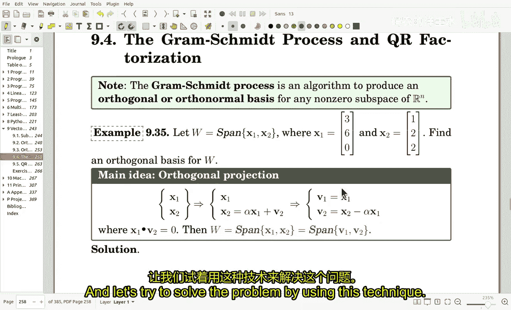

Okay。Now， X 2 must be。Projected onto the space of x1。So here， x2。Is r5hi x1 plus V2。

For this projection， alpha must be x 2 thatt x1。Over x 1 dot X 1。Right， okay。X 2， x 1。

Product is now 3。And plus。Triils。Now， x1， X1。That is here，9 plus。36。Right。Okay。So it is a 15。

 and that is 45。So it is a one third， okay？So， V 2 can be。Here， x2 minus1 third of x1。Okay。Y is x2。

 x 2 is 1，2，2。And minus。1 third。And x1， x1 is 3，6，0。Okay。So， here。내를 비 싫어。

And there will be again0 and 2。

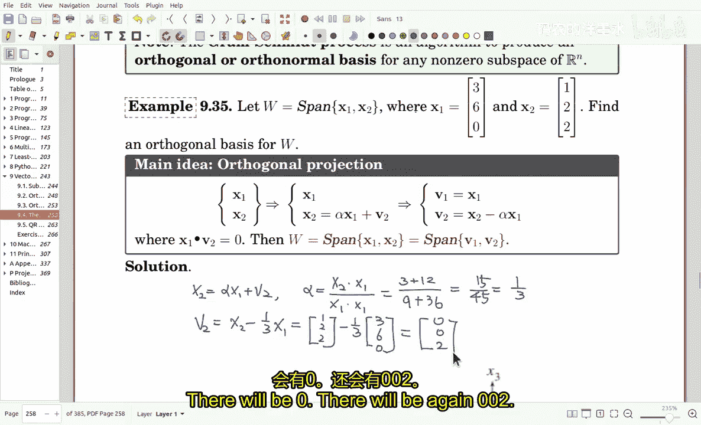

So here if we collect Vvo on and V2， then there's the spa。Yes。Also when I pay this。Here。

 we must be X1。So， view1。360。And now， we've got。AB 2 here。 That is0，0，2。This two vi。Will form。呃 do。

Psces for W。 But now these are orthogonal。 So these two will make an orthogonal basis。

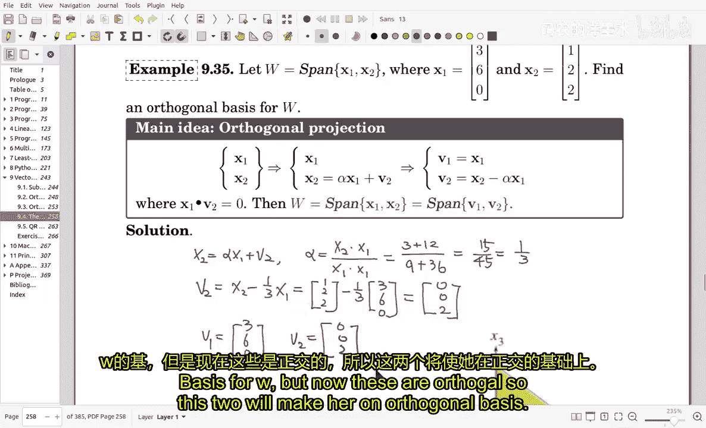

Okay。See this figure。X1 is here。 Now， X 2 is this vector。Rather than using Exonx2。

We tried to project ex to。The spaces of x1。And that is the projection。

 And this is the orthogonal component。 And so that here， V1， V2。

What1 and they form on what 10 pages is。

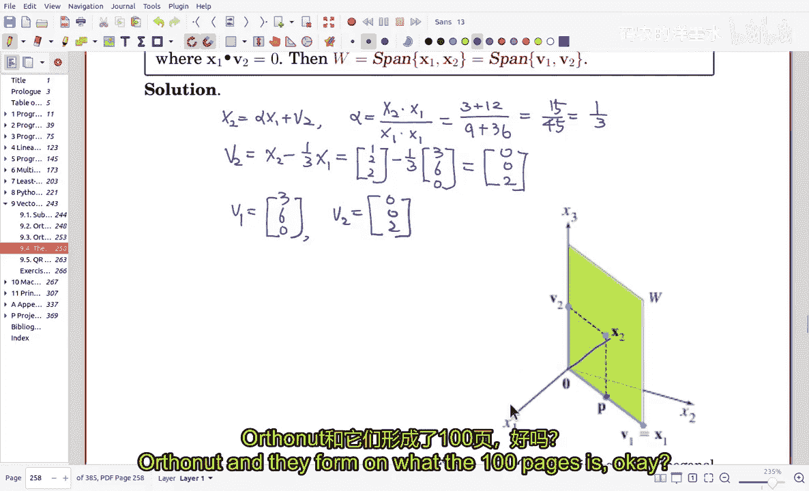

Now， we generalize that。Idea。And that is the per process， keeping a basis。

 that means they are linear independent for the9 zero subspace w of RN we define in this way。From x1。

 just we define V1。 Now， x 2 is projected to V1。 In fact， x1， V1， and the main part is V2。

 So after projection， we try to get V2。 that is orthogonal component。

Because they are linearly independent， always we have that non zero orthogonal component。Now。

 we'll go the next step。Now， X 3 is projected to。Into the direction of view1。

And also onto the subspace of V2。And the main pot is。An orthogon나 component V3。So after projection。

 we rearrange in this array。 P 3 is obtained from orthogonal。Component again。

 V3 is an non because they are linearly independent。Keep going。 And we get such formula。Then。

 we want to V。The set of these vectors is on orthogonal basis for W， in addition。Now。

 if we consider the。Subspace， spend by K。Victors。This is first K vectors of x。

 and that is first K vectors of V。 but these two spin space must be the same。

The span of x and x2 and span of V and V2 must be the same。

Because they are really linear combinations of earlier vectors only， and of course here。

 the span of x1 x to x3， these are 3 vectors must be the same as the span of these 3 vectors。Is。

We are are taking。Agonal components， however， they are all linear combinations of these earlier vectors。

Okay， so that。For each K between1 and P。The spend subspecs are the same from X from O V okay。

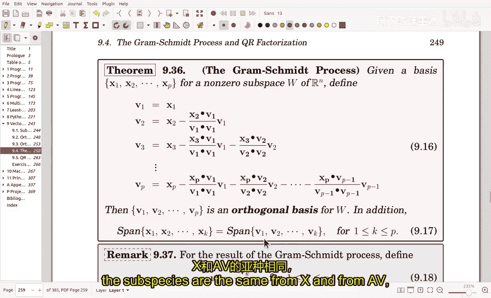

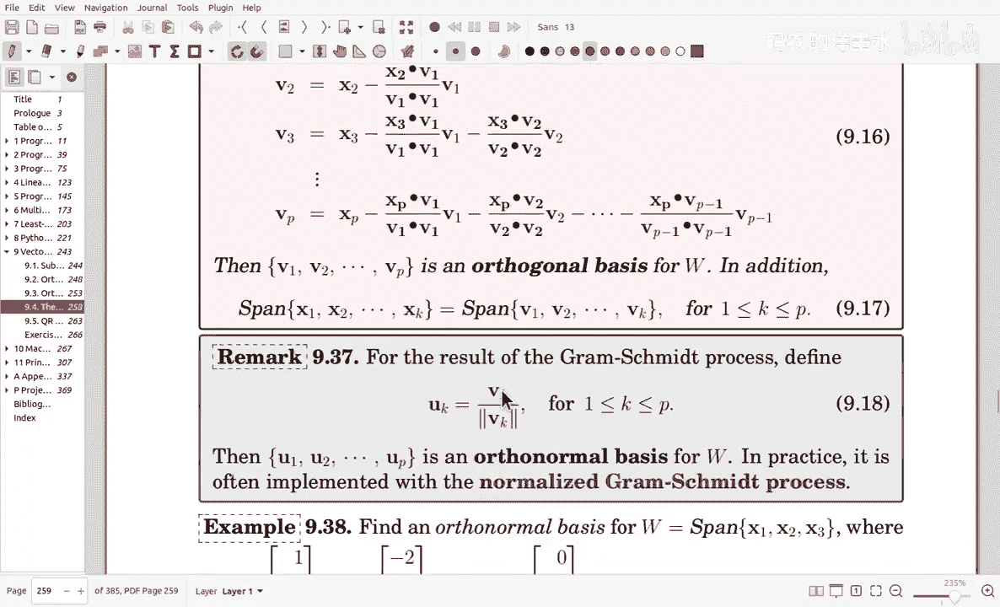

This is a orthogonal basisesience。 Now， once we normalize the orthogonal vectors。And。

This orthogon basis becomes。On what a normal base is。

Its normalized that it so that it becomes on what a normal basis for W。In reality。

 the cr process is often implemented with the normalized the parameter process。

 That means that this normalization is included in the。

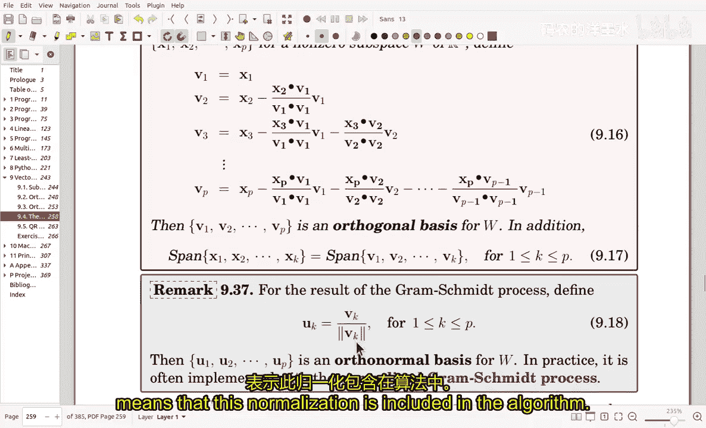

Algoism。Okay， let's try to find ortho a normal basis for W。 That is the span of x1， x 2， x3。

And X these vectors are given， they are all from。All four。Okay， let's do that。

By using the kid process we。Here， start with V2。 V2 is the same as now x2 minus alpha。X1， right。

An alpha can be found here。 That is x 2 is projected into。The space sub x1， so that x1。

 thatt x1 on the bottom。Okay， now this that product。Ass minus to0。Minor 3， okay， so it's a minor 3 a。

And。X1 dot x1，1，1，1， there is a3。So that that is a minus1， which means that this is the same as okay。

Now。Alpha is -1， so we have to add two vectors。X1 x 2， addition is minus-1， Ed is 2。

 addition is0 and1。Right。So we got V2。Now， we3。Okay， that is。First， we can project。

 Let's try to start with X 3， X 3。Must be project to now Alpha 1 and V1。 Of course。

 X 1 is v1 and plus。Alpha 2， v 2， and then here V3， we have to get that on。Now。

 for this orthonal projection。Apha 1。Must be。Now， x3。Is projected。Want the space of a V1。

So that then must be x 3 dot v1 over V1 dot v1。Now， v1 is x1， so the x 3 v1 that product，0，0，1，1。

 so that there must be 2。Okay， V1 dot V1， we already know that is 38。Okay。

 now it is not in teacherger but anyway。Now， alphapha 2， there must be。Yeah， absolutely。

Yes project 2 V 2。And V2 that V2。Now， F3， that is V2， that product must be 0， 0， okay。

 that is a 0 and 20 and plus  one。 So it is a 3。And V2 that V2，1，4，1， there is a 6。

So there is a half。Okay， so we have to do。No integer computation， but anyway。So V3 is same as x3。

 which is here。It it1。-1 and1。Alpha 2 is2 over3。And if you too。呃。Just on， Alpha 1， Okay。

 that one and P 1 a X 1。There's10 minus1 and1。An Alpha2 is one third。No， no， no， there is a half。

 right？Have。And there must be half and V2。There is。-1，2，0。Okay， you can。Simplify yourself。

 And then after that。That is few1， so you have to normalize if you want to get。

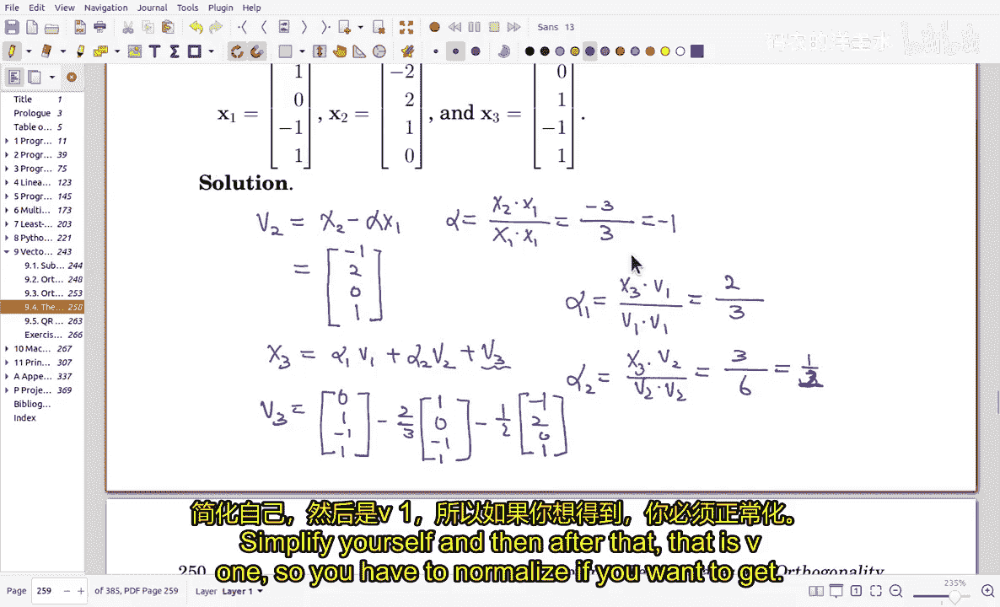

On ortho normalmal basis， then theres a V1 and U1 can be garden。 the length is Sch2 3。

 so they are divided by Schop2 3 will be U1。And that is the length is a square root of6。

 so the V2 divide y square of 6 will be u2， and after getting this one again， divide y is length。

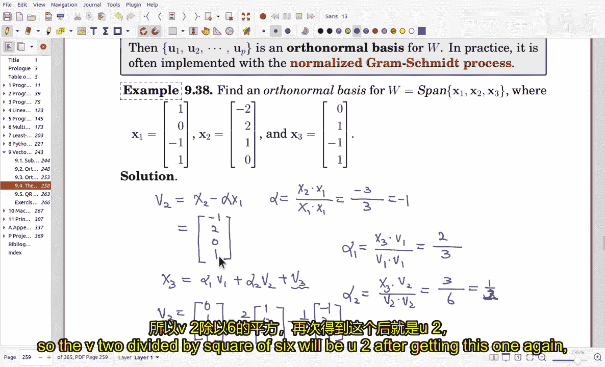

Then， that with the final。vector U 3。 So U1 U 2 U 3 will form。Due ortho no basis， okay？

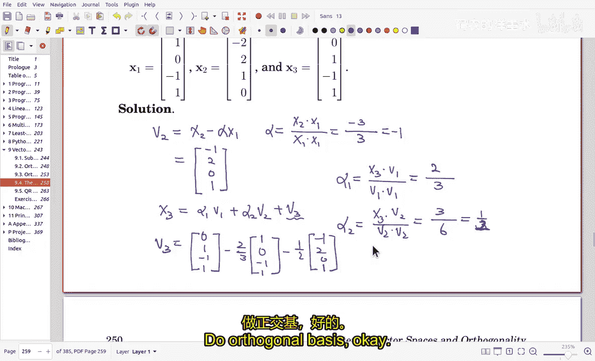

Now we can use the technet for QR factorization A is on M by N matrix。With linear。

 independent columns， then it can be affected as。Q R， where Q is on M by N metric。

Whose columnlama was a normal， which means that Q transport Q。Is identity。Now， R is on M by N。

 upper triangular inverable metric with。Part to entries on is diagonal。

We can make this effectualization。

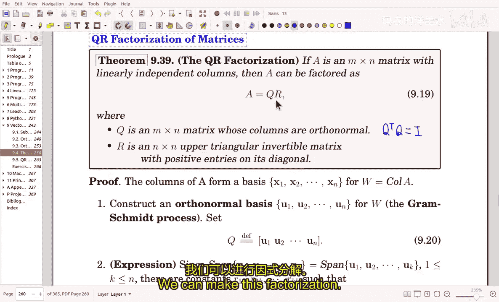

The proof of Ethereorem is quite simple。

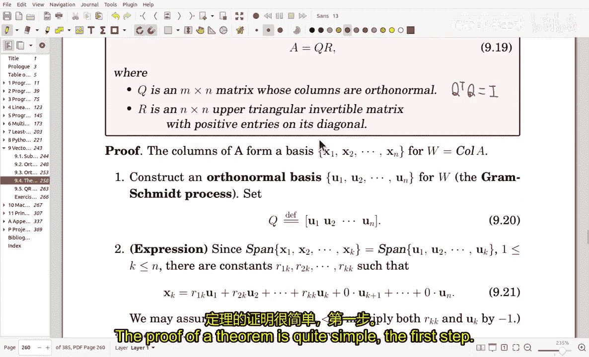

The forces tabeth。Now， we start with the metric。

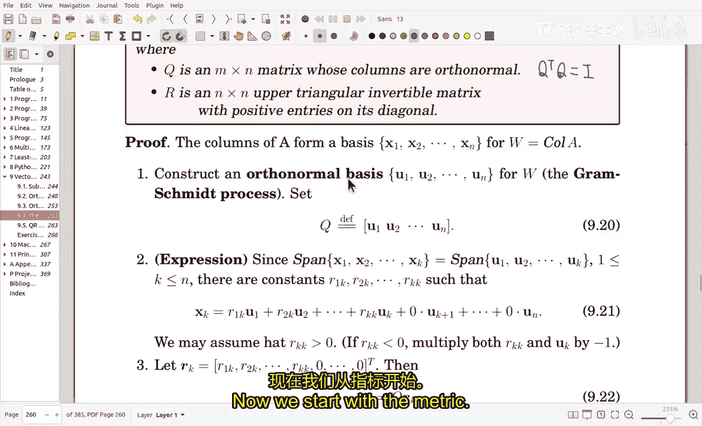

A， and the columns are linearly independent， so we can get。What's a normal。basis。

And orthonmal columns。For。The columnlam space of A。The W is the columnlam space Bay and。

These are original columns of a。 Now， from there， we can get what's the normal base end。Now。

 we define the collection of these vectors as Q。And。

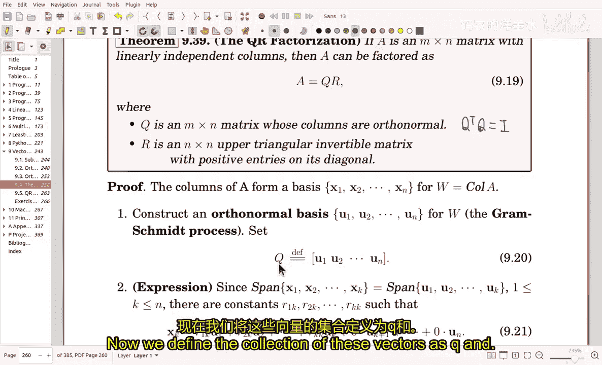

Now， this is a basis。 So for。Each X K each that the columns of a。 Now we can make projection。

Then we can get such expression for each X K。 Now， we try to collect this quo。 Then thatll be。

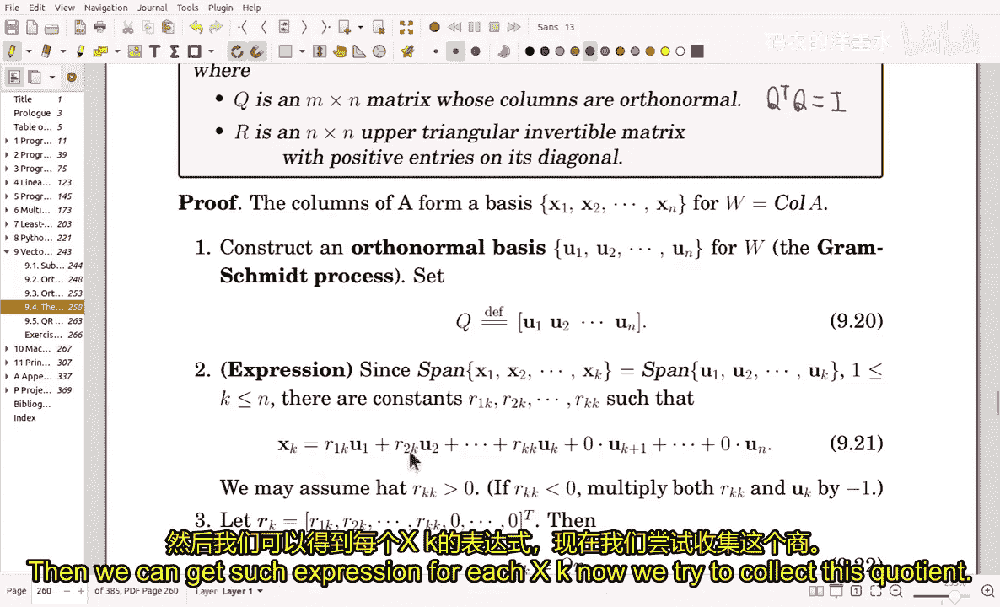

2。So that是 the major idea。Is like that， so we can get Qr factorization。Let's see， here the。

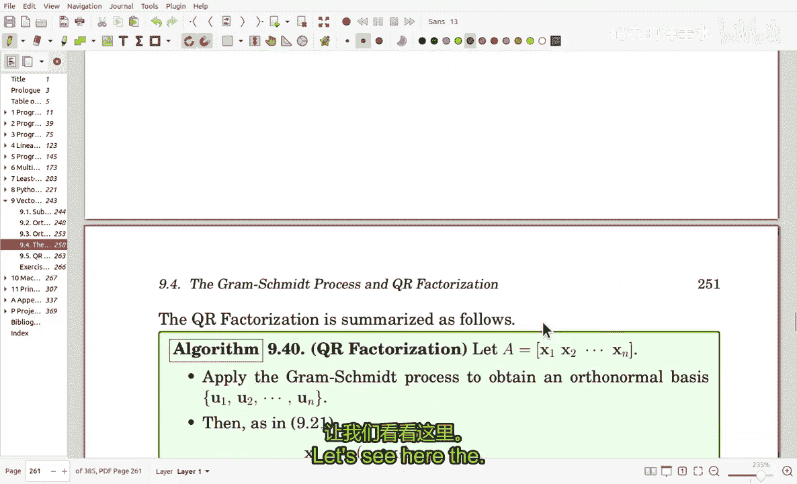

Algothism。For Q vectorization now a is a metric having x1 to x N and assume these are linearly independent。

 Then first we apply Q Schmid process to obtain orthon normalmal basis for the column space of a。Now。

 we try to make。Here expression。 So x 1 is projected in U and x 2 to U and U2 subspace and so on。

Then。Here， the Q is collection of the。On a normal basis。 And now R is the collection of the quos。

 or once you got that。Your Q。 then you may try to。Apply Q transport to A。 Then you can get R。

Now the thing is the diagonal。

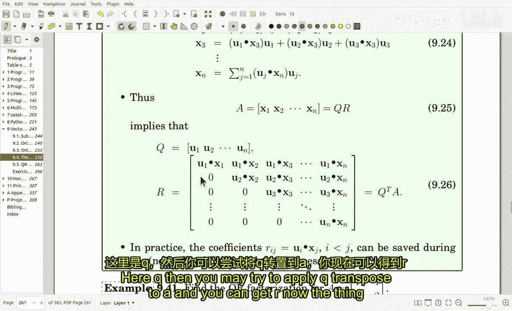

Must be positive。 Okay， here we can do in this range。

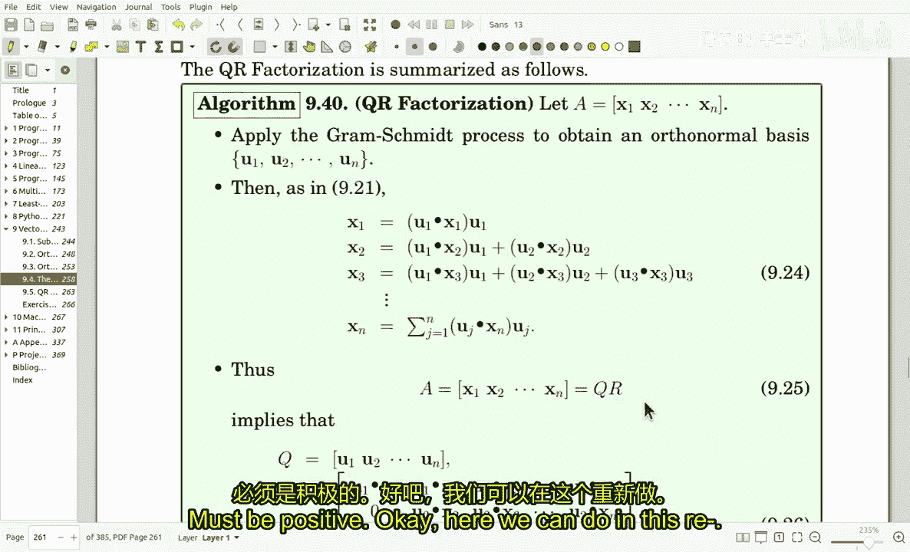

嗯。有 LKK。In。Qural fluctuationctuaation R。This is ontagonal an。That is positive。 If it is negative。

 then。We multiply minus-1， for example， if this is negative。

 then we multiply here minus-1 and also minus-1。So that this original。

What the normal base is will be changed during the computation。If this is a minus。

 then we multiply both -1 so that eventually it becomes positive。 And again。

 even though you multiply -1， the autonality is not。Change， okay。O行。😔，In practice， the E R J。

 which is UI dot U J X J， can be saved during the normalized kamid process。In practice。

 it is implemented in this way。Now， let's try to find the Q vector for a given in this array。

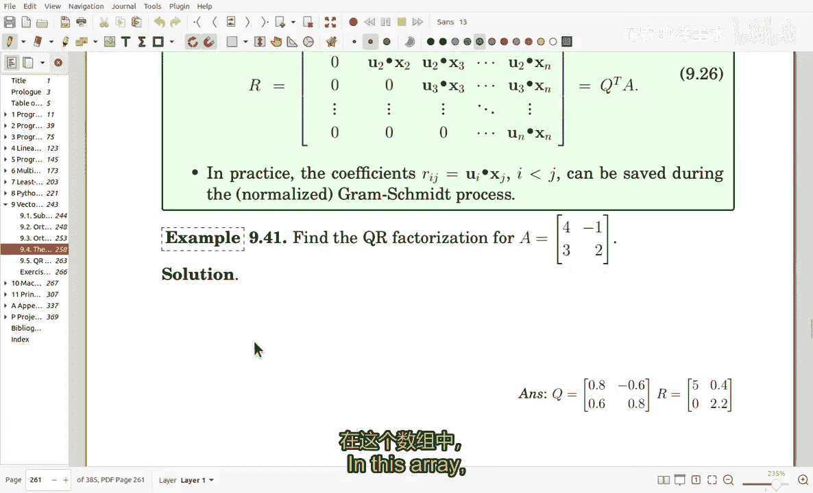

Will follow this algorithm。 First， we have to use crmeter process to get ortho normalmal bases。

 and then we can get an。Of course， the collection of these vectors will be Q and R can be obtained there。

Through that data product。

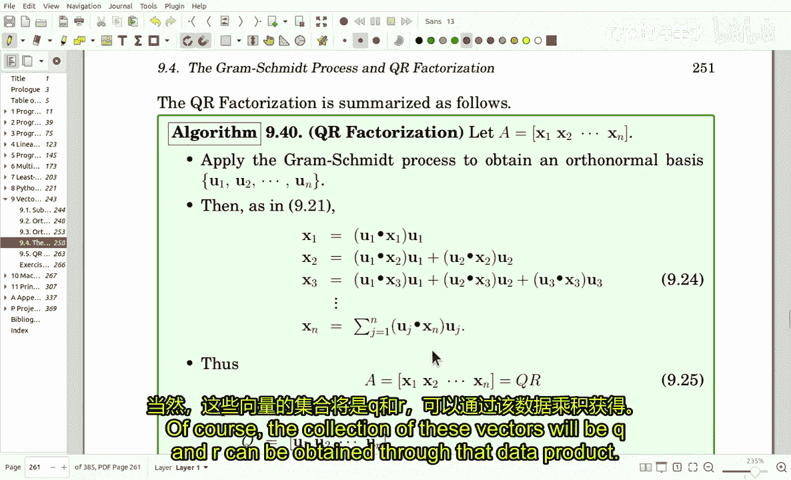

Okay。Now， x1。呃是。43。And x 2， the second column is -1 and 2。为。Try to project X 2。Onto the space of x1。

 So there's alpha x1 plus v2， where Al must be x2 dot x 1 divided by x1， dot x1。Okay。X 2。

 x 1 that the product-4 plus6， which is 2。And divide the by。X1 down x1。16。Plus 9，25。So here。

 V2 is the same as。X 2。That is now X2。X3 is minus-1 and 2。Minus alpha2 over 25。And that is x1。For烟水。

This one。Okay， that same is8 over 100， so -1。Minus and。32 over 100。And so that minus 1。32。

For this one。Okay，2 minus。 and there's  eight times 3 is 24。 so that there was 1。7。6， right。

Looks like this one is okay， minus 3 and 4。So， that is。Let's see in this way。This difference is 0。

 of44。And now， minus 3 and 4。Like that。嗯。Okay， so we got here V1， x1 is V1， and V3 is given here。

So orthonmal basis must be U1。The length is 5。So the Tita 5， so we can get u1。D by the 5。

 then there will be 0。 A and 0。6。Okay， and you too。Okay， these are essentially same length is five。

So that that is minus 0。6 and 0。 a。Okay， we got from here。 U too。 So this will。

Make autonormal pieces。 and the collection of them will O， Q is here。Now， you can get all quite。

Easly， and。

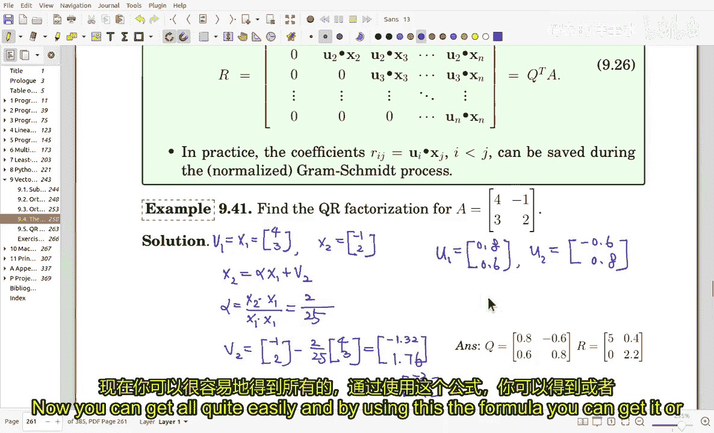

Bysing this。The formula you can get it or just simply， you can multiply Q to A。 then you can get R。

 Either way you can finish。The computation。Okay。So you can finish it yourself。

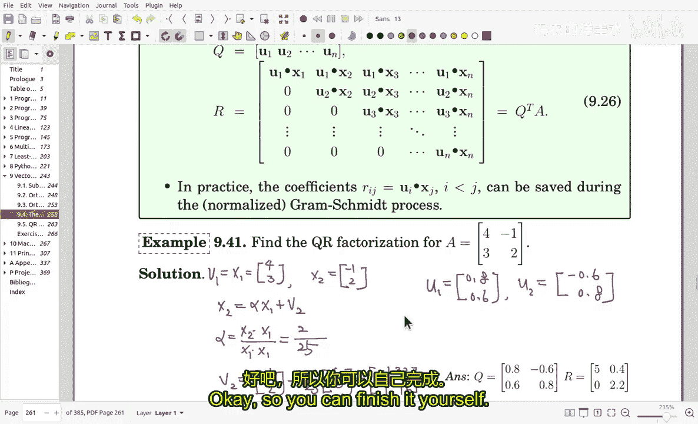

Here， we have。Alternative calculations of these scarce solutions。A。Is an n by n metric。

 and we assume M is larger than equal to n， and also assume assume rank of a is n。

 which means that the columns of a are linear independent。

Then we already know that the risk scale problem。And Ax equals B has unique solution。

And the U solution， and here we can solve by using the lease skillss。

 the method that were no medications。We multiply apo in front of the from left and side for given equation。

 and we try to make inverse so we can get it。So， the metric。

A transport inverse and a transport that portion。It looks like inverse from here， Xs now。

We don't have a inverse once M is larger than n， but that is playing the role of inverse。

 So we call this portion。The should inverse of a。 And we are trying to use the notation a plus。

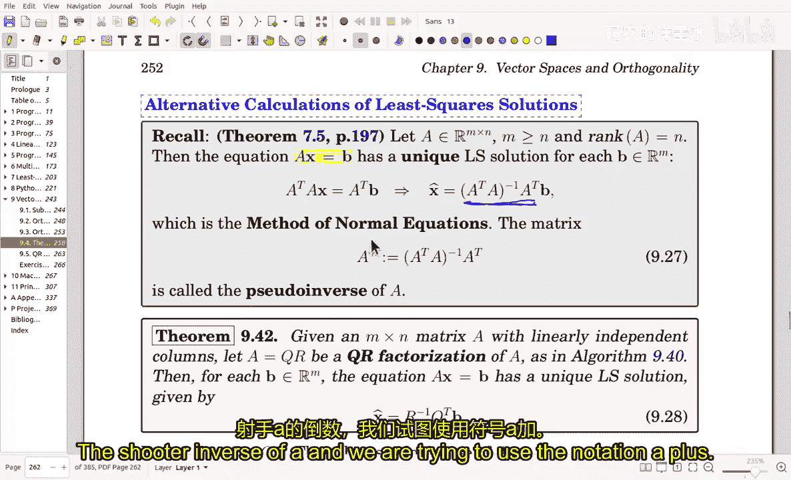

We did this one earlier。No有。Here we'll try to solve the problem。

 This case problem by saying Q effectization。The same a metric a and by M metric。

 and with the linear independent columns and a equals Qr。Is on Q vector version of A。Then。

For each choice of a be from R M。The equation A X equals B has a unique list scale solution given by。

R inverse， Q transpose and B。Okay。For。A proof of the theorem。We try to get the shoot inverse。 Okay。

 A is Q R， and the shoot inverse of A is here now。That is A QR。

 So QL transports and QL that inverse and A QL transports。 So by using simple algebra。

 we can reach add that is R inverse Q Trans。So basically。

 this term is the same as now that on so that we can get。The unique lease case solution， right？

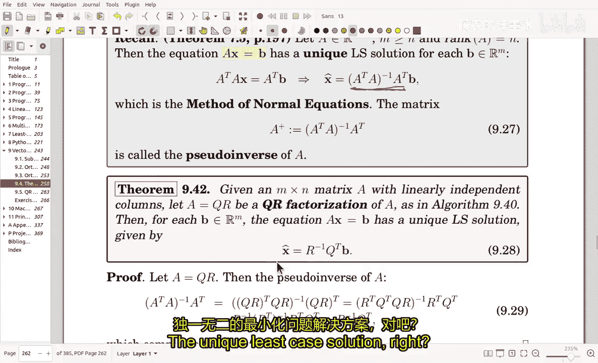

For this problem， now we try to get the least g solution of A X equals B。 Now， A is given here。

 B is given here。 We can easily see that。The column sub A are linear independent。

So that we can get pure vector addition with a diagonal paditive。And once you try to get。

The solution。 Then first， you apply transport of Q and。Inverse of R， then you can get it。

Try yourself。Okay， that's the end of the section， thank you。

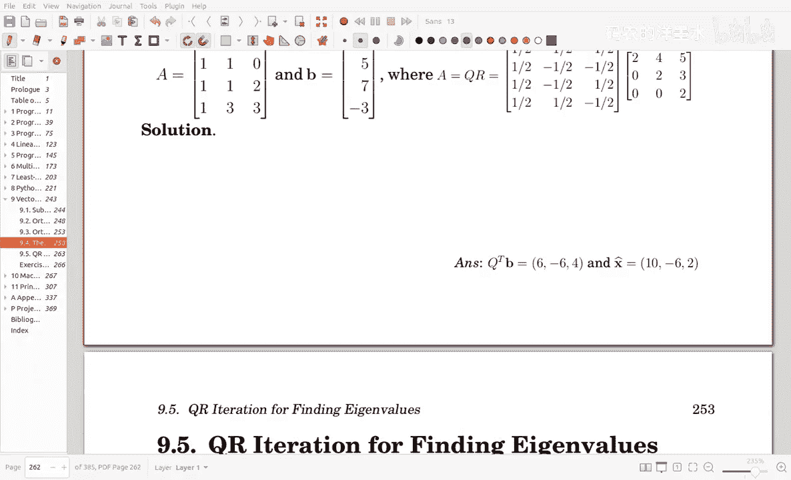