# 【全集-附课程讲义】密歇根大学-人工智能编程-EECS492-中英字幕-p58-Lecture-58---QR-迭代算法用于寻找特征值--BV14JqfBNEAS_p58-

In the last section， we studied the cr process and Q factorization。

Here will apply the equivalent to a to find。Ienvalue and I vectors。呃， see个。Algothm。Cure iteration。

For a smetric a。And in each tu。We make a cure fact addition。And multiply IQ。To get new a。

And from you， beginning with identity， we update。By multiplying right side， a cumetric。

So that's quite simple。Once it is a convergent， then the limit of A is T and limit of U。As you。

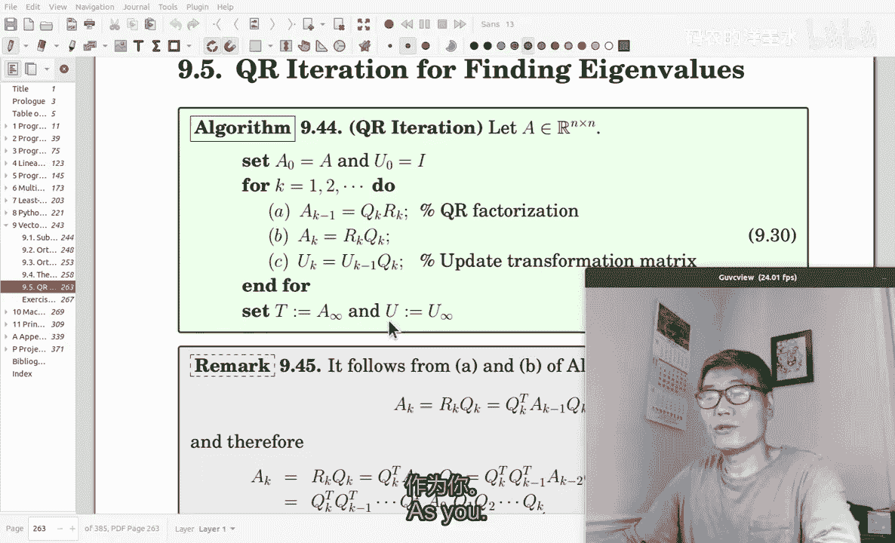

Okay， that's output。

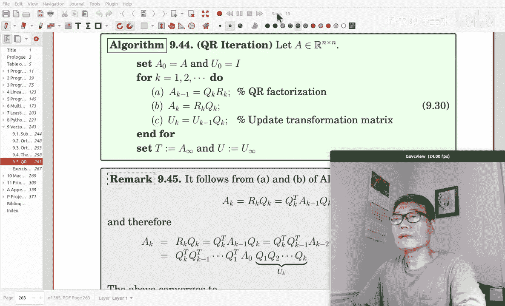

From the algorithm， we can see this one。 Now， A K is R K， Q K。Now， Q is an orthogonal metric。

 so we multiply Q response。Then that will become all K。 and there is Q trans A K。

 so we can get that one。So we have a K and A K-1 the。 We apply this equation， reively。

To get this one。Yeah， A K is along with the Q K transport to Q K now， A K -1。Apply one more time。

 Then a K -1 will be written in this way， and continuously。Then we reach at a0， A is a。Now。

Once it is convergent， then this portion is UK， we updated here。And that'll be UK transports。

So the limit of UK will be U， and we can reachsha that one。

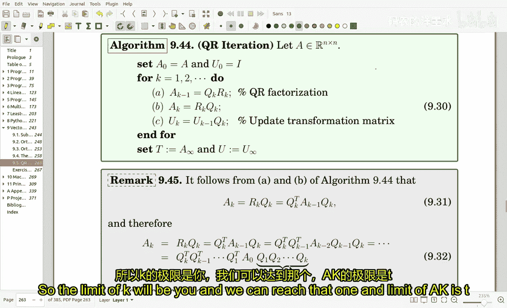

And limit of a K S T。 So T corn， u transpose A U。Now， so from this algorithm， we can get it。

 we'll try to understand what they are。

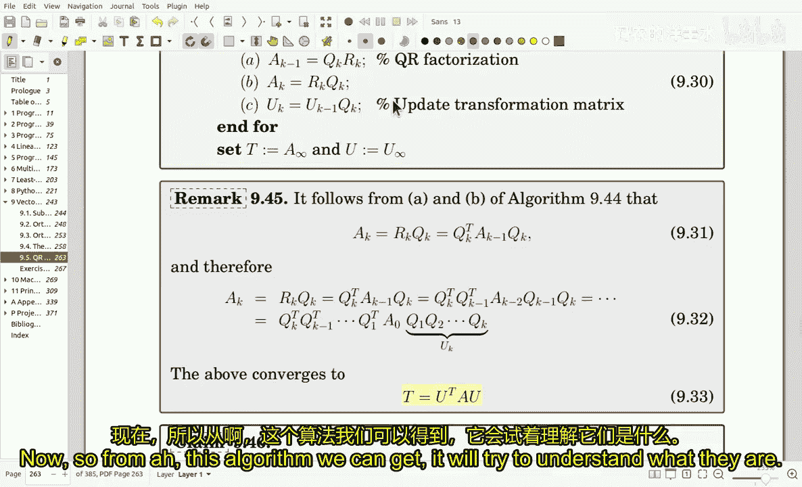

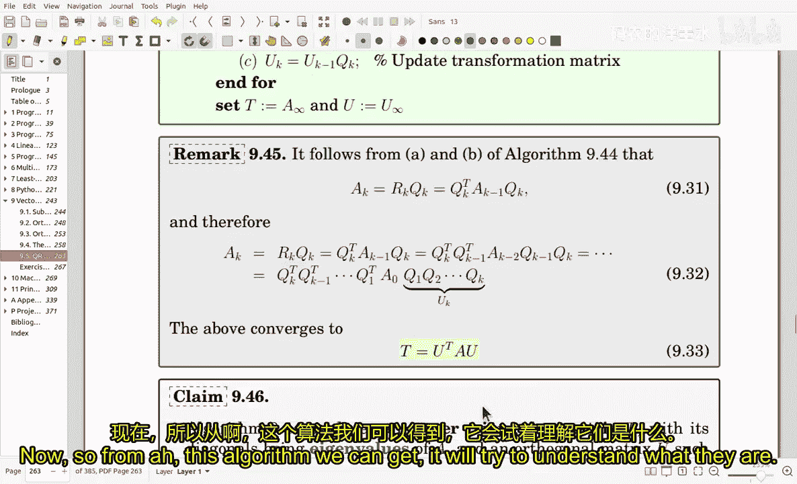

Tea。Is on upper triang matrix。And the triagonal will be eithervalue of a。

 and U is an orthogonal metric， so that from this one， we can whiten in this way easily。

And this decomposition is called the sure decomposition of a。Okay， why is a triangularular。

 Let's see here， the limit of a K is T。

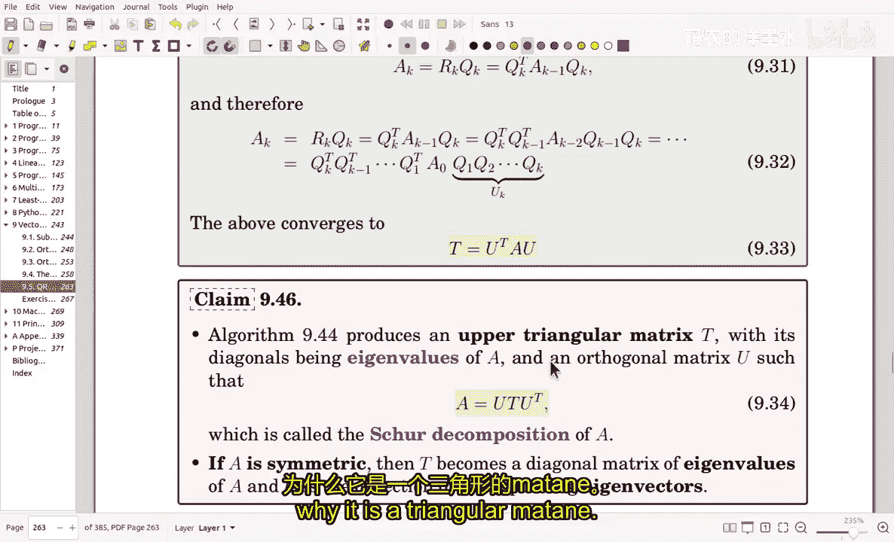

Now， India this reverse multiplication。Okay， okay， let's try to visualize the metric。

R is a a trial metric and Q S orthogonal metric， which means that。It， the column are auto normalmal。

 So length1， but R K has only 90 here。 Pi will be 0。 Now， in this product， row column。

 But these are 0。So， that。The product will have a smaller value in this lower part。

 So this portion will convert you to 0。So T must be a triangular matrix。

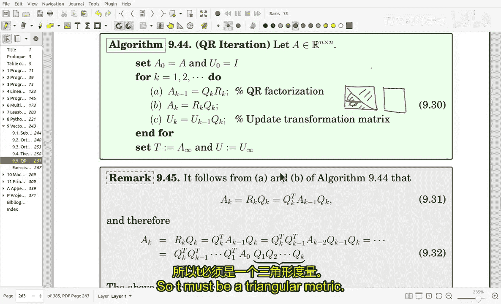

Okay。Once a is symmetric， then。T becomes diagonmetric of idenvalue。Of a。

 And U is the collection of a corresponding eigenvectors。If a is symmetric。

 then T also should be symmetric。But if a low portion cons to 0。

 then simultaneously a proportion must be also conging to 0 so that it must be a diagonal。 right。

 Let's see example。

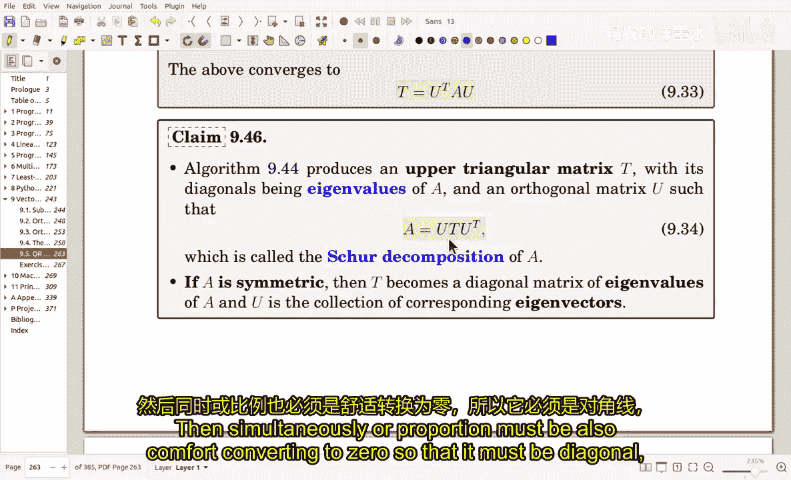

We have two mates， A and B， A is not symmetric， but B is will apply the QL algorithm Q it to find there sure decomposition。

Okay。Now。

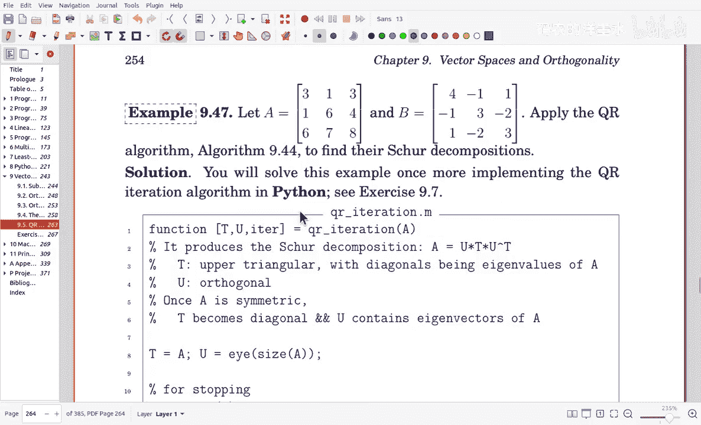

Okay， in whenever exercise problem， we'll work with a Python， okay？For this is Q iteration。

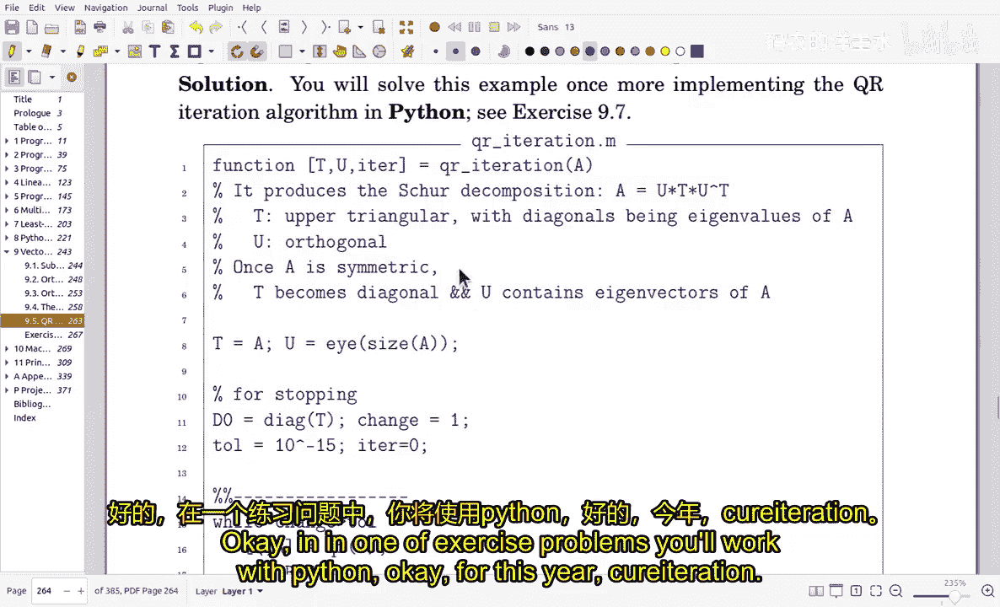

Xiang。And。Once A is given， we assign。To be T。 And U is the identity。And T is fact hydrogen than Q R。

 and then now update R Q and here Q is multiplied to get the transformation metric updated。Okay。

 pillow pushing is for stopping right now。Here， if change is larger than tolerance 10 to the -5。

 it stopped， but the changes measured from。Here， the T， the diagonal， diagonal T is checked and。嗯。In。

For the。Successive T， the diagonal changes less than the tolerance than the iteration stops。 Okay。

 this one is committed out。 But now along with that one， will try to see。啊。How the。

 the optical on entries are changing。Okay， we'll see later on。Okay for。Two matrix。Now。

Along with the QL iteration， we implement now call QL iteration do M。And here， after cure Li。

It'll be saved here。 T 1 U1， iteration 1， and we try to get also。Tory to cover the original metric。

And compare with。The eigenvalueelves and eigenvectors。And also for the symmetry one。We do the same A。

 These are output。Okay， that is T1， U1 up to 26 it it converget。Now。There one。

And we tried to recover the original metric as real recovered。 and from。Eigenvalue computation。

 we see these are eigenvectors， and these are eigenvalue。 Let's see t metric and diagonal entry。

So exactly the。嗯。The eigenvalue， this is not order， but here we have order eigenvalue。

Posymmetric case。And T must be upper tri angular metric。 and now because ofsymmetricing。

 it must be diagonal metric。 and these are eigenvalues6。31。And also， in theory。

 this must be corresponding again vectors。After 28 iterations， it converged。

 and we tried to recover the original metric is real recovered。And from eigenvalue computation。

 these are eigenvectors and these are eigenvalue again， same eigenvalue。

 even though they are not ordered but here it is well ordered and see the corresponding eigenvectors for6 this is the eigenvector for that six that is the eigenvector they are the same。

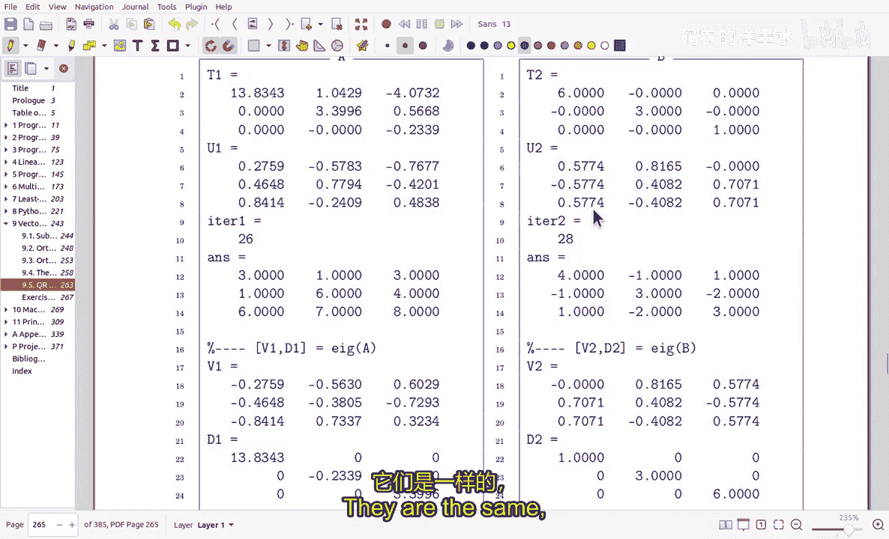

Now we'll see here components check。This is for nonsymmetric case， this is symmetric case。

 And after each attrition。AK。Here produced there。Let's see here okay。

 after one it lower part is given in this way。 and if the second it， third it， fourth it。

 it becomes a smaller， smaller， smaller。And so that at the a deter you can see now almost0。

 the reason is， major reason is from earlier， I explained it， and our cu multiplication。

 this low portion is0 and this metric metric product。

Makes a similar contribution because of this0 and now that column row column computation will make a similar values。

And because this portion is0。

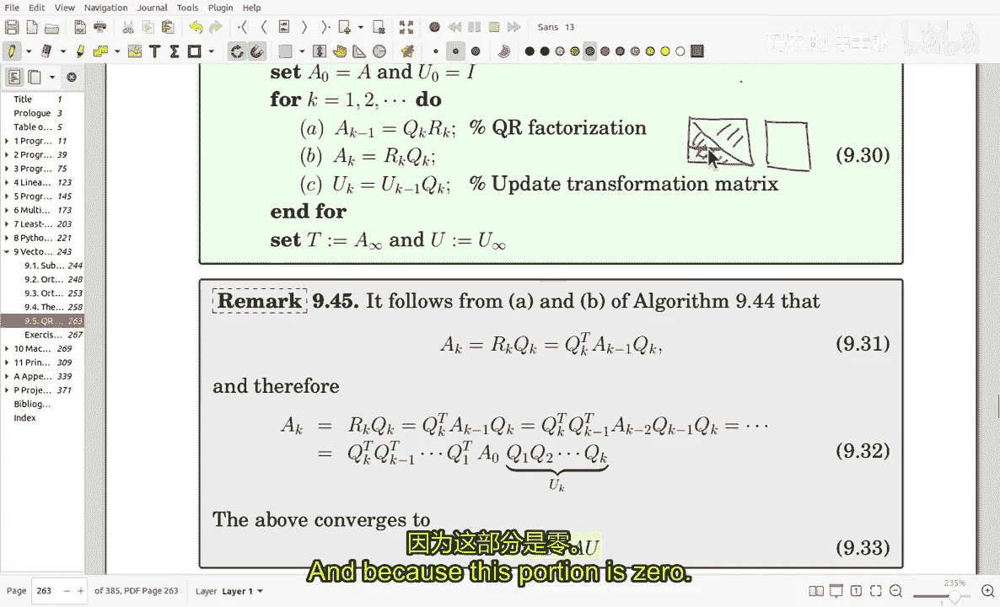

Okay。Okay， for now the the symmetric case， the convergence is here symmetric。 and after each itition。

 the output must be symmetric。 Now， look at pattern portion and upper portion。

 they are compverging the same and symmetrically and becoming smaller， smaller。

 and then is now after8tu。

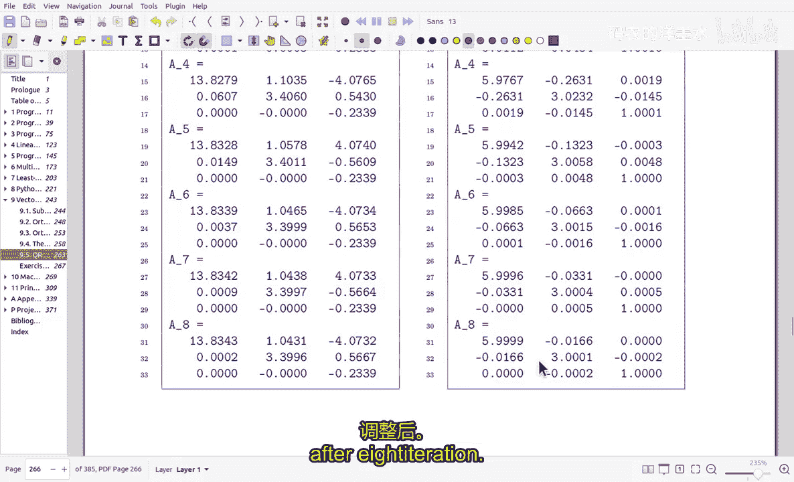

It's quite small。But in symmetric。Okay， that's the one computation result and this is the end of the section。

 Thank you。