# 【全集-附课程讲义】密歇根大学-人工智能编程-EECS492-中英字幕-p59-Lecture-59---机器学习、监督学习和无监督学习--BV14JqfBNEAS_p59-

Chapter 10， introduction to machine learning。In this chapter。

 you will learn what machine learning is and some popular machine learning classifiers。

We'll also consider a Python machine learning library called Pscheone。Finally， we'll see。

Was learning mother code。You can modify the mother code for your own machine learning algorithms。

And you can compare。You algorithms with the。Popular machine learning classifiers quite easilyly。

The chapter is a brief introduction to machine learning， I hope。Itll be useful。

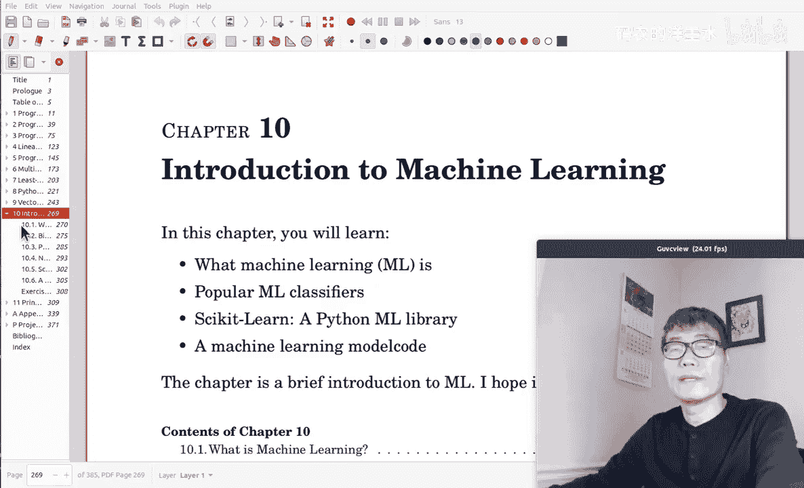

Let's go to section 10。1。Bod is machine learning。Most of the real world。

 the problems are expressed as f of x equals to y。Here F is an operation。

 X denotes the input and y is the output。Once。F and X are known。Then， getting the output。

Is the simplest task。If F and y。Unknown。Then finding the input requiress to solve the equation。

If x and Y are known。Then we have to find the operation。 But this test case not simple。

You can find most cases， only。Appp to this operation。Which learning。Is dealing with such problems。

We define machine learning here。

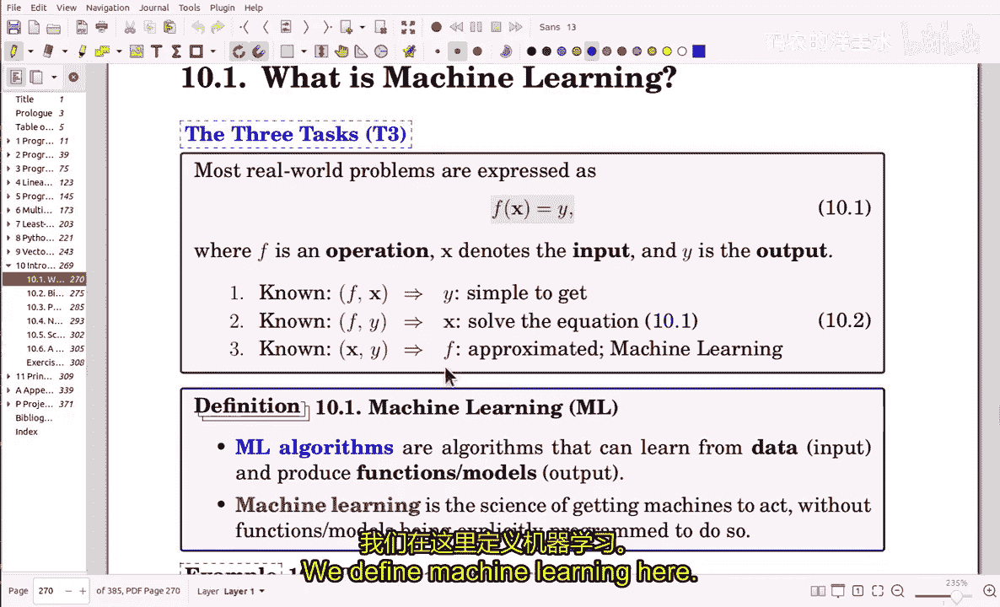

Moure learning algorithms are algorithms that can learn from data。And produce functions， moderns。

Mine learning is the science of getting machines to act without。

Functions being expressly programmed to do so。There are different types of malo algorithms。

Supervise the learning。Usually in this case， we are using label the data set。U super by learning， Us。

No labels， as N， for example， cluster ring。Reinforcement to learning。Is using re the system。

The most popular type is supervised learning。 so we'll focus on supervised learning。Mial learning。

 algorithm Sa is one believe。And the belief is the average is correct， at the least acceptable。

Let's see this example。There was a competition guess the weight of the as。In 1907。

And there is a counterfe in plymouth Meics。The questioner。s Francis Se Galton。

 who is a cousin of Charles Dne。In。In the fair。He asked them。The gets。Reader the odds。

And there are 800 people gathered。And out of this800 answers。

13 were not reliable because the answers can be0 or infinity or not easy to read。So，13 are excluded。

 and for remainder。Ges， the mean made to be。11，97。And after that。

The A was on the scale and found the real radius， 1198。So that gets from many people。

And the averaging。Has only 1 error。So the if we are using many data set。

 many data points in the data set， then the average。Would be correct at the least acceptable。

 So under this belief。By learning algorithms have been developed。

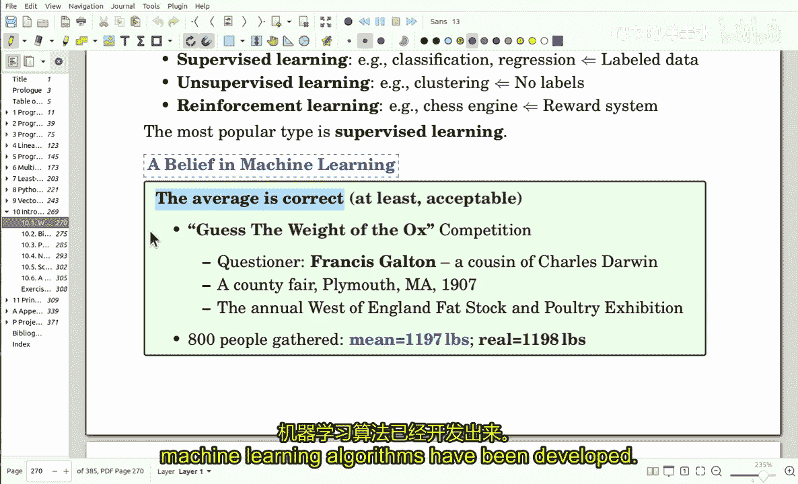

Here we have supervised learning。The assumption is that for K data set。X I， Y I。And why I are labrth？

Their egous are gl F。From X to Y。So the task of supervisor learning is to find the F。So by using。

튜 data set， X I Y I。And we try to get a hat， which is a good approximation to。Original de。

 We don't know this one， so that。Eventually， once we found a mother found a deletion or function。

 then there would be an approximation to the original del。

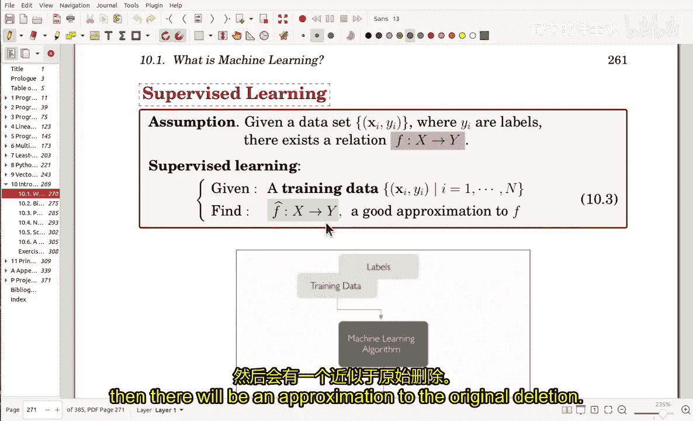

Pctorly， we can explain。The supervisorvis learning。

Ting data will be given with the labels bying this data set。

Most learning algorithm will make a model。Once later， new data points are coming in。

 then by using that。Just。Prediction is made。That is pictorial interpretation of supervised learning。

As in this figure。And learning。Is making a mother， a function。 That is like this hyperplane。

So once there are two collisions in the data set。Then， try to find。A lion。Or a Hyplane， such that。

It was new point。Comes then now the value can be negative or positive。So that it can be decided。

 So this hyperplane。Has the value 0 so that for given data points， negative， positive。

 then we can decide。 That's the main idea of。The organizing the model。And also for these data points。

 we try to find the tendency or trend of data points。There is a kind of regression。

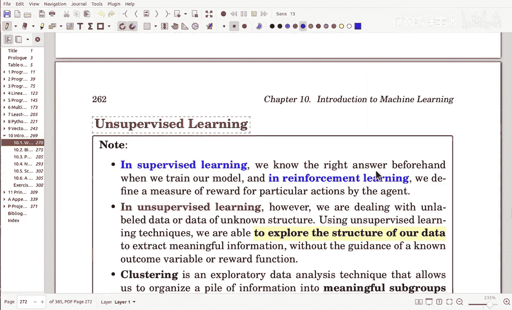

U super learning。Can be。In， in， in。Used to explore the structure of the t sand。And in the beginning。

 we don't know anything。 There is no label。 However， once the set is given， then we have to。

Find some hidden structure。 That's the purpose of on supervised learning。In supervisorvised learning。

 we are using labels and also in reinforcement learning。We are using some view with the system。

 but in unsp learning。We don't have anything just we explore。The hidden structure of the data cell。

One example。Is clustering in clustering， we try to make the meaningful subgroups。 See this example。

 the figure。

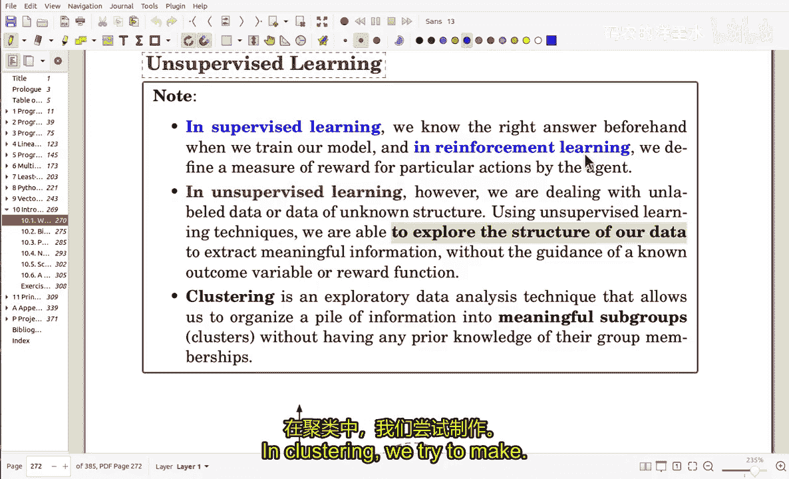

And there are 30 groups of points。This one， ideally， is working fairly nicely to get。

Meaning for the subgroups。

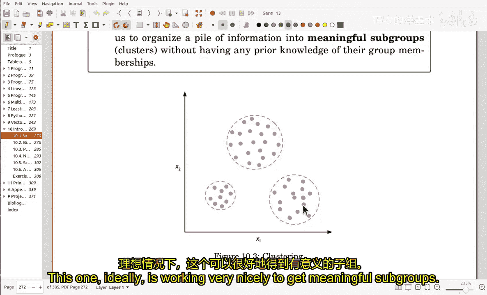

So it looks the idea of which learning is a simple。But in reality。

 the machine learning is not really simple。 Why is machine learning not always simple。In algorithm。

 in training。The overfitting， the first issue is overfitting。 This one can happen。Quite easily。

In training， we try to train the data set too tightly， for example。

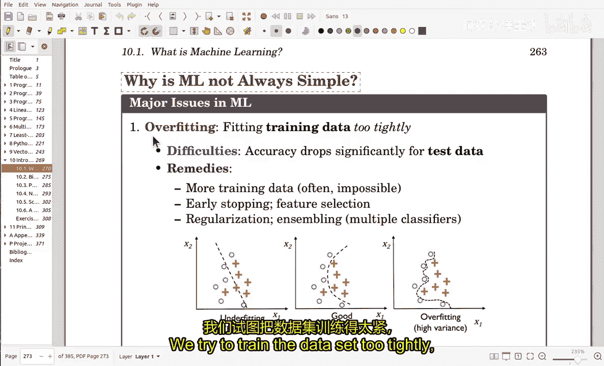

Ying。We have two parts in the data。In this case。The feeding is too rough。 And for that one。It is。

TheIt is feeling too tight。So， for example。If there is a point， for example and easily。

 you may assume that there must be some point here like that。 So around the here like that。

 then if you make。The mother too tight， Then for de point。It can be。Predicted wrong。

So that is called overfitting。So it can happen quite easilyly。

So that the problem is the accuracy drops significantly for tester data。 Once newpoint comes。

 then accuracys is quite poor， but for given training data， the accuracy is really good。In this case。

 for the trend data set averages 100%。But for new data points。

 the accuracy must be much lower than 100。Okay。To overcome this issue。

 we may try to use more training data。But in reality。It often impossible。T datata means money。

Some people 패도 많이 두 개 되 었 어요。Motoring dataset set means。Requiing more experiment and more theian。

And at the moment of training the data set， it's impossible to get more training data。

And when you are。Tra the model， usually the algorithm is iterative algorithm。

 So you may try to stop early。And or you may try to select some important features so they try to reduce the dimension。

And or you may add some。Regoularization term for your objective function。

And or you may try to use multiple classifiers， and the outputs can be used to get majority to vote。

These are remedes。But wolffeing yet happens quite frequently。

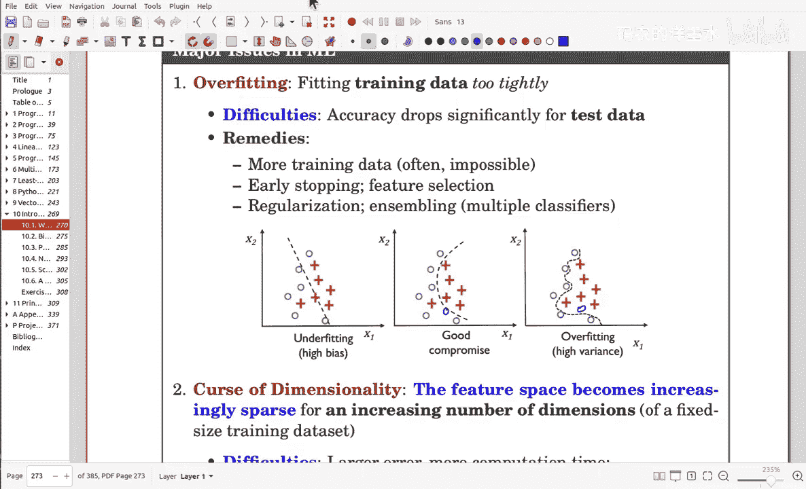

C of Timology。The future space becomes increasingly sparse for an increasing number of dimensions。

See this figure。

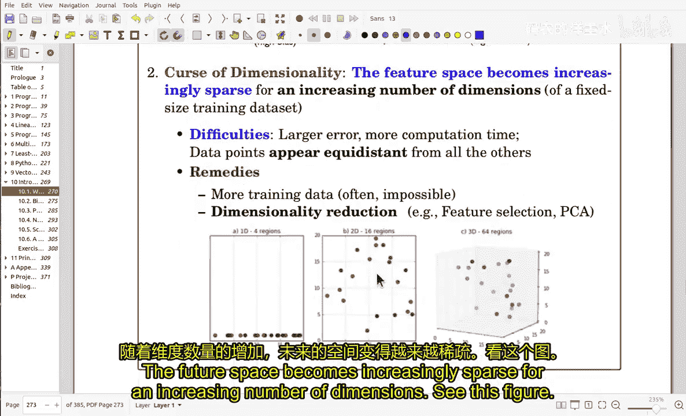

Once we consider the data points in one dimension in space， then looks at dense。

But in two dimensional spaces。As they are apart。 and then in3 dimension spaces。

 looks like the data points appear。Equidistant and every points are far away each other。So that。

もシにがる them。Can be very hard to recognize groups of points， in most cases。

IfEven though it is a supervised learning。The mother is based on groups of points。In many cases。

 so that once it is happening， then。The aes are very poor。

 So that phenomenon is called cursive dimensionality。To overcome。

 un basically more training data again， as often impossible。

And another one is demand analog reduction bias in future selection you can reduce。

 Just try to select only。Important to futures。Then maybe better。

And over bying principle component of analysis， you may try to transform the data set into。

With onener space and then try to select forces several principle components。

 Then E dimension is a reducedr。So maybe the cost of ti energy will be take。

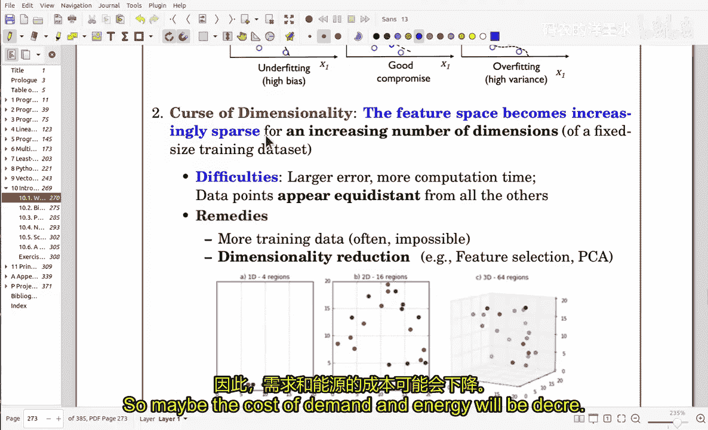

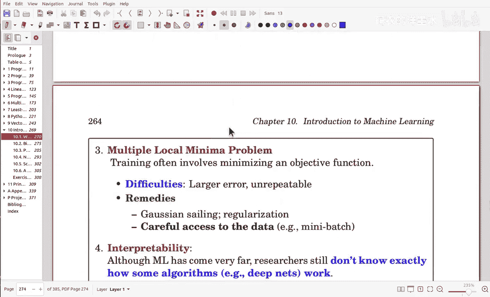

Now， most algorithms are based on objective function。

 This objective function may have multiple local minima。If you are using。Cre to teach the method。

 Then it can con to。Local minima， for example。And when the figure。

 the object function may have object function like this。Like that。

If you initial value stuff from here， then it will converted to this point。If you suffer from here。

 it'll go over there。So but in the beginning， we don't know where the global minimum is so that depending on。

Your choice of initialization， the output， the output。The mother can be quite。Different and。

Produccer sometimes larger error。Anyway。It is not repeatable。And to overcome that issue problem。

 we may try to get Ca sailing or regularization。 Ca sailing means that。

Try to make some smooth objective function。So that after finding this minimum by using this one again。

Try to use less。The smooth one again again。 And then eventually， we try to use the original。

Object function to get。Is a global minimum， but also it is not easy to do that。

Sometimes we may try to access the dataset set quite carefully。One of the tech as mini batch。

 rather than using all data points， the parts of data points will be accessed in each iteration。

 in this case， with a smaller number of data points。

 the objective function is less ociy so that you can achieve the global。

 you can get the global minimum。More likely。

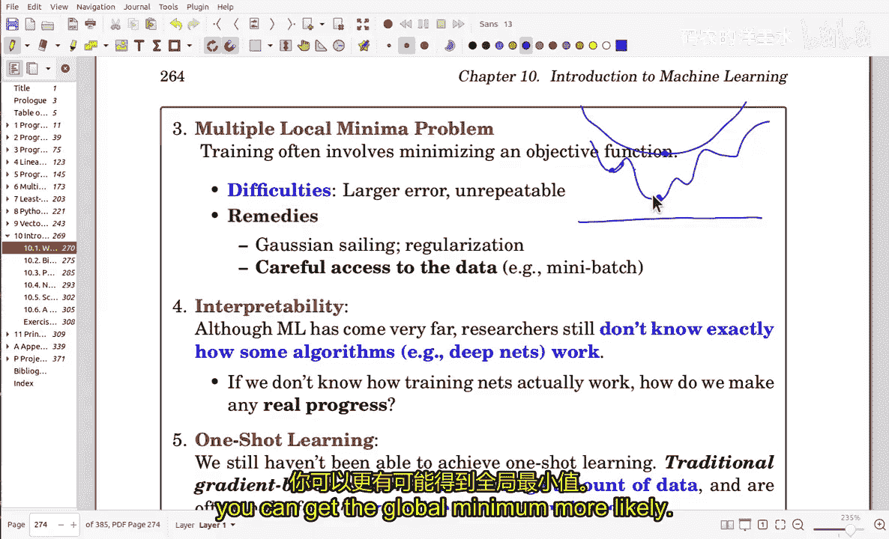

Now， fourth issue is interpretability。Although Wileni has come very far and very successful for some application areas。

And researchers still don't know exactly how some algorithms work。That is。

 one example is deep networks。Once you don't know。How。It works。Then how do we make any real progress？

So that。We have to understand， and we have to be able to explain our algorithm。

And so that we can modify and we can overcome two bags to get better algorithms。 So interpretability。

ItIt's hard issue。

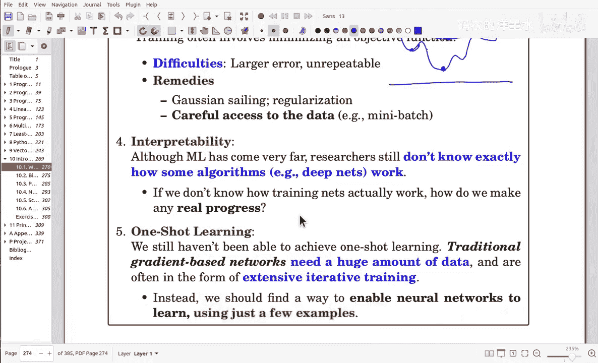

And in。Moern term， it is called explainable AI， X AI。 that is hot topic in。

The current machine learning society。And finally。We have an issue around data size for learning。

And we still haven't been able to achieve one shot learning。트레데셔널리。

Create an method for neural networks need。A huge amount of data。And then， also， often。We need。

Very many of iterations for training。But a human intelligence can understand the object with a few of examples。

So the question is， can we make any machine learning algorithm such that。

It can be trained using just a few the samples。That's the question， if you can solve this issue。

 then you can be。A billionionaire， very quickly。Okay， that's the end of the section， thank you。

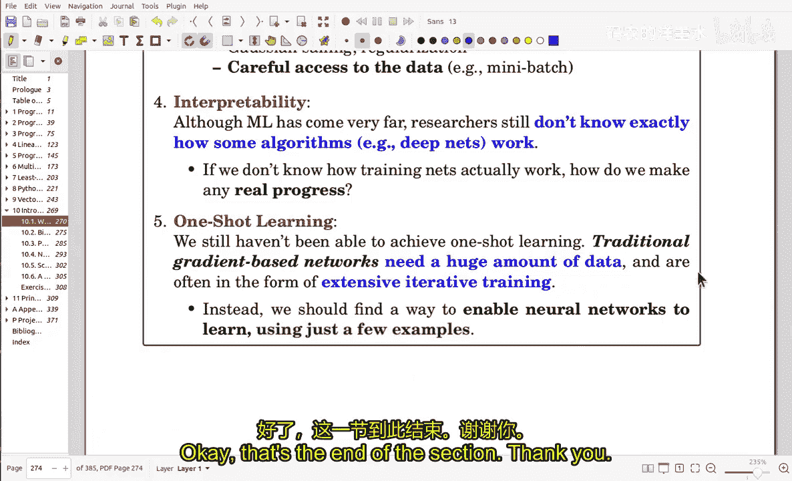