# 【全集-附课程讲义】密歇根大学-人工智能编程-EECS492-中英字幕-p63-Lecture-63---支持向量机--BV14JqfBNEAS_p63-

In the first part of the section， we considered logistic regulation。In this second part， well study。

Supportive vector machine， S VM。It can be considered as an extension of the perceptron。

Or airline line， which maximizes the margin。Look at the figure。

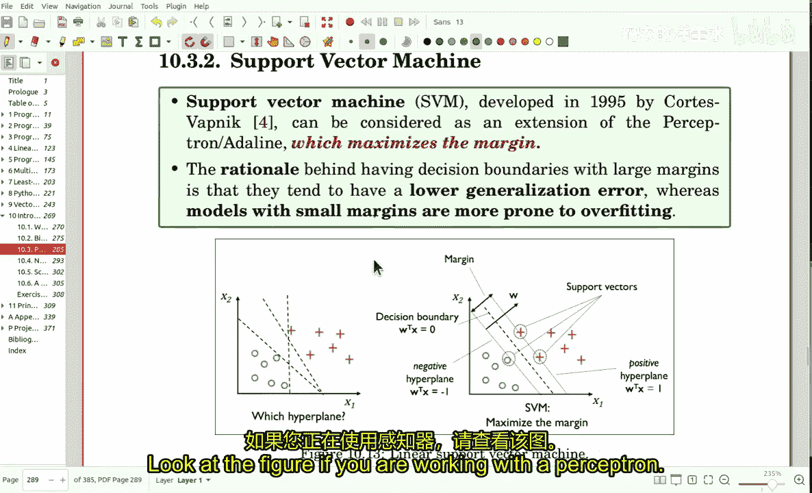

If you are working with perceptone。Then if algorithm리덤。Let just add one of these separating line。

 then。It cannot update from this point， because for every point， it is satisfied， and then。

It is not moving。So result of the perceptron can be either one of these30 lines or some other separating line。

But for example， if this a protocol line is selected and if。New point comes around here。

Then the perception will predict this point as one of this plus points。But apparently。

 it should belong to here。So such small margins。 And in this case。

 this margin margin is fairly small。Similar margins are more prone to overfiing， and。

Have large arrow in prediction。Once we have large margin， for example， as in this figure。Now。

If we can get such a separating hyperplane so that the margin between these two。

Different classes is maximized。Then it will have lower channel digest error。Here。

 the channelization means that。Once。The aresh is good for。The unknown later data points。

 than we say the algorithms will generalize them。So， lower generalization  error means。

The area is low for unknown points。 And later， the coming dew points was the areas small。Then。

 we say。It has a lower channelization error。That's the logic API the supportive vector machine。

 We try to maximize the margin。 Okay， how can we do that。Okay， we need the otherable mathematics。

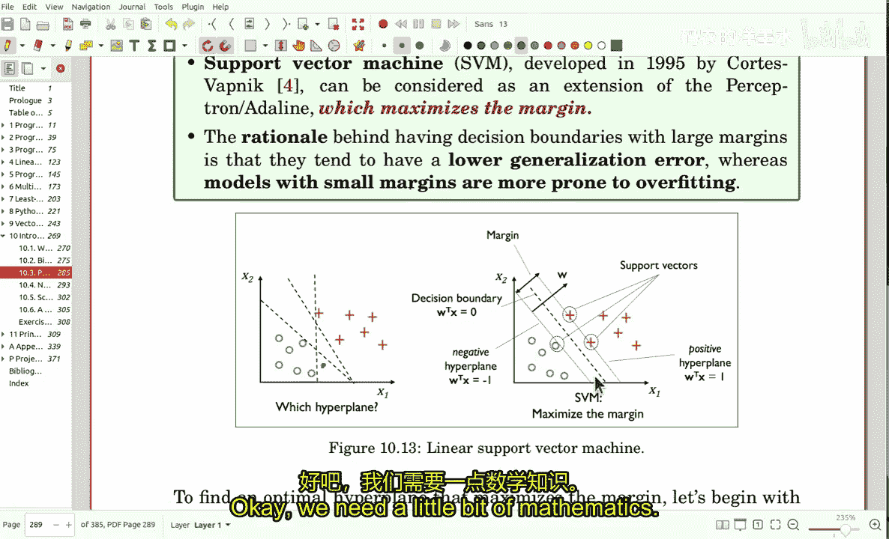

Now for。This is separating line。Here that is the net inputs it。And。For that line。Here。

 the net input is1 and for that one is minus1。So its a middle line is the separating line。

So we start with Darron from。The positive class， the point and net input is  one。From。

That negative label。And from that side， the value is minus1。 So there is zero， of course。

 over there larger than one and similar than minus1。Okay。So， we start with。

This point and so that these are called supportiveive vectors。And it is supporting here the。

That margin， we call them support vectors。

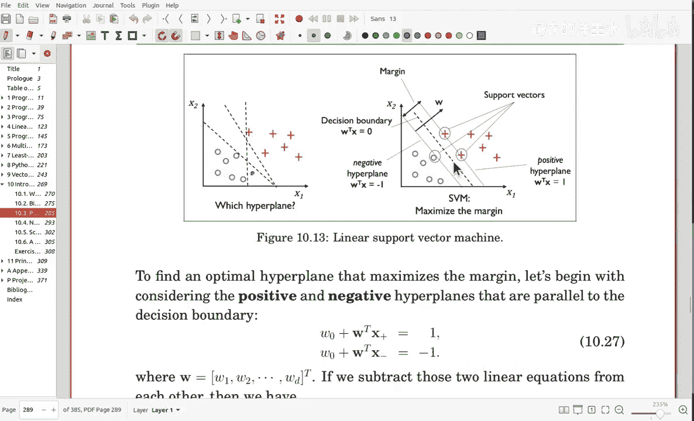

Now， from these two equations， we subject。 Then we each at this one and。Did you buy the buy。And w。

The norm， then we reach down。Now Chomet Col， this one。

Is representing the distance between these two points。 Let's see here， the picture。

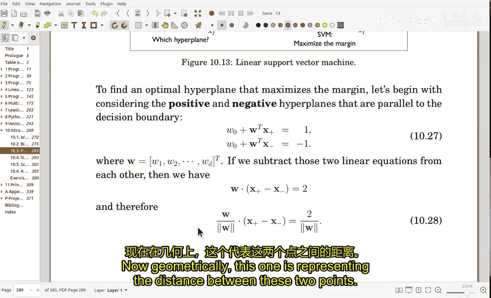

For example， now this is， okay， that's the point。And that is x plus， that is x minus。Then。Okay。

Here W is the normal direction and W is projected。On to that one or。In fact。

 the W is normalized the length one。 This one is projected。

 Dar one is projected then along that direction here projected， then this is exactly that one。Okay。

 that is the projection。So the， that one is the distance between。

It is a normal distance between this class and that class。That is exactly。

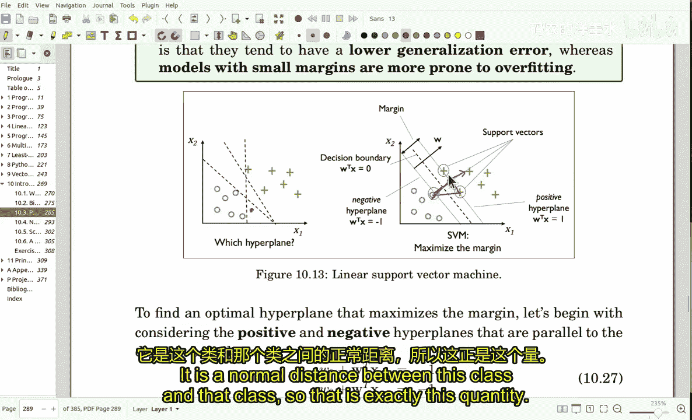

This quantity。So we have to maximize this one。But that is the same as。This one。And， of course， here。

And we have that deletion。 and along with that， we reach this one。But anyway。

 we have to maximize the this。And that is the same as minimize W norm itself。

So rather than maximize that one， we try to minimize that under that condition， of course。

 for x plus for other point is larger than one。 and there is less than -1 like that okay。

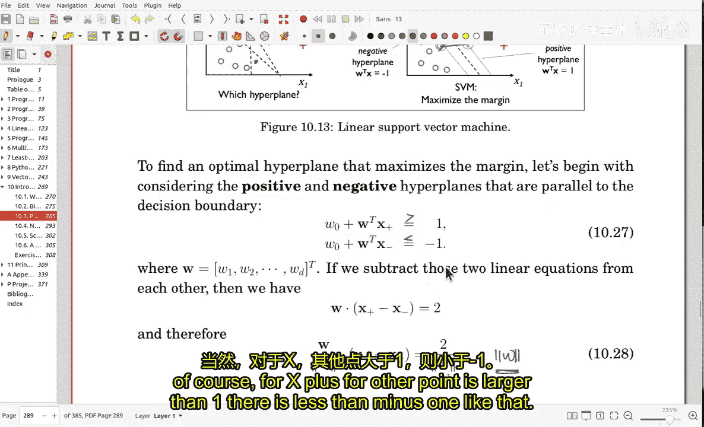

ok。And I explained this part。

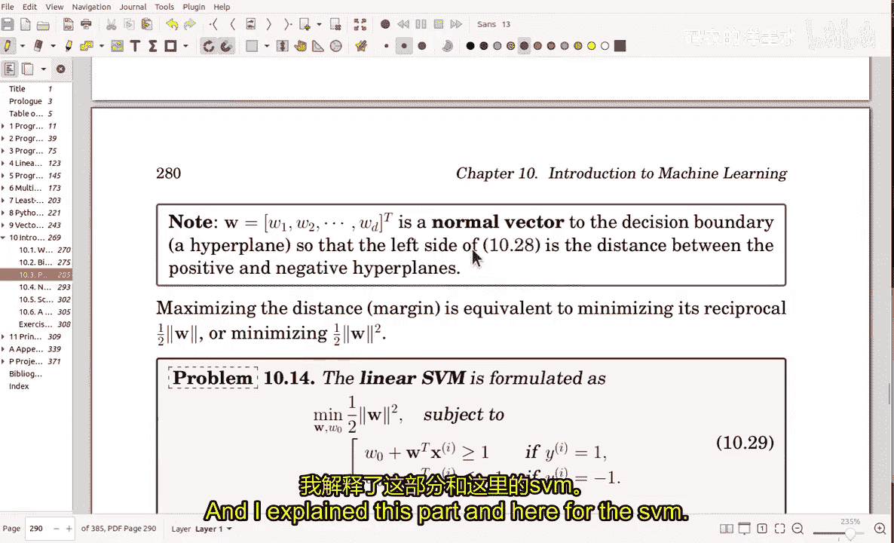

And here， for the S VM。The objective function is given in this vein。And rather than do itself。

 we may minimize norm pure is the same and subject to。Here。

 that that input is larger than or equal to one for the class1。Points。

And that is less than or equal to -14 points。In class  -1。Subject to this to inequality。

 we have to minimize this function。Now， this a minimization problem。

Can be solved by the method of Laranji multipliers， and in。Appendix。Open that says a1， A2 A3。

And I explained the technique， so。If you are interested in mathematics behind this sub vector machine。

 then go there and see the theory。

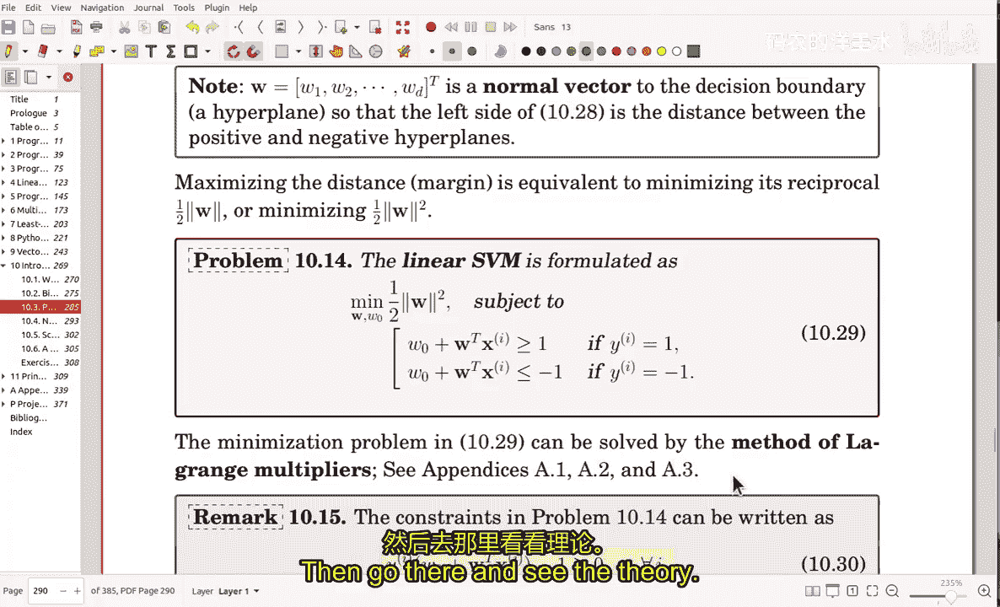

Now。For these two inequalities， we can write in this re。 We multiply the label。Then okay。

 along with the label multiplication， this one becomes that one and move to the other side。

 Once wire is negative， then again， after the multiplication that is changeable and here now becomes one。

 So eventually we can write in this way for。Every point。So the in theory。

 well try to minimize this object function and with subject to that constraints。

The beauty of the linear sub machine is that。If the data is linearly separable。

 which the data set is separable。Then， there is a unique global。Minimum value。

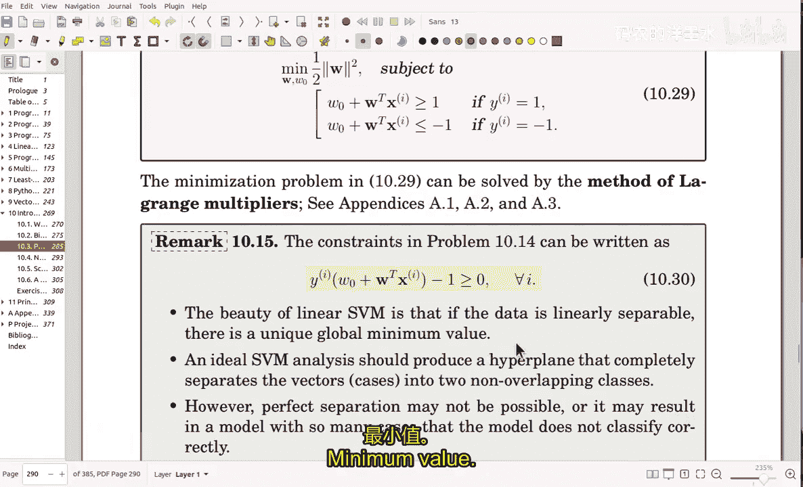

And unique separation， separating Hyplane。

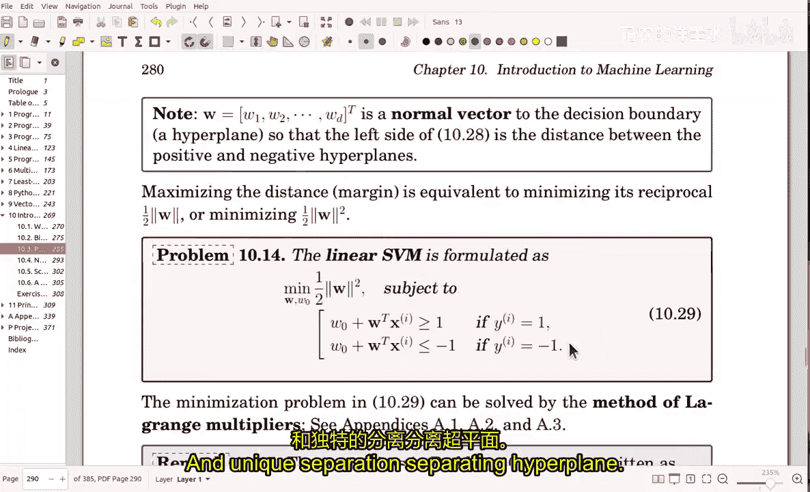

And margin is maximize them。An ideal S VM analysis S should produce a hyperplane that completely separates other vectors。

Into two non overlapping classes。However。Perfect dis separation may not be possible， or。

It may result in a modern with so many cases that。The mother does not classify correctly。

Particularly when the Teta said iss noisy。Then it may have some problems。

And to overcome the difficulties in the linear SVM。

We may consider so to margin classification with select variables。

Will that deal with this complication here in macelanni class， we' deal with that？And what song。

To get better gu and to consider various difficulties。

We may consider na subdirect machine with some corner techonic。So con trick will be involved。

 basically you none in your SVM。Will try to extend expand the the data dimension。

 But once you try to expand explicitly the data dimension。Then。Here， the cost is higher， and also。

As teamgen becomes higher， you may get。The cost of teamology。So by using a trick。

We deal with the data set。like the having the same data dimension， however。Its dramatically。

 we expanded the data set into higher dimension。So that is called Con trick。In N Nir subin。

 there are many kernels。So that you can do kernel trick and you can get a better accuracy。

 So machine is well。呃。TheOrage the algorithm and quite popular in reality。Okay。

 this is end up with the second part。 Thank you。

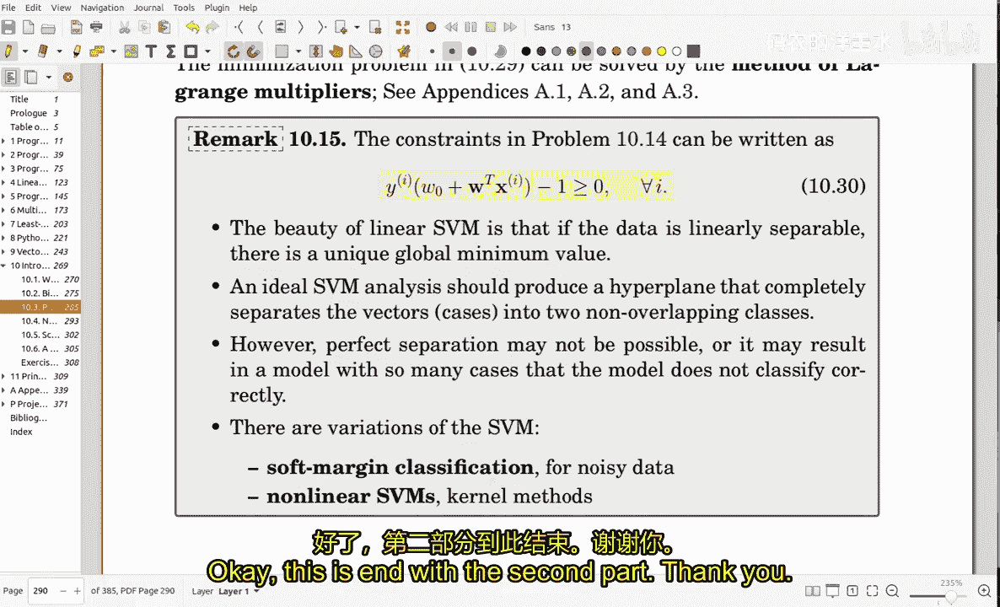