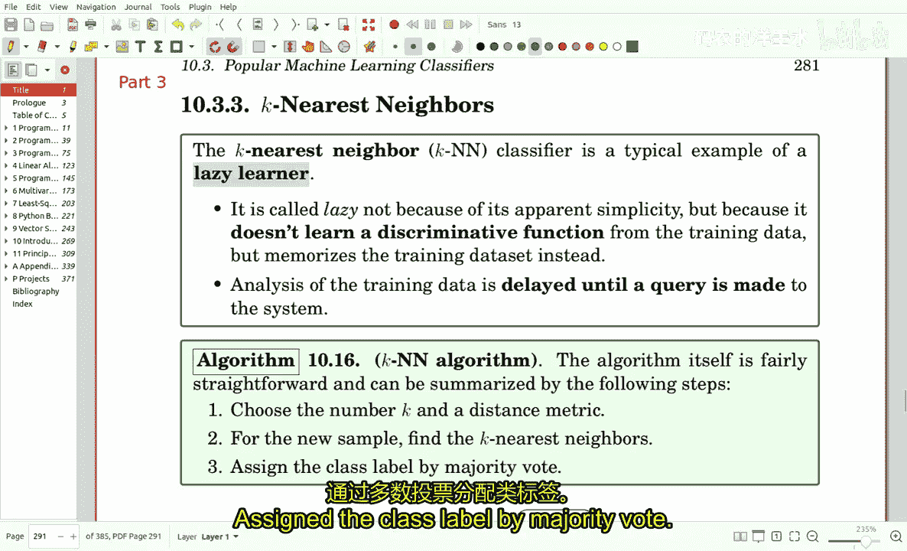
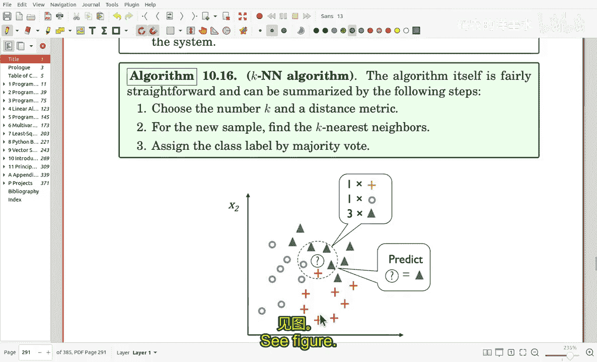
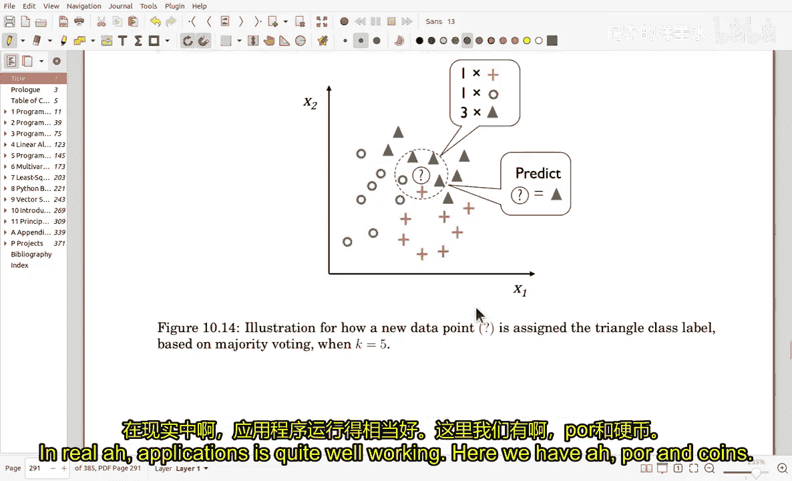
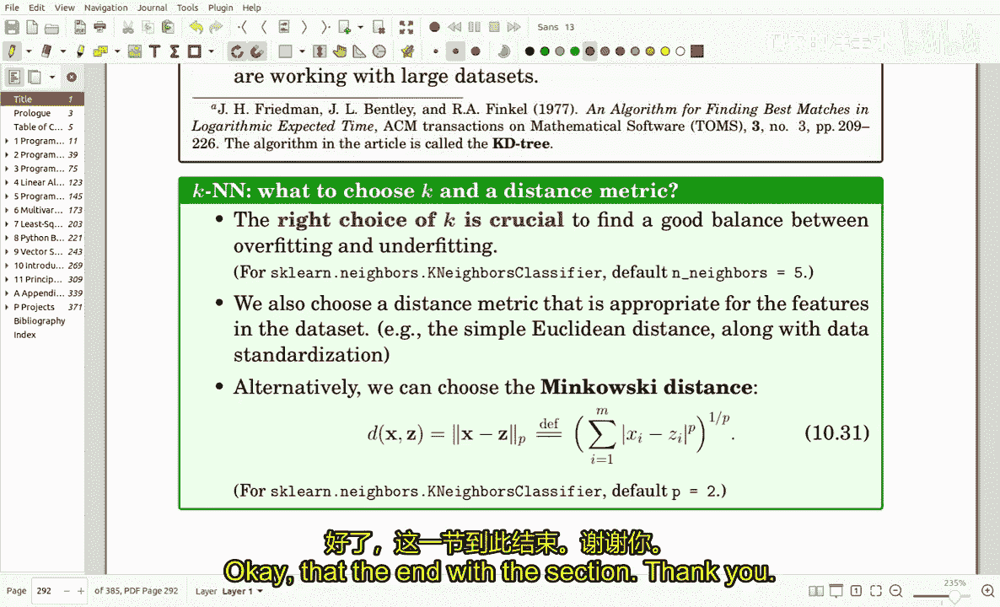

# 【全集-附课程讲义】密歇根大学-人工智能编程-EECS492-中英字幕-p64-Lecture-64---k-最近邻-KNN--BV14JqfBNEAS_p64-

Now we learn Can nearest neighbors， K N N。The Canyanan classifier is a typical example of Legilona。

It is called theing， not because of its apparent simplicity。

But because it doesn't learn a discriminative function from the training data， by memors。

The 트레닝 data set。Analysis of the training data is delayed until a query is made to the system。

It can be summarizeized。呃，快呃。Stateature foldering in these foolish tabs。Tohoose the number K。

And distance metric。For the new sample。Find the key nearest to neighbors。

Assigned the class label by majority vote。

See this video。

We chose case 5， and for do。Taketa point。And here we found the five there is the neighbor points。

Flia from triangles and one is from os， and one is from pls。So， the system。

Will predict it is a triangle。With this。Mjoed to vote。So that's the idea。 quite simple。Idea and。

In real applications， its quite real working。Here we have pos and cons。

Since it is manually based though。The classifier immediately adapts as we collect new training data。

High simple name。However。The computational complexity。

In prediction grows linearly with the number of samples。In the training data。

 in the worst case scenario， further。Is hard to discard training samples since no training step is involved them。

So that after each。Point obtained。 and we try to use it as part of training set。

So storageur will increase。 so storageur space can become challenging if we are working with。

Large t science。But in reality。It's not。Happening frequently。Here。

 more important issue is along with。The right choice of k。

The right choice of care is crucial in manys。And。By choosing right K。

 you can balance the all feeling and on feeling。If you are using。The classifier from cyclone， then。

Tfor K is 5。We may also choose Aan metric。嗯。From a various regime， the default is Euclan Antis。

And you may choose some other distance from。Mkoky distan。Pomes rather than default P 2， you choose 1。

Or the maximum。Nong。And you can choose。Oh。F way， depending what you are data said。

The K And N is quite simple。But I personally tested the various algorithms built in cyclone and also I selected more than 10 data sets and for each data set。

I applied。10 classifiers。Selected from Cyone。And I founded that。KN N1 about one third of data。

That means that full。One third of data sets。The canan。Predicted the best accuracy。

And this is as simple as algorithm。But。Many cases， better than more advanced。

 more complicated algorithms。So I believe the simpler， the better。

So the Kanon is not really a cheap algorithm。And it's simple。

 but it can be very useful in many data sets。Okay， this they ended with a section， Thank you。

