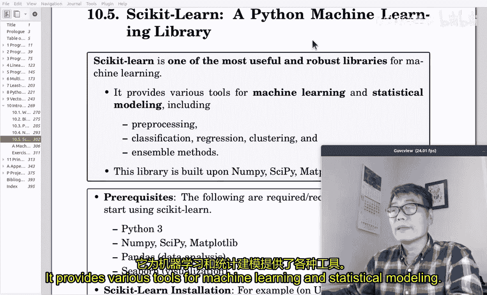
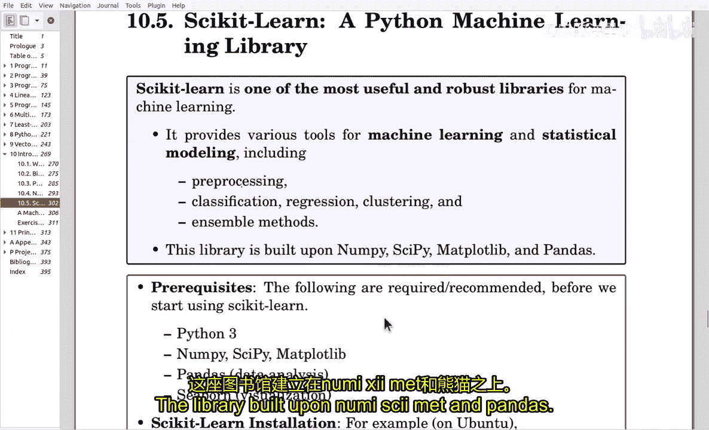
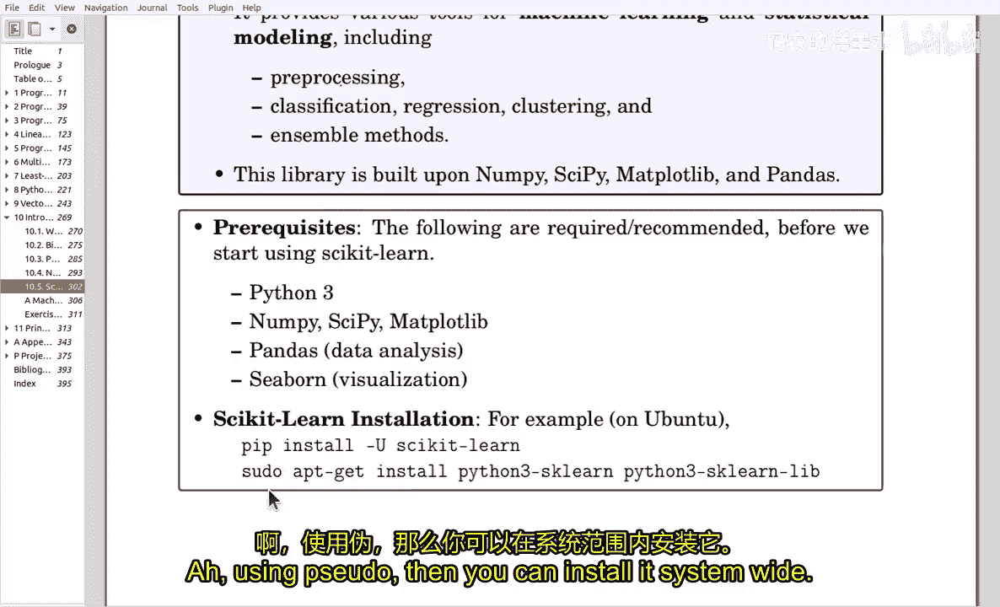
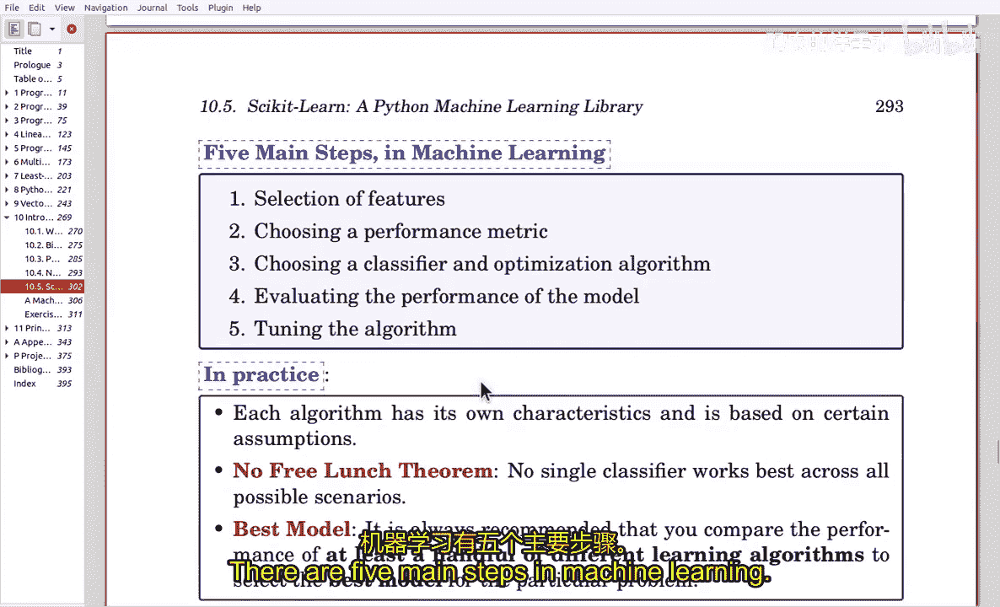
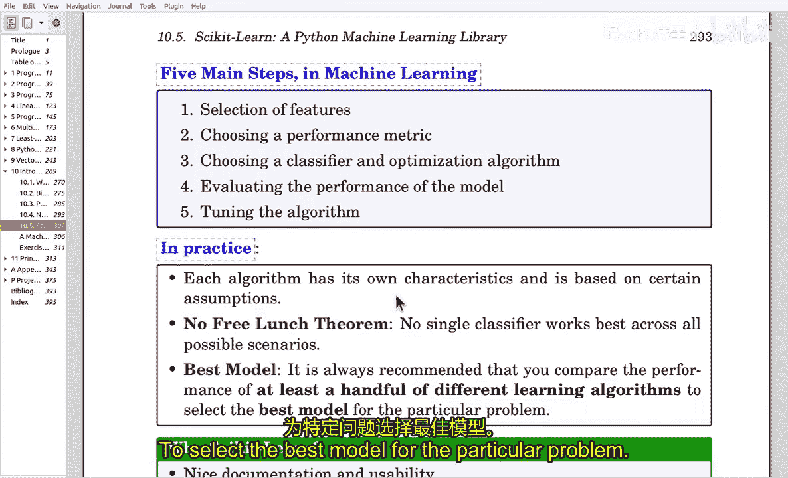
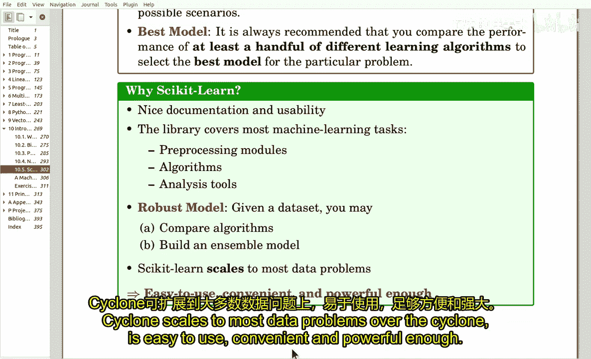
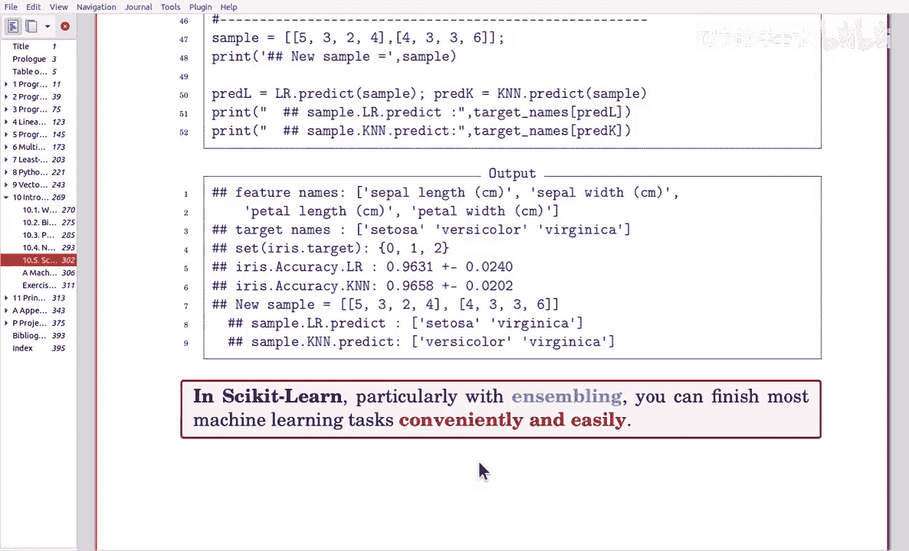

# 【全集-附课程讲义】密歇根大学-人工智能编程-EECS492-中英字幕-p66-Lecture-66---Scikit-Learn---Python-机器学习库--BV14JqfBNEAS_p66-

Cyone is a Python， machine learning library。It is one of the most useful and robust libraries for machine learning。

It provides various tools for machine learning。And statistical modeling。

앵클로ing， 프리proces。Classification， regression， clustering and ensemble methods。

The library is built upon Nompy， Sipaii， Meib and pandas。

The following are required or recommended。You have to install Python 3， lumpy， s pi。

 mat and pandas penices for。There's how another it is。

And you may try to use seaborn for visualization。For circular installation， for example， on Uund。

 you may try to use this command。If you install。Using Sudo， then you can install it system wide。

There are five main steps in muhi learning。

One， selection of features。To choosing a performance method。

Through choosing a classifier and optimization algorithm。Number 4。

 evaluating the performance of the model。And finally， you have to tune the algorithm well。

In practice， each algorithm has its own characteristics and is based on certain assumptions。

No single classifier works best across all possible scenarios。Which is the Nor free Lacher Theorem。

It is always recommended that you should compare the performance of at least a handful of different learning algorithms。

To select the best model for the particular problem。

Here is reasons。Why you。Have to or you can use a cyclone。

It is nicely documented and has wider usability。The library covers most the most learning taskers。

Ppro processinging modules。Algorithms。And one Alice's tools。If you want to get a robot to mother。

Then given a data set， you may compare algorithms。And build on。Ensemble mother。

Cyone scales to most the data problems。Overall， the cyclone。

Is easyous convenient and powerful enough。

Here is a simple e jumpmer code。Using cyclone， you can easily 업load a data set and there are some Pin data sets。

So， here we chose。The 아이리스te set。And you can get some extra information， and print out。And also。

 you can create modern instances very easily。After inputting。Logグレシン。And K neighbors classifier。

We create hear the model instances。AndL R is for logistic duration， K and N。

Is for K neighbors classifier。And。Also， you can do it here quite easilyly for splitting。

And training and test。This will be a very useful train tests split。And now。For the data set。We get。

The feature vectors and labels。And it100 minutes will try to run 100 times of the。嗯。These models。

 and then try to get。에브리즈의 키르시。So， in each tu。We split the data set into two push。

Train and test with a。Test the size is 0。3， which means 30% will be allocated for a test and the 70% for train。

And this split is working with random shuffling so that randoming separated。And after。

Sping the data set。ABying training set。And we fit。 that is training。And score， that is。Getting。

Test and the output is。Ecuracy。And we save in each it and we try to get being and standard deviation and printer out。

Okay。Once a new sample comes then we can easily predict， and， for example。Now， synthetic sample made。

And。Yeah， prediction is quite easy， and we can print out。And with the target name， real target name。

 rather than labels 0，1，2。Okay， that is output。These are future names for the data。

 These are target names。And in label， we can see 012， but original target names are these3。

This is average accuracy for I data for logistic regression。 We have this average accuracy。

For K and N， we have this one。 So K N N is slightly better。Now， for new samples。

Your logistic regression and K and N predicted for the second one the same， but for the first one。

 differently。And depending on the algorithmism。You can get。Different predictions。

 And so that the accuracy can be different。 but you can combine those。algorithmgos。In cyclone。

 particularly with ensembling， you can finish most machine learning tasksers conveniently and easily。

Will deal with。Ensembling。In the nextus section。Okay， that's the end of the section。 Thank you。

