# 【全集-附课程讲义】密歇根大学-人工智能编程-EECS492-中英字幕-p67-Lecture-67---Scikit-Learn-比较与集成--BV14JqfBNEAS_p67-

Here we have a masellaing mother code。In machine learning。

 you can write a code easily and effectively using the following model code。

It is also useful for algorithm comparisons and ensembling you may download it。Once you Ontario in。

You'll see 30 piles in Python。This one is the main program。 Let's see some details。In the beginning。

 we input required libraries and un a data set。By printing this， you can see。Available Te acid。

We chose the I data set。Have to reading it。We can get future metric。

Labels and some extra information。

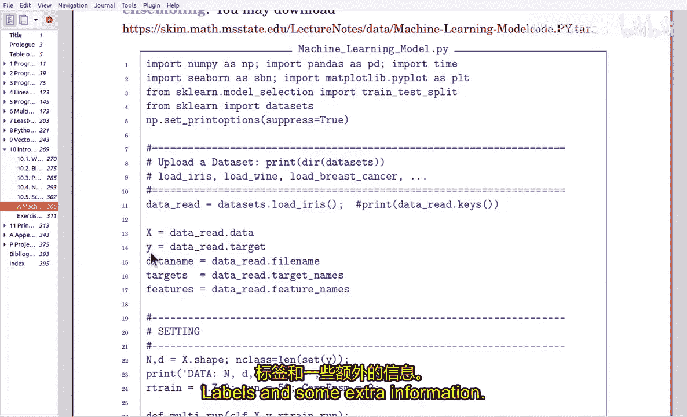

In setting。我异。Find the number with Ti points。And future dimension and number of classes in the data。

These are extra。Hyperpometers。Our train is 0。7。With this， the data set will be split into two parts。

70，30。70% for training。30% for test。Rone is 15。For each classifier。We run 50 times two major。

The average accuracy。This parametermeter controls execution。 once it is 0， or then。

The program will execute all the duly built and classifier。It is one。

 Then the classifier will be compared with cyclone。Clsifiers。If it is two， as in this setting。

Then comparison and ensembling will be executed。This function will be used for every execution。

For 기본 클래 fire and 데이터 set。Altrarian Ron。The classifier will be run 50 times， and each row。

The data is split into two portions。Train。And test with the train size 0。7。

And train and test output of this one。Its accuracy。And also。

 we measure the whole execution time that is an eip of time。

And the output of the function is  three values。The average accuracyche standard deviation。

 and e lapse the time。

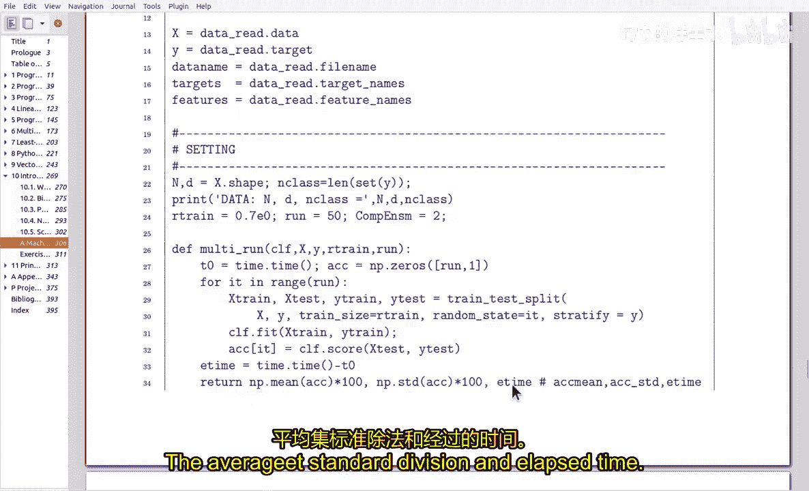

Okay， you can。M。Fmulate your own classifier and assume it is a safety in my CF that P Y。

 Then you can import。And， again。We assume and my closeifier name is my CLF。And once in inputed， then。

Now， it is available then with。My classifier。And that what Iran run is excreite， and we can get。

Everyverage I could share standard deviation and e lapse the time。 You can put it out。Now。

 this parameter is larger than a equal to one， then cyclone classifiers will be opened and read and executed。

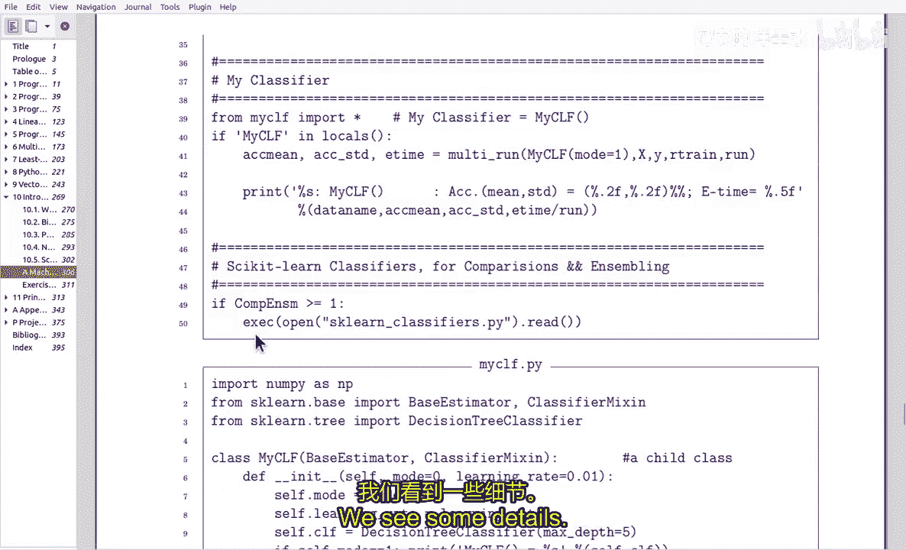

We'll see some details。レ。

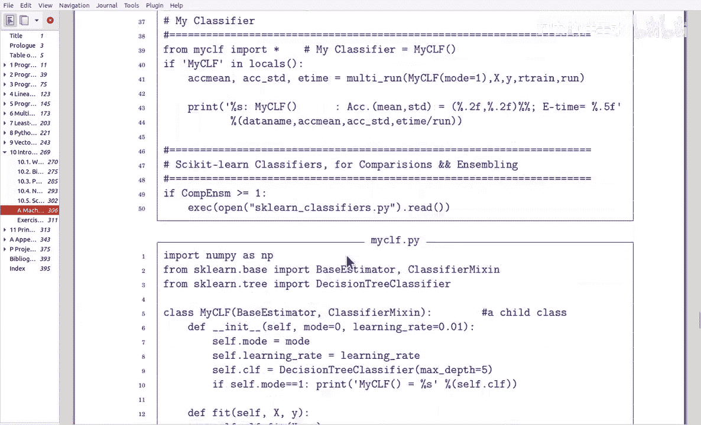

Okay， here， this is my CF thatt P Y。Momentarily。I chose decently classifier。

And once you generate the object， then。It is initial using that this essentially classifier。

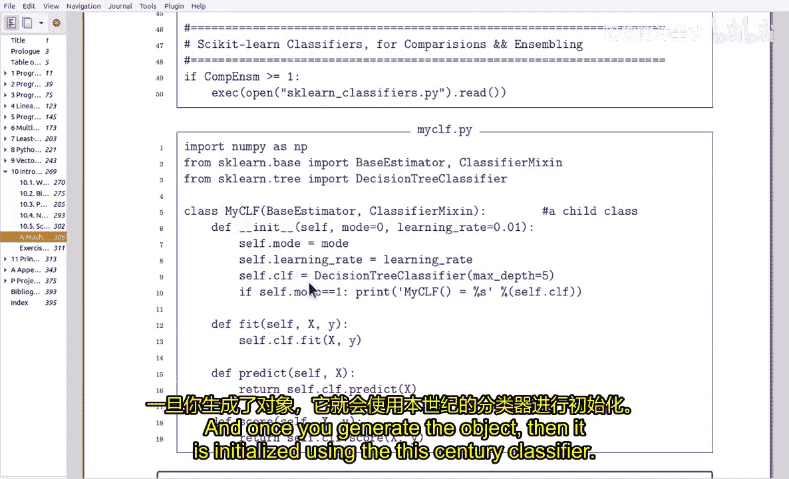

And here for this classifier， fit， predict and score are used for that methods。

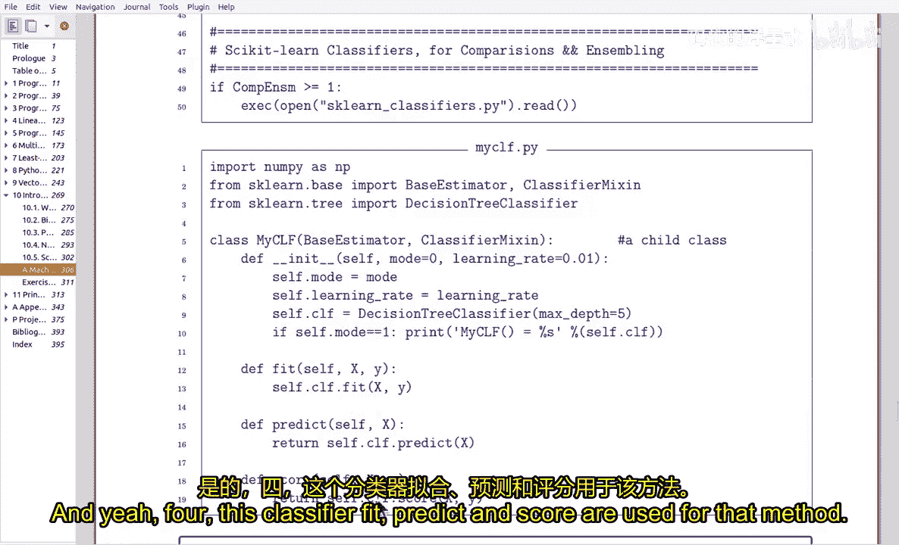

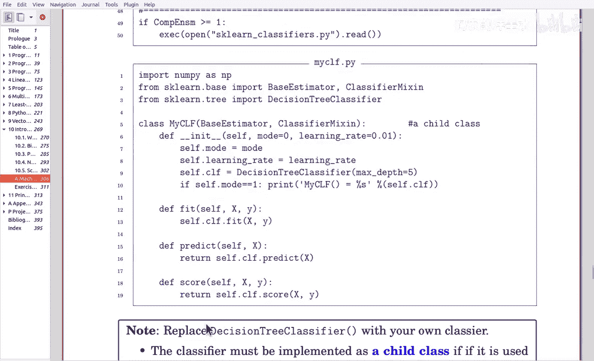

You have to， you can replace this sensorory classifier with your own classifier。And。

Your clifier must be implemented as a child class if it is used in ensembling。Now。

 in this implementation， my CF is a child class of these two base estimator classifier mix in。

And with the ads。Your classifier can be combined with other cyclone classifiers。And also。

 you have to define and fit。Predict， score all three of them。In your classifier。So that。

Every classifier in ensembling。Has same structure without that ensembling is not easy。So。

 you have to implement。First， as a child class。And these three methods must be included。Okay。

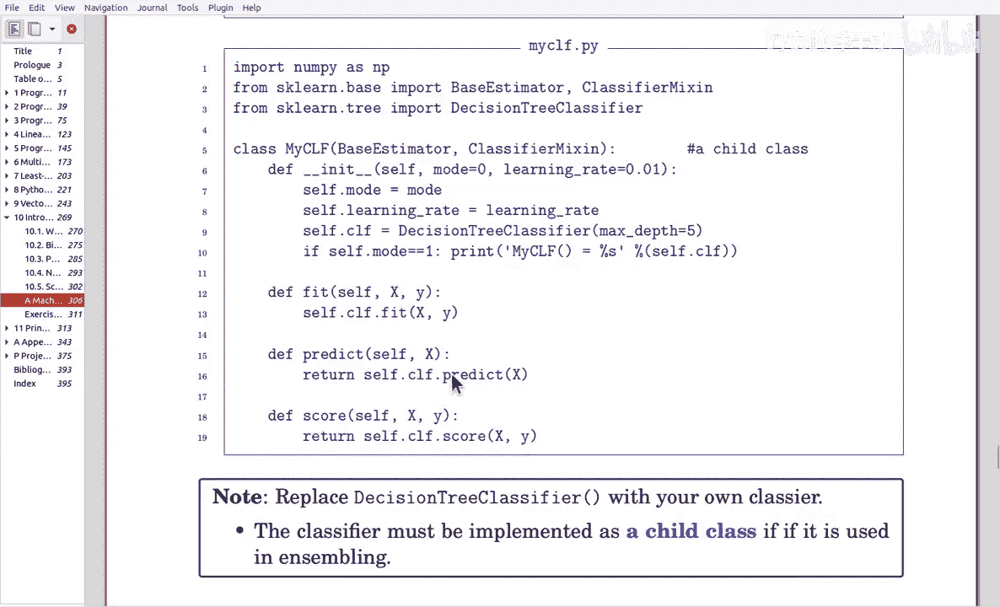

Now let's go to cyclone classifier that P Y。The requiredqui the X and y and multilron will let be define in the first part。

And for this four， once it is data defined， then we'll try to use aive for the value。

 but if it is given， then given values will be used。We import libraries， and here， choose。

10 classifiers from cyclone。And their names。This is my choice。And you can choose arbitrity quaifiers。

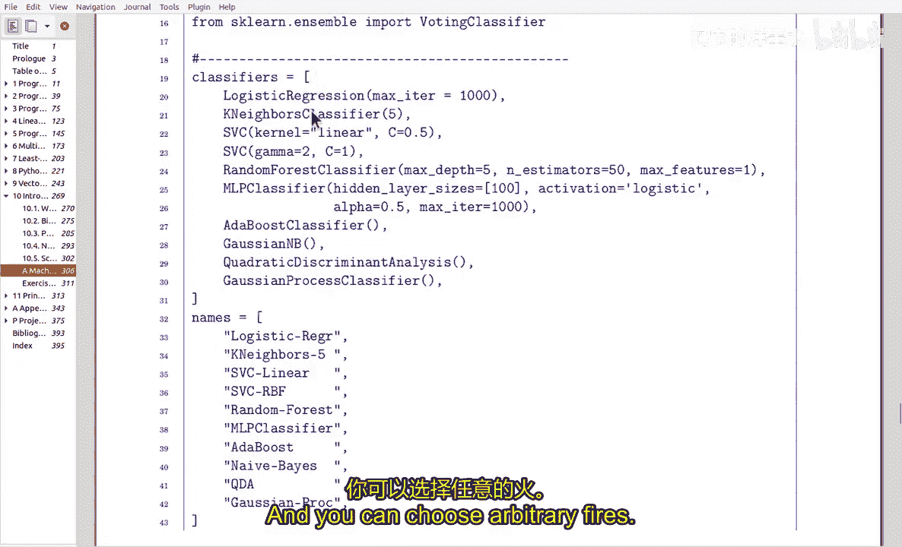

No， names。

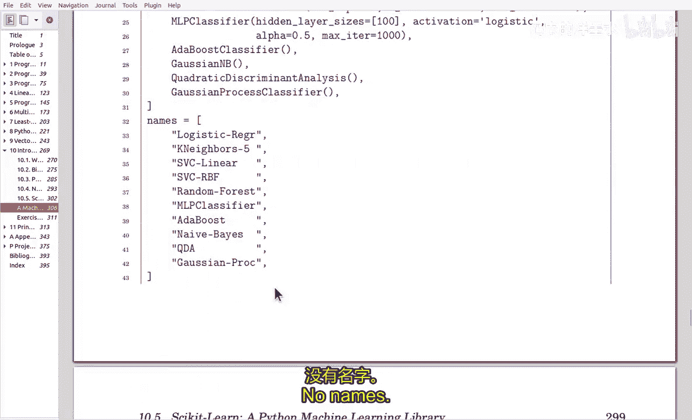

Okay， this is a default setting。 Once the data name is not defined， then we try choose the data name。

 no data name。Rone is not defined， then loan is 50， and so on。

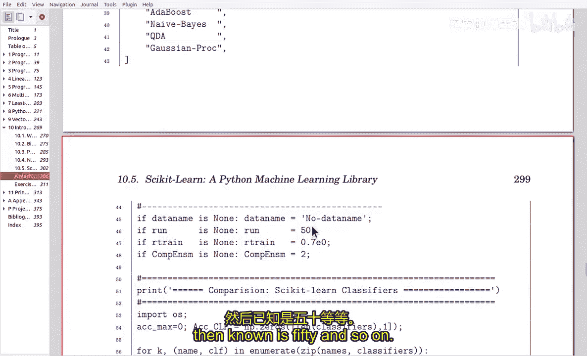

Okay， this portion is for comparison。Now， from names are classifiers for each classifier。

Will execute the Moron。To get。Average accuracy and standard deviation。An eapse of time。After that。

 the average accuracy is saved into this ur。And two major。

The average accuracy across the classifiers。And。In for each classifier， we print out the result。

 and later biasing this again， we print out the maximum and mean of the accuracy or cluster。呃。

Clsifiers。That is comparison part。And here， once this parameter is larger than or equal to 2。

 then below will be executed。Now， name is trimmed。And here。We try to pop out。Clsifiers。

And after execution， you see， okay， let's see the result。 So that will be printed out from here。

The 애し。Ass very poor for this one， there on， there on， this one and this one。So， we try to。

Eliminate from the list。 And this five of them。Baicing P method。Okay。

 from names and from classifiers， we try to pop out this five。

 and you can print out part classifiers。And for the， the classifiers。Now， we are trying to form。

The classifiers for ensemble classification。And this classifiers a must be。Or least。

But each one should be a tuil。A string。So the name and classifier。

So we try to collect this tuple for each classifier。And overall， this is a list。

If you want to add your classifier。In ensembling， then you may add your classifier with this string。

 and this is classifier。And with。The chosen classifiers。 now， you can。呃。

Generate ensembling classifier and by usinging4 classifier method。

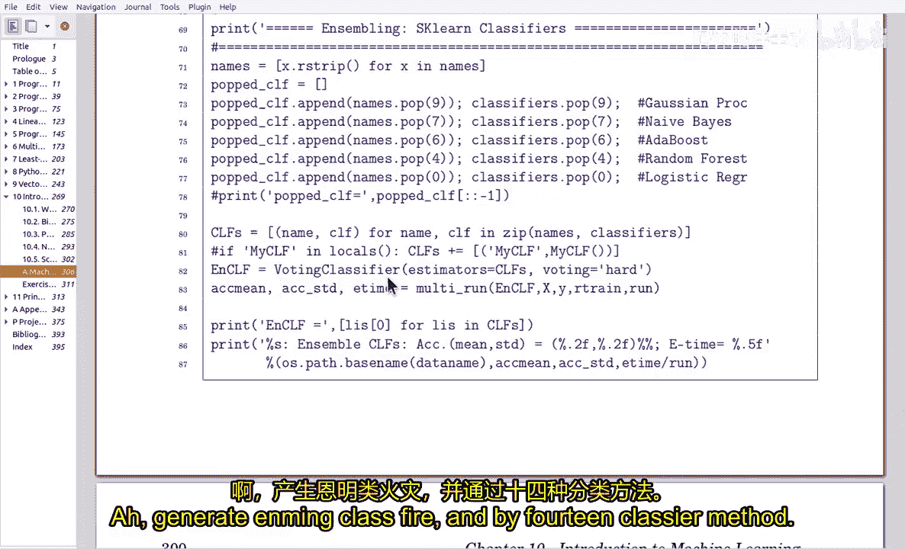

That one is built in。 okay， let's go back what they are。

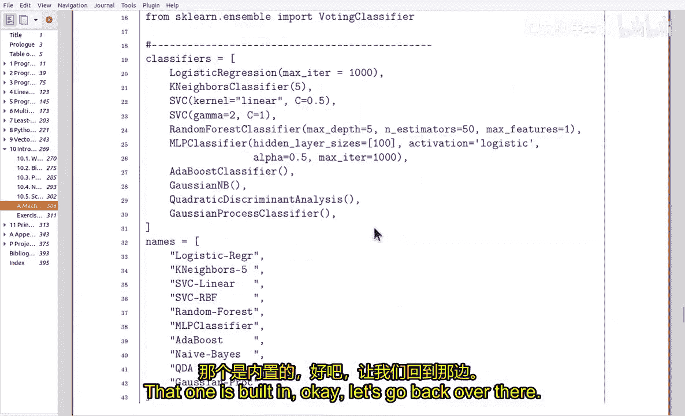

Okay， that one。It is built。

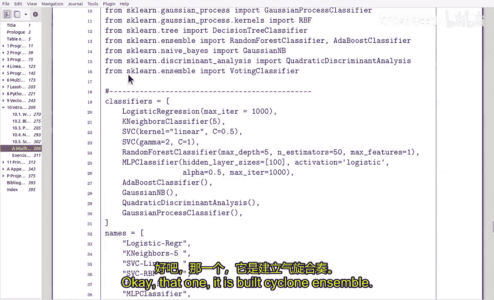

Cone ensemble。By using the method though， you can generate ensembling。

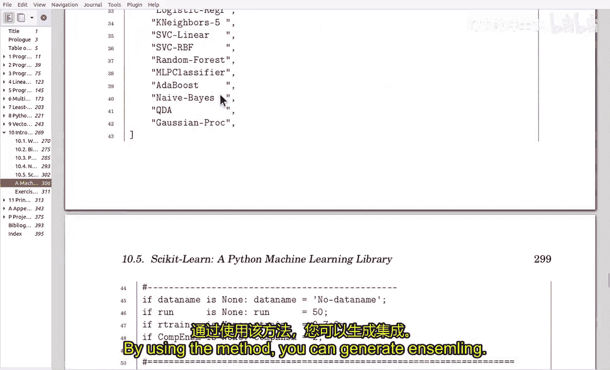

Clsifier。 And once it is generated， then。Now，vising Mertron， you can get it quite easilyly。

averageverage， standard deviation， and eapse the time。Now， we try to print out。The classifiers in。

Ensble。Clllsifiers and only now list0。 And the first one names are put into the out。

And the result will be printed along with that。

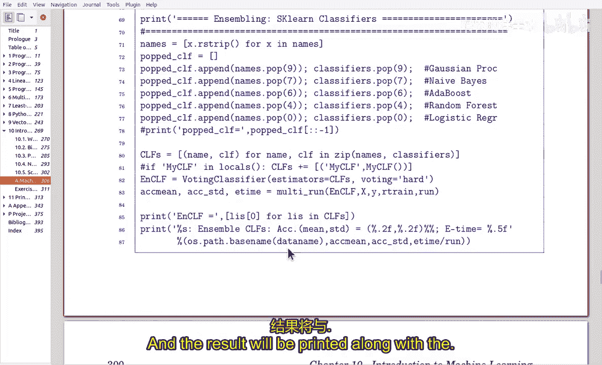

Let's see the output。This portion is from the first part of the main program。

 and there are 150 data points。And future dimension is4， and there are three classs。

And that is coming from。The mysifier。And we chose that one。And。For 디クifier， you see。

Average accuracy is 94。 to53 is almost the worst one。 In fact， this one is worse than there on。

 but is almost。Worsist one。And also， standard deviation is large。Uually。

The list we run multiple times classifier。I see here， once the standard deviations are large。

 that means there。Is not consistent for different the splitting of the data set。

The accurate flagctuay much。 that means it is not much accurate so that usually the poor classifier has large standard deviation。

Okay， these are comparison part for each of these 10 classifiers。

 We have average and standard deviation。And this one is now， of the classifiers。

And that is everything。Ecracy， and this is maximum accuracy。 The best one is。Mti layer。

 perceptual flashifier。So here that is this one。Okay。Now， this portion is from ensembling part。

 and these five are used。And ensembling。Me C this one。 and this is a standard deviation。

These equi worse than the best， however， better than averaging。So， simple assembling。

Main not increase the accuracy of classification。So that。

When one or two classifiers are much better than the others for your data set。

 then you may start the best or best ones。And they are siblings of other options。Along with theres。

The choices classifiers， you can。Build。An ensembling classifier。

Let's see current choice for current options for this classifier。

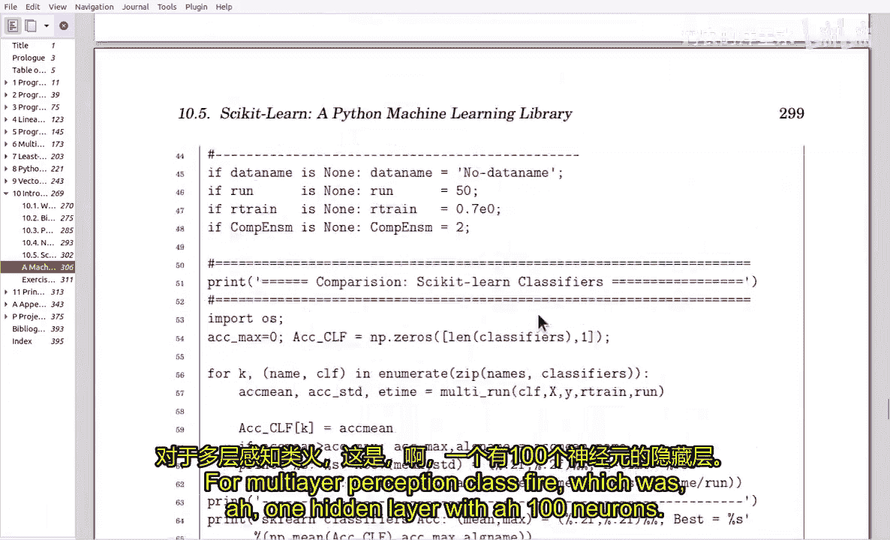

For multi layer perception and classifier， we chose1 hiter layer with 100 neurons。

You can change this one。For example。30 comm，30。Then。嗯。You chose3 hidden layers。 And for each one。嗯。

There are 30 neurons。 You can make a different。

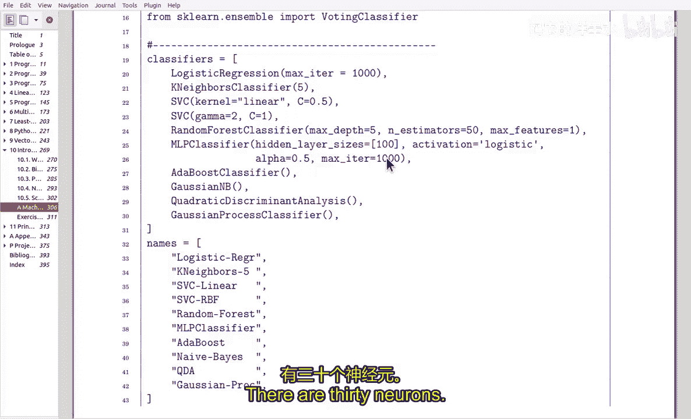

The digital networks by setting that one。And also， you can choose a different activation。

 Currently is a logistic， but you can choose electrifier over soft pullers。

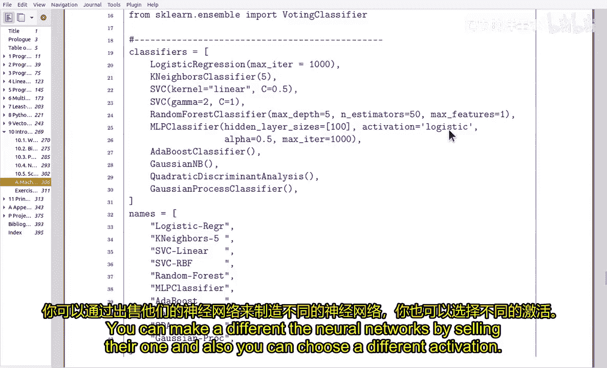

Or hyperbolic tend to function。And alpha is the quos of regularization。

 You can choose some different alpha。 You can choose one。Or a 0。1 or 0。01。 So by using various alpha。

 you can get some different classifier。By choosing other options。

 you can get siblings of this classifier。 if you combine them to get。On ensembling classifier。

 Then you may get a better accuracy。

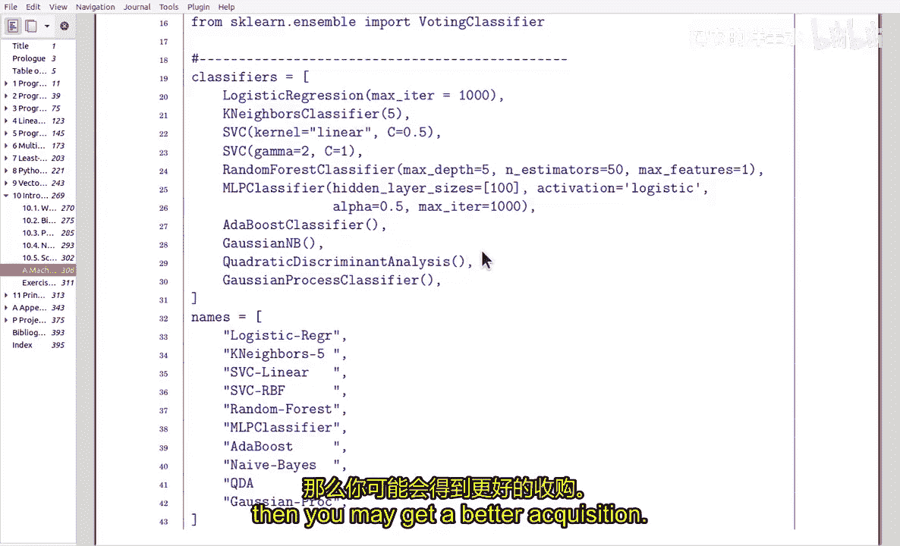

Just a simple。

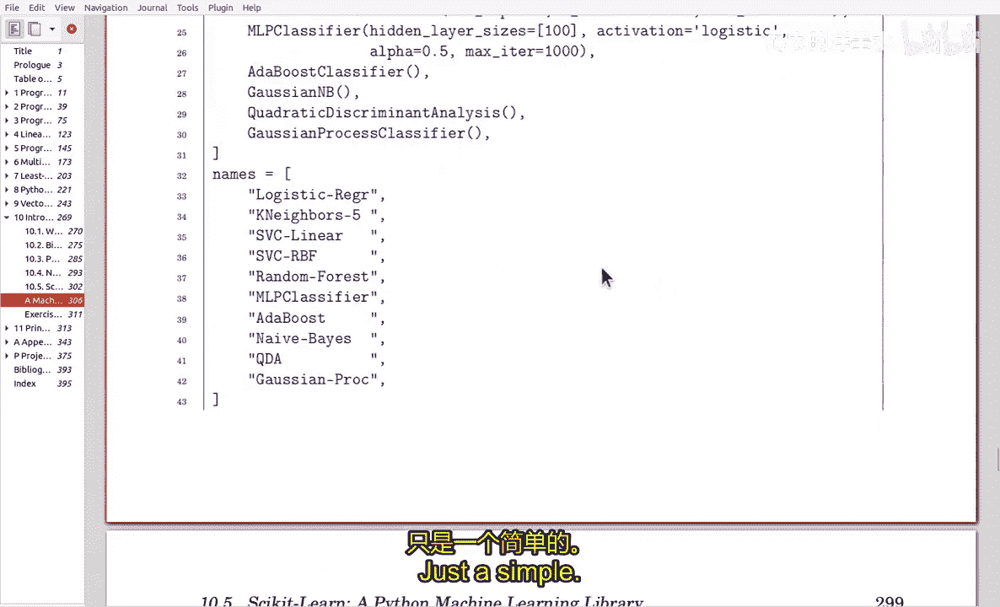

Stacking of the classifiers may not improve your accuracy。Okay。That's the end of the section。

 thank you。

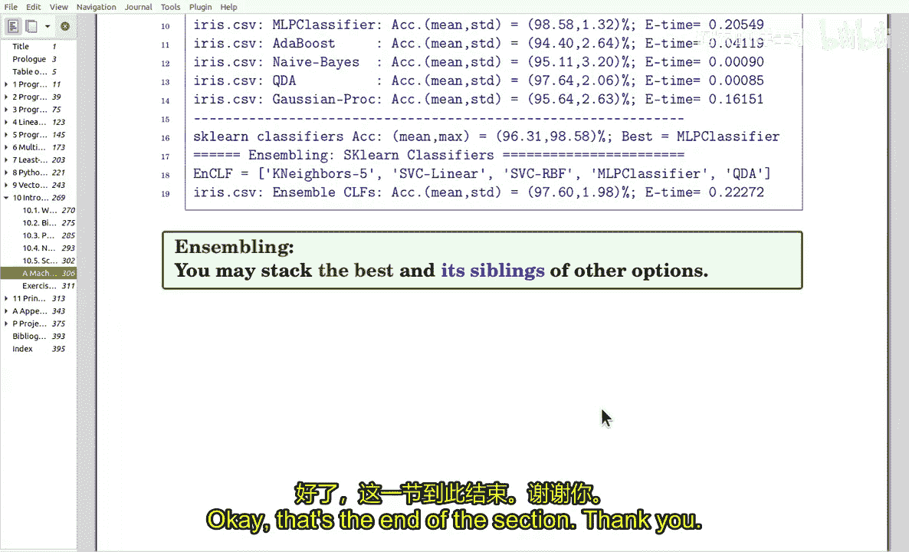