# 【全集】佐治亚理工学院-GPU编程：视频与游戏-中英字幕-p01-Lecture-1---导论--BV1GZfyBbEQn_p1-

Hi there。 My name is Aaron Laantterman。 I'm a professor of electrical and computer engineering at Georgia Tech。

 and this is my quarantine hair。 And I would like to welcome you to the first lecture of the summer 2020 offering of GPp programming for video games。

 Normally， I would be giving this lecture in front of live audience。

 but the coronavirus at other plans。 So I will be recording my lectures this semester and posting them on YouTube and the hopes that other people might find them useful。

😊，Most professors propose to do a special topics class。

 usually a graduate class when they become an expert in some esoteric research area。

I take a different approach where I have things that I want to learn and the only way I could possibly make time to learn them is to make it part of my job so I propose to teach class on it and fortunately my colleagues never checked to see if I know what I'm talking about first hellello colleagues and as a result somewhere around spring 2007 I got the idea to teach a class in programming video games now computer science and literature。

 media and communications at Georgia Tech have a lock on most of the game related courses so I needed to come up with something I could sell to my EC colleagues and I came up with idea of high performance computing as the angle so I sent an email to my colleagues to see if anyone went to join me on this adventure and fortunately my colleagues Sean Lee said yes and fortunately he actually had some experience working on graphics hardware in his previous job at Intel and at the time both the Xbox 360 and the PlayStation 3 were coming to market and in particular the PlayStation 3。

Had this new fancy cell processor， so fortunately David Bader and his graduate students in the College of Computing joined to help us with that part。

Also， Microsoft had developed a way for people to write code and run it in a sandbox mode with C sharpharp under dotnet on a retail Xbox 360。

 which was not something that happened fairly commonly。

 PlayStation had net yourrosy PlayStation 2 did have an official Linuxux that you could install。

 but this would allow other Xbox 360 users to play your games。

It wasn't the full SDK that somebody with a full Xbox development kit that would require some sort of non-disclosure agreements。

 etc， etc to have， but you could still do quite a lot So the next year Sha and I did the class on own with Sean taking over the cell processor part and we did that again in 2009 and then around 2010 Sean left Georgia Tech to go back to industry and it was left on my lonesome and near then the semester where we always put the cell processor part I got partly through the cell processor material and decided that it was just kind of boring and the cell was not a successful experiment anyway so I wound up dropping that part on the spot and then around 2012。

 the writing had been on the wall for a while， many taught people on the X&A team had moved to other projects and eventually Microsoft discontinued support for X&A around that time it was also clear that the Xbox 360 itself was getting a bit long in the tooth and some new devices like the Xbox1 which I think is absurdly。

ca it gets confused with the original Xbox and the less creatively but more sensibly named PlayStation 4 was also coming to market。

 so it was clear that there was a changing of the guard so to speak。

 and I should probably start rethinking the class。So since I've been using X andA and had a battery of X andA examples that we had developed。

 it made a lot of sense to look at monogame， which was an open source rewrite essentially of the dotnet C sharpp X&A framework Unfortunately it was relatively new at the time I looked at it I couldn't get at work in my Macintosh obviously it's developed tremendously in the eight years since I've looked at it at the time it didn't seem quite worth it so I decided to not look at monogame further then and I decided just retire the course for a bit after I last taught it in fall 2012 So 2013 came and went without any course along these lines and so it came to pass that I spent the spring 2014 semester at our remote campus in the city of Mes in France teaching at Georgia Tech Laraine this is a photo taken from the Basilica at Mamatra and it was just an amazing view of the city and I had been playing final Fasy6 with my son which has this。

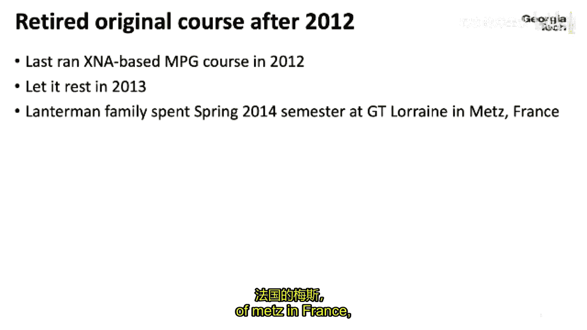

Stteampunk vibe and I thought this looked very steampunk is very awesome other than spending time at Georgia de Lraine or following my wife who was fluent in French around。

 I was pretty much spending time in our apartment and I picked up unity and started playing around with it and realize this was a good framework to get shaderco running quickly in a way that we could maybe even go further into shader stuff that we couldn't in the original course since we were spending some time on a lot of the scaffolding of just starting to get 3D graphics on the screen。

 which you have to do quasi manually and X&A。

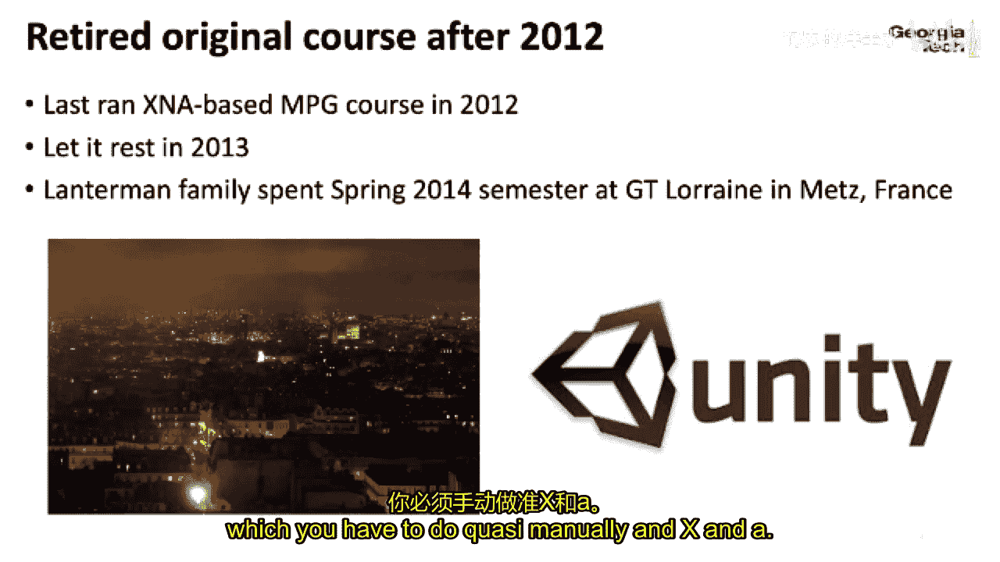

So the original course had been largely inspired by the particularly weird multicore architectures of the cell in the PlayStation3 and the Tricore power PC and the Xbox with unity。

 a lot of the things you would do with your traditional multiple extra CPU cores are being handled by unity behind the scenes but unity gives you a lot of direct access to the GPU the shader code you're writing there is the same as you would be writing code on a professional development kit for any of these consoles so I decided to drop the multicore part and just focus on the even newer better things you could do on these even newer cooler GPUs and the current version of the class GPU programming for video games was born So if anyone out there is wondering if game programming is a worthy intellectual pursuit well at least it's a worthy economic pursuit we're talking 120。

1 billion in global revenue in 2019 depending on how you count things the average gamers $35 so that's probably different than when I was a kid。

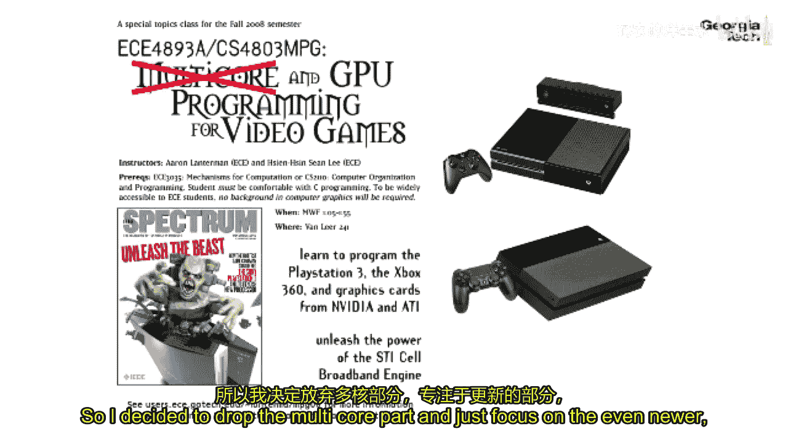

And that number skewed younger and now you have a new generation of people playing games with their parents who had played games when they were kids。

When I first put together this course in 2007， World of Warcraft had just launched。

 and that seemed massive at the time， but then this happened。Now to be clear that's a bit of a fluke。

 I'm actually fairly terrible at Fortnite， but 1。8 billion of that 120。

1 billion is just from that one game fortnite， so epicpic Game has this magical hole in the ground that is basically just spraying money out at them。

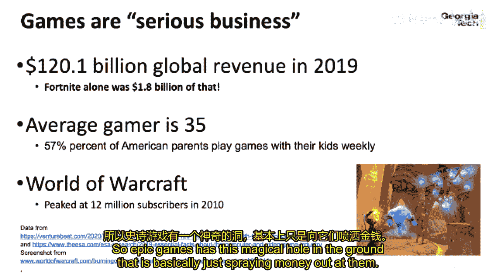

When I first proposed this course， my colleague Blair McIntyard。

 noted that low level CPU and GPU programming skill is something that the game industry needs and that they have trouble finding。

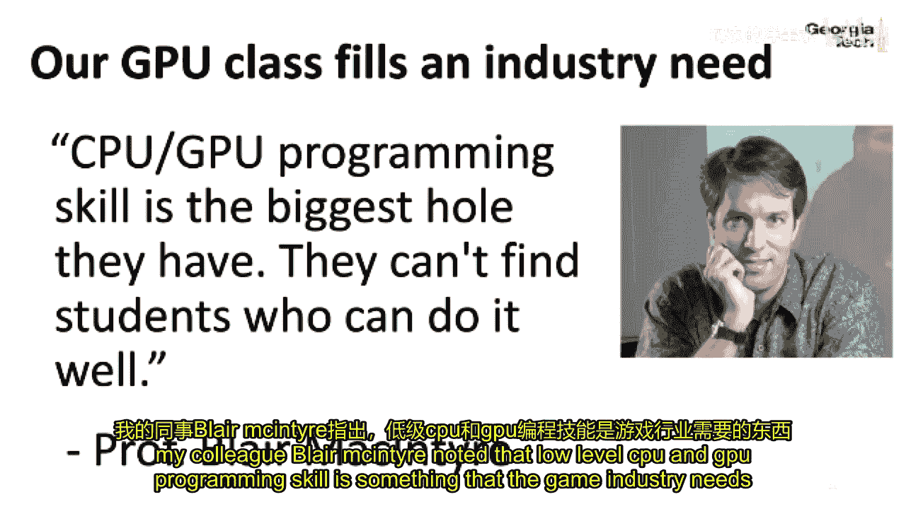

So let's talk a little bit about how game programming and realtime graphical simulation programming in general differ than your sort of general purpose programming and game programming。

 let's say you're trying to hit a 60 frames per second frame rate while you've got 16。

7 milliseconds or thereabouts to get done everything you need to get done before that next frame hits you may have fantastic performance for most of the game but if there's a few places where the game slows to a crawl。

 everybody will be on the forms talking about how terrible your game is that's very different than doing something with say a weather simulation where you can put a lot of information in the computer and wait for a while for the result to come back in that situation you may have a computer that produces 10 trillion quadrillion zillion floating point calculations per second but if every second it has to stop and cool down for a quarter of a second it's not going to be useful for a game in addition talking about what this course is。

I want to be clear with everyone about what it's not about So some people have been disappointed that I don't have you design and code a video game from scratch in this class。

 the reason I don't do that is that this easily can take up an entire class on its own such as CS4455 first taught by my colleague Amy Brookuckman in 1988 more recently that's been largely taught by Jeff Wilson and Mary Ganddy if you want to learn about artificial intelligence specifically in games we have CS4731 and although I may occasionally touch on many of these issues that come up in a more generic video game class。

 they're not going be a primary focus here so you shouldn't expect them。

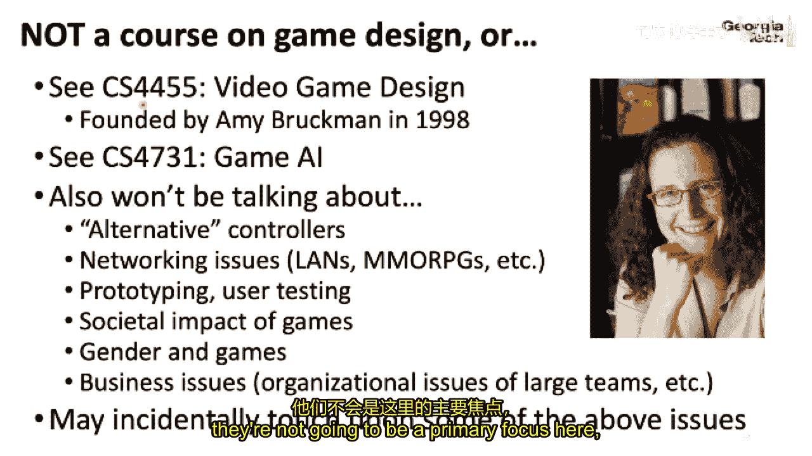

This is also not a full on course in computer graphics If this was a full on pure computer science class in a computer science curriculum then I might have made computer graphics of prerequisite but I am in an EC department and I want it to be accessible to EC majors most of whom will not have had a class in computer graphics so I'm going to review various topics that would appear in a traditional computer graphics course but only that part we need for this particular course in GPU programming particular things having to do with the rasterization model for computer graphics where you basically cycle through all of the triangles that make up your scene and you paint those to the screen and the emphasis here will be on realtime graphics and not the sort of things that you might compute offline。

 say if you're doing CGI for movies。

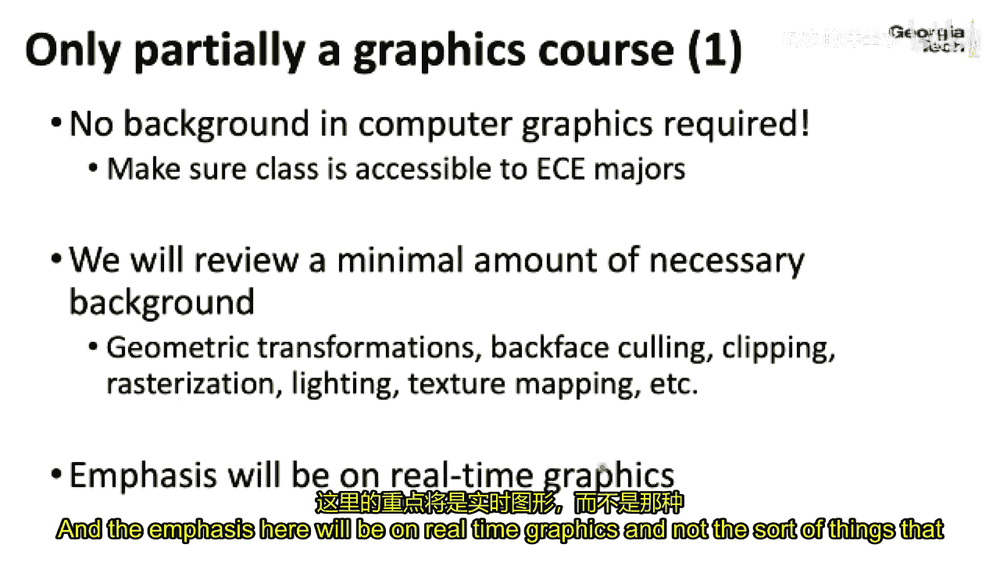

So there's some topics in a traditional graphics class in the CS department that we won't be getting detail。

 For instance， most such classes will spend some time talking about humans perceive light and color There also talk about a different model for creating images different than rasterization called ray tracing where instead of your main loop running through all of the triangles in the scene your main loop runs through all of the pixels Now that is something people have been doing on it GPUs for a while now but traditionally that's been the GPUs running in more of a scientific supercomputing GPGU mode not necessarily real time Now the latest cards from ATI and Nvidia do have some real-time ray tracing capabilities built into the hardware I've not included that in this version of the course I don't think it's quite far enough along yet that a lot of games will be adopting it to make it worth putting this course but future versions of this course may have it Also there are entire classes in things like advanced animation techniques such as inverse kinematics if you do want to learn。

More about these things， there's an entire class in computer animation。

 my colleague Efenessa teaches a class on computational photography。

 and there's an extension of that which I guess is the moving version of it for adding special effects I believe the computational photography course is available as part of the online Masters of science in Comp science curriculum that we have at Georgia Tech。

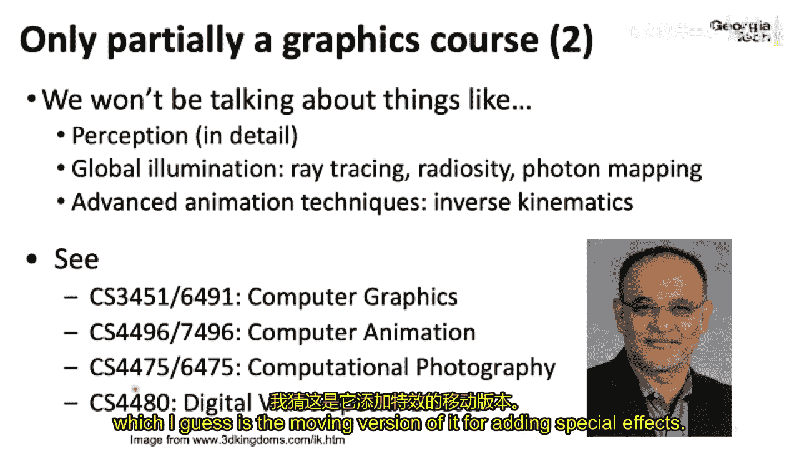

So we spent a lot of time talking about what this class is not about。

 let's talk about what it is about Now you don't necessarily have to have the latest greatest。

 most powerful， most expensive GPU card for your computer to do the assignments in this class I've made all of the demos for this class on my 15 inch MacBook pro from 2015 Now going back to earlier versions of this class I would make statements like phones and tablets are not powerful enough yet to fully utilize all of the techniques we're looking at but certainly that's changed。

 The computer game industry has certainly changed a lot in the last 40 years and the early days one person designed the game programd the game created the art for the game created the music for the game to the extent that there was art and music and games at all but nowadays these typically are specialized roles you can have teams of up to 100 people there's people whose whole jobs is to just manage other people and they don't necessarily do anything technical that said if you're somebody with programming skill and artistic skill and can be that interface。

Between the artists and the programmers， you are a rare and valuable commodity。Now。

 themes are going back the other direction a little bit。

 There's now tools and infrastructure available for individuals and small teams to make games that if not 100% on par with the games being made by teams of 100 people are quite amazing in their own right Now if you are a student thinking of getting a job in the game industry realize that it can be a little bit brutal allegedly most companies are better at work life balance issues than they were say back in 2004 but I would not say that the improvement has been consistent across the board in addition to the jobs themselves requiring fairly long hours。

 it is a tough industry to get into and that's part of the reason people work such long hours companies know that there are young hungryung college graduates trying to get into the game industry and they can run a churn and burn procedure where if you burn out after three4 or five years。

 they can always replace you as someone else Now you don't necessarily have to want to get into the game industry per se to benefit from this。

If you're doing more general computer engineering， it's useful to understand the reason we have such amazingly powerful general purpose GPU processing for scientific supercomputing is because people wanted to play cooler versions of Doom and Quake advances in computer engineering have been driven by gaming。

 certainly understanding the kind of workloads that games put on computing systems will give you insight in developing computing systems to handle other kinds of workloads so although you may not be working for electronic arts maybe you'll be working for invio or ATI designing new chips or Intel AMDR or IBM who while they're primarily known as quote unquoteCU vendors。

 a lot of their CPUs now have GPUs coupled with them and of course now come to think of it。

 AMD and ATI are technically the same company and maybe you won't be writing games but perhaps you will be designing the new PlayStation 5 or XboxX2 or whatever weird name Nintendo comes up with for their next console。

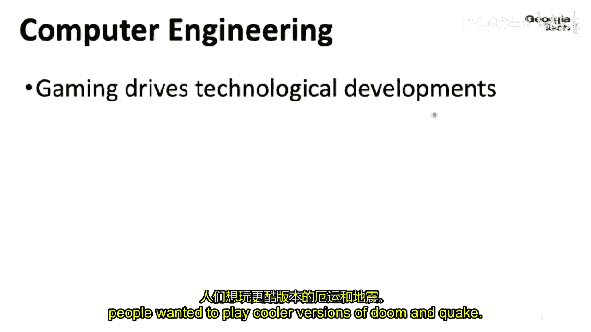

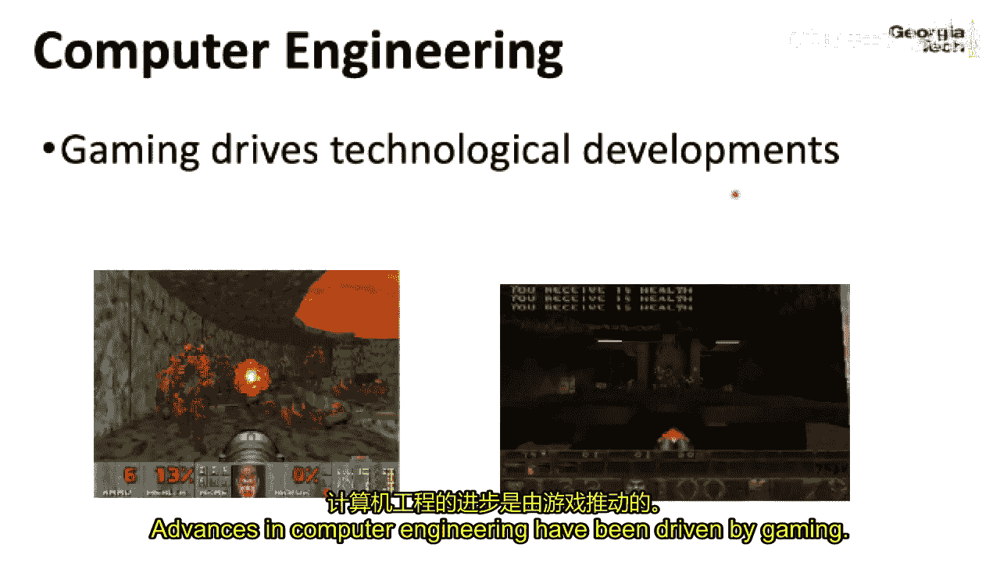

If we also think outside the box of the traditional game industry per se。

 understanding GPUs in their graphical context we give you some insight into using them in a more general scientific computing context。

 and even if you don't program games per se， the reality that clock speeds are not increasing that the rate that they used to has resulted in people by default。

 having to move to parallel processing， that all said I am totally thrilled when students come back to me and tell me that they've gotten their dream job in the game industry。

 that's awesome。Now supposing you don't go work for a commercial game company Now you do have opportunities to create and publish your own games kind of like they did in the late 70s and early 80s and in a way that you really did not have an opportunity of the 1990s when if you want to distribute a game it had to be on disks and on CDs and it had to appear on shelvess for people to go buy that led to a lot of problems because those stores only have limited shell space and as Richard Gart aKlor British often talks about when he discusses selling his company origin systems to electronic arts。

 those large companies didn't want to have to deal with a dozen different distributors。

 they really want to deal with something like three but nowadays in things like movies and TV shows companies like Amazon and Netflix can exploit a long tail effect and have lots of different products available even if each individual product doesn't necessarily sell very much and certainly from an environmental standpoint if we can use our energy to move bits around instead of moving boxes containing those bits around that's a good thing。

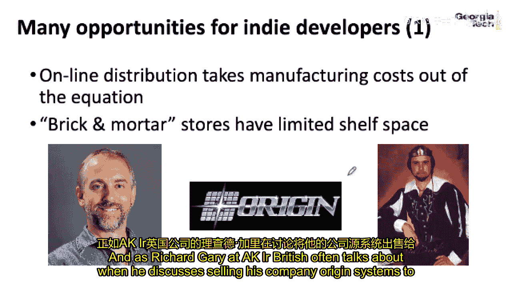

I have to give a shout out to Jeff Vogel， who was developing successful indie games long before the term indie games became standard when the termshaware was more common。

His game of Verham4 is the reason I turned in my tenure paperwork three weeks late Fortunatelyly I still got tenure the first spider web software game I played was exile back when I was in graduate school and I remember going through the demo and then to register the game I had to call Jeff on the phone and read to him digits off of my credit card just to give you a sense of how far we've come in terms of making it easy to pay for games online although it's certainly become easier for any developers to get their games onto the big three consoles。

 it's still not a walk in the park you still have to get through the gatekeepers at the individual companies and the code that you create has to go through their procedures to get on those consoles This is partially to help prevent piracy but it's also largely because the console manufacturers want to make sure that if somebody's playing a game on a PlayStation or a switch or an Xbox that that's operating within a safe zone users don't have to worry about programs crashing their machines getting。

upp to no good etca etc。 and you really don't want to try to bypass those procedures to get your own game on there without them。

 Now back when you had to distribute games on physical media like CD or in particular cartridges the console manufacturers really had to lock on that so something that NS did is they would basically charge you for all the cartridges that were made and essentially N would make money rather the cartridges sold or not so they made money even if you didn't nowadays with online distribution。

 you don't need to worry about how many rom cartridges you need to manufacture or how many you get pressed so that's certainly the best way to go for a lot of things Microsoft had an interesting program for a while where people who developed games using X could actually sell their games through the Xbox platform and that was unique PlayStation 3 didn't have anything similar and Nintendo didn't have anything like that either it went by several different names and it sort of moved around in terms of where it was in。

Xbox menu system I had a lot of high hopes for this ala。

 those hopes were not manifest in reality and a lot of the hopes for were based on the fact that mobile games that Indies were developing or selling very well but I think there is just a different psychology between playing a game on your phone and playing a game on your Xbox 360 if you're standing in the line at the grocery store you might pull out your phone and flip through a store and see what cool new game appears on the front page or something to pass the time but if you're sitting down at your Xbox 360 to play a game usually had in mind already the game that you wanted to play you're rarely just saying let me browse X and Indie games。

 even if you're aware of the existence of X and Indie games at all Now you might automatically assume that all of the roadblocks that a company like Microsoft or Sony or Nintendo might put up would automatically mean that the PC realm of Windows machines and Macintoshs and Linuxbox are automatically a more friendly territory for Indie developers but you still have gatekeepers you have things like Steam and good games and although。

Nowadays you can pretty much get your game on either of these fairly easily。

 they're not being the same kind of gatekeeper that steamam for instance is not trying to be the same kind of gatekeeper that it used to be You are now competing with a ton of other games also being developed on those platforms you cant sell games on your own website but in addition to the problem of having a lot of competition you have the difficulty of having to support a wide variety of CPU and GP variations and operating systems and motherboard chipets I know this is something that ID software had trouble with backward rage was released this was sort of Carmack's latest greatest game engine and if you follow Jonathan B the developer of the games and the witness on Twitter you would often complain long and loud about the difficulty of making your game run smoothly on all of these different platforms and supporting all of these different customers So what about the mobile market Certainly people have had issues with the gatekeepers in particular Apple but I think the main issue in the mobile space。

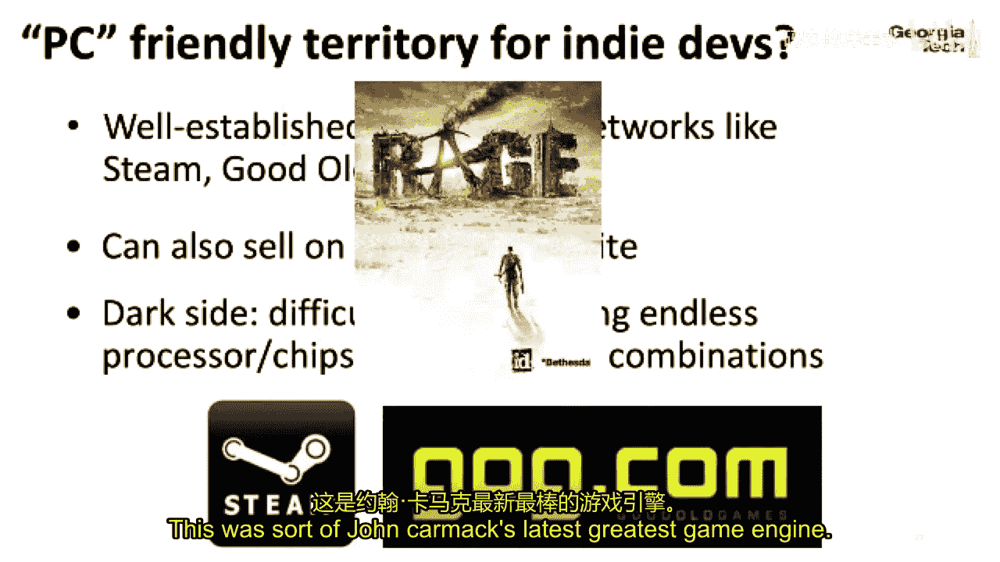

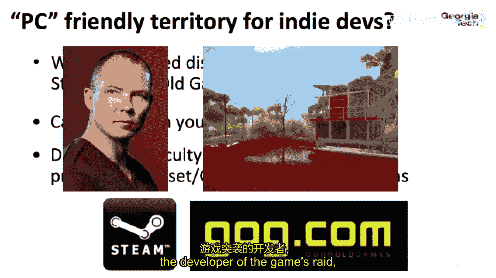

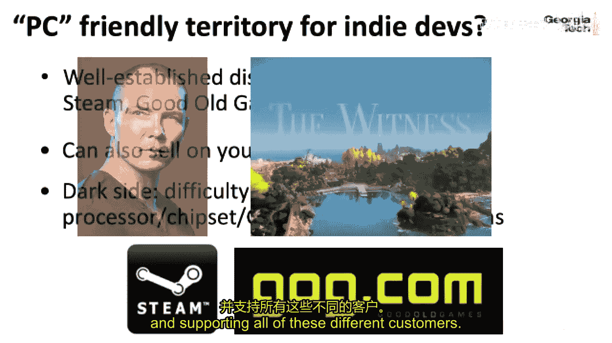

Is just that there are a million games being released like every microsecond on something like the iPhone as a result。

 you basically need to start charging negative money for your game at some point and you wind up having these games where there're nothing but advertising and then people complain about all of your microtransactions and I'm not going to go near here What about funding your game Certainly things like Kickstaroder and Indie Gogo have become popular I think they've been saturated out a little bit in the early days you had games like pillars of eternity wasteland to Torment tides of Newmana that would raise a lot of money and generally be seen as critical successes I have to give a special shout out to Sha and returns since out of all of these projects I'm about to show on this page I think this one was the best in terms of clearly defining its scope staying within that scope and shipping on time There are some other games that have been fully funded and more or less seen as successfully release that nonetheless have been controversial for one reason another。

I know that Sroud of the avatar has received some criticism。

 although my son and I have enjoyed playing it a great deal and then there's the canonical case of a highly funded。

 more or less released but highly controversial game namely star citizen by Chris Roberts Now for all of these games that have been fully funded and more or less released there have been quite a few games that were fully funded and never released at all or sadly even though they had wellknown computer game industry figures behind them didn't even get to the point of having their kickstarter funded So I mostly been talking about games for a quote unquote fun there's also market for a quote unquotesious games this is something that my colleague Ian Bogost in the School of literature media and culture has written about a lot although Ian himself isn't a huge fan of the term there's been games for training first responders and disaster areas training emergency room workers and Ian has actually create a game for a culture and creamery where you learn how to run a store and it actually includes a icecre vico model to learn how to。

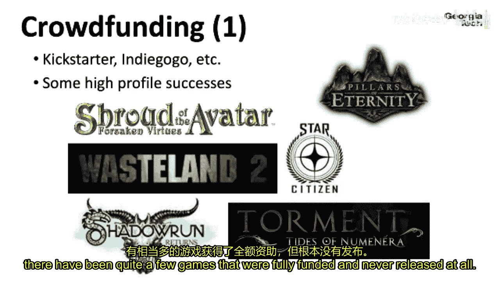

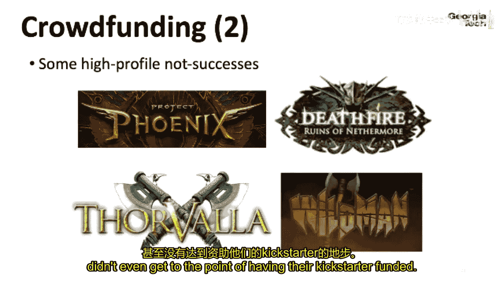

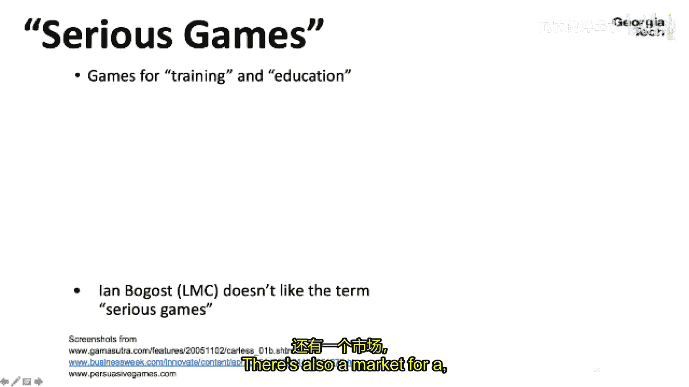

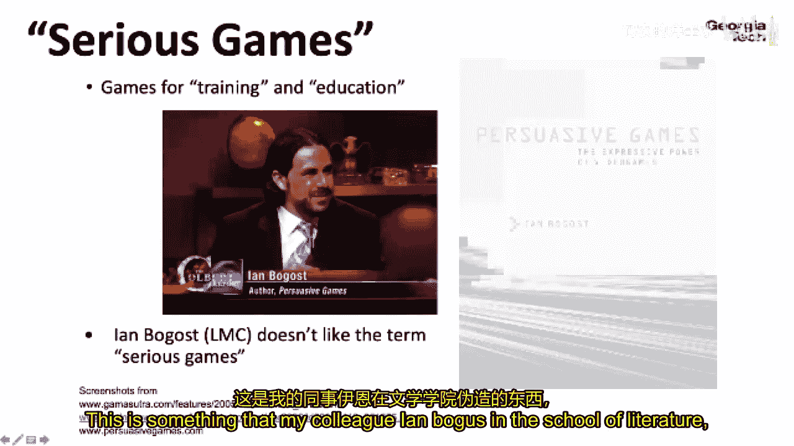

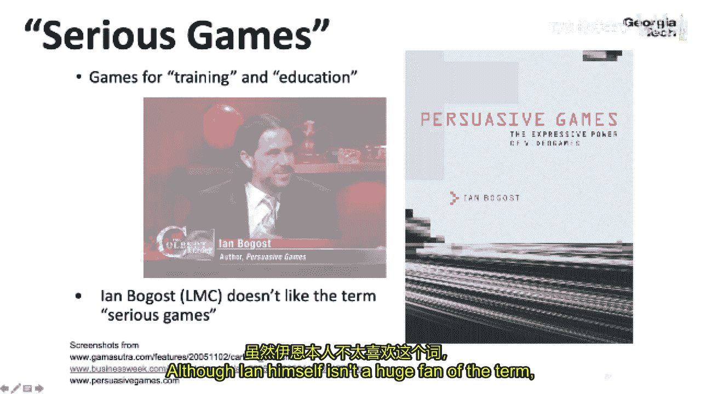

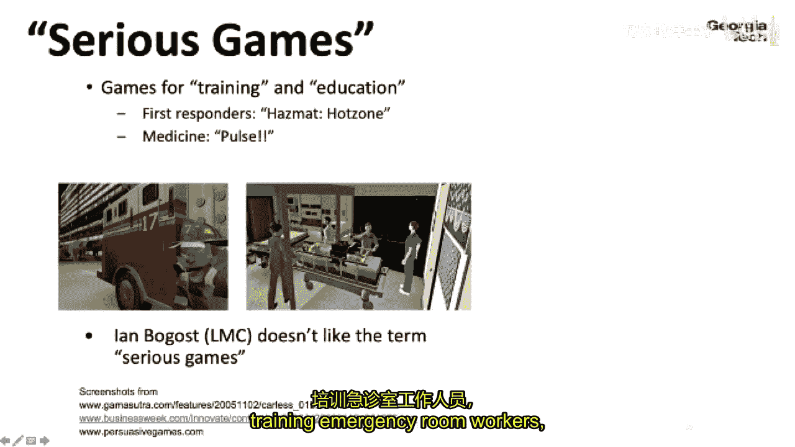

Correctly scoop the ice cream。Ian also developed a game for Howard Dean's presidential campaign for those of you old enough to remember that。

 and he also created a game where you are an employee of Kinko's and basically the customers and other employees at Kinkos try to make your life miserable。

 to acknowledge this is not actually registered on Kinko's radar screen。

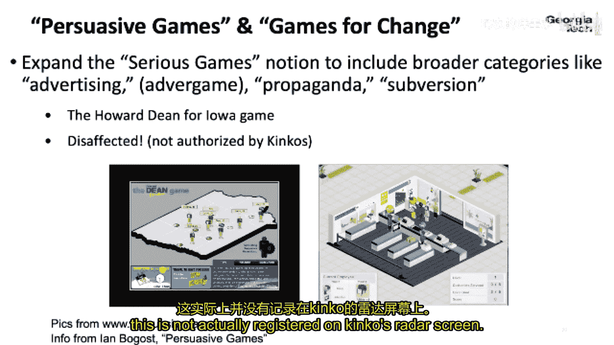

Ian also wrote about the Game America's Army， which was funded by the US government。

 the first version of it shown here was with the at the Time state of the art original Unre tournament engine there's two teams there's the US Army and then there's the bad guys and I believe the Army didn't want people actually playing as the bad guys so when you would go into play if I understand from Ian's book persuasive games correctly everybody sees themselves as the good guys and then they see the other team that's not them as the bad guys I will leave it to you to make your own judgment on these matters There's a lot of applications for realtime graphics besides games either fun or serious For instance。

 surgeons might benefit from real-time graphics in the operating room to be able to take data collected by various devices and actually get a better look at the person that they're operating on Toshiba used the cell processor back when that was an exciting thing to do motion tracking Toshiba also put。

sell processors in some of their televisions and what I found particularly interesting was that the cell processors in the PlayStation3 are actually sort of slightly broken versions of the cell basically they would manufacture a bunch of cells and if all eight of the synergistic processing elements worked they were sold at a markup as scientific supercomputing devices to companies like Mercury computing and the ones where one of the Ss failed that failed S would be masked out and then if you're writing for the PlayStation 3 you actually only get access to seven of the Ss。

 although I think one of them has actually taken up by the main operating systems you actually program6 or something like that realtime graphics have also been used in preproduction in making Hollywood movies so your final CGI is usually done with a giant pile of computers either in racks or sitting on desk that formed the quote unquoterender farms。

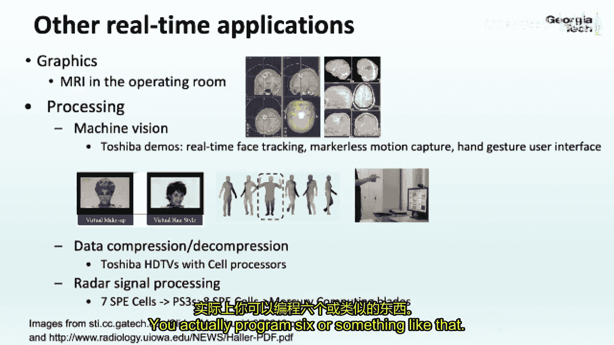

And the graphics there are rendered offline using more sophisticated techniques than you can use in real time nowadays。

 But the ability to do realtime graphics lets moviemakerrs experiment and block out scenes in different ways。

 essentially becoming a 3D moving storyboard。 I'll put some examples of this in the links below。

 there's also folks out there making fun movies using game engine。

 such as red versus blue using the Halo engine。 My colleague Michael Ntzsche and literature。

 media and communications has written about Mahanimma。

 if you want to learn more about it from an academic standpoint。 Now。

 if we look back over the past 40 years。 we see that in the early days。

 there are substantial differences between different computers and different game consoles。

 And Atari 2600 and in television each had distinct look。 But as the years keep cranking along。

 the differences between the consoles became less and less。 And nowadays。

 a Playtation 4 and an Xbox1 are both basically standard PC hardware with standard PC chipets。

Just as the internals of a MacBook aren't very much different than say a Dell Windows laptop So this is mostly a good thing。

 but I think something fun has kind of been lost here in that back in the day something like an Apple2 game would have a very different look than an Atari 800 game and an interesting part of game design back then it was how different developers dealt with the creative constraints provided by different platforms nowadays the hardware is just not that interesting and that's a recent trend if you look at the PlayStation 4 and the Xbox1 again they're basically the same whereas even just one generation ago you had the triple power PC and the Xbox 360 you had the weird sell processor in the PlayStation 3 but nowadays it's just not worth making this big fancy custom development effort it's just easier to use offthes shelf parts or at least offthe shelf quote unote IP cores from companies such as arm。

The good thing about this is that say moving to the next generation Xbox or moving from the PlayStation4 to5 is it going to be terribly difficult It's not like back in the 80s when people were programming games and assembly language and moving something like the 6502 or the Z80 to something like the 68000 was a big deal Another positive aspect about this is that the hardwares basically asympted it's not that computers aren't getting faster but the way you as the program interface with the hardware has indeed stabilized on the desktop you've got Windows。

 Mac and Linux and it's fairly easy to port software between them on your mobile platforms you have i and Android。

 even the way you interface with a GPU Vulcan， which is sort of the descendant of OpenGL and on the Microsoft side you have direct X but developers aren't in the situation they were in something like the early 1980s where you might wind up porting a popular game to a dozen different platforms and even ones that shared a similar CPU like the 6502 or the Z80 would。

Often have very different supporting sound hardware， graphics hardware， storage mechanisms， etc。

 Another positive recent development is the rise of off the shelflf affordable game engines Unity largely took over the market for a while by pricing itself reasonably to anydie developers I think Epicgas probably took too long to respond to unity。

 but when they did they did so fairly aggressively when they first launched Unreal 4 you could get the full source code for just $20 and remember a source code license for something like Unreal 3 just say a 12 years ago。

 that was a  six figure license。 We're talking 100000 or more。

 and that's even if you could get Epicgas to return your call Similarlyly the cry engine at one point was fairly expensive。

 Amazon eventually came along and bought it。 and now the entire source code is available and it's basically a way for Amazon to sell Amazon web services。

Another new player on the scene is the Goddo engine while source code is available for Unreal and lumberyard。

 it's not available for unity unless you pay them a lot of extra money and the way unity's model works is you really don't want to be having to mess with Unity's underlying source code anyway whereasas with Un there's places where you kind of have to mess with the underlying source code。

 Unal and lumberyard may be quotequote open source in that you have access to the source code。

 but they're not free， there's various license issues in how you use them。

 I think Un charges a certain percentage beyond a certain amount of revenue Gado on the other hand is a fully free and open source engine。

 it's probably closest to unity in terms of what it's like to others on this list。

 but that's not being fair to either unity or Goddo Goddo really is doing its own thing。

As I mentioned earlier， this course is mostly going to be using unity。

 but you shouldn't think about it as a unity course。 In fact。

 some of the things I will ask you to do would run against best practices in using unity if you're developing a standard game in a standard game development context。

 I'll be using unity as a way to get shader code running。

 but I want to teach generic GPU programming principles。

 that would also apply to Un or geto or some sort of proprietary inhouse engine like the frosttpite engine that some groups with an electronic arts use Similarlyly。

 when I taught the earlier version of the course using X and A。

 students would occasionally refer to it as the X and A course， but again。

 we were using X and A as a tool and trying to teach some more general principles。

 the main API language for unity as C sharpp。 I will not assume that you have any C sharpp experience and generally I'll be giving you templates to fill things in on Basically any sort of experience with Java or C plus plus or C or D or anything else。

That compiles and its curly braces and it will be fine。

 The shader language we're actually using talk to the GPU will be Hlsl highlevel shading language。

 That's at least what Microsoft called it。 It's essentially equivalent to what NviDdia used to call Cg。

 I will not assume that you have any knowledge of this。

 the syntax looks like C but the underlying semantics are different because GPU cores are inherently just much simpler than a standard CPU。

 I should also mention that this is a class on programming and will use entirely can available textures and 3D assets。

 Now if you do want to develop some of your own 3D art skill。

 Bnder has improved a lot in the last few years， something that Egas has done with that giant flow of money they're getting from Fortnite is to contribute to some open source projects。

 including Bnder and interestingly Godt another game engine。

 Also if you're a student at Georgia Tech。 and I think a student in college in general。

 Autodesk has a really nice educational license systems so you can。

Get educational licenses free for Maya， 3D studio Max and other cool stuff to play around with You should go ahead and take advantage of that and learn some things while you're a student So as of the time on May 8th when I'm making this video the current version of unity is 2019。

3 I was hoping 2020。1 would be out by now， unless it's not and I can't really complain at unity because like most other places they're running shorthanded probably because of the coronavirus。

I'm going to start developing this year's material using 2019。

3 and we'll probably stick with that through the rest of the course if 2020。

1 comes out of beta and has some really cool stuff I want to use we may switch to 2020。

1 hopefully that upgrading will be fairly painless I should mention that whenever you're looking at this especially if it's in the future some of the themes I'm going to show you are going to be out of date there will be some screenshots and demos that I show you may not look exactly like your version of unity either because by the time you're looking at this unity is change some things or there may be some cases where I cheat a little bit and use a screenshot that I might have captured a year or two ago Unity is not shy about making breaking changes so any code that I show you may require some updating to work in whatever version of unity you're using and again we may be lazy in a few places and use old code here and there that might need some things fixed because unity changes things so drastically。

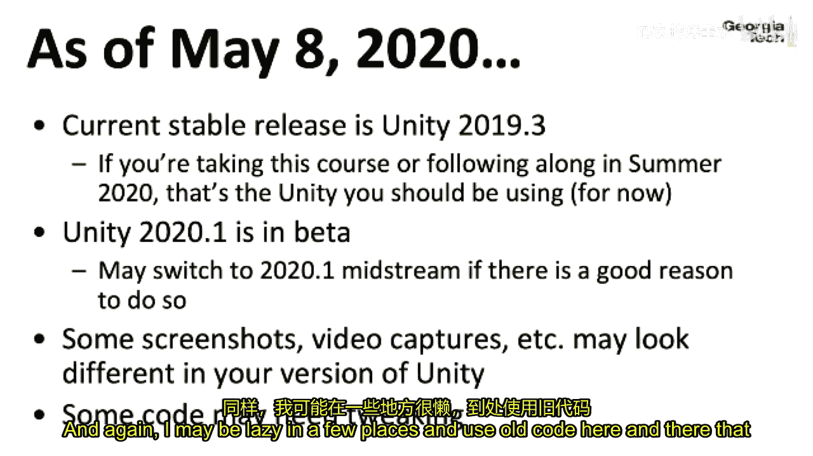

Often if you go to your Google or your duck go or your Bing。

 a good portion of what you'll find will be out of date that can even include unity's own documentation the following two statements are true Unity's documentation is pretty terrible Unity is also by far the best documented game engine out there。

You can do the math on that one。Anyway， if you find a search result from 2013。

 it's very likely to be wrong， some of the underlying ideas may still apply。

 but sometimes unity may have just changed how they're thinking drastically and trying to take some information from an old blog post or forum post from 2013 and try to apply it to current unity will often lead to frustration so when I'm searching for info I'll type what I'm looking for I'll type unity。

 type what I'm looking for more information on and then I'll put 2020 in the search field and then I'll try again with 2019 and then I'll try again with 2018 and see what else pops up and I'll just realize that as I'm going backward I may be more likely to find information that's not applicable to the current version of Unity。

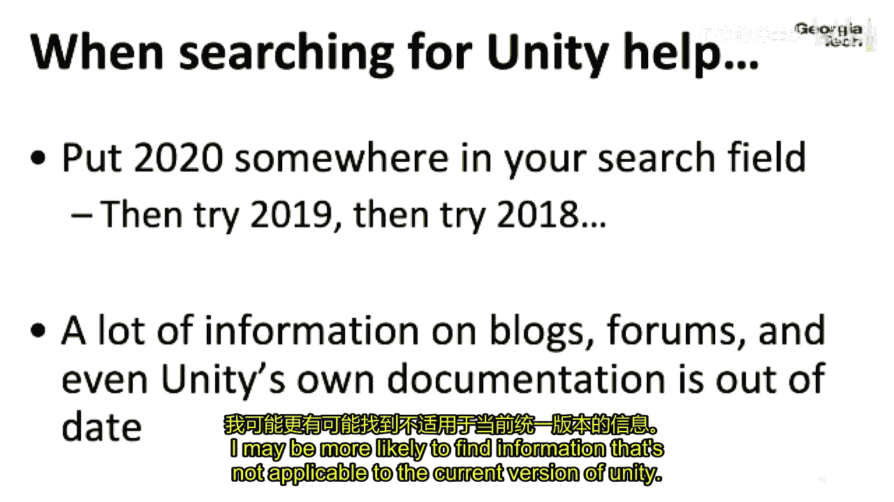