# 【全集】佐治亚理工学院-GPU编程：视频与游戏-中英字幕-p02-Lecture-2---3D坐标系--BV1GZfyBbEQn_p2-

Hi there。 My name is Er Lanchman， I'm a professor of electricallect and computer engineering at Georgia Tech。

 and this is my quarantine hair， and I would like to welcome you to the second lecture in the summer 2020 offering of GPU programming for video games。

So the model for creating computer graphics we're going to be looking at this class is generally called the rasterization model。

 This is in contrast to something like ray tracing。

 So life for objects begins by a pile of triangles defined probably by some 3D artist using a piece of software such as 3D studio max Mayo or blender and for every frame。

 these triangles are subject to various three dimensionmenal transformations to place them wherever they need to be in space and to be projected onto the twodimensional surface of the screen。

 These triangles are then converted into a series of pixels in the rasterization process。

 and this is the stage where the final color of the various pixels is computed。

 we'll be writing two kinds of shader code in this class。

 namely vertex shaders that process these threedimensional vertices and pixel shaders。

 aka fragment shaders that decide on the final color of the pixels。

So something about the vertex shaders is that they process each vertex individually and they don't create new vertices。

 there are other kinds of shaders called geometry shaders that can create new vertices。

 and there's also compute shaders that are much more general kinds of things that might be thought of as more general purpose GPU programming。

 but we won't be looking at those in this class we'll be focusing on vertex shaders and pixel shaders。

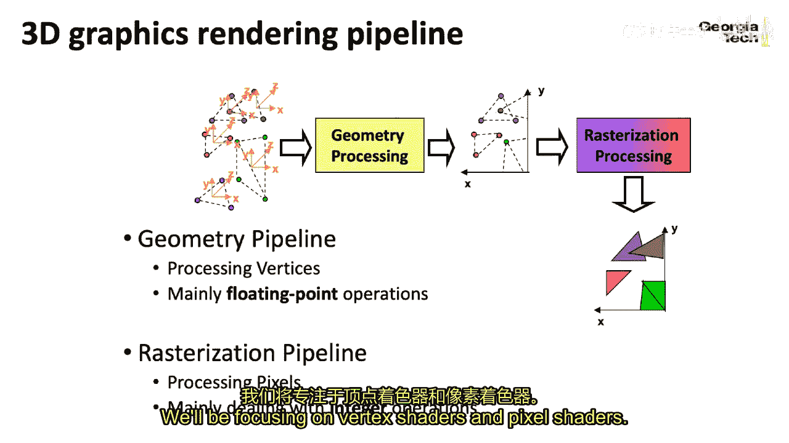

If there's twodial coordinates， this tends not to be highly controversial。

 Usually you have X going left and right， and you have y going up and down。 However。

 when you're entering the realm of threedial graphics。

 things start to get very confusing because nobody settled on a set of consistent notations。

 So most mathematics textbooks will take the X and Y plane and put that on the table and then use Z to go up and down and they'll use a righthanded coordinateant system。

 meaning that if you raise your right hand and you put out your thumb that goes along the X axis。

 put out your index finger that goes along the y axis and your driving on highway 400 in Atlanta finger goes up the Z axis。

 Now， if we enter the realm of computer graphics quite often。

 people might still use a right handeded system， but they use y going up。

 So here our thumb is going to the right， the index finger is going upward and are driving on highway 85 in Atlanta finger is going towards you。

The Open GL API uses this as well as the X&A framework developed by Microsoft to allow people to program on the Xbox 360。

 There are also tools that use a lefthand coordinate system such as Microsoft's direct 3D as well as the unity software that will be using in this class and here if you pull up your left hand。

 your thumb points along the X axis。 your index finger points along the Y axis and you're driving on highwayway 75 in Atlanta finger goes along the Z axis。

 but in this case it goes away from you。 I always thought this was a very odd set of decisions because Microsoft created direct 3D that is fundamentally lefthanded and then they created X&A that's built on top of it。

 but then they switch to a righthanded system， which always seems strange to me。

AndUnity was originally a Mac only product and so that certainly wasn't using Dr 3D and so that must have been using OpenGL Now internally unity 3D will use Dr 3D or OpenGL or Vulcan or whatever's round and it will make various transformations to make it look consistent from the point of view of the user。

 so the main distinction here is rather positive Z values go towards the viewer and negative Zvalue goes away rather positive Z values go away from the viewer and negative Z values go towards the viewer。

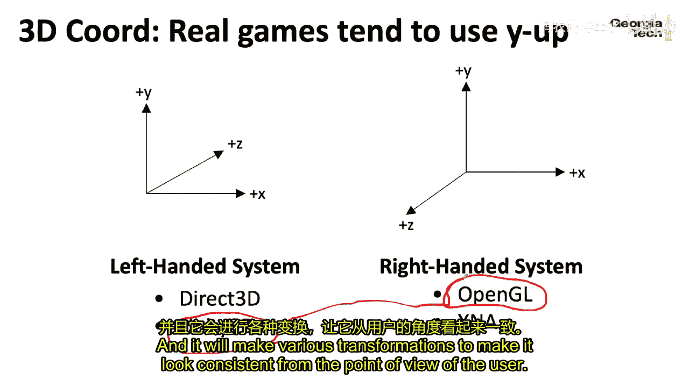

It's not a completely out of the blue that decision to use Y going up instead of Z going up as the most most mathematics books。

 because this matches the way screen coordinates are usually defined， although I should note that。

In these kinds of systems， positive going Y goes up， but in traditional 2D game programming。

 Y values go downward。

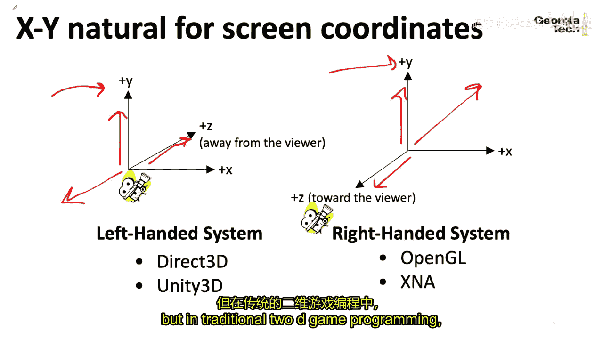

There are some tools out there that use a Z going up approach。

 which is closer to your typical mathematics books。 The Un engine。

 at least the last time I looked at it， used a Z up approach with a left handeded coordinate system。

 whereas the Ite engine quake used a right-handed Z up system。 I mention radiant here。

 This is the editor that is used with the quake engine。

 The source engine uses the same kind of coordinate system。

 which makes sense because it originally had a quakebase。 And the editor for that。

 which my son has used a lot to create various mods is known as hammer。

 This kind of system is also used by the C4 engine， which was developed by Eric Lingle。

 Eric wrote an excellent book called mathematics of 3D computer graphics。

 the latest version of the C4 engine is actually known as the tombstone engine。

 It's a lesser known engine， but it has an interesting clean architecture that I would recommend checking out。

 But one thing to keep in mind is even though these kinds of tools typically used。

Z for a vertical axis when it concerns 3D coordinates when they do that final projection onto the 2D screen。

 they go ahead and use Y for the vertical coordinates So if you take the left-handed system here and rotate it 90 degrees you could redraw it like thus and this is probably what you would see when you pull up the Un editor So in this case we're now thinking about y is going right instead of X in the other way that we've typically written things and now this X is going away from you the underlying 3D art in games is usually made in some sort of modeling software and just as in the case of game engines。

 there's no consistency here either。

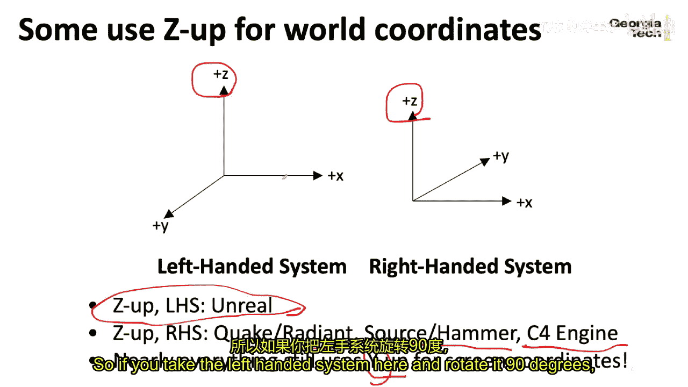

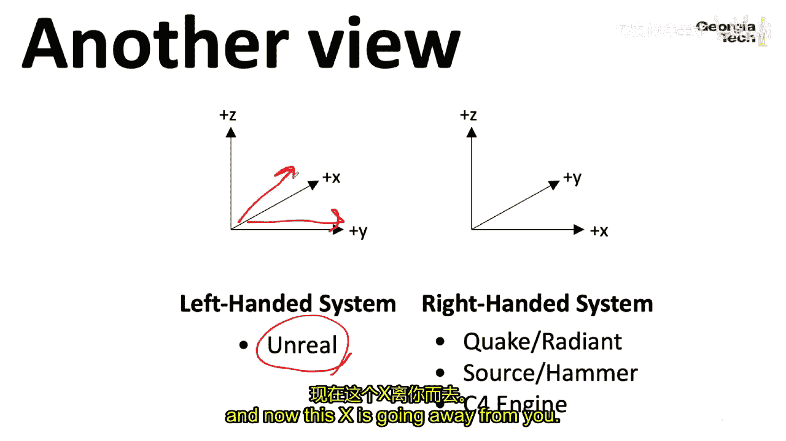

What's interesting is Maya and 3D Studio Max are both Autodesk products。

 One of them uses a Yup system the other uses a Zp system， Both are still right handeded。

 Blender is an open source product that's improved dramatically since I first ran this class in 2007。

 It uses a right handeded system Moshape was a relatively inexpensive 3D modeling software solution that was fairly popular among people doing things like making mods for halflife。

 at least at present， the models used in 3D games are formed from triangles。

 and each of the points on those triangles as annyC coordinate defining those 3D vertices。

 typicallyy each of those vertices also has an associated unit normal and this arises from the export process that your 3D artist will make from their 3D modeling software。

 So typically the artist will create some sort of high resolution。

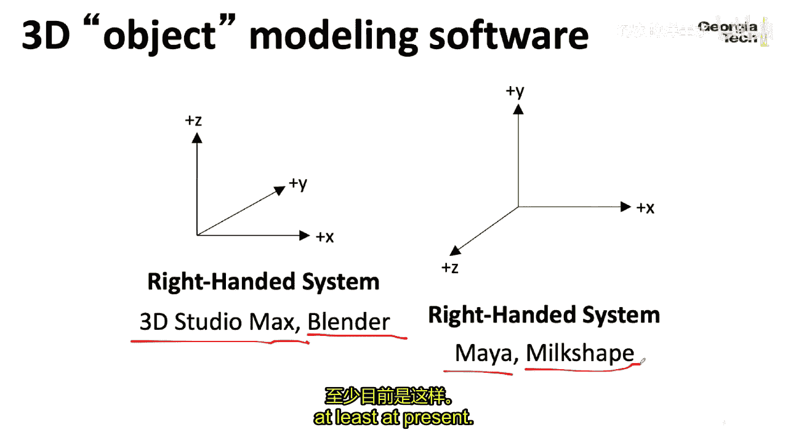

Smth parameterization of a surface and they will run an export procedure that splits this into different facets of varying degrees of resolution。

 and you might have these for different purposes， so you might have a very high resolution model with a lot of vertices that might be used to generate preentter cut scenes and then you have a lower resolution model that's used for agile gameplay。

And when this is split into different triangles with different vertices。

 some normal vector information will be computed that tries to get a sense of what the underlying curvature of the surface represented by these various triangle is this is extremely important in computing realistic looking lighting without this information you can get this quote unquote  flat shaded look where you can readily see the polygons making up the object。

 but if you use this normal information when doing lighting calculations。

 the result looks much smoother。Some 3D models may also have color information associated with the different vertices and you can interpolate between these colors when rendering the object。

 but nowadays vertex colors are not actually used very much because usually that color information as we'll see later is embedded in some sort of  twodial texture that provide a lookup into that 2D texture。

 Sometimes you will see this color slot being used。

 but it may be used for some other kind of information used in the rendering process and not typical color information。

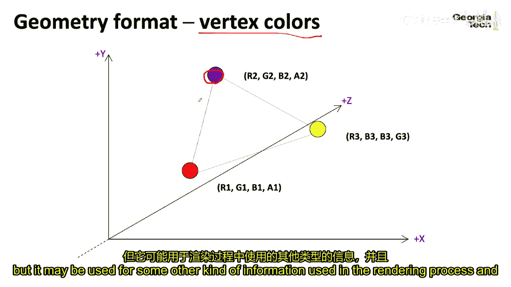

So typically what you'll have is a list of vertices， so you'll have the x Yz 4，1，2，3，4，5，6，7。

 and then you'll have a list of triangles that are indices into that list of vertices So this saves you a lot on memory usage Now the order that you list these then can be important a common technique to try to avoid doing unnecessary computations is an idea called calling where we essentially only want to render the triangles that are faced towards the viewer and not bother to render the triangles that are facing away from the viewer When approach to this is to use the normal for the facet。

 Now these normals that we're using for calling， these are different than the vertex normals that I talked about earlier that were used for lighting for those the different vertices will have different normals in the case of a particular triangle。

just one normal for that triangle and the way we embed that kind of information is by choosing some sort of order to list the vertices in either a lefthanded system。

 which in this case we would go from V1， V3 to V2 and what we're doing is we're imagining that the normal is your thumb and then your fingers are curling around the vertex order。

 so we have V1， V3， V2。Let's check V1 V5 V3， so we've got V1 V5 V3。

 oh I need to make those errors appear again， so for this one if we point our thumb upward with our left hand our fingers will curl V1 V6。

 V5， so that's down here。For a appear， okay， if we point our fingers up again。

 we've got V7 V6 V1 down here， it's listed as V1 V7 V6 in that order。 Let's see what else do we have。

 Okay， now take your left hand。 point your thumb to the right and we've got V5 V6 V3， That's here。

 and last but not least， we've got V4 V3， V6 curling our fingers around again with the thumb of the left hand pointing to the right。

 That's V4 V3 V6。You could also have a right handeded system for this now the question of are you using a left handed or right handed curling convention for these neural vectors that could be completely independent about rather your actual 3D coordinate system in your engine is left handeded or right handed so using the system。

 let's take a look at the triangles that we would draw the triangles facing away from us。

So in this particular case， we have V1， V2 v7。Curing with our thumb pointing to the left we'll have a V2 V8 V7 again。

 curling our fingers with our thumb pointing to the left， let's see so we had this one。

 V2 V8 v7 in that order。If we're pointing our thumb backwards， we'll have V7， V8。

 V4 here it written has V4， V7， V8。This one here， again。

 with our thumb pointing backwards cooling around， we have V4， V6， V7。

And for the other two we need to point our thumb downwards， so pointing our thumb downwards。

 we have V2， V4， V8， the order our fingers are curling， V3 going down here， we have V2， V3， V4。

 so we've got those covered。

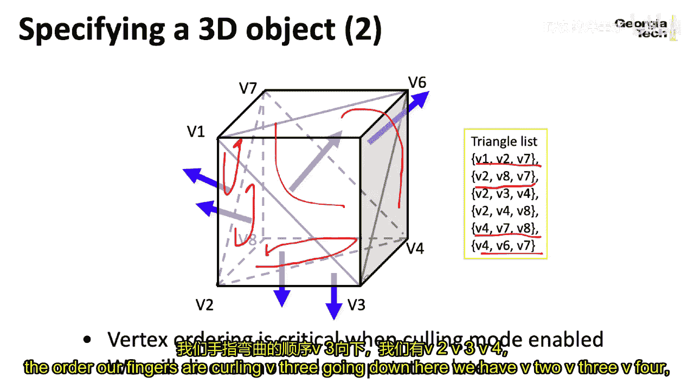

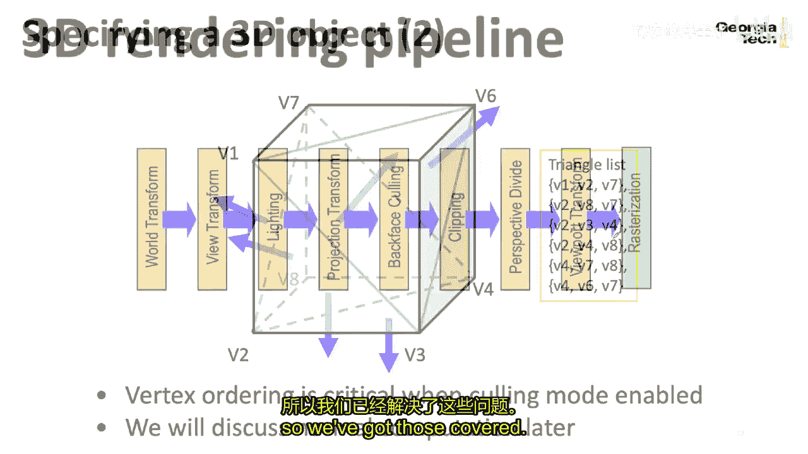

There are a lot of calculations that are done in computer graphics that can be done in different orders now the exact computations you do at each stage of the graphics pipeline might be different depending on how you choose to order this and particularly where we for instance decide to do lighting。

 but there are a lot of cases where you can rearrange these in different ways。

 how you want to rearrange these will often depend on the particular hardware you are computing it on back in the day when GPUs didn't do very much and you had to do most of your calculations on the CPUU。

 the ways you would want to arrange this computation were very different they had a modern situation where you wind up sending a lot of raw stuff to the GPU and expecting the car to sorted out later。

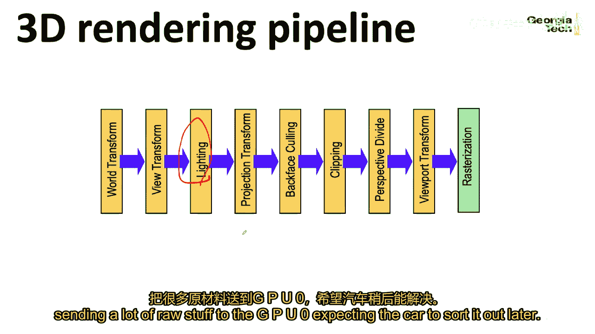

So here we've talked about just general representation of 3D objects using different 3D coordinate systems。

 there are actually several coordinate systems that are used in doing 3D graphics the model coordinate system is what your artist works with。

 that's the coordinate system they're working with in Ber or Maya or some other piece of 3D modeling software。

We need to transform those coordinates into the world coordinate space and that's basically the view space of the level editor that's what you're looking at when you're placing。

 say the same object say the same tank model for enemy tanks or something at different places in the level that you're making the world transformations jobs take you from that artist space to the level designer space the view transformation takes us from that world coordinate space that the level designer is working with to the actual space used by the camera so this will be from the viewpoint of the player in something like a first personson game or it might be pulled back a bit for a third person action game or pull back even more for something like an old school RPG or some sort of realtime strategy game the projection transformation is part of the final procedure of going from the view of the camera to actually taking things and projecting them。

Onto the twodisional surface of the screen we're going to use the language of a matrix algebra to describe these because it's a convenient way to combine various transformations。

 but you do not need to have had a full class on linear algebra or remember much of linear algebra at all to do well at this class as we'll be using a fairly small subset of linear algebra and this class isn't really focused on the theory aspects of 3D graphics。

 it will be more focused on the practical implementation issues。So if you haven't had linear algebra。

 you'll still more or less be okay， and these transformations are going to form the basis of the next couple of lectures。

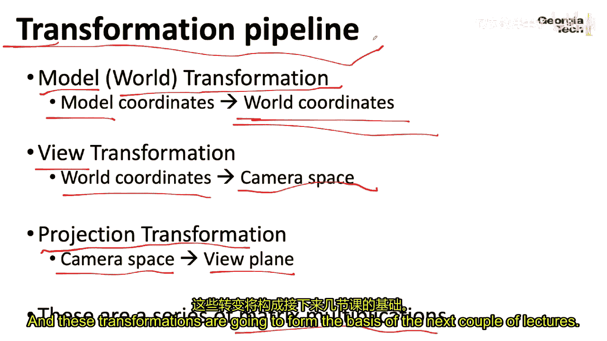