# 【全集】佐治亚理工学院-GPU编程：视频与游戏-中英字幕-p03-Lecture-3---3D顶点变换--BV1GZfyBbEQn_p3-

Hi there。 My name is Er Lanchman。 I'm a professor of electrical and computer engineering at Georgia Tech。

 and I would like to welcome you to the summer 2020 offering of GP programming for video games。

 Today we'll be looking at 3diional vertex transformations。

 This is the first step in bringing the pile of triangles created by your artist to the player。

 Today we'll be looking at the process of turning these 3D coordinates into other 3D coordinates。

 and in the next lecture， we'll look at taking these three coordinates and projecting them onto the 2D space of the screen。

 Further lectures we'll look at the computations， for instance。

 lighting computations needed to actually decide on the color values of the pixels in the resulting triangles depending on what era you're writing your game in different computations in the 3D graphics pipeline may be more or less efficient to do at different stages。

 Today we' be primarily looking at the world and view transformations and will save the projection transformation for next lecture。

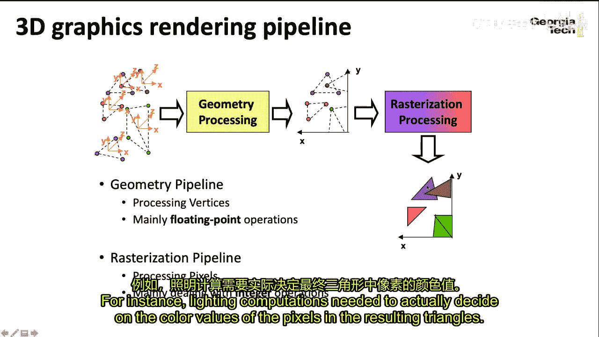

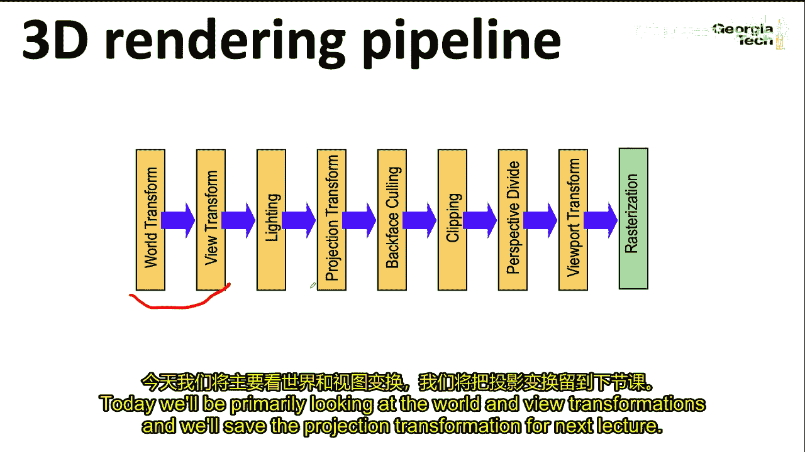

So the transformation starts with taking the coordinate system used by your 3D artist in a program like Maya or Ber and converting those into the world coordinate system by taking those objects and placing them where they need to go this world transformation puts it into the world coordinate system which is where your gameplay lives。

 this is probably where your physics computations are done where your artificial intelligence routines are executed and this is the coordinate system used by your level designers。

During gameplay， the camera may shift around。 so the job of the view transformation is to convert these world coordinate spaces。

 sort of the realm of gameplay the level designer into a conceptual space used by your camera。

 The camera may be coincident with the player in a firstperson shooter or it may be pulled back a little bit in a thirdperson game like resident evilvil for or it may be pulled back even further in a game like starcraft or civilization。

 The projection transformation as part of the final process of taking those3dimenal coordinates and putting them on the computer screen。

 but we'll save that for next lecture。 We're going to try to represent these processes as matrix multiplications。

 and the reason we want to use this matrix algebra approach is that we can premply some matrices and save some computation time So your artist was working with something like 3D studio max。

 and they were probably letting their000 be the center of an object they're creating。

 such as a cube or the Tpot or。

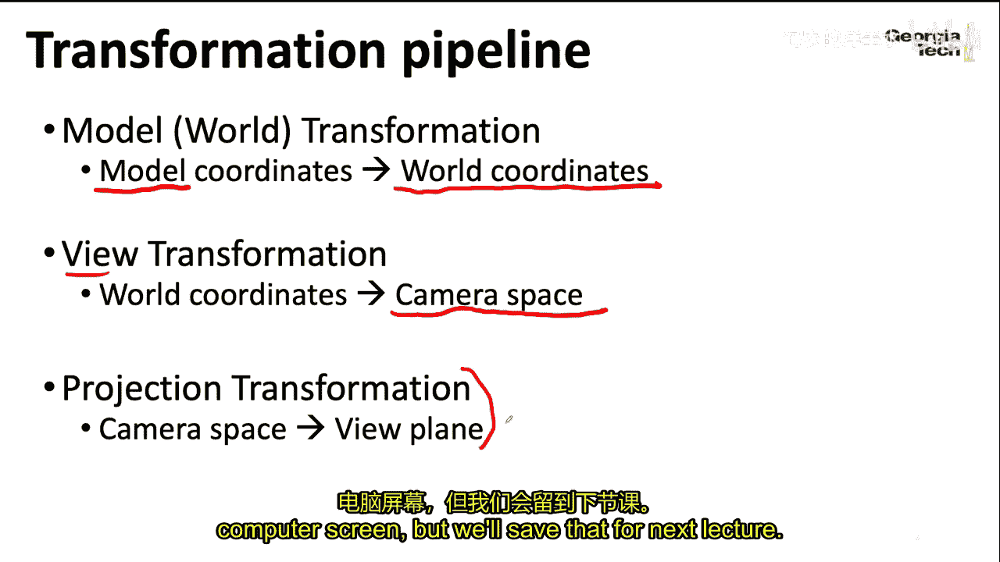

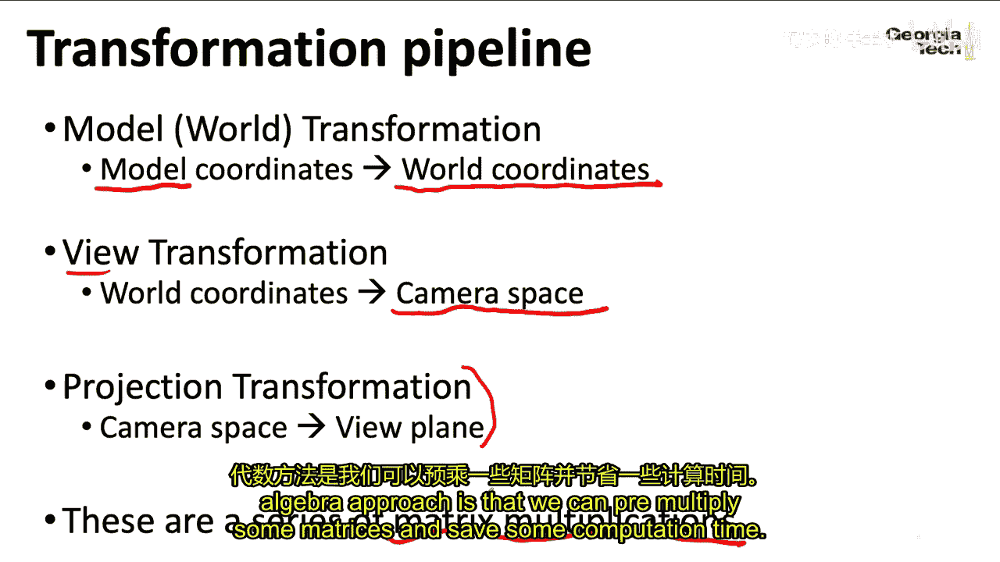

If it's the case that you have some sort of say humanoid figure。

 usually the000 will be down at the feet of the characterature。

You first want to rotate the object to the correct orientation and then translate it to where it needs to be in the world space。

 and as we'll see later， you want to do it in that order。

 you may also want to facilitate a scaling operation as your level designers will often take an object。

 scale it in strange ways， put a different texture on it and repurpose a particular object as something else in the scene。

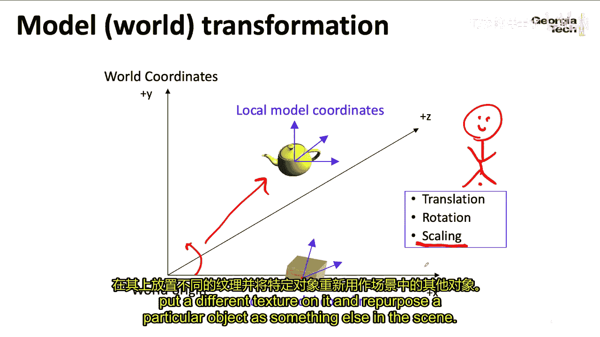

The job of the view transformation is to take into account the effect of the camera。

 so the camera is at a particular point in space and looking down a particular point in space and also has a particular orientation。

 you can think of it as the roll angle of an airplane there's various ways to define a view transformation but a nice conceptual way is to just imagine that the camera itself is another object in the scene like the boxes in the teapots。

 and if you create the equivalent world transformation matrix that would take a camera place it at the correct orientation at a certain point in the scene。

 you can then imagine making the view matrix， the inverse of that transformation。

 the inverse of that matrix， and then if you apply that to all the objects in the scene。

 it will orbit them around and rearrange them so it's like your camera is then looking down the Z axis with an up vector pointed in the direction of a new y axis。

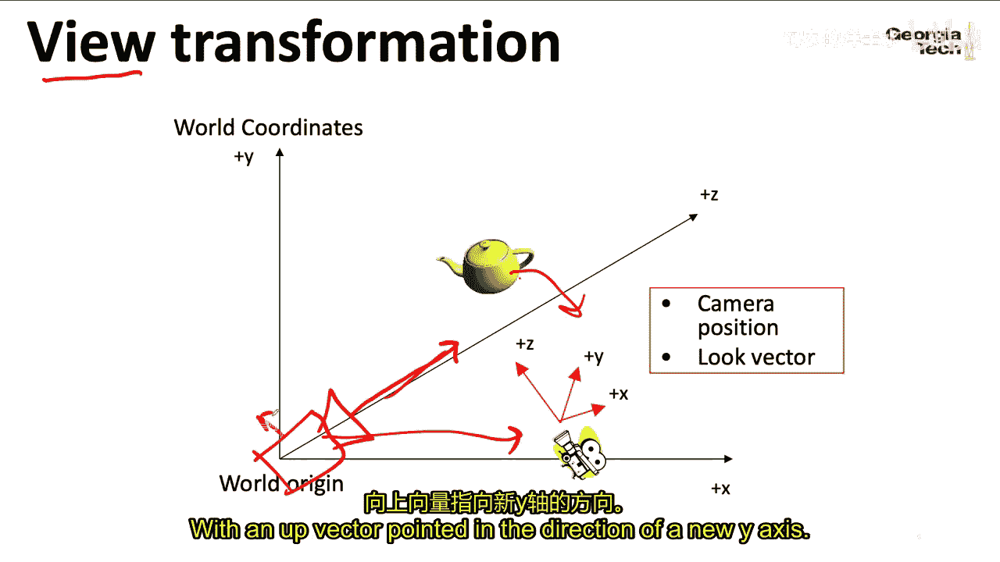

The projection transformation is something we're going to say for next lecture。

 and this is the final step before we take our three dimensional coordinates and turn them into two dimensional coordinates on the screen。

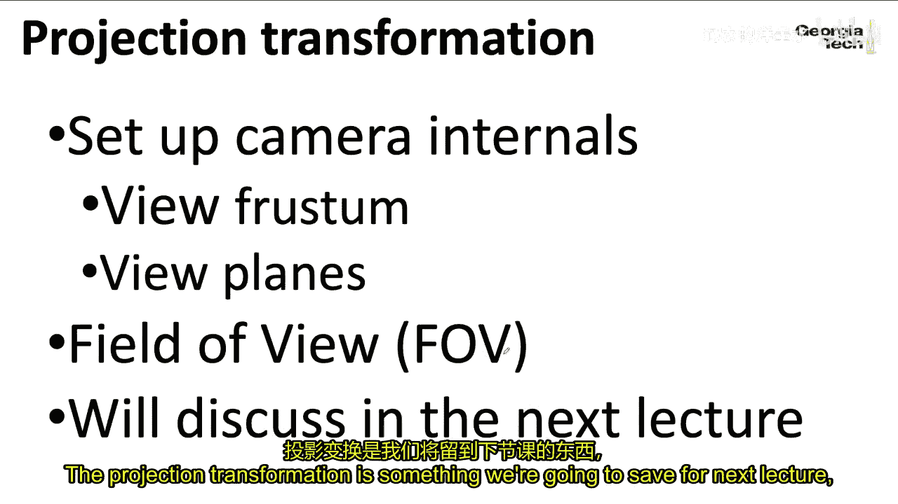

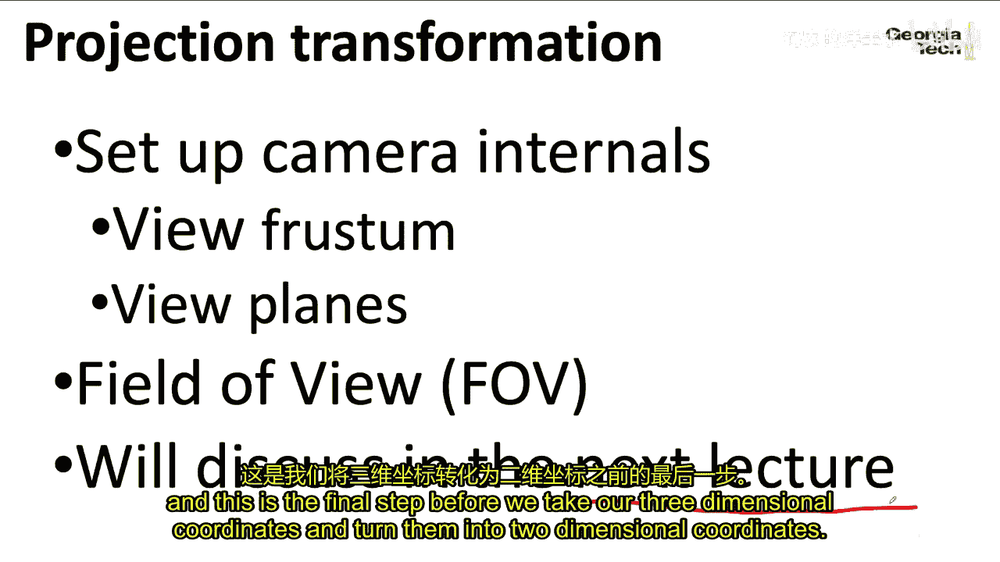

Theres a rich set of mathematical techniques concerning a concept called homogeneous coordinates。

 We're not going to use a lot of fancy mathematical structure here here we're pretty much going to use them as a convenience we will like to represent all of our operations on these 3D vertices。

 particularly translation as matrix multiply so we can deal with a series of transformations by pre multiplying those matrices together before applying them to 10000 vertices Translation itself can't be accommodated by just say taking a 3D vector and multiplying it by a 3 by 3 matrix。

 although rotation can be readily handled in such a fashion Our trick of using homogeneous coordinates will be to add a fourth coordinate。

 so now all of our coordinates are four dimensionmenional instead of 3 dimensionional this will play a role in future lectures in dealing with perspective projection where we need to divide by distance and there's a convention for handling that by sticking the distance into the W。

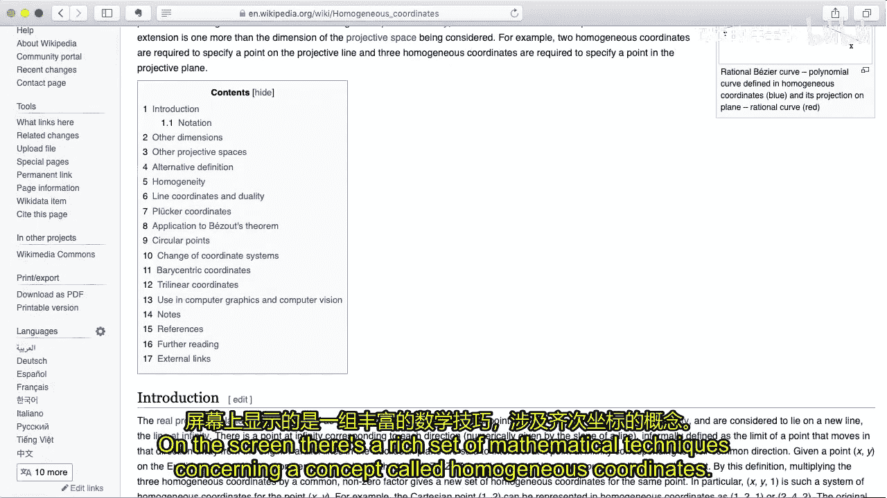

But for now， we'll essentially just take the number one and plug it into W。

 and that will be sufficient to represent the translations that we need。

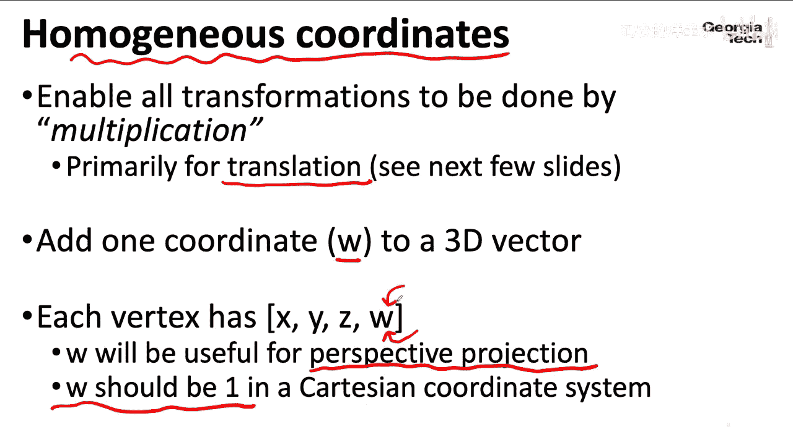

So looking at a specific translation， let's consider this rectangular box that we need to translate in space and let's track the lifespan of this particular coordinate in the lower left hand corner here。

What we want to be able to do is translate these things from XYz to the new spot。

 so the translated new spot is X T Y TzT， and here you can see this red spot here has been moved The question is how we can represent that as a matrix it becomes possible with this one stuck here for the homogeneous coordinates noticeice that we're using a row coordinate convention here so we have a horizontal row that is being post multiplied by this 4x4 transformation matrix resulting in a new row vector。

This kind of system is used by Direct 3D and X&A on the Microsoft side。

 also most of the documentation for HLSL or equivalently CG uses this row vector convention as we see later the shader code we write in HLSL we'll be able to take advantage of the fact that the various functions built into HLSL just do computations on data in various ways and depending on how we set inputs to our functions。

 we can imagine that our vectors are either in row notation or column notation because HLSL itself doesn't really know what convention you're using it just has these four dimensionmenional vectors we'll look at that later Now OpenGL Unity most of the rest of the universe uses a column coordinate convention here。

If you wanted to get a column from another column after going through those transformations。

 you would place your four vector here and the4 by4 matrix you would put here will be the transpose of the matrix that I'm showing here。

 so just keep that in mind here using this row vector convention。

 we can figure out what x of t is so if remember the rules for multiplying matrices as I run along the columns here。

 I'm going to run along the rows here， so I'll have x times 1 which gives me an x00 plus。TX times1。

So I have1 times tx， similarly for the y coordinate and similarly for the z coordinate。

 and for the final coordinate， you'll just have all of these things times 0， x， Y and z times0。

 add to it one times 1， which conveniently sticks a1 back in that spot for us。

 so we can indicate translation by this matrix operation。

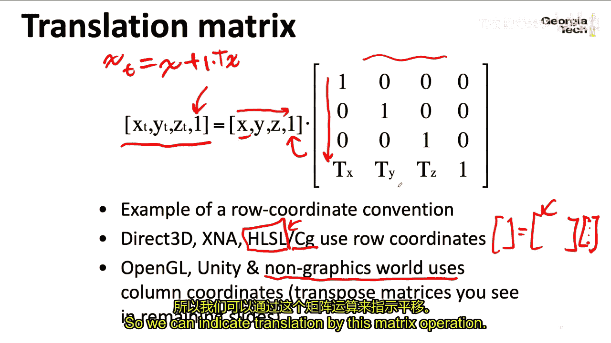

Scallling is an operation that's easily represented by matrix transformations and in fact you could do this with a 3 by3 matrix on 3D vectors。

 you don't need this x or W coordinate as we did with translation supposeupp we want to scale this matrix by quadrupling it in size we can readily represent this by taking the x and yz coordinates and just multiply each of them by a scalar。

 so here we have a diagonal transformation matrix which means that for instance x of s is just going to be x times sx and the rest of the elements here get zeroed out。

 so we'll multiply y by capitals y is z by capital z and again。

 the final thing we do here is just take1 multiply it by a1 to stick a1 back in that spot potentially as needed for future computations。

Rotation is a lot trickier here we have to think about how we're going to rotate things and there's lots of different ways to represent rotations Some game engines like unity actually use a fairly sophisticated mathematical structure called quaernions which are a fourdimenal extension of the complex numbers to represent rotations dealing with quatians gives a natural way of interpolating camera angles and also dealing with an issue called gimbal lock that we may or may not look at later people design control systems for aircraft will talk about pitchol yaw Unity and many other game engines think about a rotation around an x axis and then rotation around a y axis and then a rotation around a Z axis the order you do these in is important so here we're thinking about rotating around an x axis we have a lefthand and coordinate system here so take your left hand point your thumb along X and then curl your fingers to indicate the direction of the rotation Similarlyly we can do this。

The Y axis， point your thumb upward， curl your fingers and then take your thumb and point it towards the screen once again。

 curl your fingers and you can see how the object has rotated in each of these cases basically counterclockwise if you're thinking about looking down a particular axis you could also have a right-handed rotation system where the rotation will be clockwise looking around in axis so you may have to check to see what conventions your game engine is using or you do what most people do。

 which is just you put in a number and if it's going the wrong direction you put a minus sign in Now the order you do these in in three dimension is important Fortunatelyly in two dimensions if you're just doing a 2D game。

 there's less controversy there once again let's track the lifespan of a particular point。

Remember last time I went through all of these different variations of 3D coordinate systems that people use because it's very confusing to deal with in two dimensions it tends to be less controversial。

 we'll have XB horizontal y be vertical， the only thing that's a little different from your usual math notation to the way 3D games are traditionally programmed is that traditional 2D games started with y as a low number and as you increase the numbers that goes downward。

 but in traditional mathematics and for that matter most of the math we're doing here up until a certain point usually we'll think about positive y is going up and that's fine。

So if we start with our point here， we want to rotate it， say by an angle theta。

 and the tradition is for positive theta here to indicate a counterclockwise rotation。

To facilitate this， we can essentially just take these two dimensional coordinates and multiply them by this two dimensional matrix to sort of keep the tradition of having this weird extra W coordinate here we'll go ahead and write that in。

 but essentially you have a matrix that has signs and cosines associated with this rotation angle。

The one thing you have to be careful about is where does the minus sign go and as we'll see later this can actually be a little bit tricky so for this traditional math notation we've got the minus down here and we have a plus up here and applying this matrix to our coordinates gives us the rotation that we want now when we apply this to three dimensions we have to think about what axis we're rotating around now you can do a lot of geometry and triometry to be able to rotate around an arbitrary axis but here let's represent rotations as rotating around z and then around the y axis then around the x axis and if we do things in a consistent order we'll have a consistent notation and this is rich enough to give us any orientation of the object that we need。

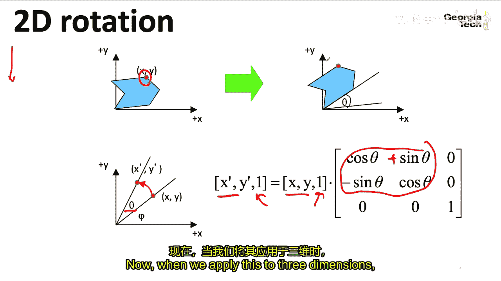

So the overall structure is very similar rotating around Z。

 we're going to keep Z fixed and we're going to rotate an x and y rotating around Y。

 we're going to keep the second coordinateant fixed， which is why you see a one here。

And then we'll take that original rotation matrix you saw and we'll apply them now in X and Z。

 one thing to keep in mind is notice the sign has now switched places and by sign I mean SigGN not SIN。

When we go to the X axis， we are now holding x constant and we're doing this two by two rotation matrix in Y and Z。

 but now the sign has switched back， presumably if we were living in a4 or 5D dimensional universe or if there are creatures in such a universe and they made video games。

 the sign flipping back and forth is something that would keep going。

Many moons ago I looked up the reasons for why the sign flip is in there。

 but I forgot it since then and it's okay to take it on faith you sort of need this in order to make that handedness convention consistent across the different rotations and as I've mentioned before and as I will keep emphasizing the order matters。

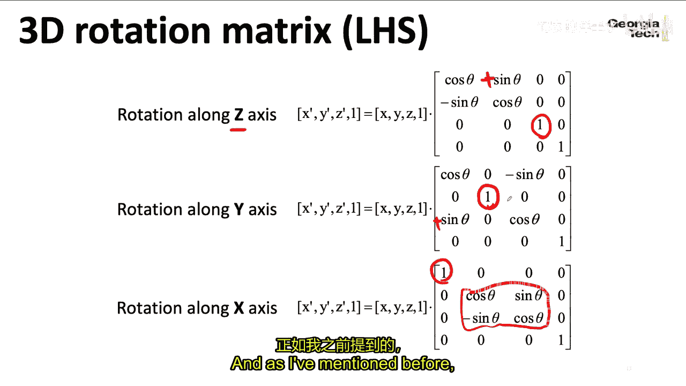

Let's see such an example brought to you by the power of clumsy PowerPoin shape animation here we have a cylinder and on the left we're first going to rotate it 90 degrees counterclockwise along the Y axis which places it over here。

 and now if we rotate it clockwise along the X axis that will then place it looking sort of straight down。

Now let's try the same experiment but flip the order of the operations if we rotate it counterclockwise along the X axis。

 it's going to look the same as we started with， and now if we rotate it counterclockwise along the Y axis。

 then it's going to wind up looking down the Z axis。

This was a geometric visualgil interpretation of what's going on。

 but we can see the effect in general by multiplying the associated rotation matrices I'm not going to go through the details of this and if you are a student in my class I'm not going to make you do that either so I'll leave that as an exercise for the viewer if somebody is extremely bored and once to go through this computation if we run through these bits of computation。

 you can see that the final matrix here basically takes the various coordinates and swaps them around and put minus signs in front of them and then if we swap the order of the matrices in the multiplication。

 we see once again we happen to here get a matrix where we swap the coordinates around and put some minus signs but we have a different set of coordinate swaps。

So that was a focus on rotation， let's now think about scaling and translation。

 and the first example will translate and then scale， so we first translate， move the cube up a bit。

 and then when we scale we scale everything。But if we were to scale it first and then translate it。

We wind up not going as far One other side thing I want to mention is notice we're not scaling evenly in all the dimensions thats something your level designers may do a lot if they're trying to repurpose one object as something else typicallyyp you want to use the approach on the right you want to think about scaling the object and then translating it The thing about the approach on the left is that the scaling applies to the original object and also to the translation so it can be difficult to predict how these operations are going to combine So that was a geometric visual illustration we can also see the order matters by looking at the results of doing the matrix multiplication and the case in the upper part of the screen where we translate and then scale the offsets also get multiplied by the scaling whereas if we do the scaling first then those offsets don't have the scaling applied to them and once again I'll leave this as a computation for the board viewer if the viewer is looking for。

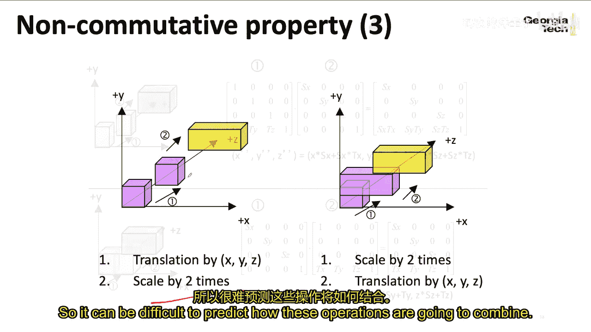

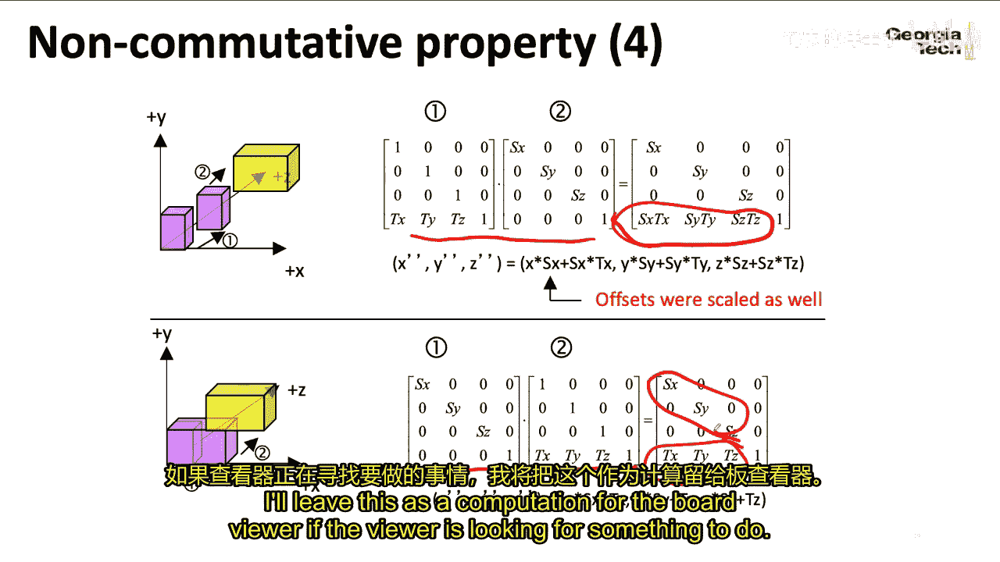

Or something to do。So the order does matter when doing matrix computations and 3D graphics。

 this can often get confusing depending on the different conventions so if you're using a row convention。

Then you put down the matrices after the row and then the operations are applied left to right。

 but if you're using a column convention。Then。You put the matrices to the left of that column vector。

 and then the operations are applied right to left。

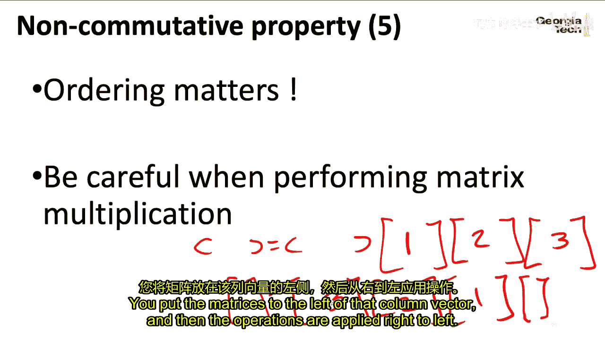

So the view transformation is something that's fairly complicated to work out。

 there's different ways of expressing the matrix Qui often what people will do is they'll specify the position of the camera a position for the camera to be looking at and then another vector indicating what the camera should consider it' quote unquote up vector the first couple of times that Professor Sean Lee and I taught this class。

 Sha went through the derivations of this matrix and it's fairly complicated。

 there's a bunch of geometry， a bunch of triometry。

 there's crossproduct and various other things Fortunatelyly any API with it salt will have routines built into the compute this for you there's one for the direct 3D the main one people would use would probably be LH because its direct 3D is inherently a left-handed system but there's other versions of it in there for the right-handed system if you're using that X andA had a routine called trait look at that was。

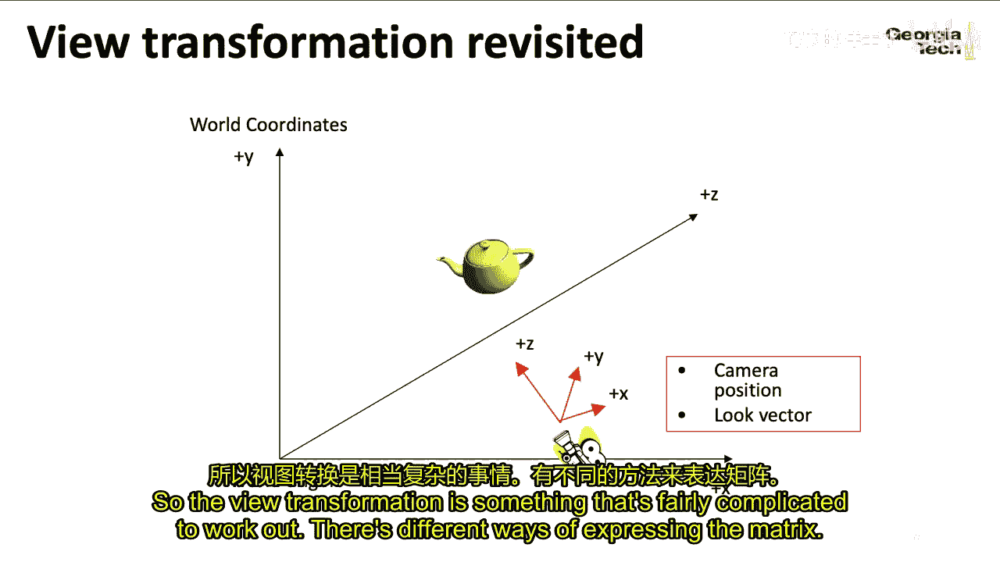

Part of the matrix class in X and A， this is interesting because even though X and A is built on top of Direct 3D X and A used a right-handed coordinate system。

 whereas direct 3D it's built on top of used left hand I never figured out why they decided to do something different with an X and A Open GL is right handeded out of the box so there is a command to create a right-handed look at matrix Unity has a four by four matrix library that includes a method for creating a look at matrix and a left-handed system which unity uses but usually a programmer will only call this if they're doing some specialized weird thing because usually there is a camera class with various built in scripts associated with it that will call such a look at routine for you。

 Theres sometimes where you want the camera attached to some object in the game Unity's camera system will handle this for you automatically you can link these things together。

 but if you're writing your own engine， you may want to create your own view matrix。

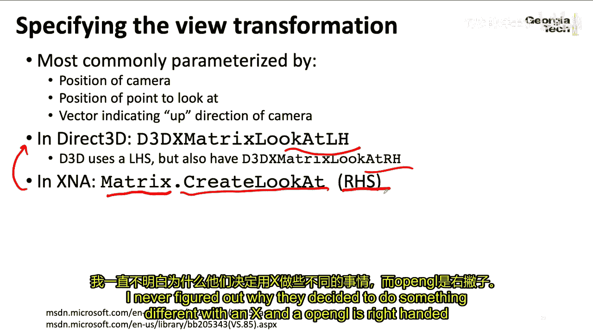

By taking the inverse of the matrices that describe that camera location and orientation。

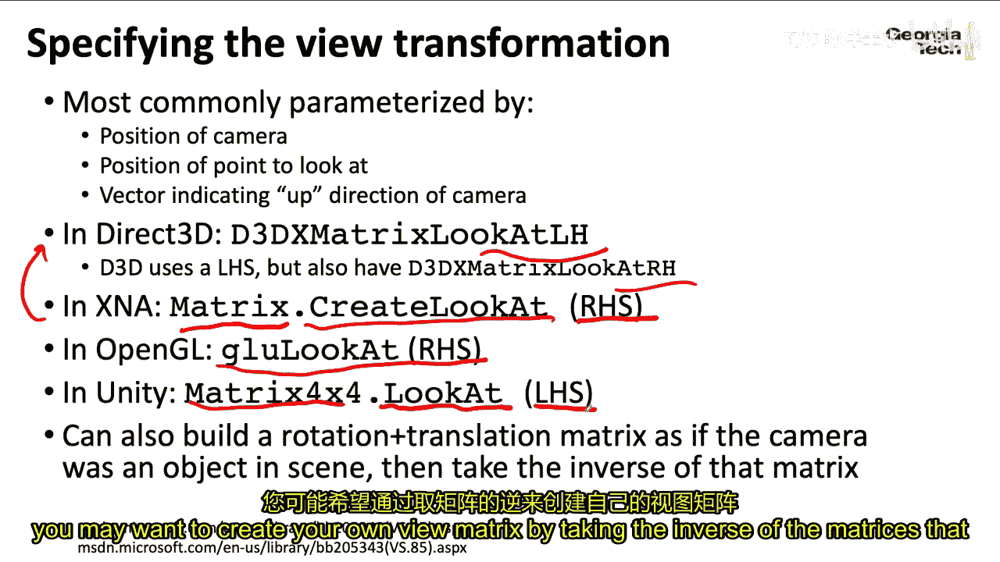