# 【全集】佐治亚理工学院-GPU编程：视频与游戏-中英字幕-p04-Lecture-4---正交投影--BV1GZfyBbEQn_p4-

Hi there， my name is Er Lantraman， I'm a professor of electrical and Comp engineering at Georgia Tech。

 and I would like to welcome you to the fourth lecture in the summer 2020 offering of GPU programming for video games。

So in the last lecture we looked at transforming threedimenional coordinate systems to other three-dimenional coordinate systems in particular we looked at the world transformation that would take objects from the model coordinate system that your artists use into the world system likely use by your level designers and your game logic we also looked at the view transformation that takes into account the location and orientation of the camera once we're in that view space we need to take the objects in the scene and project them onto your two-dimensional computer screen there's several approaches to this there's rarely used but fancy schemes out there。

 but most games are going to be using either orthographic or perspective projection and this lecture we're going to look at orthographic projection。

 the simpler projection and this will set us up to discuss perspective projection in the next lecture the job of this final set of vertex transformations is to map a three-dimensional volume into a normalized volume。

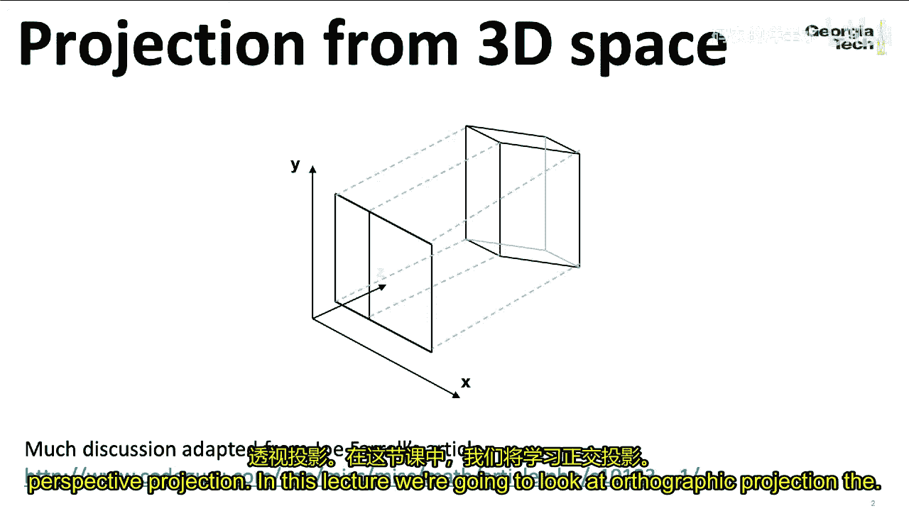

callled clip space that is expected by the remaining bits of hardware that actually performed the resturization and turn your triangles into sets of pixels Different APIs will use different approaches the one I'm shown here is used by direct 3D and this is a fairly difficult diagram to interpret I have the axis here。

 this X Y axis at the z equals zero plane that's the same plane that this part of the cube is sitting at So this is actually sitting at。

Z equals0 as well。 This is difficult to see。 Your brain is probably going to want to put this in the middle of the cube。

 but really， this point is sitting here on the face of the cube。

 And you should imagine that all of the cube that you're seeing is extending into the background and not towards zero at the viewer。

 The location of the triangles will be determined by the X and Y coordinates。

 The Z coordinate isn't as important in positioning the triangle。

 but it is used to figure out what objects are in front of other objects。

 which will look at a few more lectures from now。 And also this depth information is often used by a lot of postproces effects。

 such as focusing effects like depth of field and things like fog。

 I should also mention that the vast majority of this discussion was taken from this excellent article by Joe Farrell。

 So I've taken the diagram from the previous slide and copied it。

 All of the conventions for clip space that I'm aware of are ultimately left handeded systems。

 They have positive。

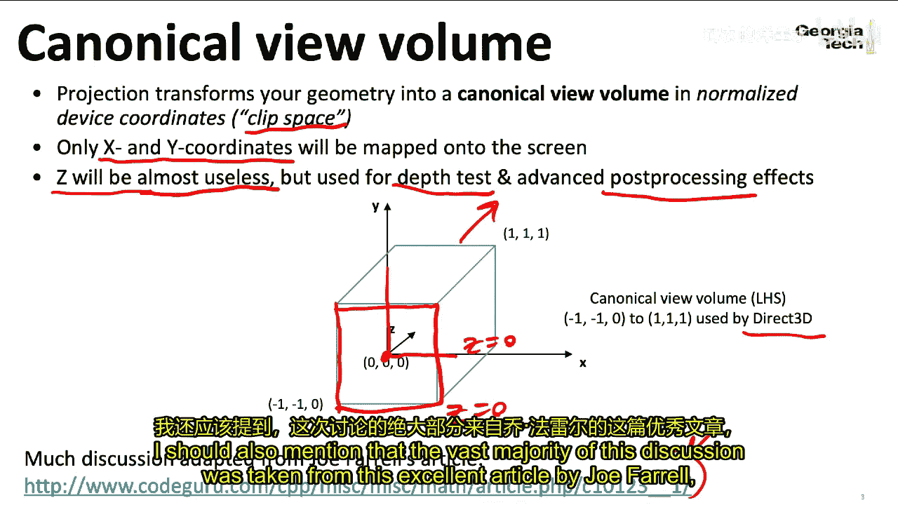

values moving away from you although they do switch around in different ways。

 so although Direct 3D is inherently a lefthanded system。

 the X and a framework that Microsoft built on top of it used a right- handeded system in its I space which you could also call the view space or the camera space so x and A which is from right- handeded to left handeded in this clip space transformation that we're going to look at whereas direct 3D keeps the same handedness and there's a similar strange thing that happens over here if we look into the openGL or the unity standard the main difference between what you see on the left and what you see on the right is the way Z is handled so both of the systems have x and y going from minus1 to1。

But what's happening with Z is different As I mentioned on the last slide。

 it's kind of difficult to visualize what's happening in the left plane because this front of the cube here。

 this is actually at z equals0， so you should envision this point as sitting here on the front face of this cube The open GL convention has z going from minus1 to1 instead of0 to 1。

 So over here you should think about this point as actually being in the middle of the cube because Z down here is at minus1。

 whereas over here， it's still sitting here， it's at z equals0。In terms of the handedness。

 Unity does use a left-handed convention in its camera space so it doesn't switch conventions while going to the clip volume。

 but OpenGL inherently has a right-handed convention in the ISp AkaA cameraspace AK viewspace so it switches handedness my initial 3D coordinate lecture I spend a lot of time just talking about how different programs and different game engines and artist tools use different systems。

 well that keeps going everybody uses a different convention and the reason I'm spending so much time on it here is that if you're reading through a book。

 it will often pick a particular convention and use that convention throughout but it won't ever explicitly state or at least not make a big deal about what particular convention it's using。

 which can make it difficult when you start reading other books or blog articles or looking at source code or whatever。

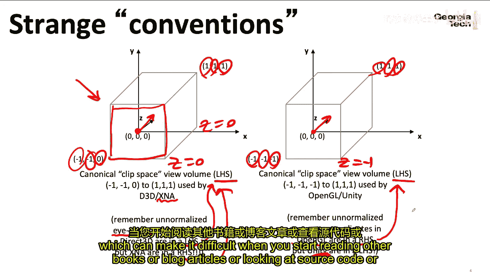

So the orthographic projection that we're going to look at is one of the simplest modes here we're just going to assume that there's a set of parallel lines running from the scene to the viewer and what we're going to do is we're going to pick a plane in space and we're going to project certain things in the scene onto those particular points there may be objects that are partially outside of the scene and in this case usually there's part of the hardware or if it is a software render part of the software that will take certain triangles that are on the edge it will do an intersection check so it will take triangles that are sitting say partially outside of your volume and it will split those up into smaller triangles as needed for the parts of the objects that are within the clip space and the next lecture we'll look at perspective projection that takes into account the fact that in real life objects that are closer to you are going to look bigger than objects that are farther away from you this orthographic projection style is fairly popular。

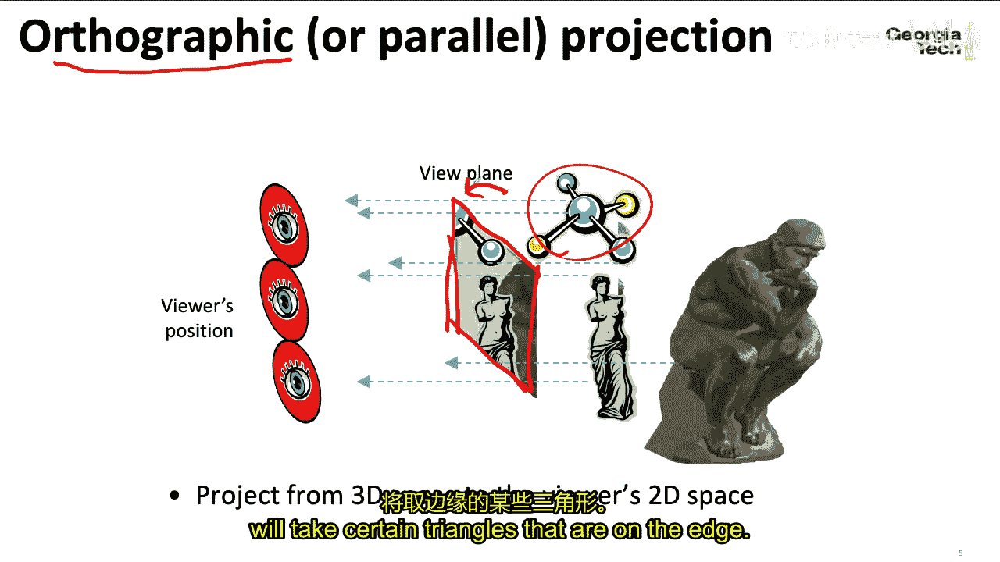

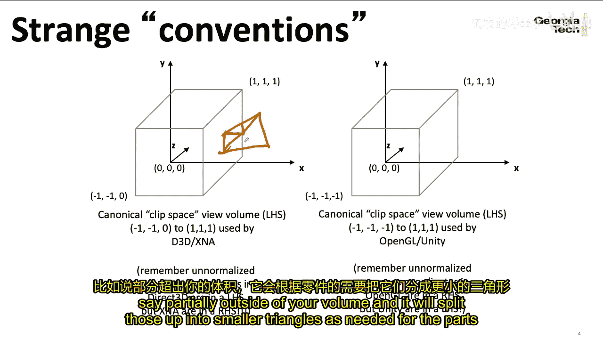

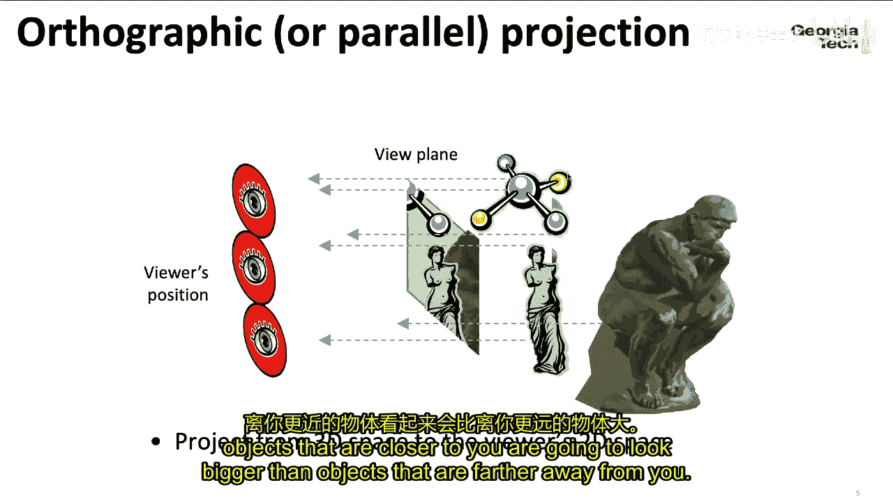

In older games before you had fast 3D graphics hardware。

 often they would essentially be quote unquote faking a 3D effect using what are essentially 2D tiles hand drawn by an artist The problem with this particular kind of approach and again I need to give credit to the article where this graphic is drawn from is that you can wind up with strange paradoxes trying to interpret the scene There is actually a game of well back called Mon Valley that takes into account these kinds of paradoxes a lot of older games such as fallout or a verum or Ul8 would use this style。

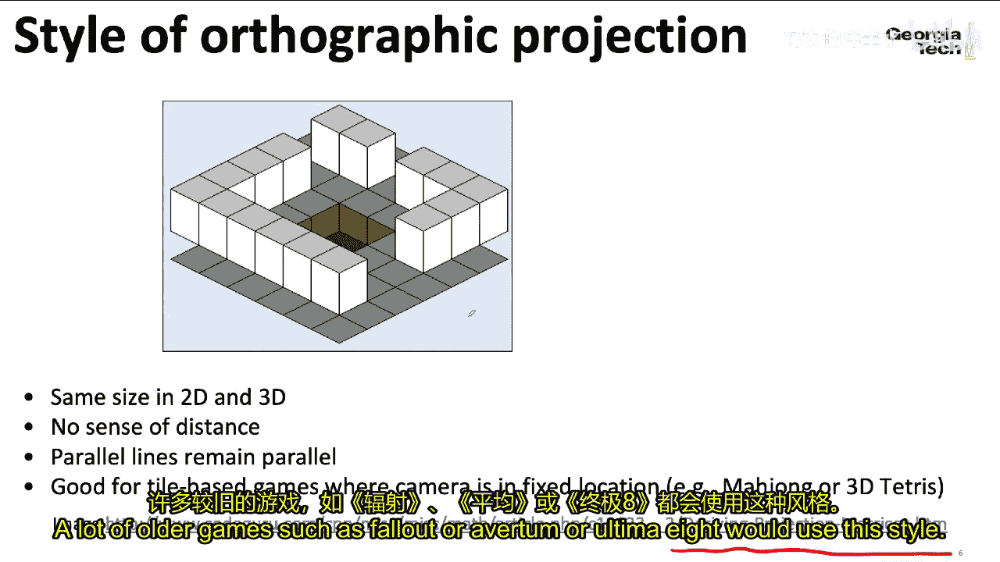

So suppose we've gone through the world transformation and we've gone through the view transformation。

 everything is now in the realm of the camera， we may define some points in space that define our volume that we want to render so we'll have a left and a right coordinate。

 a bottom and a top coordinate and a near and a far coordinate。

 what were like to do is map this into a volume that for example。

 using the Dr 3D style goes from1 minus10 down here at LBN up to 111 up to RTF。

 and these will be the kind of coordinates that are passed into the pixel shaders we're going to look at that have responsibility of determining the final color of a particular pixel。

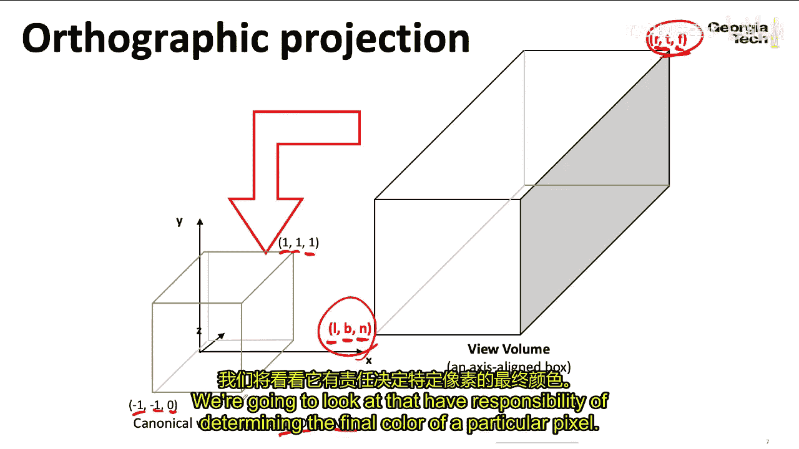

So the math here isn't really terribly fancy， we want to be able to map。

 say in the x coordinate left and right to minus1 to1。

We could say we're mapping x's between L and R to x's between minus1 and 1。 So first。

 let's say we want to normalize things on the left so we might subtract L from everything in this expression。

 and then we might divide by R minus L， the the on the right。

 so this is basically the width of that initial cube。

And now we have something going between zero and 1， but to get something between minus1 and 1。

 well that's a range of two， so let's first double everything。

 so I've multipplied by two across here。And now we can subtract one from everything。

 so I now have a number in the range of minus1 to1 and all I really need to do is take this minus1 and rewrite it as r minus L over r minus L and simplify it a bit to get my final expression the nice thing is I can write this as an a fine transformation so I've got a constant times the x coming in。

And then I'm subtracting the constant from it。 So that's something we can handle with homogeneous coordinates with our fourdimensal transformation matrices。

 and we have a one setting and that W component that we've added to our usual 3D vectors So that was the derivation for the x coordinate going from left to right。

 the derivation for the vertical coordinate， the Y coordinate going from bottom to top is basically identical。

 All right now let's think about what happens in z。

 So if we're doing the direct 3D convention that doesn't map to minus1 to1。

 we want near and far map to0 to1。 So this derivation is a little bit shorter actually when we do this mapping we' subtract by n that will put the left point of our0 range to0。

 and then we can divide by F minus n as we've done before and now we can take this expression and split it up into two terms and one of those terms is actually a multiplier on z。

And then there's just a constant and again we can take this into account easily with homogeneous coordinate approaches The OpenGL standard map Z2 minus1 to1 instead of0 to1 so you can redo this transformation for that convention and it's going to look more like the transformation from the previous slide Now if we combine all this together on one big matrix if we're using a row convention as direct 3D does。

 we can just place along the dagagonal all of the multipliers of X Y and Z and then this last row here handles the transformation terms。

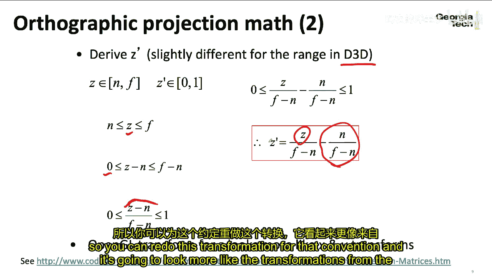

Remember if we're using a column convention， then the matrix would go before the vector。

 and in that case well be using the transpose of this matrix。

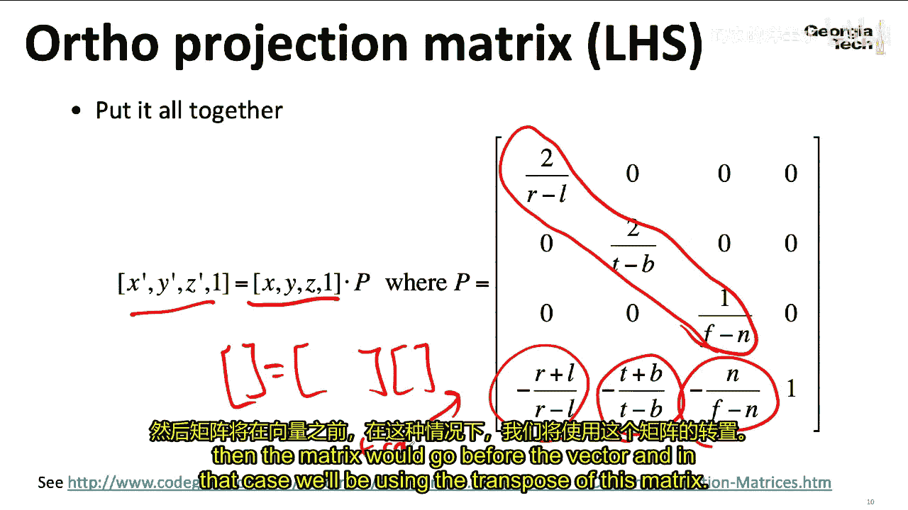

So just taking that matrix and recapppying it on this slide。

 we don't always have to program these ourselves， there are commands built into Direct 3D。

 for instance， to compute these things for us。Direct 3D has a left handed convention， as does unity。

An interesting thing about the call you see here is that direct 3D。

 this is sort of a C style framework， so we have parameters that we're passing in。

 but to create something like a matrix， we actually have to pass in a pointer to that matrix data an interesting thing about the math here is that this matrix works regardless of whether you're using a right- handeded or left- handeded coordinate system for your Zax。

So you could have f minus n and you could put in numbers like 50 for near and 100 for FA in a left- handeded system。

 or you could put in numbers like 50 for near and minus10 for FA for a right- handeded system and you wouldn't have to change any of this So that leads to something incredibly confusing that took me ages to figure out which is if you look in the Microsoft manual。

 you'll see that they actually flip in an F in this term for the right-handed version of this call to make the right-handed matrix X and a also has a routine built into the matrix class to make this for you and it has the same kind of flip so then you try to figure out what's going on and it turns out even if you're using a right-handed system where the near plane in the view aka camera Aka space is 50 and the far plane as minus 100 these API calls expect your' near and far。

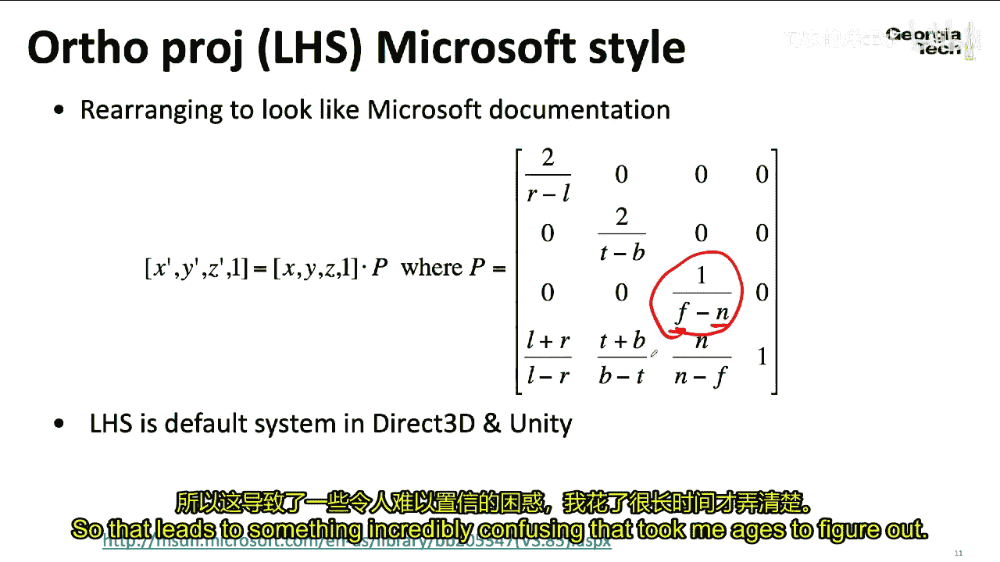

s to be listed as positive numbers Even though in the coordinate system。

 they're really negative numbers so they essentially do that sine flip for you so that's why theres two different calls that's why the left handeded version of the call has f minus n in the denominator here and the right- handeded version of the call has in minus f here they've basically done a minus sign for you because I guess they thought it would confuse people to have to put negative numbers into here even though they are so you put positive numbers in here and it does the minus n for you and yes that is confusing Now there is a command in opengL to make this right handeded matrix because that's convention they use they also use positive and and f positive near and far the other difference here is that the Z maps to minus1 to1 and there's a column vector convention so some of the scale。

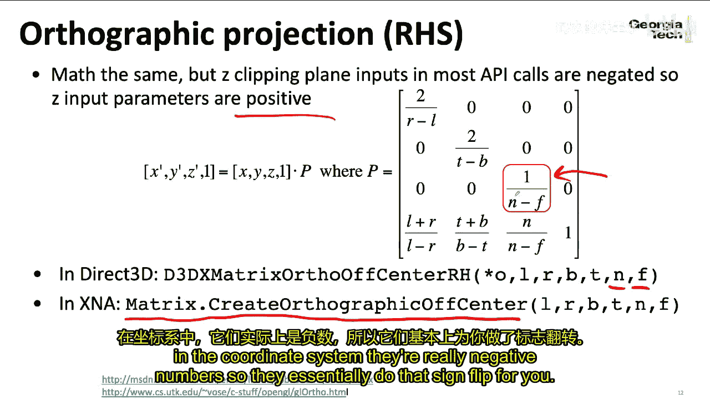

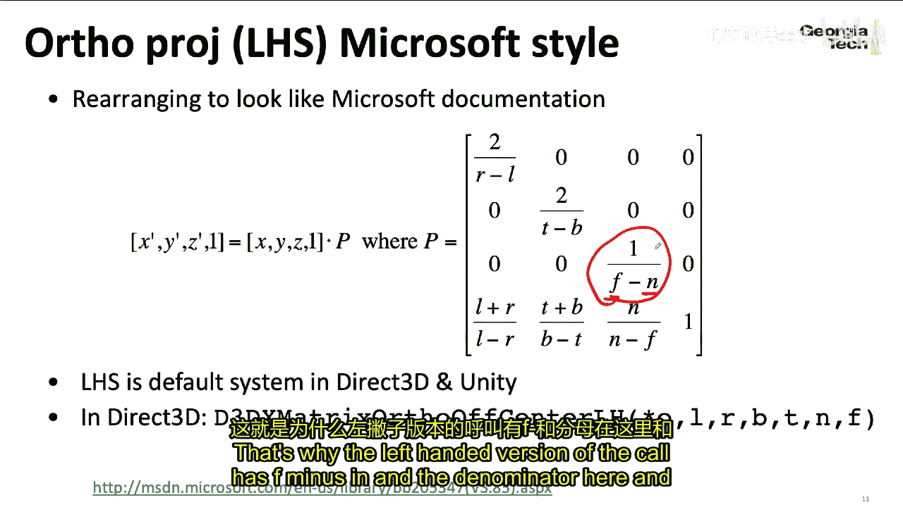

Will be different and they use column vectors so you'll see something that looks more like the transpose of this matrix than this original matrix little side point on the different calls here Direct3 d sort of has a C base so to create a matrix you actually have to pass in a pointer to the matrix data X and use C sharp which is a sli or object oriented language it can actually create and return a matrix without having to stick in this pointer you may say open GL also has a C basis how are they getting away with not having a pointer here Well GL has a strange stackbased computational model like thepN calculators that Hewlett Packard used to make So a lot of their operations will create a matrix and shove it onto a stack that then gets popped off later Now it's fairly rarely the case that you need to have all of this flexibility of the left right bottom top etc etc etc。

 usually we can say that there is。

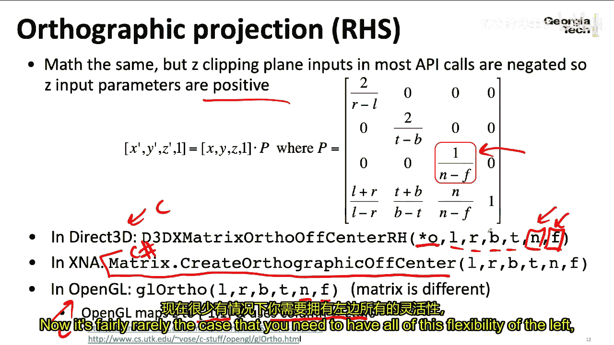

A symmetry going on， you could say the middle in your x and Y land is at zero zero and we'll just define a width and a height now we do need to keep the flexibility of having different near and far planes。

In this case， most of the APIs will have a specialized version of these calls with hopefully a shorter name and also with a smaller parameter list。

 So here's the left-handed version of the call and for completeness here's with the right-handed version again they put this minus sign in here even though N an F should be negative numbers the calls in this case the simplified calls are expecting positive numbers to go in so they do the negation for you So in the next lecture will look at perspective projection where things that are farther away。

 look smaller and things that are closer to you look bigger and now you see why I did not go to art school。

 If you are not taking GPU programming for video games with me at Georgia Tech in the summer 2020 semester。

 you can check out of this video now， but if you are one of my students taking it in the summer 2020 semester I would like you to log into canvas and there you will find a quiz and please fill out this quiz by。

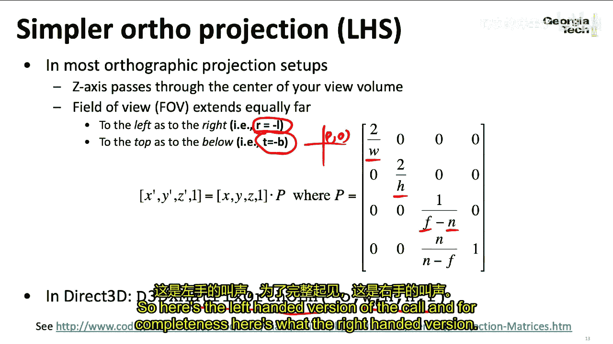

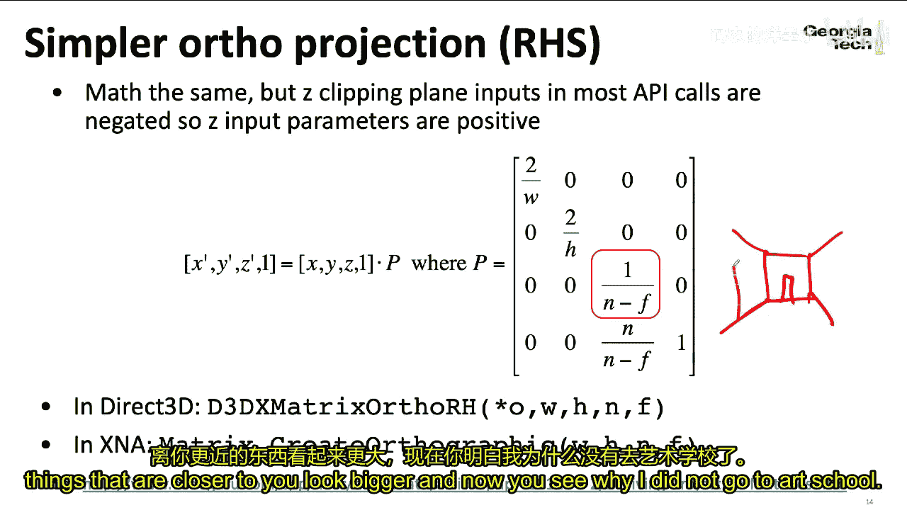

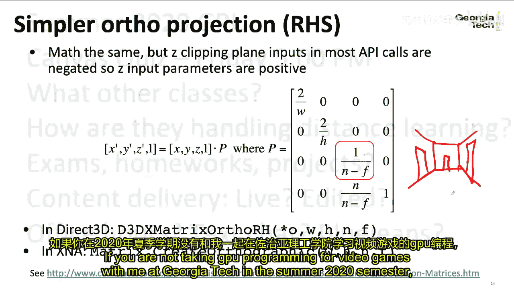

Let's say Friday at 5 pm I want to know what other classes are you taking this will give me a sense of what your workload is like the semester it'll give me a sense of what you're up against and in particular just give me a sentence or two about how are they handling distance learning。

 how are they handling turning in homeworks projects， how are they dealing with exams。

 are they using some sort of proctoring solution or just going totally open book or anyway。

 how are they handling it？How are they delivering content to you are they making you show up for live lectures that are being live streamed are they recording ahead of time and trying to edit the video to make a polish experience like I'm doing for you here how are they handling office hours are the professors and or Ts showing up for text chat at certain times that you can type questions and they can answer or are they showing up at various times on something like Bluejas Anyway。

 I would like your perspective on these things？

