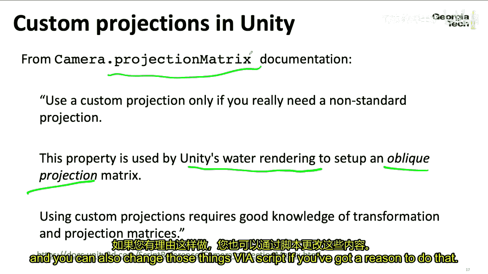
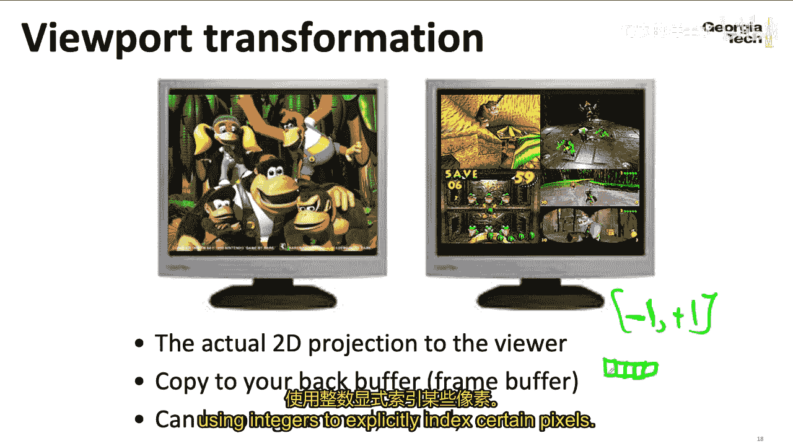
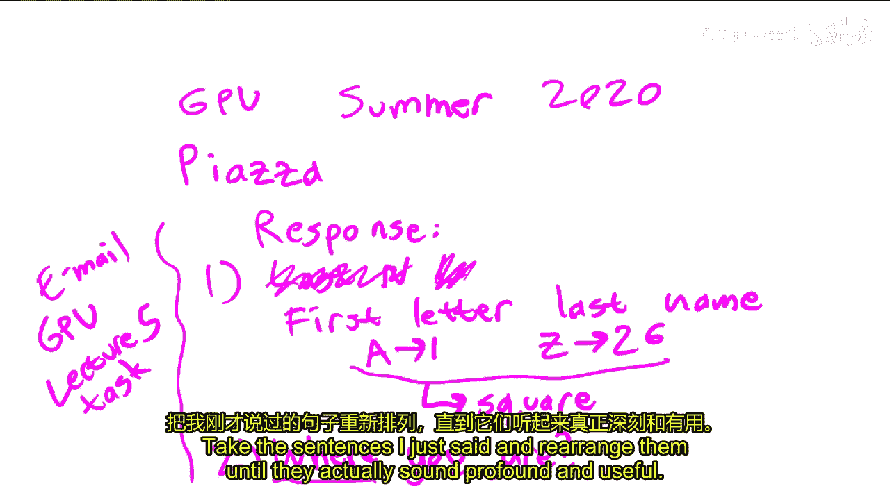

# 【全集】佐治亚理工学院-GPU编程：视频与游戏-中英字幕-p05-Lecture-5---透视投影--BV1GZfyBbEQn_p5-

Hi there， my name is Aaron Laantterman， I'm a professor of electrical and computer engineering at Georgia Tech and this is my quarantine hair and I would like to welcome you to the fifth lecture in the summer 2020 offering of GPU programming for video games and the last lecture we talked about orthographic projection and in this lecture we'll talk about perspective projection and orthographic projection objects would appear the same size regardless of the distance from the camera with perspective projection thingses that are closer to you are going to look bigger than things that are further away from you。

All of the projection transformations we're looking at this point have assumed that we've gone through the view transformation and so we essentially have a camera that is looking down the Xax with everything centered and then at that point the orthographic projection would take a threedimensal volume defined in that view space Aka camera space AkaI space and transform that into a normalized 3D volume and clip space a projective transformation is quite different here we're basically taking this kind of trapezoidal shape it's like a giant pyramid with the top chopped off here at the near playing and this is called a fum and what we're going to do is take this and project it into a rectangular volume。

Now。We're inherently outside of the realm of linear transformations at this point。

 this is going to require new math in order to do this kind of transformation。

You can imagine that you see a bunch of objects outside and essentially you're in a dark room looking out at the things outside。

 you can imagine that this window is the near plane that things are going to be projected onto so with both orthographic and prospective projection choosing the near and the far plane has a few practical impacts One is anything beyond the far plane is going to not be seen and you can get problems if you have something in between where maybe you're going towards a particular object and then when the far plane connects with the object that object will suddenly pop into view if you've played double07 gold eye on the Nintendo 64。

 you've probably seen a similar problem with the near plane where if you sneak up behind a guard and you get close enough。

 the near plane will sort of chop off the back of the guard's head and you can see the back of their face which is fairly weird。

In case of things popping in and out of view in the back in this far plane。

 sometimes people will add a fog effect to try to obscure that。

 but it's still a thing that will happen。Also choosing the near and the fire plane is important from a practical issue in both orthographic and perspective projection。

Because the Z information is used to determine which objects are closer than other objects in particular。

 which objects are obscuring other objects， and if you set your near and far plane too far apart。

 you may not have enough resolution in Z to resolve that well。

 and you can get this strange shimmering effect called Z fighting。

So we're going to take this particular ftum， this chopped off pyramid。

 this trap iszooidto look pyramid thing， we're going to map this thing that is inherently not a 3D rectangular volume into a 3D rectangular volume。

So the left， bottom and near and the right top and near coordinates these are meaningful in this window that we're going to be projecting our 3D space here onto I notice up here I'm just writing z equals the fire plane because the right and top and left bottom coordinates out here the one over here isn't going to be right and top it's going to be something else depending on the various angles here now I've drawn this according to the direct 3D convention if this was open GL this。

Lower left corner here would actually have a minus one in that spot。

The matrices I'm going to show you in this derivation are D3D style。

 but you can change the derivation a bit and get this open GL style if you needed to drive that for some reason。

So we're going to take objects in this space and project them onto this near plane and once they're on the near plane well map left to right minus1 to1 and bottom and top to minus1 to1 just as we did with orthographic projection but remember that only applies now once we're on the near plane this sort of applied throughout the entire 3D volume with an orthographic projection but this is going to be fundamentally different Okay so let's talk a little bit about the mathematics of this transformation So we have a point say it's x Y z and our 3D space and we've determined that it's in the volume that we want to transform we want all of the points in our space to be going through a point at the origin at 000 here again。

 we've assumed that the camera has moved into this point We're going to basically take all of our points in space and run them along lines that goes through this point and what we want to do is see。

where they intersect the near plane so the basic idea here is that everything needs to make similar triangles all of the angles need to match up so for instance。

 if I take the ratio of a point on the near plane， my new x coordinate which I'll call here x double prime and if I take the ratio of that x double prime to the original x that needs to be equal to the ratio of my near plane z coordinate to the actual z coordinate that I'm transforming and if I rearrange that a bit I can get an expression for that new x double prime and terms of the x that I'm transforming the near plane and notice the z coordinate so this transformation is inherently non nonlinearar and this is something that will have to handle that carefully。

What we want to do is try to keep as much of the calculation as we can in that linear matrix algebra space so we can combine it with other matrix stuff that we're doing。

 but there is a point where we are going to have to do a division operation that you can't do with just a straight matrix multiplication Now the similar triangles we're making have to work in all of the coordinates。

 so for instance， the ratio of y double prime to x double prime should match the ratio of y to X。

 and so I can manipulate that to get a similar expression as what I have up here or you could just kind of do this logic directly and get this expression for y double prime in terms of ny divided by Z just as we had up here for x double prime。

So once we've done that transformation， we now have an x double prime that should be living in the space of our left limit to our right limit。

 and our Y double prime is in our space going from the bottom coordinate to the top coordinate。

At that point， we can use the same formulas for orthographic projection that we derived in last lecture to map these into a minus one to plus one clip space。

And so we can do that here， so what we've got here is our X prime basically and what we have here is our Y prime again I should give credit to this amazing article by Joe Farrell that I think it's two Rs。

2L's。That most of this discussion is based on he uses a slightly different notation。

 he uses an x prime here， I wanted to use this x double prime to make certain distinctions a little clear anyway so oh sorry this is an x prime this is x double prime and that's y double prime that's the point what we have here is something that starts to look like the kinds of transformations we've done before and it feels good except there is the z here。

 that's not something we can represent with a matrix but if we multiply everything through by z and just say okay well we're not going to be dealing with x prime and y prime what we're going to have here is x prime times z and y prime times z we're just going to say everything's going to have a z in it and we'll get rid of that z later because then I can express that as a thing that has an x and a z and a y and a z and I can express this as a matrix computation。

Now we'll need to think a bit about what we want to do with。

Z prime so we figured out how to transform X and Y We do need to do something with Z because that's going to have some depth information in it we're going to need to figure out obscuration so let's keep things consistent we're going to take Z and we're going to map it to his new Z prime time Z and try to figure out something here that makes sense。

So what we're going to do is suppose that our near plane is going to map to0， a z prime of0。

 z equals f our far plane is going to map to z prime equals 1 if I wanted to use an openGL convention。

 I could have Z prime equal minus1， but here we're doing the direct 3D convention。

And so if I want to do that kind of mapping， I know what I can put end up here。

 so if I want the near plane here，To map to zero。I can plug that in and get this first equation here。

 and now if I switch color， let's look for the other situation。So if I want to plug F in for Z。

 I'm going to one out。For Z prime and so if I do that I wind up with this expression。

 I could redo these expressions if I want for the Z prime equals minus1 and run through the same kind of logic if we need to。

 but we don't really need to do that right now I have two equations and two unknowns it's easy enough to solve those and find out what the P and QR that I need。

I can write out the full expression just by taking that PNQ and plugging them in。

 and then I have another formula like what I've had before。

 where we're mapping everything to something that has a Z in it。Now。

 if I combine those three expressions from the previous slides I get this。

 I'll explain in a second why I have this W prime time Z there。

So I'm going to put everything into a matrix， so I'm going to map an x。

 Y and z into an x prime z y prime Z and a z prime Z， that's all well and good。

 and so that's being handled by these various things here。And now I've got a question of。

 well what do I really want to do with this W prime coordinate？

So the convention is that we want to eventually divide everything by Z， right。

 we want to get rid of this C， this Z， this Z and this C。

So the way that's typically handled is that we'll basically take this fourth coordinate。

 which should be consistent is W prime Z and we'll stick Z there。

And then somewhere on the card we'll have a piece of hardware that basically takes everything in this vector and divides it by that fourth coordinate。

So what we're going to do is we're taking that third coordinate that Z and we're sticking it and that fourth coordinate and that's what this one here does。

 it takes that Z and puts it in this fourth W coordinate。

 so now when I divide everything by this omega prime Z。

 I'm dividing everything by z and then I'm left with my x prime。

 my y prime and my z prime and then I'll be left with a1 in that W coordinate。

So just as we saw with orthogonal projection， rarely do I need the full flexibility of having a separate LNR and TNB。

 usually I can assume that there's some symmetry going on。

 so I could just define a width and a height instead of having an LNR and a TNB。

 in which case the matrix on the last slide simplifies in the way you expect。

 but even then expressing things in terms of W and H is usually not how these kind of matrices are expressed。

 usually there's a field of view that's expressed in either radians or degrees。

 usually degrees from the point of view of say your level designer who's deciding how to set up the camera。

This field of view is defined in this vertical direction here。

 and then there's an aspect ratio that you define in order to find the width I'm mastering this presentation in a 16 to9 aspect ratio that's probably what you're viewing it on on YouTube。

 the older standard definition video typically had a four to three aspect ratio。

 this is sort of an original television type of standard。

 this is a widescreen kind of standard that all modern。

Monitorors and laptop support basically for watching movies and then of course we'll also need to define our near and far planes。

 There's some trigometry involved and figure out how the field of view maps into that height and the width I'm not going to bother going through all the triometry you can dig into that if you want。

 but we can take it on faith for now。Not surprisingly。

 there are commands built into 3D APIs to create these matrices for you Direct 3D and Unity both have a left-handed system by default。

 the direct 3D version， as we mentioned last time because Direct 3D has a C basis。

 you need to pass in a pointer to the matrix data but something like unity doesn't really need that you can create a matrix and then return it without having to pass around pointers explicitly Unity has a 4 by4 matrix libraries specifically with some matrix creation routines like this。

There is of course， a right handed version of this in some APIs again。

 this is a little bit strange because the underlying math here。Would work for a right handed system。

 You just put in negative numbers for F and N instead of positive numbers for F and N。

 But even though the far plane and near plane and a right handed system should be defined with negative coordinates。

 all of the Apis assume that you are passing in positive numbers。

 So that's why you see the n minus F here looking different than you see in the。

F minus in here on the previous slide is just doing that negation for you So that's built in direct 3D X and A has its own version of it and OpenGL has a version for it because OpenGL is naturally right handeded and here this has a C basis but as I mentioned last time OpenGL has a stack computation model so this is pushed onto a stack you be used later so even in the C context you don't need to specify a pointer。

You can create your own projection matrices and unity using either the kinds of routines we've talked about or you could write something that does some sort of really weird bespoke matrix your camera has an insofverable projection matrix that you can assign that to。

 but you really only need to do that if you're doing something fairly strain So the documentation mentions oblique projection which is a weird non-standard projection outside of what we've looked at and it's apparently used by the water rendering system and again。

 you'd only really need to do something like this if you're doing something particularly weird。

Unity will take the various parameters of your camera and create these matrices for you as needed。

 depending on how you set things in the inspector， and you can also change those things via script if you've got a reason to do that。

So there is one final transformation， and that's where this minus one to one gets mapped into the actual。

Pixel count on your screen the integers， so in doing 3D graphics with modern hardware。

 it takes a while to get used to that if you're used to doing 2D graphics programming where you're using integers to explicitly index certain pixels。

But of course this does eventually happen you probably have something else in your operating system and API that you're calling that's defining where various windows are in your screen in terms of pixels that are then taking these minus101 and mapping them to various places and as we'll see later it can be even more complicated because you might be doing antialsene or you're actually rendering into a buffer that has dir pixels then you're actually displaying and nowadays a lot of this is just handle behind the scenes for you so essentially we'll leave that to the magic happening in the API in the card for now。

Unity defines several coordinate conventions again these are unity specific if you're using some other engine。

 there may be a different set of nomenclature， it defines a viewport system that has00 here on the bottom left and11 on the upper right the viewport system doesn't have any sense of a Z coordinate now there are also screen space coordinates that go from00 bottom left into something that's more of a integer pixel thing so。

We have a pixel width and pixel height。And then there's also in this setup there is a Z coordinate and this is in quote unquote world unit coordinates from the camera。

 so notice that these have different units。 so for coordinates for un built in graphical user interface facilities0 zero is now in the upper left you've got these camera pixel coordinates now in the bottom right So the first two here are closer to the kinds of conventions we've been looking at so far in terms of how you map 2D coordinates where the Y coordinate。

Increasing means you're going up the screen whereas this GuI coordinates space down here。

 this is closer to traditional 2D graphics programming where increasing why coordinates are going down the screen All right so if you are not taking GPU programming for video games in the summer 2020 semester you can check out now but if you are taking GPU programming for video games in the summer 2020 semester I would like you to do the following so by the time you see this I will have set up the piazza website for this course and I'm going to make a post that says something like answer for lecture5 task or something along those lines I want you to find that post and make a response and I would like two things from you I would like you to take the first letter。

Of your last name and I would like you to turn that into a numeric value of the usual way。

 So I would like you to map a to one and Z to 26。 So you're taking a letter and turn it into a number and then I would like you to take that number and I would like you to square it Yes。

 you may use a calculator。 So take that number square it and that's the first thing I want you to do that way I know that you've watched this video for the second thing I want to know where are you So where you living now。

 where are you currently dealing with this distance learning situation and difficulties just because I'm curious now there is another option。

 if you for privacy reasons， don't want to say where you are on piazza because other students will be able to read this you can email me this information if you do so put GPU let's say lecture。

Five task into the subject。And then I can find it quickly easily when I'm searching。

 tell me the same things but this way you can keep your location private if you've got a good reason to do that and a good reason do that is because you want to do it so but if you are willing to let your classmates know where you're at I think it would create a bit of camaraderie if we sort of have a sense of。

Sense of where each other are， and that gives you sort of philosophically a better sense of where you are。

 take the sentence， as I just said， and rearrange them until they actually sound profound and useful。

