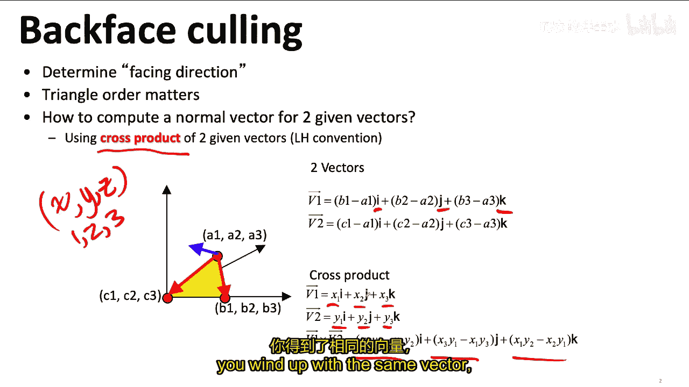
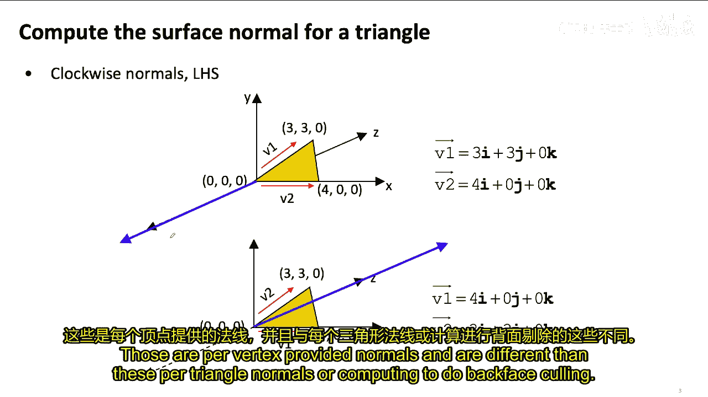
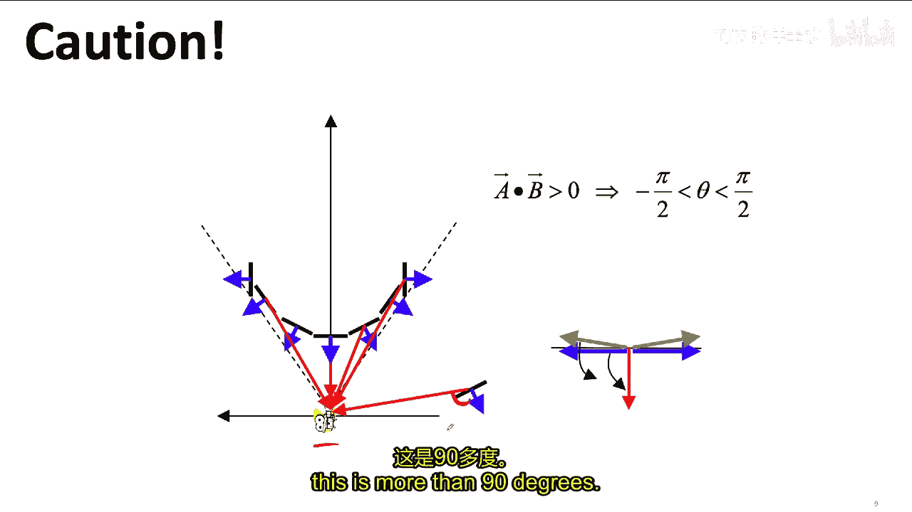
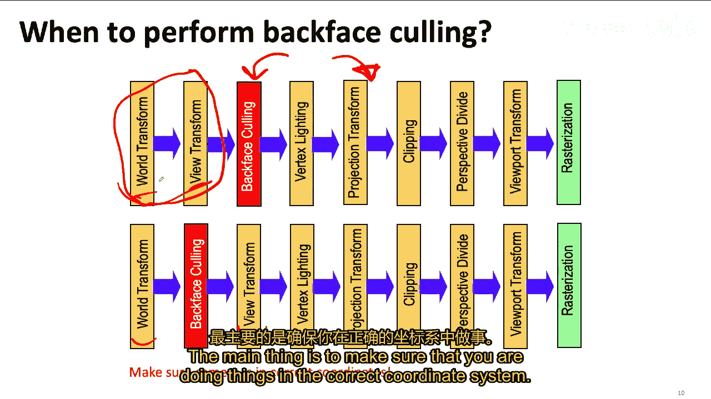
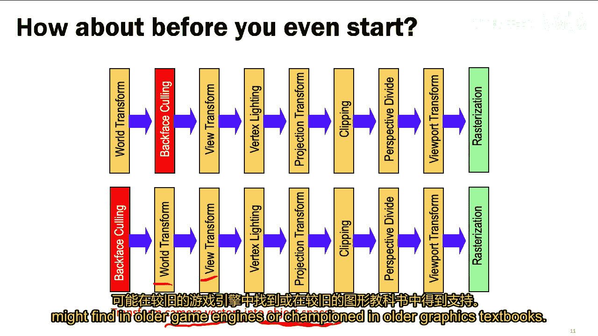
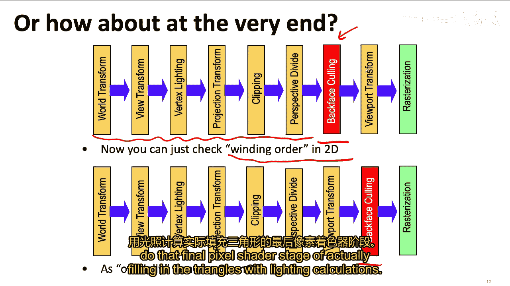
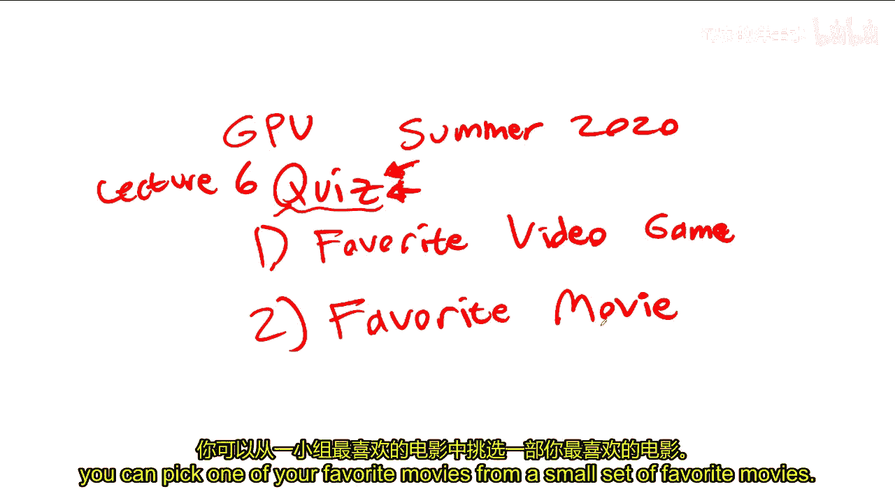

# 【全集】佐治亚理工学院-GPU编程：视频与游戏-中英字幕-p06-Lecture-6---背面剔除--BV1GZfyBbEQn_p6-

Hi there。 My name is Er Latraman。 I'm a professor of electrical and computer engineering at Georgia Tech。

 and this is my quarantine hair。 and I would like to welcome you to the sixth lecture in the summer 2020 offering of GPU programming for video games。

 Here we're going to talk about an optimization called backface calling。

 The underlying ideas that most of the objects will be looking at are closed surfaces and the facets that are facing away from us are going to be blocked by the facets that are facing towards us。

 So as the name suggests， we're just not going to bother rendering the triangles that are facing away from us。

 So in order to figure out what is or is it facing away from us。

 we're going to compute normal vectors of the triangles。

 The normal vectors that we use for backface calling。

 these are not the same as the pervertex normal information that we talked about last time。

 These are normals that are created by whatever export procedure your artist。

we use to create their 3D models and these normals try to encapsulate information about surface curvature at I shouldn't say higher resolution than what the triangles are saying but they're trying to fake higher resolution than what the triangles are saying this normal information will be used by your lighting calculations so this is not what we're talking about here in this case we're going to compute a normal for each of the triangles that is just a simple vector that's orthogonal to the surface of the triangle itself and we can compute that using a cross product we'll have a particular point on the triangle we'll compute a couple of the vectors to the other two points and we'll use a cross product to compute the normal Now admittedly the notation on this slide is different than the notation that we've used previously previously we've been using x Y and z to indicate the 3 coordinates in the 3D coordinate system here we're using one2 and3 because I feel insufficiently ambitious。

To try to unify the notation， so just keep that caveat in mind。

So the cross product can be computed as follows。 We'll think of this bold I bold J and bold K as being unit vectors forming our threedimenional coordinate systems so Ij and K are orthogonal to each other happily compute these two vectors by just taking a difference of the points and then the cross product is computed as follows。

 Now again， there's a little bit of confusion here because here we're using x and y to represent two different vectors instead of x and y coordinate systems。

 the 1，23 are representing the different coordinates， but just go with the flow here。

 The cross product is not a communutative operation， so I can't just switch the order of things。

If you switch the order of the elements in a cross product to get that new vector。

 you wind up with the same vector it's just pointing the opposite direction。

 so here we suppose that the 3D object created by your artist exported from the software is created using a left-handed convention in terms of how the vertices are ordered and what this means is that if you take your left hand and you curl your fingers starting with this V1 vector and curl it around to match the V2 vector so you can imagine your fingertips are going towards this V2 vector。

 your thumb is going to point the direction of the vector created by this cross product。

Similarly， if you take your left hand and you start with your fingers this direction and then you curl them up with your fingertips going towards V2。

 your thumb is going to point away and we'll get a vector going this direction。Now。

 if it's stored with the right-handed convention， they'll go the other way。

 but this question of whether we're using a left-handed convention or a right-handed convention for the 3D model that is yet again just another convention whatever engine you're using may be using a different convention for its coordinate system So if you load in the 3D model and you have backface callinging activated in your game engine and the object disappears then that probably is a suggestion that there's a different convention being used by the model than what the software rendering it is expecting it to be and again。

 these normals that we're using for backface callinging。

 these are not the same as the normals exported by the 3D software Maya or 3D Studio Max or Ber。

 whatever that your 3D artist uses that is trying to take into account some of the information of the underlying surface that the triangles are。

Tesating and creating an approximation of and those are used in lighting， those are different。

 those are per vertex provided normals and are different than these per triangle normals we computing to do backface calling。

So once we have those normals， what do we do with them， if we think about it for a second。

 we've got two situations。If we think about the normals coming out of each triangle。

 as we've just described， if we then compare that to a vector going from， say。

 the center for the triangle to the camera， we can look at the angles that these vectors make with each other。

 We'll see in a second， we can compute that by computing a dot product。

So if the angles between these quote unquote i vectors going from， say。

 the center of the triangle to the camera。If the angle between one of those and one of the triangle surface normals is less than 90 degrees then that triangles facing towards the camera is something that we're going to draw。

 but on the other hand， if it turns out that that angle is bigger than 90 degrees。

 that indicates that the triangle is facing the other direction and that we won't bother drawing it。

So how do we figure out if it's bigger less than 90 degrees Well there's a handy bit of triometry that says if we compute the dot product of two vectors。

 that gives us the cosine of the angle between those vectors multiplied by their magnitudes。

But notice here all we really care about is if that angle is more than 90 degrees or less than 90 degrees。

 so if that dot product is bigger than zero， we know that it's within that 90 degree range and we'll go ahead and draw it whereas if it's less than zero we have the other situation and then we're not going to draw it so notice here when we're computing this dot product。

It doesn't really matter what the length of A andBR coming out of the cross product。

 we don't need to normalize that in any way， as we'll see in a future lecture。

 all of the direction vectors used in the lighting calculation need to be normalized to have unit length they all need to have a length of one here we don't really need to normalize anything since the magnitude here is irrelevant because all we're doing is checking to see if this thing is bigger and less than zero it's strictly a check。

So one caveat I want to mention is that you might be tempted to not bother doing the dot product with the IV and that you might look at this at first and say。

 hey。Why don't we， once we've done the view transformation。

 just look at the Z part of the normal vector and then we'll be able to see if this is quote unquote faced away from us or facing towards us。

Well， if you're in a situation where everything's sort of tightly within the zone like this。

 that makes sense， but now imagine you have a facet all the way out here。

Here we have a vector that if you just looked at the Z once we're in the view space。

 it looks like it's facing quote unquote towards the camera。

 but if you look at the actual dot product here， this is more than 90 degrees。

 it's not going to be actually seen this。

So you can perform backface calling in different places。

 the way we've sort of been describing it just now is more naturally thought about in terms of the view transformation。

 you can also do it after the projective transformations that we've looked at in the last couple of lectures。

 but this requires a bit of additional work because the world in the view transforms maintain distances and angles。

 but after the projection transform once you've moved into the clip space。

 those things can get warped， you can still do it but it requires a little more trickery。

You could imagine doing it between the world and view transform。

 but there wouldn't be any real advantage to doing so。

 and the world in view transform are often combined by multiplying their matrices ahead of time to save computation。

 The main thing is to make sure that you are doing things in the correct coordinate system。

 and this is both for backface calling and for doing lighting。

 So you can actually do the backface calling even before you do the world transformation on various coordinates。

In this case， you need to take the camera vectors， the parameters describing your camera that are usually defined in worldspace that's usually controlled by your game logic or your level editors or your level designers and take those and do the inverse world transformation to actually take those cameras and put them back and to the object space that was originally used by your artist。

 and that may seem strange， but that could lead to some efficiencies particularly back when more of the computation was happening on the CPUU than the GPU。

 this is technique you might find in older game engines or championed and older graphics textbooks。

So mostly nowadays this kind of optimization is actually done further down in the chain and there's tricks you could do to actually figure out whether you want to call or not just on the basis of the order that the various triangle coordinates appear and in that final two-dimenional Space and this comes from the fact that GPUs are so powerful nowadays you're usually better off just sending a bunch of stuff to the card and letting the card go ahead and do these computations on the vertex side and then make a decision about whether to call a triangle before you do that final pixel shade or stage of actually filling in the triangles with lighting calculations there's a great book by David Eberly called3D game Engine Design with the subtitle a practical approach to Real-time Comp graphics I'm showing this second edition here it's published by Morgan Kaufman and it has a great section on various advance。

Backface calling techniques In addition to usual things like physics engines and collision detection The last thing I want to mention here is there are cases where you may not have solid 3D objects you may actually just have some sort of sheet floating in space。

 maybe it's a piece of cloth that's made up of various triangles and such and this object may flap around in various ways and so there may be times where the player may indeed be seen the other side of the triangle you may be tempted to then say okay so when we're rendering objects like this will just turn off backface calling and we'll only have it on when we're rendering solid objects This tends to not work very well usually you wind up with your lighting calculations later getting messed up unless you do some custom stuff in your shader to handle this you're almost always better off going ahead and just taking all of your triangles doubling them and then having the normals of that clone set of triangles pointing。

Oppsite direction Okay， so if you are not taking GPU programming for video games with me in the summer 2020 semester。

 you may check out here， but if you are taking GPU programming for video games with me in the summer 20 semester。

 I want you to do a quiz so go to Canva and you'll see a quiz labeled something like lecture six quiz or something like that and I have two questions that I'm going to ask。

In case you're wondering this is both to make sure you've seen this lecture and as a mechanism for me to test figuring out how to set up quizzes on canvasva and also just for my own interest and to entertain myself so first is what is your favorite video game and this could be mobile game。

 it could be computer game， it could be console game。

 it could be Stanup arcade game whatever you want， if you want you could list if you can't think of one and want a list two or three that's fine？

or just you know pick one of your favorites and the other one is your favorite movie again。

 if you can't think of a perfect favorite or if you can't think of the favorite。

 your personal the absolute favorite movie， you can pick one of your favorite movies from a small set of favorite movies。

