# 【全集】佐治亚理工学院-GPU编程：视频与游戏-中英字幕-p07-Lecture-7---基础光照--BV1GZfyBbEQn_p7-

Hi there。 My name is Aaron Laanttraman。 I'm a professor of electrical and computer engineering at Georgia Tech。

 and this is my quarantine hair。 And I would like to welcome you to the sixth lecture and the summer 2020 offering of GPU programming for video games。

 So the main method of lighting we'll look at in this class is local illumination。

 So we have a light that shines directly on an object and we're not looking at light that's bouncing off of other sources。

 and in particular， and kind of oddly， at first glance。

 we're not going to worry about the fact that there may be something in between the light and what's being lit。

 Now， there are techniques for including shadows。 But these require a lot of work。

 We'll look at some of them in this class， but it's pretty complicated to incorporate it。😊。

Global illumination would include light bouncing off of other objects。

 so you might have something over here that the light will come in and bounce off of。

This makes it for much more realistic scenes， but is definitely computationally intensive。 Now。

 a fullfledged version of this would use something like ray tracing。

 and although in the past about 10 or so years ago。

 there are people using the GPU capabilities of these graphics cards。

 the scientific supercomputing part in order to do ray tracing those were generally not realtime computations。

 the latest cards from NviDdia and ATI do have some sort of realtime ray tracing capability built into them。

 but it's still somewhat limited， and there's not a lot of games that use that capability。

 and even the games that use it only use that real-time ray tracing for certain effects in this class。

 we will look at global illumination but we basically look at clever ways of faking global illumination effects。

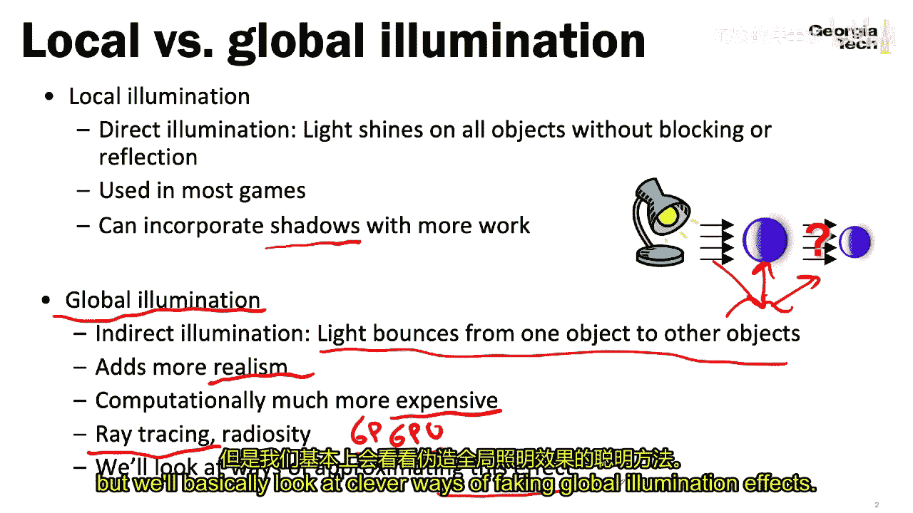

In 2012， there was a conference where a researcher at Disney published some of their work that they're using on what's called physically based rendering in movies。

 and it seems like every graphics programmer and the game industry either saw or read that presentation took a look at that work and decided to try to start putting it in video games。

 So this is an extremely influential piece of work。

 Notice that using physically based rendering doesn't necessarily mean something photorealistic。

 So here we have a couple of characters that are definitely not things that you would see in real life。

 the main idea here is that even though the characters themselves may be highly stylized。

 the various materials that make up the surfaces of the characters do respond to light the way sort of real materials respond polite。

 and the main thing this gives you is the ability to graphically change the way a scene as lit without having to go back and change the way that you are defining。

material properties on your objects and also very importantly。

 physically based rendering doesn't automatically imply that the scenes in your game are going to look good Certainly you can buy a bunch of cameras。

 you can buy a bunch of lights and you can try to shoot your own movie。

 but unless you have some experience in knowing how to set up those lights and set up those cameras。

 your production is still not going to look terribly professional。

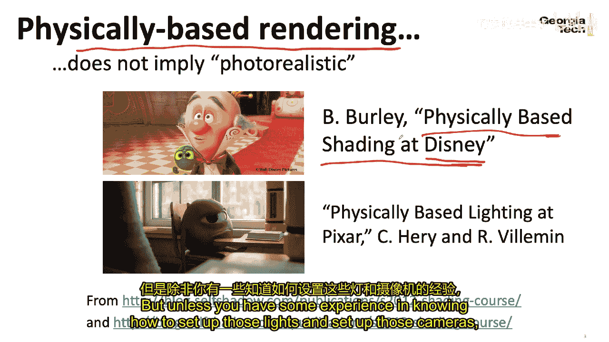

So here's a fantastic example of using physically based light and the fox engine that was used in metal gear solidd 5。

 and I'm going to pause here for a second and give you a chance to look over this and try to figure out which scenes are an actual photograph of a conference room at Cojima Productions and which one is rendered by their engine。

So there's a couple of main tells here， one is the reflection off of the posters。

 these are behind some sort of coating that's giving it a glossier reflection。

 and you can also see some subtleties in the way the light is working here if we look over on this side you can look at the reflections coming from these light sources that kind of blur out over here in the scene on the right。

I may be reading too much into it， but I think there's also some more subtle details on the backs of the chairs here than are on the right。

And you can also see the same thing about the glossy covering on the posters， so same question。

 take a look at these scenes and figure out which ones are real and which ones are created by the engine。

Okay， that was a trick question they are all created by the engine they did not actually bring a horse into their conference room this one is obviously not real you generally don't have things floating in space like this but this is fairly impressive。

I should give credit to a former Georgia Tech student， John Hable。

 he was working at naughty Dog doing video game graphics for a while I think his most recent gig is at Epic Game。

 he has two truly fantastic blogs and you'll find consistently that the latest greatest information for graphics and games is not something you'll find in scientific research papers and things you'll find in textbooks it's usually in the blog post by people who are trying to make these things work so John has a Bachelor of Science and a master of science in computer science from Georgia Tech and his blog has had a big impact on the way I think about physically based writing。

 his older blog filmming Games isn't up anymore， you need to go to the way back machine to find those articles but they are still fantastic and still very applicable。

So when people talk about physically based rendering， it's not one specific thing。

 it's sort of a combination of a lot of different factors The question of linear space lighting。

 this largely has to do with the way that textures are authored and stored and I'll deal with that in a future lecture two very important properties that will detail later in this lecture。

 energy conservation and reciprocity and these are particularly important if you are going to try to perform some sort of global illumination calculation。

Psically based rendering also makes a big deal about whether things are metallic or dielectric as an electrical engineering professor when I see the term dielectric。

 I automatically think about capacitors， but for our purposes for this class。

 dielectric basically means not metallic so anything that's not a metal is a dielectricPrevious techniques in computer graphics that were less physically based and more based on heuristics didn't have such a distinction Another interesting thing about creating a physically plausible model is that everything has specular reflections again we'll define those later in the class and we'll talk about it a little bit later in this lecture。

 even things like cardboard that you don't think about ours shiny still do have specular reflections and everything is going to have what's called a fnel effect you can think about if you're driving along and the road is made a blacktop you don't think about that as being very reflective but if it's been raining and you're at a certain grazing angle with respect to the sun so the sun's at the horizon。

That can essentially blind you。 That road turns into a mirror Now。

 in order to fully benefit from physically based rendering。

 it is good if we can actually have a level of resolution and a dynamic range in our video buffer to be able to handle the high dynamic range of realistic light sources。

 graphic techniques used in earlier games typically dealt with the limited dynamic range available in our memory buffers where we store the results of graphics calculations。

 you pretty much handle it by having very restricted ranges of possible light intensities。

 but realistic scenes that are physically plausible can have a wide range of different light intensities。

 Your eyeballs handle this by sensing light intensity on a logarithmic scale It's the same way you perceive musical pitch。

 It's the same way you perceive auditory volume。 It's why you can perceive both a jet engine and a pin dropping on the floor。

😊，And then there's a set of techniques to take that high dynamic range image and map it to the limited range of your display again。

 and we'll talk about those issues in a future lecture。

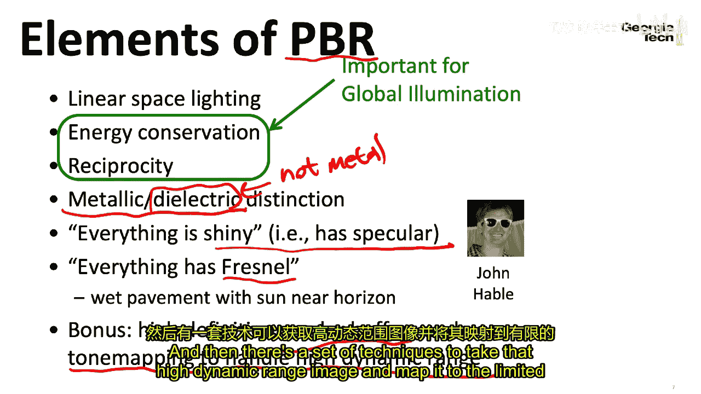

Modern game engines can handle a variety of complicated light sources， even in real time nowadays。

 but we'll stick with these simplest ones for most of this class so imagine that a directional light source consists of a bunch of rays that are coming basically parallel from something that's really far away and very bright。

 something like the sun something more local might be a point light energy radiating in all directions but that energy is going to fall off with distance so as you get further out is going to be less intense the same effect technically is happening with the sun。

 but the sun is so far away that these rays that are radiating out like this basically seem like parallel rays as far as something the size of the earth is concerned as we get further out the light intensity of this wave keeps being distributed over a bigger area and hence keeps dropping。

 but the earth or whatever our scene is is such a small limited range of ranges。

It' such a small limited range of ranges that that relative difference doesn't make much difference in terms of calculating the intenuation。

 so you assume these things over the course of your scene basically have the same intensity。

So a spotlight you can think of as a refined version of the point light that emphasizes particular directions。

So if we think about our objects sitting here in space。

 we'll have a happy surface and we'll think about the normal coming out of that surface。

 this is going to be essential for the lighting calculations we do。

We are also going to be concerned with the direction vector pointing towards the light source。

Some calculations we look at later in the class， not today are going to deal with a vector that's reflected at an equal angle around the normal。

There's going to be a vector pointing from that point on the surface we're trying to light towards wherever the camera is and computations we look at later are going to involve this thing called the half vector which bisects the light vector and the I vector or the viewing vector we can compute that bisecting vector by just basically averaging the vectors but then normalizing them again and I should mention all of this computation assumes that these have been normalized to have unit length so these have a length of one this is length of one everything here is a length of one this normal here is length of one the light the vector everything's been normalized to have a length of one and I'm emphasizing that because an extremely common error in doing graphics programming is to forget to do that normalization and there' are several places where that can turn into a problem One thing I want to emphasize is that these normal vectors are not the normal vectors we talked about in the backface coloning lecture those are things we're kind of competing on the fly for a particular triangle imagining that triangle is flat。

Vctors are derived from normals computed by the software used by your 3DD artist。

 something like 3D Studio Max or Myre Ber， that for each vertex will spit out a normal that's used in these lighting calculations and those normals created by the software try to encapsulate some information about the underlying surface that the 3D model is trying to make a coar tessellation of in order to spit out triangles。

So lighting has diffuse and specular components。 I'll briefly talk about specular later。

 but specular is so complex that I would like to do that in its own lecture so right now we'll just talk about diffuse lighting so diffuse surfaces are surfaces that are rough relative to the wavelength of light that's illuminating it and that's from the point of view of the light it may not look rough to your eyes a fun thing to do is to take a laser pointer and aim it at your table and hold it at something of an oblique angle and you'll see this weird spotted pattern that's because the coherent light coming out of the laser in your laser pointer can expose these rough details in a way that general incoherent light which is coming out of your light bulb coming out of a candle coming out of the sun is going to give you So because the surface is so rough basically when the light rays come in the energy that's coming in is evenly dispersed because of the randomness so it doesn't really matter with diffuse。

Sources where the camera is along as the surface is within the visibility range of the camera itself。

So how does that work here we're going to get into some physics So we're going to say that if the light and the normal on the surface are lined up。

 we've separated them slightly here just to try to not get the light vector and the normal vector confused。

 but you should really think about these as being on top of each other。

 if they are lined up like this and again， I should mention these are both assumed to have unit length。

 it's not clear from the way I did the graphics here。 anyway， those should both have unit length。

 So now if the light's coming in at an angle relative to the normal， again。

 it doesn't matter where the camera is we're going to have less light reflected towards us And if we're coming in at a 90 degree angle。

 there's essentially no reflection So the kinds of reflections that we get depending on the light that follows a cosine law of the cosine of this angle and the nice thing about this cosine drop off is that you don't actually need to compute it。

Tggnometric function of cosine for an angle you can get that cosine using from trigometry is just the dot product between the normal vector and the light vector so here you're taking each of the coordinates x Yz。

 and you're multiplying the x of the normal vector with the x of the light vector。

 the y of the normal vector with the y of the light vector。

 the z of the normal vector with the z of the light vector and adding those up。

So we'll also take this max here because if we don't。

 the cosine here will happily go negative because of the computation。

 but that means we're illuminating this object on the other side and obviously nothing is going to reflect there so what else is going on here。

C light is the RGB color of the light， so this is a triple and MDff is an RGB color of this diffuse reflection and the strange little multiply symbol here with a circle around it。

 this is a color wise product。 So this is red times red。Green times green。

 blue times blue of that triple of color values。That gives you another color value so for the doubles in the class。

 this doesn't represent convolution， this does not represent some sort of weird chronic or matrix product if you've seen those。

 it's just red times red， green times green blue times blue。

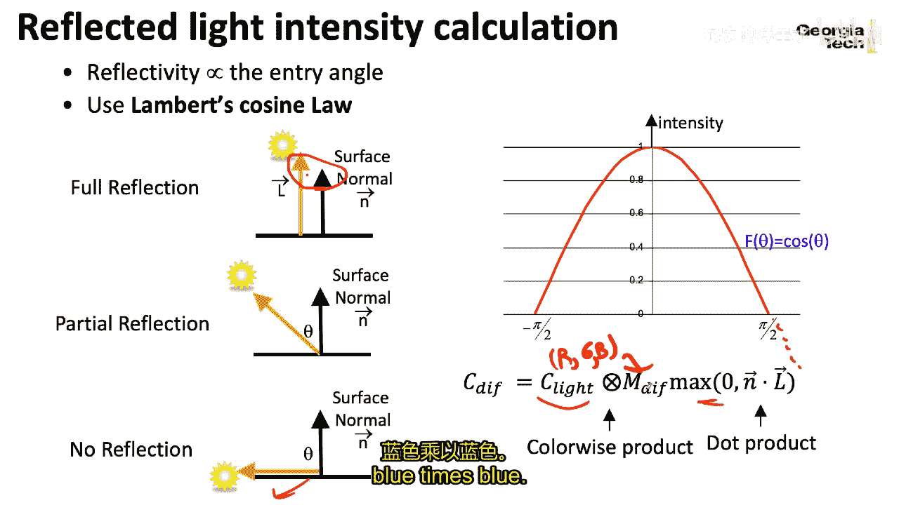

So specular reflection is more complicated。 Specular reflection is something that depends on the viewing angle of the camera。

 and if we add that effect to the diffuse。 and here I've also added a little bit of ambient light。

 So this is a bit of a legacy from earlier versions of this class that used more primitive ad hoc heuristic lighting models。

 ambience basically just a bit of light you add to everything that in an older game engine would try to represent sort of a general sense of bounce light all around the scene。

 Nowadays， we have much more advanced techniques to handle this that well look at later in the class。

 Specular lighting in earlier versions of this class。Use something called the B Foong model。

 the B Foong model is not physically plausible in ways that we'll see later。

 Now we can use some physically based specular models that are inspired by this。

 We'll talk about that in a future lecture。

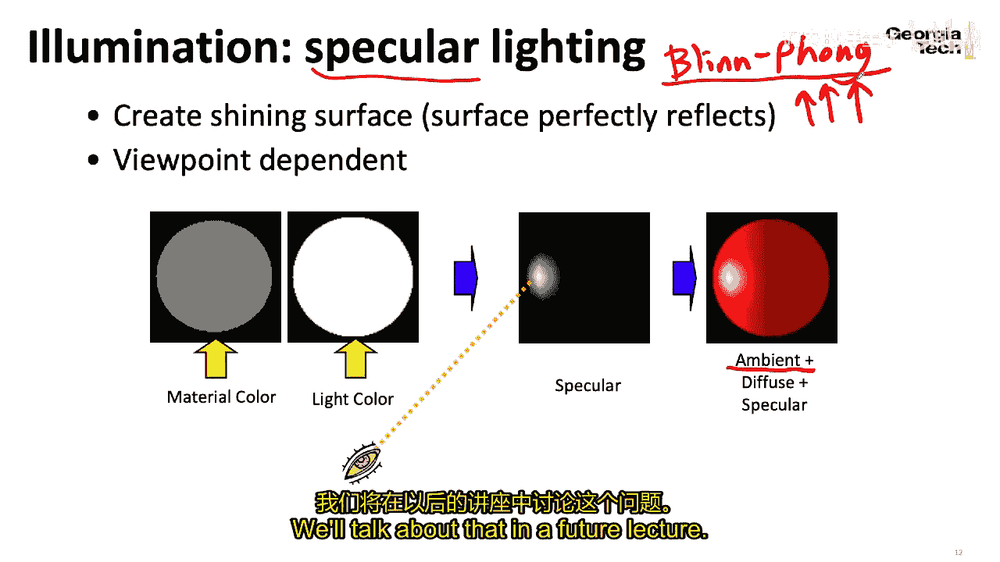

The formula that I showed you earlier looked very much like this if we did not have this part here。

 right， if we just put this diffuse color here。Then that equals what we had before。

 So what I'm showing you is a slightly more sophisticated and more general view。

 So here we have that lambberian term that computed diffuse light。

 but now we're including something called the bidirectional reflectance function。

 this is a function of that angle with which the light is coming in。

 although I should say when I say coming in， the convention is that the light vector is actually pointing towards the light source。

And same thing with the viewing vector it's pointing towards the eyeball So there's the eyeball Okay now for the case of diffuse lighting。

 there's a very simple bidirectional distribution function and it's just a constant it's basically this material color This allows us to later include specular reflections by having a more complicated BRDf where we can just add some sort of specular term to it and easily incorporate the diffuse reflections that we've already looked at Now you maybe wonder what's going on with the pis So this gets into some of the more gory details of the technical mathematical underpinnings of computer graphics the BRDf here has a pi in the denominator that acts as a normalizer and the way this the is defined I've toyed around with the idea of putting more mathematical details in this class。

 but I ultimately decided that for the purposes of this class I would like to focus a little more on the programming aspect and there's all kinds of book。

Some papers and blog posts you can read if you want to get more into details about things like why is there a pi there Fortunatelyly again。

 if you go to the underlying physics of math for most of the lights we're looking at or at least the lights we've looked at so far there's a pi factor that just shows up in the physics of this formula and beautifully if you combine these those pis wind up canceling out So when you look at shader code。

 you have to pay attention sometimes because sometimes you'll see a pi appear in a formula。

 sometimes you won't sometimes you'll see a BD like this where there's a pi in the denominator sometimes there isn't if it's something more complicated that's not diffuse maybe it shouldn't have the pi。

 it can get complicated because people will often say well I've got this pi in two places and if they wind up canceling why bother putting them in why not save the computation So BDs to be proper BDs i。

e。 to be physically plausible and that's what we're looking for we're not trying to perfectly match all the laws of physics that describe your scene。

We're trying to find models that may be approximate in certain ways。

 but at least sort of adhere to some basic physical properties and here the reciprocity means that we should be able to change the location of the light source and the eyeball and you get the same thing out that's called Helmholt's reciprocity obviously for this diffuse sliding BRDF we've looked at well it's just a constant so it satisfies that。

 but very importantly that Bnfong model that I mentioned earlier。

 this does not have this reciprocity property。

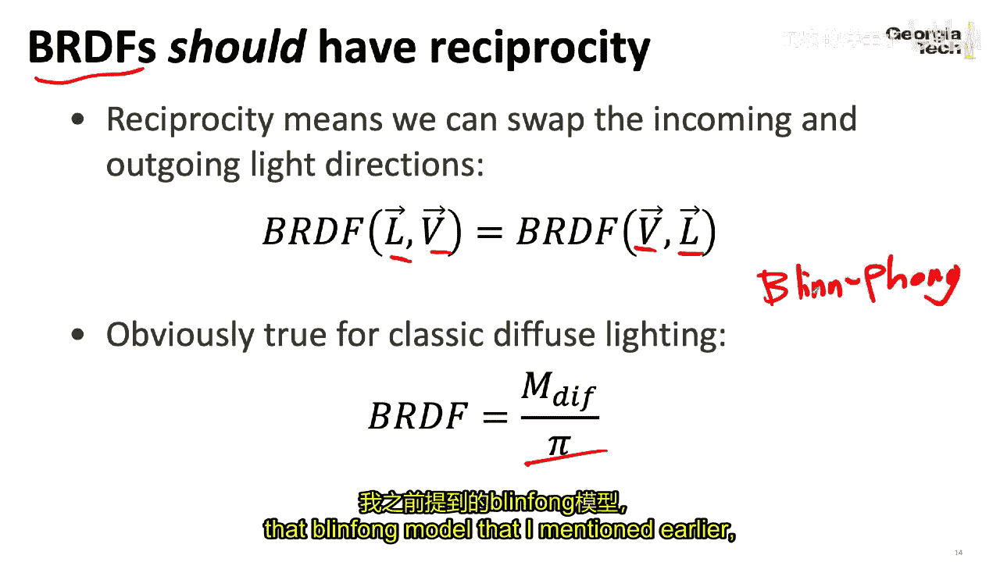

So another important thing BRDFs need to have in order to be physically plausible is they can't reflect more light than what's coming in again here we're talking about reflections。

 you can also have a missive surfaces things like a neon light or if you think about on your electric stove if you pass a current through your heating element doesn't just get hot it also glows it creates its own light technically for a diffuse model it turns out that you can't just pick any MDF you want it has to be less than one over pi so pi times MDF needs to be less than one again that goes back to some of the underlying physics a math which I don't really want to get into here。

But you know it's just a constant sitting there， so usually as this source Steve McCley noted。

 quite often people don't worry about this pie， you just say okay we're going to go with a certain convention and just say that artists。

 when you're authoring material properties for your red your green in the blue make sure each of those numbers is less than one and then that sort of gives a natural thing if you hit something with light intensity of one and the light hits the normal directly。

 you hit it head on with a zero degree angle while you get one back so that makes people happy but one thing to remember is if you are going to be writing some sort of complicated global eumination solution that is setting up some big matrix equation of some kind of whatever that is handling all of these bound light in effects then you might want to go back and worry about this because otherwise you might get an iterative solution that goes unstable because you have these surfaces that are technically spitting up more energy than came in。

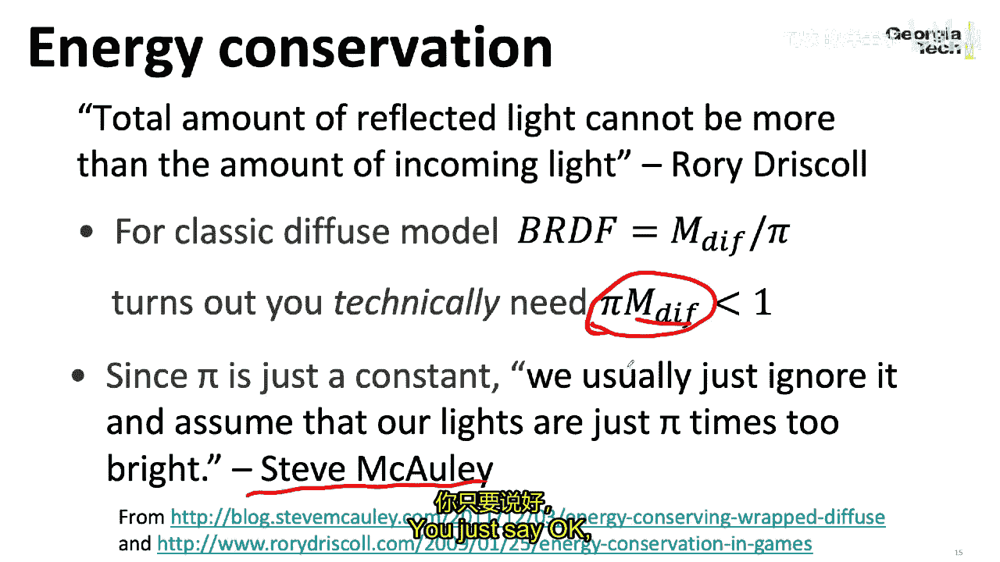

So returning to our light sources again， the directional light， it's infinitely far away。

 we're going to assume that we don't need to worry about attenuation with distance from the light over the range of R scene。

 but for point lights and for spotlights you may want to encapsulate the effect that the energy field coming out of this you know if you look at the amount of energy per unit area radiating out conservation of energy means you have less and less energy per individual bit of area that's radiating out here so you may want to take that into account that the light is going to drop off with range people will sometimes use a physically based model。

 sometimes they'll use a model like something like this where there's a couple of constants that you can set to get different artistic effects。

 this D squared that's physically a reasonable thing this D is not this linear term in D but you might select this to have some sort of artistic effect。

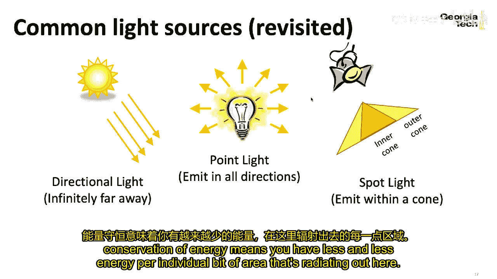

Different ways to formulate a spotlight no particular technique is necessarily better than others I'm going to show you one that I've seen in the CG tutorial that was published by NviIdia sometime back you can actually read that online now for free anyway here's the idea so we'll have a vector pointing towards the point that we're illuminating wherever that is on the surface and we'll have another vector that represents the direction the spotlight is pointed in again these are both assumed to be normalized to have unit length and what we'll do is we'll determine a fall off based on the angle here called alphabe them again we don't need to use the cosine we can just use a dot product one thing I want to mention as a bit of caution is that the lighting vectors we've looked at previously have pointed from the object to the light here to match up with the direction vector coming out of the light will have this lighting vector pointing from the light to the surface anyway this dot product here computes that angle we'll do the max again because obviously if we're at 90 degrees it's not going to be illuminated。

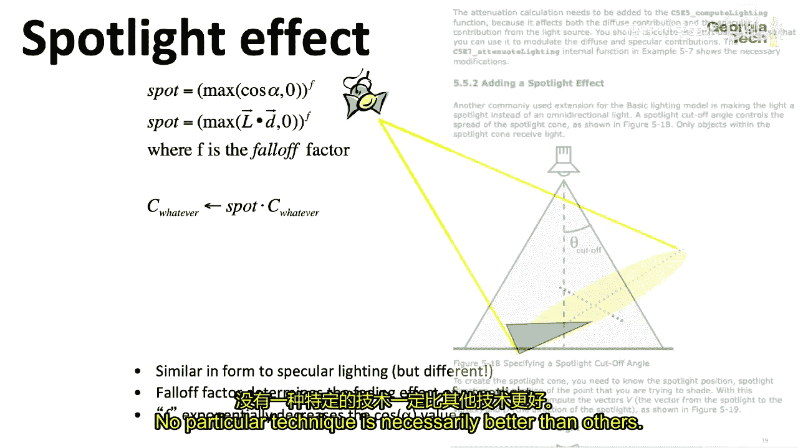

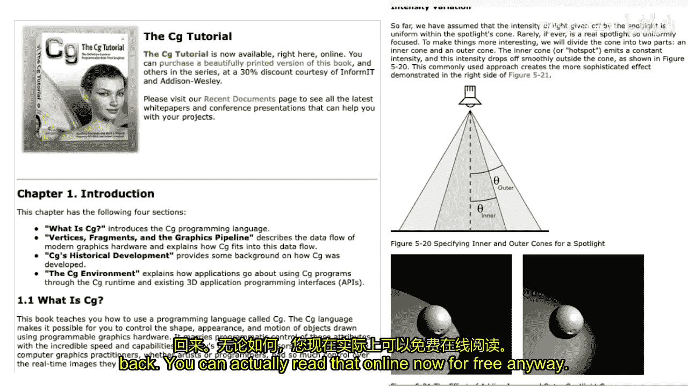

And what we have here， this F， this is a fall up factor and remember this quantity here that we're taking to the power of f is going to be between0 and1。

 and so if we take the power， what that's going to do is it will take that cosine shape and it will start to compress it in different ways so it might instead look something like this or it might then look something like this and so as we increase F。

 we're basically tightening up this spotlight effect。

The B Fong model I mentioned before used a similar computation to compute specular lighting and has similar control over the width of here a specular highlight。

 but this specular highlight I'm talking about is not the same as the spotlight effect All right so if you are not taking GPU programming for video games with me in the summer 2020 semester you can check out now but if you are taking GPU programming for video games with me in the summer 2020 and semester I would like you to do the following if you go to Piazza you will see a post labeled something like lecture 6 task or something along those lines anyway。

 what I would like you to do as the following。I would like you to once again take the first letter of your last name。

And I would like you to once again turn that into a numeric value in the usual way。

 let A be1 let Z be 26， we do something in between and then I want you to do something to that number but don't include the thing that you're doing that I'm saying here in the post because the whole point of this is I want to make sure that you've actually watch the video and that you haven't just copied what you see one of your colleagues doing when responding to the post this is just between you and me you person watching the video it was a student in my class and me take this number and add three to it Y3 because three is a nice number and it's the number of dimensions and XYz and it's the number of colors in RGB all right so I want you to do that that's the first thing now the second thing is just tell me a little bit about your interest relative to this class so basically you know things along the lines of why did you take this class。

Why did you sign up for this class and and this reason need not to be super fancy。

 it could be as simple as I needed one more class at the senior level and this is the only one I could get into this summer something like that we are offering a lot of classes so I assume there was assume there were them that drew you to this particular class in terms of interest things like are you interested in maybe writing a video game would you be interested in teaming with classmates not for the purpose of this class but outside of this class or perhaps joining with other people outside of this class to write a computer game do you have any interest of later joining the game industry or maybe not the game industry。

 maybe the game industry makes you much to run screaming and maybe you want to get into computer architecture and maybe you would want to design GPUs even if you're not writing for games Maybe you do want to do graphics programming but you want to make simulations for training。

Of some kind instead of games anyway。I'm not looking for a giant essay here。

 just a couple of sentence， why did you sign up for the class。

 you know what drew you to this class and a couple of sentence of sort of what your interests are relative to the subject material of this class。

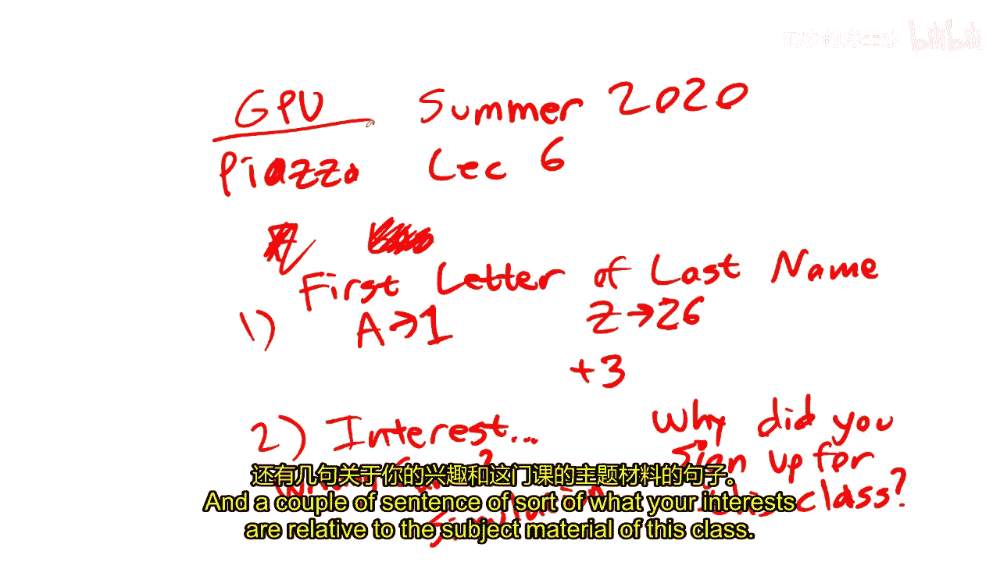