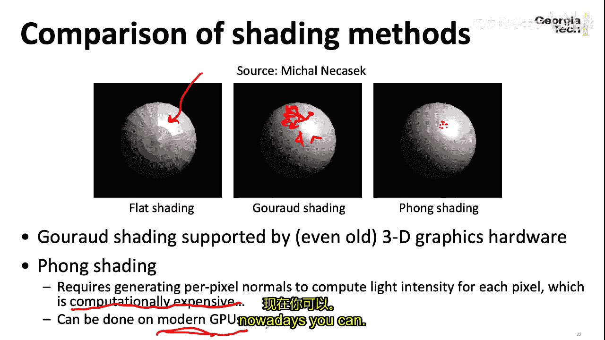
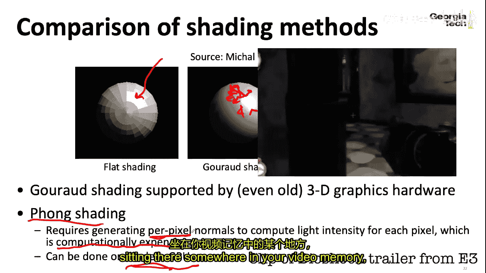
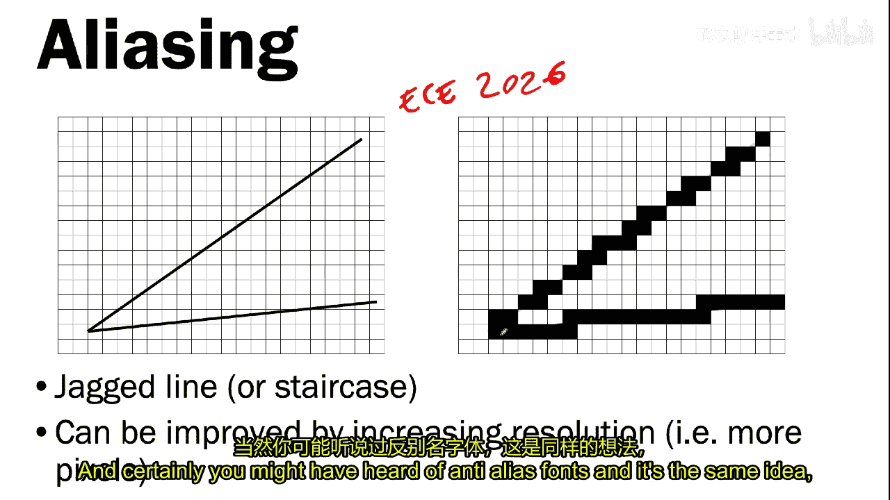
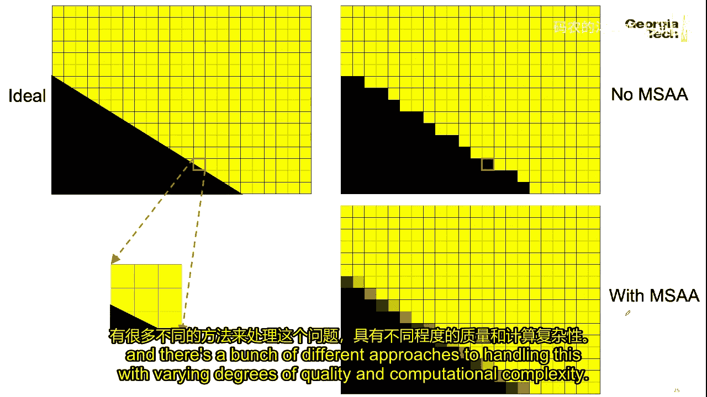

# 【全集】佐治亚理工学院-GPU编程：视频与游戏-中英字幕-p08-Lecture-8---光栅化--BV1GZfyBbEQn_p8-

Hi there。 My name is Er Laanttraman， I'm a professor of electrical and computer engineering at Georgia Tech and this is my quarantine hair。

 and I would like to welcome you to GPU programming for video games Today we'll begin looking at rasterization so we spent a while talking about lighting let's talk a little bit about rasterization your GPU is going to figure out which pixels on the screen correspond to pixels that need to be painted for a particular triangle and here we have a somewhat contrived example where the points of the triangle are red。

 green and blue One of the simplest techniques for figure how to fill these in is basically to compute a color for each of these and then interpolate between them that's called garrociating and it's fairly efficient compared to other techniques you can do because we're only doing a lighting calculation at the vertices and then we'll interpolate between them so you can imagine in a practical implementation where you would first interpolate across the line here to figure out the colors on the。

And then interpolate scanning across the individual pixels If this was the 1980s。

 you would probably be taking a computer graphics class where you actually write the routines that do this。

 but nowadays we'll just assume the magic on the card is going to deal with this for you。

Now there's some limitations in what we've talked about with gting。

 but at least they're better than flat shading， so here you might imagine that you compute a color that is the same for the entire triangle and you could compute that like color based on say the same normals that you would have used for backface calling but these give you an obviously faceted appearance and nowadays you would only use this really if you're deliberately going for a retro look or deliberately going for some kind of obviously computerary kind of effect。

Thegtiating definitely is an improvement， but here you can see that although themes look smoothed out。

 you can still see sort of a little bit of the effect of the way this surface here is broken up to triangles。

 but again， this is fairly efficient from a computation point of view because you're only doing those complicated lighting calculations for each vertex。

 and then you're just interpretating the resulting lighting values in between。

Newer graphics hardware can perform a separate lighting calculation for every single pixel in the scene。

 and what instead gets interpolated is the unit normals associated with the various triangles。

 so it interpolates the normal information and not the resulting lighting calculation itself。

 this is obviously a lot more computationally intensive because you're doing this dot product computation。

Between this interpolated normal vector and the light source for every single pixel but it does look a lot better and this is readily done on modern GPUs When I first taught this class how makes statements like oh but you couldn't do that on a mobile GPU well nowadays you can they are just that powerful the first game that I'm aware of that used extensive per pixel lighting also known as Fong shading is probably doom3 there might have been others but I think doom3 really pushed this per pixel lighting idea and now everything essentially uses this this is a big deal Unreal Engine 3 uses per pixel lighting that's why bioshock looks so awesome but really that's just the look of everything nowadays。

All right。So in addition to painting light information to a buffer sitting there somewhere in your video memory。

 we also are going to be filling out something called a Z buffer this is another image you're writing。

 but instead of containing color information， it contains depth information essentially what happens is when you're trying to figure out what color to paint in your image。

You first look at the depth buffer and you see if that pixel has actually been written yet at all。

 and if it hasn't， you write that pixel， but you also write distance information to that Z buffer。

 so later when you go to the color of a particular pixel。

 you first see if there's something in that depth buffer already indicating that there's already been a color painted for that particular pixel that is closer than the object that you're trying to think about right now。

 in that case you can discard this， you don't even need to do that computation。Z buffers， of course。

 obviously take up a lot of memory in general， whatever the number of pixels you have in your scene is that you figure out colors for。

 you will need that many pixels for your Z buffer and that can be a lot of memory。

 So something like the PlayStation1 doesn't have a Z buffer it will essentially try to sort the objects you're drawing and draw them back to front that's called the painters's algorithm but there can be weird situations in there where that gives you kind of slightly garbage G lookin results There's also the issue of well how do you want to represent these distances and you'll need at least 16 bits of resolution somehow in order to generate a reasonable z buffer that's not complete mess。

 although really you want something higher resolution than that and modern cards with big video memories will give that to you The way the distances here are stored is typically not a straightforward linear mapping we'll look at that later in the class when we look at some actual pixel shaders that deal with these kind of depth value to。

But the fun thing about modern GPUs is this kind of Z buffer check of seeing oh is the pixel we're dry closer to or further away This is all handled automatically by the hardware you just set some flags or API that tells the hardware to do certain things and treat these Z buffers in a certain way so the final issue I want to mention here is I've sort of assumed so far that you'll be doing a lighting calculation for every pixel on the screen if you're doing say per pixel lighting or what they calledong shading Now of course even if you have a massive screen with tons of pixels that is still limited resolution and if you just try to straightforwardly take the edges of your triangle and paint those onto the screen you will get these little jagged effects called aliases these are the same kind of aliases that we've looked at in a class called E2026 if you're a or computer engineering student at Georgia Tech and in that class sometimes we' have a assignment on aliasene of images where you see what happens if you take。

I and you just drop samples from it if you just drop。

 say all the even numbered rows and all the even numbered columns。

 you can get some really janky looking effects and certainly you might have heard of antiallias fonts and the same idea you want things to be blurred out a bit near the edges。

And one of the ways you can approach this fairly easily is to simply compute the image at a higher resolution than you can actually display and then average nearby pixels in some way。

 so you wind up with a slightly blurd edge， but you don't get this stair step effect and there's a bunch of different approaches to handling this with varying degrees of quality and computational complexity。

