# 【全集】佐治亚理工学院-GPU编程：视频与游戏-中英字幕-p09-Lecture-9---纹理导论--BV1GZfyBbEQn_p9-

Hi there， my name is Aaron Lanchman， I'm a professor of electricallect and Comp engineering at Georgia Tech and this is the ninth lecture in the summer 2020 offering of GPU programming for video games and today we're talking about textures。

So textureexs were devised because if you try to build an object out of a bunch of tiny little triangles where each of the vertices of that triangle has a particular defined color you would probably find yourself using a lot of triangles and it would be particularly wasteful for something like a billboard that you could just render the main surface with two triangles it would not be a great idea。

 efficiencywise either in terms of memory or computation to have a whole bunch of individual triangles representing all the varying colors over the various bits of paints of the billboard so the general idea here is that we're going to have these 2D images。

 these textures and think about them as having texts instead of pixels。

 the pixels are the final little squares or rectangles if you're playing an old school game on a television or an old computer monitor those things are the pixels the texts are like the pixels of a 2D image that's going to be stretched around and play。

On the objectSo previously we've talked about the vertices that make up your object having threedimenal positions and the object space as used by your 3D artist in something like blendnder or Maya。

 those will also have for each of the vertices and associated normal vector that's used in lighting calculations and historically those have also had colors associated with them。

 but nowadays we pretty much put color information into these textures。

 so to the extent that people use quote vertex colors unquote those are usually used to contain some other kind of per vertex information。

But now we'll have something additional we're adding to this。

 each vertex is going to have a two dimensional vector coordinate that sort of represents an index into a particular part of the 2D texture image。

And just like with every other coordinate system we've looked at。

 there is no consistent convention for textures， Direct 3D or X and A used 00 in the upper left corner and 11 in the lower right。

 whereas OpenGL and unity uses00 for the lower left and 11 for the upper right。

 and unity and Directx 3D and X and A all used UVV to represent what you would normally think about as X and Y coordinates。

 OpenGL would tend to use the variables S and T， obviously we don't use x and Y here because we want to reserve those for either the first coordinates in the X Yz coordinate space or the X Y coordinates that actually indicate screen positions in some way。

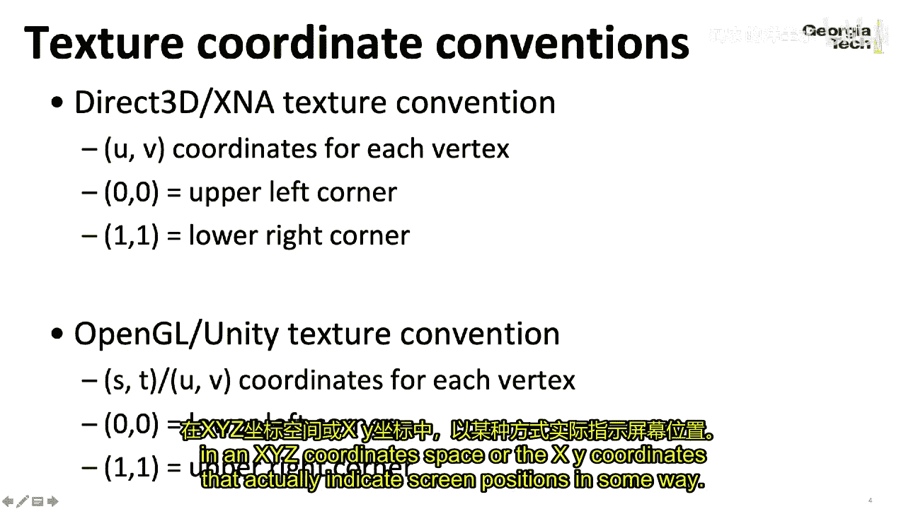

So this is what I looked like in my younger days before my hair started turning gray。

 that's a MOTM synthesisthesizer by synthesis technologies。

 and that synthesisthesizer was actually built by the students in the first offering of what's now called analog circuits for music synthesis that was way back in spring 2006。

 and my students built that from a kit。One of these days I may redo these slides to use the Unity convention because that's what we're using nowadays but this GPU course began its life on the X&A platform so we'll go with that for now but you'll get the basic idea this is not being done by any sort of GPU anything this is just an example faked in PowerPoint so we've got a nice little rectangular box here and we can take my face and map it onto the surface。

This is Sean Lee that we're mapping onto the top surface there。

 He was a professor at Georgia Tech who created the first version of this class with me and we taught it for three years together after which he left tech and went back to industry and basically the vertices that you define will have pointers into the textures and then generally you can imagine that you sort of are more or less linearly interolating between those texture coordinates to figure out what the actual lookups into the texture should be。

 there is a slight modification for that。 if you just try to linearly interpolate the texture values that will lead to problems if you are doing perspective projection。

 Fortunatelyly there is a correction for that。 and nowadays that's just sort of magically handled by your graphics card。

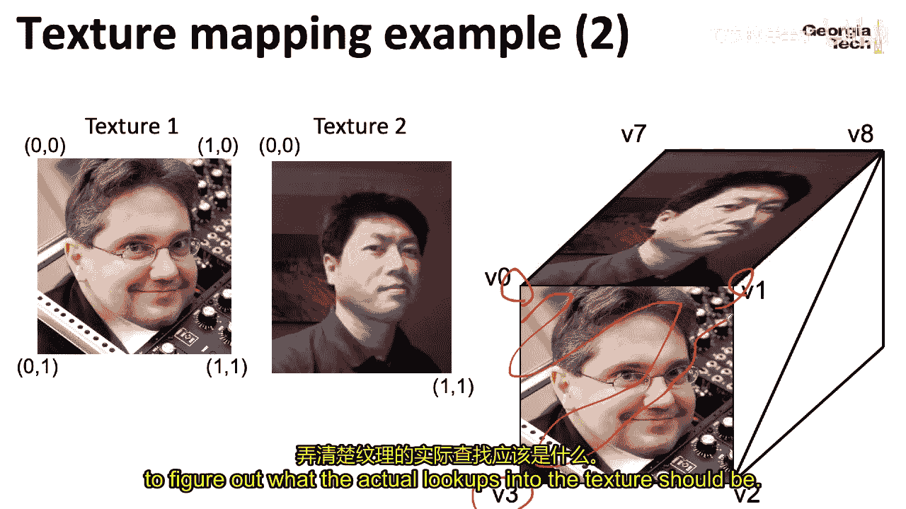

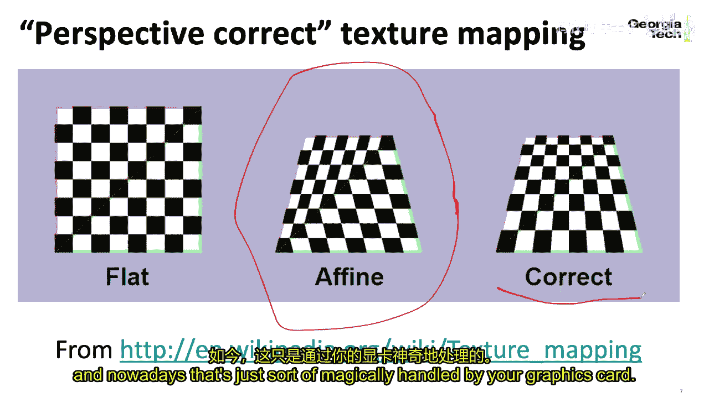

So there's a trick you can do with these texture coordinates these texture coordinates are all reference sort of modo1 so if you give it a texture coordinate that is bigger than one or for that matter if you give it a negative texture coordinate you can set different modes in your API one of those modes as a clamp mode which will basically take say this last column of pixels and replicated infinitely but that doesn't have a lot of use cases。

 usually you will set your API to use a kind of rap mode which will let you tile your texture if that's something you want to do and this is often used for things like a wall texture in a game。

 this can lead to a problem if the player notices a repeated pattern that's unrealistic clearly no actual brick wall would look like this a trick people will often use is to actually superimpose several textures and we can look at different ways of doing that later when we look at shader code and they'll have these two textures of different sizes。

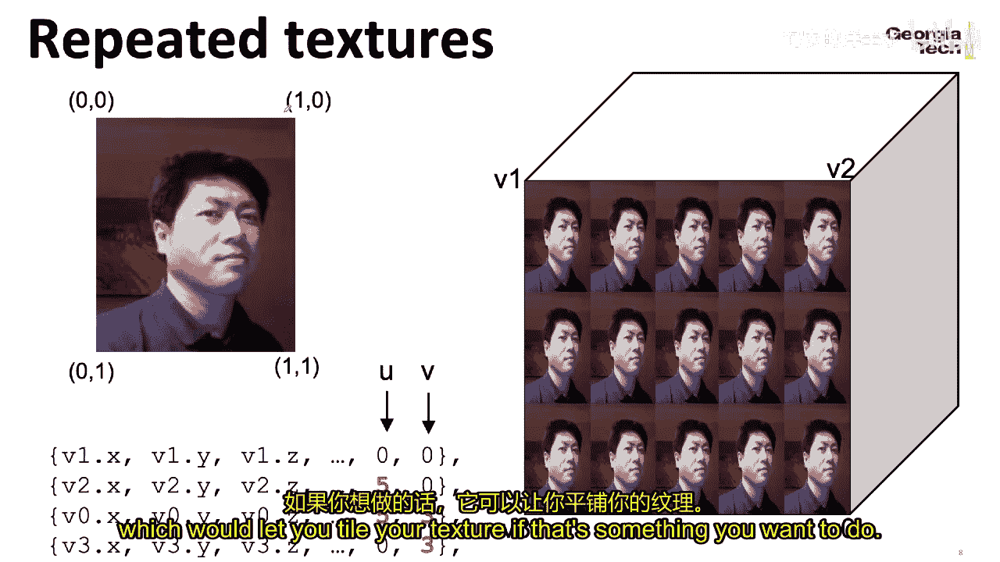

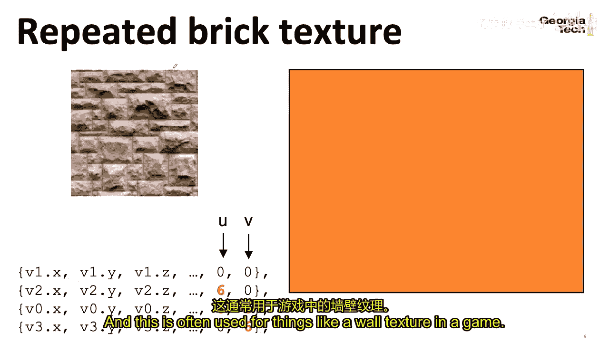

So they're repeating at different rates， so they'll sort of go in and out of phase with each other and break up that obvious repetition。

There are a lot of tricky practical issues that arise in dealing with textures。

 Let's try to keep things simple for the moment and just assume that we're looking at a square head on on the screen。

 you'll often have situations where you may be zooming in pretty close to a texture and the pixels that actually show up on the screen are a lot denser than the texts that make up the underlying texture image。

 And there's different ways to deal with this kind of magnification effect here。

 One of the easiest would be for each pixel on the screen， you just grab the textel aka。

 the pixel of the texture image that's closest in terms of the corresponding texture coordinate。

 And this is the sort of thing you'll see in games from the 1990s。 For instance。

 if you play the original PlayStation 1 version of metal gear solid。

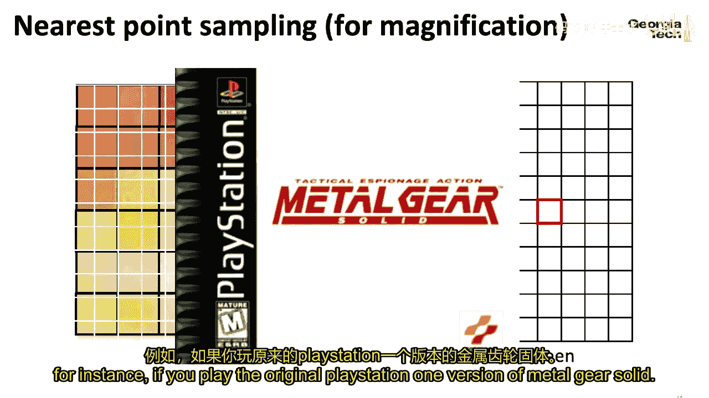

It doesn't wind up looking terribly great， so something you could do that would be better and wouldn't be too much more computationally intensive would be to take the fourtexiles that would overlap with a particular image pixel and just average those values。

Now this obviously isn't the best thing you could do because if you think for a second。

 there could be a whole bunch of different possible image pixels that would overlap the same four texts and it wouldn't make a lot of sense for them to all show up the same a better thing to do would be to use something like bilinear interpolation and this is a thing that shows up as an option and Photoshop when you're changing image sizes so this is more computationally intensive but you' would only really worried about that if you're having to write a software renderer nowadays even the most primitive GPUs would handle this for you and hardware。

 but I'm mentioning all of these things because the kind of interpolation is often a parameter you can set in your API。

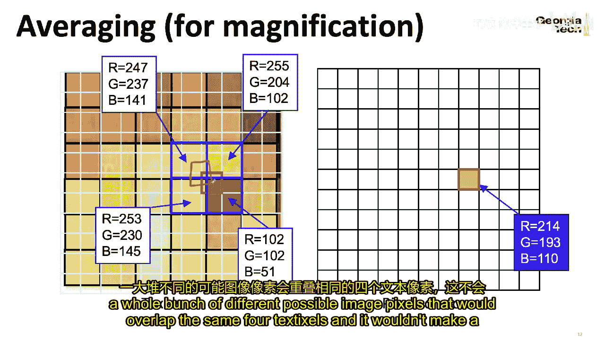

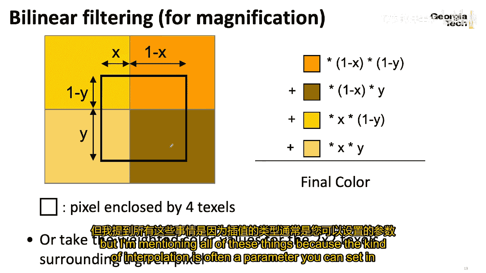

You can also run into trouble perhaps even more trouble going the other direction supposeose you zoom way out and you don't have a whole lot of pixels on the screen on your object but you do have a very dense texture image and this case a particular pixel on the screen may correspond to a lot of the texture image pixels which we're calling texts here and this can run into a lot of issues and trying to figure out what actual color to put here can get you into a lot of trouble more so even than in the magnification case and that has to do with sampling if you just grab the text that is nearest to the center of the image pixel you're trying to write and you do that for each of these you can wind up with some very odd effects because of aliasing imagine for a second that we had a car and in case you're wondering I'm drawing this using the trackpad on my laptop but this drawing would not be of any higher quality even if I were given much more sophisticated tools anyway。

Iine that somebody went along and painted this perfectly vertical red and white striped pattern。

Now imagine that we happened to place this vehicle such that it perfectly lined up with the pixels in our image。

 but we were using this nearest neighbor scheme and our pixels happened to pick out all of the vertical stripes that were red。

In this case， the player might think that you had a red car， on the other hand。

 if the car just moves a little bit and all of those sample points lined up with the vertical white stripes。

I think that's a band the player might think it's a white car and then if it's zooming along at just the right rate。

 it would look like it was flashing back and forth between a red car and white car。

 you can get all sorts of weird effects called moray patterns when you use this kind of nearest neighbor sampling and you'll see this in old 90s video games。

 particularly in textures that are very far away。

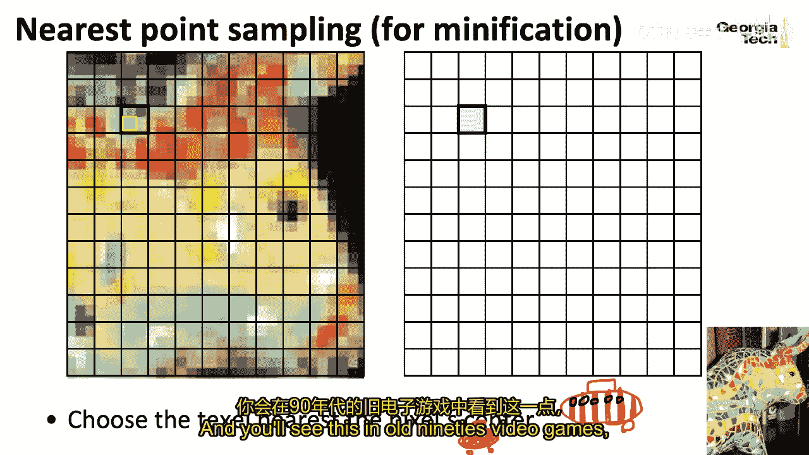

So just like with the magnification case， some simple averaging could help with doing minification here。

 you could just grab four of the nearest neighbors in an easy ad hoc fashion and then average those values together that would avoid some of the alias in issues but if you are really far away from this texture you can still run into problems and we'll talk about that when we talk about mi mappingapp and certainly a brighter approach would be to do some sort of bilinear interpolation at least just like we looked at in the magnification case and to be clear it's not like you can set different interpolation approaches for minification magnification you have to pick one interpolation approach for everything and depending on your object you may have a case where within one single texture there's places where it's quote unquote minifying and then places where it's magnifying just different parts of the same texture wrapped over a surface so even if you do this kind of averaging trick if you're quite far away。

You may still run into these kinds of sine issues One approach to handling that is called mi mapping and here you create a series of textures of different sizes。

 usually each one is twice the size of the other that are essentially the same texture but at different levels of detail and then so you could go in and grab whichever of these textures has the most appropriate detail for the particular part of the image that you're showing usually something like unity you can just load in a texture and it will automatically create all these mimaps for you usually just doing some very simple averaging and downsizing but you could have an artist custom make some of these levels if there was a particular artistic reason to do so and in addition to dealing with aseine issues。

 these can be good from a performance point of view and that there may not be much point of using up all the texture memory in your GPU for some giant texture if a smaller texture might be more appropriate。

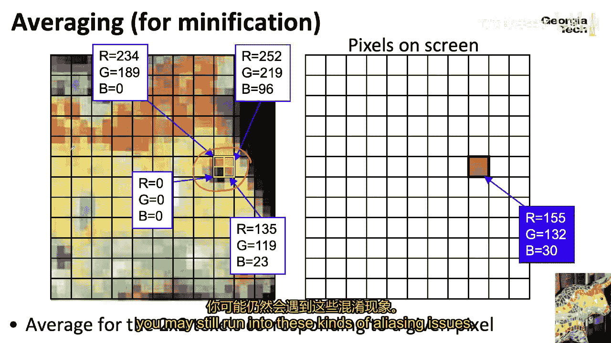

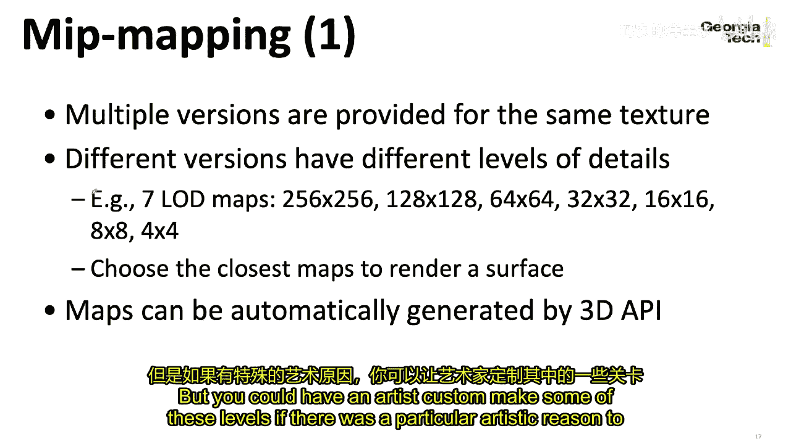

We have these different textures at different levels of detail。

 we don't necessarily have to pick one of these you can actually interpolate along this MItmap dimension MI。

 by the way， according to Wikipedia stands for Moltum and Parvo， which means much in a small space。

So in this triallinear interpolation scheme you would find the two MImaps that were at the most reasonable level of resolution for the pixel that you're trying to write。

 you would do interpolation calculations for each of those individual mi mapps and then you would take the results of those interpolation calculations and then linearly interpolate between the different MImaps and you can wait that accordingly。

 so if the map on the right was a better match than the map on the left you would weight the map on the right higher and again nowadays you can set a setting in your API and the card will handle these details for you in hardware One problem with all of these various interpolation schemes we've talked about in terms of two-dimenal interpolation is that they inherently blur your texture there are some more sophisticated techniques that basically do a kind of edge detection operation and we' try to avoid blurring along edges this is more expensive but again a more modern。

 more powerful card。

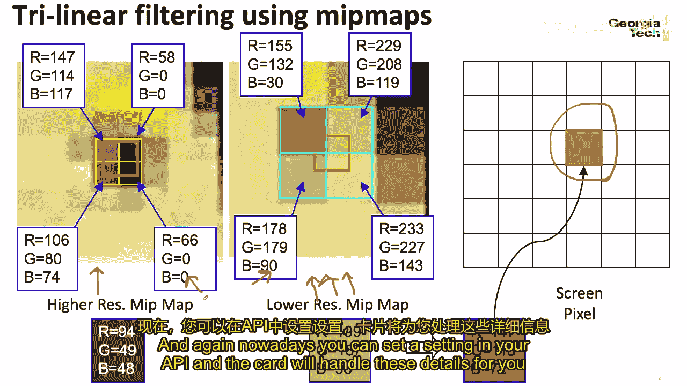

can handle things like this and if you're wondering what anisotropic means， well。

 it means not isotropic， and I realized that was not a useful answer。

Iotropic means that it would essentially whatever it's doing。

 it's doing the same effect in all directions， so an isotropic blur is rotationally invariant here it's trying to detect some edges so this is definitely not an isotropic operation。

If you are not taking GPU programming for video games with me in the summer 2020 semester you can check out now。

 but if you are I want to make sure you're watching these lectures My main question here isn't really GPU programming related I'm just curious I would like to make sure you've actually watched the video I would like you to respond to an appropriately titled post on Piazza that I'm going to make with the second letter of your last name Turn to a number just give me the number don't give the second letter of your last name and then give the number because then people who haven't watched the lecture I guess the formula this is just between you and me person who has actually watched the lecture and me the main thing I want to know is do you play any music instruments one or more If so which ones if not that's fine I'm just sort of curious。

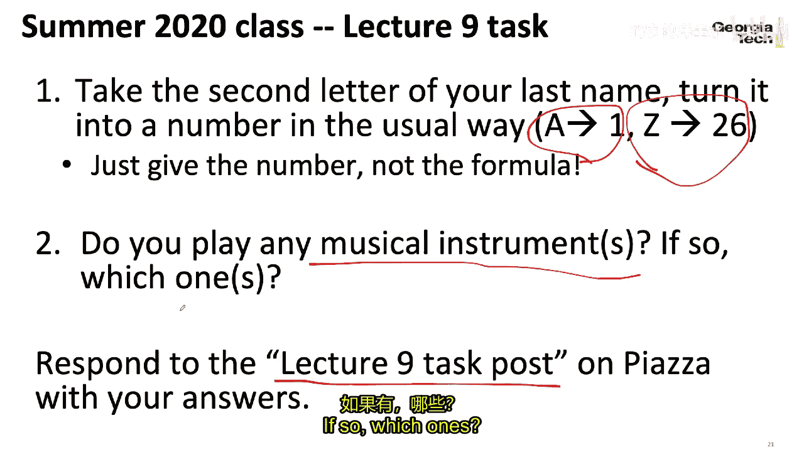