# 【全集】佐治亚理工学院-GPU编程：视频与游戏-中英字幕-p10-Lecture-10---高级纹理技术--BV1GZfyBbEQn_p10-

Hi there， my name is Er Lanchman， I'm a professor of electrical and Comp engineering at Georgia Tech。

 and I would like to welcome you to the summer 2020 offering of GPU programming for video games。

So the title here is a bit of a misnomer， none of the techniques we'll be looking at today are particularly exotic。

 pretty much any modern 3D engine will use them and any modern GPU can handle them without much difficulty。

 but they are examples of using textures for things beyond just say the basic RGB diffuse color of an object。

One of the most common techniques in games is called normal mapping。

 you'll also see the term bump mapping used， you could argue that there's a difference between them but I'll tend to use them interchangeably the general idea here is that objects by themselves just defined by their vertices can look a little boring。

What we'd like to do is to put additional detail in the surface for instance。

 to show a rough surface without having to add additional triangles so here we're specifying a bump map this is also called a height map the grayscale level here indicates a height perturbation above the surface and then we can render the object using that height map to get for instance this cool looking orange here the geometry of this orange here is the same as the geometry of the sphere there's no additional vertices here it's strictly a trick done in the lighting calculations using this bump map information Now what's actually used in the rendering algorithms nowadays isn't the raw bump map will instead compute something called a normal map and we're going to store those normals in the red and green and blue slots of a texture。

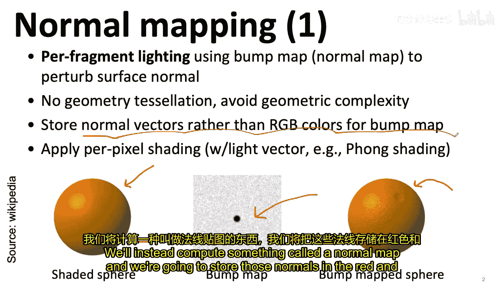

Here's another example。 I have a nice little taurus here， Aka， a doughut。

 and it has a diffus texture on it， but it looks kind of boring。 So on the right here， again。

 the vertex geometry has not changed at all。 This is an effect that's pulled off in the lighting calculations using this normal map。

The normal map represents a perturbation of the raw interpolated vectors provided by the normal stretch of the vertices。

 the per vertex normals。If you use normal mapping with a normal map that looks like one on the left here where everything's pointed straight up。

 you would get this base object here， it would not look like you were applying any normal mapping at all。

 the arrows indicated at the various texts in a normal map if they're pointing straight up。

 you can think of those as pointing straight out of the surface so they're not pertuurrbing any of the normals it's when you start making little variations here that you can get effects like this。

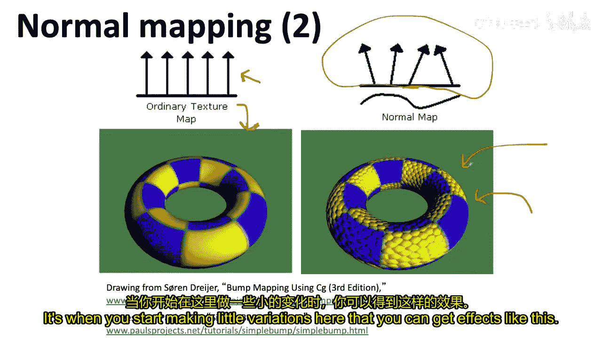

Normal maps can be authored in different ways， quite often an artist will create a height map。

 something where the grayscale indicates height in something like Photoshop on the left here we have a twodimensional conceptual example where the grayscale values in this texture indicate height variations and then you can run it through a piece of software that will use that height information and take a guess at what the normal perturbations are for each of the vectors along the surface this was done with the magic of PowerPoint。

 all of these vectors should have unit length although that's probably not the case if you were to zoom in on this because these are just lines drawn in PowerPoint and we didn't do anything particularly fancy to make sure they are all the same length Pre they're the same length。

So a game engine like Unity and I'm guessing many others will provide the ability to create normal maps from hype maps in whatever their editing software is or you can write your own tools or use somebody else's tools let's take a look at a normal map example that you can find on the web you can load in one of these hyp maps and it will provide a normal map for you as seen here on the right。

 and I'll talk in a second about why it has this weird particular color pattern。

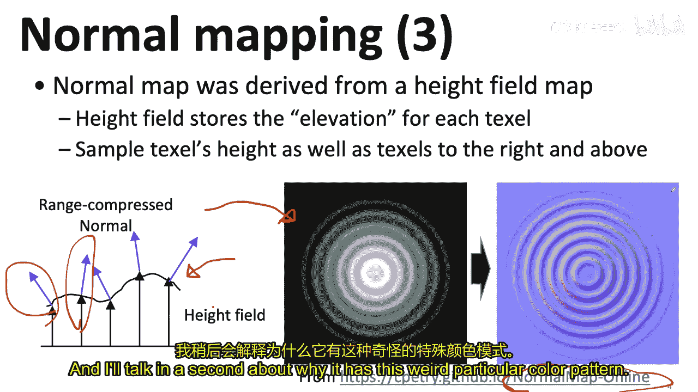

Okay so let's take a look at this normal map do online website this is really cool you can drag and drop a picture over here it will turn that into grayscale and make it into a normal map this is the default image and you can play with different parameters here's the strength parameteroo that's neat it shows you a little spiny cube over here that's kind of fun there's a level parameter here。

play with these in different ways， I'm not going to bother figuring out what these all do exactly。

Bluur sharp， this probably is doing some kind of uncharharp masking operation over here。

Different filters here's a map to a plane oh this is all of the fancy features turned on let me just put in the normal map here there we go looks like you can load your own object if you have it in the OBJ format。

Here's the sphere。Here's that mapped to a cylinder。

And you can really see in particular in the sphere that it's faking an effect。

 you don't see any dips into the sphere。Ooh a teapot everybody needs a teapot all computer graphics is based on teapots that was kind of fun again。

 unity has these kinds of facilities built in， but this is kind of cool in its own right。

So to compute the normals， you basically want to take the partial derivatives of the height field along the various directions。

 so here we're essentially doing a calculus type trick of using a first difference in the horizontal and in the vertical direction in order to compute approximations to those partial derivatives。

And we do need the resulting normal to be normalized to have unit length。

 and if you work through the math of this， you can see all you really need to do is stick a1 and the Z coordinate。

 that's the up coordinate， and then divide it by its length and that will work out。

So in the places where you have 001 that's no red， no green， but all blue。

 that corresponds to that height field that's pointing up and that basically represents no perturbation。

 so that would be a smooth surface wrapped around your object。

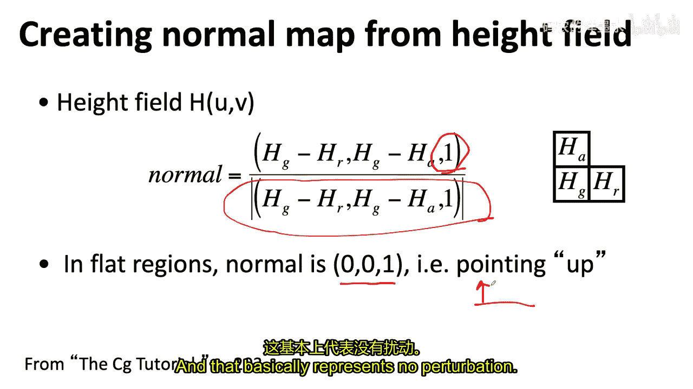

And that's why you'll typically see these big blue sections in the normal map and you'll see red。

 along areas like this because that represents changes in the horizontal direction。

 and you'll see green and spots like this because it represents variations in the vertical direction。

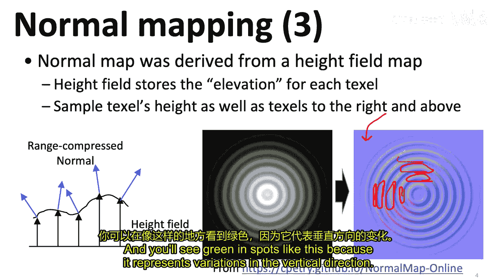

So back in the day， you didn't have a lot of computational power available to do fancy lighting tricks。

 so artists would often include shadowing effects in the textures that they would create in something like Photoshop。

 and you'll see a lot of games in the 90s that will have a particular look but those shadows aren't terribly realistic。

 Nowadays， you would like your main color map for your diffuse lighting to not really have any lighting information in it。

 if you're using photographs as your main source， you would really want to try to get a situation where youre looking at the object head on and you have uniform light around the scene。

 So then you can put the effect of lights in different places into your real-time calculations not have them already baked into the texture。

 But even if you were to do that if you just place this on a wall and you moved a light around。

 it would look like somebody had taken a photograph of this wall。

And just wall papered it on the wall。 You really want to get the effect of seeing all these various nooks and crannies as the light moves around。

 We could include normal map information when doing the lighting calculations。

 And here you see the same sort of a general effect。 all of the places that are heavily blue。

 those are relatively flat。 but the places where you'll see the red and the green。

 Those are places where you'll see the lighting changing because of the normal vectors being perturbed。

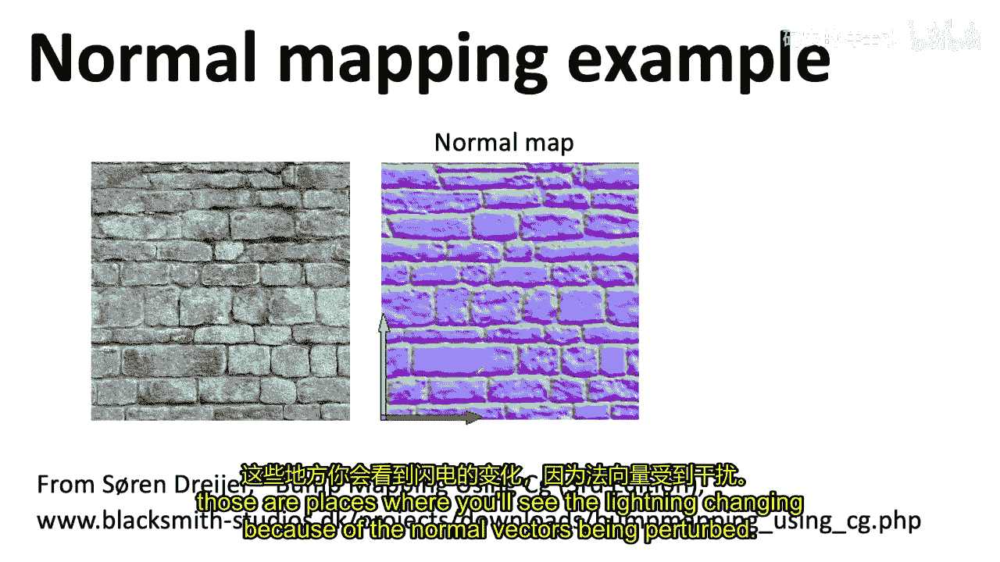

And then if we include that information you can get something like the image on the right which would look even more dramatic if we move the light around This lecture is basically a preview of some of the techniques we'll be looking at in detail later。

 so I will show you how to implement this in shader code and do some demos using unity where objects are spinning and lights are flying around This is just a little teaser trailer for the techniques we'll be looking at in detail later So this is one example of using the RGB color entries in a texture to represent information that's not RGB colors it's something else。

There is one little sticky point， which is that although the z value of our normal is going to be positive。

 it will have to be between0 and 1， it can't be negative because that would then be pointing into the object but even though the total length needs to be equal to one the x and y values themselves may swing all the way down to negative one and our Rrgb colors have to be positive and in particular modern shader hardware may expect them to be between0 and1。

 So we can easily handle this in our shadedr code。 we haven't looked at shadedr code yet。

 but I've assumed using Cc plus plus C sharp jascript some sort of language that has curly braces and semicolons So we'll take our normal value and then multiply it by a half so then we'll have something going from minus a half to a half and then we'll add a half to it to give us something that's going between0 and1。

 So that's what we need to do when we author these normal map texture。And then in the shader code。

 when we read that value back， we'll subtract a half to put it back to this minus 0。5 to 。

5 range and multiply it by two to give us that minus one to one range back and this is just one example of using a color slot in a texture to represent some kind of piece of information besides an actual color that you'll use in the rendering。

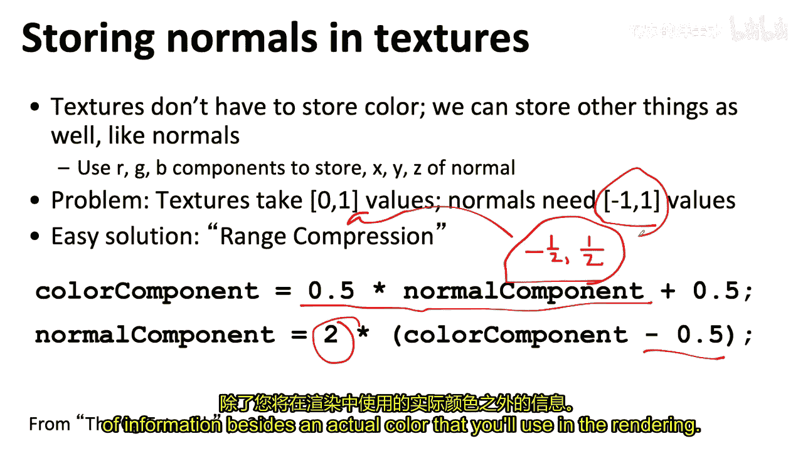

Here's another technique where the texture values here are indeed RGB colors。

 but this is now a very different kind of texture this is something called a cube map and you can imagine going out into the world and taking a camera and pointing it up down left right forward and back and each time you do that you take a picture and then you load those into Photoshop and you spend a massive amount of time trying to get the edges to line up just right and then what you've built is basically a description of the overall light environment of the scene this is the basis of something called imagebased lighting which we'll be looking at in detail later for right now the main thing is that this gives us the ability to make some really cool looking kind of reflection effects you can go out and author your own cube maps in different ways by taking photographs or you could do it and your 3D rendering software you don't necessarily have to be limited by what your game engine can do。

Unity and other game engines can create these cube maps for you and either create them at the beginning of some scene and then use those or actually update them during the game now that's going to be really computationally intensive the only thing that can really save you there is the fact that you can render these cube maps at a smaller resolution and still get decent results and you could also pull up tricks about like not updating them every frame or maybe you cycle through these six directions and you only update one of them every frame or something like that but if you are willing to take that extra computational time then your cube maps can reflect the dynamics of your environment in the way the objects are moving and entering and leaving the scene and that can be reflected pun intendedended in your reflections so the teapot here is reacting to light in a specular fashion This is very different than the diffuse sliding we've looked at so far。

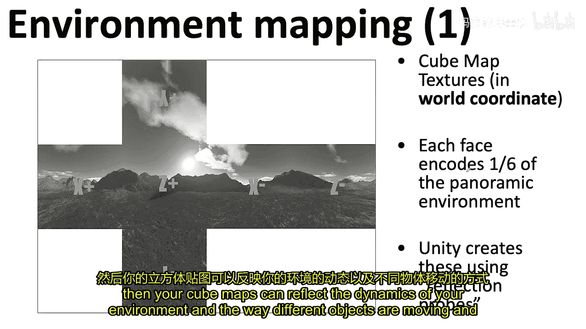

The models used for specular and modern games are pretty complicated。

 so we'll actually spend a whole lecture on that later。

 but for right now let's just do some perfect mirrors and assume that your objects are perfectly reflecting the environment like coming in from your Q map。

This is very different than the diffuse lighting here instead of specifying a particular light source。

 the light is sort of coming from all directions and where the camera is is very relevant to how this is going to look that's not the case for a diffuse light the whole idea behind diffuse lighting is that light would bouncer around in the surface wherever it came in and it will kind of go equally all directions here to figure out what we're seeing in a particular point we want to take the light ray here and reflect it around the normal of the surface to figure out where we want to look up things in the cube map I'm not going bother doing the geometry here。

 there's usually a command built into shader languages to compute that reflected ray for you and if not you can just implement it with this equation I'm not going to bother going through the details of the geometry you can just take this on faith and to look things up in the cube map shader languages will typically also have a particular command to handle that。

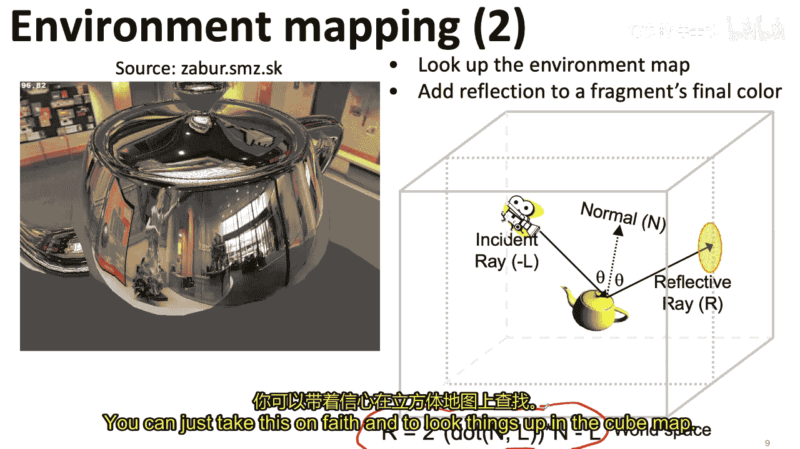

So what we'll see later is to do a usual texture lookup well use something called tech 2D and you give them your texture coordinates either specified as Ucoma V or S comma T depending on your particular convention but Tech Cube is different Tech cube you actually give a 3D vector and that vector doesn't need to be normalized。

 it can just as long as it's pointign in that right direction。

 it will figure out for you which of those six textures it hit which of the six faces is relevant and then grab the appropriate textel interpolated if desired from that particular image this effect was popularized in movies like the abyss and Terminator2 by James Cameron。

Both those movies had CGI with a lot of shiny reflective surfaces at the time those would have been computed offline。

 you wouldn't have been doing those calculations live。

 There wasn't enough computing horsepower to do those kinds of calculations live So here's this first Q mapap texture example that we showed and you can show it here both with the Q mapap image in the background and showing it reflecting off the sphere and if you wanted to have more fun you could actually combine these。

 you could put a normal map on the sphere and give it a rough surface and that could look pretty awesome we'll do something like that later Now I've been using the term RGB GPs like to do everything in groups of four and we do have four with the X Yz W for our fourth dimension when we use homogeneous coordinates So it makes sense to go ahead and add a component to our RGB and that fourth component is called Alpha。

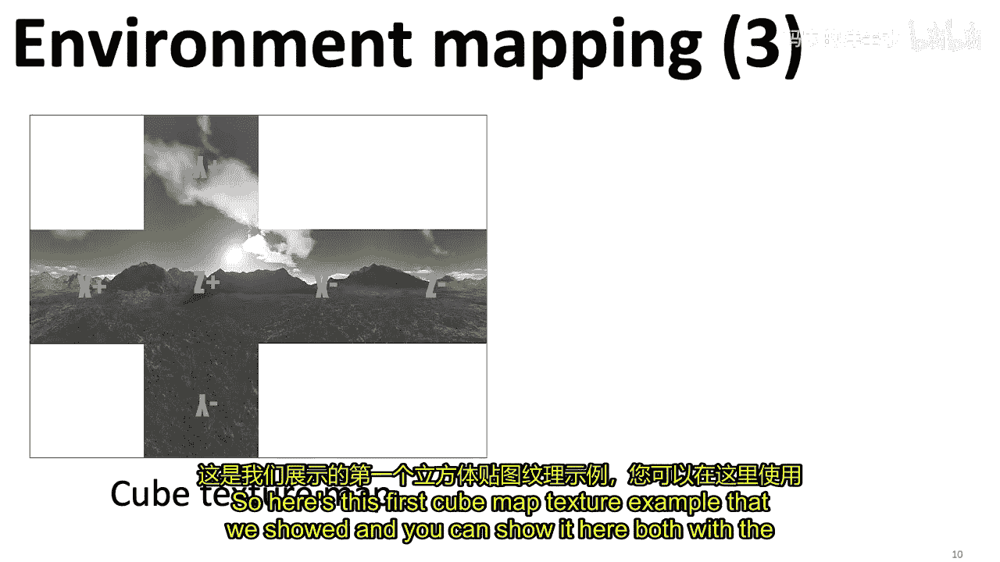

You can use this alpha slot for all kinds of information。 For instance。

 later when we look at specular models， we'll look at smoothness parameters that define how specular reflections work and you could put that into your alpha and have that change over the surface of an object but most often in the wild alpha is used for transparency information。

 So in this particular case， if we just had an RGB texture here of these white and black lines you would just render that and see the white and black lines。

 but you could use alpha information in different ways。

 and you could use that alpha to decide what parts of that texture should actually be rendered or not。

 and you will find people use these kinds of effects not just to put supervillains in jail。

 but for things like fences。 So instead of having a separate 3D object for each post and the fence you could actually just kind of have a big wallow fence and specify the areas between the post to be stenciled out。

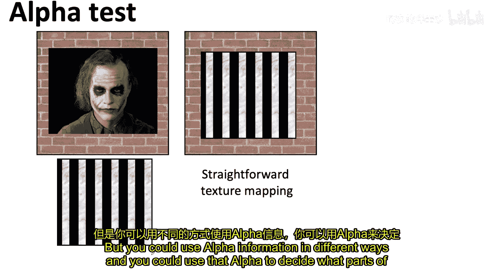

So that those aren't rendered you also see this trick used for vegetation like grass。

 If you look closely at the grass， they may not have a separate 3D object for each blade of grass。

 you may just have a block of grass with alpha being used to see through the individual blades of grass in that texture and alpha doesn't have to be an all on or all off sort of thing。

 you can also use it to indicate degrees of transparency。

 where you can partially see an object behind what's being written。

 You want to make sure that transparent objects are drawn later in the rendering process than opaque objects。

As a final example of creative uses of textures， older games like Quake would often have a preauthored light map that you would combine with some basic texture to essentially bake in the effect of static lights on static surfaces。

 Now this is reasonable for diffuse reflections and obviously can't handle specular reflections because that's something dynamic that changes as the camera is moving that's again something we'll look at in a later lecture and it also can't handle lights that may be moving or objects that might be moving。

 you can change them out of blending to get different effects and I should clarify this isn't necessarily something only used in older games。

 modern games will use a lot of baked light maps and when you do that baking。

 you can save real-time computation and you could also incorporate some complicated bounce lighting effects that you wouldn't be able to pull off in real time even with a fairly powerful GPU。

 We'll look at some of these issues。

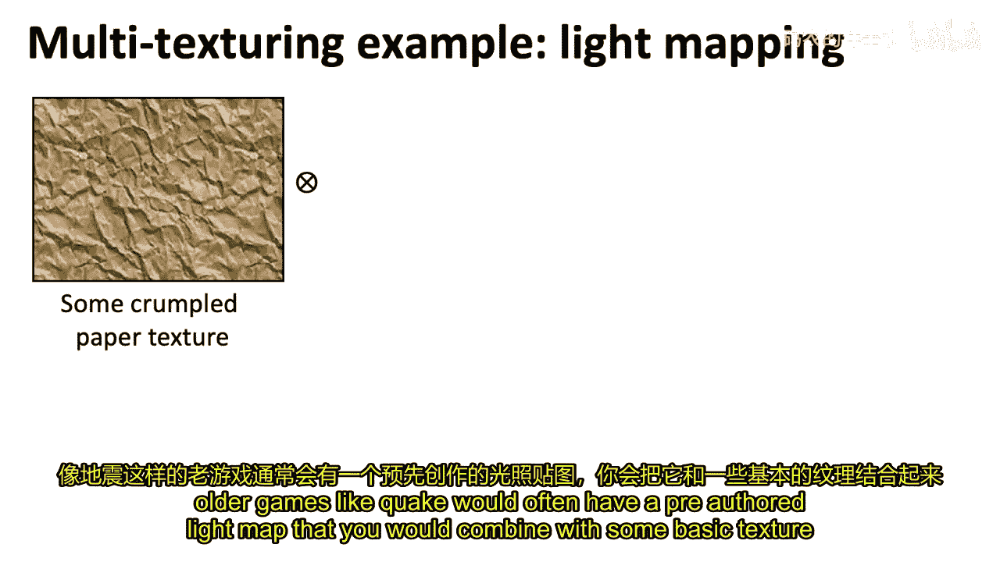

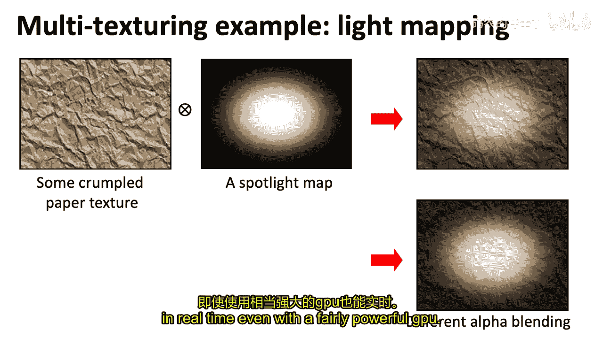

LaterIn particular， we'll look at different ways that one can combine pre baked lighting versus dynamic lighting and have them all work together and make sense。

