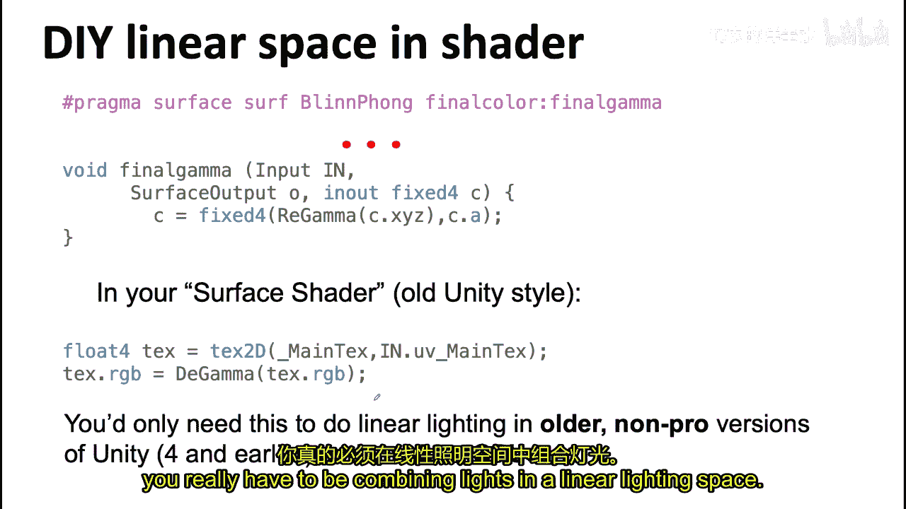
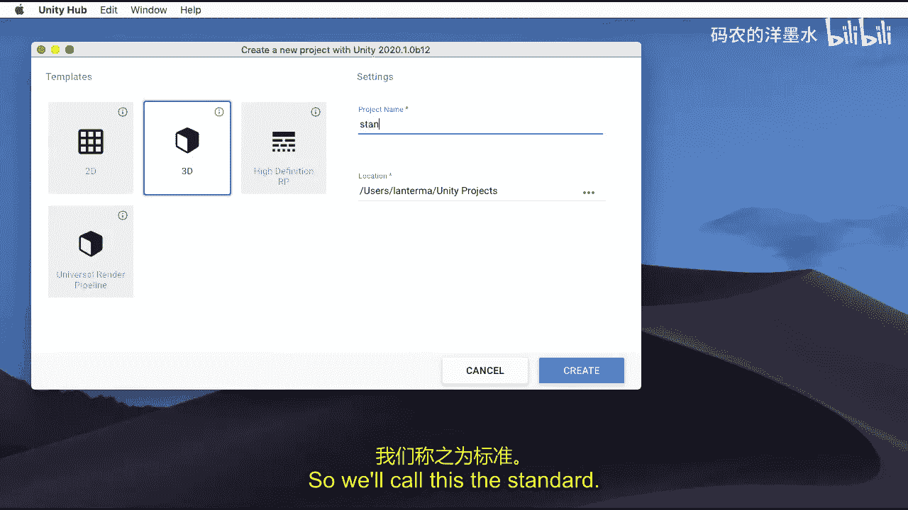
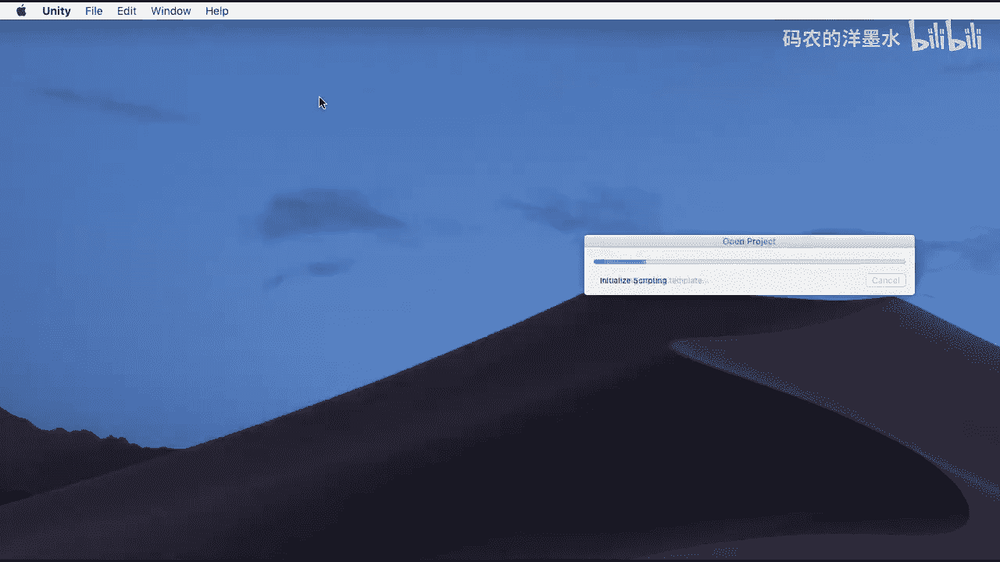
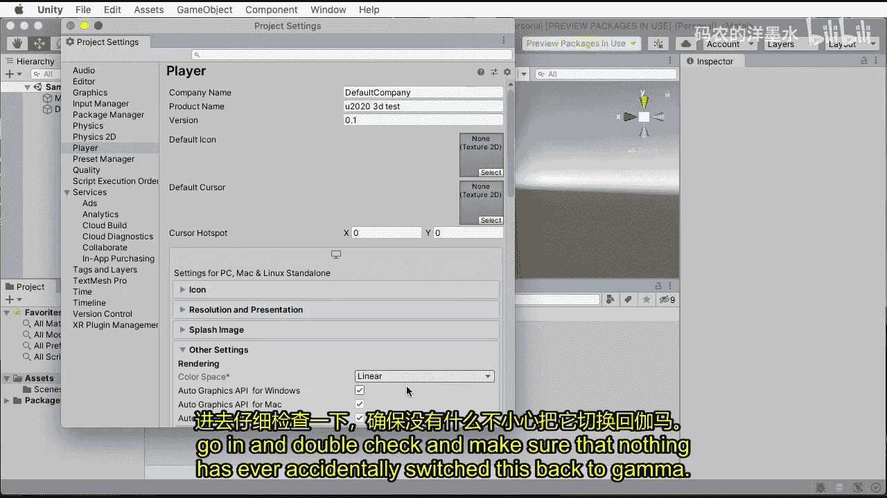
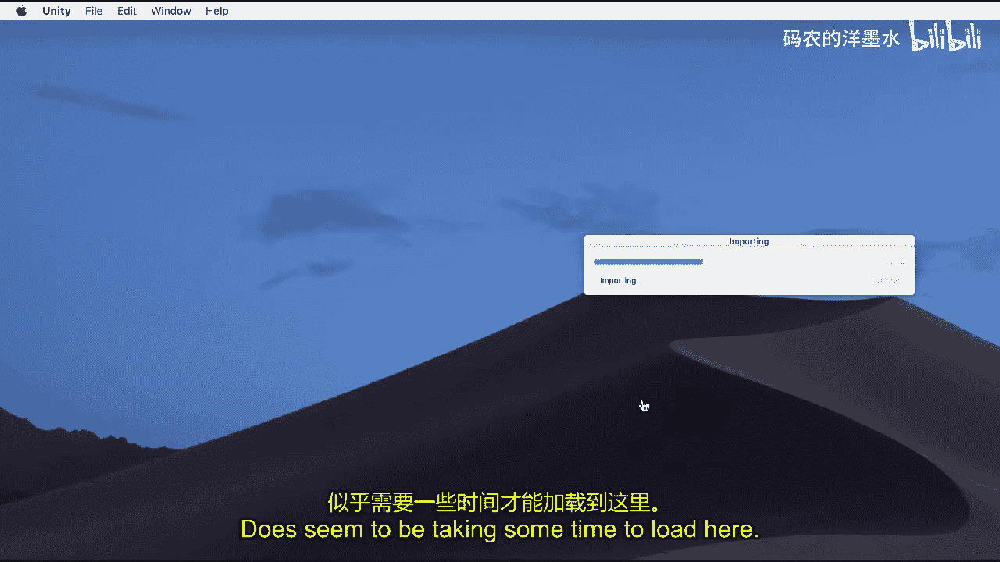
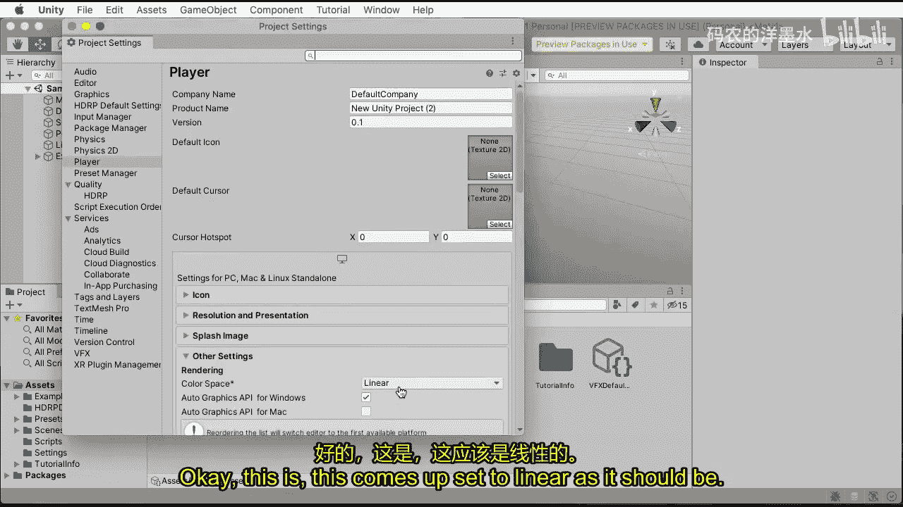
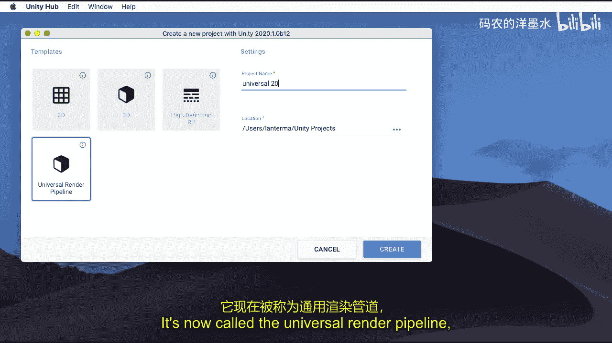
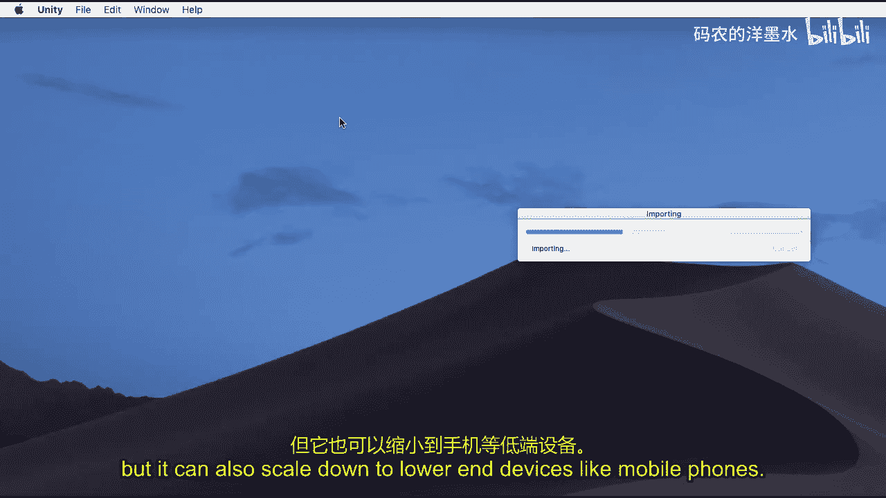
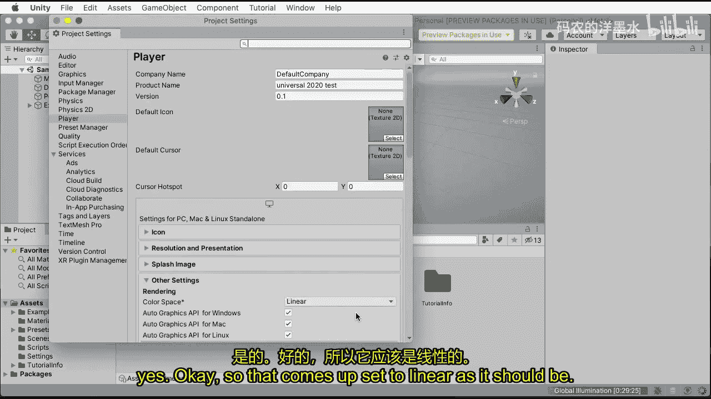

# 【全集】佐治亚理工学院-GPU编程：视频与游戏-中英字幕-p11-Lecture-11---色彩空间--BV1GZfyBbEQn_p11-

Hi there。 My name is Er Lantraman， I'm a professor of electrical and computer engineering at Georgia Tech。

 and now I would like to welcome you to the summer 2020 offering of GPU programming for video games。

So there's a sticky issue that comes up in computer graphics that has to do with the way images are stored and displayed Some of this is kind of intentional and some of it is a historic accident John Hple is a Georgia Tech grad who has a fantastic blog called Filmic Worlds。

 he has an older blog called Filmic Games that I don't think is available anymore。

 but you can find it on the Internet Arch。And he and others have pointed out that this is a widely misunderstood issue。

As a historical thing， if you think back to your old big cathode ray tube。

 display monitors and televisions， the way that those display light isn't in a linear fashion in terms of the numbers that goes in。

 you could think of them as voltages if it was old school or just eight bit values。

 whatever they may be。So the light that comes out at these lower values is actually less than you would expect。

 and one way to think about it is that it's like taking this number 0 to1 to the power of 2。

2 Later I'm going to often use the number2。Think of it as squaring and because we're squaring something that's less than one。

 it actually shrinks the value， I'm going to use squares later just to sort of make the discussion easy。

If you were to take images that were taken sort of in a standard way of storing just raw light values and display it on a oldcho Crt。

 they would basically come out too dark。 So essentially。

 every consumer camera on the planet will preapply a correction to it that you can think of as being pretty close to taking a square root of the light values coming in that way。

 these two effects counteract each other and you get the right value of light out。 Now， of course。

 I'm simplifying all sorts of issues here。 but this is the basic idea。 and for the most part。

 this isn't much of a problem。 if you just take a photograph and then look at your photograph。

 And this doesn't even include all sorts of perceptual issues about the way humans perceive light。

 So most of the time this isn't a big deal。 imagine that the actual light value of a particular pixel should be a。

 we store the square root of that in the image and then the。Monior squares that， so we get A out。

Okay， that's fine， but now the issue comes in if we want to blend images and this isn't just an issue in doing 3D CGI。

 this is also an issue of say blending images and something like Photoshop this kind of gamma space you'll see that called SRGB if you're using Photoshop and again this is an oversimplification。

 the As RGB color profile is more complicated than what I'm showing here so going back to the CGI case。

 suppose you have a 3D object and you light it with just one light， okay fine。

 but now what if you're lighting it with two lights well the square root that you're seeing here。

 the way to think about that is that's the way the texture is stored。

So if we try to add lights in our shader code， well， we'll have a square root of a。

 and then we could add， say， a square root of B。And then if we're adding them in this gamma space。

 then the screen is going to square that and then I have some problems okay so I will get a square root of a squared。

 I'll get an a and I'll get a square root of B squared that will give me a B but I'm also going to get a crosster in here I'll get a two square root of a times B and that leads to problems now people made games for many。

 many years using this quote unquote gamma space lighting and people enjoy them and such but pretty much the main issue there is that any given set of lights in a scene only really works for that particular scene your level designers would put a lot of effort into tweaking the particular light so this weirdness may be going on but everything still looks good but if somebody comes along later and tries to add a light to the scene everything gets kind of weird if you have a professional cinematographer who does lighting for a lid。

The lights in your game engine just don't combine in the way that they're used to Now again。

 I've used square roots and squares here to make sort of a math easy to describe the real powers you need to look at as something closer to 2。

2。So the solution to this is to basically take that square every time you read a texture。

 and then you do all of your math in your shade or you add up all your lights or whatever。

 and then you do that square root at that final pixel value before you write it into the screen。

Normally you would actually take some instructions in your pixel shader to do those kinds of computations。

 but fortunately， modern GPUs will have hardware in there to do this for you。

 So you can change some settings in your API I assume Vulcan has something similar to do these squareishh operation when you read from a texture and to do the square rootish operation when you have that final value and are writing that to your frame buffer to go to the screen and fortunately unity supports this now。

 even in the free and version， but back in the day that wasn't the case。

 So if you go back to around 2015 or so the unity four days there was a big difference between the free and version of unity and the pro version。

 partly it was the $1000 price tag of the pro version and partly is that there was a huge difference of feature sets between the two versions in particular you could only use GPU proper linear。

Space lighting in Unity Pro and if you wanted to use proper linear space lighting。

 you would have to explicitly put it in your shader code and waste shader instructions on it instead of having other hardware in the card to handle it for you So if you did have to do this without explicit GPU support you might do something like this Now we haven't really looked at any shader code yet I'm just giving you a feel for it will discuss what all of these terms mean in detail later Basically I'm defining here a couple of helper functions Dgamma and regamma to move between gamma color space and linear color space。

And Unity had a technology that they were using for a bit called surface shaders。

 and surface shaders were basically a way that you could write a stub of shader code。

 And then unity would come along and make a bunch of variations of that for a whole bunch of different lighting configurations。

 Unity isn't really pushing this anymore。 They're now pushing something called shader graph that will look at later。

 One of the basic ideas in the surface shaders was that you could define a special function that would be applied right before a color value would actually be sent to the frame buffer Here。

 you could do that regammaing。But then in your main shader， when you did a texture lookup。

 you would do that squaring and leave the gamma space。Again。

 later we'll look at the details of these kinds of lines right now I just want to give you the general idea。

 The problem with this is that this is taking up extra cycles in your shader code。

 so it's a lot nicer to have the GPU do it for you and fortunately from unity5 onward Unity decided to unify the feature sets greatly between the Pro and the Indie versions so linear space lighting supported by the GPU is something you could do in the Indie version of Unity 5 onward and they kind of had to do this because starting with Unity 5 they really pushed physically based rendering and for that to make any sense at all you really have to be combining lights in a linear lighting space。

Here I'm going to check out the unity 2020。1 beta and here I'm going to see what happens if we start up a standard 3D game template that uses the original quote unquote built in legacy pipeline this is in contrast with the scriptable pipelines。

 which is sort of a new way of doing things in unity so we'll call this the standard。

3D test。 Sure， Why not。

Okay， so we've loaded up a standard 3D scene using the original legacy pipeline and not one of the new fancy scriptable render pipelines。

 let's take a look at the graphic setting for the color space， so we'll go to project settings。

You might think that this would be in graphics， but no。

Rather you're using linear space or gamma space lighting supported by the GPU。

 I should clarify that's actually in this thing called player and look at this， even Unity 2020。

1 defaults to having gamma color space， No unity you should not be doing this nowadays I guess if you're doing like a 2D sprite game where you have no lighting effects。

 maybe gamma' is a good idea， but switch this to linear。Yeah。

 make everything be linear so anytime you are using unity if you're doing 3D graphics or just I think in general。

 just switch it to it linear， make sure everything's in linear。

 go in and double check and make sure that nothing has ever accidentally switched this back to gamma。

Okay， let's see what happens if we use one of the main scriptable render pipelines provided by unity。

 which is the high definition render pipeline， this is designed specifically to target exclusively high end systems so we're probably talking here PlayStation 4 Xbox1。

Medium range， gaming PC。Okay， and we'll wait and see how long this takes to load。

Well I think this loads a demo scene， I think that's why this takes so long to load。Hi， okay。

 so I'm going to edit most of the spending wheel out does seem to be taking some time to load here。

h here we go， Okay， so that loaded a fairly big scene。

Let's play I should probably press play do do do do pressing play waiting for it to start a now we can zoom around the scene。

 that's kind of neat Okay， let's go in and look at the render pipeline。

 I'm going to assume that this is set to。Let's see project settings。Okay， is。

 this comes up set the linear as it should be。

Let's load in the other main scriptable pipeline provided by Unity， it's now called the Univeral。

Reendnder pipeline。

It used to go by the name of the lightweight render pipeline。

 but the lightweight pipeline does have a ton of cool features that can be enabled。

Maybe calling it lightweight wasn't entirely appropriate anyway。

 the idea of this pipeline it is fairly capable， but it can also scale down to lower end devices like mobile phones。

so here's our example scene， it looks like it's still loading so oh it's running some global illumination computations。

 it'll probably look better shortly okay here we go yep it's running and let's look at how it comes up here if we look at the project settings Yes okay so that comes up set to linear as it should be。

