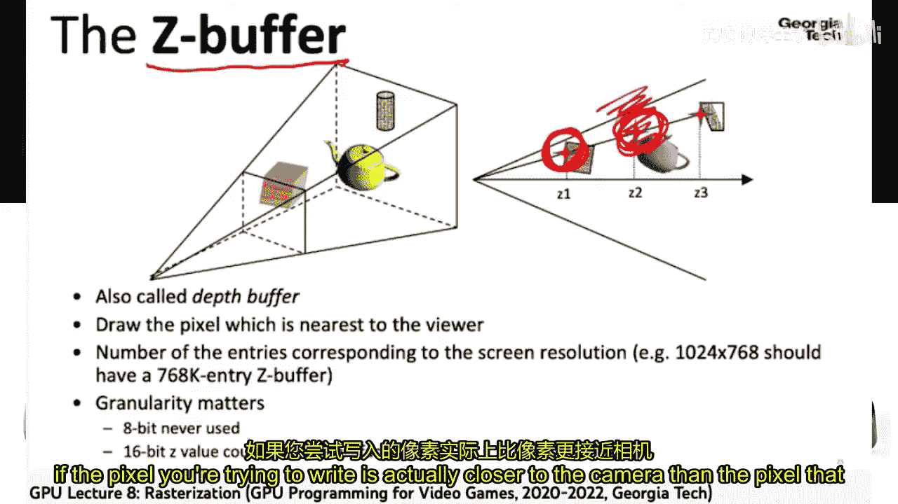
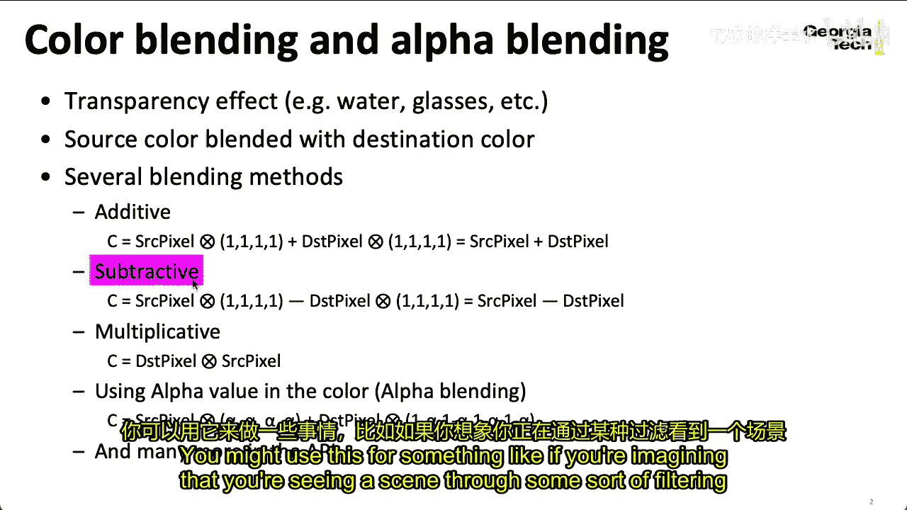
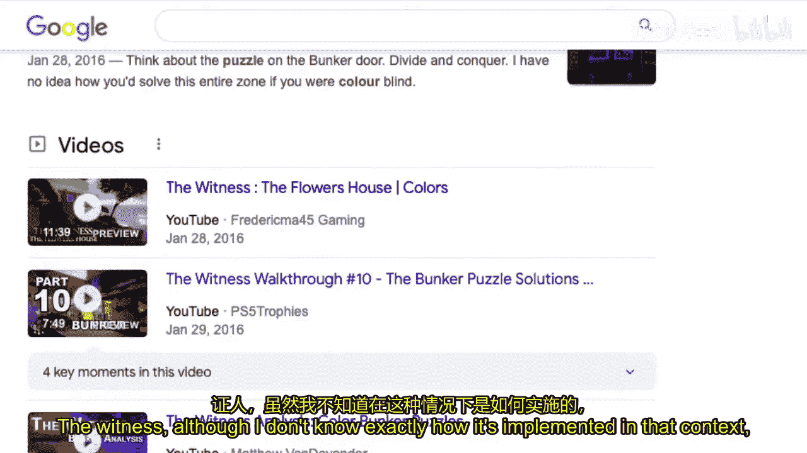
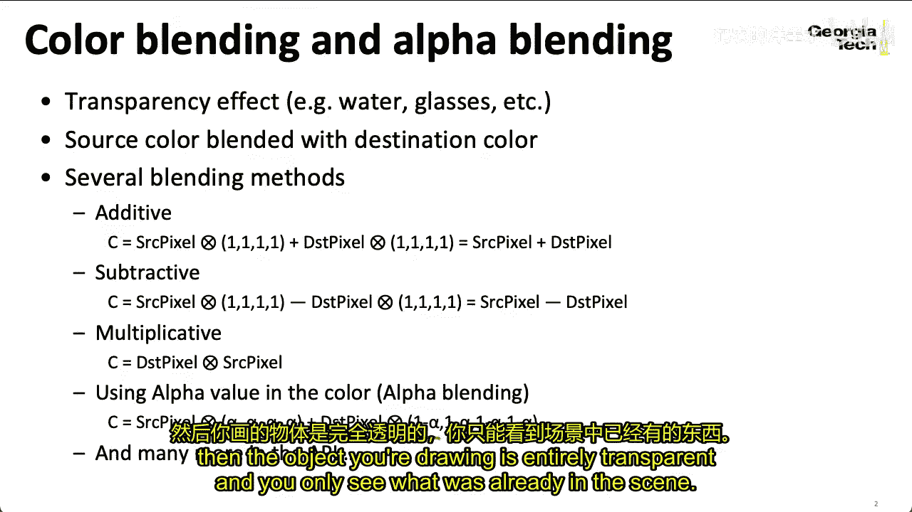
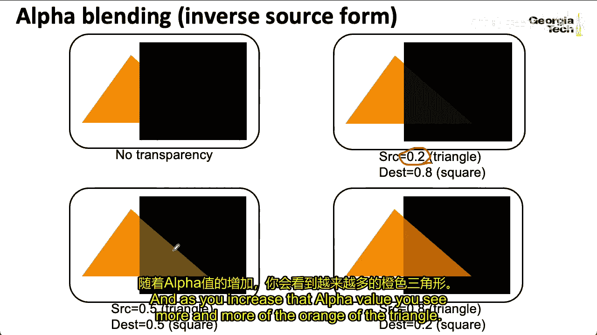
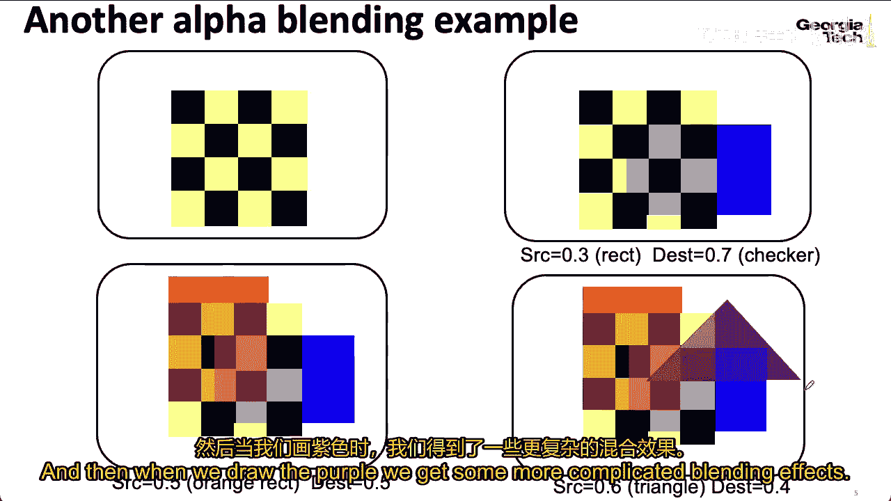
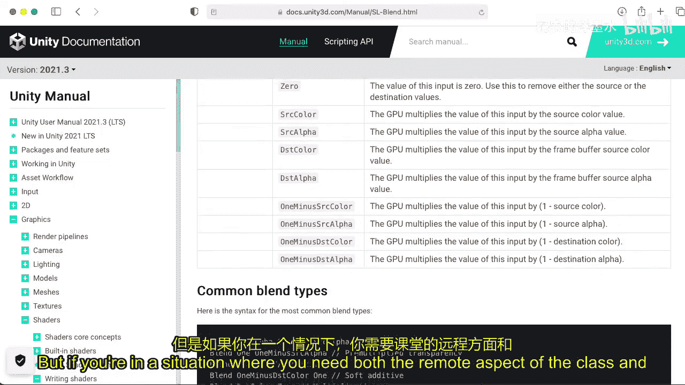
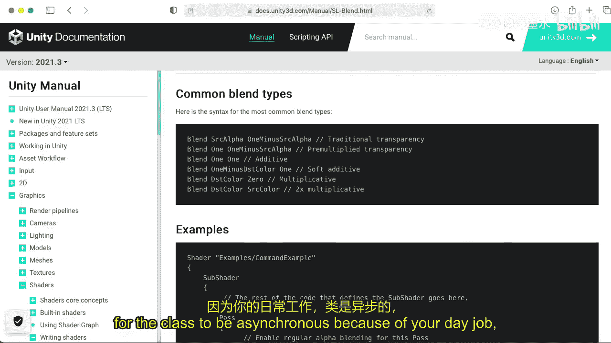
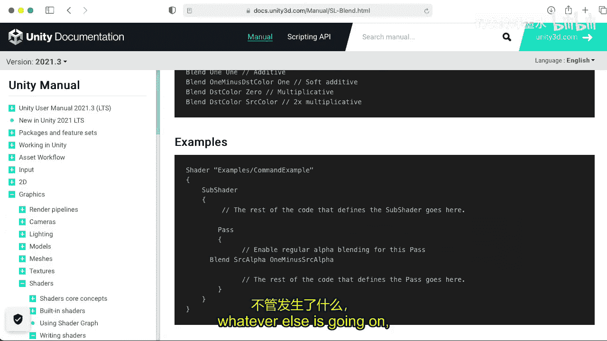
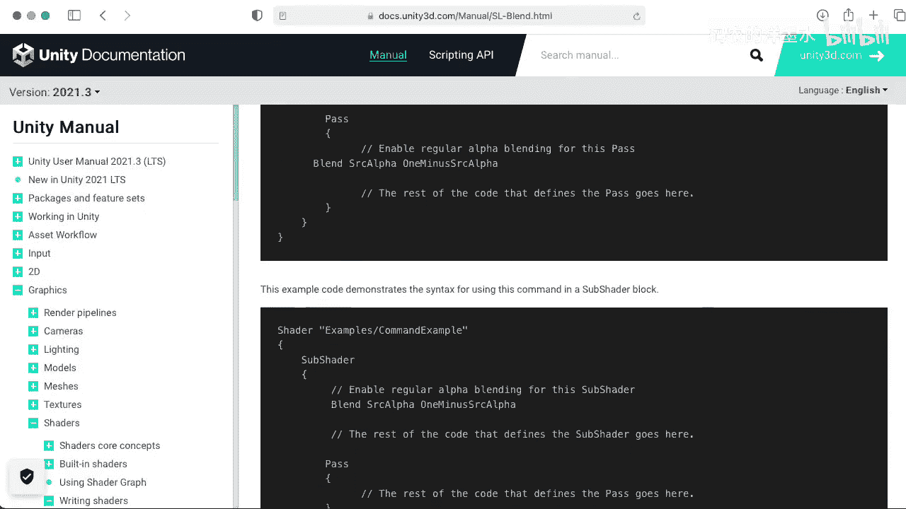

# 【全集】佐治亚理工学院-GPU编程：视频与游戏-中英字幕-p12-Lecture-12---混合--BV1GZfyBbEQn_p12-

Hi there。 My name is Er Laantterman， I'm a professor of electricallectrical and Comp engineering Nejch and in previous lectures of GPU programming for video games。

 we've generally assumed that when you write a pixel into the frame buffer。

 you're comparing the depth of the pixel you're currently trying to write to a depth value already stored in a Z buffer。

 if that pixels been written to previously， and you compare those things and basically you only write the new color value of the pixel and the new depth value of the pixel。

 if the pixel you're trying to write， is actually closer to the camera then the pixel that was already in the buffer。

 so you're always overr color values。

But sometimes you may not want to just brute force overwrite the color that is there。

 You might want to blend the color that you're trying to write to a pixel with some color value that you've already written in order to achieve things like transparency effects。

 This might be for trying to render some kind of ghostly figure。

 or maybe you're trying to render tinted windows that you can see through。

 or this sort of thing is often used for user interface elements。

So using different calls in your API， you can set different blending modes to say add the colors。

 subtract them。 This is something I haven't seen used very often。

 you might use this for something like if you're imagining that you're seeing a scene through some sort of filtering lens。

 If I remember right， there is a puzzle along these lines in Jonathan blows game the witness。

 although I don't know exactly how it's implemented in that context。

 You could multiply the pixel values together。 although to my knowledge。

 these are not used very often。 The kind of blending mode that's most often used is alpha blending。

 where the new color value is a weighted combination of the source pixel and the destination pixel。

 and this alpha is a blending factor that ranges between0 and1。

 Often that alpha is the actual alpha component of a texture。 So if alpha is one。

 then the object your writing is entirely opaque and you don。

See anything about what was already there。 If alpha is0。

 then the object you're drawing is entirely transparent。

 and you only see what was already in the scene。 Many years ago。

 my colleague Sha Lee created this demonstration based on just the power of PowerPoint。

 There's no fancy 3D API going on here。 Imagine that you were to draw the black square over the orange triangle without any sort of alpha blending。

 you'll get something like this。 but maybe if you were to draw it with an alpha of0 point2。

 then in the place where the triangle and the square overlap。

 you will see a little bit of the triangle blended with the square。

 And as you increase that alpha value， you see more and more of the orange of the triangle。 Again。

 this is just to illustrate the idea。 Here's another example。 Sean cooked up with PowerPoint。

 Imagine you have this yellow and black checkerboard pattern。

You were to draw some additional objects without using any transparency effects so you could draw a blue rectangle on top of it and then draw an orange rectangle on top of it and then draw a purple rectangle on top of it。

 what if we were to do the same sort of drawing but use the transparency effect？

So if we were to blend that blue rectangle with what we had previously。

 notice that we wind up with some gray here， where the yellow and the blue overlap and combine blue and yellow are compliment colors such that when you combine them。

 you'll get gray。 So if we were to then draw the orange。

 The orange would take the bits with the yellow and give you some yellow tinted orange。

 Then when we draw the purple， we get some more complicated blending effects。 Y get the general idea。

If you are not one of my Georgia Tech students， you can check out here。

 If you are one of my Georgia Tech students， I would like you to go on canvas and find a video quiz 12。

1。 What I want to know here is how essential the particular class format was to you being able to take this class this summer。

 If inper instruction would have worked for you， I。e。

 you are in the Atlanta area and available for class during the day。

 write something like in- person would have been fine。 Now。

 if you needed the class to be offered remotely。 but you could attend synchronous lectures during the day。

 write something like remote essential synchronous would have been fine。

 But if you are in a situation where you need both the remote aspect of the class and for the class to be asynchronous because of your day job coop internship。

 whatever else is going on， write something like asynchronous。

。

