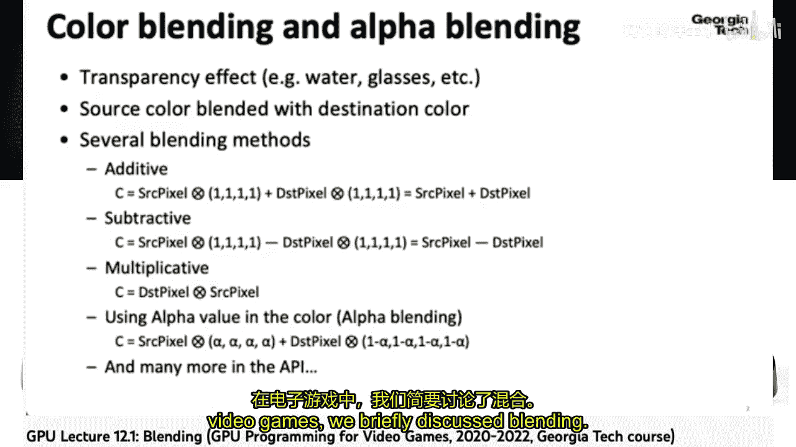
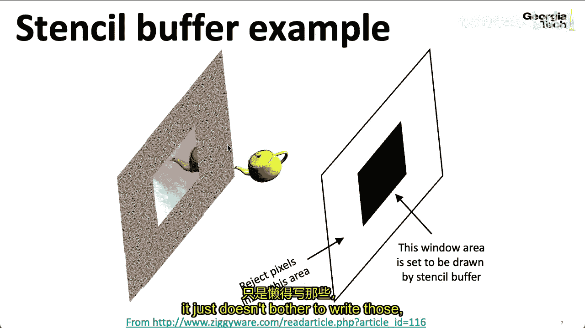
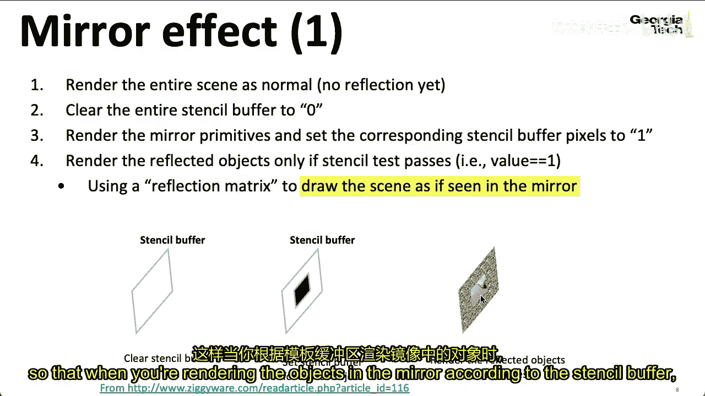
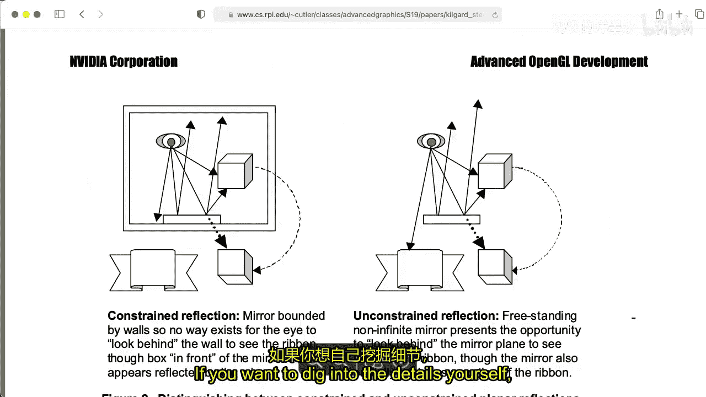
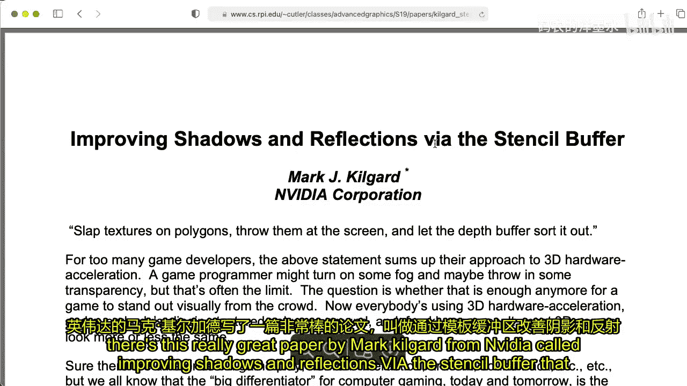
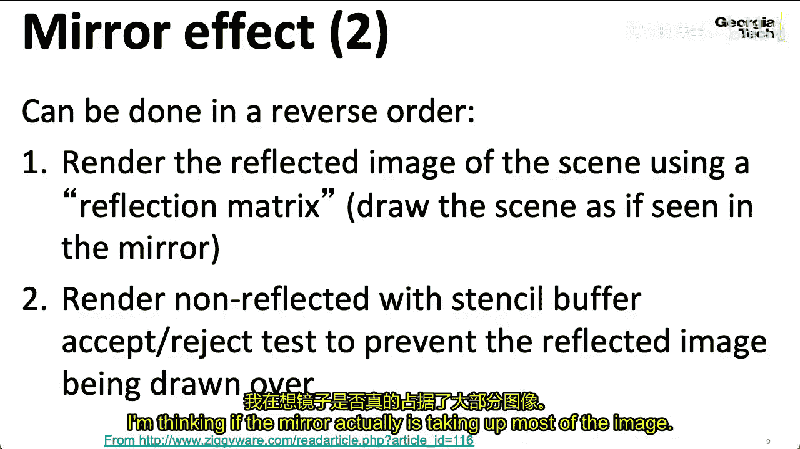
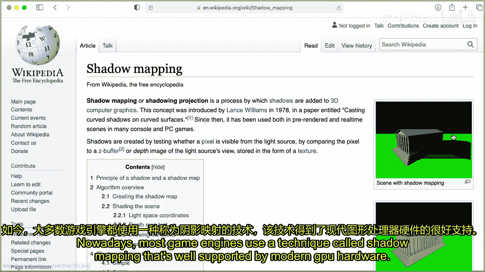
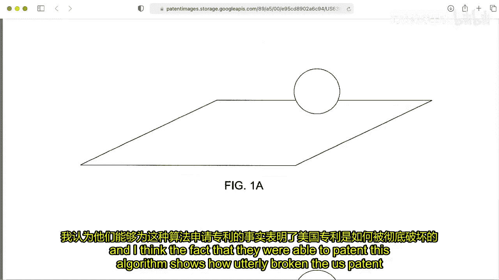
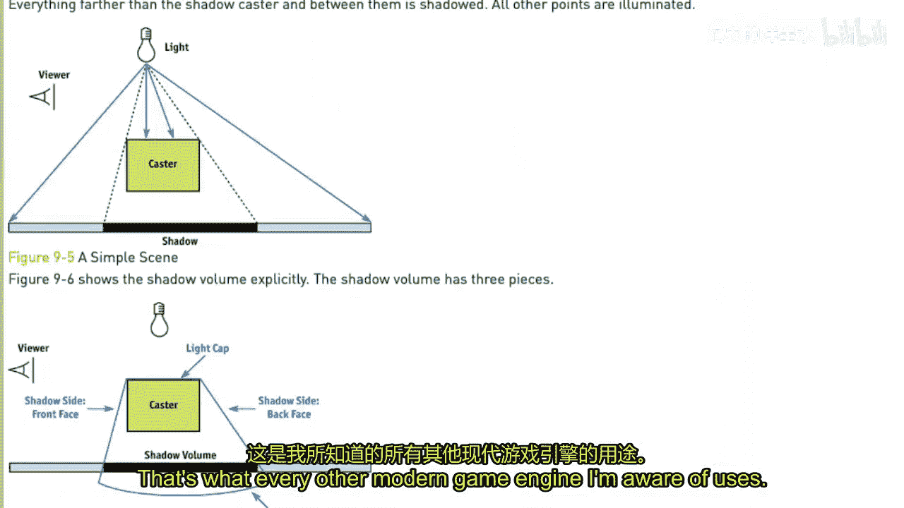

# 【全集】佐治亚理工学院-GPU编程：视频与游戏-中英字幕-p13-Lecture-13---模板缓冲区--BV1GZfyBbEQn_p13-

Hi there。 My name is Er Laterman。 I'm a professor of electricallectical and computer engineering at Georgiaia Tech and in the previous lecture of GPU programming for video games。

 we briefly discussed blending， so let's move on to talk about stencil buffers。

 We've talked about the main color buffer， which is what you eventually show the player and we talked about the Z buffer that's used to determine obscuration。

 the stencil buffer is another frame buffer in the GP's memory that lets you select certain portions of the screen to be drawn and certain portions of the screen to be not drawn。

 so you might imagine using something like this in order to mask out the cockpit of an airplane and some sort of flight simulator when you're drawing the main external scene。

So this particular notional diagram is from this Zggyware website。 Unfortunately。

 this website doesn't exist anymore， but you can find it on the Internet archive。 Well。

 at least you can find the text that looks like the Internet archive didn't archive the actual images。

 but here's the general idea。 if you wanted your final image to look something like this。 Well。

 you could imagine drawing the background here and drawing the teapot where you do everything with a Z buffer。

 However， if you know ahead of time that this wall here or whatever this is on the outside is going to be there and blocking the teapot there's no reason to go through all that extra computation computing the various Z buffer values for the bits of the teapot that you're not going to see to eventually figure out。

 oh， well， the wall is going to overrite it anyway。

 So if you know the structure of this obscuration out here， you can write that into the Z buffer。

 And then when you draw the teapot。 Well， the parts。

The teapot that would overlap with this part that's not going to be drawn with a teapot anyway。

 it just doesn't bother to write those so you save some time。

You can use stencil buffers to fake mirror effects Now if you really want to properly handle mirrors。

 you would really want to go with a ray tracing solution。

 but although there are some cards out there that can handle some realtime ray tracing。

 is still very computationally intensive， so even games that can use those cards tend to only use it for part of the computation。

In any case， the general idea is that you first render all of your standard non-mrred objects and then what you can do is you can clear out the stencil buffer and you can render the mirror。

 but you're not writing the actual color values of the mirror yet。

 you're basically just writing say the value of one to the stencil buffer and then you do another pass to render the actual color values that appear in the mirror using that stencil buffer。

 but when you run the main renderer for the mirror。

 you include something called a reflection matrix in that big set of transformations that included the model to world transformation in the world view transformation。

 somewhere in that sequence you can put in a matrix that basically flips the scene around the plane of the mirror。

 so that when you're rendering the objects in the mirror according to the stencil buffer。

 you're rendering the reflected scene。

I'm not going to go into more details on this here because I'm not going to give a homework assignment on this I just wanted to let you know that this kind of technique was out there if you want to dig into the details yourself。

 there's this really great paper by Mark Kilgard from NviDdia called Improving Shadows and Reflections via the stencil buffer that I suggest you check out。

I'll just mention that you can do this in the opposite order if you want。

 you could actually fully render the mirror first and then render the parts of the scene that aren't in the mirror。

 there might be some performance reason to do that I'm thinking if the mirror actually is taking up most of the image。

Stencil buffers can be used for all kinds of things， including handling shadows。

 using a technique called shadow volumes。 Unfortunately， shadow volumes kind of went out of style。

 They were used in the game engine for doom 3， and they are kind of nice because they give you nice。

 well defined shadow boundaries。But I'm not aware of any modern mainstream game engine that uses them if you know of one please let me know in the comments below Nowadays most game engines use a technique called shadow mapping that's well supported by modern GPU hardware。

 so shadow volumes that tend to involve a lot of computation on the CPU have kind of gone by the wayside。

There's a particular implementation called the depth fail algorithm that's also known as the Karmac reverse。

 Some folks at C labs independently discovered the algorithm， and were able to get a patent on it。

 And I think the fact that they were able to patent this algorithm shows how utterly broken the US patent system is。

 This LED to all kinds of absurdity， and you can read about the absurdity elsewhere。

If you would like to learn more about shadow volumes。

 I highly recommend this excellent chapter from NviDdia's GPU Ges。

 which is now available for free online， and I won't be covering shadow volumes any further in this class I just wanted to mention it for context。

 but I will cover shadow mapping， that's what Uniity uses， that's what Unreal uses。

 that's what every other modern game engine I'm aware of uses。

