# 【全集】佐治亚理工学院-GPU编程：视频与游戏-中英字幕-p14-Lecture-14---GPU-架构与汇编语言--BV1GZfyBbEQn_p14-

Hi there。 My name is Er Laantterman， I'm a professor of electricallectical and Comp engineering at Georgia Tech。

 and this is my quarantine hair， and now I would like to welcome you to the summer 2020 offering of GPU programming for video games。

In the next lecture we're going to look at the high levelvel shading language HLSL as it's called by Microsoft。

 you'll also see the term CG being used that was what NviIDdia called it。

 and this is basically just one of a whole set of different shader languages that are more or less equivalent and this lecture willll look at some general principles that apply to all shader languages and we'll also look a little bit at Shadr assembly code。

So let's talk about what people mean by the term shader model Basically the shader model is define an agreement of certain kinds of registers and certain kinds of instructions that the GPU will execute。

 but the exact details of how the GPU executes those instructions is up to that GPU and the driver So as the programmer you interface through GPU hardware through an API like OpenGL direct3D nowadays we also have Vulcan and metal and over the course of the time。

 GPUs have increased what they do relative to what you wind up doing on the CPUU For instance。

 early GPUs at a time where you probably wouldn't even have called them GPUs in the early 80s for your PC might say have a command to draw triangles and over the course of the time what the GPU could handle gradually sort of move to the left here and nowadays the GPs basically handle everything although there might have been a time where each of the vertices of your triangle could be specified。

To have particular color and then the GPU would interpolate the colors between those for gciating。

 but you would still do the computation of those colors on the CPU Later more and more of the 3D transformations and the lighting calculations got pushed onto the GPU so you didn't have to do that on the CPU anymore anyway nowadays you have a bunch of vertices。

 a big buffer that you send to the GPU and you also send the information that specifies what vertices and what triangles mapped to the particular vertices in that list and that big bunch of vertices is parcceled out to a bunch of parallel computing units for computation Now this is where we put a kind of shader code called vertex shader and when you're writing a vertex shader you have to remember that the compute unit only knows about that particular vertex it doesn't know anything about the other vertices and then all of those vertices are put back together and reassociated with what their triangles are and then later you。

So we'll actually figure out what pixels belong to those particular triangles and then here you'll run something called a fragment shader or a pixel shader and that's what actually figures out what the color of a particular pixel should be The term fragment will often be used interchangeably with pixel and I'll use it interchangeably as well it's a fragment in the sense that it may not actually become a pixel because maybe it's discarded over the course of the computation overwritten with a different color value and also if you're doing some kind of antialliasing you may have pixel fragments in the sense that you might be rendering the image at a much higher resolution than what's finally displayed and then those individual pixel fragments or average to become the final pixel In any case there's other hardware in your card that's responsible for taking the output of these compute units computing your pixels and actually shoving that into the frame buffer memory and doing whatever else you need to do needing to do。

If you're doing addition for operations of C through transparency effects or the Z buffer checks and if something fails a Z buffer check。

 you might not send that pixel to one of these compute units at all So these are the two kinds of shader codes we're going to look at vertex shaders and pixel shaders there are also geometry shaders that can actually create new vertices which vertex shaders on their own can't we're not going to look at those and there's also compute shaders that allow more general purpose kind of computation that you might be doing some sort of physics calculation or artificial intelligence calculation or maybe some sort of audio digital signal processing but for sake of time we're not going look at those in this course either we're just going to stick with the vertex and the pixel shaders because those are going to be common to every 3D game。

So coming from a more conventional programming point of view。

 something that takes a while to get used to is that the main element of operation in our graphics calculations are operations on floating point numbers In fact。

 integers don't even exist before shade or model 4。0。

And bitwise operations hence don't exist either Now you'll see for most of what we do we don't actually need integers。

 but in the places that you are thinking about doing something with integers。

 if you're in share Model 4。0 and earlier well you're stuck with representing those integers as floating point numbers however strange that might be Now in earlier GPUs you had all sorts of different floating point formats and you sort of do nowadays we'll look at that a little bit when we come to it but for the most part you could just think about these things as standard 32 bit iE floating point integers again。

 earlier GPUs would have all sorts of weird hybrid formats。

We'll also have things like floating point values in either four by four vectors and what we'll see is that there's not really necessarily a fixed convention in the shader code itself about whether these should be thought of as row vectors or column vectors they are these four number things that depending on how you arrange the computation in your shader code you can interpret them as columns or as row vectors but the data type itself doesn't have the information built into it will also have four by four matrixrices now we've seen are the basic building blocks of 3D graphics operations and then there's also smaller versions of these so you can have a two-dimenional vector or two by two matrix or a three-dimenional vector or three by3 matrix so this especially gets weird later when we look at postpro effects where you actually snarf the whole screen as a texture and rearrange it just as a rectangle and you can do things like blurring effects if you're used to doing usual image processing you're used to writing。

Things like I plus1 or I is a in index Well here we won't be doing that we'll be taking some coordinate and adding a floating point value to it so that takes a while to get used to anyway those kind of postpro things or things we're going to look at later anyway so there's three main types of data we're going to look at one that they call per instance is for instance the particular vertex that you're processing at that moment so you have an object consisting of 10 vertices。

 you'll write a piece of shader code but that piece of shader code doesn't know or care which particular vertex it's getting it just knows that it's job is to process that vertex Now coming out of the vertex shaders once those are reassociated with particular triangles there will be interpolation hardware in the GPU that will generate all of the data that needs to be passed into the pixel shaders So that might be an interpolated normal vector to do shadingka per pixel shading or maybe。

doing Grot shading where you've computed a light value in the vertex shader and you're now interpolating that to put into the pixel shader and certainly if you're using textures。

 that's something that needs to be happening on the pixel shader side to look up the appropriate texture color value for the individual pixels So in that case。

 your vertex shader will return some texture coordinates that get interpolated by the interpolation hardware and then passed into the individual compute units that are running your pixel shader program and then you also have data being passed in by the API that applies to say every vertex your're computing which would be something like the position of a light or the various transformation matrices world view projection or perhaps prempplied combinations of those vertices that apply to all of the vertices that you're computing for a particular object these are usually referred to asun variables So shader code is intriguing。

It will have specific assembly instructions to do some fairly specialized things such as dot products or exponentialsInterestinglyly there's no specific instruction to take a square root。

 although there is a specific instruction to take a reciprocal square root this makes sense when you realize that multiplying by the reciprocal of a square root is something that you need in order to normalize a vector to have unit length and that's something you do a lot when doing lighting calculations So if you do want the square root。

 your best bet might be to use this reciprocal square root of operation and then take its reciprocal and then you'll have trignometric functions that are built in usually for a general rotation you will precompute this on the CPU because you'll create a matrix that's applied to all of your vertices。

 but there are times where you may be needing to use trinometric functions inside the shader itself Now one of the most important aspects of a GPU is its ability to swap。

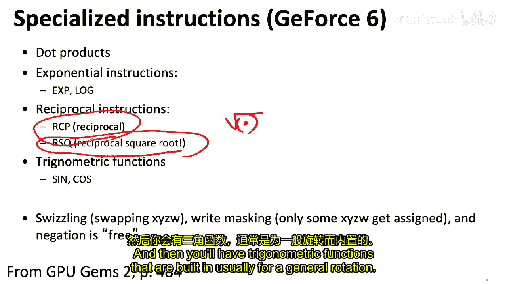

Data around in these four tuples， these units of four so you could refer to these individual data values as X Yzw。

 or you could also refer to it as RGB the GPU itself doesn't care。

 This is just a nomenclature for the user X corresponds to R Y to G Z to B and W to A although of course we'll want to use X Yzw when we're talking about coordinates and RGBA when we're talking about colors。

 the GPU doesn't really care。 this is just a nomenclature for the human。

 just does everything in groups of4 The idea of sizzling is that as we're doing operations in addition to whatever operation we're doing。

 we can also rearrange these elements of the four tuple， you could swap X with Y or W with Z。

 and you can also play games where only some of the components of your 4 vector are getting assigned and the others are being left alone or you can take one value。

 say it's W。

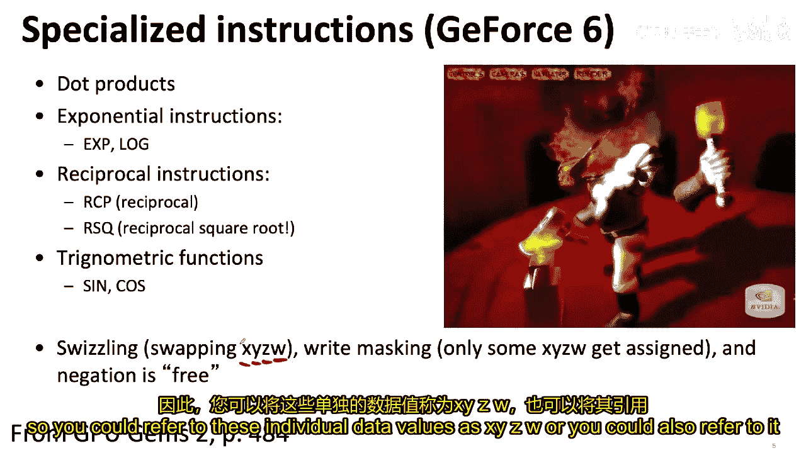

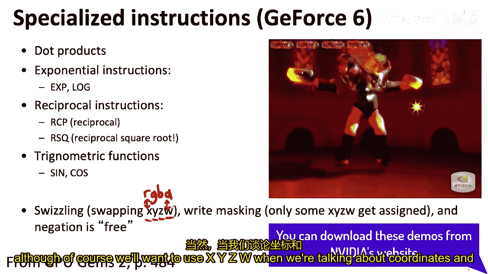

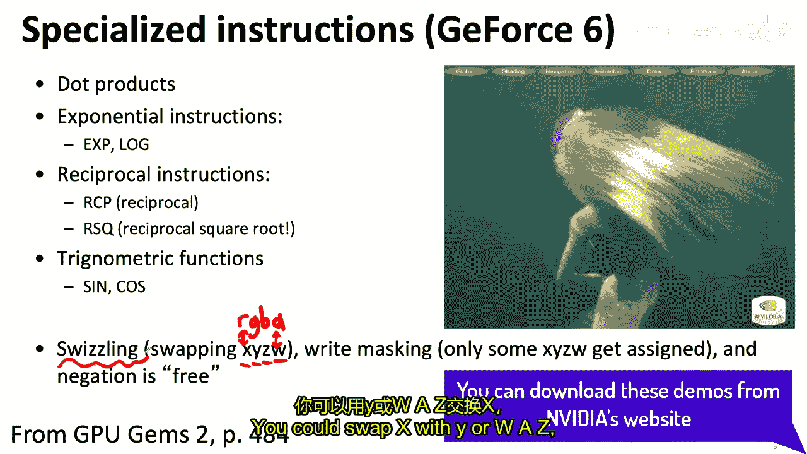

And splat it， you can then write it to all four of the vectors It's fairly flexible and the main important thing about the GPU is you can do this with everything in every instruction and you don't have to have specific code to do these rearrangements the way you would if you're writing it on some more general purpose processor Also if you want to take a minus sign of something that's also just built into the op code。

 you don't have to do that in a separate instruction This is one of the main things that makes the GPU a GPU and it's one of the main reasons that other things that try to do the job of a GPU just inherently don't do it as well So although people have developed all kinds of hardware to do specialized tasks like physics created a piece of physical hardware to do physics computation that didn't last somewherewhere around a dozen years ago I went to the game developers conference in San Francisco and there is a company selling a plugin card to do artificial intelligence calculation。

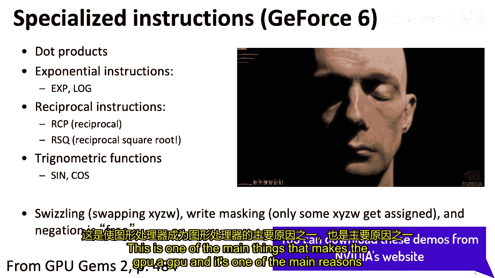

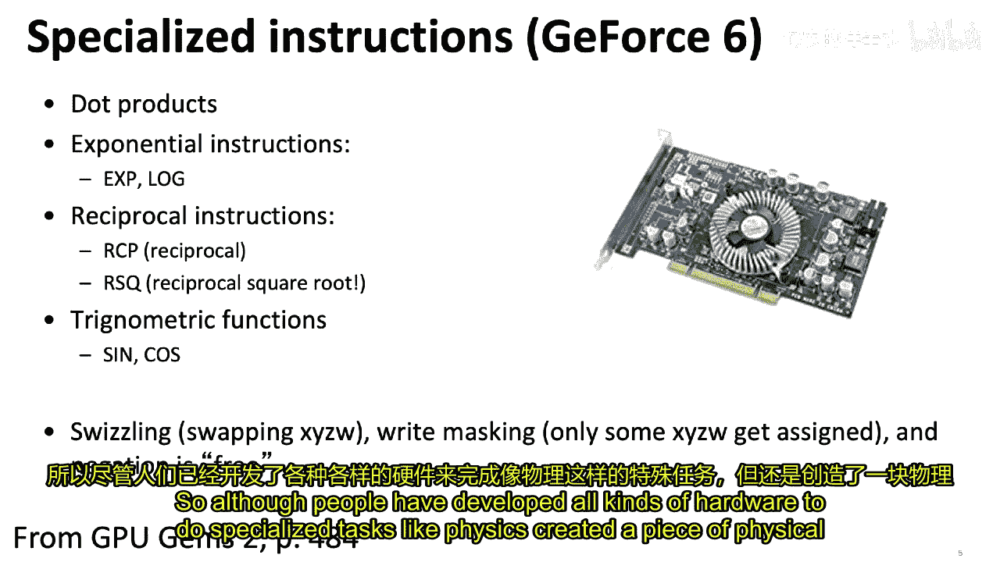

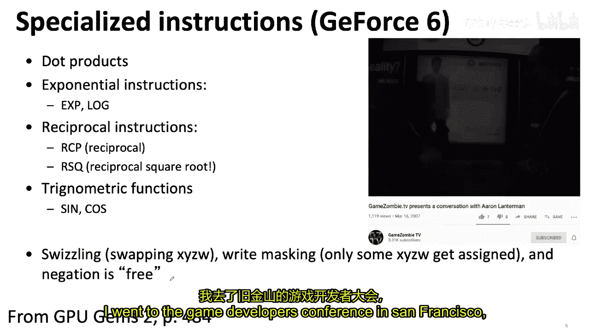

That didn't catch on either in the mid-90s when I first got into using computers to digitally record and manipulate music。

 I bought a sound tool system that at the time was incredibly expensive I got to deal in it because it was a display unit at the store so they were selling it for a little cheaper than usual but it was still well over1000 and it was just a two-track recording playback system and later digit design now Avid would create all sorts of plug cards for protools that would have custom DSP chips for audio and companies like Univeral audio still make things like that but nowadays your raw CPU is just so fast that it's reasonable to do those kinds of computations just on the CPU so Billy Eilish and her brother Phineas can make a best-selling awardwin album on a MacBook just using logic Pro X and nowadays for so many things it just doesn't make sense to have expensive specialized hardware when generic CPUs progressed so quickly。

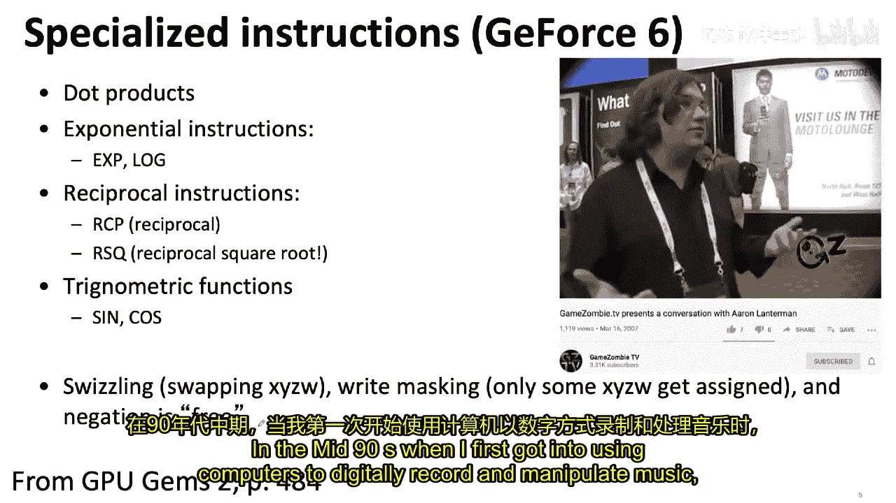

arere reasonably priced because they're mass market items There's one spot where it really still always makes sense to have a custom piece of hardware and that is the GPU Now I should mention that the assembly code examples I'm about to show you this is actually fairly old these are examples from GPU gems2 but all of the basic ideas will also apply to modern shader assembly code。

Okay， so the main job of the vertex shader is to do the transformations from the first few lectures where we talked about transforming 3D coordinate spaces and also projecting 3D coordinates onto the two dimensionional screen so here different compute units will be assigned different vertices to process these usually start in the model space used by your 3D artist and these will also be taking your texture coordinates now although we'll be transforming your vertex positions quite a bit here I'm using a column convention。

 but you could also imagine using a row convention。

The texture coordinates most often are just passed directly through because the texture lookups won't actually happen until we get to the pixel shader Now if you weren't using textures for the colors you might have colors associated with the individual vertices being interpolated for gross shading you will only really see that in some extremely old 3D games even early on people very quickly switch to using textures for colors you will often have people use the color slot in the vertices but it's usually used to contain some other kind of information Beyon say diffuse colors and then you'll have certain inputs that are common to El vertices and these might be things like your4 by four transformation matrix for your vertices we often refer to those with the uniform keyword your vertex shader is going to spit out some things say color maybe it's going to be transformed normal vectors because you're going to actually be doing the lighting calculations in the pixel。

Shader per vertex or maybe you're doing grow style shading where for each of the vertices。

 you have actually computed a light value and that's obviously going to save a lot of computation either way。

 whatever is coming out of the vertex shader gets interpolated to create the inputs to the pixel shaders early GPUs would often have dedicated vertex shader units and pixel shader units you would have a lot more pixel shader units than vertex shader units because any given triangle is going to generate a lot more pixels on average than just the three vertices and the information coming out of those vertex shaders is not directly past to the pixel shaders it gets interpolated over the triangle first So this is the description of a vertex compute unit under shader model 3。

0 Again， how this is exactly implemented on any given GPU is up to the GPU modern GPUs typically have a unified compute architecture where any given compute unit can serve。

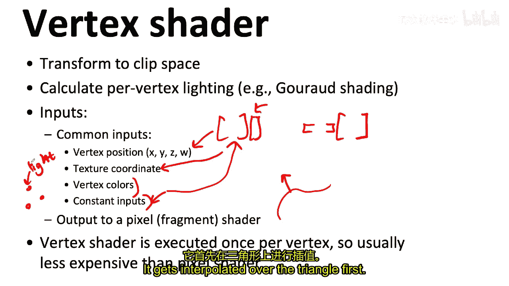

a vertex shader or a pixel shader and it's up to the card and the driver to figure out how it wants to parcel all of that out So everything you see in here is one of these four vectors。

Either it's an Xyzw or an RGB alpha or those are just names。

 it can also represent other kinds of data so you'll have a certain number of general purpose registers for your computation if you're writing shader assembly code you're thinking of those yourself nowadays usually you will use some higher levelvel shading language either HLSL specifically or another high level shading language one not necessarily actually called HLSL and you'll define some variables and the compiler will decide how to allocate the registers but this is it as far as memory goes shader codes very simple because the compute units themselves are very simple there's no moik in shader code because there's no heap to allocate memory on because there's no memory for a heap similar there's no stack there's no recursion in shader code you can't have a function call itself all functions are basically in line when you call a function it's not like you're allocating space on a stack to pop parameters onto along with a return address and then pop those back off。

There's no stack It's just these registers and that's it Now there's a bunch of registers associated with constants these are for what I've been calling the uniform variables these are things like positions of lights colors of lights they're things like the elements of a four by four transformation matrix that you're applying to your vertices and remember all of these registers whether it's a constant register or one of these dynamic variable registers that you can use in your computations all of those are by four so whether you're storing your information this way or rather you're storing your information this way any four by four matrix is only going to take up four of these constant registers Now under this shader model you do have some fairly specific things here we have an output register for fog that's fairly specific you also have here some specific output registers associated with particular diffuse or specular color computations We're not really going to use this kind of functionality because well want things to。

Be more general， but that kind of facility is out there Now we'll have some input registers that from the point of view of the compute unit it has no idea where it actually came from There's some place further upstream on the card that's deciding what vertices are getting past to what compute units when you're writing your code you imagine the stream of vertex data coming in and your card will run a piece of code on it to produce various outputs but again。

 the outputs that you compute aren't directly used by the pixel shader they get interpolated first for all these pixels that are being created so typically you will output a position that's locked to a hardware register that has a particular meaning This is what other parts of the card might use to figure out as part of a Z buffer check to see rather the pixel shader should be run at all Here we have a texture coordinate and sometimes we don't actually put texture coordinates in here Sometimes we will put some other kind of information say normal vectors because we want to actually do the lighting calculation。

the pixel shader and we're repurposing that texture register to hold that normal information because then we can take advantage of the coordinate interpolation hardware that's built into the GPU So let's take a look at some shader assembly code This particular example is from Stanford and it's a fairly old example This is fairly old shader code but you'll see the kind of instructions in modern assembly code Now in this class we're not going to write assembly code and even in professional context。

 you very rarely want to write In fact you never want to write shader model assembly code from scratch you may have situations where you will look at the compiled output of one of your shader compilers and you might tweak the assembly code more often what you'll do is you'll use the created assembly code as guidance to go back and tweak your higher level shader code to try to give hints of the compiler that it wants to do something more efficient Now usually trying to game out the compiler。

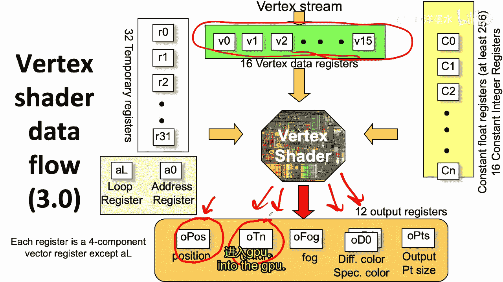

And figuring out how to twiddle your code to make the compiler make more efficient code。

 that's usually a losing battle because it's specific to both the architecture you're targeting and the compiler itself and later versions of the compiler might do things differently。

 and as Mike act the engine developer at insomnac game。

 So I think now is actually working with unity under new data oriented computation framework is fond of saying the space of optimizations that the compiler can come up with and handle is fairly small and they're fairly brittle。

 if you just make small changes in your code， the compiler doesn't see something anymore。 Anyway。

 let's take a look at some shader code And here you'll see the beauty of Swwizzling。

 So here's an example of computing a dot product。 The dot product can be written in terms of the determminant of this matrix where I J and K correspond to unit vectors in the X Y and Z direction The first coordinate it。

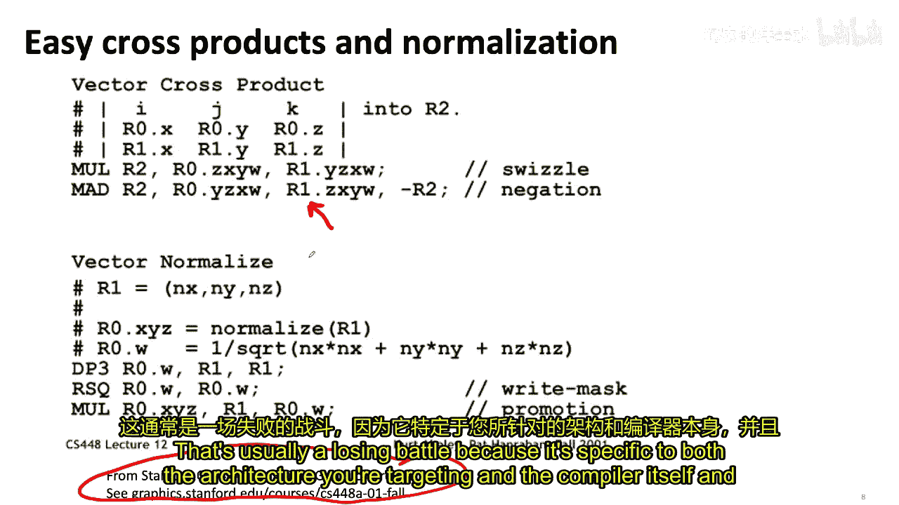

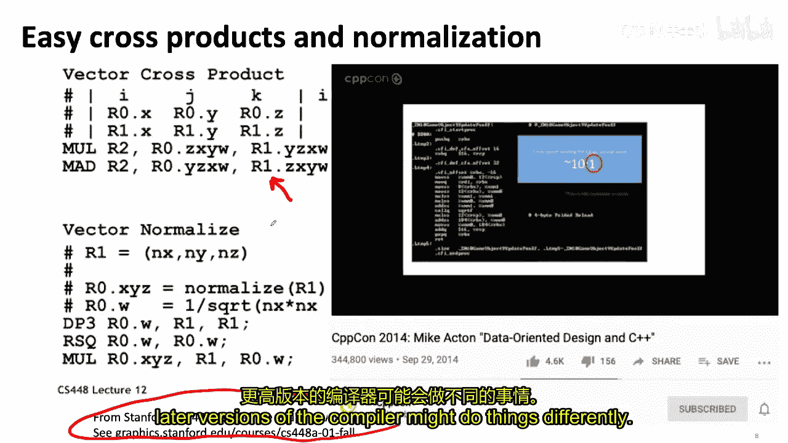

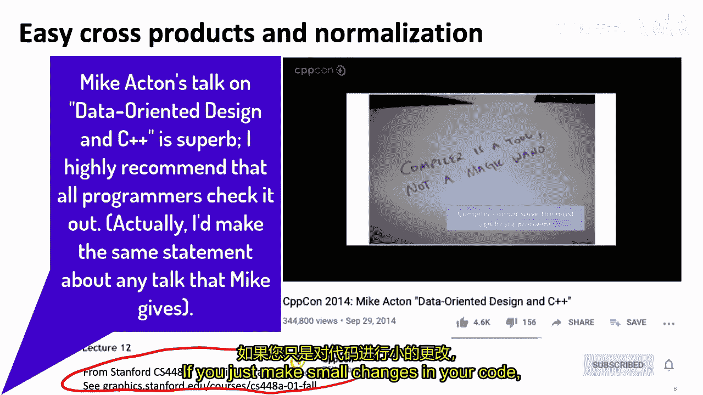

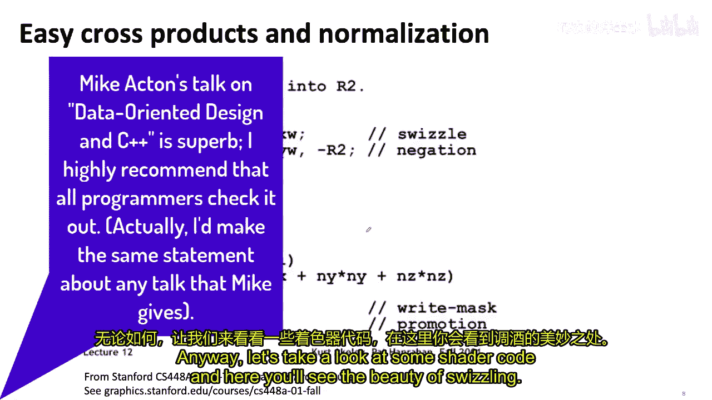

We'll have the y coordinate of R0 multipplied by the z coordinate of R1。

 and we want to subtract going the other direction and computing the determinant。

 the y coordinate R1 and the z coordinate of R0。So if you look at the computation here。

 what's being put in R2 is what's being subtracted， so that's this r1。 y in this R0。z。

 so here we've got R0。z and R1。 Y and that's going into the x coordinate All right。

 so what goes in y Well eventually we're going to subtract R0 x and R1z so that we see here R0 x R1z。

What are we going to subtract in the Z coordinate， where we're going to subtract going this direction。

 R1 x。which you'll see here in R0 Y and that goes in the Z coordinate So those are the thingses that are going to get subtracted on this next line remember this minus sign that happens free on the GPU we don't have to waste specific instruction to do that notgation that's a bit in the op code field of your assembly instruction。

Now， as I'll talk about in a second， these assembly instructions are probably not actually what's being executed on the GPU。

 The GPU is actually probably running some even more primitive kind of assembly code there's usually a precompilation stage run by the API and driver for your card that will take this kind of assembly code and boil it down to whatever is actually running on the GPU and the thing that's actually running on the GPU quite often not only do you not want to know about it because it'll vary from GPU to GPU quite often you can't know about it unless you've signed a nondisclosure agreement with the manufacturer of the GPU and VDdia and ATI will often consider that there special sauce so what about the stuff you're not subtracting that's what goes in here although this is a multiply operation this is a multiply and ad operation so this is the kind of thing that shows up on a digital signal processing architectures this multiply and ad or DSP who also。

Often have a multiply and accumulate instruction。 So this is the stuff going from upper left to lower right。

 So in the first position， we have R0 y and Rz1 in the second position taking this matrix determinant。

 we have R0 z and R1 x。 and I'm going through this in a pedantic amount of detail because it's easy to get lost here。

 so what about for Rz component going from upper left to lower right。

 I've got the x coordinate in R0 I've got the y coordinate in R1 and that's getting shovedho into z。

 So all of the upper left to lower right stuff is getting multiplied here and then the lower left to upper right computations。

 those are getting multiplied here and subtracted as part of this instruction。

 So notice in just two of these assembly instructions。

 we've implemented across product Now just think about how complicated this would be if you're writing it in some other more generic assembly code。

Whistling here gives you all kinds of power So you might also ask what happens with W Well there's not a whole lot of interest in here going on so I guess here we're taking the two W components and multiplying them together and then in the next line we're subtracting it so I guess zero comes out in the W spot I think the assumption here is that it kind of doesn't even really matter what's happening in the W slot so this is just the easiest thing to do and that's fine because the only thing you really care about out of this crossproduct calculation is what's happening in X Y and z supposeose we wanted to normalize a vector to have a length of1 this is a thing we often have to do in lighting calculations。

So the first thing we're doing here is taking a dot product of R1 with itself that does this calculation here of adding up the squares as you might guess there is also a DP4 instruction that includes the W component and the way these up codes work as you can guess from earlier is that the result is stored in the first register here so this is just giving us a number in the dot product so we have to specify where it goes and here we're just going to put it in the W register to have a place to put it and here we're going to take the reciprocal square root of this W component and we're going to stick it back in the same spot so that does the one over square rooting and incidentally it doesn't change any of the others so it's just going to write this in the do W component but it's not going to change X Y or Z and then in the next line we're taking register one we're going to multiply each element of register one by the scalar that's in register zero。

w。s this reciprocal square root and then we're going to store the result of that multiplication into r0。

 but only in the Xyz coordinates， leaving the W component there unchanged so the W component is going to have whatever the normalization factor here is if you need it for somebody else I can't think of a situation where you actually need that value after the fact but in case you needed it there it is so just three instructions and we've managed to normalize that vector So when programmable graphics hardware first came on the scene people would program these GPs in their raw assembly language and that was a big mess it was very much like the situation of developing video games in the 1980s when people would have to write assembly code for the 68000 or the 652 or the Z8 but the kinds of assembly instructions I'm showing you here aren't really like that these are more like Java codes or C sharpp net by codes。

likelyly the GPU isn't implementing those instructions directly they probably represent something more like an intermediate stage that the driver is comping down to an even more primitive set of assembly instructions so although counting these shader model instructions will give you a rough sense of computational complexity it's not an exact calculation because exactly how these instructions are implemented how many cycles each takes will change from GP or may then change from driver to driver so let's look at a more complicated example of a full shader。

 I'm not going to go through every single detail here I just want to give you a sense of things we'll look at how to do these kinds of calculations and a higher level language later so here we have our vertex coming in and to do the4 by4 matrix multiplication will do four dot products where each of those dot products is a fourcompent dot product and so here C0 c1 c2 C3。

Remember each of those has four values in it that combines to form my main transformation matrix in order to transform the normal we actually need to use the inverse transpo matrix Now I haven't shown you why that is yet we'll leave that for a future lecture to explain the math about why that is necessary I've shown you how to transform 3D vertices but I haven't yet really shown you the math of how to properly transform 3D normals we'll do that in another lecture okay so the lighting calculation that's actually done here is an older style that includes the diffuse component that we've talked about already and here it also includes a generic ambient term that's just sort of a number we add in there to represent general light bouncing around the scene nowadays we have more sophisticated ways of handling that this is also illustrating an older graphics model using something called blend Fong specular This is not a physically plausible model。

It doesn't have helmholt reciprocity so you can't change the eye in the light source and get the same answer and it also isn't energy conserving。

 but it was computationally inexpensive inexpensive and good enough to make games for quite a while nowadays people generally use a more sophisticated specular model called the torrentance model and I'll actually spend an entire lecture on that so we'll look at that another time The details of this again aren't important I just want to give you a general feel。

 So here we have a couple of these multiply and add instructions that add up the various lighting effects to produce the final output that is then sent to the interpolation hardware that creates values that are sent to the pixel shader Now this is a per vertex lighting scheme indicated by this code a per pixel lighting scheme would have these calculations done in the pixel shader and not here in the vertex shader So those are examples of a vertex shader the pixel shader aka the fragment shader。

The code that computes the final color value that's written to the screen so if you're looking up anything in a texture。

 you want to do it here and so things like texture coordinates aren't just used directly out of the vertex shader the vertex shader might compute certain things but those are only things computed for each vertex and then it will take values and interpolate between them before it takes a particular value and parcels it out to the various compute units that are running the pixel shader code Now the registers that are attached to the interpolation hardware。

 those don't necessarily have to be given texture coordinates。

 the vertex shader can put whatever numbers at once in that slot so you can use that for other stuff and we'll see many examples of this Now in addition to outputting color and that might include alphatrans or stencline information if you need it。

 the pixel shader can also deal with depth values most of the time this isn't something you as the programmer need to deal with explicitly。

Handled automatically by the GPU behind the scenes。

 but it can use that to do Z buffer depth tests and other things。

So there's a general tradeoff in quality between doing calculations on the vertex shader side and doing calculations on the pixel shader side。

 usually calculations done on the pixel shader side are going to look better but certainly trying to do whatever you can get away with on the vertex shader is going to be less computationally expensive So we looked at an example high levelvel computation model for a vertex shader let's do the same the for the pixel shader again。

 these registers are all the scratch space you have to work with there's no memory where you can pop things onto a stack so function calls don't involve pushing parameters on a stack the way you would get with the language like C or Java or anything else nowadays or most other things really and there's no moik there's no heap to allocate memory on this is all you've got all of these themes again are four component vectors either Xyzw or especially now here on the pixel shader it might be RGB alpha depending on what you're doing So we do have constant。

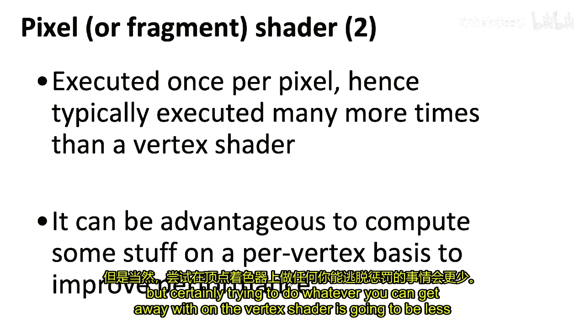

that are pieces of information that are the same for all the pixels being rendered。

 say the positions and colors of your lights if you're doing per vertex lighting akaong style lighting instead of grow per vertex lighting the one thing that's new here compared to the vertex shaders is we have hardware mechanisms that go out and talk to the parts of your video memory that are storing textures and these are linked to interpolation hardware So if you have the API settings to do bi in your interpolation the hardware will do that for you when it does the texture fetch versus say if you have the API set to tell it to do nearest neighbor interpolation and your job as a pixel shader is to figure out what the color and depth of the pixel are and the depth is usually handled automatically but the color is a thing that you need to explicitly code up in your shader So the coolest effects generally have their basis in the pixel shader because you can get a lot of details here anything you're doing with texture。

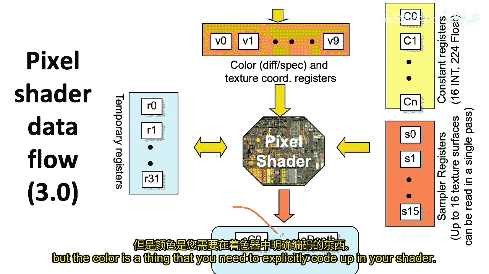

Even if it's just a basic diffuse texture you have to do in the pixel shader because that is a per pixel thing and certainly if you're using normal maps to get these interesting rough bumpy looking effects without adding geometric complexity to your original vertex mesh that has to be done in the pixel shader but even if you're not using normal mapping。

 if you are doing per pixel lighting， you quite obviously need to do that in the pixel shader so that is expensive if you're doing per pixel lighting typically you'll take normal information from each of the vertices use the texture coordinate interpolation hardware to interpolate that and pass that in the pixel shader and then you do a per pixel computation using those interpolated normals again the hardware just sees numbers it doesn't know that you're using that texture coordinate register to store normal information instead of texture information Anything you're doing in the shadows will by default need to be a per pixel computation and later in the class will look at the details。

Of using cube maps to reflect light from the general environment that's something you would have to do in the pixel shader So per pixel effects are more computational intensive than per vertex effects but they can look pretty cool So as I mentioned before。

 we won't actually be writing assembly language in this class although we might on some occasions look at the assembly code output created by our compilers we'll be using a particular shading language called Cg it's also known as hLsl highlevel shading language HLsso was the Microsoft term and CG as the NviDdia term way way back these did start as being different things but they basically converge and became the same thing nowadays nobody really says Cg they just say hLsl and the term high levelvel shading language you could use that in two ways you could say highlevel shading language in the general way of there's a bunch of shading languages out there that are high level and then there's also these。

highlevel shading language unote that was defined primarily by Microsoft but also essentially by NviIDdia and this sort of higher level language is obviously a lot nicer to work with but it's also not really that far removed from the underlying assembly code it produces because the processing units themselves are fairly simple things So HLSL Cg is not the only game in town OpenGL GLSL which looks fairly similar nowadays Vulcan and Apple for some reason insisted on doing its own thing I guess because it's Apple they should have just gone with Vulcan and been done with it anyway Vulcan is sort of the successor to openGL but all of the shading languages are really fairly similar because whatever GPU you're using they all have of the same underlying basic shader model 3。

4，56， whatever and a sophisticated engine like Unity will let you code your shaders in something like HL。

And then if it needs to， it will translate it into these other languages for you。

 and that's how you can write your thing quote unquote once in unity and then deploy it for Mac Windows。

 Linux， yada yada， yada。

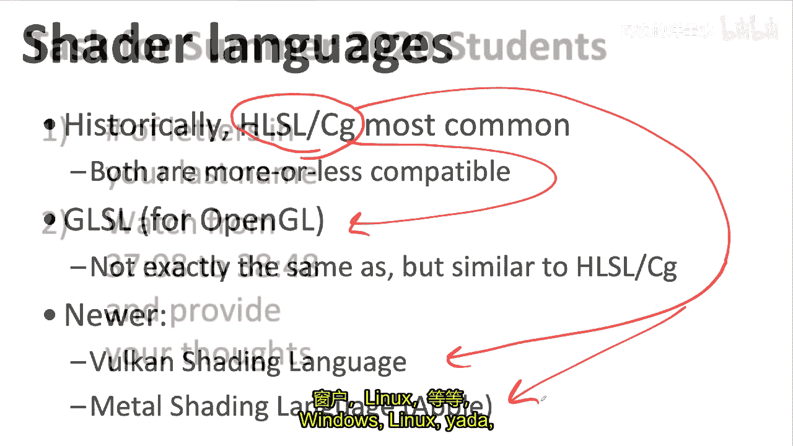

So if you are not taking GPU programming for video games with me in the summer 2020 semester。

 you can check out here but if you are taking it， I would like to make sure you're watching these videos so please go to Piazza and respond to an appropriately titled post that I'll make with two things one the number of letters in your last name I just want to make sure that you're watching the video and not guessing how to respond based on what other students are writing and also when you do this don't write number of letters in my last name is this is just between you the person watching the video and me So the main thing I would like you to do is give me your thoughts on a tiny clip of this video of an interview of music educator Rickpiiato by Spitfire audio cofounder and Media composer Christian Henson if you're into music I would recommend watching the whole thing but for the purposes of this assignment。

 I just want you to watch from the 37。

ute eight second mark to the 38 minute 48 second mark in which Rick and Christian discuss education in the time of CoVID 19 and just give me a few sentences with your thoughts on their discussion。

 what do you agree with， what do you disagree with， what lessons can be learned。

 just generally what's your impressions。

