# 【全集】佐治亚理工学院-GPU编程：视频与游戏-中英字幕-p15-Lecture-15---HLSL导论--BV1GZfyBbEQn_p15-

Hi there。 My name is Er Lanchman， I'm a professor of electricallectical and computer engineering at Georgia Tech。

 and this is my quarantine hair， and I would like to welcome you to the summer 2020 offering of GPU programming for video games。

In the last lecture we looked at shade or assembly code and we noted that nobody really wants to write an assembly code you want to write in a high levelvel shading language。

 so today we're going to look at a particular highlel shading language that Microsoft quite creatively called highlevel shading language usually shortened to HLSL Now HLsL developed by Microsoft and CG developed by NviDdia did start out different。

 but they very quickly converge to being more or less the same thing。

 so people will tend to use the term HLSL and Cg interchangeably。

 although I think HLsL is now the more common term CG was at least a little more creative。

 I think it stood for C for graphics OpenGL had its own shading language called GLSL if you find code written in GLsL it's fairly easy to adapt it to HLSL and vice versa Vulcan is a new API that's the successor to open GL and essentially what Vulcan does。

I it takes a lot of decisions that were implicitly handled by the openGL driver and takes some of those decisions and puts them in the hands of the programmer so the programmer can do some more detailed kinds of optimizations where on the street is that this makes Vulcan a more challenging API to deal with because there's often a tradeoff between flexibility and ease of use Now Apple could have just gone ahead and use Vulcan but no they had to do their own thing because their're Apple and that's called metal and both Vulcan and metal have their particular shading languages again these aren't actually much different from GLsL or HLsL or whatever all of these languages have the same underlying semantics really they just have different syntax and what that means is that it's fairly easy for somebody who makes an engine。

 say unity to let you write your code in HLsL and then unity will translate it into these other languages as needed for you from this point。

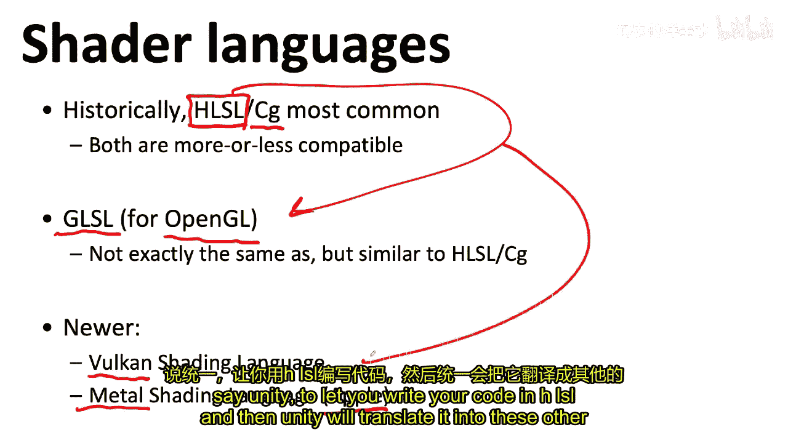

I'll mostly say HLSL， although everything I say about HLsL you could also apply to CG。

 it looks like C。 but it's a lot simpler Now this year I added the term generally to these slides because Sean Lee who used to be a professor Georgia Tech he's had left tech and went back to industry anyway when Sean and I were originally preparing these slides it was somewhere around 2007 and the industry was just transitioning from shader model 2 to shader Model3 the Xbox 360 and the PlayStation 3 that used shader Model 3 I think with a few custom special sauce extensions had recently come out and so I haven't really kept track of say what's nowadays in shader model six point something but even if you're using one of these newer shader models you generally are writing code that winds up compiling down to something fairly simple as I mentioned before there's no memory there's just registers so it's not like。

There's any kind of moic command because there's no heap to allocate memory on more recent shader models do have explicit jump commands but older shader models didn't you would often essentially run all of the branches of the loop and do conditional assignments in order to fake the semantics of branches and even nowadays most function calls are actually just in line so it takes the compiled code and just sticks it wherever it needs to go instead of doing jumps and I wrote no practical recursion here because I have recently seen some articles on the web talking about how to fake recursion in the newest shader models I don't really know anything about that and I can't think of a good use for it and most common graphics applications so I won't explore that further here but fortunately we won't really need things like that。

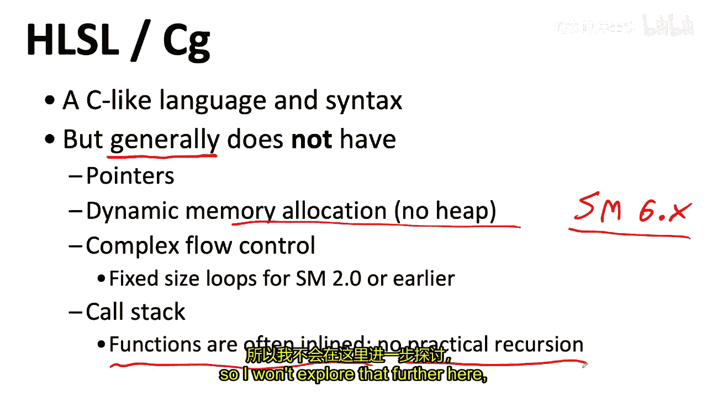

So the main thing that you have in HLSL or CG that you aren't used to from C or C++ or C sharphar or Java or whatever is the idea of uniform variables versus variable inputs so uniform variables are things that are common to all of the vertices and pixels that you're processing these are things like the matrices that represent your transformations from model space to worldspace to view space to clip space and these have to be set somewhere outside of the shader code somewhere in C++ or C sharpp or whatever language you're accessing the API from you don't need to explicitly include the keyword uniform to define the uniform variable as long as you're defining variables outside the functions which you have to for uniform variables anyway。

 it wouldn't make sense otherwise and you'll see these defined at the top of your code So those are the things that are common for all of the vertices you're processing and all of the pixels that you are creating。

There's another kind of input and these are basically the big buffers of vertices that are being sent from your main memory into the GPU and these are also various things like the locations and colors of pixels being created by your interpoator These are defined using something called semantics and again these are unique to HLSL s CG you don't see these in your standard C++ C sharpp whatever and these are tied to specific pieces of hardware on the GPU they're not generic。

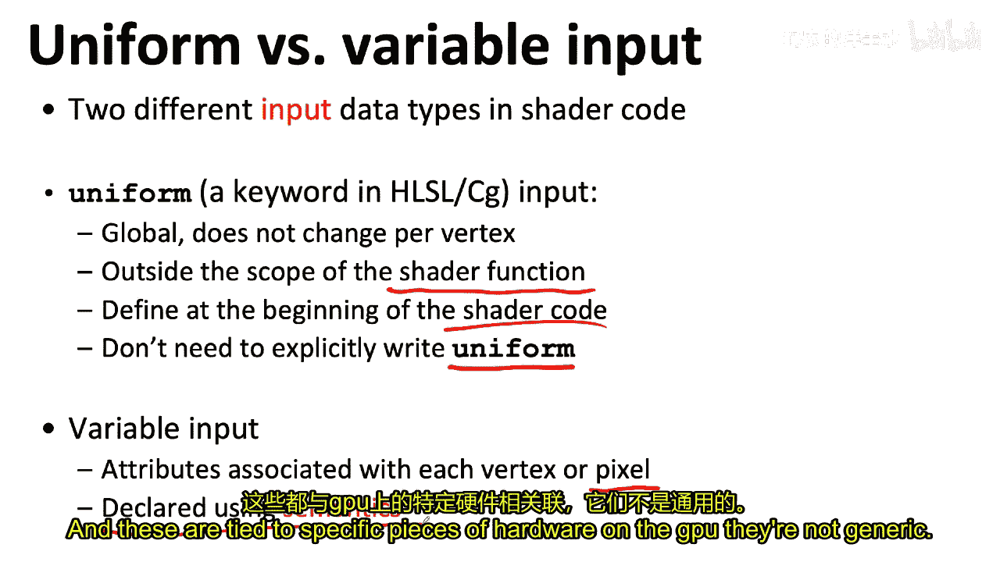

So something that's a little tricky about using Unity is that unity is trying to make riding games as easy as possible。

 which is a great goal， and so it tries to hide a lot of the details from the user that actually kind of runs counter to our main goals in this class。

 which is about the nitty gritty details of the GPU the net effect is that there's a lot of variables that the unity runtime will define for us and the same thing will be true if you're using Unreal or Goddo or some other engine in this general class of engines that I like to think of as having batteries included。

Inevitably， once you get to a certain level of sophistication。

 you will have to create some of your own variables that you define using a custom script。Now。

 if you're writing either in raw Direct X or OpenGL or Vulcan or metal or whatever。

 and you're probably writing in C++， then you have to do all of this yourself。

You don't have a unity or an under runtime assigning these variables for you， Similarlyly。

 although people would occasionally call X and A a game engine or a monogame。

 which is an open source rewrite of X andA game engine。

 it's really a game focused API it's essentially a dotnet layer that sits on top of direct X or openGL or whatever it's not really a full game engine again in X and A you needed to define and assign all these uniform variables yourself the first six years that I taught this class we used X and A So in those early examples we had to do all of that explicit assignment here unity is handling a lot of it for us and the kind of information that you have here such as say the positions and colors of lights。

 these are stored in the constant registers that we looked at in the last lecture and again。

 these are called uniform because these will stay the same for all of the vertices and pixels being processed by your shader code。

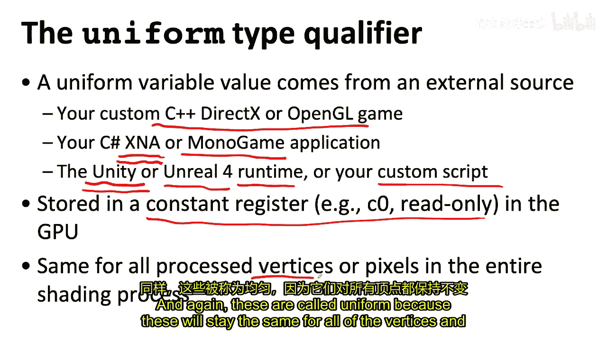

So here's an example of some semantics。 The variable name you give it is more or less up to you。

 Now unity has certain conventions that it likes to use and I'll more or less stick with the conventions。

 whatever I find in the code but sometimes I don't it just depends on my mood the semantics are defined by these keywords and they go after this colon and these are in capital letters and you don't get to pick these you can't just make up one and call it Fred because these are actually tied two specific pieces of hardware on the GPU So these serve certain functions for instance text coded zero textcor1 etc ce。

 Those are tied to the interpolation hardware and when you're passing a big chunk of vertices and a big array of indices into that table of vertices that define various triangles the calls in the API that you make reference specific things like positions and things like normals Now the renderer that's built into the。

Unity runtime will handle a lot of this for us， but if you're writing your own game using monogame or just raw C plus plus with Direct X or open GL then you have to define these buffers low the vertices into it make all those API calls that takes those buffers and sends it over to the GPU etc etc here unity will handle most of it for us Now if you want unity has built into it abilities to call the lower level routines so if you wanted you could just ignore the rendering capabilities of the unity runtime and write it all manually although that would be pretty painful and you generally only do that if you had some word special case where most of your game you're handling using the usual unity rendering routines but you may have this one odd effect that you wind up doing manually generally you want to avoid doing that it negates the main purpose of using something like unity to begin with So the semantics connect the CPU side。

To the GPU side， and then they connect the various hardware elements of the GPU。

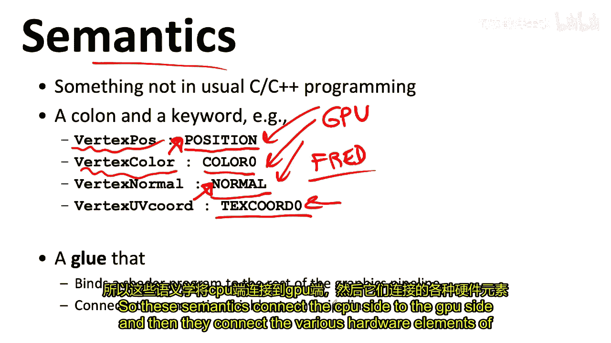

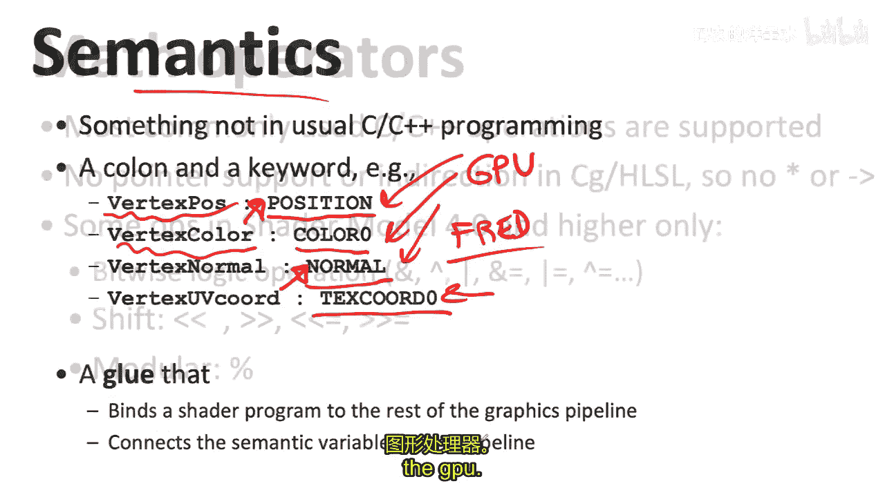

So most of the math operations we're going to do in shader code involve either floating point values or vectors and arrays of floating point values The bad news about shader code is that you don't have pointers so you can't create and use sophisticated data structures the good news is that you don't have pointers so you don't have pointer bugs so we don't have any of the usual syntax associated with pointers Now Shar Model 4。

0 did introduce integers and all of your various operations on integers but come to think of it I can't recall seeing any examples of shader code used 43D graphics that uses this stuff I think this is mostly kept around for if you're using a more general purpose GP programming framework to mind Bitcoincoins or something or do cryptography or something。

So before we delve in further， we need to talk a little bit about vectors in HLSL and particularly how to multiply them so in a language like MatTlab there's this notion of column vectors and row vectors in HLSL and I think a lot of other shader languages。

 there's not the same kind of notion there's just vectors and matrices and how you interpret what's a row vector and what's a column vector really depends on the way you use the multiply command。

 so this just has to do with the way that ML that command treats the numbers that you give it and the way that these arraysor stored so if you put the vector in front of the matrix you can interpret it in the usual way as multiplying a row vector by a matrix。

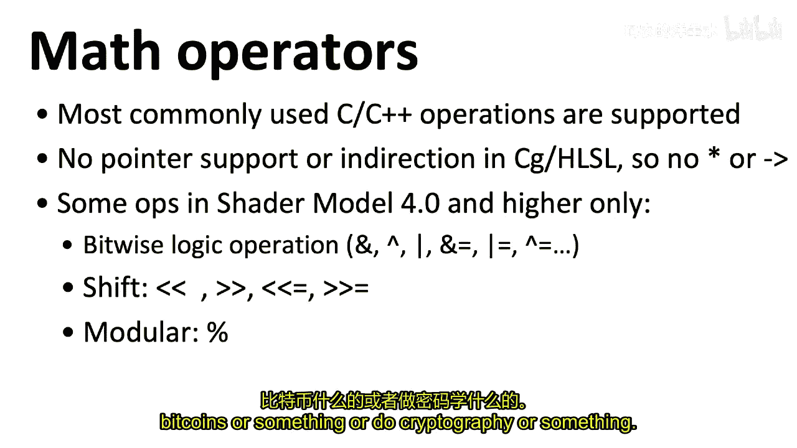

You put the matrix before the vector， you can interpret that in the usual way of post multiplying a matrix by a column vector。

But if you want to treat your vector here as a column vector。

 you can go ahead and put the V in the first argument。

 and that would correspond to multiplying that column vector by the transpose of the matrix Similarlyly。

 you could if you want to think about V as a row vector but put V second in the multiply command。

 and that's equivalent to post multiplying V by the matrix transpose。

 This can cause a great deal of confusion when you're looking at different textbooks and various examples of shade or code you'll find online。

 because it sometimes seems unclear about whether it's a row or column vector and the answer is it depends on how you're treating it。

 It depends on how you're thinking about it。The net effect of this is I can't think of a single example of shader code I've ever seen where there's been an explicit transposed command used and in a case where transposed is used。

 either it's precomputed on the CPU side and sent in as a uniform parameter or it's basically involving using the mo command in a certain way and interpreting the results in a certain way So although in something like matlab you'll quite often see people write V and then put a single quote after it to do the transpose operation。

 you just don't see stuff like that in shader code that takes a little bit of time to get used to So HLsL and most other shader languages will have a lot of commands built in there's things that you would expect to take dot products and cross products。

 of course if you wanted to you could write these out explicitly find distance between things one interesting thing about the linear interpolation command is that your F doesn't need to be between zero。

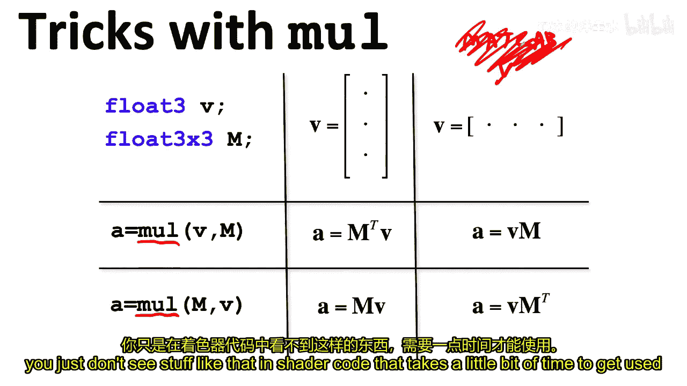

And one so you can sort of extrapolate to the different extremes this lit command is a little weird it maps to a shader model and symbol instruction where if you precompute your normal vector dot product with a light vector and your normal vector dot product with a half vector it will compute this old school Blin Fong lighting model although every place I've ever seen an actual piece of shader code that implements Bfong they don't actually seem to use that command。

 they just code the various equations directly， so who knows？Anyway。

 we've already talked about multiply a bit， normalized does exactly what you think it does。

 and you wind up using that a lot。 saturate is basically a shorthand for using a combination of a min and max operation to clamp things between zero and1 you wind up using that a lot when we get to environment mapping willll need to use this reflect command and now the sineco command that's kind of interesting because all of the other commands on this list。

 take a particular input and then provide a given output like a function does here you give it an input but the actual outputs are placed in this S andC component so HLsl can have functions that assign outputs to things inside the parameter list although that's not fairly common in most of the library functions and yes。

 in case you're wondering there is a specific shader model assembly instruction that produces the sign and the cosine of a number in one。

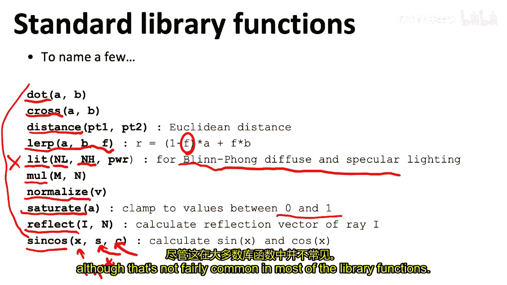

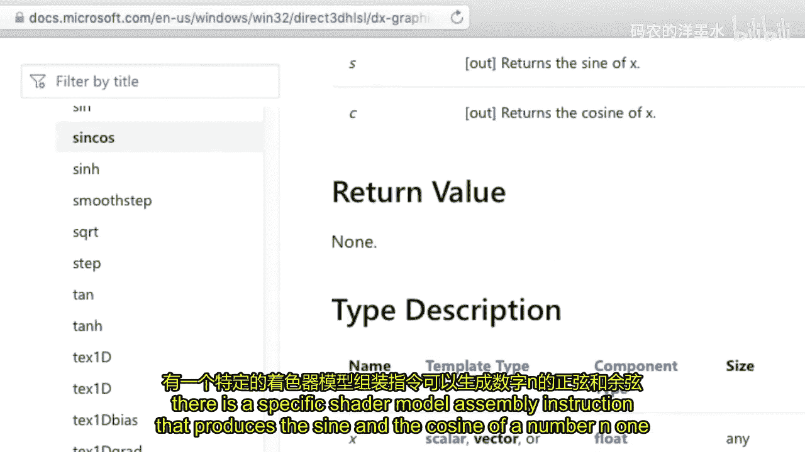

And if you're wondering where you might use that， remember the rotation matrices if you just think about an object at a certain position in orientation。

 those signs are cosines are things that will be precomputed to create some sort of matrix that you are applying to all of your vertices。

 but you might imagine doing some sort of rotational animation inside the shade or code itself。

 in which case a command like this might come in handy。

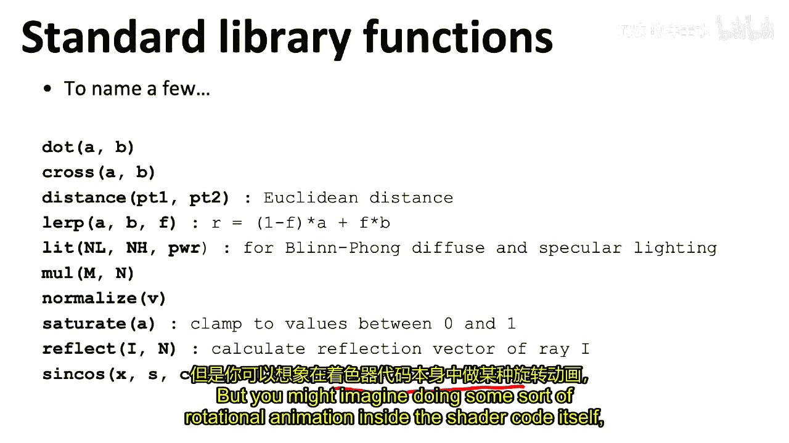