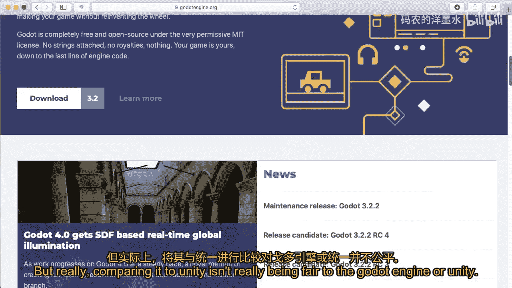
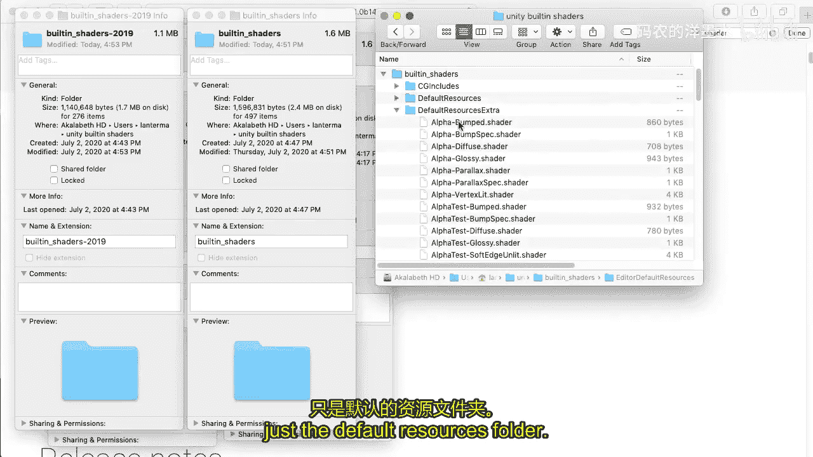
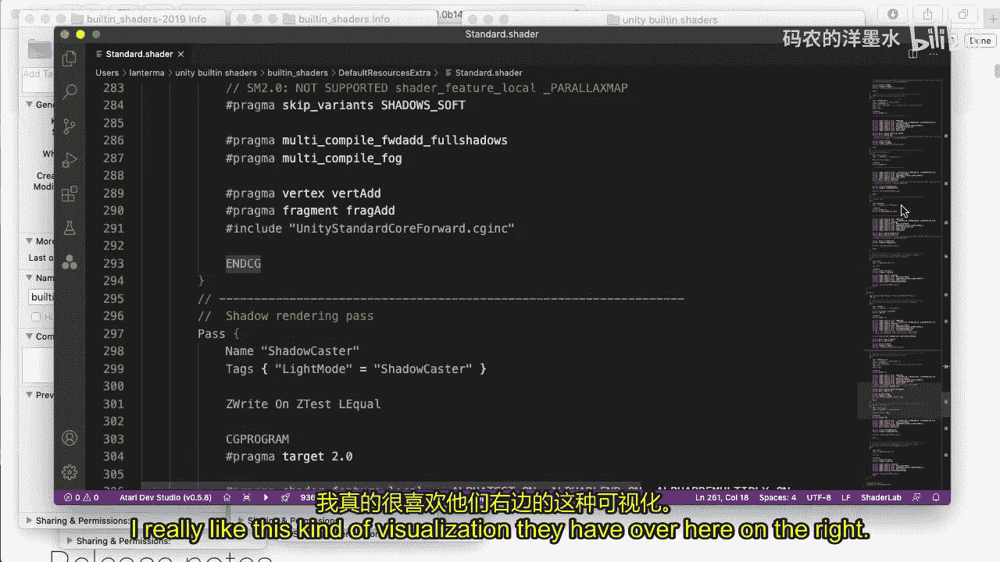
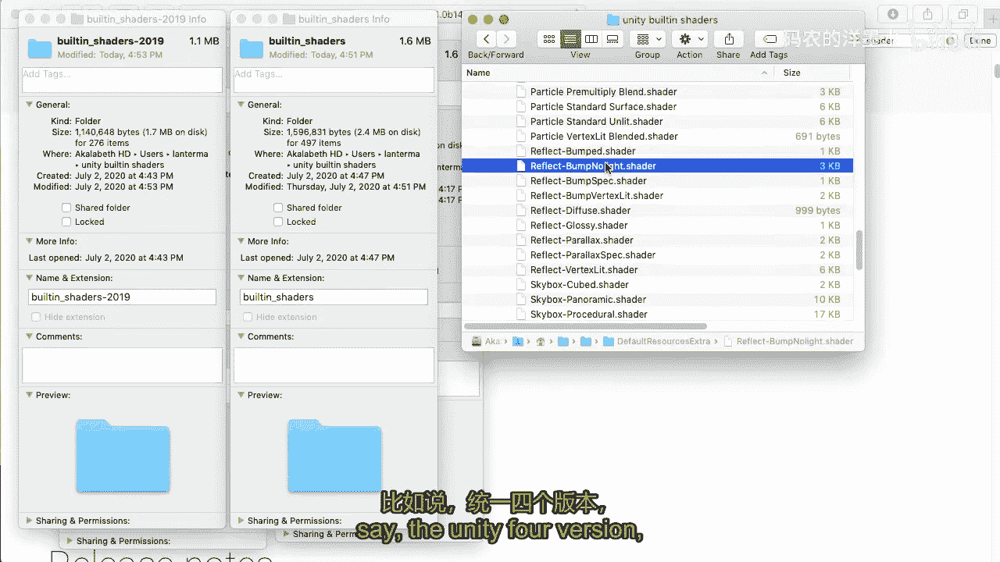
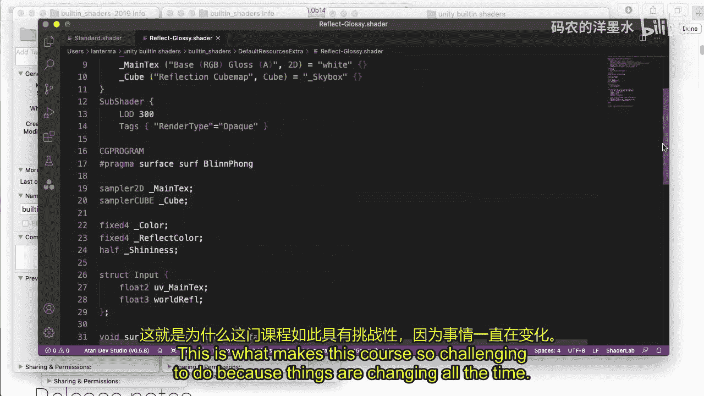
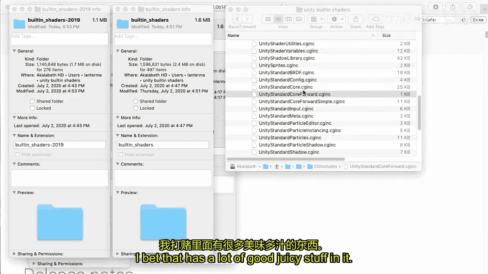
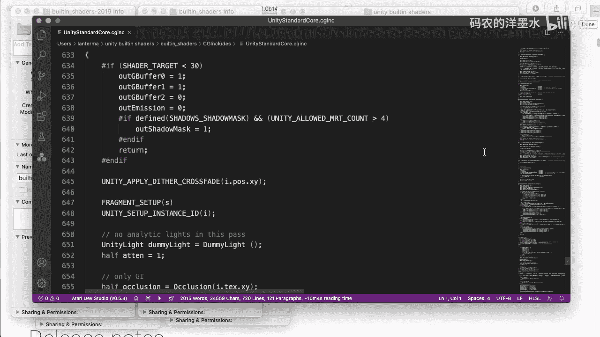

# 【全集】佐治亚理工学院-GPU编程：视频与游戏-中英字幕-p16-Lecture-16---Unity-内置着色器源代码--BV1GZfyBbEQn_p16-

Trust me。 Don't worry。 Don't panic。 Trust me。 It's gonna be fun。 Hi there。 My name's Sarah Lanchman。

 I'm a professor of electrical and computer engineering at Georgia Tech。

 and this is my quarantine hair。 And I would like to welcome you to GPU programming for video games。

 And this lecture， we're just going to download some of the Shar code from Unity's website。😊，Okay。

 this isn't going to be very exciting。Now， if by some twist of fate。

 you wound up watching this video， even though you're not using unity， if you're say using unreal。

Or say if you're using the Goddo engine。Whatever engine you're using。

 I would still recommend downloading the Unity Shar code and going through it because you can learn a lot from looking at that code。

And as an aside， the Goddo engine is really very interesting。

 it is totally free and open source and all that it's probably the closest and general style to unity out of all the various engines that I've looked at。

But really comparing it to unity isn't really being fair to the Goddo engine or unity。

 each is really trying to do its own thing。

But if you're using unity， you really need to spend some time looking through that shader code because the unity documentation is usually either fairly sparse or fairly。

Incorrect。A lot of the documentation that's up really applies to earlier versions of unity。

 and especially if you're looking through web forms to try to find answers to questions。

 then whatever you're looking at will probably be extremely misleading。

So if you're doing anything beyond just using the builtt in standard shader。

 you have to spend some time in that shader code， particularly if you want the shaders that you write to play nice with the built in Unity shaders。

Head to your favorite online search engine and type something like Unity archive。

So Unity provides the source code to all of its various built in shaders。

Although the shader code is embedded inside the unity executable。

 the actual source code needs to be downloaded separately。

 so let's download the source code to the latest version of 2019 this tends not to change a lot if you had previously downloaded the source code to 2019。

4。0 you would probably not bother downloading it for 2019。4。2 However。

 they do tend to change between dot releases so if the last time you downloaded the shader code was 2019。

3。15。And now you're using 2019。4 well， then you want to go download it again Now of course the various executables are different between the Windows and Mac versions here。

 the links to download the Shar code， these are actually the same between the Mac and PC versions。

 which makes sense because they want to be able to deploy your game to a billion different platforms。

So it doesn't really matter which link you click on here let's download the built in shaders do to do to do I also want to pick up the shader code for the latest beta。

 but unfortunately that's not available here so let's go back to our search engine so I'm just going to go here and try to search on 2020。

1。Let's see， okay， this， I'm sure we'll download the installer for it。What about archive？AhOkay。

 here we have additional downloads。Additional resources ah built in shaders， okay。

 they did not make that easy to find。Okay， so the 2019 shaders downloaded with this 2019 extension。

 the 2020 beta shaders downloaded with no extension at all。

 it looks like the 2020 shaders have about half a megabyte of extra source code beyond the 2019 shaders。

Oh， this is interesting， there's this extra Ed default resources folder in the 2020 version。

 who knows what that is。okay interesting Unity has some odd folder naming conventions There's two main places you need to look in order to figure out how unity shaders are actually working。

 one is the CG includes and the other is default resources extra there's not a whole lot that's terribly interesting inside just the default resources folder。

Now figuring out how the standard shader works is not a particularly easy task because it's designed to be I think unity at one point called it the Uber shader basically it is huge it goes here and then it goes down here and then it keeps going and then it keeps going and then it keeps going and it keeps going and it keeps going and what makes it particularly tricky to figure out is there's not an actual lot of code code in here it's mostly a bunch of include files so here it includes some standard stuff and then it has a whole bunch of different variations I guess here's something with shadow。

Here's something with some standard core stuff， whatever standard core stuff is。

 here's some meta stuff， the meta stuff usually has to do with support for precomputed bounce lighting calculations we'll talk about that later in the course unity standard core forward whatever that is so even though this is huge it's really a ton of copy and paste style programming and you can see that I'm using visual studio code here I really like this kind of visualization they have over here on the right you can very quickly see that there's definitely this repeated block structure with these little blocks of code be mostly identical except for a few variations。

So that Uber shader style of shader coding is very different than say。

 the Unity4 version where you had a whole bunch of individual shaders for individual lighting effects。

Each individual shader was fairly small This is what makes this course so challenging to do because things are changing all the time both in terms of unity changing things from one version to the next each year and just general industry trends changing there are topics I'm going to be covering this semester that probably were more like research topics 10 years ago。

So besides that default resource extras folder， the main place you want to look is in CG includes so if you scroll down here here you'll see all of that unity blah。

 blah， blah stuff。So here's Unity standard core， Unity standard core forward， Unity standard input。

 Unity standard Me， these are the main include files that that standard shader file would import so if we take a look at Unity standard core forward。

Now we're getting down to details we actually know this is calling other stuff so we're importing either Unity standard core forward simple or unity standard core let's take a look at Unity standard core I bet that has a lot of good juicy stuff and itooh。

 look， it's 26 kilobytes of source code。

Okay， now we're talking now there's stuff a look at all this stuff。More stuff， stuff about tangents。

 everybody loves tangents。Metalllic gloss， roughness set up。Doesn't this look fun。

 ah global illumination stuff？Anyway。You can go down quite a rabbit hole here and guess what in a good portion of the rest of the course。

 we're going to go down this rabbit hole， trust me， don't worry， don't panic， trust me。

 it's going to be fun。

