# 【全集】佐治亚理工学院-GPU编程：视频与游戏-中英字幕-p17-Lecture-17---ntroShaders-Unity-包预览--BV1GZfyBbEQn_p17-

Hi there。 My name is Sarah Lanchman。 I'm a professor of electricallect engineeringer at Georgia Tech。

 and this is my quarantine hair。 So I've created a unity package that contains some example shader code that we'll look at in this in a few of the following lectures。

 So the way I've structured some of these demos in this unity package and the other unity packages that I'll provide later in the class have been heavily influenced by this website。

 Cat like coding that has a truly amazing set of tutorials。

 I strongly recommend that you go check out catlike coding。

 particularly these tutorials on rendering。 and these tutorials on advanced rendering。

 There's also some great tutorials on scriptable render pipelines that well look at a little bit later。

 And one issue with these scriptable render pipelines is that unity has changed the way those work quite a bit。

 So you want to make sure you're looking at the latest tutorials。 So cat like coding great website。

 great tutorial。😊。

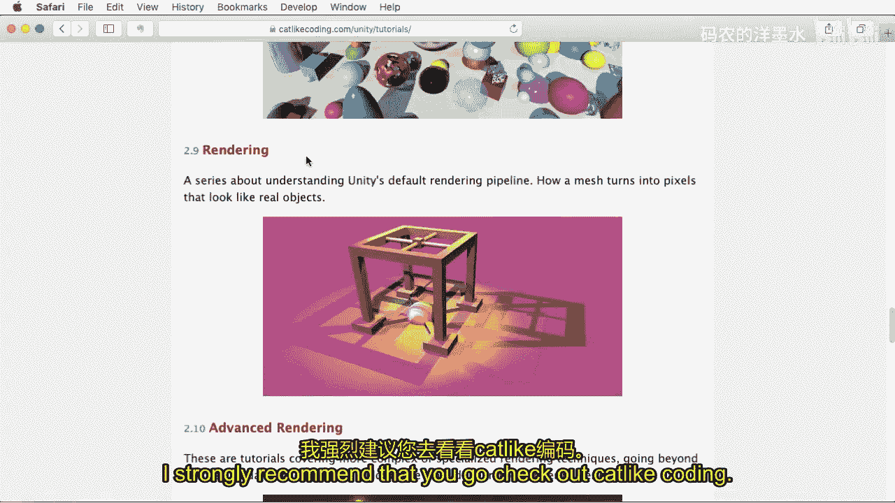

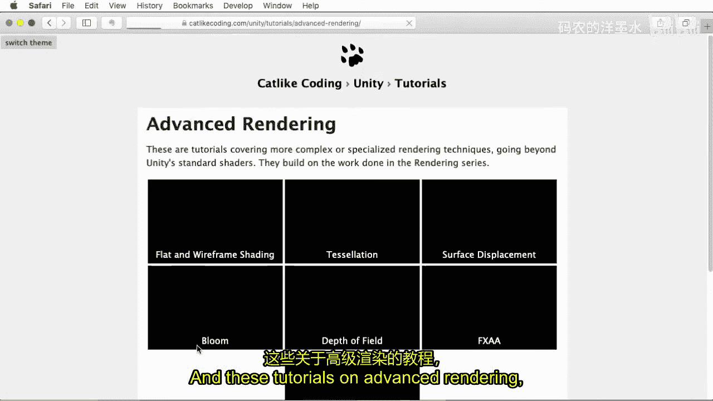

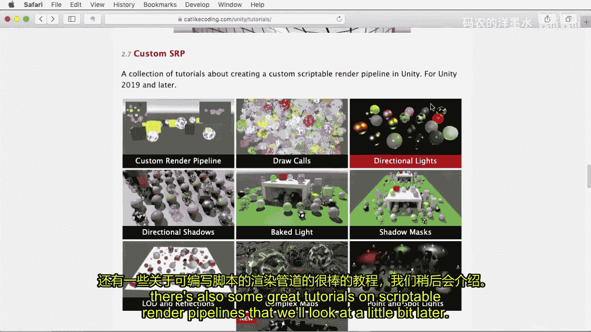

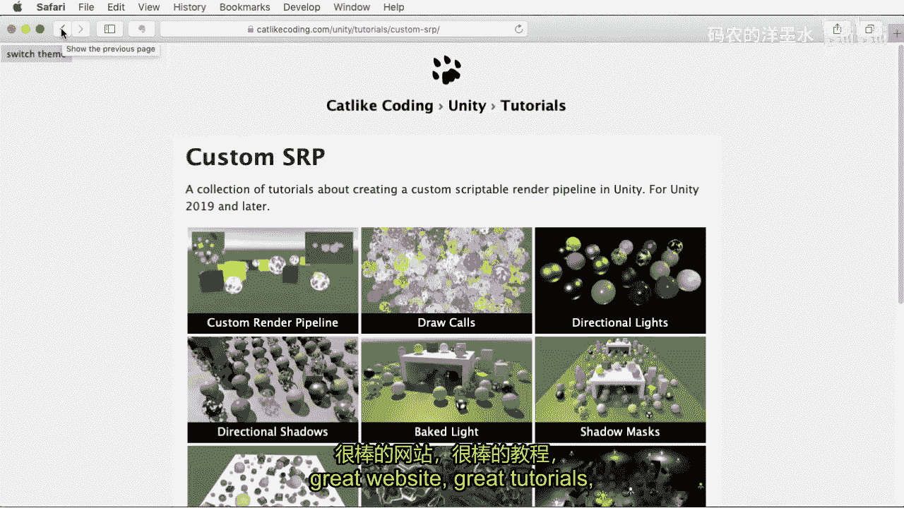

Go check them out。The pedigree of the example code I'm going to show you goes a long way back to Unity 4 before there was the standard physically based Unity shader that they introduced in Unity 5 in Unity 4。

 They had a bunch of small individual shaders that you could select and a good portion of what I did in my democodes try to reproduce those shaders。

 and that was also done under the advice and influence of various things in the CG tutorial。

 which fortunately is now available for free on Nvidia's website。

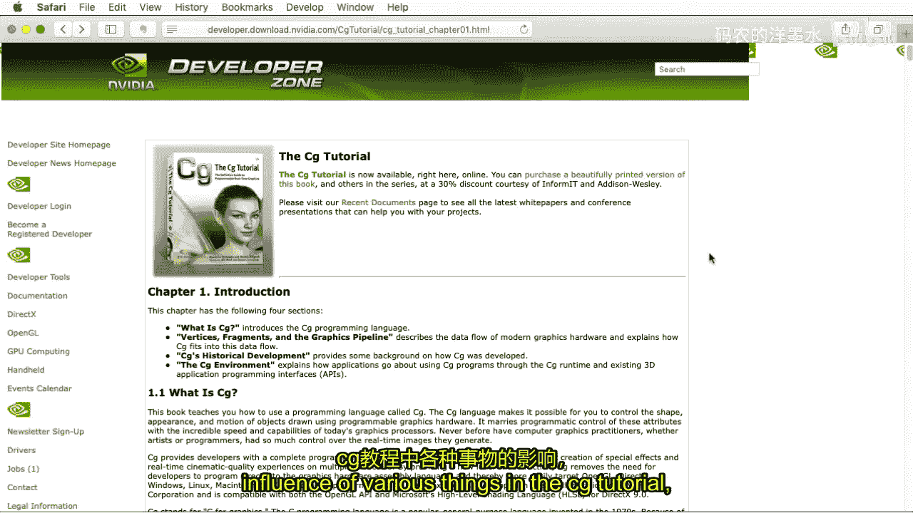

So this inter shader Unity package I developed uses these sword and shield models that were available for free from the Unity assetet store。

 and so I just wanted to give a shout out to the creator of these models。

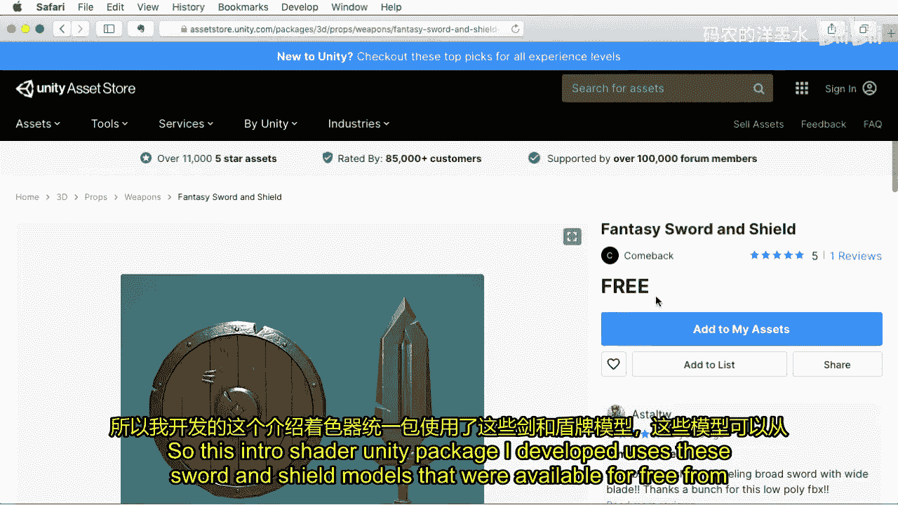

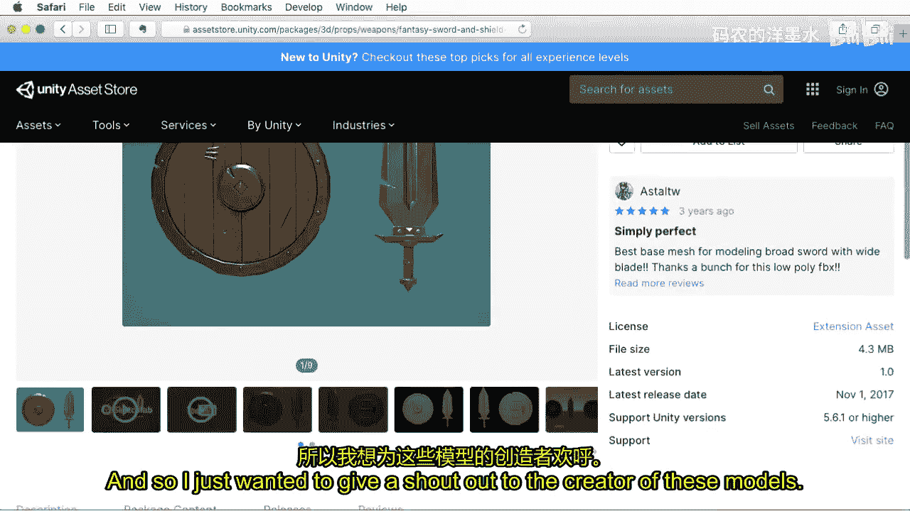

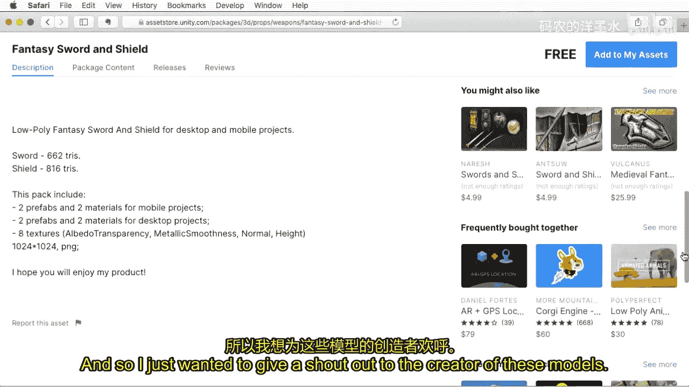

Okay， here you go from Tula， Russia， they've got a lot of cool stuff here。

 so you should go check them out。

So I currently have two unities installed， one is the 2019。4 longterm support release。

 so the idea there is Unity is going to keep providing bug fixes for a while and keep supporting it but not add new features。

 of course 2020。1 beta that is supposed to be the latest greatest everything but probably not the most stable。

 hopefully this will have its full official release in a couple of weeks。

 I saw somebody from Unity say something like that on Twitter。Anyway。

 the Intro shaders package I created appears to load F in both of these versions。

So to show how to load this in， I'm going to create a new Unity project。

As I said it seems to load up and run fine in both versions I'm going to go ahead and use the original 2019。

4 version here let's call this Intro shader load test and here let's not use 3D with extras and it loads in a bunch of extras and we're also not going to be using HDRP or the universal render pipeline these are new fancy scriptable pipeline things and the intro shaders I've created won't work with those so let's just go with a standard old school built in original non-f pipeline 3D project so we'll create one of these。

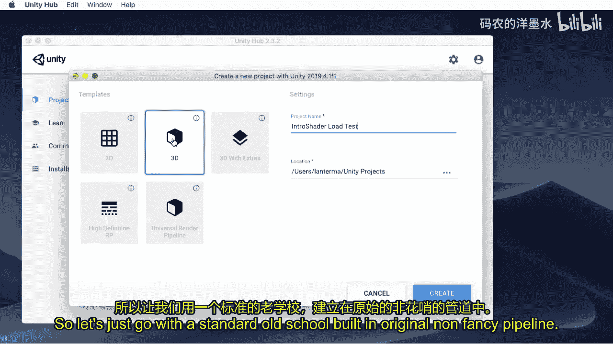

The main thing you need to do every time you create a 3D scene is you go into the project settings and then you click on playerer。

 and then you change this from gamma because running in gamma color space is not good change this to linear and periodically go back and make sure nothing somehow magically set this back to gamma。

 always make sure this is in linear Brent concluded。

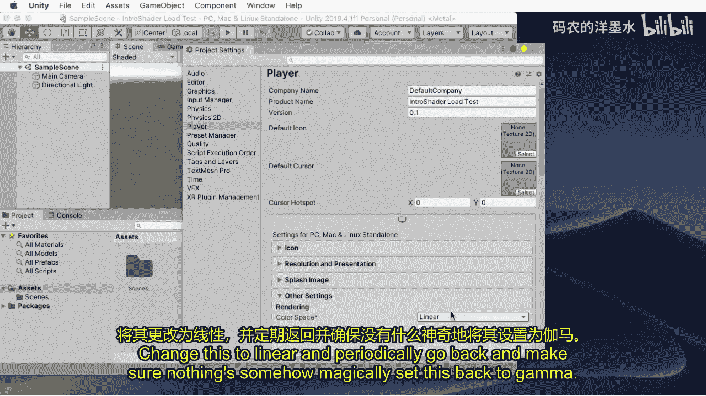

Okay， so over here I have my Unity package file， I'm just going to take that and drag it onto the assets folder。

And it's going to tell me about all the stuff that's in there。Yep。

 there's a lot of stuff in there and then I'm going to hit import， this also works on the 2020。

1 version of Unity。And now in the scene folder there will be five scenes。

 one of them is the scene we're looking at now， the sample scene that's not very interesting。

 that was created automatically when we created that blank Unity project。

 but we also have a set of simple shaders that we're looking at。

And so we'll spend a lecture talking about those， I'll leave these spin here for a second so that you may admire them。

Here's the Unlit texturetures demo， so that will be the second lecture in the series where we dig into the code and talk about how to do textures。

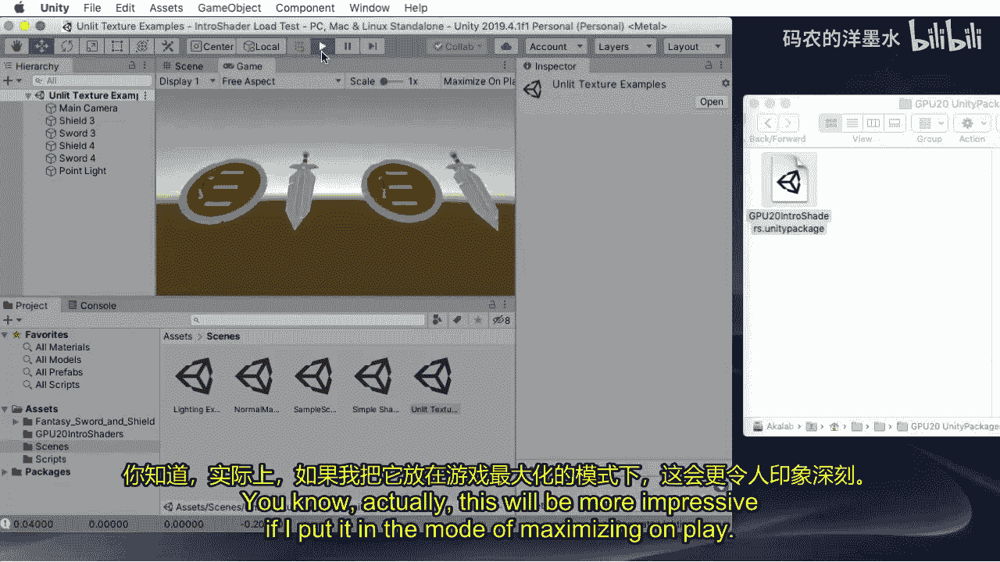

You know， actually， this will be more impressive if I put it in the mode of maximizing on play。Okay。

 let's try that。Okay， so that's still not terribly impressive。

 but later we'll look at another scene where we actually include some lighting。

So here in addition to having these swords and shield spin。

 I put down some cylinders and then I have a light going back and forth and when we look at this and the third lecture we do where we delve into these examples in detail。

 we'll talk about the difference between per vertex and per pixel lighting。

 akaA grow versus thong style shading。And then the final example we'll look at in the sequence。

 it will involve doing the same demos， but doing them using normal maps to get the roughness effect that you're seeing here Now normal mapping。

 of course， is something that can only work if you're doing per pixel lighting。

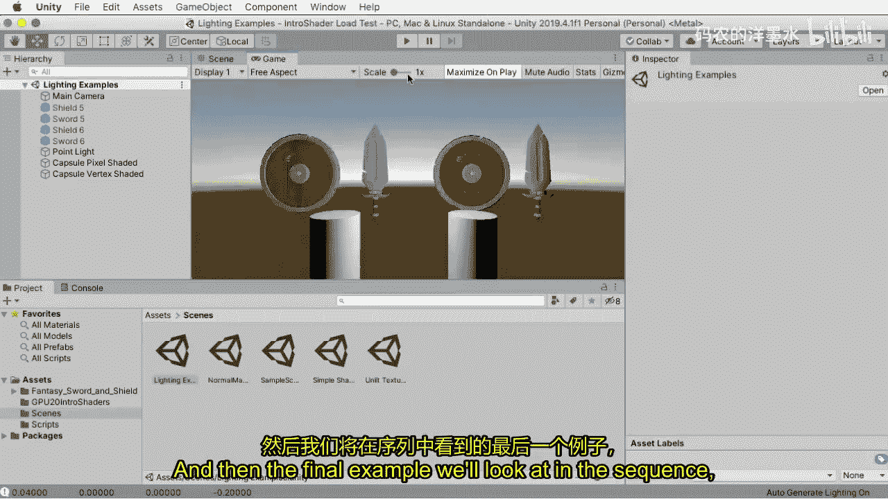

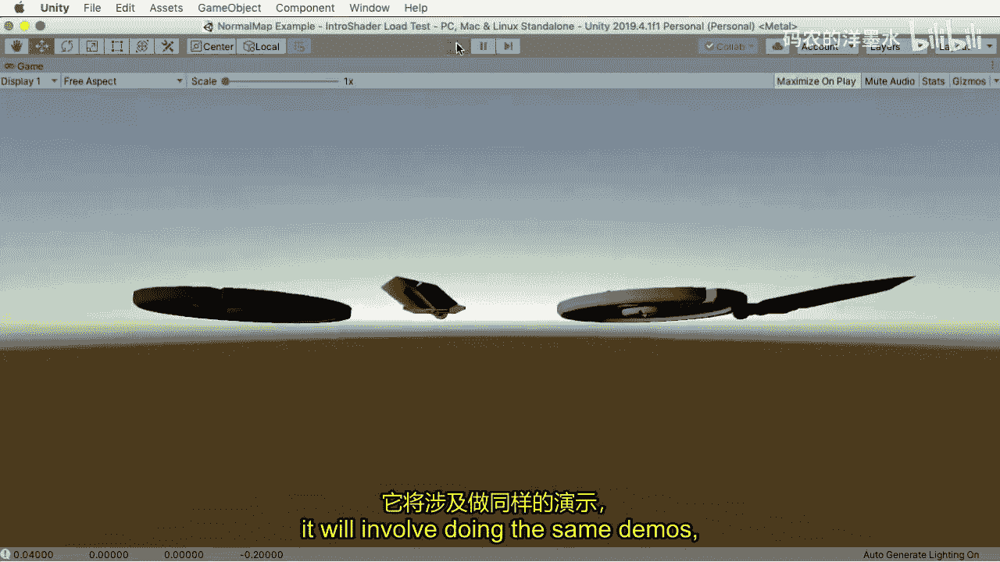

So if you haven't used unity before， this is the scene view， not to be confused with the game view。

 which you actually see when running the game， this lets you move objects around。Here's the light。

 here's the camera， I should mention that all of the shader code that I'm providing here I'm only guaranteed to work if you have a single light source in the scene。

 if you have more light sources in the scene， they might work okay with multiple lights。

 they may not， it depends on some particulars。

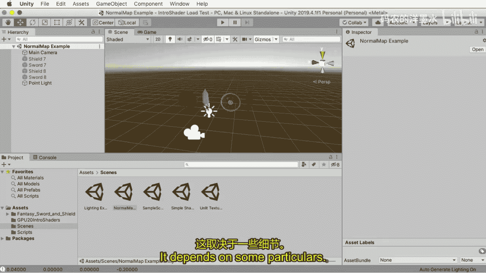