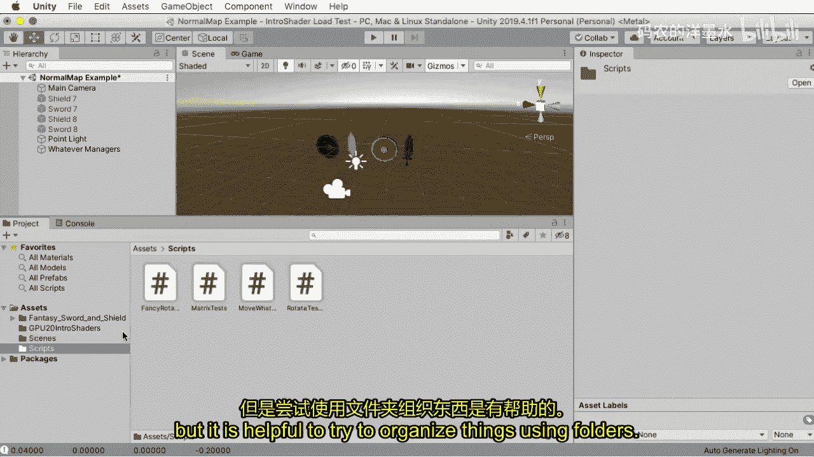
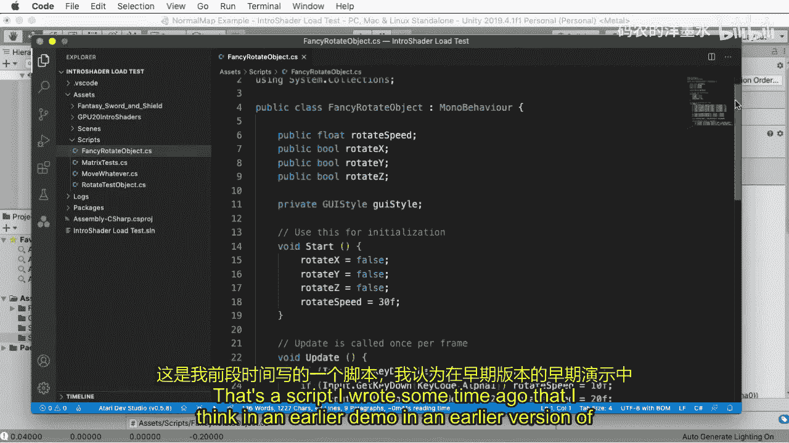
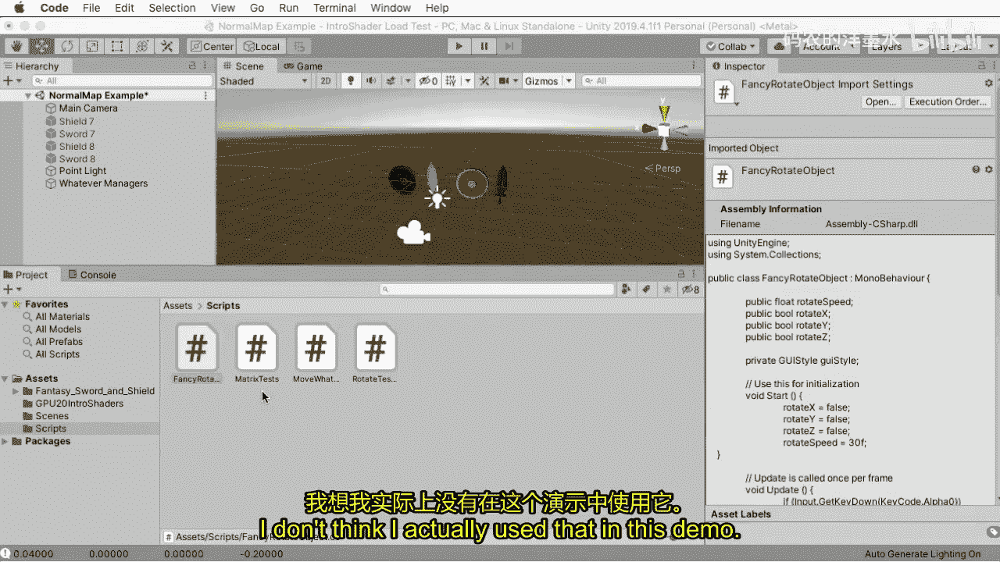
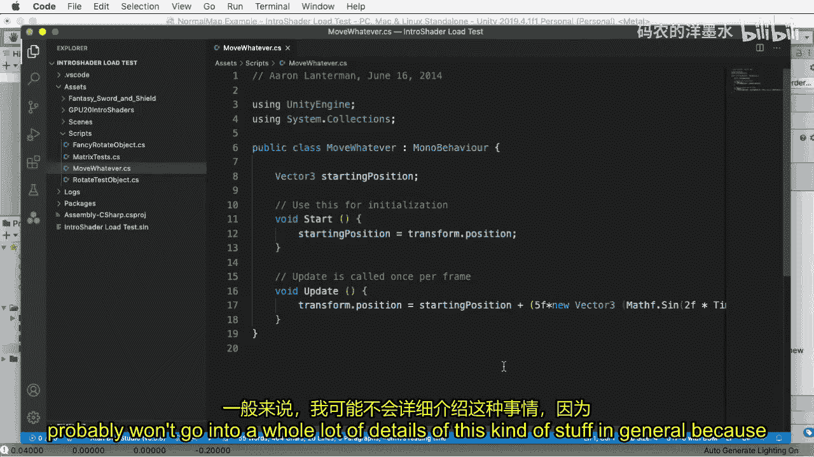
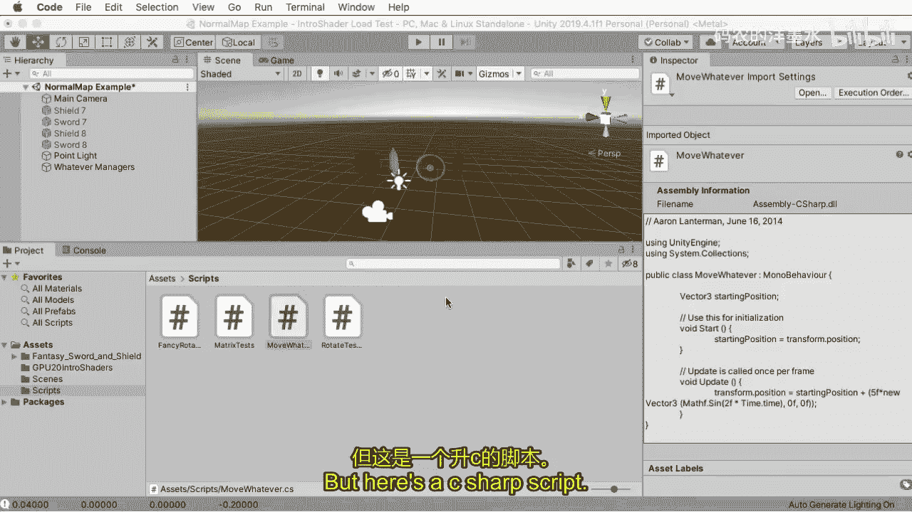
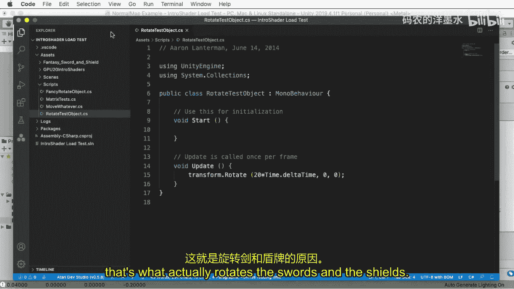
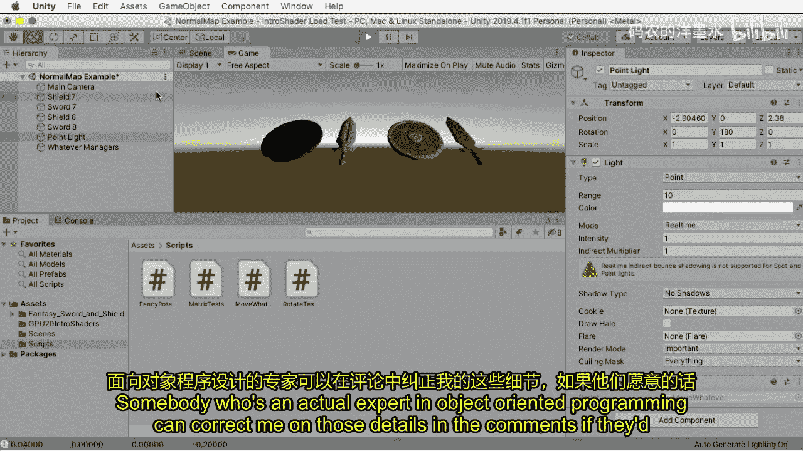

# 【全集】佐治亚理工学院-GPU编程：视频与游戏-中英字幕-p18-Lecture-18---游戏对象与组件--BV1GZfyBbEQn_p18-

Hi there。 My name is Er Laanttraman。 I'm a professor of electrical and computer engineering at Georgia Tech。

 and this is my quarantine hair。 This summer 2020 offering of GPU programming for video games is not supposed to be a class about the Unity game engine。

 I'm aiming to cover general principles about GPU shader programming that you could apply to something like the Goddo engine or the Un engine or some custom dimension engine that you may want to write。

That said， because we are using unity to host our shader code this semester。

 we do need to spend some time talking specifically about how unity works in the last lecture I showed you how to load up a unity package I created with some shader code that I creatively called Intro shaders and this lecture will poke a little bit at that intro shaders demo to talk about the unity concepts of assets。

 game objects and components when you're first using unity you need to have you need to have in your head a separation of the idea of the assets。

 sort of generic things like sounds， scripts， 3D models， etc cetera。

 and the game objects that are the specific instances of those things in your scene。

Now sometimes you'll have game objects that represent physical things in the scene or things like cameras or point lights here。

 but you'll often find people will have just game objects that contain sort of game logic code。

 but that's not really associated with anything in a scene。

 so people will often have things like theirre whatever managers。

 usually those kinds of objects have a position of 000。

 everything zeroed out here that's kind of the null Island of unity。

 and that usually represents something that's not an actual physical object in the 3D space。

 but it's something you can put code onto。Another thing to get used to unity is the idea of components。

 and components describe behaviors via C sharpp scripts。

 or some of these are actually built in to unity and probably tie more directly to the engine with deeper direct hooks into it。

And you can create your own scripts， oh， that's hard to。

 let me move this up here so you can actually see what's happening there。So if I say add component。

It will list。 that's still going off the screen Anyway， you've got the main idea。

 There's a bunch of different scripts that do all sorts of different things that are built in。

 but the most important thing is you can actually create your own scripts。

 So I've created some scripts in here to do various things and then you can attach those scripts that define components to the objects。

 Some of the scripts I've created here that I've put it in the script folder。

 Now you don't have to put your scripts in the folder called scripts just as you don't have to put your scenes in a folder called scenes。

 but it is helpful to try to organize things using folders。

 So there's something here called fancy rotation that's a script I wrote some time ago that I think in an earlier demo in an earlier version of this class when I was rotating various barrels around I don't think I actually use that in this demo。

 It's there anyway。 I have this move whatever script and the move whatever script oh this is quite a 2014。

 I'm not going to go into the details of this now and probably won't go。

A whole lot of details of this kind of stuff in general because I want to mostly focus on the shader code side of things。

 but here's the C sharp script so the rotate script。

 that's what actually rotates the swords and the shields。

And then they move whatever script that I think I have attached to the light in one of the scenes。

 Let's see if I go over to one of my shields。 so the shield。

 see how it has a rotate test object script attached to it。

And then。Yeah the objects do and then the point light that has the move whatever script。

 so if I play that demo again actually to make this work well let me turn off the maximize so here。

You can see the lighting change as the light is sweeping back and forth。

And you can even see that here in the inspector now if I click here。

Notice the lighting stopped because I've clicked this little box here to stop that moving script Now all of the game objects in unity。

 they all have a transform they all have a position a rotation and scale that's one component that's sort of built in that's why even if you don't have something that represents a physical object in the scene you'll still have a transform that by convention is usually set to 00 like there's nothing magic about the fact that this is called main camera other than we have also attached a camera script to it that does camera stuff so I can play with the field of view setting。

 etc cetera， etc cetera， etc ce I can turn off that camera in which case there's no cameras running and so I'm getting nothing out of the graphics at that point it just gives up let's see what other stuff I have I have a layer layer。

Oh， if you have audio in the game， I guess that's attached to the camera here， that's kind of cool。

Objects that appear will have mes associated with them and then the mesh renderer that's the code that actually is called by the main unity rendering routine and actually knows how to draw it so if I turn it off for that sword the sword goes away let's see what else we have on here Oh we also have the materials associated with the different objects I'll talk about materials a little bit later。

The point light。Again， here's the light strip that defines its lighty behavior and can turn that off and oh。

 there's still the background， but now I don't have the light in the scene。

So folks in CS who talk about object oriented programming。

 I'm not a huge fan of object oriented programming myself， but you know， it's a thing。

There's this concept of is a hierarchies versus has a hierarchies and if I remember correctly the object oriented idea of inheritance is and is a kind of idea。

 this notion of having these scripts defining components that have bits of generic behavior that you can just drag onto whatever game objects you want that's more of a has a kind of idea and object oriented programming。

 somebody who is an actual expert in object oriented programming can correct me on those details in the comments if they' would like。

