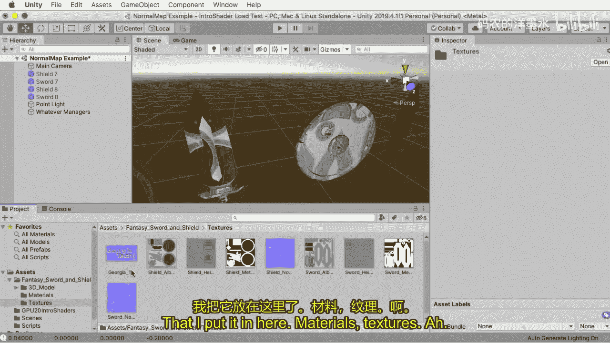
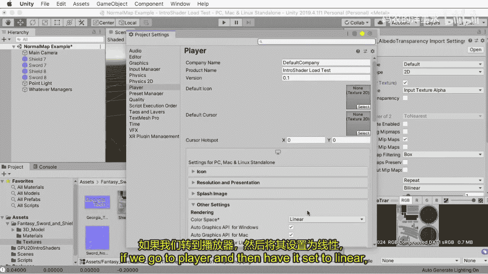

# 【全集】佐治亚理工学院-GPU编程：视频与游戏-中英字幕-p19-Lecture-19---材质--BV1GZfyBbEQn_p19-

Hi there my name is Er Lachman， I'm a professor of electricallect engineering at Georgia Tech and this is my quarantine hair on July 4。

 2020 and this is the summer 2020 offering of GPU programming for video games and although I'll be showing you how to deal with materials in unity pretty much every 3D engine I'm aware of conceptualizes the idea of materials in a similar fashion so here we have a mesh it's got a material on it and the material hair being applied to that mesh。

Gives it its main properties interpreted by the shader and a material is a combination of a shader and a set of parameters。

 those parameters might。B numbers that we're putting in， so here I'm putting in some numbers。

 if you look at the shield closely， you'll see that as I'm changing this attenuation factor。

 you'll see it darken in different ways。And this has to do with how the intensity of the light hitting the object falls off with distance。

And then we also have the textures here Now here we have the sort of base diffuse map。

And I could put other things on it， so let's say I select this unity will' go through and find other textures that are available。

 here's one built in for particle effects that's not terribly interesting when applied to that but you could do it。

 let me undo that or I could take one of these normal maps that's not supposed to be used as a base texture and throw it on there and see the weirdness you get again。

 a normal map doesn't expect to be used like that。Or I could say take the map for the sword and apply it to the shield。

 in which case it kind of look interesting but it's kind of garbled because it's the wrong kind of thing。

 similarly over here， let me expand that material。So I can take the texture associated with the shield and apply it to the sword。

 or let me go back to this one。This one has a normal map associated with it that's associated with the shield。

 but I actually loaded some other normal maps in here that I put it in here， materials， textures， ah。

So I actually made a normal map out of the Georgia Tech logo。

And let's see if we can apply that directly， so what I'm going to do here is I'm going to go find the shield again。

And now instead of clicking the texture and then picking a texture。

 I'm going to drag and drop this Georgia tech here onto there a， so now you can see。

That we have this Georgia Tech looking kind of bumpy effect looks like maybe this is some sort of embossed commemorative coin or something like that。

 so materials are a combination of both a choice of shader code and a particular set of parameters and we'll look in detail in the next lecture about how to define these parameters in your shadedr code。

Let me try picking a different shader for this material， so here's my GPU 20。

I'm going to try going just from texture normal map back to texture because there's something I want to see。

Okay， so when we went to textured。I kept the name of this texture the same between the two shaders。

 So it kept it。 If I used a different name， it would probably go away。 What I'm wondering is。

 let's see if I go back to the normal map version。 If it remembered what it was， it did。 Okay。

 that's excellent。 So even though at this particular juncture， let's see if that goes all the way。

 What if I go all the way to solid color。 Okay， that's not very interesting。 Now。

 let me go back to using the texture normal I kept those。

 So it looks like a cool thing that unity is doing here。

 is if you change the shader on your material to be a simpler shader that is missing certain parameters。

Then when you go back to the more complicated one， it's kept track of that。

 assumes you might want it and sixs it back in， that's very cool， good on you unity folks。

One other thing here about textures so here's some textures and you can very easily load textures in you can just drag and drop something from your desktop and it'll turn it into a texture now there's a billion things to interpret in that input space there's a very important clickmark here called SRGB and this goes back to our earlier lecture about color spaces about gamma space versus linear space so working with linear space lighting is the recognition that textures are usually stored with kind of a square root mapping because displays display things with a square mapping so if you want to combine lighting effects properly in your shader code you want to square all of your RGB texture reads。

 do whatever math you need to do combine these however you want and then square root them on the way out and then in our project settings if we go to player and then have it set to linear we have the GPU doing that for us Now the GPU only。

Do that automatic squaring when you do a texture read and then square rooting when you stick a color in the buffer for the RGB component。

 it leaves the alpha component alone because the alphas usually representing something else Now there are times where you might have a texture you've got red green blue each of those as0 to 255 or whatever and those aren't stored in this kind of square rootdy mapping fashion you may be storing other kinds of information so for those kinds of textures you may want to unclick this color texture box so the GPU won't implement that squaring and then you can do whatever else you need to do with it。

This is an important thing to keep track of because if I remember right。

 earlier versions of Unity actually had the effect of this checkbox backwards from what it is now。

Anyway， there is one place where you definitely don't want to have that automatic squaring and that's normal maps。

 so fortunately there is a normal map mode that automatically knows not to apply that squaring mapping。

 it knows it's not an RGB， it knows it's trying to represent some sort of minus1 to one thing。

