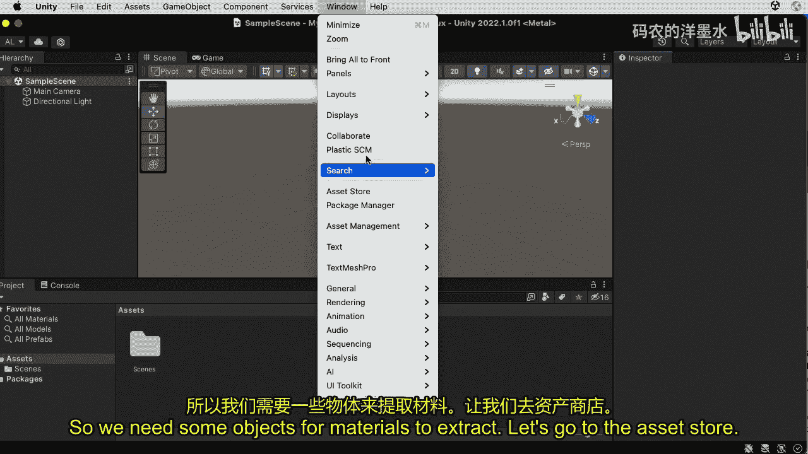
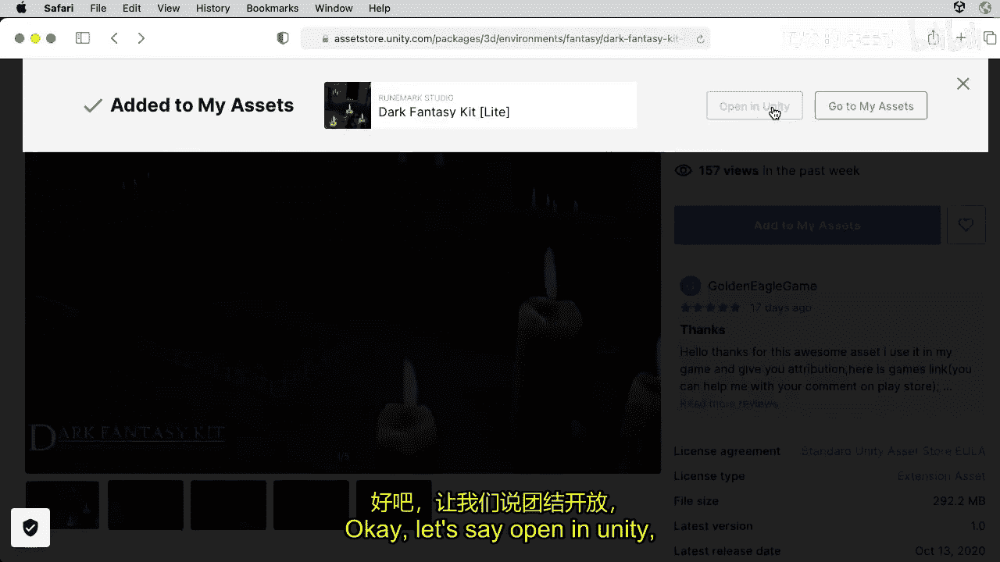
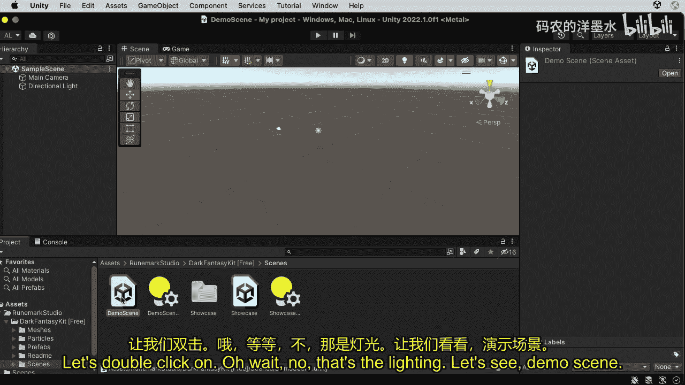

# 【全集】佐治亚理工学院-GPU编程：视频与游戏-中英字幕-p20-Lecture-20---Unity-中的材质提取--BV1GZfyBbEQn_p20-

Hi there。 My name' iss Er Lanchman。 I'm a professor of electrical and computer engineering at Georgia Tech and a couple of years ago。

 I recorded this lecture for my GPU programming for video games class called shaders plus parameters equals materials and I label that lecture 18。

 I'm going to remember that 18。1 and I'm going to call this lecture 18。

2 because Unity has changed the way it handles materials upon import and I should talk about that。

 Ive started a blank regular 3D builtin pipeline project in Unity 2022。1。

 although what I am about to say should also apply to 2021 versions of unity and before going any further let me go to edit and project settings and we're going to check the settings in the player in particular we're going to look at the graphics pipeline and see that the color space。

Defaults to gamma Unity technologies， why are you still doing this， this should be set to linear。Yes。

 let's change it to linearar。All right。 Now it's linear。 Always do that。

 So we need some objects for materials to extract。 Let's go to the asset store。

And I found this free， dark fantasy kit。 This is the light version， hence free。 presumablysum。

 there is a paid version that has a lot more materials。 I should say a lot more assets。

 I don't mean materials in the particular unity sense of materials， just a lot more stuff。Anyway。

 let's say add to my assets。 Yes， yes， yes。 Okay， let's say open in unity， sure。

Low it to open a Unity app。Okay， so that pulled up the package manager and let's say download。

All right， so we'll download。Okay， that took a long time to download anyway we now have an import button sure let's click the import button。

Okay， so we have a bunch of stuff that is going to be imported， including a bunch of materials。

 bunch of decorations， a bunch of doors， bunch of furniture， bunch more materials， etctera， etctera。

 etc， I'm going to hit the import button。Okay， so let's see。 I have some scenes。 Sure， demo scene。

 Let's double click on。 Oh， wait， no， that's the lighting。 Let's see。 demo scene。

Okay， here's our demo scene。 Let's zoom in here and take a look around。But if I press play。

 is the camera inside here already， Oh， there you go。 That's kinda nice。What about this showcase。

 Let's take a look at the showcase。The showcases， oh， what's going on here？Oh， okay。

 so I guess the showcases， you can add your own stuff in here or something like that。All right。

 Anyway， this is a nice looking set of models。 Okay。

 so let's click on the bed and scroll down to the materials。 This is using the standard。

 physically based rendering style shader that's built into the unity built in pipeline。

 Let's try changing the albedo color here。 Let's tint it。 There we go tint red and。

So there we're changing the color of the bed over here。So that's nice。

 we can edit the materials here because the material for this particular object is its own separate thing。

 so this is DFK bed single， so let's search for that actually。DFK， bed， single。

So that's sitting here。 So here's the material just in the abstract。

 sort of separate from that bed as it exists in the hierarchy。

 But I should be able to change it here。 So I should be able to go up here。

So here I'm just editing that particular material Okay and in general。

 that's the way unity has always handled things and this particular asset pack is set up so that the materials are separate from the meshes that use them but sometimes you will import a model where the materials are sort of built into the mesh and you can't edit those so you have to separate extract them and that's what I want to talk about now So this is an FBx model of a radiator that I got from a company called DaS and I exported the model from DaS studio as an FBX and what I'm going to do is I'm going to take the images folder that was part of the export that has the textures and I'm going to take the dot FBX file and I'm going to import them into my assets folder。

All right， So let's see what's now in my assets folder。

 So there's the textures associated with the radiator that's sitting here in this dot images folder and the assets。

 if I were to take the radiator here and drag it into my model。 Oh。

 it's scaled differently than everything else。 or is it， I guess it's not。Maybe it is， I du't know。

 Probably， I would expect the radiator to be a little bigger， so。This is a very oddly set up scene。

 Why is it。Anyway， I'm going to stick my radiator right here， Allright， so there's my radiator。

Let me increase the size of my radiator。Giant radiator， giant radiator， giant radiator。 Okay。

 so now there's a radiator。 Actually， that is really bothering me。

 let's put the radiator on the floor。Something like that。 This whole scene is very weird。

 Why did they set the floor of their scene。To be at -12， that's very odd。 Anyway。

 let's not get distracted。 All right， so here I have my radiator。 Now。

 let's say I want to modify the material on the radiator here。 Okay， I'll go up here to my radiator。

 Let's see。 I'll expand this out。 radiator， Okay， no radiator shape， That's what I want。 All right。

 let me scroll down here？ and now I'll try to wait a minute， Why can't I change the。

 why is this all grayed out， why can't I change this material， Well， it turns out。

In the older versions of Unity， if you imported a model like I just did。

 it would create separate materials automatically and stick those somewhere in your assets folder now。

In order to try to keep things a little more tidy， modern versions of unity keep those materials embedded as part of the mesh。

 The problem with that is it doesn't let you edit those。

 So what you need to do is extract these to be able to edit them。

 and that's what I want to show you now。 Unfortunately。

 I don't know of any easy way to take the edited materials and then recombine them as part of the mesh they'll just have to live separately。

 So what we need to do here is to go click on the radiator in the assets folder。

 and we need to go over to where it says materials。And let's say extract materials。

 And now you need to give it a folder name。 now， unfortunately。

It really wants you to call this materials。 If you call it something like radiator materials。

 Unity will get confused when trying to find stuff。 So quite often。

 what I'll do is I'll create this materials folder。 and eventually， I'll take all of this stuff。

 I'll rename this radiator dot images here。 I'll rename this something like textures。

And now what I'm going to do is I'm going to create a new folder entirely， you don't have to do this。

 but it starts to get messy otherwise called radiator。

Now what I'm going to do is I'm going to put the materials folder that I just made into that radiator folder。

 Wait， where did the radiator folder go？I thought I just made a folder called radiator。Okay。

 where are you， you should be here in assets。Okay， apparently， I accidentally made it somewhere else。

 Anyway， I'm going to go back to assets here。 Let's take the material folders that we just created。

 Put that in radiator。 I'm going to take the radiator model itself。

 Put that in radiator and this textures folder。That I'm going to put in radiator。 All right。

 So now this is all kind of together。 Otherwise you wind up with one materials folder that just has the materials for everything you import。

 and it can get very confusing later。 It's convenient for it to have its own separate folder。 So hi。

 hello， unity Christrist on me。 So I had to restart， put the radiator back in。 Anyway。

 we extracted the material。 So there's a new material for the radiator sitting here in this material folder。

 But。Notice it's not using it。 What I have to do is I have to change it from use embedded materials。

 I don't know why it's showing up pink here。 It should just be using the original embedded material。

 That's very strange。 I don't know why it's doing that。 That happened when I restarted it。 Anyway。

 this should hopefully fix it。 What I'm going to do is say use external materials legacy。

 So this will tell unity not to go to the mesh。 Wait， and why is it showing up here correctly。

 but not down here。 I don't know。 Anyway， welcome to Unity。 All right。

 so I'm going to say use external materials legacy。And now I want by base texture name。

 usually recursive up。 Usually sometimes you have to mess with this in different ways。 It depends。

 So I'm going to hit apply， and it looks like it fixed it down here。 Okay， anyway。

 let me click on this up here。And now the material that it uses should be this radiator material in the materials folder。

 so I should be able to edit it， let's see。Doude to do？Yep， there we go。All right。

So that's how you extract materials if the materials are embedded in the model。

 And that's how you then set the material settings where you have to use it use external materials and hit apply to get it to use that new external material instead of the inside material。

 Again， I'm not sure why it was showing up pink there。 Something weird happened when I reloaded。

I should mention that there are different schemes by which this will look up and try to find the materials that it needs。

 let's see， recursive up， local materials folder， project wide。

Let's see if I change this to local materialsial folder， this should work because I have。

A materials folder here。 Okay， that worked。 Project wide。 That's a little extreme。

I suppose that could be useful， but it could be chaotic if you had different models that use similar names for their materials。

 I don't know。Let's see。 There's also up here in terms of the naming。 there's by base texture name。

 So here it looks like there's a radiator called。Wait a minute， why is there two materials here。Okay。

 it made a W P underscore material。 What does that mean。Hm。😊，Oh。

 it looks like I'm not sure what went on the here。Maybe it extracted multiple materials that are different。

 It looks like it's not using this radiator material。 It's using this W P radiator material。 Oh。

 wait a minute。 Did it create a new material specific for this particular instance here。

Let's take a look here。 Oh， W。 P radiator。 Now， when I instantiated that， when I pulled that in。

Did it create its own new copy of that material， If so， that's a new behavior。 I have no idea。

 Let's see。 Let me take the radiator here and put it in。Nope， that's still W P radiator。

 That's interesting。 It created this new material with this new name on it。

 So not sure what's going on there anyway。Oh， okay。

 So it looks like it created a material with a texture name。

 But then what was this radiator material， What's that for。hu。Anyway。

 all sorts of strange mysteries associated with extracting materials。Okay。

 that was not a very informative lecture。 So I will confess that I generally handle issues in unity like this by just kind of messing around until it works and renaming things as needed until unity stops complaining and does what I want。

 Let's see。 There's other naming conventions here。 by texture name for models。

 material model name plus models， material。 So there's all sorts of stuff here。

Now is that part of how it extracts or what it looks for？We already extracted。

 So this is for what it's looking for。 Anyway， it seems to be working。 so your mileage may vary。Oh。

 wait a minute。 One more thing。 There's a warning on my other screen。

 Normal map settings material is using the texture as a normal map。

 This texture must be marked as a normal map in the import settings。 Sure， let's fix that。

 So if we go into this texture。 Now， earlier， this did not have this kind of appearance。 Oh。

 wait a minute， this doesn't look good to me， though。The original normal map。

 let's see what it looks like default， so let's put it back to default and say apply oh。

 this is not an RGB style normal map， this is actually like a height map。

So to actually use this as a normal map， let's turn this to a normal map。

 but say create from gray scale。Say apply。 so now we have a really。narly look radiator。 There we go。

 Let's see。 Let's play around with that a little bit。

 Let me go to the settings here and change how much the normal map has an effect。 That's the ruling。

 Harley。 Let's go crazy。 Okay， no， maybe not that crazy。 Here's no normal map。

 Here's a pretty extreme normal map。How about that。深圳。

Something more like that is probably reasonable， whoops， sorry。There we go， something like that。No。

 wait， still not done。I wonder if we really actually have to explicitly extract the materials into a folder as a separate step。

 So let's see what I'm going to do is I have this spooky plot set of assets that I got from Das。

 What I'm going to do is I'm going to try to import this coffin spooky coffin。 All right。

 so that goes here into the assets folder。Okay， yes， fixed now as far as fixing the normal map。

Let's see just because it will drive me crazy if I don't。

 this is something that is really a height map， so we need to create the normal map from grayscale okay。

 now we've done that。And I'm going to leave this call this for right now。 Actually no。

 let's go ahead and be disciplined about this and create a folder。

 and we're going to call this folder。Coffin。Spooky plots。Let's see if I can spell spooky plots。

 alright， so the。Texture folder goes in there。 The asset goes in there。 Let's go in there。

 And let's see， Let me rename this coffin underscore spooky plots。 Let's rename it。 Sorry。

 you can't see the renaming。 Oh， you can't see the renaming。 We'll rename that as textures。Now。

 instead of hitting extract materials， what if？We go ahead， and。Say use external Ma legacy。

The theme I want to check first is the texture for this。Is called S。 P coffin。All right。

 so with that in mind。Let's say。Use Ex Mater Le， but not hit the Ex Mater button。

 let's just see if we can do that directly。Oh， so earlier。

 I thought that this is about how it searches， but it looks like it may also be about how it creates。

 So let's try this。Model name plus models name no， let's not try that first。

's let's go ahead and just do by base texture name。All right， so if I say apply。Oh， okay。

 so it created a materials folder for me。 and it called the material S P coffin because the texture is called X P coffin。

 But it looks like there's other possibilities for that。 So if I were to go into the model again。

 So here's that model。Whoops， I call the wrong thing textures， sorry。Let's see。

This was not called textures Oh boy I really messed that up let's rename this as coffin model。Okay。

This was what I wanted to rename as textures。 So rename this textures。 Boy。

 I've just really confused things heavily， haven't I， All right。

So let's go back to the model and say， use。 oh， I had undone it。 Okay。

 so it's now using the embedded materials。 So in theory， if I put this into the scene。

 I shouldn't be able to edit this。Let's see。 Oh， if you see this coffin here。

 that's from some earlier experiment off camera， unquote。 Now， if I go to this coffin model。

 can I edit this。In its current setting。No， I can't because it's using the embedded materials。

 but now I should be able to go here， wait no， that's the material I need to go to the coffee model itself。

 say。Use external materials legacy， say apply。And now I should be able to go here。Now I said， apply。

 where are you complaining。Apply， All right。 Now， if I go over here。I should be able to edit this。

All right， let's scroll down。 Yes， no， there's an S coffin material。Oh， that's what's going on， Okay。

 so earlier。When I extracted the material here using that extract button。

 which apparently disappears， once you do this， it created a material based something on the name of the materials that are in the model instead of the textures。

 but now let's use something like。Let's use the location model name plus model material。

 If I click that and apply。 Is it good to create a new material with a new kind of name。

 Let's find out。 So I'll say apply。 Let me go to materials folder。 And， yes， it did。

It's now coffin model， dash S PCC body。 And now if I go back to the original model where I messed up earlier。

 that's coffin model and the。Let's see。 The actual material in here is that's the shape。

And there's now it's coffin underscoreco 5，4，2。 Not sure entirely what's going on here。Okay。

 that's SPC coffin this one I just made is has the dash SPC body。Now， if I go back to here。And I say。

 let's change that to use embedded materials again。 And I hit apply。 see that material。 S C B， sorry。

 S PC body reappears。So that disappeared when I extracted it， and it gave it that name。

 So I was wrong earlier。 It's not just for look up。 When you look at this。

 use external materials legacy， it uses this to figure out how to name things。

 Let me use from models material。 Let me apply。Yep。

 there's now a third material that's just called S PC body。 Okay， hopefully。

 we've all learned something。 All right， See you later。

