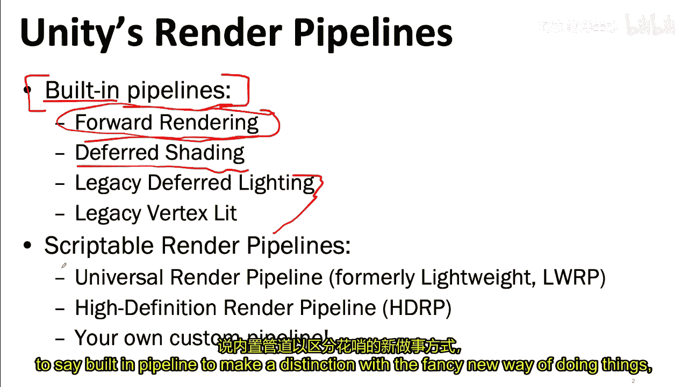
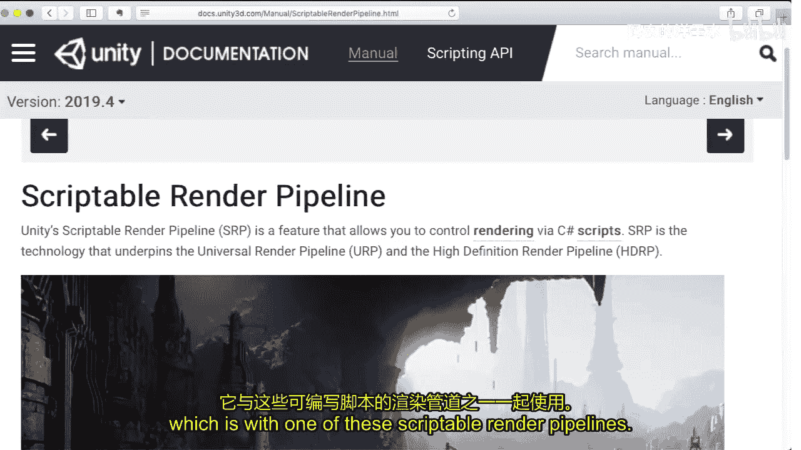
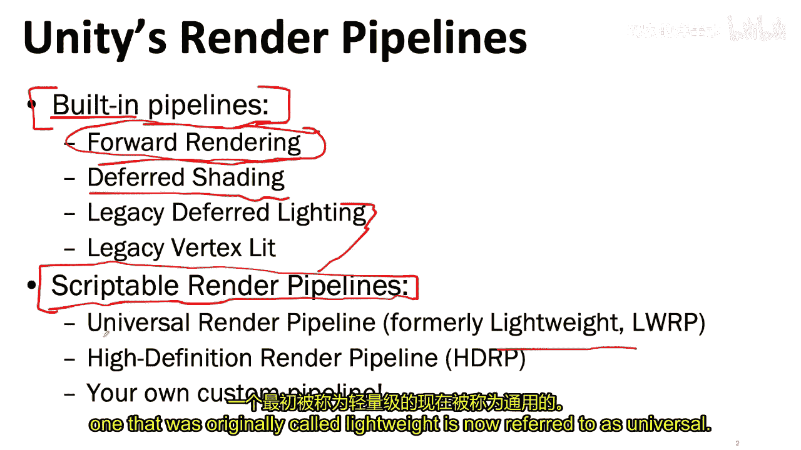
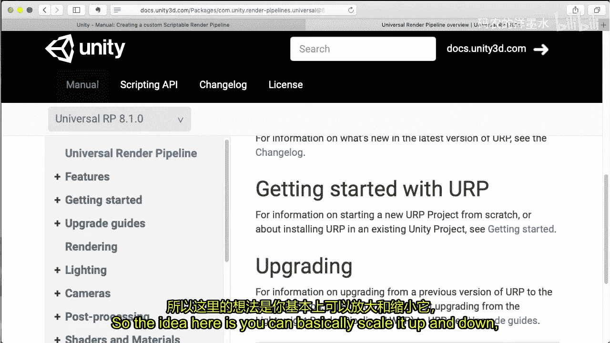
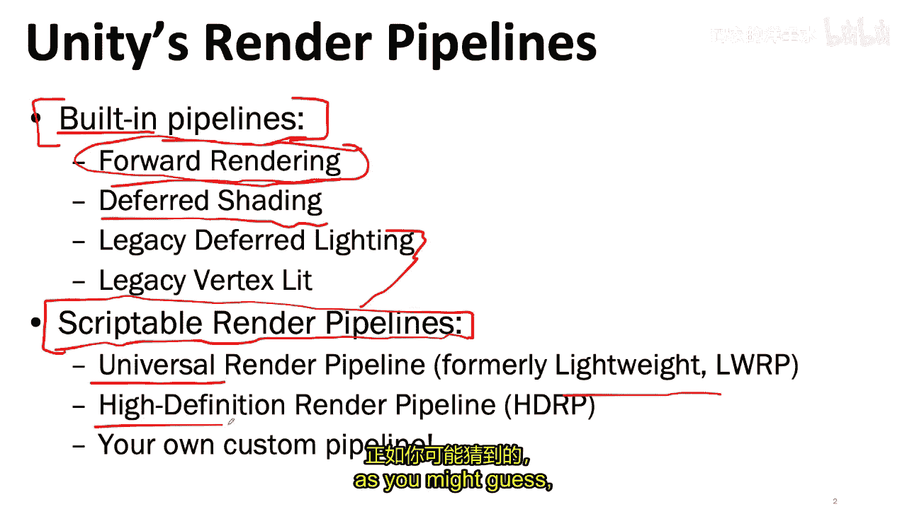
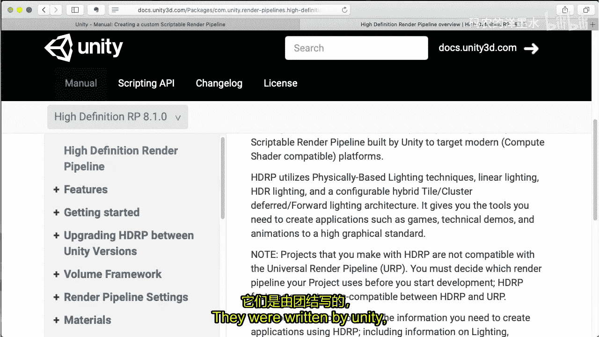
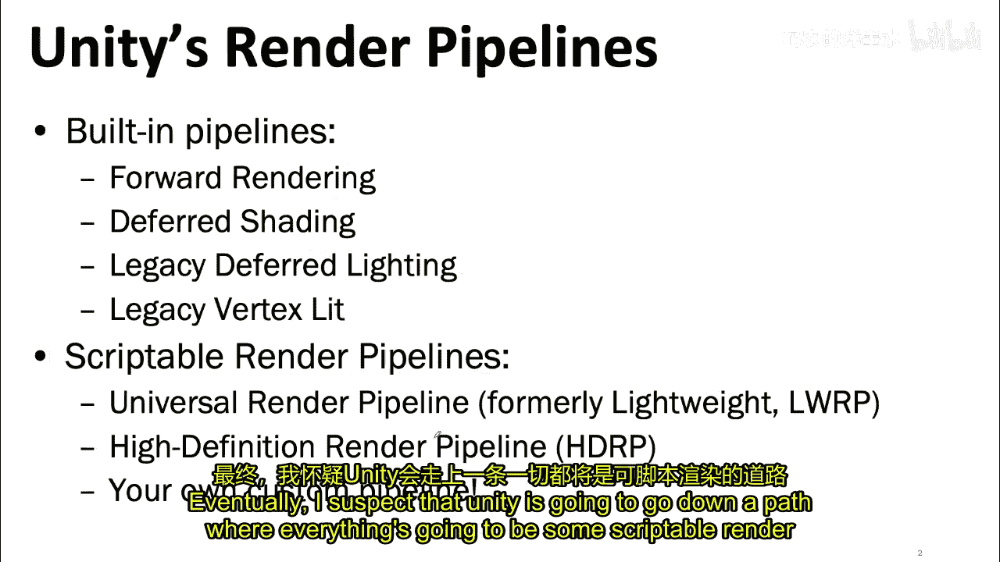
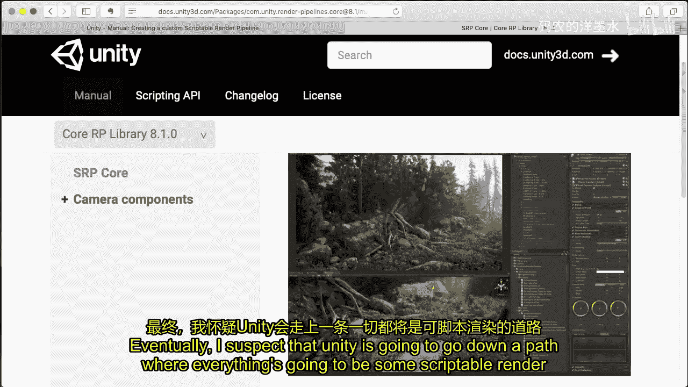
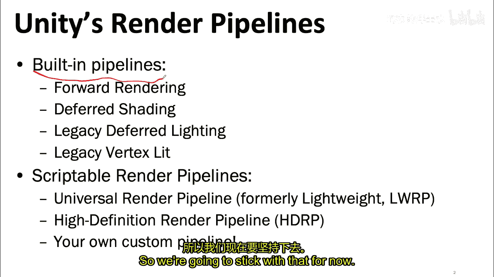

# 【全集】佐治亚理工学院-GPU编程：视频与游戏-中英字幕-p21-Lecture-21---内置与可编写脚本--BV1GZfyBbEQn_p21-

Before we dig into actually writing some shader code here。

 we need to talk a little bit about the way unity sets up its graphic systems So for years and years you have various pipelines that were built into unity For rendering is basically the kind of rasterization model that we've looked at so far deferred rendering is a little bit more complicated it basically precomputes various kinds of lighting information stores that in a buffer and then runs a special shader that runs through all the individual pixels after the fact to figure out how the lighting should actually work that's a more advanced technique we'll look at that in later lectures right now all of the code I'm showing you is for a forward rendering kind of paradigm and there's some earlier versions of these that nobody really uses anymore anyway so all of the code that I'm about to show you at least for the next many。

 many lectures is going to use the original。Built in pipeline and back in the day。

 we didn't say built in pipeline because there's just these pipelines。

Now I have to say built in pipeline to make a distinction with the。

Fancy new way of doing things， which is with one of these scriptable render pipelines Basically the original built in pipeline had all kinds of different callbacks and different settings you could make that would do or not to certain things or do them in different ways what the scriptable render pipeline framework does is it exposes much of that functionality to give you much finer grain controlled over how the graphics work There's two built in pipelines one that was originally called lightweight is now referred to as universal I think the main reason they changed it from lightweight to universal is lightweight sort of implied lower NPpcs and cell phones and stuff like that。

 but the universal render pipeline actually has a tremendous amount of capability built into it。

 So the idea here is you can basically scale it up and down down to cell phones and up to really fancy custom gaming rigs Now the high definitionfinition render pipeline as you might guess that's something that you need a reasonably beefy piece of hardware to。

Use and both of these aren't special they were written by unity。

 but they were written using the same kind of functionality you have if you want to write your own custom pipeline either from scratch which I would really not recommend or by taking one of unity provided pipelines and then modifying it to do what you need because the source code to the scriptable render pipeline is available to the user unlike the original built in pipeline eventually I suspect that unity is going to go down a path where everything' is going to be some scriptable render pipeline and the built and pipeline will be deprecated but we're far away from that at the moment and for right now it was a whole lot easier to take my existing shade or example code from previous versions of this class and just go ahead and keep using the builtin pipeline so we're gonna to stick with that for now。

