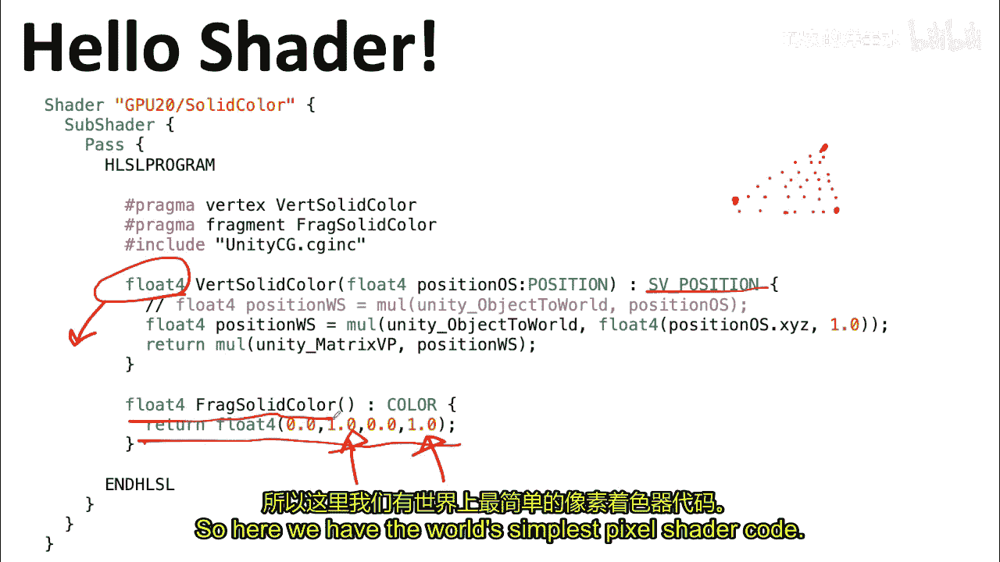
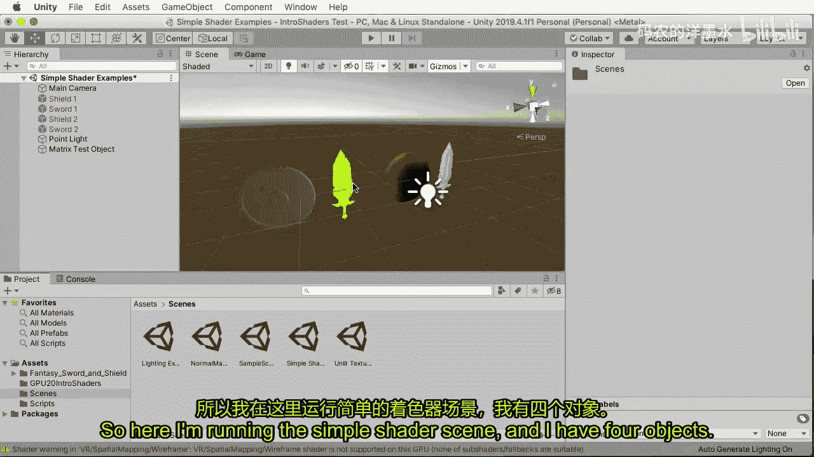
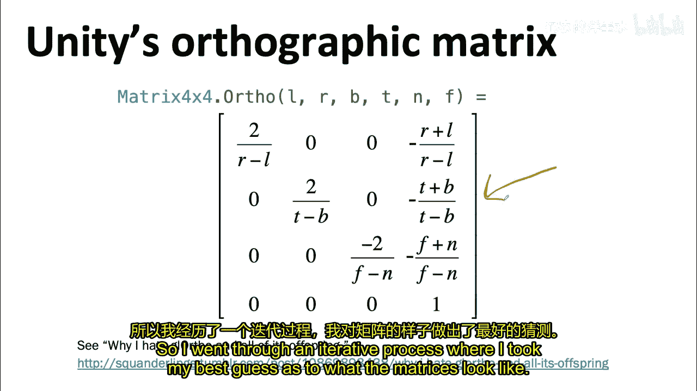
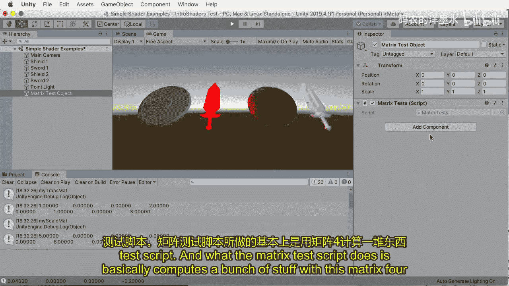
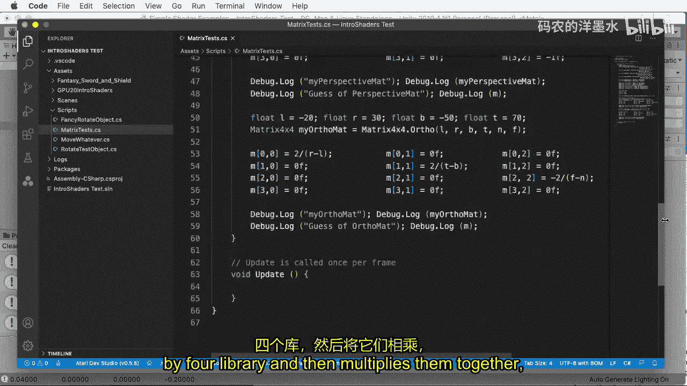
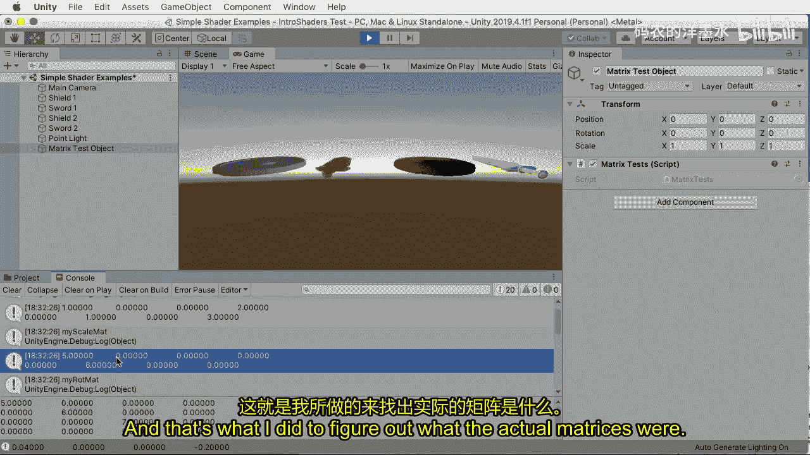
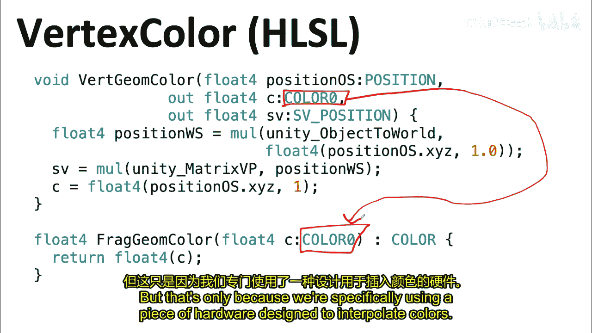
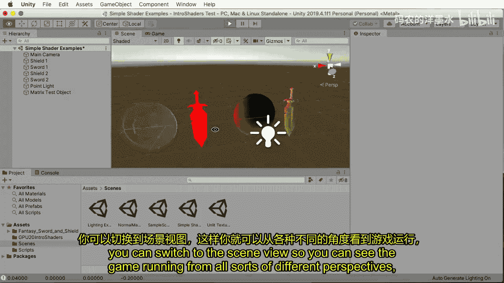
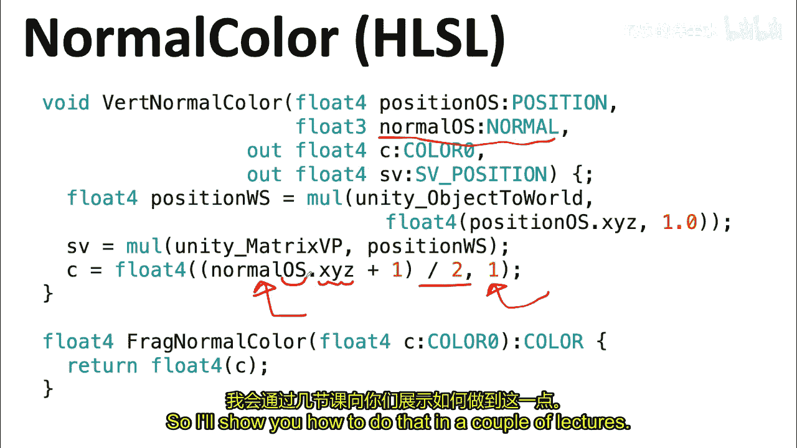
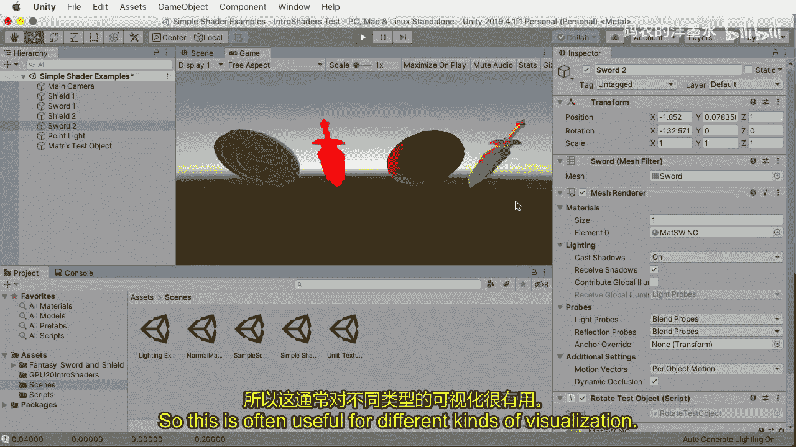

# 【全集】佐治亚理工学院-GPU编程：视频与游戏-中英字幕-p22-Lecture-22---简单无光着色器--BV1GZfyBbEQn_p22-

So we've spent a lot of time reviewing general background about computer graphics。

 and we've also spent a lot of time talking about using unity as a platform for implementing computer graphics algorithms。

 and we've talked about shader code in general， but here we'll finally look at some specific examples of working shader code。

So we're going to start by looking at some simple shader code that doesn't respond to light。

 One thing I would like to remind you of is that if you start up a blank 3D project with the traditional built in pipeline。

 be sure to go to your player settings in your project settings and make sure that your color space is set to linear。

It still defaults to gamma even in 2020。1 beta， which is bad you want this to be set to linear Fortunatelyly if you start up a universal render pipeline or a high definition render pipeline project。

 then it defaults to linear as it should be。Okay， let's finally。

So many lectures in this class look at some shader code The actual HLSL is here between this HLSO program and HLSO and some older shader examples for unity you'll probably see CG here instead of HLSL if you read the current unity docs it becomes very confusing because the unity docs will say that the only difference now between seeing HLSO program and CG program is in the various include files that are automatically included and they sort of make a big deal and say they say oh you can't write CG code anymore you have to write HLSL whereas in earlier versions of unity apparently there was a difference if you use HLSL or CG or not but as far as I can tell HLSl and CG are the same thing at least I've taken examples from textbooks that say they're using CG and type them into unity and made the appropriate tweaks just to make unity happy and they see。

To work fine。 I don't recall ever having to do anything where oh in HLSL this is done differently so here's what I need to change anyway so all of the stuff outside of here is not actually part of HLsl per se this is unity specific but any reasonably robust engine that you're using whether it's something like ado or even an inhouse engine like the frosttbite engine now don't work at electronic art so I don't know what's actually in the frostbite engine so I'm just guessing here but I'll guess that they have something similar to this Basically this is all metatuff that tells unity how to organize the code you're about to give it As I'll show you a second this will put it in your set of possible selectable shaders in a set of shaders called GPU 20 and within that folder will find a solid color shader everything that we're going to look at now just has one subshader and does one pass later we'll look at situations where you have different shaders that do multiple passes。

So include does exactly what you would expect and the unity docs again are a little confusing here because we'll say。

 oh， we call it unitycg。cGncC because we want to maintain compatibility because that's the suffix people are used to。

 but this is now really HLSL and I'm like unity， come on。

 it looks like HLSL and CG are the same to me， but whatever。

Pretty much any shader you write for unity， you will want to include this set of definitions。

And what will admittedly make what I'm about to show you a little bit confusing if you either write your own engine or go to use somebody else's engine besides unity is that there's a lot of variables that we're going to use that unity will define for you and we at the level of the unity runtime run various scripts that are internal to unity that set these variables like unity underscore object world。

 Unity underscore matrix VP these do the sort of things that you expect so unity object world is a4 by four matrix that transforms coordinates from your artist space into the world space Unity underscore matrix Vp is a combination of the view transformation and the perspective transformation and one thing that's a little bit confusing and unitys nomenclature is its sort of listing the order of the transformations if they're applied to say a vector but this is not the actual order of the vertices because if you'll notice here we're using。

Column convention because the position that we're transforming is here on the right and we have our matrices on the left so what unity is actually doing is it's putting the view matrix here and the projection matrix here and then it's precomputing those P times V and the usual matrix algebra sense on the CPU side of unity so the fact that the V is in frontier can be a little confusing but that's just the convention Unity uses anyway。

 if you were not using unities rendering routines that fill in these variables for you and passes into the GPU from the CPU side you would have to actually put in your C sharpp script over on the unity side you would have to include the commands there in order to actually explicitly create these matrixrices on the CPU side and then send them into the GPU here the unity on time is handling that for you behind the scenes。

So what else is going on here。 We have these pragmas that are designed to tell the compiler what's the vertex shader and what's the pixel shader。

 They use the word fragment for the pixel shader here。

 So we've got one called vertex solid color and fragment solid color people often just call this something like vert and call this f but because I'm showing a bunch of different examples。

 I like to have different names for these things for the different examples。 that's I required。

 that's just what I'm doing here。 So we have this Ct syntax where we have inputs to a function and we have outputs。

 The semantic position。 Again， you can't just call this anything。

 you can't just make up semantic called Fred。No， Fred apologies to anyone out there named Fred。

 Anyway， so position O， that's been tagged as being a position。 If you're writing your own engine。

 you would need to actually create the data structure that holds a whole bunch of positions representing vertices and that runs the API call for your GPU Vulcan Open GL directs。

 whatever， and sends that data over again， here， unity is handling that for us。

 But just know that position O is going to contain vertices。

 and there's an assumption that these are X Y Z3D positions and then there's a W coordinate that holds the one in order to do the various transformations。

 But the way this particular code is set up you don't necessarily have to put that one in the W component。

 and I'll show you why in a second。The output of the vertex shader that is processing a particular vertex。

 what is it output， Well， it's outputting a four dimensional coordinate that represents a position on the screen in that final projected clip space。

And so that's given the semantic SV underscore position。You could just take your position。

That's being thought of as a column and then multiply it by your object to world transformation matrix to get the position in worldspace。

 Notice we're using os for object space。 Ws for world space。

 This is the convention that I saw in the new scriptable render pipeline code。

 So I decided to start using that kind of convention here。

 even though we're not actually using a scriptable render pipeline。

 Notice this line is commented out。 Oh， I forgot to change the slashes here to have the gray in PowerPoint I'm using to represent comments。

 But whatever， anyway， we're not actually doing that4 by4 multiply。

 What we're doing is we're actually taking that X， Y， Z position， we're sticking a one in here。

 and then we're doing the multiply And you might say， well， why are we doing that。

 Is it because on the CPU side then we don't have to bother putting in that W equal 1。 Well。

 not really， This is actually a hint to the compiler。

So our hope is that the compiler is going to look at this。

 think about how it's implementing the matrix multiply and when it needs to handle that one。

 essentially this is a hint to the compiler and hopefully the compiler will use the fact that there's a one in that last column in order to simplify the code that's actually doing that matrix multiply it's a little bit more confusing but hopefully the compiler will generate some tighter code This is one of the cases wherere making your code slightly less clear in order to try to hint potential optimizations to the compiler actually works usually that's a fairly dubious kind of business All right so we've taken our vertex from the object space into the world space and then the final thing we'll do is we'll do a final matrix multiply to go from the worldspace into the projected clip space Now notice in here there's no place where we're dividing by w to effectively div by Z like you did in homework1。

That's handled by other hardware on the card and when I say that I'm assuming there's a little bit of hardware handling that perspective division。

 but as far as we know inside the chip， there could be some super advanced processor that was imported from 30 years in the future via time travel that's emulating all this and software that's fine what we have with our shader model is just a definition of how the GPU response to certain commands and it's kind of up to the GPU how it wants to do it But anyway。

 you as the programmer don't write that perspective divide that's handled by another flag that's set in the API So the positions that come out are used for different purposes eventually there's that divide by Z etc etc。

 etc， but ultimately this position is used to figure out the points of a triangle and then a set of interpolation hardware is going to figure out what points on the screen are actually going to be a raster right this isn't terribly accurate in terms of what a natural rasterization would look like。

Anyway， I just want to make the point that running that vertex shader is going to generate a whole bunch of pixels more than just a pixel for each of the vertices。

 and then we could use that information to figure out the color。

 but here or not here we're just going to return a floating point value consisting of the color green and I'm using one here in alpha so if there's any transparency action going on or whatever this is going to show up anyway。

 so here we have the world's simplest pixel shader code。

So here I'm running the simple shader scene and I have four objects。

Each with a different shader on it on the left， I have a shield。

 and I have the standard built in unity shader attached to it。

 defaulting to the most boring possible set of parameters。 That's just for a general reference。

 Here I have the solid color shader that we just looked at。And it makes the object green。 Okay。

 that isn't terribly interesting。 Here's the scene view。 We can also look at this in the game view。

 There you go。 Now we're actually running the game。Now。

 if you're actually wondering what unity various matrices look like， I figured those out。

 and I placed them here in the slides。 Here's the orthographic matrix。

 if you're using orthographic projection。 and that's something that you can set in a scripting unity or your basic camera component in unity will have a little perimeter where you can set that。

 anyway， you can either use an orthographic projection matrix。

 or you could use a perspective projection matrix that I've listed here。

 And the reason I'm making a big deal about this is that if you look up the matrix 4 by4 class in unity documentation。

 They never actually spell out what the matrix looks like。

 So I went through an iterative process where I took my best guess as to what the matrices look like。

 So when you run one of these scenes besides seeing these cool looking spinningy objects。

 there is also a matrix test object， that's not actually a physical object in the scene。

 So it's at the traditional 0，0，0 or。😊。

Such objects are placed and all it does is it runs this matrix test script and what the matrix test script does is basically computes a bunch of stuff with this matrix 4 by4 library and then multiplies them together runs some builtin routines and then computes my guess as to what those routines actually compute and essentially what I wound up doing is adding and removing minus signs from various places and adding or removing various factors of two here and there or whatever。

 until I got my guess of what was actually being computed to match with what unity was actually giving me and I had to do this because the unity documentation does not say。

There's nothing in the update。 It's just running in the start routine of that component and it outputs the results to this debug log in the console so you can click on various matrices and then compare them and see what they look like and that's what I did to figure out what the actual matrices were In any case you the game programmer writing the unity game very rarely needs to call this directly same thing with this perspective method or a bunch of other stuff that's built into the matrix 4 by4 class usually these things are called for you by other things in unity like the camera class if needed we'll call matrix 4 by4 dot perspective and all the various other matrix generating things that you need for the vertex transformations Sometimes you do need to call these if you're doing some special customized thing for some reason So the vertex shader I just showed you used an approach where we had input parameters and the parentheses and then we had an output parameter that we never really needed to name because it was whatever we returned。

We could use an alternative style where we don't have a return command and this function isn't returning a particular result。

 but we do need to have some kind of output。 so we can actually name a variable here we'll call it Sv。

 and declare that variable out as an output variable for this function。

 So this is a programming language kind of function， not really a pure math kind of function。 Anyway。

 we do need to remember to assign this variable to function。

 So this is just another style of programming。 So now just to make sure this still works。

 I'm going to change this to the solid color out shader and now it's red。 which is what I had。 Okay。

 so that wasn't terribly exciting。 so far the pixel shaders I've showed you haven't taken any parameters。

 here we're going to take in a color parameter and all the pixel shader is going to do is just display whatever that color is So the pixel shader still isn't doing anything fancy And for that matter。

Most of what we're doing in the vertex shader isn't too fancy either these are the vertex transformations that we've seen before and now all I'm going to do is I'm going to take that position information and display it as an RGB color so I'm going to put a one here in the alpha spot and this is a little weird you can think of this as doing something artistic but the way I typically will use something like this is as a bit of a diagnostic to try to visualize what my geometry data is and to make sure it's being interpreted correctly so here I'm taking a position that's x a position that's y a position that's Z and I'm interpreting X as red y as green and Z as blue which is completely illogical and there's no particular reason I had to pick that particular ordering this is just to visualize the position data Now notice that I'm not visualizing the transformed positions that could also be。

Interesting， but here I'm visualizing just the original object space positions so any x。

 Y or z that is bigger than one， well that's just going to wash out。

 that's going to hit max and probably in object space there's a bunch of negative coordinates and those are going to just show up as black。

But you could easily imagine multiplying this by some number and then adding or subtracting some number to be able to have a different look again。

 this isn't meant to be a logical thing again this is just a way to look at numbers So here I'm using this out convention because we're actually passing two things along we're passing both the clip space position and this color and based on what I've showed you so far we would have to use this out convention because we have two things that were' returning and the return kind of syntax that we looked at only handles one parameter in future lectures will look at a way to set up structures that would let you do this with one parameter but we'll get into that later so for now just remember we are computing this and it is being used to figure out what pixels need to be drawn and I forgot to mention earlier it's also using this to doze buffer calculations if you have your Z buffer stuff turned on so that objects that are closer than objects that are further away。

Are the ones that you see。Now something to constantly keep in mind is that this color is not directly passed in to this color。

The colors that are being passed into the pixel shader are the interpolated colors。

 where the hardware is interpolating between a fairly small number of colors being computed at the vertices。

 the fact that we have the color0 here， matching the color0 here。

 those semantics hooked to the interpolation hardware and that make that connection。

 but that's only because we're specifically using a piece of hardware designed to interpolate colors。

Okay， so the third object from the left， or I should say the second object from the right that has the vertex demonstration shader attached to it。

 so the X Y and Z are being interpreted as colors that doesn't make a whole lot of sense。

 but it's kind of fun one fun thing that unity will let you do which I'll mention here is while the games running。

 you can switch to the scene view， so you can see the game running from all sorts of different perspectives。

 which can be fun。

Here's another example of doing some visualization。 Now。

 the normal information we normally use to do something like a diffuse sliding calculation。

 and we'll do that a couple of lectures from now。 But right now。

 suppose I just wanted to visualize the normal information。 Normals go from -1 to 1。

 So what I'm going to do is I'm going to take the x and y and z of the normal。

 and I'm going to add one to each of those， which will make it map from0 to 2。

 and now'll divide by two。 So thingses are now mapping from 0 to 1。 Again。

 I'm putting one in the alpha component。 And now we're going to compute this color for each of the vertices。

 andpolate those and display those。 note that just like with the previous example。

 I'm showing the normals in object space。 doing coordinate space transformation of normal vectors is actually a little trickier than doing the transformations of vertex positions。

 So I'll show you how to do that in a couple of lectures。 Anyway， this is just for visualization。

So the object all the way on the far right here is running this normal visualization code。

 so this is often useful for different kinds of visualization。

And again， we can look at it here in the scene view and spin it around in different ways。

 so that's kind of fun。