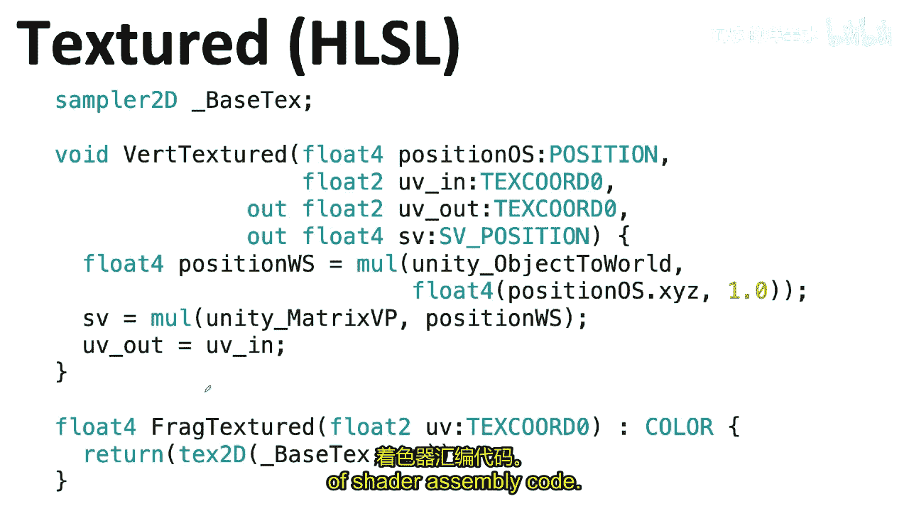
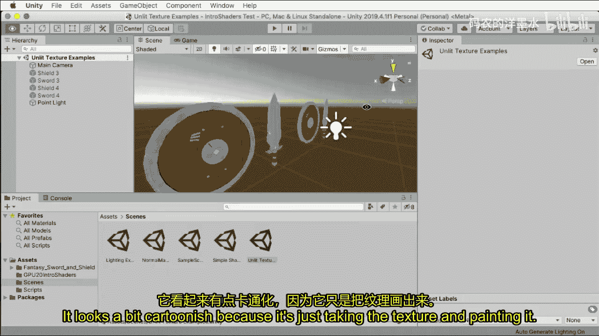
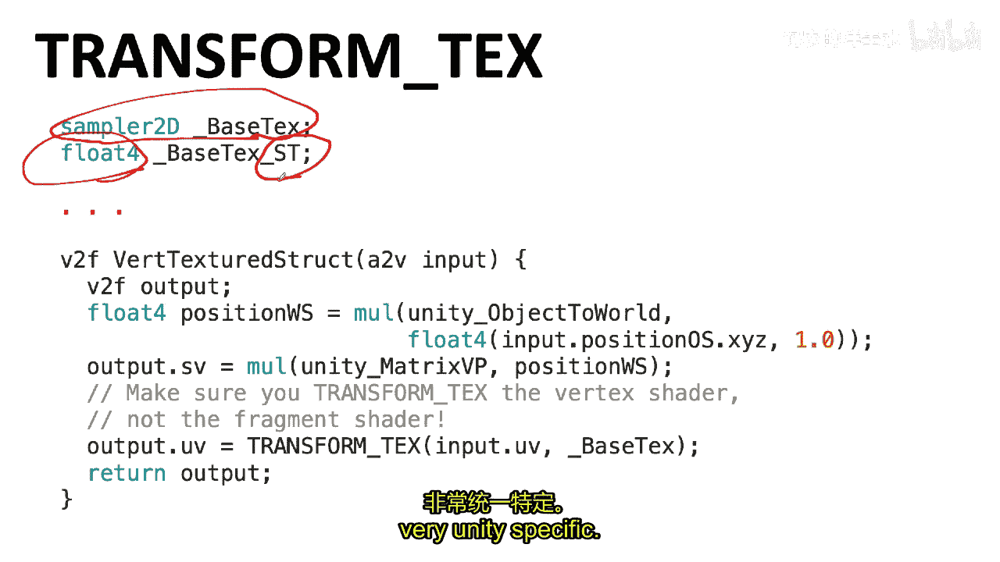
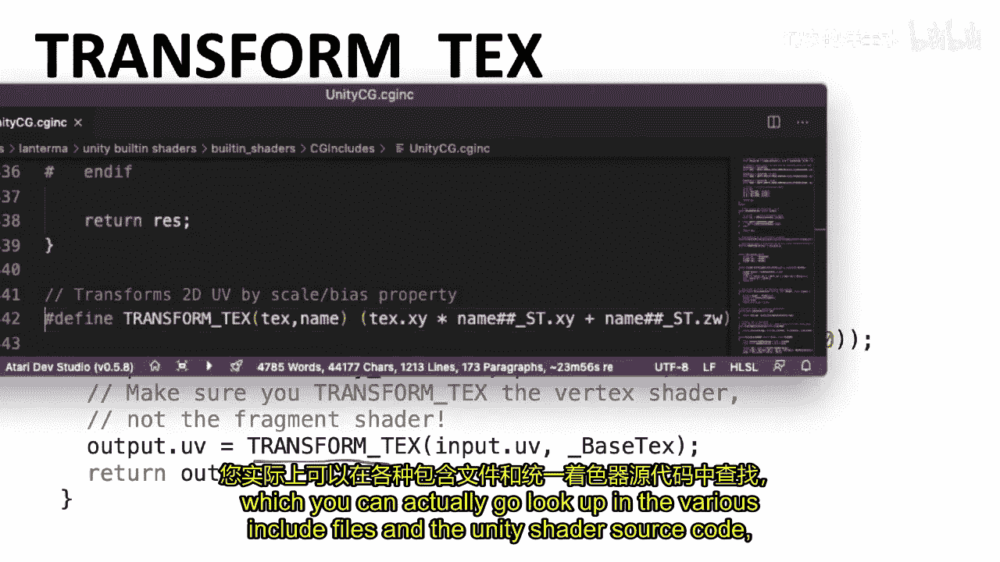
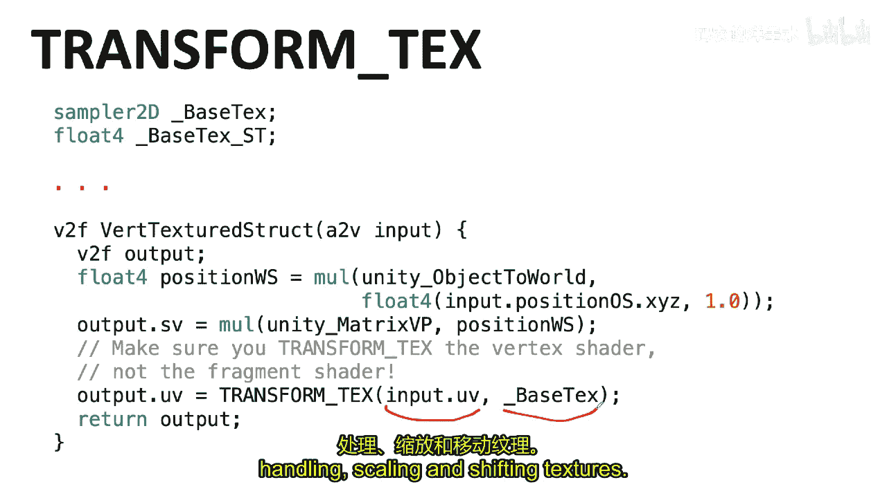

# 【全集】佐治亚理工学院-GPU编程：视频与游戏-中英字幕-p23-Lecture-23---在着色器代码中访问纹理--BV1GZfyBbEQn_p23-

Hi there。 My name is Er Lanchman。 I'm a professor of electrical engineering at Georgia Tech。

 And this is my thunderstorm， And it pretty much describes my mood today。 So with that。

 let's get into looking at some shader code。So the bulk of the code here is going to look a lot like what we saw in lecture 20 the main thing that we're going to add here is a property these represent variables that you can assign in the unity inspector remember the HLSL part actually lives between this HLSO program and in HLSO program line the stuff outside of it is sort of meta information to tell unity how to use this particular shader code most other engines will have some sort of similar setup。

The variable name you see here， the underscore basease tech。

 this is the variable as it will appear inside the actual HLSl program I don't think you have to have the underscore here but unity has a convention of putting an underscore on these properties so I'm going to stick with that and again the rest of this line is also fairly unity specific the base RGB that you see here in the string this is how this property will be labeled in the unity inspector the second thing you see in the parentheses here describes the type of this property and this property is a uniform variable this is one of those things that is assigned on the CPU side and then applies to all of the vertices or pixels that you'll be processing。

And this white with this little open and closed brackets， this basically sets up a default。

Also to be honest， I have no idea what is up with this open bracket closed bracket thing。

 you would think options could go in here， but I don't think I've ever seen anybody actually put stuff in here。

 so who knows？So the various compiler directives we see here for HLSL are what we saw in the last lecture。

 nothing new here。So there's one particularly confusing issue about dealing with the semantics of texture coordinates and by semantics。

 I mean these themes and capital letters that define the behavior of hardware registers on the card semantics is of course a more general term that you use when talking about programming languages anyway。

 the main issue is that this text chor zero is not at all the same as this text chord zero。

So this text chd0 connects the output of the vertex shader through the interpolation hardware that creates all the interpolated UVV values here for the various pixels created by a particular triangle whereas in contrast this text chord zero is connected to the CPU side through your API I would much have preferred it if this text ch and this text ch we're named different things you can do all sorts of things in your shader code you're under no obligation to take the textcor0 coming in from your API and then match it up somehow with the text code0 that's connecting your vertex shader to the pixel shader those are different things Now what makes it extra confusing here is is we are kind of treating them as the same thing because all we're doing here is taking the text coordinate in and the vertex text cord is then just spitting it right out unchanged in this particular example。

So most of this code is the same as what we saw in the last lecture。

 here we have the position of the vertex coming in and we need to output a position and clip space that's used by the GPU to figure out where the triangles are and also do Z bufferffer kinds of things if needed。

Here we are converting the position and object space to worldspace this little weird thing of sticking the one here is kind of odd。

 you don't really have to do this， you could just do a direct four by four multiply。

 but this here hopefully hints to the compiler that it could do some optimizations。

And then we take the position in worldspace and then run through the view and projection transformations to get that coordinate andc clip space and then we spit that out So what are we doing with the texture coordinates here in addition to each 3D vertex having a position as we've seen before it will have a 2D coordinate the coordinates here in unity are called UV some other engines might use another convention where they use the letters S&T and people use the coordinates U or S&T because X and y are already taken by our 3D coordinates XYz and then those 2D texture coordinates represent a lookup into an image that's the texture stretched around the object and all we're doing here is taking the UV coordinate coming in and just sending it right back out unchanged that UV coordinate that comes out of course runs through the interpolation hardware。

So the fragment shader is going to do a texture lookup。

 not just on one of the three coordinates produced as a result of passing along the texture coordinates for the three vertices of that triangle but however many dozens or hundreds of pixels are created in the rasterization process so we're looking up interpolated coordinates here so that's how you can get a nice image to show up instead of just a big b now it's very important then that the actual texture lookup you do。

 which is performed by this text 2D command takes place in the pixel shader。

 if you see a T2D reference up here in the vertex shader there might be some weird reason to do that but for the most part you usually don't want to modern shader models that you will find on any reasonable platform can do texture lookups in the vertex shader if for some reason you wanted to。

Earlier shader models， earlier GPUs actually would only have texture lookup capability in the pixel shader because that's where you generally need it。

So the textex 2D command does the lookup for us you give it the name of a texture variable and then you give it a two dimensional coordinate。

 it goes and does that look up at this point when it does that lookup。

 it will do the image interpolation， the texture interpolation that we looked at in an earlier lecture and they pick the interpolation technique based on the flags that you set in your API and if you're using unity。

 these are things you generally set in the inspector for a particular texture。

So here we're going to read that texture and without doing any lighting or anything else complicated we're just going to return that RGB alpha value It's important that we do that with this color semantic because that's then what tells the GPU this is an RGB send it to the buffer and perhaps interpret the alpha in different ways again depending on how you set behavioral variables in your API notice that before I provided the code for the vertex shader and the fragment shader we have a declaration so here we're declaring the basete variable with that underscore this uniform variable to be a sampler 2D which basically means this is a 2D texture noticeice that I do have to declare it in the shader code proper it's not sufficient to just declare it here in the properties Also as you might guess unity will complain or otherwise weird things might happen if the type。

As indicated here in the properties list is incompatible with the particular type given in the shader code itself。

Another thing to note is that although I'm using a return structure for the pixel shader。

 we're not using that kind of return structure for the vertex shader。

 instead we're using these out keywords in the parameter list and assigning those parameters here。

In the last lecture I promised that I would show you another way of handling this and here we go。

This code does the exact same thing except we have introduced the use of structures that are like the structures you might expect from C。

Here we're defining a application to vertex structure and a vertex to fragment shader structure and the application to vertex structure contained the input position and the input UV coordinate for each of your vertices and the vertex to fragment structure has a SV position that's a clip space position and the UV texture coordinate and all of the underlying logic here is the same the one thing I need to do a little bit differently down here。

 I just need to use some dot notation to access the correct things。

 so instead of just having a UV here， I'm using a dot UV to select the UV component of this input structure here。

Notice that I don't need to explicitly have an input。

 sv anywhere the card will get those clip space positions and figure out how to make triangles based on the fact that there's the semantic here again I would like to emphasize that the text chord zero that you see up here this UV component is not the same as the text chord zero coordinate here that's used to connect with the pixel shader we need to tweak the code and the vertex structure similarly retrieving the position and the UV coordinate from the input structure。

And similarly， assigning things to the output structure specified here。

 we need to use this dot notation， but once we've assigned those things to the output structure。

 we can actually return it Now this is just a coding stylistic style I would be shocked if this piece of code and this piece of code actually compiled down to different bits of shader assembly code So here we're taking a look at the unlit texture scene in the In shaderss unity package I created This is not terribly interesting because there's no actual lighting here it looks a bit cartoonish because it's just taking the texture and painting it。

 nothing very exciting going on。

On the left here， you can see that we have the original textured shader。And if I expand this out。

 we can take a look at the texture。So this is the base RGB that corresponds with the base RGB you see in the string in the shader code。

We could try something else like putting the sword texture on it， which looks weird， let's undo that。

 and then the next one over we have the textured structure shader and as I said。

 this operates exactly the same it just a difference coding style。

Now one thing you're supposed to be able to do in Unity is to put in some offsets here to change the texture coordinates going in oh but that doesn't do anything that seems to be a problem and you should also be able to apply a scaling factor to the coordinates going in say if you wanted to repeat this texture like for a brick wall or something oh but changing that doesn't do anything either Well to be able to handle this。

 we have to do something a little bit extra the sword and shield on the right here are using another shade or I call texture tile correctly and if we use this well then we can properly mess around with the tiling。

Oh let's change that to be 10 and 10 a you see a bunch of little shields there。

 you can do it differently in each direction and stretch it out in different ways that's kind of fun。

 let's stretch it out the other way。Okay， that's fun too or you can also offset the shield like if I put 0。

5 here and 0。5 here， then it's grabbing another part of the texture anyway。

 in order to facilitate that functionality， we have to slightly tweak the code。

So here's how to fix that and this is annoyingly quite unity specific。

The Unity shader compilers would like you to take all of your textures and create a float4 variable that has an underscore capitalized capital T appended at the end this is very。

 very unity specific and then there's a macro which you can actually go look up in the various include files and the unity Shar source code and you give this macro a UV texture coordinate and the texture you want to look up and it will substitute in the couple of transformations needed in order to incorporate that business from the inspector for handling scaling and shifting textures。

