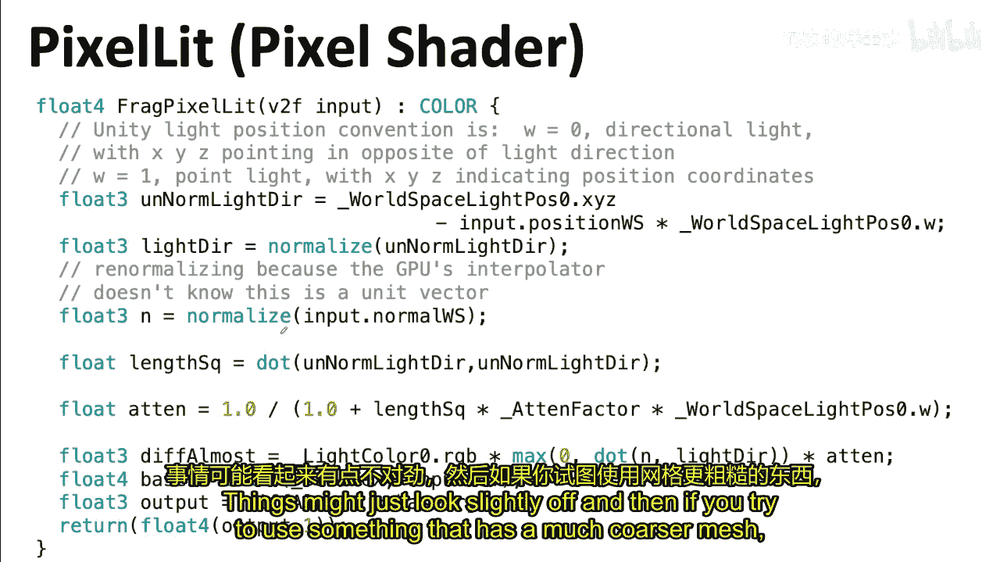
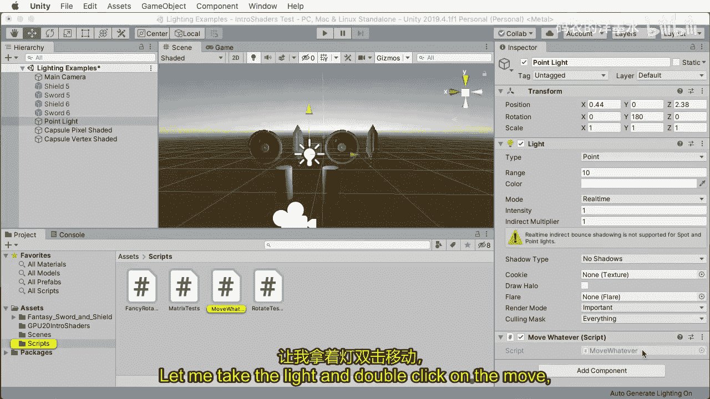
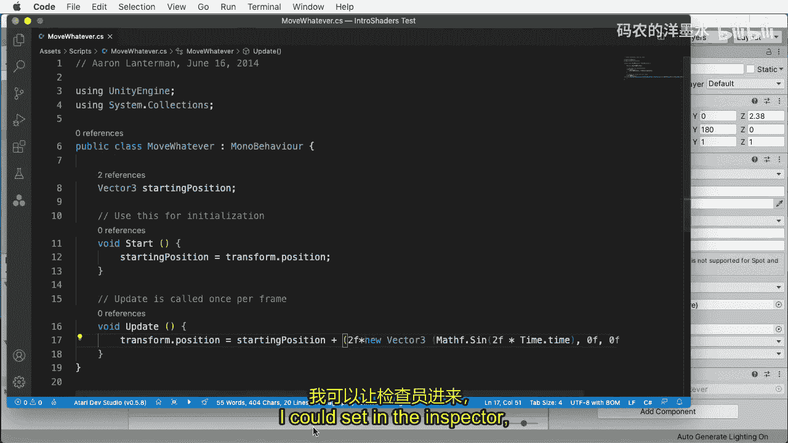
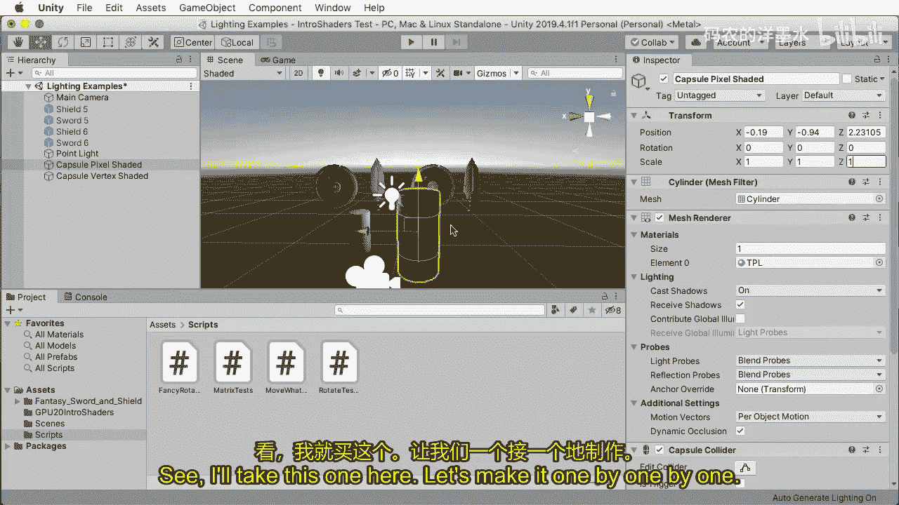
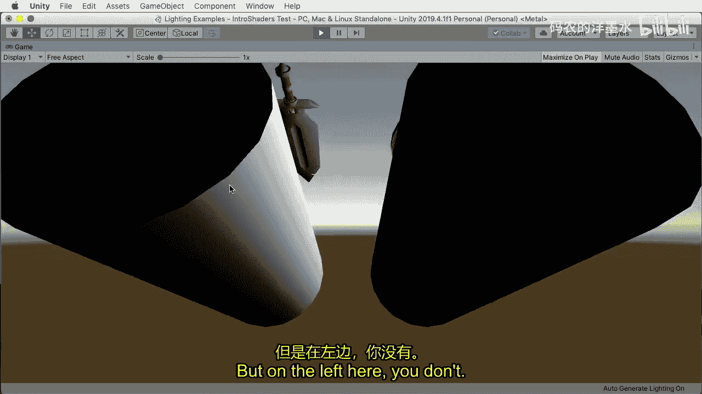
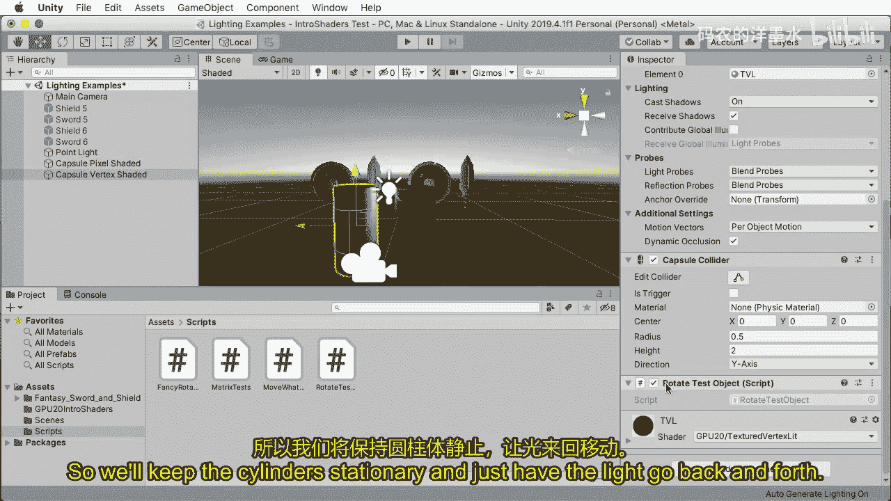
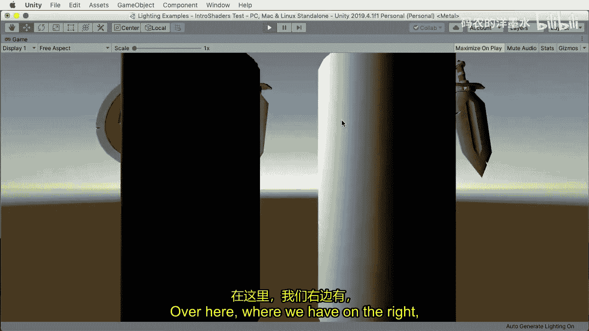

# 【全集】佐治亚理工学院-GPU编程：视频与游戏-中英字幕-p25-Lecture-25---简单光照着色器--BV1GZfyBbEQn_p25-

Hi there， my name is Er Lachman， I'm a professor of electricallect and computer engineering at Georgia Tech If you are one of my GPU programming for video game students。

 pay particularly close attention in this lecture because some of the subtleties and the ideas we explore here are going to show up throughout the rest of the course so finally we'll look at how to write Shadr code that deals with light。

So this is the last shader that we looked at in the last lecture in the vertex shader we take our positions in object space and turn them into worldspace and then we turn them from worldspace into clip space and as far as the texture coordinates those we're just essentially passing those directly through but we're first running it through this transform tech macro to be able to handle offsets and scaling of textures in the unity inspector if you're not using unity you won't have something like that so the shaders we're going to look at in this lecture only implement diffuse lighting we'll look at specular lighting and another lecture the first shader we're going to look at uses per vertex lighting also known as grcheding and then the last one we're going to look at uses per pixel lighting also known as Fong shading we're going to bring in a texture。

If you're using a point light， we've included this attenuation factor that lets you control how the intensity of the light falls off with range Now remember all of the stuff out here is not really part of HLSO code this is a unity specific metal language that you wrap around your shader code to tell unity how to interpret it and notice that in the subshader category that we have here。

 we have these tags and I have one of them commented out the light mode tag indicates certain kinds of bits of shader code that the unity render functional run at different points。

I don't want to get into too much detail here about what these mean basically there's a single directional light that's computed as part of what's called a forward base pass that includes some other things and then any additional directional lights in any point lights are computed and these additional forward add runs and if I wanted to make this more robust I would actually have two copies of the shader code here with minor tweaks。

 one for the forward add and one for the For base but here I'm just going to say oh since this is a demo example and I want to make the code as compact as possible just comment in or out whichever one you want based on whichever light you're using if you find that your object is not appearing at all go check the comments for these tags and make sure they match however you set the light into the inspector to either be point light or directional light the various compiler directives are exactly what we've seen before So there's something a little strange in the actual。

HLSL uniform variable declarations。Most of the unity side variables that we use such as the transformation matrices are automatically grabbed by unity in one of the include files。

 there's a underscore light color 0 variable that unity fills in for us。

 this is not part of those include files， I have a feeling I've stumbled across something that might be deprecated and removed in a future version of unity so if you're not using Unity 2019。

4 or 2020。1 which is what I tested this code in and it seems to choke on that particular variable。

 then you might have to go in and do some tweak in and find some other place where unity is filling in that light information。

So we have the textures， here's the intenuation factor。

 those correspond to the properties we have here， again。

 just including these properties to have them show up in the specter isn't enough。

 you need to have the variables actually be declared in a type compatible way in the HLSL code itself。

So here's the structures that we're going to use A2 v is for passing information from the application side into the vertex shader the vertex shader is going to compute some things for each vertex those will get interpolated and then get passed into the fragment akaA pixel shader I'm going to emphasize again that this text chd0 and this textcor zero are different things even if we're basically passing the texture coordinate through they are different parts of the hardware on the card。

 one of them is connecting to your CPU and the other is connecting the pixel shader to the interpolation hardware that's getting information from the vertex shader so each vertex of a 3D object has a position。

 a normal vector and a texture coordinate and something interesting we're going to do here is the vertex shader sending the information to the fragment shader is going to send some results of a lighting calculation I call it diF almost because it doesn't。

include the actual image texture information but the overall light intensity is computed here and we're going to transmit that information through techcorord1 We're using a texture coordinate register to transmit information that's not actually a texture coordinate we are going to do a lot of this and you just need to get used to it So the vertex shader for per vertex lighting has a lot of code in it as you might expect because this is where we are doing our lighting calculations We're taking in one of these input structures and we're going to return one of these output structures the geometric transformations on the verttex positions are what we expect and then we also need to transform the normals So this gets a little bit tricky remember that unity uses a column convention for its vectors so what we want to do is we want to take our three vector that's the normal it's a column and premply it by。

A transformation matrix。Now up here， we've used object to world。

 a uniform variable that unity filled in us to take us from the object to the world space。

 but if you remember from the normal transformation math we just did。

 we want the actual inverse transpose to the matrix so unity actually has an inverse matrix computed and already for us on the inverse side so we're not having to constantly redo that in the shader code which would be silly to do。

 and it's just called unity world2 object， so they flipped the order of object and world and that indicates that it's the inverse transformation。

 I guess they could have called it unity inverse object to world but this somehow does feel more elegant。

So what we want to do is we want to multiply our column vector by that matrix transpose。

 but instead of explicitly computing a transpose here or computing the transpose on the CPU side in unity what we're doing here is we're using a quirk of the way HLSL interprets a mut command I have something that I'm thinking of as a column vector。

 but I'm putting it first in the argument sequence of the mule command and what this is going to do is it's going to effectively take what we're treating as a column vector and multiply it by the transpose of this matrix without explicitly taking a matrix transpose。

This is a weird thing you can do with the Mt command and examples you'll find in textbooks will use this all over the place and not necessarily make any comment about it。

It's so confusing I will typically leave these comments here even many lectures from now I'll still leave comments like this in the code because it's really a confusing issue so another unity specific thing。

 Unity is going to fill in this underscore worldspace light position for us which if you have a point light unsurprisingly is the position of the light in world space but unity does a clever thing it uses this variable in two different ways the Xyz in worldspace light position can either be the position of the point light or it can be the direction vector for a directional light and the way it tags whether a light is a directional light or point light is using this W coordinate in this four vector so this lets you use an interesting trick instead of having to write and if then else kind of statement to deal with these separate cases of W being zero or W being1。

What we can do is take our world space light position， just stick it here。

 then we'll subtract the position of the world space， then multiply it by this W coordinate。

So if you have a directional light， then the second term here goes away。

And then we just have the direction of the light stored in XYz。But if you're using a point light。

 this isn't direction information， it's position information。

And then we can get the vector pointing from the vertex towards the light by subtracting the vertex position from the world space light position。

 and that's facilitated because in this case this W component is holding just the number one Cl a。

One thing you want to be careful with is this isn't normalized。

 so I'm going to run the normalized command to get a normalized version of this vector so it has unit length。

A very common bug is to forget to do that normalization， and if you do that。

 your lights are going to look all messed up。So the reason I called this dial is it doesn't have the final application of the actualgile texture image that's something we have to do in the pixel shader。

 so it's not quite the diffuse light calculation yet it's almost I have the color of the light that's hanging out in this underscore light color zero variable again I suspect that might go away in a future version of unity but it's stuck around for a while and here I have my diffuse lighting calculation I'm taking my normalized light direction pointing out of the surface dot product it with the normal and then we use a max zero in order to make sure that we're not lighting something where it's actually facing the wrong direction but I do have one other thing here and that's this attenuation factor and to compute it I'm using this unnormalized light direction because in the case of a point light that's now the distance between that vertex in the light so dot product it with itself gives me the square of that distance which Im。

including here in this formula to compute a value that indicates how much I would like the light to drop off for a particular range and I can modify how that operates using this atinuation factor Now notice this drop off with distance is something I only want to happen if I'm using a point light so here once again I can use this convenient W variable because if I put a one in here。

 then all of this stuff is included in the formula but if it's zero。

 all of this stuff here gets multiplied by zero， which is what happens if this is a directional light and that atinuation factor just turns into one。

This di almost is something I want to pass into the pixel shaders through the interpolation hardware that makes all these little pixels and interpolates the values that are coming in and also I just want to pass along the texture coordinate。

So for per vertex lighting， the pixel shader is fairly simple as you would expect it to be because most of the work is happening in the vertex shader I'm just going to look up this color from the texture using tech2D I'm looking it up at the appropriate texture coordinate this is the texture coordinate for a particular pixel on the screen that was interpolated from the output of the vertex shader and then I'm also going to take my dialmost light calculation from the previous slide and just multiply it by this texture so this texture is indicating the diffuse color properties of an object and dialmost contains the light color and the Laberian lighting calculation and the attenuation if appropriate so we compute that and we just stick it back out notice output here I'm grabbing just the RGB out of that and just to keep the simple I'm sticking a one here for the alpha component。

If you're doing something more general with transparencies or whatever。

 you'll probably want to be more careful than this。

 but this is just the quickest way to get a clear example going so I'm going to return this color and then that's what the hardware that talks to the frame buffer memory uses to figure out what actually to stick at the frame buffer so back in the day GPUs weren't really powerful enough to do per pixel lighting at decent frame rates so most games used this kind of per vertex Aka grosscheting technique。

And it works， you can play some fun games with it， they can kind of look okay but if you want things to look really good。

 you want to use per pixel lighting and modern GPUs can handle this without much problem so the overall structure is pretty similar the information coming from the CPU side for each vertex is the same I've got a position a normal and a texture coordinate。

But now what I'm passing along to the vertex shader is different I'm still passing along the texture coordinate that's what we're going to need to do the texture lookup but now because I'm doing so much of the lighting and the pixel shader。

 I'm not passing some aggregate light calculation like the dial variable I computed and the per vertex shader。

 I'm going to pass along the clip space positions， I'm going to pass along the position of the point in world space and then I'm also going to pass along the normal in world space something to keep in mind is that what the pixel shader gets is not the worldspace position computed by a vertex for three individual points making up the endpoints of a triangle。

The GPU is interpolating all of this over all of the pixels that make up the triangle。

As you might expect， the vertex shader for per pixel lighting is shorter than the vertex shader for per vertex lighting we're basically here just doing the geometric transformations so here we're transforming the positions as always。

A main difference here is that although I'm passing along the clipspace SV coordinates as we always have。

 and that's always been used by your hardware figuring out where to put pixels on the screen whether your pixel shader or explicitly uses it or not here we'll find it very convenient to go ahead and pass along the 3D worldspace coordinates and let the hardware interpolate that and it's convenient to do that separately from the clip space positions。

 because these are in different spaces and that's convenient because for the purposes of this demo code。

 I think it's clearest to actually do the lighting calculations in worldspace。

 whether or not that's necessarily the most efficient so previously we've only needed these final clip space positions and the GPU hardware uses that to figure out where to put pixels even if you're not actually explicitly using that in your pixel shader。

 but here we're going to use this worldspace position in the pixel shader。

I have all of these comments here again describing that transforming normals uses a bunch of weird tricks。

 the underlying math is a bit strange， and we're also using this strange way of using the mule command to basically affect an implicit matrix inverse operation and so we're going to pass along those normals in world space in order to do the lighting and the pixel shader。

 and we're just passing along the texture coordinates the same way。And then of course。

 as you might expect， the pixel shader that was very short and simple in per vertex lighting is now fairly complicated and lengthy looking in the per pixel lighting scenario。

 most of this code looks familiar though all of this fancy stuff we do here to handle rather the light is a directional light or a point light and getting the appropriate light normal to use in our lighting calculations。

 that's all still there the need to normalize the vector to use in your lighting calculations is all still there the way we compute the attenuation factor is pretty much the same。

Just to show the overall structure of moving logic from the vertex shader to pixel shader。

 I kept this name diff almost in this way of writing it。We do our texture lookup。

 then multiply our defaultal times the result of that texture lookup to get our final output and again to make things simple。

 I'm just putting in one in the alpha register if you're doing something with transparencies or whatever you would want to be more careful about that。

The main thing I want to point out here is that although the overall lighting calculation looks the same in the pixel shader as the vertex shader。

 the interpolation hardware doesn't know that you've hijacked one of the texture coordinate registers to hold something that's not a texture coordinate。

 it doesn't know that the normal vectors need to be normalized to have unit length。

So if you have a surface and you have some triangle making up that surface and each vertex of the triangle has some associated unit length normal。

 well the xyz's here that are getting interpolated， those are just numbers。

 so as the interpolation hardware is interpolating these numbers across the surface is just linearly interolating the x's linearly interpolating the Y's and linearly interating the z's。

You need to know to go back later and run a normalized operation in order to get an actual unit length normal to then use in your lighting calculation again。

 forgetting to do that normal is a fairly common error and it's particularly problematic error because if you have a reasonably dense mesh。

 sometimes things are close enough that not including that normalized command isn't really noticeable。

 things might just look slightly off and then if you try to use something that has a much coarser mesh。

 then you'll start to notice that there's something strange with the lighting。

So a couple of lectures ago we looked at this very basic textured shader that didn't actually include any lighting effects so it of course looked a little cartoony let's go into the scenes folder of this intro shaders unity package and double click on lighting example now we have some really interesting cool looking lighting effects so you'll see the light going back and forth here and what fun thing is we can actually click on the scene view and see what it looks like from various angles and here you can actually see that moving light script that's moving the light back and forth that's kind of fun。

Let's go back to the game view and hit maximizeimize on play。

So we can get a closer look at these things。So let's talk about what objects are using。

 what shader so on the left here we have。The textured vertex lit shader。Textured vertex lit shader。

 textured vertex lit shader， probably。For the cylinder over here and the sword and shield。

 and on the right， we have materials that are using the pixellit shader。

 so now we can compare per vertex per pixel lighting。

It's hard to see any particular detailed effect on the sword and the shield。

 but if you look at the cylinder。That I created here in the hierarchy menu by just going to through the object and asking for a cylinder。

To make that a little clearer， let's take the camera and move the camera downwards a bit to make the cylinders the center of the action here。

And as the light goes back and forth， if you look at the。Wigh that delight light。

Slides across the cylinder on the right， you'll see it's fairly smooth。

But if you look closely at the one on the left， you can see the effect of the per vertex lighting and that you can see sort of the individual strips of triangles making up the cylinder eye。

 you can see it there pretty well， let me take the light and double click on the move whatever stripped。

This was just a quick and dirty script to make something go back and forth。

 Let's have it move a little bit less。It's been a while since I wrote this， how does this work okay。

 I'm caching the starting position and then I'm reusing that on every frame and I'm adding to it the sinusoidal thing going back and forth。

 let me change this five to a two。If I really wanted to make this a piece of code that was good。

 I would probably take this and make it a public variable I could set in the inspector。

 but this was a quick and dirty kind of thing。

Okay， let's run that so the lights。Not going out quite as far this time out there。

 there you can really see on the left here。Let's make the cylinders a little bit bigger。

LetSee I'll take this one here， let's make it。One by one by one。

Let'sMake the cylinder。Over here。Changenge the scale from a half a half and a half to 111。

 what does that look like？Now you can really see the effect here。So on the right。

 you have this nice smooth spot。But on the left here， you don't。

You can really see that there's a distinct spot that appears up here。Actually。

 if I really want to show that effect， let me take my cylinders here and actually turn off the rotation。

So we'll keep the cylinders stationary and just have the light go back and forth。

啊。Now it's pretty evident。You can see this little flash up here。

Has a very different character on the left。And you can sort of see the little strips here。

There's a definite striping effect。And that's a result of the pervertex lighting。

Over here where we have on the right where we have the pur pixel lighting。

 we have a much smoother effect。

Before we close out this lecture， I would like to give another shout out to a Unity asset store developer that goes by the name of Comeback。

If you follow the link here， it looks like they're from Tula。

 Russia and they have all sorts of cool stuff here to check out。

They're the creator of the free fantasy sword and shield that I've been using in these demos。

