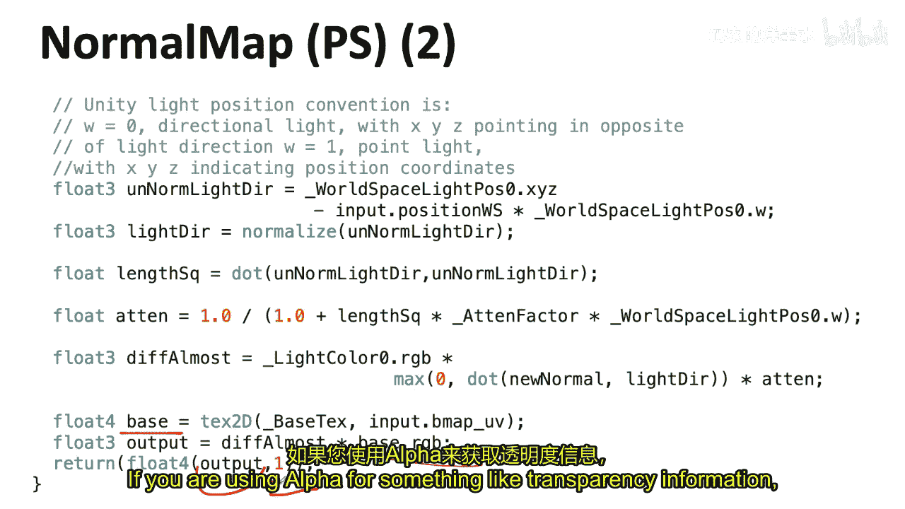
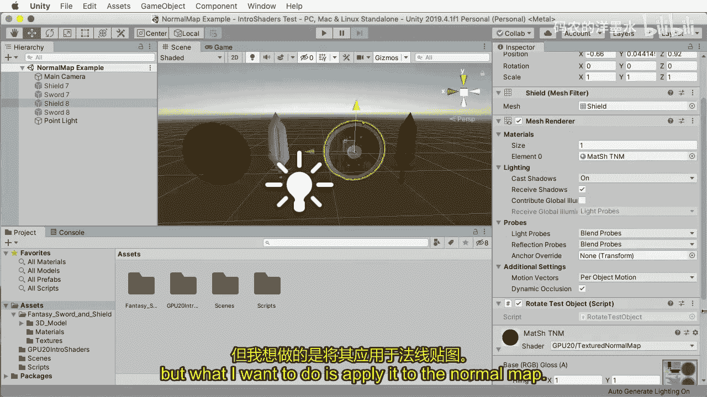
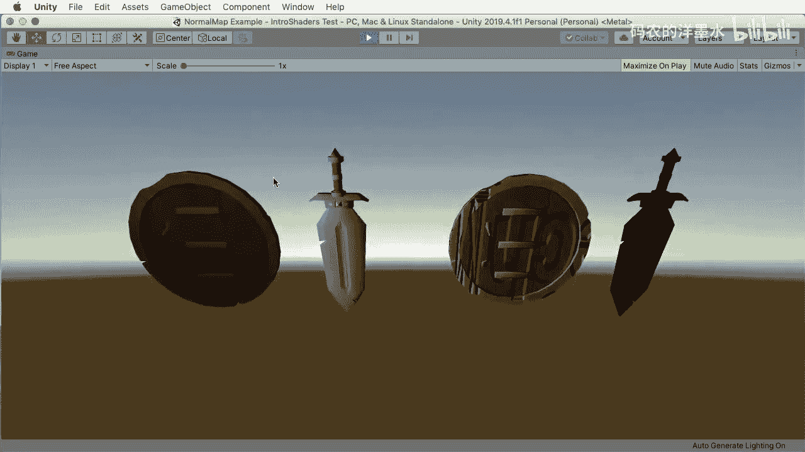
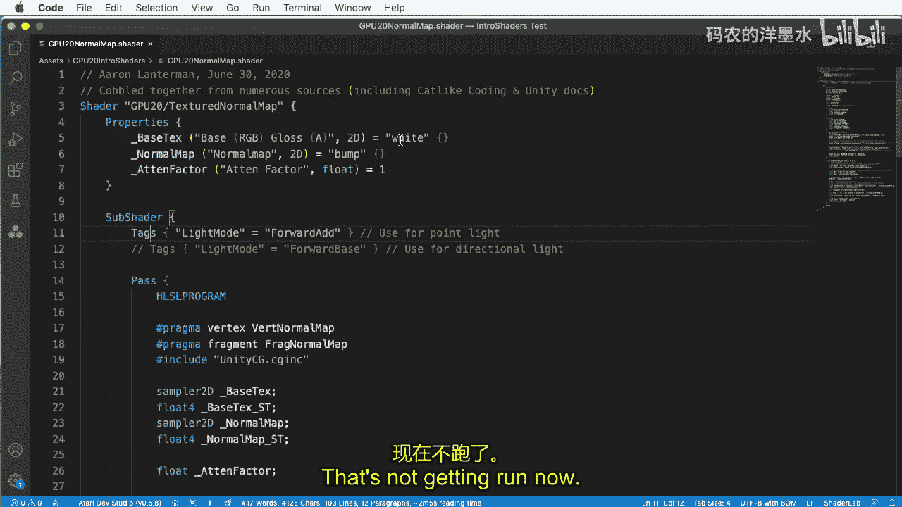
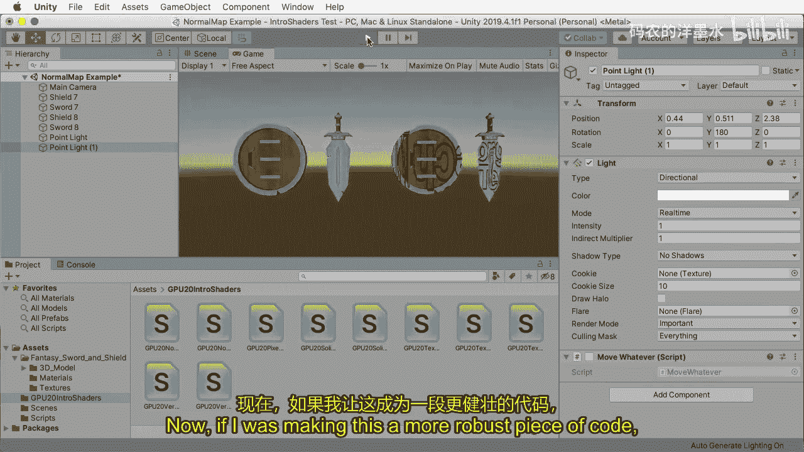
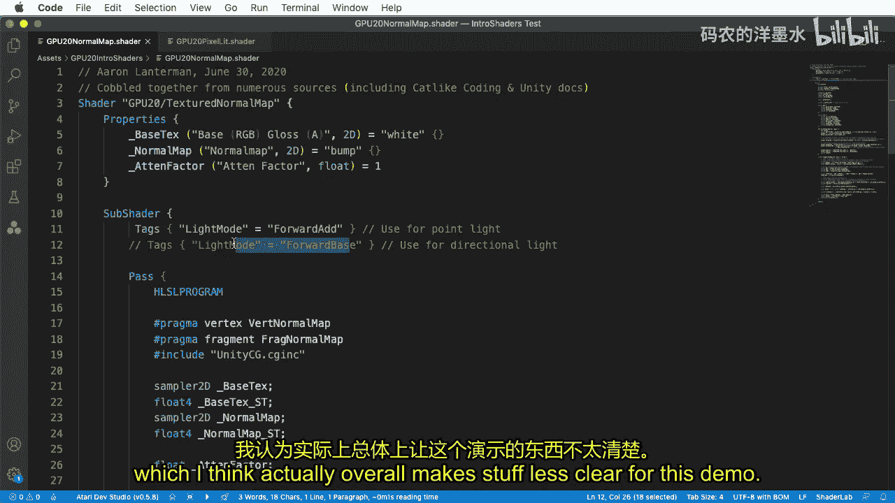

# 【全集】佐治亚理工学院-GPU编程：视频与游戏-中英字幕-p26-Lecture-26---法线贴图--BV1GZfyBbEQn_p26-

Hi there， my name is Er Lanchman， I'm a professor of electricallect and Comp engineering at Georgia Tech and this is the summer 2020 offering of GPU programming for video games。

This lecture on normal mapping is the last lecture that will use the Intro shaders Unity package and the next lecture we're going to look at environment mapping。

So most of the code I'm going to show you is right out of the lit shader that used diffuse lighting that we looked at in the last lecture。

The main addition we're going to have here of course。

 is this normal map and remember it's not sufficient to just include it in the properties。

 we also have to include it in the shader code itself。Now there are some new things coming in。

 obviously there's going to be something new coming in from the API side。

 we had the normal in object space coming in before。

 but this time we also have tangent information coming in。

One of the things that our vertex shader is going to do。

 in addition to transforming that tangent and normal into worldspace。

 it's also going to create a bytangent vector and so we're using a lot of texture coordinates here in addition to the position and normal passing in through a texture coordinate from the vertex shader through the interpolation hardware into the pixel shader。

 we also now have a tangent and a bytangent so all of these 3D vectors are getting interpolated。

Just for thoroughness， even though a single set of texture coordinates is coming in for the vertices。

 I'm going to go ahead and pass these in separately for the buttm and normal map。

 even though we'll usually keep these the same。So for the vertex shader。

 this set of code here that transforms the positions is as it was before。

 as well as this bit of code that transforms the normals， transforming normals is a bit weird。

 we're using world to object instead of object to world because normal transformation actually needs the inverse matrix and we're also using this very strange thing of putting the vector first。

 even though we're thinking about these as a column vector because that facilitates a matrix transpose。

 so that's how weird if that was confusing， don't worry it is。

 you can look back at an earlier lecture to see some more details about where that all comes from。

Now I'm not going to pretend to understand the math on this。

 I studied this some years ago and at that point it all made sense to me and then I forgot it。

 so you can take this on faith。Transforming tangent vectors is not as strange as transforming normals。

 we're still only using the upper three by three part of the object to world transformation matrix because we want to just do rotations and not any translations。

But otherwise， this is kind of a normal transformation you do on a vertex。Now the by tangangent。

 that's not something that's being computed on the engine side and being passed in。

 that's something we're going to do here， so what this code does is it takes that tangent vector and the normal vector and computes its crossproduct in order to get a vector orthogonal to both of those to create a 3D orthogonal basis。

We're going to normalize whatever is coming out of that cross product to make sure we have a unit vector。

Now the one thing you want to watch out for is this little strange multiplication by W and you're thinking well what is W doing there。

 we're usually using W in a homogeneous coordinate framework to hold the number one to handle translations。

 but if we're rotating these direction vectors， we don't want any translations anyway。

This is a subtle issue， so instead of me trying to explain it and messing it up。

 I'm going to provide a couple of links in the description below that will go into details about what that W component is doing。

Right now it will be sufficient to say that Unity's shader code includes this。

 so we're going to include it as well。Now， the only way we're going to get different bump map and normal map vectors is if for some reason。

 the user wanted to do something strange and use different scaling and offsets for the base map and the normal map。

In case the user wants to do that I'm letting them do it so moving to the pixel shader。

 there is some weird stuff in here we've always talked about normal maps as being represented as red green blue textures where X information is stored in red。

 Y information is stored in green and Z information is stored in blue and this is the way you'll see these normal maps show up in the unity inspector。

 but the way it is actually stored and transmitted into the card actually just ignores the red and the blue。

It stores the X and Y information in the alphapha register and in the green register。

 and if you're wondering why it's doing that， it has to do with the way sometimes textures are compressed。

 either when they're sent to the card or inside the card itself or any number of strange things。

And it turns out that the kind of image compression that's used is not used on the alphapha channel。

 the alpha channel is left alone and uncompressed， so you're guaranteed to get some good quality there。

Also， it turns out that humans are more sensitive to variations in green than they are red and blue。

 I don't know if that's because there's trees and grass everywhere or whatever。

And if you play around in Photoshop， you'll find that if you just take green and crank it all the way。

It does look a lot more obnoxious than if you take red and blue solo crankked those all the way。

 In fact， although red all the way up is usually just called red and blue all the way up is called blue。

 green all the way up is usually called something like limeme and if you want a green that's comparable to red all the way up or blue all the way up。

 you really turn green only part way up。So as a result of this。

 the various RGB compression formats will often put more bits into correctly representing green than they do into representing red and blue。

 so once you get the appropriate pixel from the normal map。

We're using this dot notation here to pull out just the alpha register and the green register。

 that's our X and Y。It's stored in the normal map as being zero to1。

 we multiply that by two to get something that's going from zero to 2 and then we subtract one to get something that's going between minus1 and1 and then at that point we can do a bit of math to reconstruct what the Z was that's how we can get away with only having two of the components of that 3D vector because we know it needs to be unit length so we can construct the third。

I'm not going to go into the details of the math here， it's not hard to figure out。

 but you can take it on faith for now。Now we also have normal tangent and by tangangent vectors that have been sent out of the vertex shaders run through the detailed interpolation hardware to make the interpolated values for all of the pixels。

When we looked at using normals previously， I talked about how the card does not know that you're using these texture coordinate interpoators to interpolate unit length vector data。

 so you have to go in and do the normalization yourself。

 not just for the normal but also for the tangent and the by tangent。Okay。

 so now we can actually apply the normal map。So think about this worldspace vector as being the unperturbed vector that any normal map perturbation that you apply is going to work around and so multiplying these three coordinates by the equivalent X。

 Y， and z from the normal map is basically doing a projection。Now。

 if you imagine a normal map where all of the vectors are poing straight up。

That would essentially show up as blue in the unity inspector， that would have a1 in the z component。

 and it would have0 and the x and y components， so what would that do here。

 well we would take one and multiply it by the original worldspace normal and these other terms would go away。

So that's just a bit of a sanity check。If you're not quite following all of the math here。

 that's fine， you can just use this code in a variety of different contexts and it should work out okay whatever the result of this calculation is。

 let's also normalize it to make sure it has unit normal before we use it in a lighting calculation。

So the rest of this is pretty much what we saw before。

We can get the vector pointing from that point on the triangle to the light source and you can look at previous lectures to review the weird tricks that unity uses to handle the differences between directional and point lights we do need to keep the unnormalized version of that around to get this length to use in the attenuation calculation if we're using point lights if you found this video out of the blue。

 take a look at the previous lecture that will go through the details about how it's handling attenuation but of course for the main lighting calculation we want to use the normalized version so here's our diffuse lighting calculation we're including an attenuation factor if we need it and here's the color of the light again this underscore light color zero variable is something I discovered。

 it doesn't seem to be actually declared in the main unity include files so it might go away at some point so if you're using some version of unity past 2020 point。

One， you might have to get this information from somewhere else and do some tweaking to get this code to work。

Anyway， we will look up the diffuse texture in our base map and notice here I'm using the base mapap UV coordinates。

Again， there's only one set of UV coordinates being passed in for each vertex。

 I'm just including two different versions of the UV coordinates here in case the user wants to put in different offsets and or scalings for the base and normal textures in the unity inspector we take the result of the lighting calculation and multiply it by the texture and we'll send that back out to keep things simple I like to put one here。

 if you are using alpha for something like transparency information you would want to be a little more careful。

Okay， so let's try out the normal map scene in the intro shaders unity package I developed。 Okay。

 so now we have a nice， happy light going back and forth。Let's take a look at this in closer detail。

Can I swing the light back and forth like this， sure， there we go。

Let's see what actually have in here。This has the textured pixel lit， textured P it。

 and then textured more normal map， textured normal map。

The things on the left just have the diffuse reflection texture， but not the normal map。

 and the things on the right have the normal map。To make this a little more obvious。

 let's put some crazy textures on here。I have this texture I developed based on the Georgia Tech logo。

 whoop， nope that's not what I wanted to do， that would have applied it to the base texture。

 but what I want to do is apply it to the normal map。

So let me drag and drop that onto the normal map here a now you can have something。

Something much more noticeable。Obviously， this is not intended to be realistic， okay， let's play。Hmm。

 that looks cool。

And now you can definitely see that there's no normal map applied。To the one on the left。

 because we clearly see there is a one applied to what's on the right。

Let me turn off the maximize on play。That way we can switch to the scene view。Okay。

 here it is in the scenem view。That's a pretty cool effect， I think。So before we depart here。

 there's one point I wanted to make。And that if we were to take the light。

And switch it from a point light to a directional light， all of the objects disappear。

 where did the objects go。This gets into some more unity specific stuff than I usually like to at this point in the course。

 but there's really no avoiding it。Let's open up the normal map shader in case you're wondering I'm using visual Studio code here with some unity extensions that were pretty easy to find。

Unity comes with Viual Studio community， which is actually very different than visual Studio code。

And that works fine。 I happen to like visual studio code It's just a matter of personal taste and rather you want to go through the extra hoop of setting up VS code to work with Unity and unity to work with VS code it's not too hard anyway unity's main builtin shader again none of this is going to work with any of the scriptable render pipelines you have to do something else for that this is designed to work with unity's original builtin forward rendering pipeline I should also mention that this is only for forward rendering Def rendering is something very different this code would not work for that So unityities builtin renderer will run a base pass that includes whatever the most important directional light is however unity determines that and then any additional directional lights beyond that are part of the forward a passs along with any point lights so because we've set this to be associated with the forward apas when we switch to the directional light。

That's not getting run now we could change which tag is active。

 let's save that come back over here and then。

The things on the right reappeared because the things on the left were actually a different shader if wanted to change those。

 this is the one without the normal map。Let's select editit Shar。

 I can change both of these torque and the base pass， there we go， so now they all appear。Again。

 that's more unity specific stuff that I like to get into。

 the purpose of this course is to teach general concepts of shader programming that you could use in other engines like Goddo or Unreal or whatever custom engine you're writing an OpenGL or Vulcan or direct DeX or whatever。

But we do have to talk about immunity un stuff here and there。Now。

 if I was making this a more robust piece of code， I would include a set of subshaderrs to cover these various modes of the forward add mode or the forward base light mode。

 in this case it would involve copy and pasting a bunch of code。

 which I think actually overall make stuff less clear for this demo， but your mileage may vary。

