# 【全集】佐治亚理工学院-GPU编程：视频与游戏-中英字幕-p27-Lecture-27---环境映射--BV1GZfyBbEQn_p27-

Hi there， my name is Er Lancherman， I'm a professor of electrical and Comp engineering at Georgia Tech and this is the summer 2020 offering of GPU programming for video games Today we're going to look at a special texture mapping technique called Environment mapping。

In most of the previous lectures I've shown you code and then showed you a demo。

 I'm going to start this lecture by showing you a brief bit of the demo and then showing you the code。

 but first I want to give credit to Tom Higgins who created this animated H model that I use in the demo。

 so this is available for free from the Unity asset store and you should also go check out Tom's other models。

I have started up a blank Unity project in 2019。4 with just the basic built in 3D graphics pipeline。

 not one of the weird new fancy scriptable render pipelines。

I'm going to take the GPU20 environment map Shars Unity package and drag that onto the assets I've also tested this in the 2020。

1 beta。If you're using some other version of Unity than 2019。1 or 2020。1。

 you may need to make some tweaks to the code。Anyway， there's two scenes in here。

 let me just go ahead and double click on the fanciest one for the moment， let's check that out。

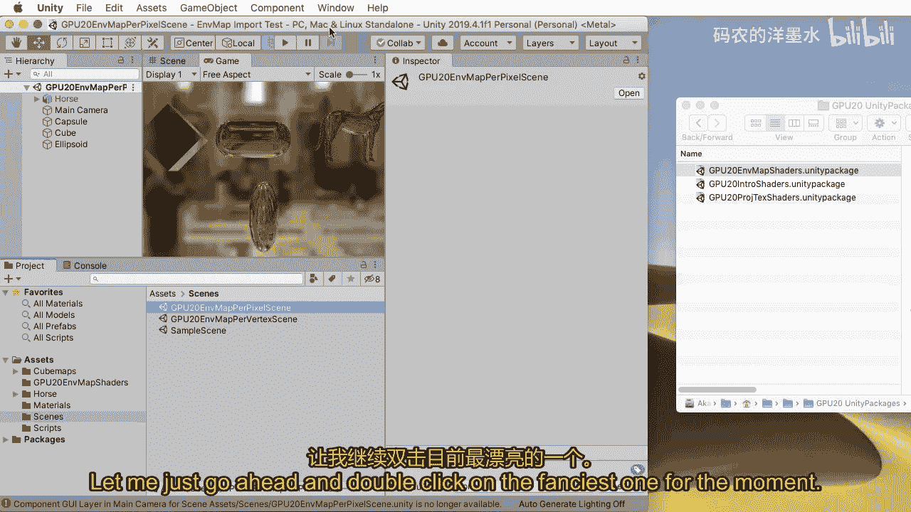

And doesn't that look awesomely cool So in this lecture we'll see how to create these reflection and refraction effects Notice that we'll be faking these effects if you want if you want reflections and refraction and by refraction I mean you're actually seen through a translucent surface If you want an accurate simulation of those kind of effects。

 you need to go to something like ray tracing and although the latest graphics cards have some built in ray tracing capability there's not many games that use them because not a lot of people actually have those cards and even the games that use them typically only use that realtime ray tracing capability for some particular aspects of the graphics and they'll use the rasterization model for everything else So we've made extensive use of the normal vector of the surface being lit。

 the vector pointing from the surface to the light source we haven't really yet used the vector。

Wing to the I a great deal other than to talk about spotlight effects。

 this is going to play a critical role in specular lighting calculations that we'll look at in a future lecture The specular lighting calculations so also make extensive use of this half vector which is the vector halfway between the light and the I vector in this lecture we're going to make great use of the reflected vector Now this concept of a reflected vector is a fairly general one here it's described as reflecting a particular light vector what's a little bit confusing is that in this lecture we're mostly going to want to be reflecting the I vector。

And instead of working out all the trigonnoometry here。

 I'll just state the way that this is usually formulated。

 so you can give this formula the normal vector and this incident vector。

 be careful with the sign on this， and it will give you the reflected vector and fortunately there's a command built into most shading languages that implements this formula for you。

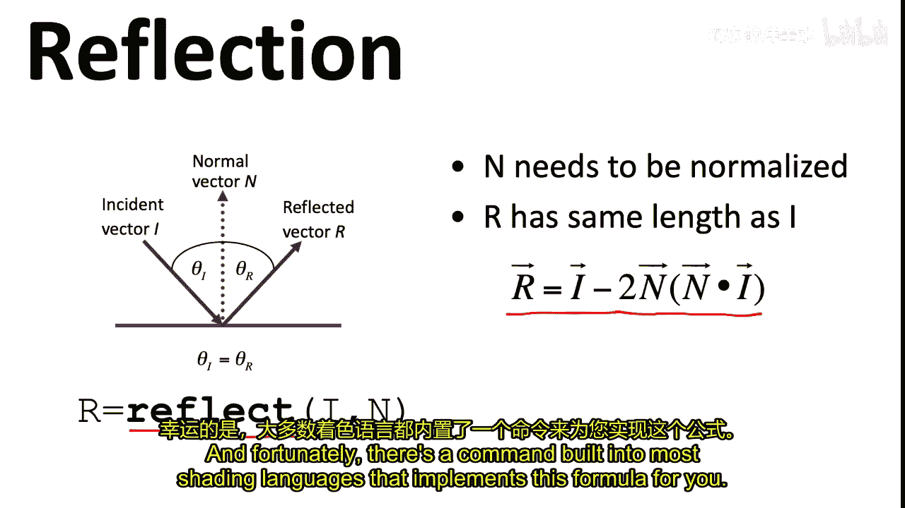

So the way we're going to fake reflection effects is with the use of a cube map so you can imagine going out into the world with a camera and pointing the camera ahead of you and then behind you and then towards the sky and then towards the floor and then towards the left and the right and building up a series of photographs and there are a bunch of folks who've made a hobby of this it takes a lot of postprocess work in something like Photoshop in order to get the seams between the images to make sense so you don't get abrupt transitions and what we'll be able to do then is use that cube map to fake this cool reflection effect Now the reflection that we're seeing depends on the eye position so this is something new this isn't something you can implement using the diffuse kind of lighting that we've been looking at so far because that doesn't depend on the angle of the viewer this is a special case of a specular reflection essentially a perfect specular reflection。

 a perfect mirror。In a future lecture， we'll look at some much more complicated specular models。

Just like you use Tech 2D to look up points in a standard 2D texture image。

 you can use Tech cube to look up points in a Q map。But instead of a 2D value。

 you give it a vector pointing towards the cube map。

 and then the hardware will figure out both which of these six images that vector would intersect with on the Q mapap and also the point within that particular image。

So this is very convenient， one interesting thing about this is this vector doesn't need to be normalized to have a length of one as long as it's pointing in the correct direction。

 it's fine。

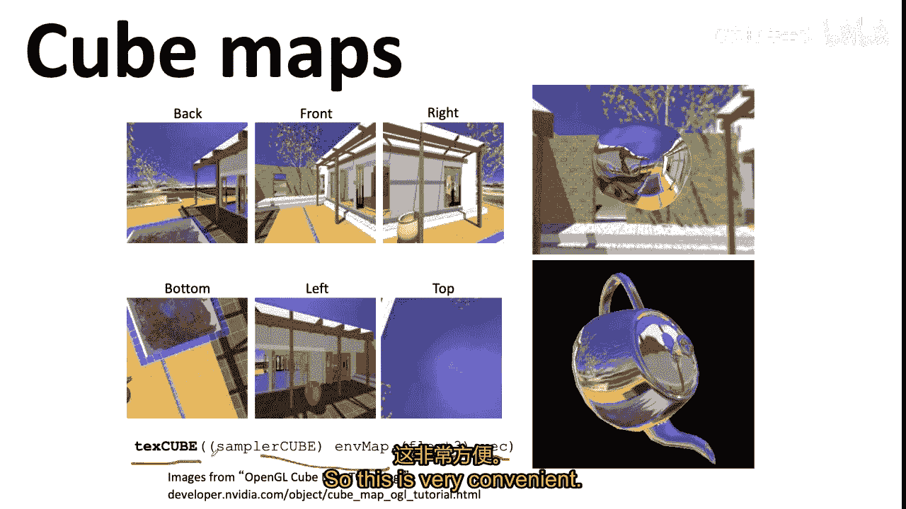

To once again give credit where it's due， the demo scene I created is using this Q map by a male person。

I'm not sure I'm pronouncing that correctly I'm probably not anyway。

 this is a cube map they created of St。 Peter's Basilica and as you can see it takes a bit of work to try to make sure that this somewhat sensibly matches up along the various transition points of the cube map。

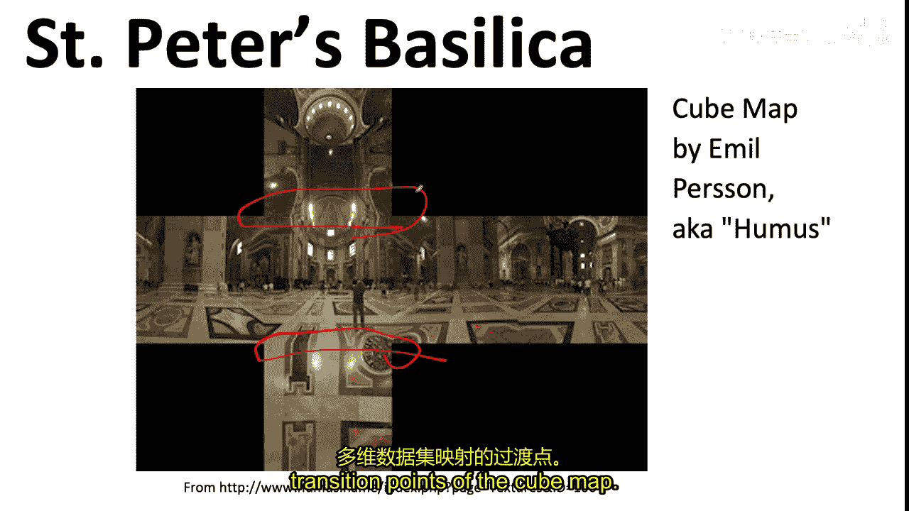

In addition to reflection effects， we can also use Q maps for refraction effects where we're imagining that the object is translucent and we're seeing light waves from things on the other side but they're distorted a bit because those light waves are being bent as they're going through the surface。

 so if you go back to your physics lessons you'll find that there's the concept of an index of refraction and then Snell's law gives us a relationship between these angles。

Of the light coming in and then the light going through the other side in terms of the index of refraions。

For what we need to do， we don't need to know the exact index of refraions。

 we just need to know their ratio， and so we'll place that into the refract command。

 you give the refract command an incident vector， again that's going sort of opposite the direction of our usual vector the way we've defined it and the normal vector for the surface。

 and then it will give you this refracted vector。I'm not listing all of the mathematics here。

 but you can go look that up if you're wondering what the exact formulas are that refract is implementing。

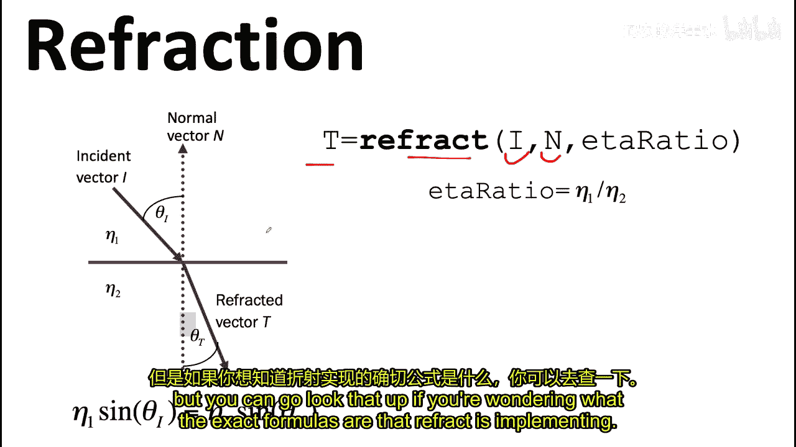

So here are some examples created by Thomas Kwin at Ohio State。

 here we can see an example where you have these floating spheres and if the index of refraction of the material making up those spheres is larger than that of the air that we're looking through。

 then you have this effect or thingses on the other side basically look bigger。

 whereas if those spheres are made up with an object whose index of refraction is smaller。

 then that of the air， then the thingses on the other side look smaller。

 as we can see air has an index of refraction pretty close to a vacuum， water is higher。

 which is why thingses look distorted， if you're looking down into a pool。

Glass and plastic are a little bit higher， diamondiad is extremely high。

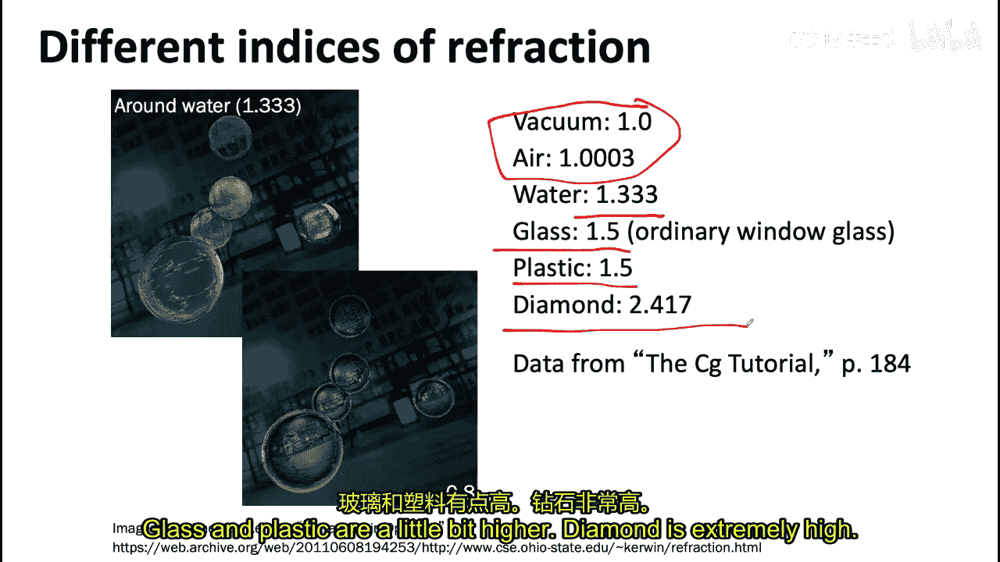

So let's take a look at the code the first piece of code I'm going to show you uses a per vertex approach for some of the calculations and we'll see this isn't very good so we'll very quickly move towards a per pixel approach but I wanted to show this to you first to make the point so we're going to give it a cube map。

We've previously seen textures as being listed as having a type 2D here。

 but these are cube maps so we say cube instead， here's a slider for the Aer ratio。For this shader。

 I created a cross fadeade slider that lets you cross fadeade between a pure reflection effect and a pure refraction effect。

The rest of this is the sort of stuff we've seen before。As usual。

 it's not sufficient to just declare these variables in the properties list。

 you also have to explicitly declare their types in the shader code itself， so instead of sampler 2D。

 this is now a sampler cube type。The information we're passing in for each vertex is just a position and a normal。

 I left out all of the 2D texture mapping stuff just to focus on the Q maps in this lecture。

 so in the vertex shader we're going to compute reflected and refracted vectors in the world space coordinates and then let the interpolation hardware interpolate those and then parcel those out to the individual pixel shader calculations。

So taking a look at the per vertex version of the code。

 the vertex shader has a lot of stuff we're used to seeing。

 we've seen over and over the transformation of vertex positions from object space into world space and then the continued transformation into clip space through the view and the projection transformations。

 this coordinate and clip space is used by the GPU hardware to figure out where pixels on the screen should go。

 regardless of whether or not we use that information and the pixel shader。

 we transform the vertex normals into worldspace and remember that transformation is a bit weird。

 you need the inverse transform of the upper left3 by three portion of your transformation matrix。

 which we facilitate here by using the world to object matrix provided by unity which is the inverse of the object to world matrix。

 and also using the trick where we're thinking about the normal。Vctor as a column vector。

 but by placing it first in the multiplication command。

 we wind up facilitating an effective multiplication by the transpose so all of that is code we've seen repeatedly in previous shaders that we looked at。

We're also going to compute a incident light vector that's pointing from where the camera is to the vertex。

This rolled space camera position variable is filled in for us by the Unity runtime if you're writing your own custom engine。

 you would need to have a piece of code on the CPU side that fills this in for the GPU。

And then we use the Ref and Refract command to find the reflected and refracted vectors in worldspace coordinates。

So we compute these reflected and refracted vectors per vertex。

 and then the GPU hardware is going to interpolate these vectors when deciding what to pass off to the various bits of hardware that are running the pixel shader code。

So the pixel shader itself doesn't need to do very much。

 it takes the reflected worldspace vector and looks that up on the cube mapap and then it takes the refracted worldspace vector and looks that up on the cube mapap and I've set it up here to linearly interpolate between those two colors it looks up depending on what this crossfade variable is so if it's all the way to one side will get a mirror if it's all the way to the other side it's translucicent and trying to look towards the other side By the fact that we are computing these vectors for each vertex and then just linearly interpolating between them that creates some problems with some clearly visible artifacts Before we try to build a per pixel version of the shader to deal with those artifacts。

 let's take a look at what these actually look like when the game's running and not just still frames because it's even more dramatically noticeable there。

So here I'm running the per vertex scene， all of the objects are using the same material so I can play with the parameters on just one of them。

 let's play with the crossfade first， so setting it to one we have entirely refracted light and if I set it to zero then we have entirely reflected light obviously when things are reflected changing the eight ratio doesn't change anything but if I switch back to being perfectly refracted light now we can change some things so here's a very small a ratioio。

Here's more of a medium editorial ratio。Notice that the objects here are pretty close to invisible it looks kind of like the predator invisibility effect from the predator movies。

 let's now make this really high Oh look at that that's just crazy okay。

 let me make it not so extreme。So the main thing to notice is that even if you don't pay any attention to this weird little。

Bar on the outside here where the calculations are freaking out。

 you can definitely see this weird gem like effect where things are sort of blinking in and out。

And you can really see this flicky effect。On this little lipoid that's going back and forth here。

Let's see if I can still see it if it's less extreme。So even here， you can see sea goes blink， blink。

 blink， blink， blink， blink， blink， blink， blink， blink。That's kind of a alias scene effect。

Blink blink blink blink， basically doing per vertex lighting。

 isn't giving us enough detail in those reflected and refracted coordinate transformations。

So the reflected's not quite so bad， but definitely the refracted is a mess。

 and I could set this to be something like 0。5 to be a combination of the fact。

 there's that blinking again， so pervertex is definitely not the way to go。

One thing I want to point out before we go on is that notice we didn't bother putting any normalized commands here。

 usually you can't expect that the interpolated normal created by the GPU hardware is going to have unit norm because the GPU doesn't know that's what we're wanting to do。

 so we have to normalize these vectors ourselves in the pixel shader。

 but here the tech cube command doesn't care if it has unit length or not。

 all it cares about is the direction。So before we look at the perpel code。

 I want to talk about an effect that I added to the perpixel code which I didn't bother to add to the per vertex code because the per vertex code wasn't performing very well anyway Now the equations that I'm showing you here for the Fnel effect aren't at all related to the actual physics this is a quick and dirty way of getting some ferl type effect that I pulled out of the CG tutorial。

 we'll look at some more precise ferl effect equations in a future lecture this is just to have something that's easy to implement the idea is that the amount of light you see from a translucent surface that's actually passing through the other side versus how much you see reflected depends on the viewing angle so if you walk up to a swimming pool but if you're some yards away and you're looking at it at a fairly shallow viewing angle you'll mostly see the sunlight reflecting。

The pool but if you walk up to the edge of the pool and look down。

 you'll see less of that reflection and more of what's actually inside the pool and so this is a quick and dirty way of getting that kind of effect remember that the incident vector for whatever historical reason is defined as being opposite of our usual I vector so I is pointing from the camera to the surface instead of the other way around I'm not going to bother slogging through all the details of the formula here bias scale and power are parameters you can use to adjust this effect but the net effect is that you get a reflection coefficient that's between zero and1 that you use to interpolate between the reflected and refracted colors and this formula is set up so that if the incident vector and the normal vector are lined up so you're looking at a surface square on you get strictly the refracted light but as you move away from that。

Seeing more and more of the reflected light。So let's take a look at our code here I've added three new parameters for the Fnel effect and I've also added a couple things we haven't used before I've added a toggle and a keyword Enum these are unity specific things but pretty much any engine in the same class as unity will have similar facilities in some way so toggle will actually create a littleeral checkmark box that will be filled with either zero or1 here it defaults to being unchecked and this is what I'm going to use to select a certain diagnostic mode that ignores all the cube lookups and just replaces them with the color blue and yellow。

This will give us a way to visualize the fl reflect coefficient calculation。

 and then I have the keyword enum that will let us switch between using the original crossfade I already used in the perveric shader and the fancier frel effect by setting it to crossfade it makes it easier to see what's happening with the reflections and the refraions versus the Frel mode that is going to mix them together when you have the Frel mode activated then it doesn't use this crossfade value at all enumeration here lets you select things from a drop down menu so that will let you label things。

So the way that you actually use these toggles and enums is by placing some pragmas into your shader code so the toggle is activated according to this shader feature line and then the multicompile thing will handle the dropdown menu that you have here and these names have to be hardcoded like this so here we have blue yellow with an underscore so we need a shader feature called blue underscore yellow it will want to see it match like that similarly for the multicompile you'll need to have a couple of things in all caps here that are this blend with the underscore here you don't use the underscore here I know that's confusing anyway you have blend here with underscore and then you concatenate it with underscore these various options and the dropdown menu again the letters here have to match for this to work。

This is a unity specific feature， but again， nearly every other engine at a similar level of sophistication as unity will have something like this。

So most of this is the same as what we've seen before。

 Of course I do need to add these declarations for the Fl parameters。

 the main thing that's different here is that instead of passing along the reflected and refracted vectors that were calculated in the vertex shader and sending that to the interpolation hardware。

 here I'm sending something more primitive earlier in the stage。

 I'm just sending the positions and the normals， because we're going to use that now to do the calculations in the pixel shader。

So as you should expect by this point， moving from a per vertex to per pixel approach results in the vertex shader becoming a lot simpler。

 we still have the geometric transformation for the positions of the vertices and we have the transformation of the normals。

 but everything else has moved out of this function， so all of this is fairly standard。

 this is more or less the kind of vertex shader we saw in the per pixel lighting approach to basic diffus shading。

So as expected， just as the vertex program became simpler when we moved to a per pixel approach。

 the fragment program became more complicated， but not in a complicated way。

 these lines where we compute the incident and reflected and refracted vectors in worldspace are exactly the same code we saw in the vertex shader in the per vertex version。

 we just cut and pasted that code， and then I do the lookups into the Q maps。

 this is code that was in the original pixel shader for the per vertex version of the code。

Here I compute that reflect factor with the equations from a couple of slides ago。

 again this is a hack from the CG tutorial we'll look at more elegant things in a later lecture。

And then here for the first time I'm using these check marks and these pulldown menus。

 if the blue yellow option is checked， then I just ignore whatever the Q mapap lookups are and replace those with yellow and blue。

And so if I have this checked， the refracted color is yellow and the reflected color is blue。

 so this is very useful for visualizing how this formula for the Ref factor works。

And here we implement the effect of the dropdown menu。

 so in those pragmas we stated that we had a blend crossfade and a blend Fl and then we use this defined set in these if then sort of metal language that is on top of HLSL one or the other of these will be quote unquote defined based on what the user selected and the unity inspector and it should emphasize all these parameters including these check marks and the dropdowns。

 these are things that you can change via the C sharpharp script so you can put in some pretty complicated behaviors if you want here we'll just have the user click on it and so here we're lurping between the reflected in the refracted colors based on either that primitive cross fadeade fader or that complicated fake fl effect reflection factor。

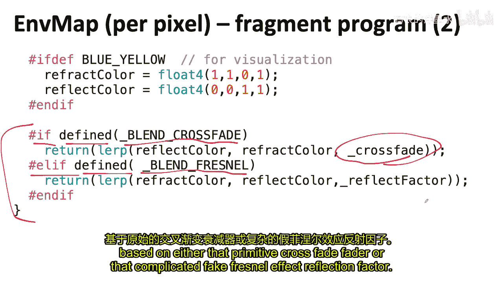

So let's see what these wind up looking like I'll show you the actual running demo in a moment but first I wanted to show you some still frames just to emphasize certain points so here's an illustration where we're using the crossfade slider and having it set all the way to refracted and here you can see the various effects and so it's a pretty complicated effect if you're wondering about this little band here。

 this is something that happens when you have a pretty big it ratioio and basically this is the point where the calculations are just breaking down entirely。

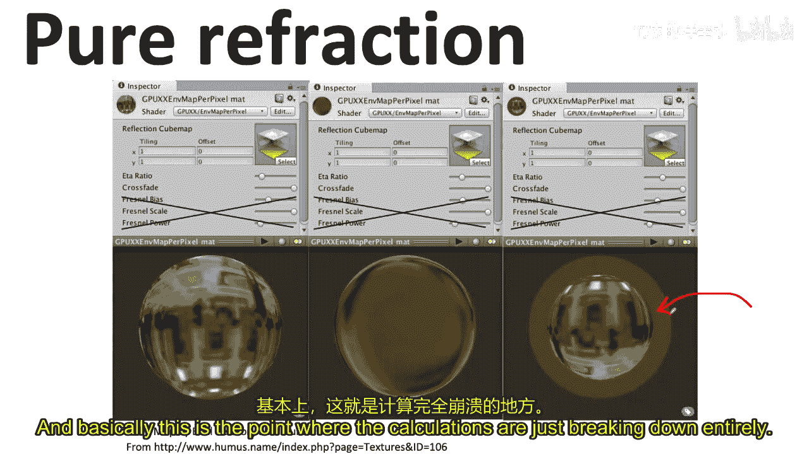

So here's what that scene looks like for a fairly low it ratio here's what it looks like at a medium it ratio and here now for a big it ratio it's essentially having this squishing effect so it looks like there is a person standing here and now you can see them in this little globe and again these are sections where the calculations just numerically break down Now here's an example of clicking that yellow blue option to visualize the fnel effect so on the left here we have a combination of seeing reflections and refras which is visually very intriguing but it's kind of hard to play around with these sliders and get a handle on what's actually happening here we have this blue and yellow business going on So you see blue that's pretty much pure reflection in case you see yellow is pure refraction and when you have a bit of each those will blend and become gray so you can。

Play around with these sliders and get a much better sense about what that formula is doing。

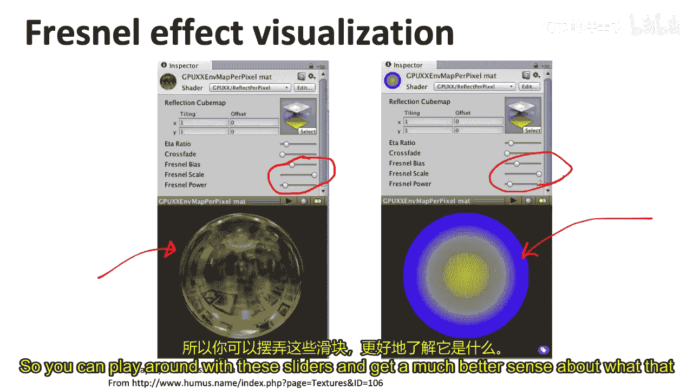

So here we do have a combination of reflected and refracted light。

 but by putting in this visualization mode， it's a lot easier to see what it's actually doing this particular face here that's going to be mostly refracted。

 but this face here on the cube is mostly reflected。So I've loaded up the per pixel scene。

 Let's turn the cross fadeade all the way down to get a pure mirror effect。

I need to switch the B mode to crossfade。So here I have a pure mirror effect。

And now let's switch it back to having a pure refracted effect。

Let's change the it ratio to something relatively small， okay， that's fine。

 let's make it something big。Ah， so notice that we still have this weird part where the calculations are breaking down。

 but you now don't have that weird blinky gem like effect near the edges。

Let's make this a little less extreme， something like that。You don't see the blink， blink， blink。

 blink， temporal aliasing kind of facts we saw with the per vertex version。

Let's switch this back to using the Frenel effect。So I have a variety of things I can change here。

What does Fll biasas do？So， that does something。Here's the scale。Here's a scale of 0。2， scale of 0。9。

 here's 0。5， what about the power？So there's 0。1， what if about a power of 10？Okay。

 so I really have no idea what these parameters do， so let's click on this blue yellow。

 so now I can really look at the effects of these parameters directly。

So here it looks like it's mostly gray， so we've got a pretty even mix of both。

What about the scale here？Ah， there we go。So putting the power above one just blows everything out。

Here's 0。3， 0。1 ah。This is the kind of thing you can get with a specular spot。

 but it's not it looks kind of like a specular spot， but it's not。

 it's this sense of what we're seeing through the object and what's the reflective part of the object。

 sort of changing how that transition works。I'm just playing with the scale parameter。嗯。

I think that's been maxed out or something at some point。What about this bias parameter， oh。

 that's fine？You can play around with these different parameters and see how they affect this transition from seeing through the object。

To just seeing reflections。Notice in the cross fade mode， this settings is useless。

 you have to have it in the Frel mode。Go back to regulargler。

There's one more interesting effect that I'm going to have you do as a homework assignment and that's to implement chromatic dispersion Basically we're going to give red。

 green and blue different indices of refraction and this is what happens in materials that give you a prismatic effect so this lets you build prisms Now if you wanted to be super accurate about this you would want to actually split the color band into a wider set of colors and maybe give something like orange or purple the own index of refraction but nobody actually does that that's getting a little overly detailed here at least nobody does that for a real-time rendering there are offline renderers that do highly detailed spectral calculations。

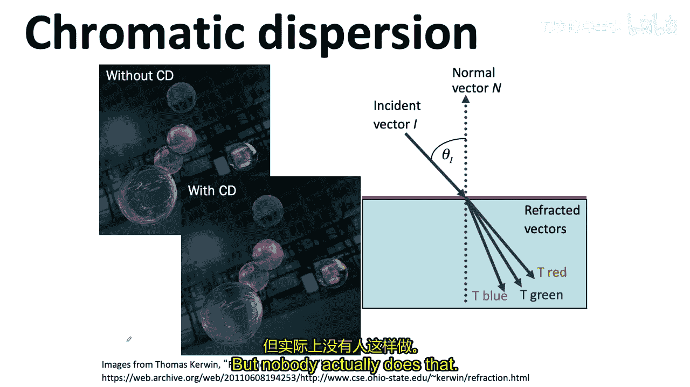

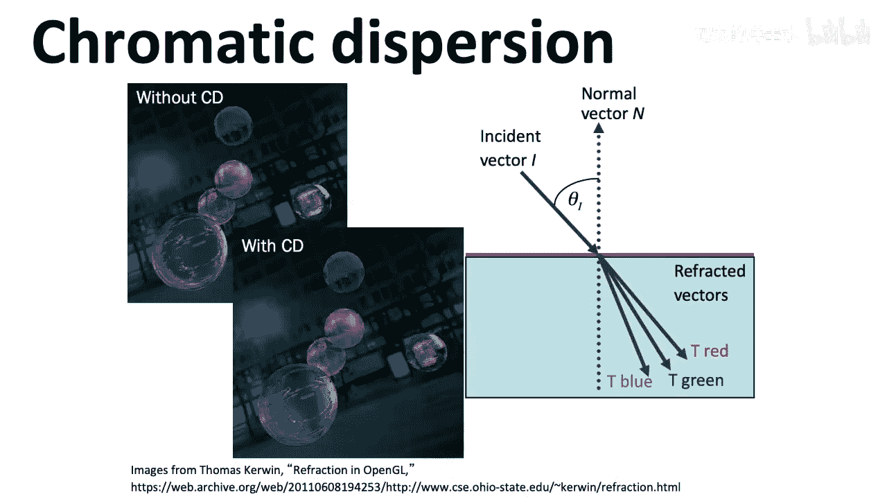