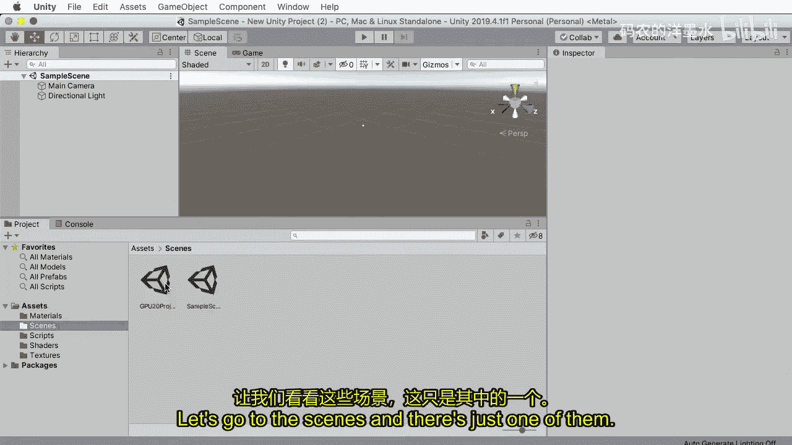
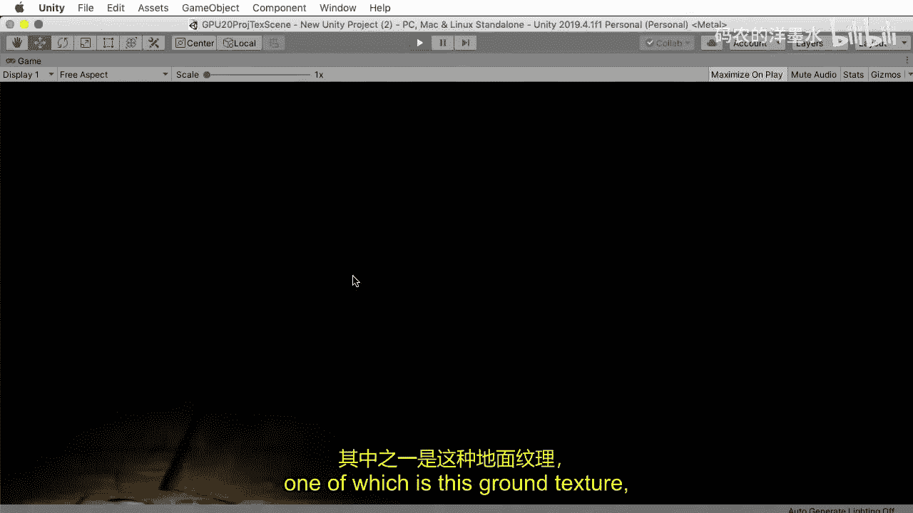
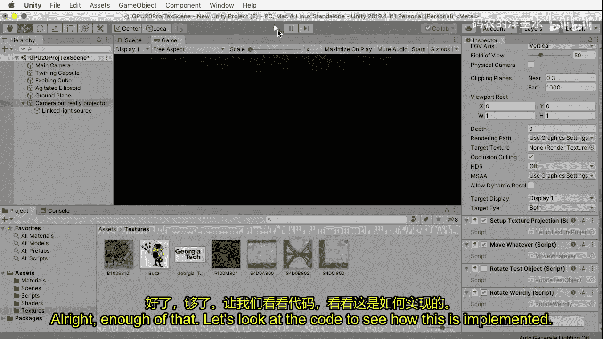
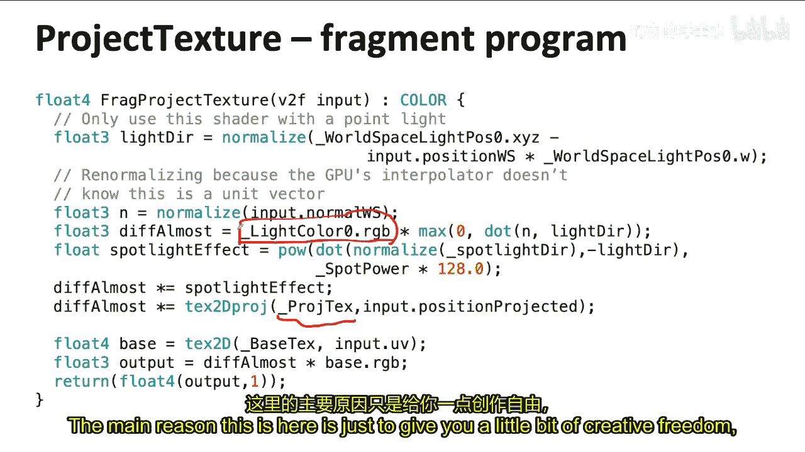
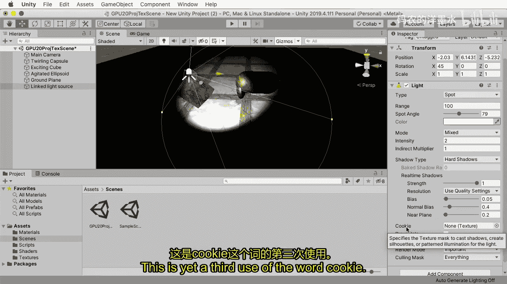

# 【全集】佐治亚理工学院-GPU编程：视频与游戏-中英字幕-p28-Lecture-28---投影纹理--BV1GZfyBbEQn_p28-

Hi there。 My name is Aaron Lanchman。 I'm a professor of electricallect and computer engineering at Georgia Tech。

 and this is the summer 2020 offering of GPU programming for video games。

 We've looked at two dimensional textures that we wrapped around objects and threedial textures。

 namely cube maps that let us fake reflection and refraction effects。 In this lecture。

 we're going to return to looking at twodial textures。

 but we're going to use them in a very different way。

 basically imagining putting them in a slide projector and projecting them onto the various other objects in the scene。

 These particular examples are from a course at Stanford。

Here's another example of these projective texture effects。

 notice there is a bit of a glitch and that the creepy toothy smile appears both on the teapot and the table and the next lecture will look at how we can incorporate shadowing effects to prevent that issue。

So the way we formulate this is basically to set up the same set of matrix transformations we would when taking 3D objects in the scene and projecting them onto a camera plane。

 except here， we're using the light position and orientation instead of the camera's position and orientation。

 as if the light itself was a camera。 So we still have the same transformation from model coordinates into world space。

 and then we transform it into view space。 but this view space is from the point of view of the projecting light and not the camera。

 Similarly， we will go through a projection matrix。 again。

 from the point of view of the light source and not the camera。

There's one other thing we need to do here， which is to shift everything from a minus1 to1 coordinate system to a0 to one coordinate system because that's what texture lookups expect We're using STR and Q in place of X Yzw in order to avoid confusing what we're doing here with the X。

 Yzw we use for camera coordinates By the fact that we have this projection you can imagine there is going to be a perspective divide in here instead of a divide by W it's a divide by Q and that's how we get this projected texture effect This time before we dig into the code。

 let's actually look at a demo and unity。I have started a blank Unity 2019。4 project。

 this Unity package also works in the 2020。1 beta， so I'll drag GPU 20 Pra tech shaders over to the assets folder。

Let's import everything if you're trying this out in a different version of unity。

 you'll probably have to make a few adjustments to the code。

Let's go to the scenes and there's just one of them。

And you can see that I have a buzz icon being projected。

 Its kind of wiggling back and forth and up and down a little bit。 I have four objects in the scene。

 one of which is this ground texture。 and I have a few objects that are spinning around and waving back and forth。

So each of the objects in here has its own texture。They're all sharing the projected buzz texture。

 but each has its own individual base texture that you can change around。For instance。

 if I were to take the texture off of this twirline capsule and replace it with this boring gray checker map。

 it would turn boring， let's undo that and also each of these has to have the buzz texture associated with it as the projected texture so here you can see there's a little bit of buzz's eye and a little bit of that grin on this twirling capsule。

 if I replace that with something else well now you're not seeing the buzz properly projected let me undo that。

Now you can see the bit of the buzz there， similarly， let's look at the ground plane。

I can replace that buzz with a blank white texture。

 and now you'll see the buzz on the various animated objects。There we go。

 so you can see the buzz here on the animated objects。

 but not the ground to make it a little easier to see what's going on here。

 let me put buzz back and I'm going to change the spotlight effect。

So here we have a very tight spotlight。And I can broaden this out and make it a very wide spotlight。

Now you can more easily see what's going on One thing to notice， though。

 is that it doesn't quite look right now as far as the moving objects go because each of these textures has its own spotlightiness parameter。

So let me change that for everything， dragging that down the exciting cube I'll need to change that too twiring capsule let me drag that down now my various moving turning objects here have the correct look that matches the ground here Now in practice you wouldn't want to have to go change this spotlightiness parameter for every single material here you would probably script that in some fashion。

If I just wanted to see what the diffus textures look like without the projected light。

 so I'm just seeing the spotlight effect， I could go into all of these materials and let's use this one。

Think this one is pure white， so notice I'm going in here manually。

And changing everything to show just a white texture So now I see the spotlight effect。

 but without the projected buzz。Let me put all those buzzes back。So I'm undoing。There we go。Okay。

 so that's a bunch of buzzes。One thing to note that's a little strange is you'll see these little black lines coming out of Buzz's foot and out of the top of his head。

 that's because I was kind of sloppy when I picked this image。

I have the texture in import mode set to take whatever is on the edge and just take that line on the edge and extend that line out。

 so let's go take a look at that。So if I go over to my textures。

 here's my Georgia Tech imported character， I have the rap mode set to clamp so that does this business of taking the edges of the texture and repeating it forever。

 so you'll see the antenna and the foot and it's hard to see here but a little bit of the wing is actually on that last pixel edge。

Really， you would want to use this with a texture that has empty edges that has an empty line of pixels along each edge。

Here's a fun thing， let me take the clamp and switch it to repeatat mode。

So now it's tiling the texture and I have an infinite number of buzzes going either direction。

 that's a little trippy。Let's see what did these others do， here's a mirror mode。oh。

 so this is repeating， but I guess it flips it around。Mira once。Oh， now I've have four buzzes。

That are flipped around each way， what's per axis do？Oh。

 this is interesting so I can decide what I want to do along the different axes。

 so I could say clamp along one direction。But then repeat along another direction。

 ah so now I have this big column of buzzes。I had't seen that before。That's kind of neat。

 Let's change this back to clamp。 now I have a row of buzzes。And just for a second。

 can we talk about how amazing it is that we can change the parameters on a texture import and have that reflected at the moment while the game is still running that's really cool Something else fun we can do here is click over to the scene view。

I love the fact that you can do this while the game is running。

That's really neat ah and here you can see what's going on a little bit。What is happening here？

So I do have my main camera。It's way out， wait， where are your main camera， a here's the main camera。

And we could if we wanted to zoom that around a bit。鸟鸟。Let's zoom it up and down。And by Zoom。

 I don't mean camera Zoom， I mean Zoom as in very quickly make it go back and forth like Zoom， zm。

 zoom， zm， zoom。We could actually make it zoom by changing the field of view。

 so here we're going way out， here we're going way to the middle you can see down here in the camera preview。

Wop， that's way， that's way too far， that's way too far in， a necessary zoom， a necessary zoom， okay？

Let's zoom way out， okay， let's just undo all of that。Okay， I had it set to 45 degrees to be in with。

So what's going on here with this little guy？Catch him as he。

Ah there I did I was able to click on himmos moving Oh and look the little axes。

Now that that's selected， you can see the axes spin around with it。

So I have this game object called camera but really projector so this does have a camera component attached to it just like the regular camera has a camera component attached to it。

 but this camera is not being used as a camera this camera is being used as a basis for the projected effect because as we'll see in a second in order to get this projection effect we're going to use a camera class and snaf a bunch of matrices that are normally associated with the view transformation because those are the same kind of matrices that we need when doing this projection effect Oh something freaky I just noticed notice when I have the main camera selected here my little camera preview has what we see before but if I click on。

This camera。That when we're playing， the game is not actually used as the camera。Now we're seeing。

Things from the point of view of this object， if we actually were using it as a camera。

 so that's why the buzz stays in the middle here， that's kind of neat， it's a little bit confusing。

 but it's neat。I love the fact that you can see the affecting field of view of this camera that we're not using as a camera。

 that's kind of fun too。Let's see if I want to I could turn off the rotate weirdly script。

 so now it's just moving back and forth， let me turn off the move whatever script。

 so now if I go back to the game view，We're seeing the objects still rotate and move around or whatever。

 but the buzz is now holding still。Here's what it looks like if we just have the rotate weirdly script running on its own。

And let me turn on the move， whatever script， and now you see it going back and forth。All right。

 enough of that， let's look at the code to see how this is implemented。

So here's the code。 We're using the forward add light mode here。 Not the forward base。 Remember。

 forward base is something we needed to include to employ a directional light。 here。

 the projector for me， the light source needs to be a point light for this to make sense。

 In addition to the usual RGB based texture for the object。

 I've also created a spot here for the texture that were going to project Now。

 in the demo I just did， if I wanted to change this。

 I had to go through every material in the scene and set it。 In general。

 you would want to do something like this from script。

 just as you would probably want to take all the objects in the scene and set their spotlightiness。

 Yeah， I made up a word。 My wife gets to make up words because she has a masters in applied linguistics。

 so I can ask her to approve that for me。 Anyway， this is also probably something you would want to write a script for。

 So you could set this property and a bunch of materials at once。

 You also have to declare them in the shader code itself。

We also have to declare that spot power as a float Now I'm also declaring a couple of variables here my projector matrix VP this is the view and projection matrix for the light and the direction of the spotlight These are things that we're going to have to set ourselves from the CPU side I'm going to show you a C sharp script for setting these variables。

This is the sort of thing that if we wrote our own engine。

 we would have to do for all of the various matrix transformations and lighting data we've seen before。

 we've relied on the unity runtime to fill those in for us， but these we will have to do ourselves。

As far as our structures go， there's nothing too exciting here， we have positions。

 normals and UV coordinates for each of the vertices and object space。

 since we're doing per pixelix lighting here， we'll compute the world space positions and normals in the vertex shader and pass this along through the interpolation hardware to the various compute units handling the pixel shader code。

The main UV texture for the surface of the object itself will' just pass that along。

 The new thing we're passing along here is this position projected field let's see what that looks like。

 This section of the vertex shader is exactly what we've seen in previous bits of code we take the object space position and convert that into world coordinates and then we go through the view and perspective transformations to put them into clip space We won't be explicitly using this SV component and our shader code but it's used by the hardware and the GPU to figure out where on the screen the pixel should go during the rasterization process but we will need to pass along the position and world space the transformation of the normal in worldspace is as we've seen before we're using world2 object because it's the inverse of the object to world matrix and then we're using the strange business with multiply where we're thinking about the normal vector as a column vector but by putting it first in the argument to the mu command。

That affects a transpose operation， so that's how we get the weird inverse transpose that we need in order to transform normal vectors。

Now we are going to need something new here， so we'll need to take the positions of the vertices in worldspace and apply a viewing transformation and a projection transformation to it。

 but not the view and projection transformation associated with the camera we need to do it in terms of the light source so that's what this line does and again we'll need to set up this variable ourselves in a C sharpp script we'll do the usual transform underscore tech magic so that the U coordinates we pass through will be subject to any offset and scalings that we might set in the inspector so the first part of the pixel shader looks very much like what we've had before we compute the light direction we normalize the worldspace vector and then we take the dot product of these vectors here we're doing this in the world space but you could also do the lighting in the view space or even if you're very clever in the original object space as long as you're。

consistent we multiply the result of that diffuse lighting calculation by the light color as I've mentioned before。

 I found this light color variable while pursuing various bits of unity shader code It doesn't actually declare it in the main unity C Cgi and include file so I suspect that might go away in the future and we'll have to replace it with something else。

 One thing that might seem a little strange is that I've included this worldspace light position0w business here remember this W coordinate is04 directional light in which case underscore worldspace light position0 xyz holds a direction vector of that light and if this is instead a1 that indicates it's a point light so we can subtract the light position by the position of the vertex to actually get the direction vector there Now in this case we've already said that this only works for a point light so you could take this out as an optimization I decided to leave it in just to maintain consistency with the code we've seen。

So here is where we'll compute a factor for the spotlight effect namely we'll take the spotlight direction vector that's being set on the unity CPUC sharp side let's normalize it here just for safety's sake Now remember the light direction vector is pointing from the vertex to the light here this direction is pointing out of the light so I'll put a minus sign here so there's no vector pointing from the light to the vertex on the object and then we dot product that to get something that falls off as that angle increases to get a nice spotlight effect and then what we'll do is we'll take that to some power and by changing the power we can change the size of the spot I set up the spotlight power slider to go between some small number and one and as I was experimenting I found that putting a factor of 128 here basically essentially changing this power between。

some small number and 128 seem to give me a nice range of possible spotlights there's no particular reason I had to put a power of two here。

 I could have put 127 or 129 but I don't know just my programmer So said put a power of two there there's no reason why it needed to be。

So I started with a defaultalmost that had the light color and this diffuse lighting calculation。

 I'm now going to multiply it by the result of this spotlight effect calculation and the final thing I want to do here is multiply it by this projected texture Now the way you handle this is using a new version of tech2 d that's tech2 d PRj that's what does the projection。

 and instead of giving this a twodimenional UV coordinate。

 you give it a fourdimenional vector that represents this Srq coordinate space that's like xyzw but it's relative to the light source and not your usual camera and this tech2 d prodge command handles that divide by Q to have the slidehow effect of the texture being projected across the surface。

 So remember that this4D vector is being passed to the compute units handling the pixel shader code from the output of the vertex shader through the。

hardwareAnd then the final thing we'll do here is multiply that result with what we get out of our usual base texture lookup that we've seen since the first lecture on using textures in HLSL。

As usual， I've put in a one here for the alpha coordinateant just to keep things simple。

 if you're using the alpha coordinateant for some special effect。

 you would want to treat this more carefully。So now we're going to see something new。

 this is a C sharpp script to define a component that will attach to a camera object。

 but this camera object we attach it to is not the main camera。

 it's sort of a fake camera we're using for the spotlight effect。I've set this。

 execute and edit mode directive that tells Unity to run this while we're in the Unity editor and not just in the game。

 so if I move things around， if I change parameters。

 the various things needed to handle this texture projection effect will also update properly。

I've declared three private variables here， actually come to think of it。

 I don't think you have to explicitly declare these private if you just leave this out I think they default to private two of these are four by four matrices and one of them is a variable to have a camera type so the script can grab information from the camera component of the game object that the script is attached to these start routine is unsurprisingly run when you start your game and these first couple of lines here are designed to set up that matrix of one/hals that we saw at the beginning of the lecture。

So this script defines a component that we're going to attach to a game object。

 and then the script can use this git component command with this camera type to go ask the game object that it's part of。

 hey， look for a camera components that are attached to you and give me the first camera component that you see。

So once we have that my camera component cached， we can go ask it what's the projection matrix that you're using and what's the world to camera matrix。

 that's the world to view space transformation and these are things that a camera component computes on its own we've benefited from unity doing this behind the scenes。

 but now we're accessing it explicitly， so the transformation matrix that we're sending in to handle the texture projection consists of this transformation from the world to view space from the point of view of the light source again its not a real camera and the projection matrix again from the point of view of the light source and this matrix of onehals that we compute it up here so that any accordance going from minus1 to one eclipse space are now zero to one as we would want them to be to handle texture lookups。

And now I'm going to engage in some bad programming practice。

 We need to set these variables in our HLSO code。 remember we've declared these variables in the HLSO code but they're not declared on the C sharpp side they don't exist on the C sharpp side So here we're forced to refer to them by strings and then in C sharpharp land specify what we want to set these to Now the commands I'm using here really are quite brute force the shader class has some static methods and remember static methods and object oriented parlance are methods that belong to the entire class and not specific instances of that class In this case。

 what set global matrix and set global vector do for the respective types of matrix and vector is that they go through every single material and each time they find a shader that has a variable with the name given here。

In these quotes， sets those variables to whatever we're setting here。

 but it does that for every single material， so this wouldn't work if you wanted to have multiple spotlights。

 you would have to do something more sophisticated。

Also I should mention that looking up things by strings and unity is extremely time consuming that eats up a surprising amount of cycles There are things you can do to cache things and speed this up basically internally。

 I think everything in unity is given a hash and there's a way to then refer to things according to that hash that can speed things up。

 but this is fine for quick and dirty demo code。There's one interesting effect that can crop up that sometimes you have to watch out for。

 which is that the underlying projection math doesn't care which direction you're going so you can have these weird mirrored projections that you might have to be careful about。

So projecting textures is a neat effect has lots of uses。

 but I think the most common use actually is as the core of implementing shadow maps which are a method of handling shadow effects。

 that's something we'll look at in the next lecture。

Something I just thought about is that it might look a little odd for me to be including the light color as setting the inspector for the light。

 when if you think about it， the light is actually defined by the texture that's changing over the course of the underlying image。

The main reason this is here is just to give you a little bit of creative freedom。

 you can tint the projected texture in various ways。

So for instance， I might want buzz to look a little more on the red side。

Or perhaps the purple side or the blue side or the green side。

Maybe I don't want to be so drastic with that green tent， so I'll turn that over here。

That's kind of fun。Okay， enough of that。Before we close out。

 I should let you know that unity does have spotlights built into it。

 along with the ability for those spotlights to project textures。

 Unity implements these in a way that's different than what I've described here。

 The reason I created the code I showed you today is because it's relatively easy to understand。

 and it's fairly general。In order to explain how Unity does things。

 I would have to spend a lot more time digging into a lot of unity specific details。

 which I don't really want to do here， but you can explore that on your own if you want by looking through the Unity Shader source code。

Just for completeness， I would like to show you how unities built in spotlights work。

 so I'm going to take the light that was in this camera but really projector game object。

Move it up to the top level， delete that camera， but really projector object So interestingly。

 even though I've removed the game object that contained the component that was setting the various variables for the lighting effect for the projective texture effect。

 the thing is still running， the thing to note though is that if I take this light and move it。

 the projected texture is staying the same because that script isn't there anymore to update it。

What I'm going to do is take all of the various objects I have in my scene here and switch them all over to using Unities built in standard shader。

It wants me to put in a new map here。Have to redo that manually。Okay， we'll redo that manually。

Let's see what texture was I using for this one， I think it was that one。Let's see the ground plane。

ItUs this texture， let's switch it over to standard。And it was using this texture。

Although it was tiled differently， I forget what the actual tiing was。All right。

 so I think everybody here has a texture now。Using unities built in physically based shader。

And we can take the light。And switch it over to spotlight mode。Okay。

 change the spot angle wide in it out。ItHas a fairly aggressive fall off。We can， of course。

 change the color of the light。Let me undo that。So there's a lot of complicated stuff you can set here。

So unity calls the texture that you might want to project a cookie。

 this is not the cookies that you eat and this is also not the cookies that track you in your web browser。

 this is yet a third use of the word cookie。

