# 【全集】佐治亚理工学院-GPU编程：视频与游戏-中英字幕-p29-Lecture-29---阴影映射--BV1GZfyBbEQn_p29-

Hi there。 My name's Er Lanterman， I'm a professor of electrical and computer engineering at Georgia Tech and when I first taught this class in 2007 with my colleague Sean Lee。

 the game bioshock had just come out and I pulled out this particular promo shot that's particularly dramatic you're round the corner and you see a woman cooing to what you think might be some sort of baby in this carriage with this dramatic shadow on the wall and come to think of it the screenshot must have been rigged up particularly for some promo because in the game you don't actually have a gun yet。

 the gun is actually in the baby carriage and you find that after the woman attacks you anyway it's a really cool shot and in this lecture we're going to talk about how such effects are achieved in modern games。

In a previous lecture， I briefly mentioned shadow volumes as one possible technique for implementing real time shadows in a rasterization framework。

 This was used in the Doom 3 engine， but hasn't really maintained a lot of popularity since then。

 mostly， I think， because it requires a lot of processing on the CPU side。

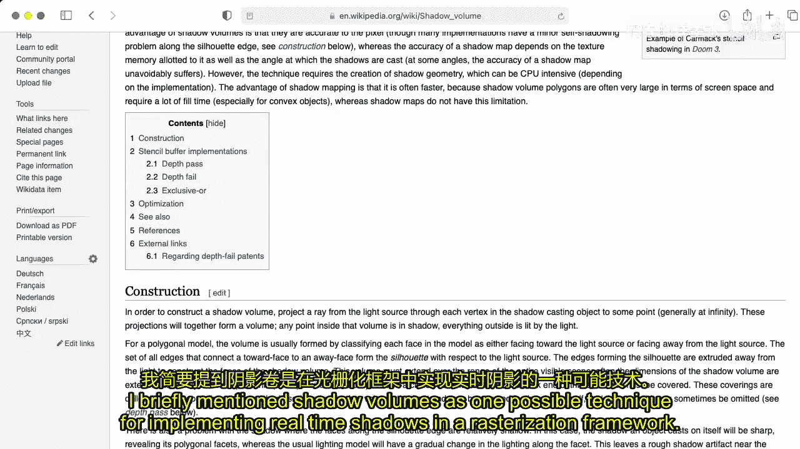

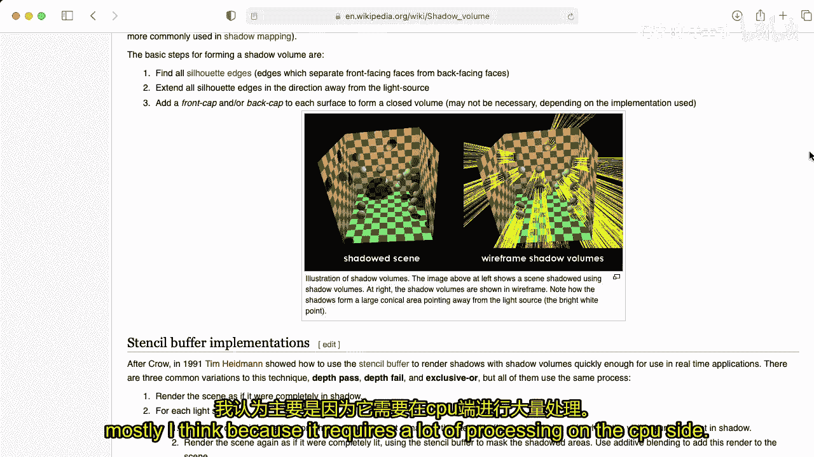

The technique of shadow mapping has become a lot more popular。

I'm hoping that GPU support for a realtime ray tracing eventually reaches the point where it replaces rasterization。

 because if you're using ray tracing， shadows are kind of handled automatically。

 but for now rasterization rules the roost， so we have to use clever hacks like shadow mapping。

In this lecture， I'll describe shadow mapping in general and in the next lecture。

 I'll talk about shadows in the unity game engine in particular。 So for the rest of this lecture。

 I'm going to describe things using the set of slides from Nvidia by Cass Everett。

 So this is the first time where we've looked at an algorithm for resturization that requires more than one pass。

 You first render the scene from the point of view of the light as if the light was the camera。 Now。

 this isn't something you ever actually show to the user。 This isn't part of the final scene。

 It's a temporary stage you use in drawing that final scene。

 So the general idea here is that when I say we render the scene。

 we're not actually trying to compute colors for the particular pixels。

 All we're doing is we're writing downze bufferffer values。So in the second pass。

 you go ahead and render the actual scene from the point of view of the camera。

 but while you're doing that， you compute the position of the particular point that you're trying to render relative to the light and then what you do is you take the Z position relative to the light as you're rendering it and compare that to the Z value that's actually already stored in that depth map。

Now， if the Z position relative to the light of the point you are trying to draw is bigger than the z value that you find in the shadow map。

 it means that when that shadow map was being drawn。

 there's something closer to the light then the pixel you're now thinking about drawing and then that pixel must be in shadow。

 but if those values are about the same and I'll talk about the about the part of about the same a little more in a little bit。

 then you can assume there's nothing blocking the light and you go ahead and paint that pixel。

So that was a lot of words， and at this point the algorithm probably doesn't make a lot of sense to you。

 and honestly if I listened to the words that I just said it wouldn't make a lot of sense to me either。

 it makes a lot more sense if you see it in the form of a diagram。

Here's an example where we have the object in shadow。

 So the idea here is that here we have the camera over here on the right and we have the light source and the upper left。

 and so we're going to render the scene and compute the depth to various objects in the scene and here the blue arrow is representing the depth to this blue object here and we store that distance in the Z buffer。

 Cass everett is drawing the arrows a little bit offset to avoid cluttering up certain portions of the diagram。

 but anyway， we have this blue object here that's pretty close to the light and that information will be indicated in the Z buffer。

Now， when we go to actually render the scene， if we're imagining trying to draw this green object here。

 whatever this particular pixel would be representing， Well。

 we would compute the distance from this point to the light and notice that it's a lot bigger than what we would see in the depth buffer if we take whatever is in the depth buffer and find the appropriate point。

This is actually a primary use of projective textures and the main reason I actually wanted to discuss them in the previous lecture。

Anyway， we will then realize that this blue object here， whatever it was， will mask the light source。

 going to the screen object， and we declare it to be in shadow。 Now。

 let's compare that to the case where there isn't anything between the light and the object that we're drawing。

 In this case， when we first draw the scene from the point of view of the light。

 and we store the death information into that shadow map。

Then we would have a bigger number in that shadow map indicating that distance and now when we draw the scene from the point of view of the camera and we compute the value between that green point and I mean green in terms of how it's specified on the diagram I don't mean that the actual pixel is the color green。

We see that the distance there is the same as the distance that's stored in the buffer we conclude that there's nothing blocking the light and the object and we go ahead and do the lighting calculation for that object At least that's the theory In practice there are some issues your shadow map and the actual frame buffer that you're eventually going to show the player may be at different resolutions and this can sometimes result in your shadows having some blocky artifacts we'll see examples of those a little bit later the shadow volumes technique that I briefly mentioned avoids these kinds of artifacts and gives you pixel perfect shadows but a modern hardware shadow volumes are typically a lot more expensive than shadow mapping。

 largely because the GPU has a lot of support for shadow mapping。

The other problem you can run into is that the Z buffer has limited resolution and the depth information is usually stored in some sort of complicated nonlinearar mapping。

 so you need to think about your test as being not one of absolute equality but one that includes a certain tolerance and you usually wind up having to add some bias factors in to avoid certain problems that we'll talk about a little bit later。

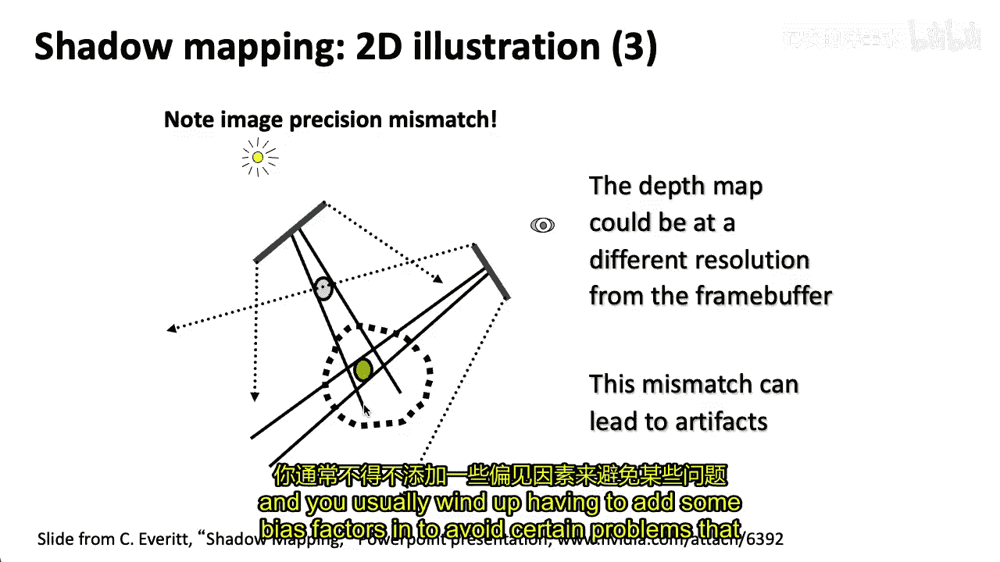

Here's an example of a scene with a single point light marked in the upper left corner。

 You can see that there's shadows created by these balls floating in space， and to a certain extent。

 the balls will shadow each other。 The shadowed areas aren't entirely black。

 So that tells me they using a little bit of an ad hoc general ambient light term where basically every pixel has a little bit of constant light added to it to generically represent light that is overall bouncing around in a scene。

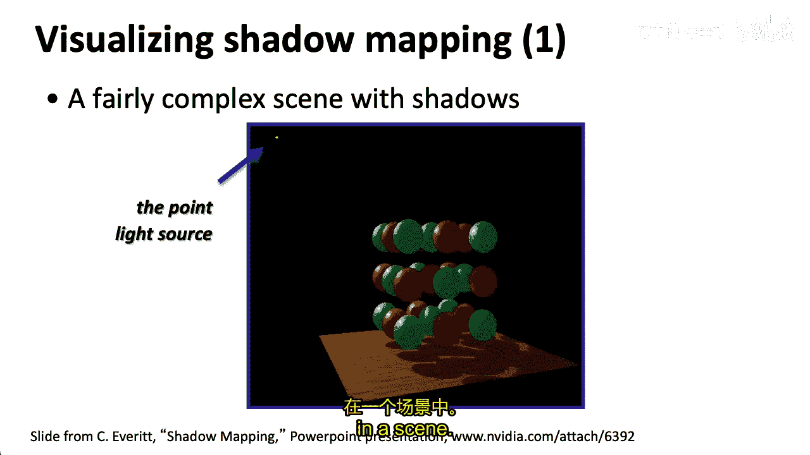

Let's repeat the image here on the left。 And now on the right。

 you can see what the image would look like without any shadows。

You can see the specular reflection here in the ball on the lower right that you don't see on the left because of the shadowing。

 the specular reflection is something arising from this light。

 We haven't really talked about specular lighting yet， but we will in a couple of lectures。

And of curiosity， let's see what the scene would look like from the point of view of the light。

 We can see that here on the left。 On the right， we see it from the original point of view of the actual camera。

 Now， this is not something that the actual shadow mapping algorithm ever actually computes。

 This is just something that is being shown here to give you some perspective。

 The thing that is actually computed by the shadow mapping algorithm on the first pass。

 It is something like this where the darker values are objects that are closer to the light。

 and lighter values represent objects that are further away and white represents pixels that aren't being written to at all。

 So to help visualize this further。 let's imagine taking thisze buffer image from the point of view of the light and projecting it。

 on the image from the point of view of the camera。 It would look a little something like this。😊。

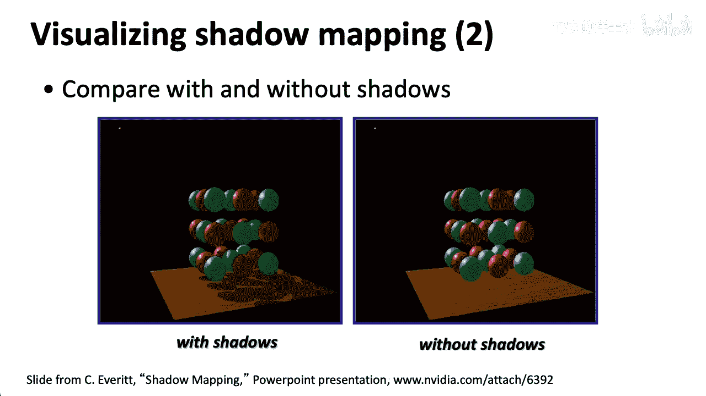

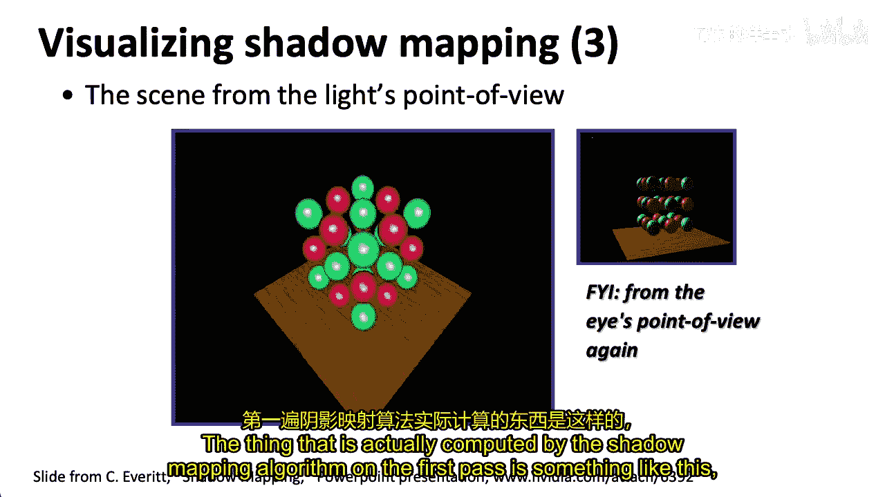

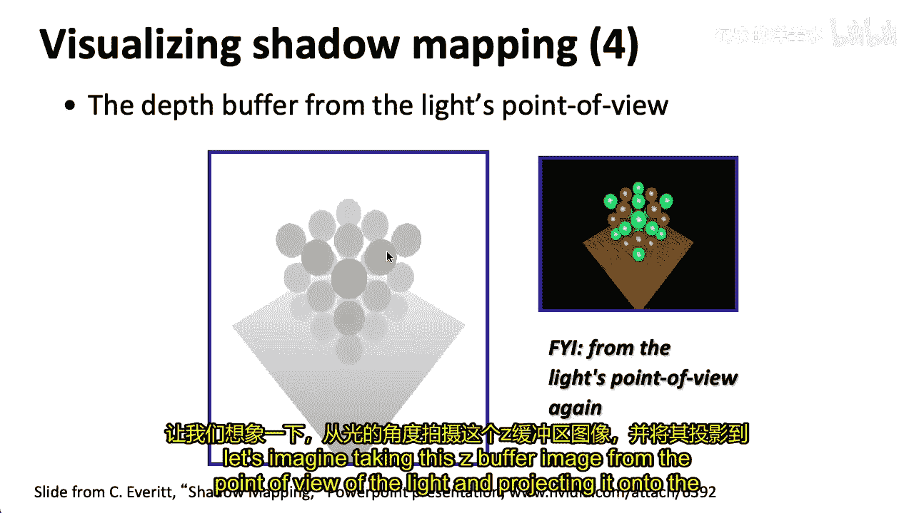

We can facilitate this using the two dimensional projective texture capabilities of the GPU that we looked at in the last lecture in the context of something like a slide projector effect out here。

 there's a situation where there's nothing really in the way， but down here。

 notice this dark circle here。 That sort of corresponds to the fact that there's this object here。

 this particular sphere。 that's between the light and this particular part of the plane。

So we're going to make another image that indicates the distance between the light and the point of that image as seen from the point of view of the camera。

 and that looks a little something like this， so the name of the game is going to be comparing this kind of image and the values in it to this kind of image and the values in it and that gives us something like this so the places in green are where those values more or less match and the places that aren't green are places where they don't and that's where you're going to wind up with shadows。

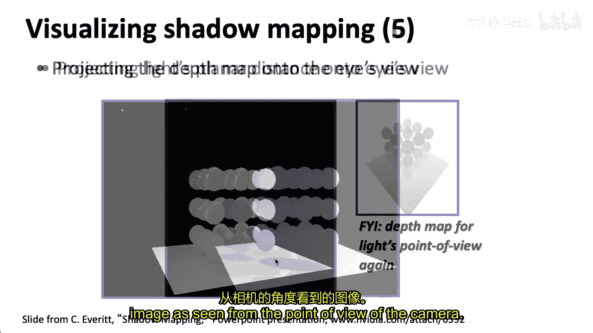

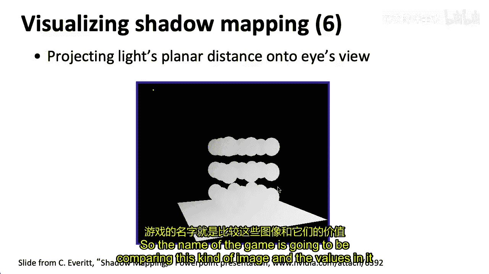

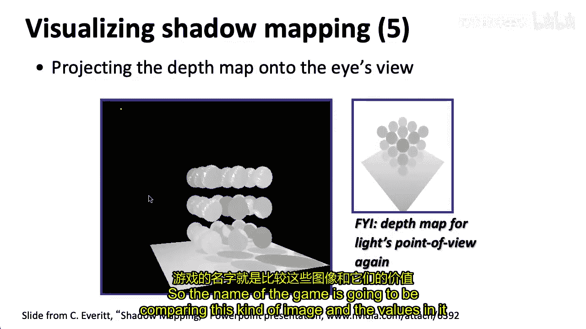

The grayscale values here indicate the degree of difference， so in the places that are black。

 it's been deemed that there is enough difference that they don't match but there's not a big difference。

 whereas down here in this bright white area， that's a place where this area and this area are indeed very different in value。

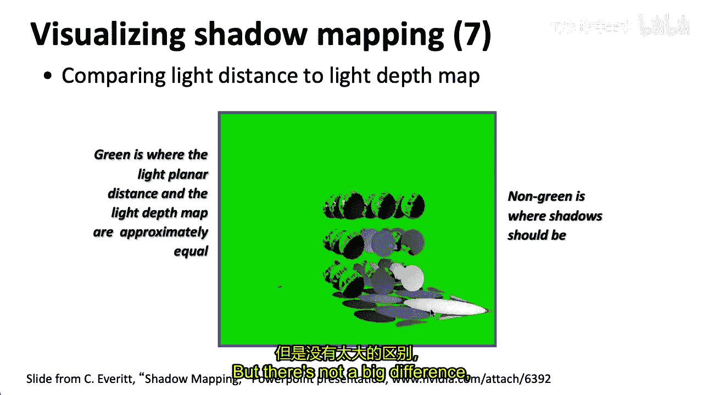

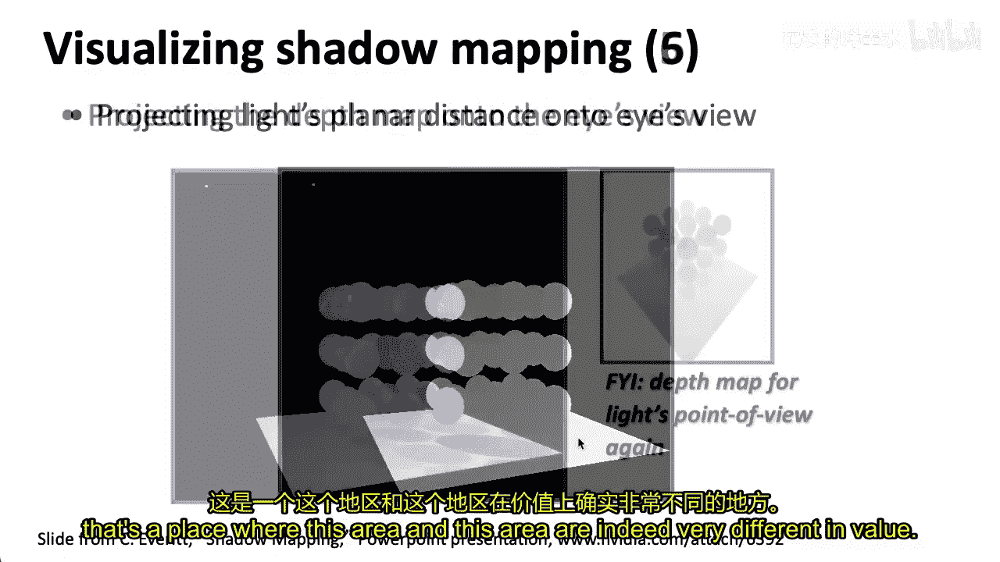

With this knowledge of which pixels are in shadow， we can create an image that looks something like this。

 But this image is actually the result of tweaking some fudge factors。

 If you try to do a direct comparison of values for each pixel。 you wind up with an effect。

 something like in the upper left， this effect is called shadow actingne。

 And it's basically where a pixel is considered to shadow itself。

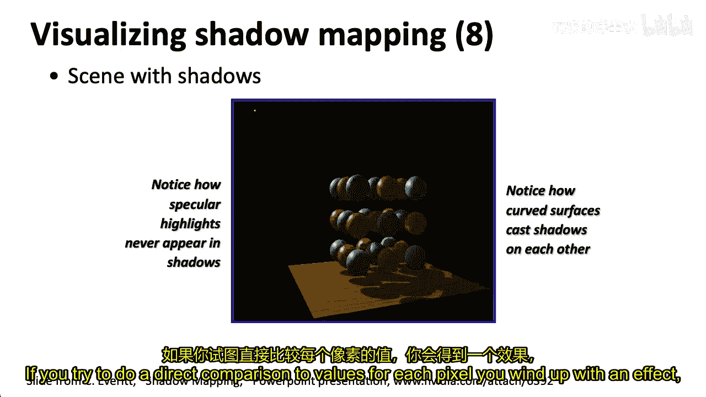

So the usual approach is to introduce some bias into that comparison， you introduce an offset。

But if you introduce too much， well， then there's some things that should be in shadow that aren't in shadow。

 And you need to tweak that to get it just right。 Shadow maps can sometimes give your shadows a blocky appearance。

 especially for places in the scene， where the shadow map is being projected a long distance from the light source。

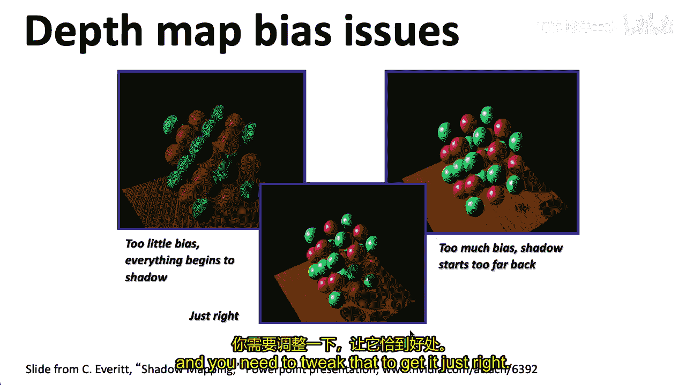

On the left here， they've artificially cranked down the resolution of the shadow map to emphasize that effect。

 But there are tricks you can do to try to smooth out these artifacts。

 None of them are particularly principled from a mathematical viewpoint and rather。

 one technique looks better than the other may depend on the circumstance。

 but there are some tricks you can do to help alleviate this effect。

 This is one issue that shadow volumes don't suffer from shadow volumes will give youote pixel perfect hard shadows if you want them。

 But in general， shadow volumes seem to be more computationally intensive than shadow mapping techniques。

 So they've gone out of style。

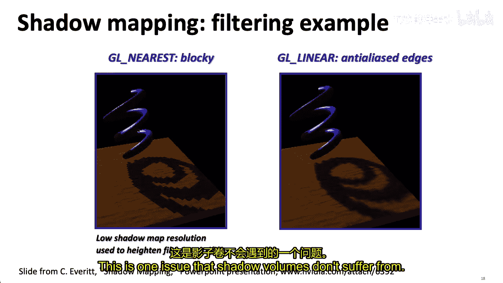

Finally， I would like to note that you can combine shadow mapping with the kind of slidehow projective texture effect we looked at last time to get some pretty cool effects。

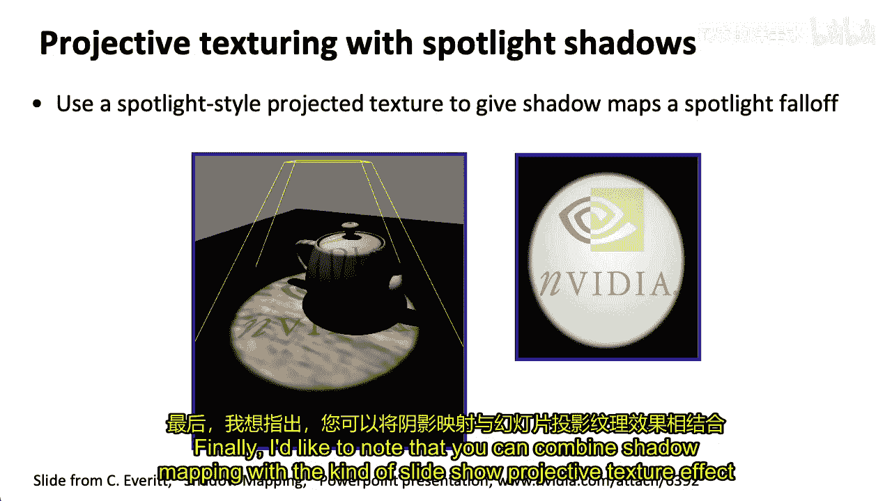

Now， if you're not one of my Georgia Tech students taking this class for credit。

 you can check out here， if you are one of my students。

 I want you to go on Canvas where you will find a video 27 quiz。

And your answer on this quiz will be just one word and that will give me an indication about your viewing habits of the lectures for this class。

 and your answer will be one of the names of the Beatles。

So I'm interested in your viewing habits of these lectures over the course of the semester。

 and I would like your honest opinion， I'm just going to collect some aggregate statistics。

 I'm not making any personal judgments here。So which of the following statements most accurately describes the way you generally approach the lectures this semester？

John， I eagerly watch them the day they're posted。Paul。

 I watched them within a couple of days after they are posted， sometimes watching a couple at a time。

 George， I'd wait for a few to pile up and then binge watch them at a convenient time。 Ringo。

 I'd watch them all in a panic the night before the homework was due。 So type John Paul。

 George Oringo， depending on which seems most accurate on average。 Again。

 I'm not making any personal judgments here。 I just want to get a feel for things。

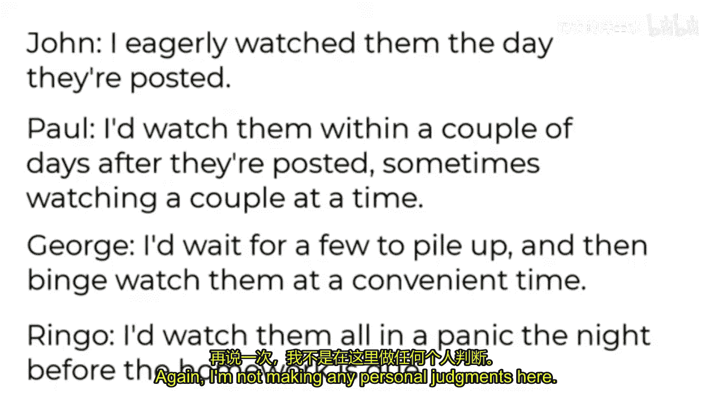